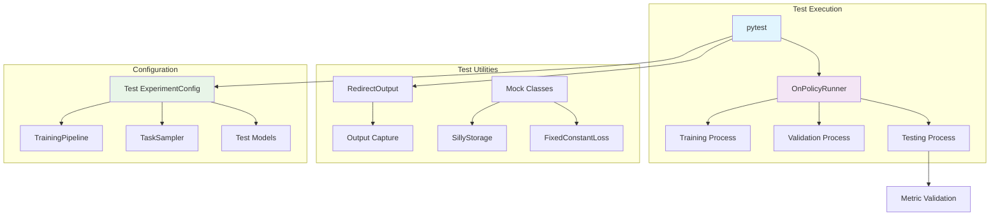
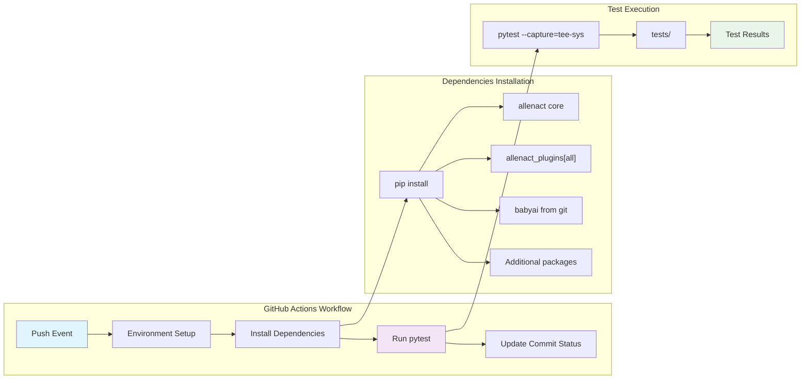
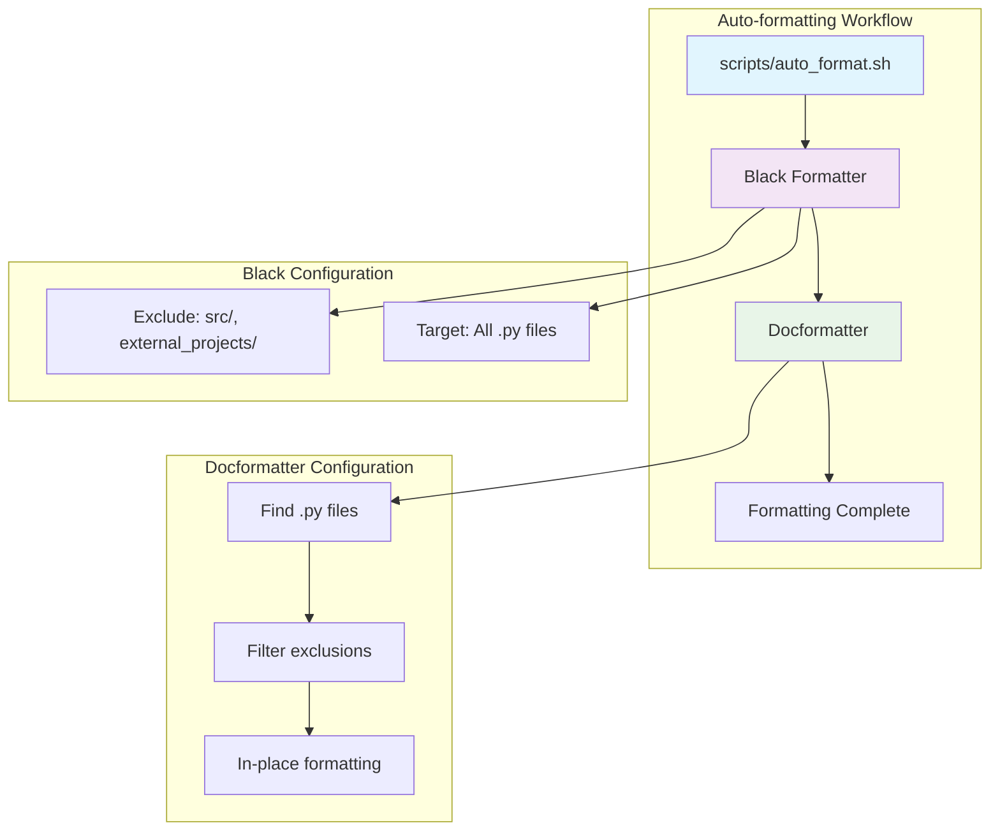
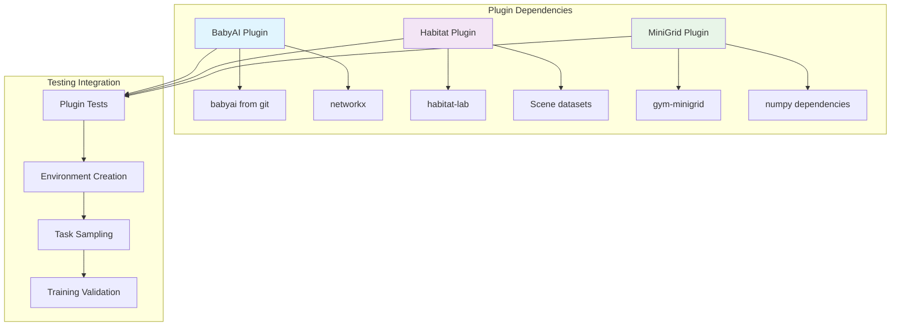

<!-- source: DeepWiki mcp.deepwiki.com · repo allenai/allenact · page 8 Development and Contributing · fetched 2026-10-26 -->

# Development and Contributing

Relevant source files

The following files were used as context for generating this wiki page:

- [.github/workflows/publish.yml](.github/workflows/publish.yml)
- [.github/workflows/pytest.yml](.github/workflows/pytest.yml)
- [.pre-commit-config.yaml](.pre-commit-config.yaml)
- [allenact_plugins/babyai_plugin/extra_requirements.txt](allenact_plugins/babyai_plugin/extra_requirements.txt)
- [allenact_plugins/habitat_plugin/habitat_constants.py](allenact_plugins/habitat_plugin/habitat_constants.py)
- [allenact_plugins/habitat_plugin/habitat_environment.py](allenact_plugins/habitat_plugin/habitat_environment.py)
- [allenact_plugins/habitat_plugin/habitat_preprocessors.py](allenact_plugins/habitat_plugin/habitat_preprocessors.py)
- [allenact_plugins/habitat_plugin/habitat_sensors.py](allenact_plugins/habitat_plugin/habitat_sensors.py)
- [allenact_plugins/habitat_plugin/habitat_task_samplers.py](allenact_plugins/habitat_plugin/habitat_task_samplers.py)
- [allenact_plugins/habitat_plugin/habitat_utils.py](allenact_plugins/habitat_plugin/habitat_utils.py)
- [allenact_plugins/minigrid_plugin/minigrid_models.py](allenact_plugins/minigrid_plugin/minigrid_models.py)
- [allenact_plugins/minigrid_plugin/minigrid_tasks.py](allenact_plugins/minigrid_plugin/minigrid_tasks.py)
- [conda/environment-dev.yml](conda/environment-dev.yml)
- [dev_requirements.txt](dev_requirements.txt)
- [mypy.ini](mypy.ini)
- [projects/tutorials/minigrid_tutorial_conds.py](projects/tutorials/minigrid_tutorial_conds.py)
- [scripts/auto_format.sh](scripts/auto_format.sh)
- [tests/hierarchical_policies/__init__.py](tests/hierarchical_policies/__init__.py)
- [tests/hierarchical_policies/test_minigrid_conditional.py](tests/hierarchical_policies/test_minigrid_conditional.py)
- [tests/sync_algs_cpu/test_to_to_obj_trains.py](tests/sync_algs_cpu/test_to_to_obj_trains.py)

This page provides comprehensive guidance for developers contributing to AllenAct, covering testing frameworks, continuous integration, development environment setup, and release processes. This documentation focuses on the technical infrastructure and workflows that support AllenAct development.

For information about running experiments and using the framework, see [Getting Started](#2). For details about the core training architecture, see [Core Training Architecture](#3).

## Testing Framework

AllenAct employs a comprehensive testing strategy using pytest as the primary testing framework. The test suite validates both core functionality and plugin integrations across different environments.

### Test Organization

The testing infrastructure is organized into several key areas:

**Core Algorithm Tests**: Located in `tests/sync_algs_cpu/`, these tests validate the core training algorithms. The `TestGoToObjTrains` class in [tests/sync_algs_cpu/test_to_to_obj_trains.py:261-374]() demonstrates a complete end-to-end training validation that:

- Creates a custom experiment configuration (`PPOBabyAIGoToObjTestExperimentConfig`)
- Runs training with `OnPolicyRunner` 
- Validates training metrics and checkpoint creation
- Executes testing with multiple checkpoints
- Verifies convergence criteria (success rate > 0.95)

**Hierarchical Policy Tests**: The [tests/hierarchical_policies/test_minigrid_conditional.py:177-220]() file tests complex policy architectures with conditional action distributions, validating both training and inference modes.

### Test Infrastructure Components

The testing framework utilizes several key components:

**Custom Test Classes**: Tests define specialized classes like `FixedConstantLoss` [tests/sync_algs_cpu/test_to_to_obj_trains.py:37-48]() and `SillyStorage` [tests/sync_algs_cpu/test_to_to_obj_trains.py:51-104]() to create controlled testing environments with predictable behavior.

**Output Redirection**: The `RedirectOutput` context manager [tests/sync_algs_cpu/test_to_to_obj_trains.py:220-258]() handles output capture for pytest compatibility, managing both stdout/stderr and pytest's capture systems.

Sources: [tests/sync_algs_cpu/test_to_to_obj_trains.py:1-375](), [tests/hierarchical_policies/test_minigrid_conditional.py:1-224]()

## CI/CD Pipeline

AllenAct uses GitHub Actions for continuous integration, automated testing, and package publishing. The pipeline ensures code quality and facilitates reliable releases.

### Automated Testing Workflow

The primary CI workflow is defined in [.github/workflows/pytest.yml:1-41]():

The workflow executes the following steps:
1. **Environment Setup**: Configures Python 3.9 environment
2. **Dependency Installation**: Installs core framework, plugins, and test dependencies
3. **Test Execution**: Runs pytest with output capture
4. **Status Updates**: Updates commit status badges regardless of test outcome

### Package Publishing Pipeline

The publishing workflow [.github/workflows/publish.yml:1-30]() handles automated package deployment:

- **Manual Trigger**: Uses `workflow_dispatch` for controlled releases
- **Multi-package Build**: Builds both `allenact` and `allenact_plugins` packages
- **PyPI Upload**: Uses Twine with token authentication for secure publishing

Sources: [.github/workflows/pytest.yml:1-41](), [.github/workflows/publish.yml:1-30]()

## Development Environment Setup

Setting up a development environment requires specific tooling and dependencies for code quality, testing, and documentation generation.

### Core Development Dependencies

The development requirements are specified in multiple files:

**Primary Development Tools** [dev_requirements.txt:1-14]():
- `black==24.2.0` - Code formatting
- `pytest` - Testing framework  
- `mypy` - Type checking
- `pre-commit` - Git hooks
- `mkdocs` and related packages - Documentation generation

**Conda Environment** [conda/environment-dev.yml:1-18]():
Provides additional tools including `docformatter`, `gitpython`, and `pydoc-markdown` for comprehensive development support.

### Code Quality Configuration

**Type Checking**: MyPy configuration [mypy.ini:1-10]() enforces type safety with Python 3.7 compatibility and lenient settings for demo code.

**Pre-commit Hooks**: The [.pre-commit-config.yaml:1-11]() configures automatic code formatting and type checking:
- Black formatting with Python 3.7
- MyPy type checking with import skipping

### Plugin-Specific Dependencies

Environment plugins have specialized requirements:

**BabyAI Plugin** [allenact_plugins/babyai_plugin/extra_requirements.txt:1-2]():
- Specific BabyAI commit from Lucaweihs fork
- NetworkX for graph algorithms

Sources: [dev_requirements.txt:1-14](), [conda/environment-dev.yml:1-18](), [mypy.ini:1-10](), [.pre-commit-config.yaml:1-11]()

## Code Quality and Formatting

AllenAct maintains consistent code quality through automated formatting and quality checks integrated into the development workflow.

### Automated Formatting Pipeline

The formatting process is managed by [scripts/auto_format.sh:1-15]():

**Black Formatting**: Applies consistent code formatting while excluding source and external project directories.

**Docstring Formatting**: Uses docformatter to standardize docstring formatting across the codebase with in-place modifications.

### Pre-commit Integration

The pre-commit configuration ensures quality checks run automatically:
- **Black Integration**: Enforces formatting standards before commits
- **MyPy Integration**: Validates type annotations with import skipping for external dependencies

Sources: [scripts/auto_format.sh:1-15](), [.pre-commit-config.yaml:1-11]()

## Plugin Development and Testing

AllenAct's plugin architecture requires specialized testing approaches to validate environment integrations and maintain compatibility across different simulation platforms.

### Environment Plugin Testing

Plugin tests validate integration with external simulators:

**MiniGrid Integration**: The [tests/hierarchical_policies/test_minigrid_conditional.py:30-176]() demonstrates comprehensive plugin testing with:
- Custom experiment configurations
- Conditional action distributions  
- Multi-stage training pipelines
- Expert policy validation

**Task Sampler Validation**: Tests verify proper task sampling behavior across different modes (train/valid/test) with deterministic and random sampling strategies.

### Plugin Dependency Management

Each plugin maintains its own requirements:

Sources: [tests/hierarchical_policies/test_minigrid_conditional.py:1-224](), [allenact_plugins/babyai_plugin/extra_requirements.txt:1-2]()

## Release Process and Package Management

AllenAct follows a structured release process that builds and publishes both core framework and plugin packages to PyPI.

### Multi-Package Architecture

The framework is distributed as two primary packages:
- **allenact**: Core framework functionality
- **allenact_plugins**: Environment-specific integrations

### Automated Release Workflow

The release process [.github/workflows/publish.yml:1-30]() implements:

1. **Manual Trigger**: Releases are initiated through GitHub's workflow dispatch
2. **Environment Setup**: Configures Python 3.7 environment for compatibility
3. **Build Process**: Executes `python scripts/release.py` to prepare distributions
4. **Secure Publishing**: Uses PyPI tokens for authenticated uploads via Twine

### Version Management

| Component | Purpose | Dependencies |
|-----------|---------|--------------|
| Core Release Script | `scripts/release.py` | Handles version bumping and package building |
| Twine Upload | Package publishing | Secure token-based authentication |
| Multi-package Support | Simultaneous release | Coordinates core and plugin versions |

Sources: [.github/workflows/publish.yml:1-30]()

## Contributing Guidelines

### Development Workflow

1. **Environment Setup**: Install development dependencies using `conda/environment-dev.yml` or `dev_requirements.txt`
2. **Code Quality**: Run `scripts/auto_format.sh` before committing changes
3. **Testing**: Execute `pytest tests/` to validate changes
4. **Pre-commit Hooks**: Install and configure pre-commit for automated quality checks

### Test Requirements

New contributions should include:
- **Unit Tests**: For new functionality using pytest framework
- **Integration Tests**: For plugin or cross-component features
- **Performance Tests**: For training algorithm modifications
- **Documentation**: Updated docstrings and markdown documentation

### Code Standards

- **Type Annotations**: Required for public APIs, validated by MyPy
- **Formatting**: Automatic Black formatting with consistent style
- **Documentation**: Comprehensive docstrings formatted by docformatter
- **Import Organization**: Clean imports following MyPy skip patterns for external dependencies

Sources: [dev_requirements.txt:1-14](), [scripts/auto_format.sh:1-15](), [tests/sync_algs_cpu/test_to_to_obj_trains.py:1-375]()

---

