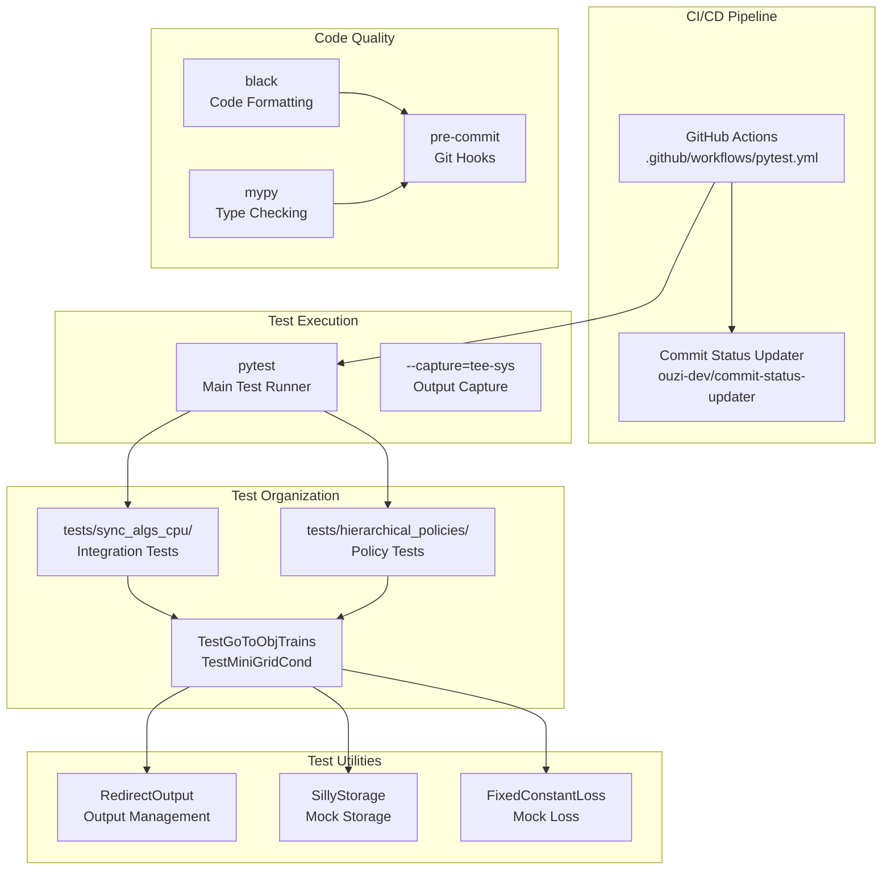
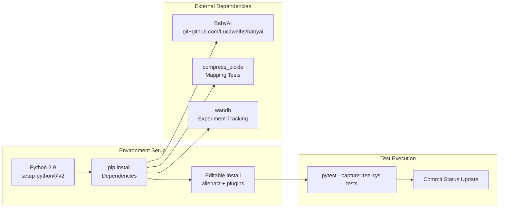
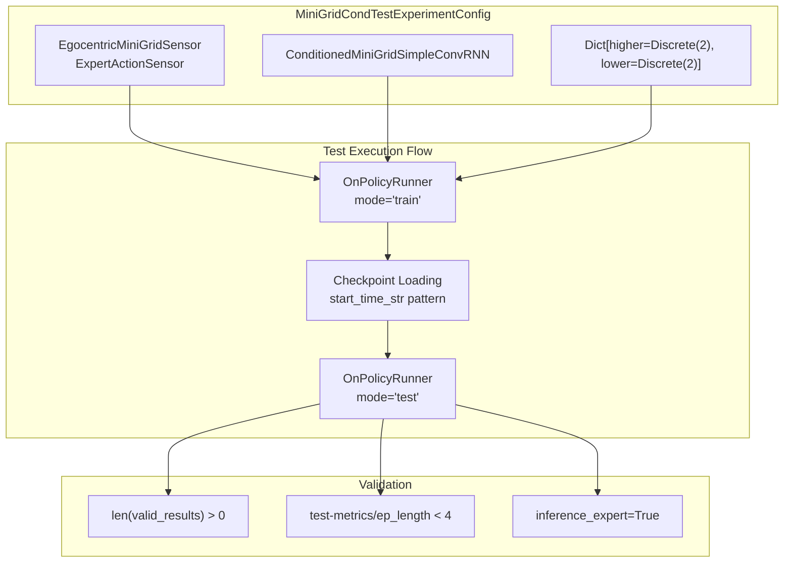
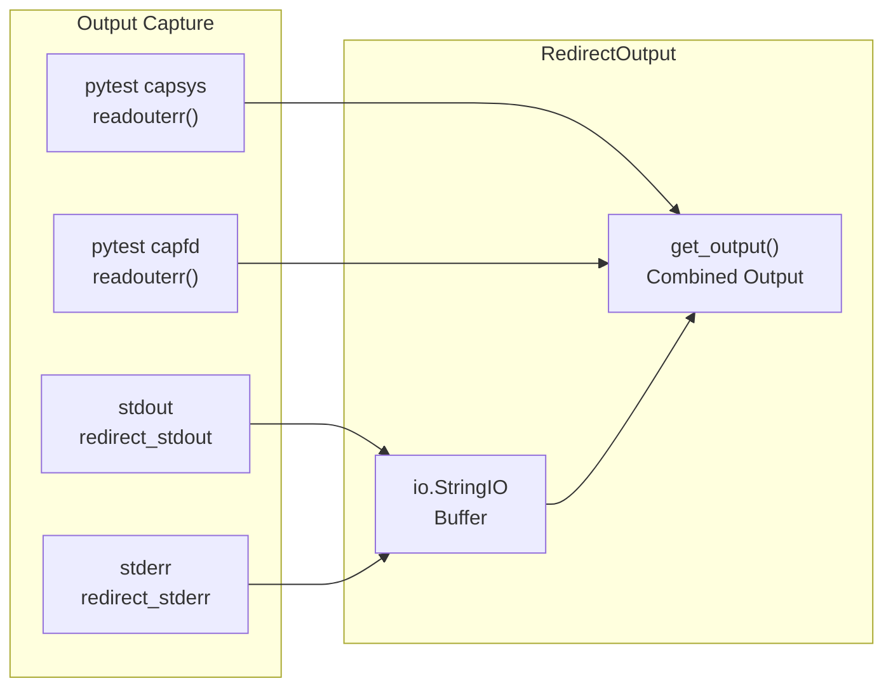

<!-- source: DeepWiki mcp.deepwiki.com · repo allenai/allenact · page 8.1 Testing Framework · fetched 2026-10-26 -->

# Testing Framework

<details>
<summary>Relevant source files</summary>

The following files were used as context for generating this wiki page:

- [.github/workflows/publish.yml](.github/workflows/publish.yml)
- [.github/workflows/pytest.yml](.github/workflows/pytest.yml)
- [.pre-commit-config.yaml](.pre-commit-config.yaml)
- [allenact_plugins/babyai_plugin/extra_requirements.txt](allenact_plugins/babyai_plugin/extra_requirements.txt)
- [allenact_plugins/habitat_plugin/habitat_constants.py](allenact_plugins/habitat_plugin/habitat_constants.py)
- [allenact_plugins/habitat_plugin/habitat_environment.py](allenact_plugins/habitat_plugin/habitat_environment.py)
- [allenact_plugins/habitat_plugin/habitat_preprocessors.py](allenact_plugins/habitat_plugin/habitat_preprocessors.py)
- [allenact_plugins/habitat_plugin/habitat_sensors.py](allenact_plugins/habitat_plugin/habitat_sensors.py)
- [allenact_plugins/habitat_plugin/habitat_task_samplers.py](allenact_plugins/habitat_plugin/habitat_task_samplers.py)
- [allenact_plugins/habitat_plugin/habitat_utils.py](allenact_plugins/habitat_plugin/habitat_utils.py)
- [allenact_plugins/minigrid_plugin/minigrid_models.py](allenact_plugins/minigrid_plugin/minigrid_models.py)
- [allenact_plugins/minigrid_plugin/minigrid_tasks.py](allenact_plugins/minigrid_plugin/minigrid_tasks.py)
- [conda/environment-dev.yml](conda/environment-dev.yml)
- [dev_requirements.txt](dev_requirements.txt)
- [mypy.ini](mypy.ini)
- [projects/tutorials/minigrid_tutorial_conds.py](projects/tutorials/minigrid_tutorial_conds.py)
- [scripts/auto_format.sh](scripts/auto_format.sh)
- [tests/hierarchical_policies/__init__.py](tests/hierarchical_policies/__init__.py)
- [tests/hierarchical_policies/test_minigrid_conditional.py](tests/hierarchical_policies/test_minigrid_conditional.py)
- [tests/sync_algs_cpu/test_to_to_obj_trains.py](tests/sync_algs_cpu/test_to_to_obj_trains.py)

</details>


## Purpose and Scope

This document covers AllenAct's comprehensive testing infrastructure, including the CI/CD pipeline, test organization, test utilities, and code quality tools. The testing framework ensures code reliability through automated testing, static analysis, and consistent code formatting.

For information about the core training system that these tests validate, see [Core Training Architecture](#3). For development workflows and contributing guidelines, see [Development and Contributing](#8).

## Testing Architecture Overview

AllenAct's testing framework consists of multiple layers working together to ensure code quality and functionality.

### Overall Testing Infrastructure



Sources: [.github/workflows/pytest.yml:1-41](), [tests/sync_algs_cpu/test_to_to_obj_trains.py:1-375](), [tests/hierarchical_policies/test_minigrid_conditional.py:1-224]()

## CI/CD Pipeline

### GitHub Actions Workflow

The primary CI pipeline is defined in `.github/workflows/pytest.yml` and executes on every push:

| Component | Configuration | Purpose |
|-----------|---------------|---------|
| **Python Version** | 3.9 | Standard runtime environment |
| **Test Runner** | `pytest --capture=tee-sys tests` | Execute all tests with output capture |
| **Dependencies** | pytest, wandb, allenact packages | Core testing and framework dependencies |
| **Status Updates** | `ouzi-dev/commit-status-updater` | GitHub commit status integration |

The workflow installs AllenAct in editable mode and includes plugin dependencies:

```bash
python -m pip install --editable="./allenact"
python -m pip install --editable="./allenact_plugins[all]"
```

Sources: [.github/workflows/pytest.yml:14-35]()

### Test Environment Setup



Sources: [.github/workflows/pytest.yml:18-31](), [allenact_plugins/babyai_plugin/extra_requirements.txt:1-2]()

## Test Types and Organization

### Integration Tests

#### OnPolicy Training Tests

The primary integration test is `TestGoToObjTrains` in [tests/sync_algs_cpu/test_to_to_obj_trains.py:261-370](), which validates the complete training pipeline:

| Test Component | Implementation | Validation |
|----------------|----------------|------------|
| **Training Config** | `PPOBabyAIGoToObjTestExperimentConfig` | Reduced-scale BabyAI experiment |
| **Training Runner** | `OnPolicyRunner(mode="train")` | Full training execution |
| **Test Runner** | `OnPolicyRunner(mode="test")` | Model evaluation |
| **Convergence Check** | `success > 0.95` | Training effectiveness |

#### Hierarchical Policy Tests

The `TestMiniGridCond` class tests conditional/hierarchical policies:



Sources: [tests/hierarchical_policies/test_minigrid_conditional.py:177-220](), [projects/tutorials/minigrid_tutorial_conds.py:354-498]()

### Custom Test Utilities

#### Mock Components for Testing

The testing framework includes several mock components for isolation:

| Component | Purpose | Key Features |
|-----------|---------|--------------|
| **`SillyStorage`** | Mock experience storage | Implements `ExperienceStorage` and `StreamingStorageMixin` |
| **`FixedConstantLoss`** | Deterministic loss function | Returns constant value for predictable testing |
| **`AverageBatchValueLoss`** | Simple batch aggregation loss | Tests generic loss interface |

```python
# Example from SillyStorage implementation
class SillyStorage(ExperienceStorage, StreamingStorageMixin):
    def next_batch(self) -> Dict[str, Any]:
        return {
            "value": torch.tensor([self.values_to_return[self.index]] * self.repeats[self.index])
        }
```

Sources: [tests/sync_algs_cpu/test_to_to_obj_trains.py:51-124]()

#### Output Management

The `RedirectOutput` context manager handles output capture in test environments:



Sources: [tests/sync_algs_cpu/test_to_to_obj_trains.py:218-259]()

## Test Configuration and Validation

### Test-Specific Experiment Configs

Test experiments use reduced configurations for faster execution:

| Configuration Aspect | Production | Test Override |
|----------------------|------------|---------------|
| **Training Steps** | `TOTAL_RL_TRAIN_STEPS` | Inherited (reduced) |
| **Validation Processes** | Multiple | `nprocesses=1` |
| **Checkpoint Saving** | Standard interval | `NUM_CKPTS_TO_SAVE = 2` |
| **Pipeline Stages** | Full complexity | Simplified with mock components |

### Metrics Validation

Tests validate both training metrics and convergence:

```python
# Training metrics validation
assert train_metrics["global_batch_size"] == 256

# Validation metrics validation  
assert valid_metrics["3_loss/3_loss"] == 3
assert valid_metrics["new_tasks_completed"] == cfg.NUM_TEST_TASKS

# Convergence validation
assert tr["test-metrics/success"] > 0.95
```

Sources: [tests/sync_algs_cpu/test_to_to_obj_trains.py:312-359]()

## Running Tests

### Local Test Execution

| Command | Purpose | Scope |
|---------|---------|-------|
| `pytest tests/` | Run all tests | Complete test suite |
| `pytest tests/sync_algs_cpu/` | Integration tests | Core training validation |
| `pytest tests/hierarchical_policies/` | Policy tests | Hierarchical model validation |
| `pytest --capture=tee-sys` | Capture output | Match CI behavior |

### Development Dependencies

Core testing dependencies are defined in multiple files:

```yaml
# conda/environment-dev.yml
dependencies:
  - pytest>=6.1.1
  - mypy
  - black>=24.2.0
  - pre-commit
```

Sources: [conda/environment-dev.yml:14](), [dev_requirements.txt:6]()

## Code Quality and Formatting

### Automated Formatting

The `scripts/auto_format.sh` script provides consistent code formatting:

```bash
# Black formatting (excluding external projects)
black . --exclude src --exclude external_projects

# Docstring formatting
find . -name "*.py" | grep -v ^./src | xargs docformatter --in-place -r
```

### Pre-commit Hooks

Pre-commit configuration ensures code quality before commits:

| Hook | Tool | Configuration |
|------|------|---------------|
| **Code Formatting** | `black` | Python 3.7 compatibility |
| **Type Checking** | `mypy` | `--follow-imports=skip` |
| **Git Integration** | `pre-commit` | Automated on commit |

Sources: [scripts/auto_format.sh:6-12](), [.pre-commit-config.yaml:2-11](), [mypy.ini:1-10]()

### Type Checking Configuration

MyPy configuration emphasizes practical type safety:

```ini
[mypy]
python_version = 3.7
follow_imports = skip
ignore_missing_imports = True
strict_optional = False
```

Sources: [mypy.ini:1-6]()

---

