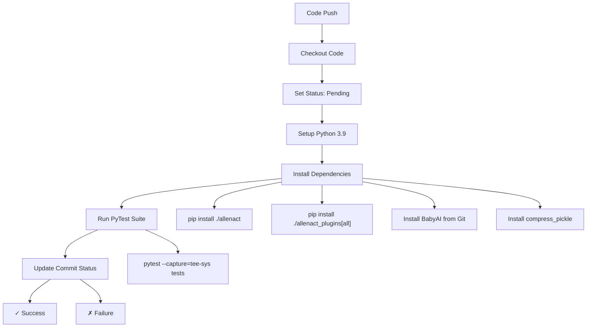
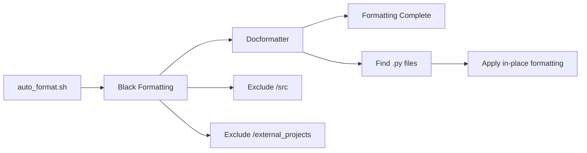
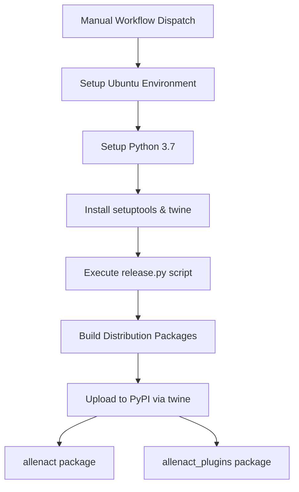

<!-- source: DeepWiki mcp.deepwiki.com · repo allenai/allenact · page 8.2 CI/CD and Release Process · fetched 2026-10-26 -->

# CI/CD and Release Process

Relevant source files

The following files were used as context for generating this wiki page:

- [.github/workflows/publish.yml](.github/workflows/publish.yml)
- [.github/workflows/pytest.yml](.github/workflows/pytest.yml)
- [.pre-commit-config.yaml](.pre-commit-config.yaml)
- [allenact_plugins/babyai_plugin/extra_requirements.txt](allenact_plugins/babyai_plugin/extra_requirements.txt)
- [allenact_plugins/habitat_plugin/habitat_constants.py](allenact_plugins/habitat_plugin/habitat_constants.py)
- [allenact_plugins/habitat_plugin/habitat_preprocessors.py](allenact_plugins/habitat_plugin/habitat_preprocessors.py)
- [allenact_plugins/habitat_plugin/habitat_utils.py](allenact_plugins/habitat_plugin/habitat_utils.py)
- [conda/environment-dev.yml](conda/environment-dev.yml)
- [dev_requirements.txt](dev_requirements.txt)
- [mypy.ini](mypy.ini)
- [scripts/auto_format.sh](scripts/auto_format.sh)

This document covers the continuous integration, continuous deployment, and release processes for the AllenAct framework. It explains how code changes are automatically tested, validated, and eventually published as packages. For information about the testing framework itself, see [Testing Framework](#8.1). For documentation system details, see [Documentation System](#8.3).

## Continuous Integration Pipeline

AllenAct uses GitHub Actions for automated testing and validation of all code changes. The primary CI workflow is triggered on every push to the repository and ensures code quality through comprehensive testing.

### Primary CI Workflow

The main CI pipeline is defined in [.github/workflows/pytest.yml:1-41]() and executes the following stages:

**Key Dependencies Installation**

The CI process installs both core and plugin packages in editable mode:
- Core framework: `pip install --editable="./allenact"`
- All plugins: `pip install --editable="./allenact_plugins[all]"`
- External dependency: BabyAI from specific commit [.github/workflows/pytest.yml:29]()

Sources: [.github/workflows/pytest.yml:1-41]()

### Commit Status Integration

The workflow uses `ouzi-dev/commit-status-updater` to provide real-time feedback on commit status, updating GitHub's commit status badges to show pending, success, or failure states [.github/workflows/pytest.yml:16-17](), [.github/workflows/pytest.yml:37-40]().

Sources: [.github/workflows/pytest.yml:16-17](), [.github/workflows/pytest.yml:37-40]()

## Code Quality and Formatting

AllenAct enforces consistent code quality through automated formatting and type checking tools integrated into both the development workflow and CI pipeline.

### Pre-commit Hooks

Pre-commit hooks are configured in [.pre-commit-config.yaml:1-11]() to automatically run quality checks before commits:

| Tool | Purpose | Version |
|------|---------|---------|
| Black | Code formatting | 19.10b0 |
| MyPy | Static type checking | v0.761 |

The hooks run with specific configurations:
- Black uses Python 3.7 language version
- MyPy follows imports skip mode and specific argument flags

### Automated Formatting Script

The [scripts/auto_format.sh:1-15]() script provides comprehensive code formatting:

**Exclusions**: The script specifically excludes `src` and `external_projects` directories, as well as `used_configs` from formatting operations.

Sources: [.pre-commit-config.yaml:1-11](), [scripts/auto_format.sh:1-15]()

### Type Checking Configuration

MyPy configuration is defined in [mypy.ini:1-10]() with the following settings:

- Python version: 3.7
- Follow imports: skip
- Ignore missing imports: True
- Strict optional: False
- Demo modules are ignored for type checking

Sources: [mypy.ini:1-10]()

## Development Environment Setup

AllenAct provides comprehensive development environment configurations supporting both pip and conda-based workflows.

### Development Dependencies

Core development tools are specified in [dev_requirements.txt:1-14]():

| Category | Tools |
|----------|-------|
| Code Quality | black==24.2.0, mypy, pre-commit |
| Documentation | mkdocs==1.1.2, mkdocs-material==5.5.3, pydoc-markdown==3.4.0 |
| Testing | pytest, compress-pickle==1.2.0 |
| Formatting | docformatter==1.3.1, docstr-coverage==1.2.0 |

### Conda Environment

The conda development environment is defined in [conda/environment-dev.yml:1-18]() and includes:

- All core development tools from multiple channels (defaults, conda-forge)
- Specific versions for critical tools like black>=24.2.0
- Additional pip-based packages for documentation generation

Sources: [dev_requirements.txt:1-14](), [conda/environment-dev.yml:1-18]()

## Release and Publishing Process

AllenAct uses a manual release process through GitHub Actions to publish packages to PyPI. This ensures controlled releases with proper validation.

### Publishing Workflow

The publishing pipeline is defined in [.github/workflows/publish.yml:1-30]() and follows this process:

**Key Release Components**:

- **Trigger**: Manual workflow dispatch (on-demand releases)
- **Build Script**: `python scripts/release.py` handles package preparation
- **Authentication**: Uses PyPI token stored in GitHub secrets (`PYPI_PASSWORD`)
- **Upload Tool**: Twine with token-based authentication (`twine upload -u __token__`)

### Package Structure

The release process handles two main packages:
1. **allenact**: Core framework package
2. **allenact_plugins**: Environment-specific plugins package

Both packages are built and uploaded simultaneously during the release process.

Sources: [.github/workflows/publish.yml:1-30]()

### Plugin-Specific Requirements

Individual plugins may have additional requirements defined in separate files, such as [allenact_plugins/babyai_plugin/extra_requirements.txt:1-2]() which specifies:
- BabyAI from specific Git commit
- Additional dependencies like networkx

Sources: [allenact_plugins/babyai_plugin/extra_requirements.txt:1-2]()

## Testing Integration

The CI/CD pipeline integrates closely with AllenAct's testing framework, executing the full test suite on every code change. Tests are run using pytest with specific capture settings [.github/workflows/pytest.yml:35]() to ensure comprehensive output logging.

The testing process includes:
- Unit tests for core functionality
- Integration tests for plugin systems
- Environment-specific tests requiring external dependencies
- Mapping tests requiring compress_pickle dependency

Sources: [.github/workflows/pytest.yml:35](), [.github/workflows/pytest.yml:30]()

---

