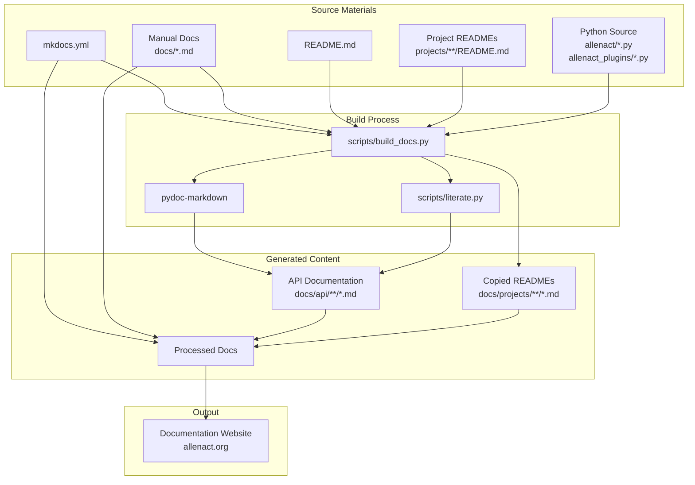
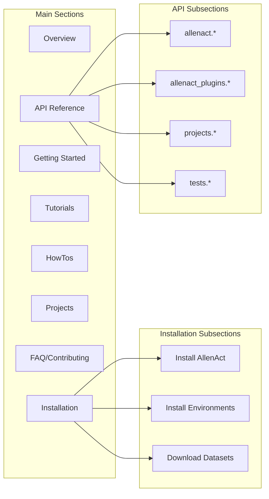
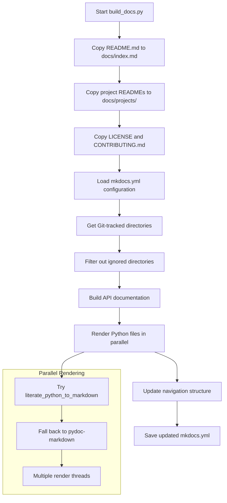
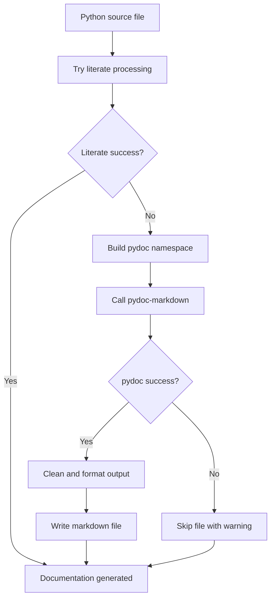
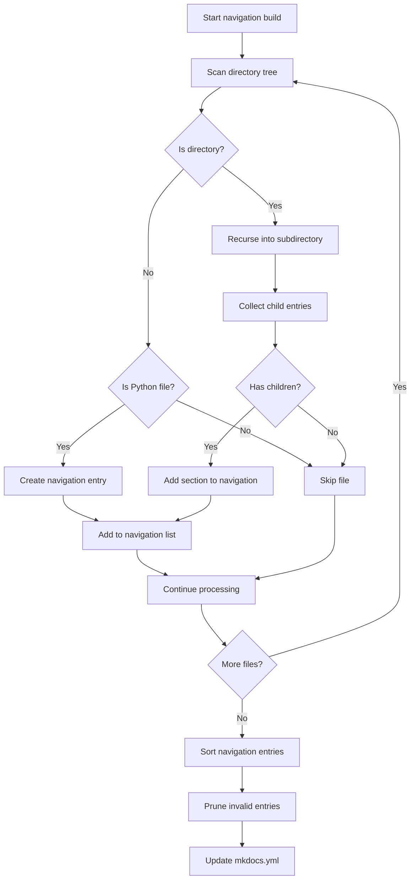

<!-- source: DeepWiki mcp.deepwiki.com · repo allenai/allenact · page 8.3 Documentation System · fetched 2026-10-26 -->

# Documentation System

<details>
<summary>Relevant source files</summary>

The following files were used as context for generating this wiki page:

- [README.md](README.md)
- [docs/img/AI2_Logo_Square_Gradients_crop.png](docs/img/AI2_Logo_Square_Gradients_crop.png)
- [docs/img/PRIORLogoBlackEmbedded.png](docs/img/PRIORLogoBlackEmbedded.png)
- [mkdocs.yml](mkdocs.yml)
- [scripts/build_docs.py](scripts/build_docs.py)

</details>


This document covers AllenAct's documentation infrastructure, including the MkDocs-based website generation, automated API documentation building, and the build processes that transform source code and markdown files into the published documentation website.

For information about the testing framework, see [Testing Framework](#8.1). For details about the CI/CD pipeline that deploys documentation, see [CI/CD and Release Process](#8.2).

## Documentation Architecture Overview

AllenAct uses a sophisticated documentation system built on MkDocs with automated API documentation generation. The system transforms both hand-written markdown files and Python source code into a comprehensive documentation website.



Sources: [mkdocs.yml:1-353](), [scripts/build_docs.py:1-357]()

## MkDocs Configuration

The documentation system is configured through `mkdocs.yml`, which defines the site structure, theme, and build settings.

### Site Configuration

| Setting | Value | Purpose |
|---------|--------|---------|
| **Theme** | Material | Modern, responsive documentation theme |
| **Site URL** | https://allenact.org | Primary documentation website |
| **Repository** | allenai/allenact | GitHub integration for source links |
| **Analytics** | UA-120916510-8 | Google Analytics tracking |

### Theme Customization

The Material theme is customized with:
- **Logo**: AI2 Avatar (white version for dark backgrounds)
- **Favicon**: AllenAct logo
- **Color Scheme**: Blue primary, grey accent
- **Code Highlighting**: Python and TypeScript support
- **Custom CSS**: Additional styling in `css/extra.css`

Sources: [mkdocs.yml:5-21]()

### Navigation Structure

The documentation follows a hierarchical structure defined in the `nav` section:



Sources: [mkdocs.yml:28-338]()

## Documentation Build Process

The build process is orchestrated by `scripts/build_docs.py`, which automates the generation of API documentation and organization of content.

### Build Script Workflow



Sources: [scripts/build_docs.py:254-354]()

### File Processing Logic

The build script implements sophisticated logic for processing different types of files:

#### Excluded Files
Files automatically excluded from documentation generation:
- `.DS_Store`, `__init__.py`, `README.md`
- `version.py`, `run.py`, `setup.py`, `main.py`

#### Directory Filtering
Directories excluded from processing:
- `docs`, `scripts`, `experiments`, `src`
- `.pip_src`, `dist`, `build`
- Non-Git-tracked directories

Sources: [scripts/build_docs.py:34-43](), [scripts/build_docs.py:309-324]()

## API Documentation Generation

The system supports two methods for generating API documentation from Python source files:

### Literate Programming Support

The `literate_python_to_markdown()` function attempts to process files as literate documentation first, allowing for embedded markdown within Python files.

### PyDoc-Markdown Generation

When literate processing fails, the system falls back to `pydoc-markdown` with the following configuration:

```python
pydoc_config = {
    'renderer': {
        'type': 'markdown',
        'code_headers': True,
        'descriptive_class_title': False,
        'add_method_class_prefix': True,
        'source_linker': {'type': 'github', 'repo': 'allenai/allenact'},
        'header_level_by_type': {
            'Module': 1,
            'Class': 2,
            'Method': 3,
            'Function': 3,
            'Data': 3,
        }
    }
}
```

This configuration ensures consistent formatting and proper GitHub source linking for all generated API documentation.

Sources: [scripts/build_docs.py:77-92](), [scripts/build_docs.py:56-66]()

### Rendering Process

The `render_file()` function handles the actual documentation generation:



Sources: [scripts/build_docs.py:46-121]()

## Parallel Processing and Performance

The build system uses threading to process multiple files simultaneously:

### Thread Management
- **Thread Creation**: One thread per Python file
- **Thread Coordination**: All threads joined before proceeding
- **Error Handling**: Individual file failures don't stop the build

### Performance Optimizations
- **Parallel Processing**: Multiple files processed simultaneously
- **Smart Filtering**: Only Git-tracked files are processed
- **Incremental Updates**: Navigation structure updated after all files processed

Sources: [scripts/build_docs.py:134-137](), [scripts/build_docs.py:336-337]()

## Navigation Structure Generation

The build script dynamically generates the API section navigation based on the discovered Python modules:

### Navigation Building Algorithm



Sources: [scripts/build_docs.py:142-194](), [scripts/build_docs.py:230-252]()

### Project README Integration

Project README files are automatically discovered and integrated into the documentation structure:

1. **Discovery**: Find all `README.md` files in `projects/` subdirectories
2. **Copy**: Copy to `docs/projects/` maintaining directory structure  
3. **Navigation**: Build nested navigation structure matching directory hierarchy

Sources: [scripts/build_docs.py:264-270](), [scripts/build_docs.py:197-227]()

## Build Output and File Organization

The documentation build produces a structured output in the `docs/` directory:

### Generated Directory Structure

| Path | Content | Source |
|------|---------|---------|
| `docs/index.md` | Main landing page | `README.md` |
| `docs/api/` | Auto-generated API docs | Python source files |
| `docs/projects/` | Project documentation | `projects/**/README.md` |
| `docs/LICENSE.md` | License information | `LICENSE` |
| `docs/CONTRIBUTING.md` | Contribution guidelines | `CONTRIBUTING.md` |

### File Naming Conventions

- **API Files**: `{module_name}.md` (e.g., `experiment_config.md`)
- **Navigation Paths**: `api/{relative_path}/{filename}.md`
- **Project Files**: `projects/{project_path}/README.md`

Sources: [scripts/build_docs.py:128-132](), [scripts/build_docs.py:272-276]()

---

