<!-- source: DeepWiki mcp.deepwiki.com · repo allenai/allenact · page 9 API Reference · fetched 2026-10-26 -->

# API Reference

Relevant source files

The following files were used as context for generating this wiki page:

- [allenact/algorithms/offpolicy_sync/losses/abstract_offpolicy_loss.py](allenact/algorithms/offpolicy_sync/losses/abstract_offpolicy_loss.py)
- [allenact/algorithms/onpolicy_sync/losses/a2cacktr.py](allenact/algorithms/onpolicy_sync/losses/a2cacktr.py)
- [allenact/algorithms/onpolicy_sync/losses/abstract_loss.py](allenact/algorithms/onpolicy_sync/losses/abstract_loss.py)
- [allenact/algorithms/onpolicy_sync/losses/imitation.py](allenact/algorithms/onpolicy_sync/losses/imitation.py)
- [allenact/algorithms/onpolicy_sync/losses/ppo.py](allenact/algorithms/onpolicy_sync/losses/ppo.py)
- [allenact/algorithms/onpolicy_sync/misc.py](allenact/algorithms/onpolicy_sync/misc.py)
- [allenact/base_abstractions/distributions.py](allenact/base_abstractions/distributions.py)
- [allenact/base_abstractions/misc.py](allenact/base_abstractions/misc.py)
- [allenact/base_abstractions/sensor.py](allenact/base_abstractions/sensor.py)
- [allenact/embodiedai/storage/vdr_storage.py](allenact/embodiedai/storage/vdr_storage.py)
- [allenact/utils/spaces_utils.py](allenact/utils/spaces_utils.py)
- [allenact/utils/system.py](allenact/utils/system.py)
- [allenact_plugins/minigrid_plugin/__init__.py](allenact_plugins/minigrid_plugin/__init__.py)
- [docs/getting_started/abstractions.md](docs/getting_started/abstractions.md)
- [docs/getting_started/running-your-first-experiment.md](docs/getting_started/running-your-first-experiment.md)
- [docs/getting_started/structure.md](docs/getting_started/structure.md)
- [docs/howtos/changing-rewards-and-losses.md](docs/howtos/changing-rewards-and-losses.md)
- [docs/howtos/defining-a-new-model.md](docs/howtos/defining-a-new-model.md)
- [docs/howtos/defining-a-new-task.md](docs/howtos/defining-a-new-task.md)
- [docs/howtos/defining-an-experiment.md](docs/howtos/defining-an-experiment.md)
- [tests/mapping/test_ai2thor_mapping.py](tests/mapping/test_ai2thor_mapping.py)

This section provides detailed API documentation for AllenAct's core classes, functions, and abstractions. It covers the fundamental building blocks that developers use when implementing experiments, models, and training pipelines in AllenAct.

For information about setting up experiments and training pipelines, see [Experiment Configuration](#4). For tutorials on using these APIs in practice, see [Tutorials](#7).

## Core Abstractions Overview

AllenAct's architecture is built around several key abstractions that work together to enable embodied AI research. The following diagram shows the primary abstractions and their relationships:

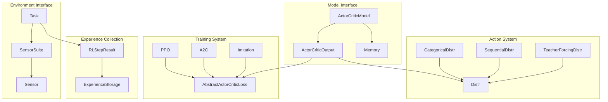

Sources: [allenact/base_abstractions/distributions.py:22-45](), [allenact/base_abstractions/sensor.py:38-52](), [allenact/base_abstractions/misc.py:55-79](), [allenact/algorithms/onpolicy_sync/losses/abstract_loss.py:13-15]()

## Action Distributions and Policies

AllenAct provides a comprehensive system for representing action distributions that extends PyTorch's distribution classes. The distribution hierarchy supports both simple discrete actions and complex hierarchical action spaces.

### Distribution Hierarchy

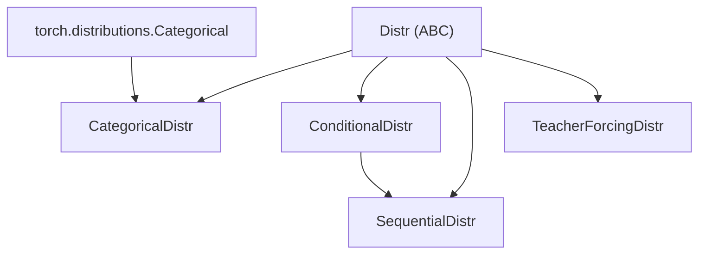

Sources: [allenact/base_abstractions/distributions.py:22-44](), [allenact/base_abstractions/distributions.py:46-82](), [allenact/base_abstractions/distributions.py:83-153]()

### Core Distribution Classes

| Class | Purpose | Key Methods |
|-------|---------|-------------|
| `Distr` | Abstract base for all distributions | `log_prob()`, `entropy()`, `sample()`, `mode()` |
| `CategoricalDistr` | Discrete action distributions | Extends PyTorch Categorical with broadcasting control |
| `ConditionalDistr` | Actions conditioned on previous actions | `condition_on_input()`, `reset()` |
| `SequentialDistr` | Sequential action sampling | Manages multiple conditional distributions |
| `TeacherForcingDistr` | Teacher forcing wrapper | `enforce()` for expert action enforcement |

#### CategoricalDistr

The `CategoricalDistr` class extends PyTorch's `Categorical` distribution with additional safety checks and shape handling. It prevents unexpected broadcasting behavior that can occur with the standard PyTorch implementation.

Key features:
- **Shape validation**: Enforces explicit shape requirements for action tensors [allenact/base_abstractions/distributions.py:56-72]()
- **Mode computation**: Provides deterministic action selection via `mode()` [allenact/base_abstractions/distributions.py:53-54]()
- **Lazy properties**: Efficient computation of log probabilities and probabilities [allenact/base_abstractions/distributions.py:74-80]()

#### Sequential and Conditional Distributions

For complex action spaces requiring multiple sequential decisions, AllenAct provides `SequentialDistr` and `ConditionalDistr`:

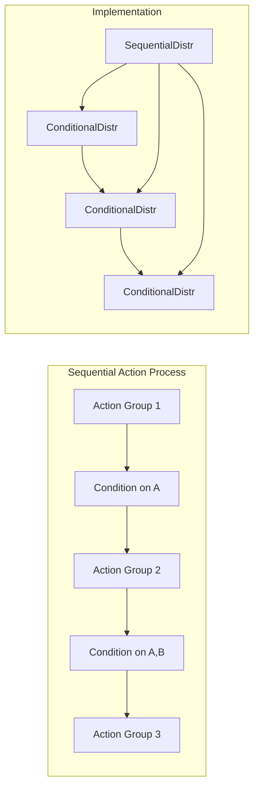

Sources: [allenact/base_abstractions/distributions.py:155-210](), [allenact/base_abstractions/distributions.py:83-153]()

#### Teacher Forcing

The `TeacherForcingDistr` enables training with expert demonstrations by probabilistically replacing sampled actions with expert actions:

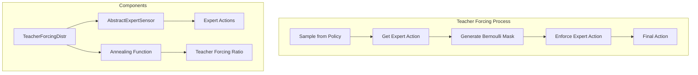

Sources: [allenact/base_abstractions/distributions.py:216-351](), [allenact/base_abstractions/sensor.py:137-408]()

## Sensor System

Sensors provide the interface between environments and agents, extracting observations that models can process. AllenAct's sensor system supports both environment observations (like RGB images) and task-specific information (like goal specifications).

### Sensor Architecture

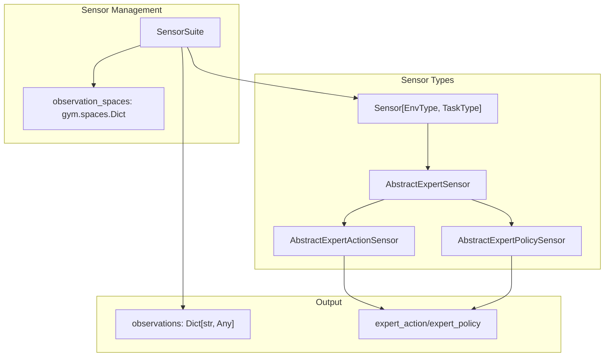

Sources: [allenact/base_abstractions/sensor.py:38-135](), [allenact/base_abstractions/sensor.py:137-408]()

### Core Sensor Classes

| Class | Purpose | Key Attributes |
|-------|---------|----------------|
| `Sensor` | Base sensor interface | `uuid`, `observation_space`, `get_observation()` |
| `SensorSuite` | Manages collections of sensors | `sensors`, `observation_spaces` |
| `AbstractExpertSensor` | Base for expert sensors | `ACTION_POLICY_LABEL`, `EXPERT_SUCCESS_LABEL` |

#### Sensor Implementation

Each sensor must implement:
- **UUID identification**: Unique string identifier [allenact/base_abstractions/sensor.py:45-51]()
- **Observation space**: `gym.Space` defining the output format [allenact/base_abstractions/sensor.py:51]()
- **Observation method**: `get_observation()` that extracts data from environment/task [allenact/base_abstractions/sensor.py:57-71]()

#### Expert Sensors

Expert sensors provide ground-truth actions or policies for imitation learning:

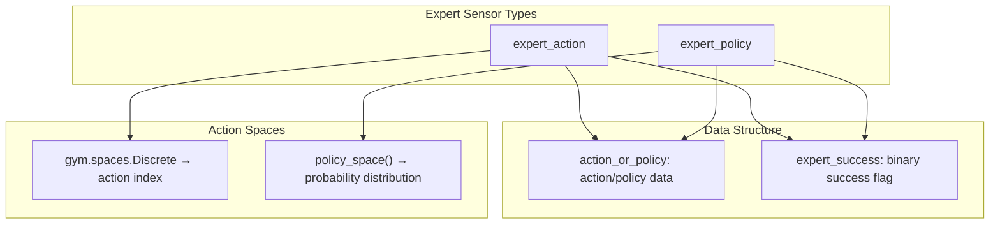

Sources: [allenact/base_abstractions/sensor.py:327-408](), [allenact/utils/spaces_utils.py:177-219]()

## Memory Management

AllenAct provides a flexible memory system for managing recurrent model states and sharing computation across losses during training.

### Memory System Architecture

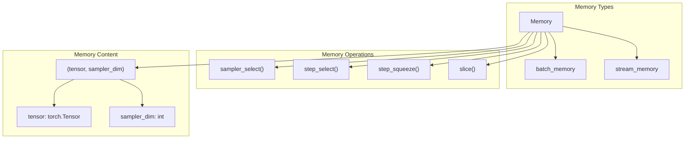

Sources: [allenact/base_abstractions/misc.py:81-352]()

### Memory Usage Patterns

The `Memory` class supports two primary usage patterns:

1. **Batch Memory**: Shared computation within a single training batch [allenact/base_abstractions/misc.py:386-402]()
2. **Stream Memory**: Persistent state across batches (e.g., RNN hidden states) [allenact/base_abstractions/misc.py:404-414]()

Key operations:
- **Tensor management**: Store and retrieve tensors with associated sampler dimensions [allenact/base_abstractions/misc.py:146-172]()
- **Indexing**: Select specific samplers or time steps [allenact/base_abstractions/misc.py:174-284]()
- **Device management**: Move memory to different devices [allenact/base_abstractions/misc.py:346-351]()

## Training Losses

AllenAct implements several standard reinforcement learning and imitation learning losses. All losses inherit from `AbstractActorCriticLoss` and operate on batched experience data.

### Loss System Architecture

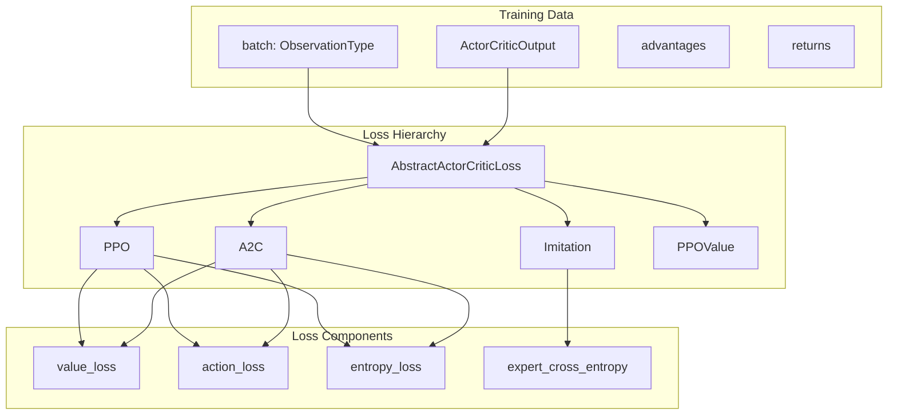

Sources: [allenact/algorithms/onpolicy_sync/losses/abstract_loss.py:13-51](), [allenact/algorithms/onpolicy_sync/losses/ppo.py:15-164](), [allenact/algorithms/onpolicy_sync/losses/a2cacktr.py:16-178]()

### Loss Implementation Details

| Loss Class | Purpose | Key Parameters |
|------------|---------|----------------|
| `PPO` | Proximal Policy Optimization | `clip_param`, `value_loss_coef`, `entropy_coef` |
| `A2C` | Advantage Actor-Critic | `value_loss_coef`, `entropy_coef` |
| `Imitation` | Expert imitation learning | `expert_sensor` |

#### PPO Loss Components

The PPO implementation includes several sophisticated features:

- **Ratio clipping**: Prevents large policy updates [allenact/algorithms/onpolicy_sync/losses/ppo.py:89-97]()
- **Value function clipping**: Optional clipping of value loss [allenact/algorithms/onpolicy_sync/losses/ppo.py:99-109]()
- **Advantage normalization**: Supports both normalized and unnormalized advantages [allenact/algorithms/onpolicy_sync/losses/ppo.py:57-60]()
- **Entropy regularization**: Encourages exploration through entropy bonus [allenact/algorithms/onpolicy_sync/losses/ppo.py:116]()

#### Imitation Learning

The `Imitation` loss supports both action-based and policy-based expert supervision:

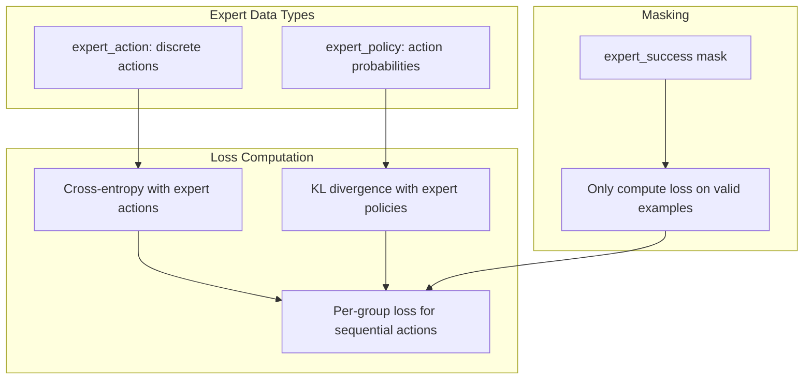

Sources: [allenact/algorithms/onpolicy_sync/losses/imitation.py:23-214]()

## Utility Functions and Space Handling

AllenAct provides extensive utilities for working with `gym.Space` objects and converting between different data formats.

### Space Utilities

The `spaces_utils` module provides functions for manipulating observation and action spaces:

| Function | Purpose | Input/Output |
|----------|---------|--------------|
| `flatdim()` | Get flattened dimension count | `gym.Space → int` |
| `flatten()` | Flatten space data | `(gym.Space, torch.Tensor) → torch.Tensor` |
| `unflatten()` | Restore original structure | `(gym.Space, torch.Tensor) → structured data` |
| `policy_space()` | Convert action space to policy space | `gym.Space → gym.Space` |

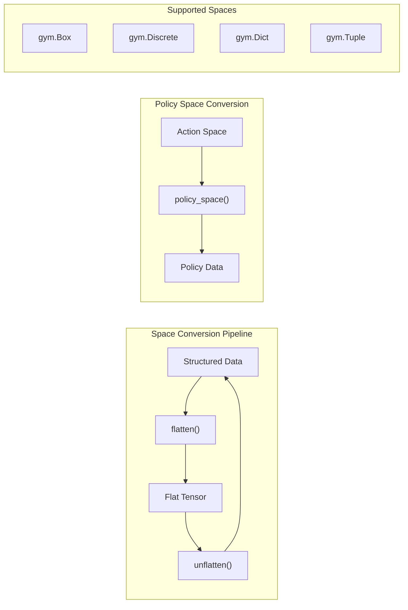

Sources: [allenact/utils/spaces_utils.py:16-243]()

### System Utilities

The system utilities provide logging, device management, and other infrastructure support:

- **Logging system**: Colored, configurable logging with multiprocessing support [allenact/utils/system.py:64-188]()
- **Port finding**: Automatic free port detection for distributed training [allenact/utils/system.py:118-129]()
- **Import checking**: Graceful handling of optional dependencies [allenact/utils/system.py:229-239]()

## Model Interface and Actor-Critic Output

All models in AllenAct must implement the `ActorCriticModel` interface, which standardizes how models process observations and produce action distributions and value estimates.

### ActorCriticOutput Structure

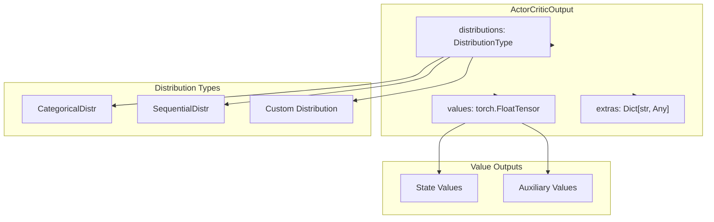

Sources: [allenact/base_abstractions/misc.py:55-79]()

The `ActorCriticOutput` serves as the standardized interface between models and the training system, ensuring consistent handling of policy outputs across different model architectures and action spaces.

---

