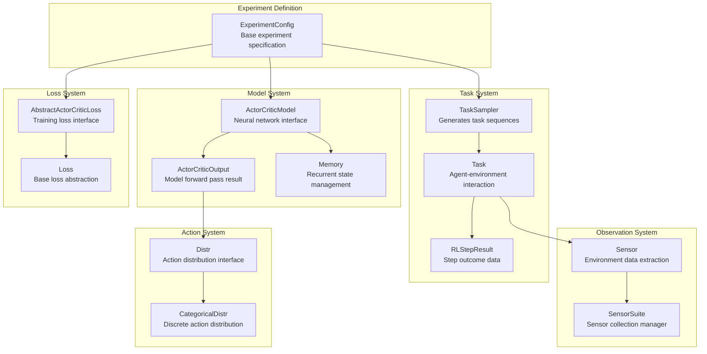
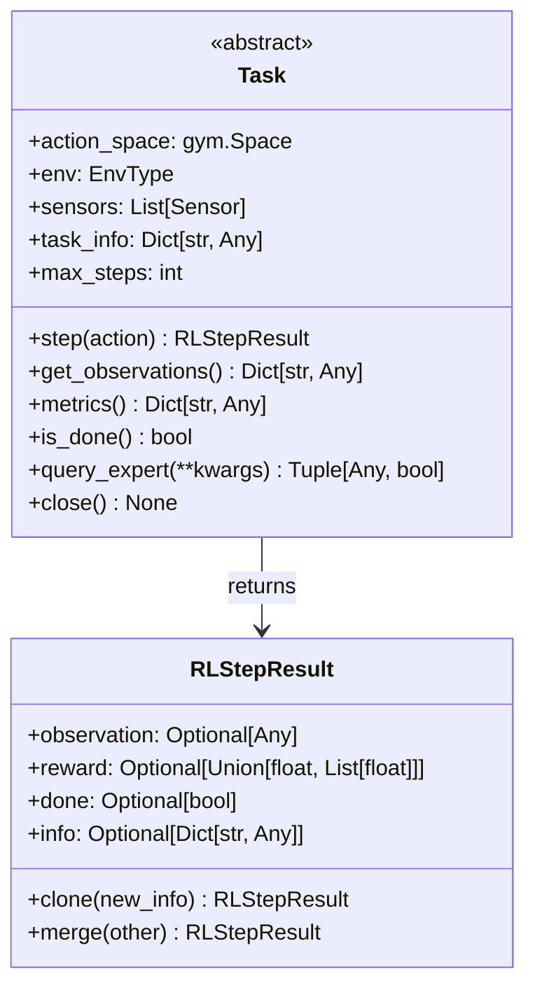
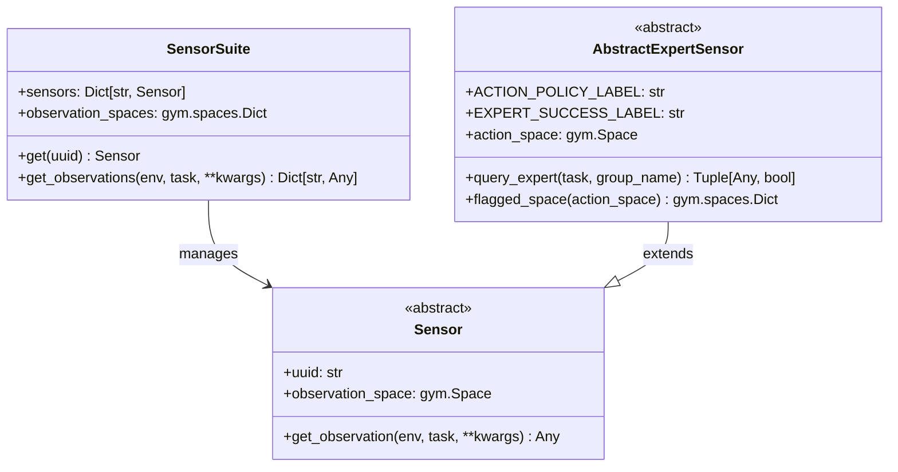
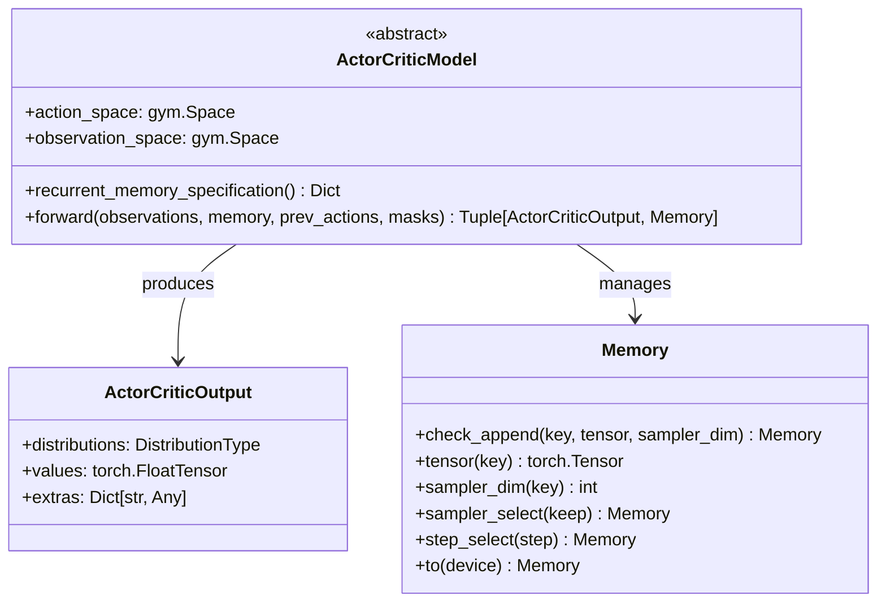
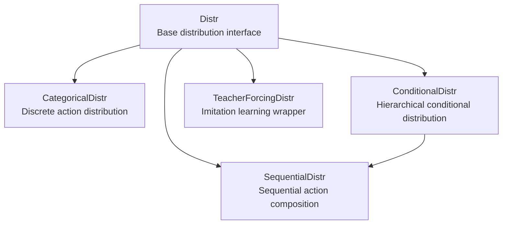
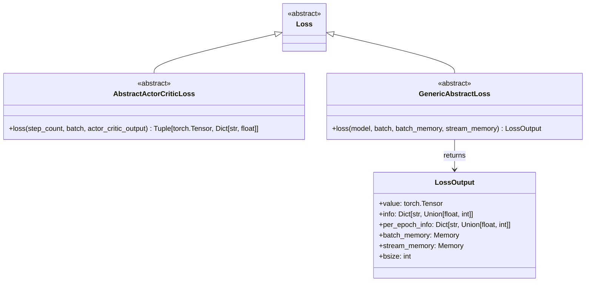

<!-- source: DeepWiki mcp.deepwiki.com · repo allenai/allenact · page 9.1 Core Abstractions · fetched 2026-10-26 -->

# Core Abstractions

Relevant source files

The following files were used as context for generating this wiki page:

- [allenact/algorithms/offpolicy_sync/losses/abstract_offpolicy_loss.py](allenact/algorithms/offpolicy_sync/losses/abstract_offpolicy_loss.py)
- [allenact/algorithms/onpolicy_sync/losses/a2cacktr.py](allenact/algorithms/onpolicy_sync/losses/a2cacktr.py)
- [allenact/algorithms/onpolicy_sync/losses/abstract_loss.py](allenact/algorithms/onpolicy_sync/losses/abstract_loss.py)
- [allenact/algorithms/onpolicy_sync/losses/imitation.py](allenact/algorithms/onpolicy_sync/losses/imitation.py)
- [allenact/algorithms/onpolicy_sync/losses/ppo.py](allenact/algorithms/onpolicy_sync/losses/ppo.py)
- [allenact/algorithms/onpolicy_sync/misc.py](allenact/algorithms/onpolicy_sync/misc.py)
- [allenact/base_abstractions/distributions.py](allenact/base_abstractions/distributions.py)
- [allenact/base_abstractions/misc.py](allenact/base_abstractions/misc.py)
- [allenact/base_abstractions/sensor.py](allenact/base_abstractions/sensor.py)
- [allenact/embodiedai/storage/vdr_storage.py](allenact/embodiedai/storage/vdr_storage.py)
- [allenact/utils/spaces_utils.py](allenact/utils/spaces_utils.py)
- [allenact/utils/system.py](allenact/utils/system.py)
- [allenact_plugins/minigrid_plugin/__init__.py](allenact_plugins/minigrid_plugin/__init__.py)
- [docs/getting_started/abstractions.md](docs/getting_started/abstractions.md)
- [docs/getting_started/running-your-first-experiment.md](docs/getting_started/running-your-first-experiment.md)
- [docs/getting_started/structure.md](docs/getting_started/structure.md)
- [docs/howtos/changing-rewards-and-losses.md](docs/howtos/changing-rewards-and-losses.md)
- [docs/howtos/defining-a-new-model.md](docs/howtos/defining-a-new-model.md)
- [docs/howtos/defining-a-new-task.md](docs/howtos/defining-a-new-task.md)
- [docs/howtos/defining-an-experiment.md](docs/howtos/defining-an-experiment.md)
- [tests/mapping/test_ai2thor_mapping.py](tests/mapping/test_ai2thor_mapping.py)

This document covers the fundamental abstract base classes and interfaces that define AllenAct's architecture. These abstractions provide the core building blocks for defining experiments, tasks, sensors, models, and training procedures. For information about specific training algorithms and distributed training, see [Training and Storage APIs](#9.2). For environment-specific implementations, see [Environment Plugin APIs](#9.3).

## Overview

AllenAct's core abstractions form a layered architecture where each abstraction has specific responsibilities and well-defined interfaces. The following diagram shows the primary abstractions and their relationships:

Sources: [allenact/base_abstractions/sensor.py](), [allenact/base_abstractions/misc.py](), [allenact/base_abstractions/distributions.py](), [allenact/algorithms/onpolicy_sync/losses/abstract_loss.py]()

## Task Abstractions

### Task

The `Task` abstraction defines the core interface for agent-environment interaction. Tasks encapsulate the logic for action execution, reward computation, termination conditions, and performance metrics.

Key responsibilities:
- **Action Processing**: Execute actions in the environment via `step()`
- **Reward Computation**: Calculate rewards based on current state and action outcomes
- **Termination Logic**: Determine when episodes end via `is_done()`
- **Metric Collection**: Provide performance measurements via `metrics()`
- **Expert Interface**: Optionally provide expert actions via `query_expert()`

Sources: [allenact/base_abstractions/misc.py:23-53]()

### TaskSampler

The `TaskSampler` abstraction manages the generation and lifecycle of task instances. It provides an interface for creating sequences of tasks for training, validation, and testing.

| Method | Purpose |
|--------|---------|
| `next_task()` | Generate the next task instance |
| `reset()` | Reset sampler state |
| `close()` | Clean up resources |
| `set_seed()` | Set random seed for reproducibility |
| `__len__()` | Number of available tasks |
| `total_unique()` | Number of unique task configurations |

Sources: [docs/howtos/defining-a-new-task.md:142-246]()

## Sensor System

### Sensor

The `Sensor[EnvType, SubTaskType]` abstraction defines how environmental and task data is extracted and formatted for agent consumption.

**Core Sensor Interface**:
- `uuid`: Unique identifier for the sensor
- `observation_space`: Gym space describing the sensor's output format
- `get_observation()`: Extract and format observations from environment/task

**SensorSuite Management**:
- Aggregates multiple sensors with unique UUIDs
- Provides unified observation collection via `get_observations()`
- Manages observation space composition

**Expert Sensor Specialization**:
- `AbstractExpertSensor` provides expert action/policy data
- Used for imitation learning and teacher forcing
- Includes success flags for masking invalid expert data

Sources: [allenact/base_abstractions/sensor.py:38-135](), [allenact/base_abstractions/sensor.py:137-325]()

## Model Abstractions

### ActorCriticModel and ActorCriticOutput

The model system centers around the `ActorCriticModel` interface, which defines how neural networks process observations and produce action distributions and value estimates.

**ActorCriticOutput Components**:
- `distributions`: Action probability distributions (e.g., `CategoricalDistr`)
- `values`: State value estimates for value-based RL algorithms
- `extras`: Additional model outputs (attention maps, auxiliary predictions, etc.)

**Memory Management**:
- Handles recurrent neural network hidden states
- Supports multiple memory types with different tensor dimensions
- Provides operations for batching, slicing, and device movement

Sources: [allenact/base_abstractions/misc.py:55-79](), [allenact/base_abstractions/misc.py:81-352]()

## Distribution System

### Action Distributions

AllenAct provides a hierarchy of action distribution abstractions for different action space types and training scenarios.

**Base Distribution Interface** (`Distr`):
| Method | Purpose |
|--------|---------|
| `log_prob(actions)` | Compute log probabilities of actions |
| `entropy()` | Calculate distribution entropy |
| `sample()` | Sample actions from distribution |
| `mode()` | Get most probable actions |

**Specialized Distributions**:
- **CategoricalDistr**: Extends PyTorch's Categorical for discrete actions with AllenAct-specific shape handling
- **ConditionalDistr**: Enables hierarchical action spaces where later actions depend on earlier ones
- **SequentialDistr**: Composes multiple conditional distributions for complex action sequences
- **TeacherForcingDistr**: Wrapper for imitation learning that probabilistically replaces sampled actions with expert actions

Sources: [allenact/base_abstractions/distributions.py:22-44](), [allenact/base_abstractions/distributions.py:46-82](), [allenact/base_abstractions/distributions.py:155-210](), [allenact/base_abstractions/distributions.py:216-351]()

## Loss Abstractions

### Training Loss Interface

The loss system provides abstractions for different training paradigms, with clear separation between on-policy and off-policy approaches.

**AbstractActorCriticLoss** (On-policy):
- Processes rollout experience from on-policy training
- Takes `ActorCriticOutput` and computes policy and value losses
- Used by PPO, A2C, and imitation learning losses

**GenericAbstractLoss** (General):
- More flexible interface supporting arbitrary model types
- Manages `batch_memory` for computation sharing across losses
- Supports `stream_memory` for temporal dependencies across batches

Sources: [allenact/base_abstractions/misc.py:354-432](), [allenact/algorithms/onpolicy_sync/losses/abstract_loss.py:13-51]()

## Integration and Usage

These abstractions work together to form complete training pipelines. The typical flow involves:

1. **ExperimentConfig** defines the experiment structure
2. **TaskSampler** generates **Task** instances 
3. **Task** uses **Sensor** instances to provide observations
4. **ActorCriticModel** processes observations to produce **ActorCriticOutput**
5. **Loss** functions compute gradients from model outputs and rollout data
6. Training engine manages the optimization loop

This modular design enables easy experimentation with different environments, models, and training algorithms while maintaining clean interfaces between components.

Sources: [docs/getting_started/abstractions.md:1-86](), [docs/howtos/defining-an-experiment.md:1-308]()

---

