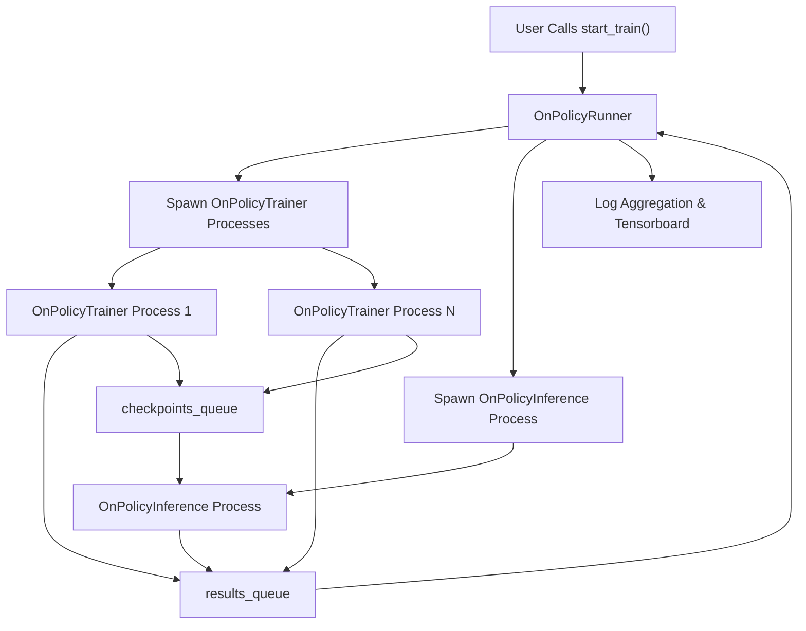
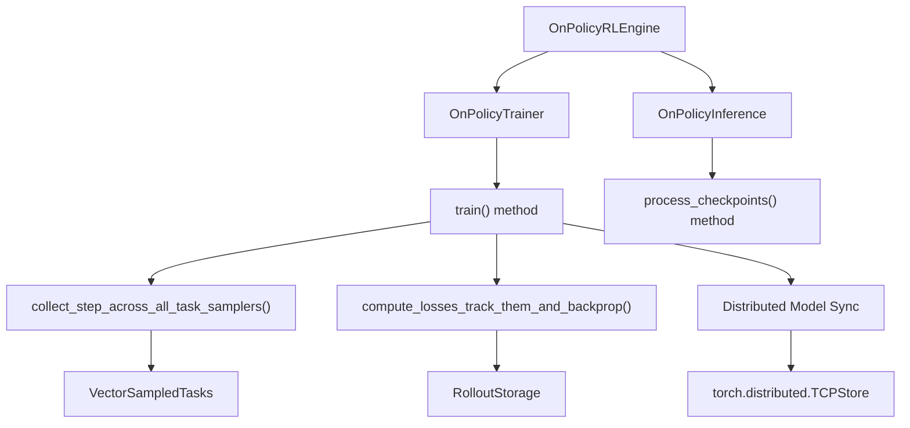
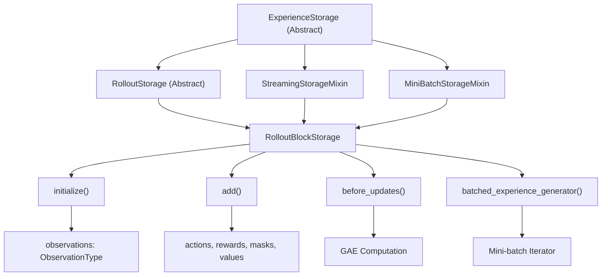
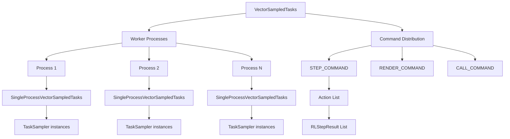
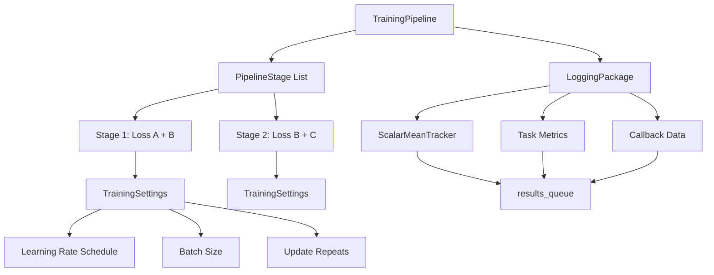
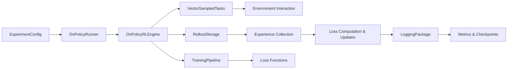

<!-- source: DeepWiki mcp.deepwiki.com · repo allenai/allenact · page 9.2 Training and Storage APIs · fetched 2026-10-26 -->

# Training and Storage APIs

Relevant source files

The following files were used as context for generating this wiki page:

- [allenact/algorithms/onpolicy_sync/engine.py](allenact/algorithms/onpolicy_sync/engine.py)
- [allenact/algorithms/onpolicy_sync/runner.py](allenact/algorithms/onpolicy_sync/runner.py)
- [allenact/algorithms/onpolicy_sync/storage.py](allenact/algorithms/onpolicy_sync/storage.py)
- [allenact/algorithms/onpolicy_sync/vector_sampled_tasks.py](allenact/algorithms/onpolicy_sync/vector_sampled_tasks.py)
- [allenact/base_abstractions/callbacks.py](allenact/base_abstractions/callbacks.py)
- [allenact/base_abstractions/preprocessor.py](allenact/base_abstractions/preprocessor.py)
- [allenact/base_abstractions/task.py](allenact/base_abstractions/task.py)
- [allenact/embodiedai/mapping/mapping_utils/map_builders.py](allenact/embodiedai/mapping/mapping_utils/map_builders.py)
- [allenact/embodiedai/mapping/mapping_utils/point_cloud_utils.py](allenact/embodiedai/mapping/mapping_utils/point_cloud_utils.py)
- [allenact/main.py](allenact/main.py)
- [allenact/utils/experiment_utils.py](allenact/utils/experiment_utils.py)
- [allenact/utils/misc_utils.py](allenact/utils/misc_utils.py)
- [allenact_plugins/ithor_plugin/ithor_sensors.py](allenact_plugins/ithor_plugin/ithor_sensors.py)
- [allenact_plugins/robothor_plugin/robothor_sensors.py](allenact_plugins/robothor_plugin/robothor_sensors.py)

This document covers the core APIs for training orchestration and experience storage in AllenAct. These APIs provide the foundation for running reinforcement learning experiments, managing experience data, and coordinating distributed training across multiple processes.

For information about experiment configuration and setup, see [Experiment Configuration](#4.1). For details about specific RL algorithms and loss functions, see [Training Pipelines and Loss Functions](#4.3).

## Core Training Orchestration APIs

The training system in AllenAct is built around a hierarchical architecture where `OnPolicyRunner` orchestrates multiple `OnPolicyRLEngine` instances across processes.

### OnPolicyRunner

The `OnPolicyRunner` class serves as the primary entry point for training, validation, and testing. It manages multiprocessing, checkpointing, and result aggregation.

**Key Methods:**
- `start_train()` - Initiates training with optional validation
- `start_test()` - Runs evaluation on checkpoints  
- `worker_devices()` - Determines device allocation across workers
- `log_and_close()` - Handles result collection and cleanup

Sources: [allenact/algorithms/onpolicy_sync/runner.py:80-669]()

### OnPolicyRLEngine and Subclasses

The `OnPolicyRLEngine` is the abstract base class for training and inference engines. It has two main concrete implementations:

- **`OnPolicyTrainer`** - Handles training loops, gradient updates, and model synchronization
- **`OnPolicyInference`** - Handles validation and testing without gradient updates

**Key Methods:**
- `__init__()` - Initializes model, optimizers, and distributed communication
- `collect_step_across_all_task_samplers()` - Collects experience from environments
- `compute_losses_track_them_and_backprop()` - Runs loss computation and backpropagation
- `checkpoint_load()` / `checkpoint_save()` - Model persistence

Sources: [allenact/algorithms/onpolicy_sync/engine.py:93-1044](), [allenact/algorithms/onpolicy_sync/engine.py:1045-1263](), [allenact/algorithms/onpolicy_sync/engine.py:1264-1427]()

## Experience Storage APIs

AllenAct provides a flexible storage system for managing experience data during training and evaluation.

### ExperienceStorage Abstract Base Class

`ExperienceStorage` defines the interface for all storage implementations:

**Core Methods:**
- `initialize()` - Sets up storage with initial observations
- `add()` - Adds new experience tuples (observations, actions, rewards, etc.)
- `before_updates()` / `after_updates()` - Hooks for pre/post training updates
- `to()` - Device management for GPU/CPU
- `set_partition()` - Support for distributed training

### RolloutStorage and RolloutBlockStorage

`RolloutStorage` is the abstract base for on-policy storage, with `RolloutBlockStorage` as the primary implementation.

**Key Features:**
- Stores complete rollout trajectories
- Implements GAE (Generalized Advantage Estimation) computation
- Supports mini-batch generation for training
- Handles memory management for recurrent models

**Storage Data Flow:**
1. `initialize()` with initial observations and model specifications
2. Repeated `add()` calls during rollout collection
3. `before_updates()` computes advantages and returns
4. `batched_experience_generator()` yields mini-batches for training
5. `after_updates()` prepares for next rollout

Sources: [allenact/algorithms/onpolicy_sync/storage.py:34-83](), [allenact/algorithms/onpolicy_sync/storage.py:130-671]()

## Task Management APIs

### VectorSampledTasks

`VectorSampledTasks` manages multiple task sampler processes for parallel environment interaction.

**Key Features:**
- Multi-process task execution with automatic respawning
- Synchronized stepping across all environments
- Communication via multiprocessing queues/pipes
- Support for different multiprocessing start methods

**Core Methods:**
- `step()` - Steps all unpaused tasks synchronously
- `pause_at()` / `resume_all()` - Task lifecycle management
- `call_at()` / `call()` - Invoke methods on specific or all tasks
- `get_observations()` - Collect current observations

Sources: [allenact/algorithms/onpolicy_sync/vector_sampled_tasks.py:116-227](), [allenact/algorithms/onpolicy_sync/vector_sampled_tasks.py:479-600]()

## Training Utilities APIs

### TrainingPipeline

The `TrainingPipeline` manages the overall training process including multiple stages, loss functions, and optimization schedules.

**Key Components:**
- `PipelineStage` - Individual training stages with specific loss configurations
- `TrainingSettings` - Hyperparameters like learning rate, batch size, etc.
- Loss management and weight scheduling
- Early stopping criteria

### LoggingPackage

`LoggingPackage` standardizes metric collection and reporting across training, validation, and testing.

**Key Features:**
- Metric aggregation with `ScalarMeanTracker`
- Task callback data collection
- Integration with TensorBoard logging
- Support for distributed metric reduction

Sources: [allenact/utils/experiment_utils.py:612-780](), [allenact/utils/experiment_utils.py:241-316](), [allenact/utils/experiment_utils.py:172-239]()

## Integration Overview

The training and storage APIs work together to provide a complete training framework:

This architecture enables:
- **Scalable Training**: Multi-process execution with distributed synchronization
- **Flexible Storage**: Pluggable storage backends for different algorithm needs  
- **Robust Logging**: Comprehensive metric collection and checkpoint management
- **Environment Abstraction**: Seamless integration with various simulation environments

Sources: [allenact/algorithms/onpolicy_sync/engine.py:93-300](), [allenact/algorithms/onpolicy_sync/runner.py:495-669](), [allenact/algorithms/onpolicy_sync/storage.py:130-220](), [allenact/algorithms/onpolicy_sync/vector_sampled_tasks.py:151-227]()

---

