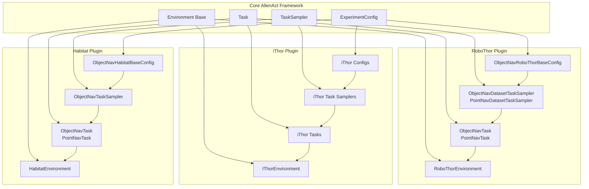
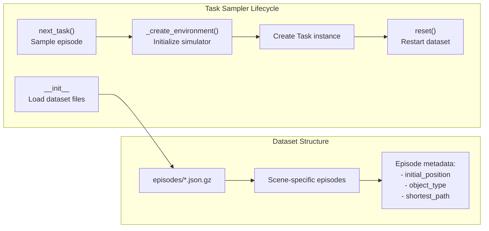
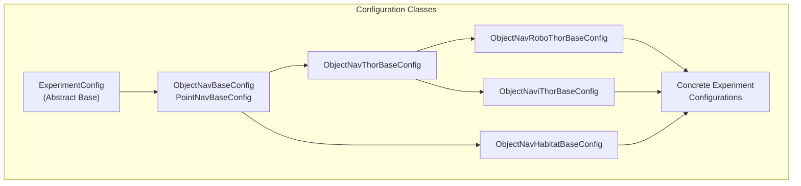

<!-- source: DeepWiki mcp.deepwiki.com · repo allenai/allenact · page 9.3 Environment Plugin APIs · fetched 2026-10-26 -->

# Environment Plugin APIs

Relevant source files

The following files were used as context for generating this wiki page:

- [allenact/utils/inference.py](allenact/utils/inference.py)
- [allenact_plugins/habitat_plugin/habitat_tasks.py](allenact_plugins/habitat_plugin/habitat_tasks.py)
- [allenact_plugins/ithor_plugin/ithor_environment.py](allenact_plugins/ithor_plugin/ithor_environment.py)
- [allenact_plugins/ithor_plugin/ithor_util.py](allenact_plugins/ithor_plugin/ithor_util.py)
- [allenact_plugins/robothor_plugin/robothor_environment.py](allenact_plugins/robothor_plugin/robothor_environment.py)
- [allenact_plugins/robothor_plugin/robothor_task_samplers.py](allenact_plugins/robothor_plugin/robothor_task_samplers.py)
- [allenact_plugins/robothor_plugin/robothor_tasks.py](allenact_plugins/robothor_plugin/robothor_tasks.py)
- [projects/objectnav_baselines/experiments/clip/mixins.py](projects/objectnav_baselines/experiments/clip/mixins.py)
- [projects/objectnav_baselines/experiments/habitat/clip/objectnav_habitat_rgb_clipresnet50gru_ddppo.py](projects/objectnav_baselines/experiments/habitat/clip/objectnav_habitat_rgb_clipresnet50gru_ddppo.py)
- [projects/objectnav_baselines/experiments/habitat/clip/objectnav_habitat_rgb_clipresnet50gru_ddppo_increasingrollouts.py](projects/objectnav_baselines/experiments/habitat/clip/objectnav_habitat_rgb_clipresnet50gru_ddppo_increasingrollouts.py)
- [projects/objectnav_baselines/experiments/habitat/objectnav_habitat_base.py](projects/objectnav_baselines/experiments/habitat/objectnav_habitat_base.py)
- [projects/objectnav_baselines/experiments/objectnav_thor_base.py](projects/objectnav_baselines/experiments/objectnav_thor_base.py)
- [projects/objectnav_baselines/experiments/robothor/clip/objectnav_robothor_rgb_clipresnet50gru_ddppo.py](projects/objectnav_baselines/experiments/robothor/clip/objectnav_robothor_rgb_clipresnet50gru_ddppo.py)
- [projects/objectnav_baselines/experiments/robothor/clip/objectnav_robothor_rgb_clipresnet50x16gru_ddppo.py](projects/objectnav_baselines/experiments/robothor/clip/objectnav_robothor_rgb_clipresnet50x16gru_ddppo.py)
- [projects/objectnav_baselines/mixins.py](projects/objectnav_baselines/mixins.py)
- [projects/pointnav_baselines/experiments/habitat/clip/pointnav_habitat_rgb_clipresnet50gru_ddppo.py](projects/pointnav_baselines/experiments/habitat/clip/pointnav_habitat_rgb_clipresnet50gru_ddppo.py)
- [projects/pointnav_baselines/experiments/pointnav_thor_base.py](projects/pointnav_baselines/experiments/pointnav_thor_base.py)

This document provides detailed API reference for AllenAct's environment plugin system. Environment plugins enable integration with simulation environments like AI2-THOR (RoboThor/iThor), Habitat, and MiniGrid. Each plugin provides standardized APIs for environment control, task definition, and experiment configuration.

For general information about using these environments in experiments, see [Simulation Environments](#5). For core framework abstractions that these plugins implement, see [Core Abstractions](#9.1).

## Environment Plugin Architecture

AllenAct's environment plugin system follows a layered architecture where each plugin provides three main components: environment wrappers, task implementations, and experiment configurations.

Sources: [allenact_plugins/robothor_plugin/robothor_environment.py:18-30](), [allenact_plugins/ithor_plugin/ithor_environment.py:20-31](), [projects/objectnav_baselines/experiments/objectnav_thor_base.py:45-46](), [projects/objectnav_baselines/experiments/habitat/objectnav_habitat_base.py:111-112]()

## Environment Wrapper APIs

Environment wrappers provide a unified interface to different simulation backends while exposing environment-specific functionality.

### RoboThorEnvironment API

The `RoboThorEnvironment` class wraps the AI2-THOR RoboThor simulator and provides navigation-specific functionality.

**Core Methods:**
- `step(action_dict)` - Execute actions in the environment
- `reset(scene_name, filtered_objects)` - Reset to new scene with optional object filtering  
- `teleport(pose, rotation, horizon, agent_id)` - Teleport agent to specific location
- `randomize_agent_location(seed, partial_position, agent_id)` - Random valid agent placement

**Navigation Methods:**
- `distance_to_object_type(object_type, agent_id)` - Geodesic distance to nearest object of type
- `distance_to_point(target, agent_id)` - Geodesic distance to target coordinates
- `path_from_point_to_object_type(point, object_type, allowed_error)` - Get navigation path
- `random_reachable_state(seed)` - Generate random valid agent state

**State Access:**
- `agent_state(agent_id)` - Current agent position, rotation, and horizon
- `scene_name` - Current scene identifier
- `current_frame` - RGB observation
- `current_depth` - Depth observation
- `visible_objects()` - Objects visible to agent

Sources: [allenact_plugins/robothor_plugin/robothor_environment.py:18-508]()

### IThorEnvironment API

The `IThorEnvironment` class provides a more general AI2-THOR interface supporting manipulation and household tasks.

**Initialization Parameters:**
- `x_display` - X display for Linux systems
- `docker_enabled` - Use Docker container
- `visibility_distance` - Object visibility range
- `fov` - Camera field of view
- `player_screen_width/height` - Image resolution
- `restrict_to_initially_reachable_points` - Constrain agent movement

**Key Methods:**
- `start(scene_name, move_mag)` - Initialize controller
- `reset(scene_name, move_mag)` - Reset environment
- `teleport_agent_to(x, y, z, rotation, horizon)` - Precise agent positioning
- `object_pixels_in_frame(object_id)` - Get object segmentation mask
- `get_agent_location()` - Agent pose information

Sources: [allenact_plugins/ithor_plugin/ithor_environment.py:20-98](), [allenact_plugins/ithor_plugin/ithor_environment.py:166-211]()

## Task Sampler APIs

Task samplers generate task instances for training and evaluation. They implement the `TaskSampler` interface with environment-specific logic.

### Dataset-Based Task Samplers

Dataset task samplers load pre-generated episode data from compressed JSON files.

**ObjectNavDatasetTaskSampler Methods:**
- `__init__(scenes, scene_directory, sensors, max_steps, env_args, action_space, rewards_config)` - Initialize with dataset
- `next_task(force_advance_scene)` - Generate next task instance
- `load_dataset(scene, base_directory)` - Load episode data for scene
- `reset()` - Reset sampler state
- `close()` - Clean up environment resources

**Key Configuration:**
- `loop_dataset` - Whether to loop through episodes infinitely
- `allow_flipping` - Enable horizontal mirroring for data augmentation
- `randomize_materials_in_training` - Randomize object materials in training scenes

Sources: [allenact_plugins/robothor_plugin/robothor_task_samplers.py:292-533]()

### Procedural Task Samplers

Procedural samplers generate episodes dynamically using environment queries.

**ObjectNavTaskSampler Features:**
- Dynamic scene and object type selection
- Random agent placement within scenes
- Configurable scene switching periods
- Support for filtered object sets

**PointNavTaskSampler Features:**
- Random start/goal position generation
- Distance validation between start and target
- Scene rotation for variety

Sources: [allenact_plugins/robothor_plugin/robothor_task_samplers.py:22-291](), [allenact_plugins/robothor_plugin/robothor_task_samplers.py:535-755]()

## Task APIs

Tasks define the agent's objectives and provide reward signals. They implement the `Task` interface with environment and task-specific logic.

### Navigation Task Interface

Both ObjectNav and PointNav tasks share common navigation patterns:

**Core Task Methods:**
- `_step(action)` - Execute action and return `RLStepResult`
- `judge()` - Calculate reward for current step
- `metrics()` - Compute final episode metrics
- `reached_terminal_state()` - Check if episode is complete
- `render(mode)` - Generate visual observations

**Reward Components:**
- Step penalty - Small negative reward per timestep
- Shaping reward - Distance-based guidance signal  
- Success reward - Large positive reward for task completion
- Failure penalty - Negative reward for incorrect termination

### ObjectNavTask Specifics

The `ObjectNavTask` implements object-goal navigation where agents must find and approach target objects.

**Action Space:**
- `MOVE_AHEAD` - Move forward
- `ROTATE_LEFT/RIGHT` - Turn left/right
- `LOOK_UP/DOWN` - Adjust camera pitch
- `END` - Terminate episode

**Success Conditions:**
- Target object visible to agent when `END` action taken
- Uses `visible_objects()` environment query

**Mirroring Support:**
- Horizontal flipping for data augmentation
- Automatic action and observation mirroring
- Configured via `task_info["mirrored"]`

Sources: [allenact_plugins/robothor_plugin/robothor_tasks.py:207-411]()

### PointNavTask Specifics  

The `PointNavTask` implements coordinate-goal navigation to specific 3D locations.

**Success Conditions:**
- Agent within threshold distance of target coordinates
- Distance computed using environment geodesic pathfinding

**Expert Policy:**
- `query_expert()` provides optimal actions
- Uses environment shortest path algorithms
- Supports both greedy and planning-based experts

Sources: [allenact_plugins/robothor_plugin/robothor_tasks.py:41-205]()

## ExperimentConfig Integration Patterns

Environment plugins integrate with AllenAct through specialized `ExperimentConfig` subclasses that handle environment-specific setup.

### Configuration Hierarchy

**Required Methods Implementation:**
- `env_args()` - Environment initialization parameters
- `make_sampler_fn(**kwargs)` - Task sampler factory
- `train_task_sampler_args(process_ind, total_processes)` - Training sampler configuration
- `valid_task_sampler_args(process_ind, total_processes)` - Validation sampler configuration
- `machine_params(mode)` - Hardware and process configuration

### Environment Arguments

Each plugin defines standard environment arguments:

**RoboThor Arguments:**
- `width/height` - Image resolution
- `rotateStepDegrees` - Rotation increment
- `gridSize` - Movement step size
- `visibilityDistance` - Object visibility range
- `agentMode` - Agent type ("bot" or "locobot")
- `renderDepthImage` - Enable depth rendering

**Habitat Arguments:**
- `simulator_gpu_ids` - GPU device assignment
- `num_processes` - Parallel environment count
- Environment config YAML paths
- Scene dataset directories

Sources: [projects/objectnav_baselines/experiments/objectnav_thor_base.py:98-123](), [projects/objectnav_baselines/experiments/habitat/objectnav_habitat_base.py:193-218]()

### Multi-Process Distribution

Environment plugins handle distributed training by partitioning scenes and episodes across processes:

**Scene Distribution:**
- `_partition_inds(n, num_parts)` - Divide episodes across processes
- `_get_sampler_args_for_scene_split()` - Generate per-process arguments
- Automatic load balancing for scene memory usage

**GPU Assignment:**
- X-display management for iThor/RoboThor on Linux
- CloudRendering platform support for headless servers
- Memory-aware scene distribution for Habitat

Sources: [projects/objectnav_baselines/experiments/objectnav_thor_base.py:187-274](), [projects/objectnav_baselines/experiments/habitat/objectnav_habitat_base.py:302-360]()

## Plugin-Specific Implementation Patterns

### Device and Display Management

Environment plugins must handle hardware resource allocation:

**X-Display Management (iThor/RoboThor):**
- `get_open_x_displays()` - Detect available X displays
- Automatic display assignment per process
- Fallback to CPU rendering when displays unavailable

**GPU Memory Management (Habitat):**
- Scene memory profiling for optimal GPU utilization
- Dynamic scene-to-GPU assignment
- Memory-based load balancing

Sources: [allenact_plugins/ithor_plugin/ithor_util.py:65-97](), [projects/objectnav_baselines/experiments/habitat/objectnav_habitat_base.py:305-345]()

### Dataset Loading and Caching

Environment plugins implement efficient data loading:

**Compressed Dataset Format:**
- Episodes stored as `.json.gz` files per scene
- Automatic decompression and JSON parsing
- Scene-based episode organization

**Distance Caching:**
- `DynamicDistanceCache` for geodesic distances
- Scene-aware cache partitioning  
- Automatic cache invalidation

Sources: [allenact_plugins/robothor_plugin/robothor_task_samplers.py:371-385](), [allenact_plugins/robothor_plugin/robothor_environment.py:63-71]()

### Error Handling and Robustness

Environment plugins implement robust error handling:

**Teleportation Retry Logic:**
- Multiple attempt strategies for agent placement
- Fallback to force actions when standard placement fails
- Validation of final agent positions

**Action Failure Handling:**
- Invalid action detection and logging
- Graceful degradation for failed environment steps
- Automatic environment reset on critical failures

Sources: [allenact_plugins/robothor_plugin/robothor_environment.py:357-393](), [allenact_plugins/ithor_plugin/ithor_environment.py:390-416]()