# Page: Overview

# Overview

<details>
<summary>Relevant source files</summary>

The following files were used as context for generating this wiki page:

- [README.md](README.md)
- [allenact/setup.py](allenact/setup.py)
- [allenact_plugins/gym_plugin/extra_environment.yml](allenact_plugins/gym_plugin/extra_environment.yml)
- [allenact_plugins/setup.py](allenact_plugins/setup.py)
- [conda/environment-10.1.yml](conda/environment-10.1.yml)
- [conda/environment-10.2.yml](conda/environment-10.2.yml)
- [conda/environment-9.2.yml](conda/environment-9.2.yml)
- [conda/environment-base.yml](conda/environment-base.yml)
- [docs/img/AI2_Logo_Square_Gradients_crop.png](docs/img/AI2_Logo_Square_Gradients_crop.png)
- [docs/img/PRIORLogoBlackEmbedded.png](docs/img/PRIORLogoBlackEmbedded.png)
- [main.py](main.py)
- [mkdocs.yml](mkdocs.yml)
- [requirements.txt](requirements.txt)
- [scripts/build_docs.py](scripts/build_docs.py)

</details>


This document provides a high-level introduction to AllenAct, an open-source framework for embodied AI research. It covers the framework's purpose, core architecture, and key components. For detailed installation instructions, see [Installation and Setup](#2.1). For step-by-step guidance on running experiments, see [Running Your First Experiment](#2.2).

## What is AllenAct

AllenAct is a modular and flexible learning framework designed specifically for embodied AI research. The framework provides first-class support for multiple simulation environments, task abstractions, and reinforcement learning algorithms, enabling researchers to easily implement and experiment with embodied AI agents.

The framework is built around several core principles:
- **Environment-Task Decoupling**: Tasks and environments are separated, allowing the same task to run across different simulators
- **Modular Architecture**: Components can be easily swapped and extended
- **PyTorch-First Design**: Native PyTorch support throughout the framework
- **Distributed Training**: Built-in support for multi-process and multi-machine training

**Sources:** [README.md:16-18](), [README.md:31-42]()

## Package Structure

AllenAct is organized into two main Python packages that serve distinct purposes:

| Package | Purpose | Location |
|---------|---------|----------|
| `allenact` | Core framework with base abstractions, algorithms, and utilities | [allenact/]() |
| `allenact_plugins` | Environment-specific implementations and extensions | [allenact_plugins/]() |

The core `allenact` package contains framework essentials like the training engine, base classes, and algorithms. The `allenact_plugins` package provides concrete implementations for specific environments like RoboTHOR, iTHOR, Habitat, and MiniGrid, allowing users to install only the plugins they need.

**Sources:** [allenact/setup.py:86-133](), [allenact_plugins/setup.py:98-127]()

## Core Architecture Overview

The following diagram illustrates AllenAct's high-level architecture and the relationships between major system components:

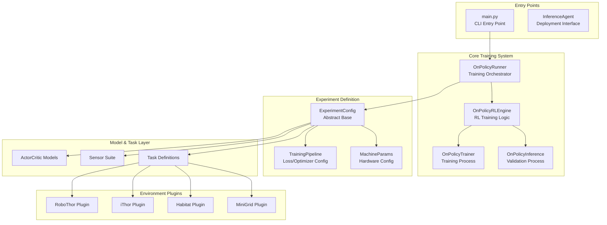

The training system centers around `OnPolicyRunner`, which orchestrates the entire training process by spawning training and validation processes, managing checkpoints, and collecting metrics. The `ExperimentConfig` system provides a declarative way to configure all aspects of an experiment.

**Sources:** [main.py:4-7](), [mkdocs.yml:28-66]()

## Key Framework Components

This diagram maps the major framework abstractions to their concrete implementations in the codebase:

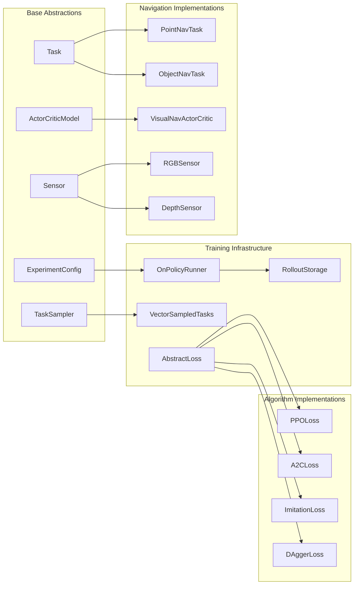

The framework follows a clear inheritance hierarchy where abstract base classes define interfaces and concrete implementations provide environment-specific functionality. For example, `Task` is the base abstraction while `PointNavTask` and `ObjectNavTask` provide specific navigation behaviors.

**Sources:** [mkdocs.yml:91-110](), [mkdocs.yml:221-295]()

## Supported Environments and Tasks

AllenAct provides built-in support for multiple simulation environments through its plugin system:

| Environment | Plugin | Tasks | Key Features |
|-------------|--------|-------|--------------|
| **RoboTHOR** | `robothor_plugin` | PointNav, ObjectNav | Robotic embodiment, realistic physics |
| **iTHOR** | `ithor_plugin` | PointNav, ObjectNav, Manipulation | Interactive scenes, object manipulation |
| **Habitat** | `habitat_plugin` | PointNav | Photorealistic environments, large datasets |
| **MiniGrid** | `minigrid_plugin` | Grid navigation | Lightweight, fast prototyping |

Each plugin provides environment-specific implementations of tasks, sensors, and utilities while maintaining compatibility with the core framework abstractions.

**Sources:** [README.md:31](), [README.md:44-45](), [mkdocs.yml:126-183]()

## Training Algorithms

The framework includes implementations of several on-policy and imitation learning algorithms:

- **PPO (Proximal Policy Optimization)**: Standard policy gradient method with clipped objectives
- **DD-PPO (Decentralized Distributed PPO)**: Distributed version of PPO for multi-machine training  
- **A2C (Advantage Actor-Critic)**: Synchronous variant of actor-critic methods
- **Imitation Learning**: Learning from expert demonstrations
- **DAgger**: Dataset Aggregation for imitation learning with iterative expert feedback

All algorithms are implemented as modular loss functions that can be combined and sequenced within training pipelines.

**Sources:** [README.md:33](), [README.md:45](), [mkdocs.yml:98-111]()

## Next Steps

To start using AllenAct:
1. Follow the [Installation and Setup](#2.1) guide to install the framework and required dependencies
2. Try [Running Your First Experiment](#2.2) to verify your installation
3. Explore the [Tutorials](#7) for hands-on examples with different environments and tasks
4. Consult [Experiment Configuration](#4) to learn how to define custom experiments

**Sources:** [mkdocs.yml:30-47]()

---

# Page: What is AllenAct

# What is AllenAct

<details>
<summary>Relevant source files</summary>

The following files were used as context for generating this wiki page:

- [README.md](README.md)
- [docs/getting_started/abstractions.md](docs/getting_started/abstractions.md)
- [docs/getting_started/running-your-first-experiment.md](docs/getting_started/running-your-first-experiment.md)
- [docs/getting_started/structure.md](docs/getting_started/structure.md)
- [docs/howtos/changing-rewards-and-losses.md](docs/howtos/changing-rewards-and-losses.md)
- [docs/howtos/defining-a-new-model.md](docs/howtos/defining-a-new-model.md)
- [docs/howtos/defining-a-new-task.md](docs/howtos/defining-a-new-task.md)
- [docs/howtos/defining-an-experiment.md](docs/howtos/defining-an-experiment.md)
- [docs/img/AI2_Logo_Square_Gradients_crop.png](docs/img/AI2_Logo_Square_Gradients_crop.png)
- [docs/img/PRIORLogoBlackEmbedded.png](docs/img/PRIORLogoBlackEmbedded.png)
- [mkdocs.yml](mkdocs.yml)
- [scripts/build_docs.py](scripts/build_docs.py)

</details>


This document explains AllenAct's role as an embodied AI research framework, its key features, target use cases, and high-level architecture. For detailed installation instructions, see [Installation and Setup](#2.1). For hands-on tutorials, see [Getting Started](#2).

## Overview

AllenAct is a modular and flexible learning framework designed specifically for **Embodied AI research**. It provides a unified platform for training and evaluating agents that must learn to navigate, manipulate, and interact with simulated environments through visual observations and discrete or continuous actions.

The framework abstracts away the complexity of distributed training, environment management, and experiment configuration while maintaining the flexibility needed for cutting-edge research. AllenAct supports multiple simulation environments, navigation tasks, and reinforcement learning algorithms out of the box.

**Sources:** [README.md:16-16](), [mkdocs.yml:2-2]()

## Key Features and Capabilities

AllenAct provides several core capabilities that distinguish it as an embodied AI research platform:

| Feature | Description | Implementation |
|---------|-------------|----------------|
| **Multi-Environment Support** | Unified interface across simulation platforms | iTHOR, RoboTHOR, Habitat, MiniGrid plugins |
| **Task Abstraction** | Decouple tasks from environments | `Task` and `TaskSampler` base classes |
| **Distributed Training** | Scale across multiple machines/GPUs | `OnPolicyRunner` with `TCPStore` communication |
| **Algorithm Modularity** | Mix and match RL algorithms | PPO, A2C, DAgger, Imitation Learning |
| **Sequential Training** | Multi-stage training pipelines | `TrainingPipeline` with `PipelineStage` |
| **Auxiliary Tasks** | Self-supervised learning integration | Inverse dynamics, CPCA, other auxiliary losses |

**Sources:** [README.md:29-42](), [docs/getting_started/abstractions.md:1-86]()

## Framework Architecture Overview

The following diagram shows AllenAct's high-level architecture and how components interact:

**AllenAct Framework Architecture**
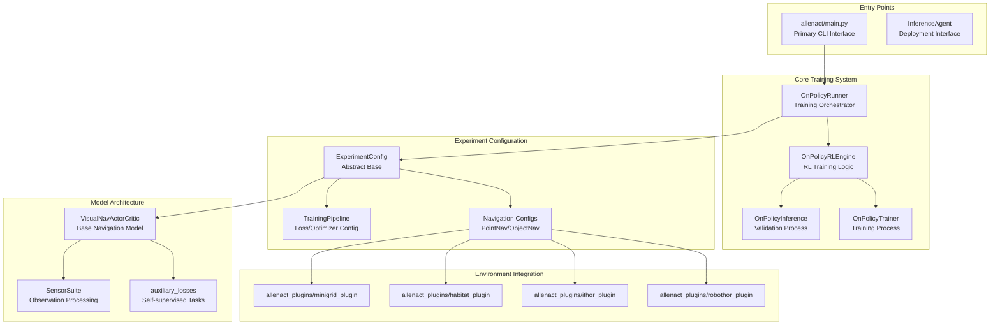

**Sources:** [allenact/main.py](), [allenact/algorithms/onpolicy_sync/runner.py](), [allenact/algorithms/onpolicy_sync/engine.py](), [allenact/base_abstractions/experiment_config.py]()

## Core Abstractions and Code Mapping

AllenAct's design centers around several key abstractions that map directly to code entities:

**Core Abstractions and Their Code Implementations**
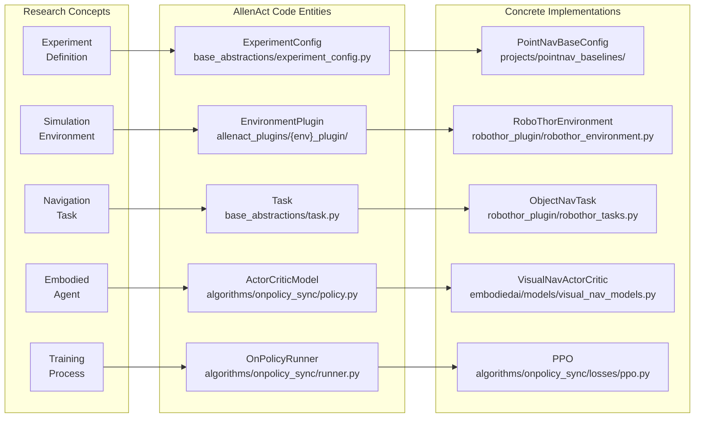

**Sources:** [allenact/base_abstractions/](), [allenact_plugins/](), [projects/](), [allenact/algorithms/onpolicy_sync/]()

## Supported Environments and Tasks

AllenAct provides plugin-based support for major embodied AI simulation environments:

### Environment Plugins

| Environment | Plugin Location | Tasks Supported | Key Features |
|-------------|----------------|----------------|--------------|
| **AI2-THOR iThor** | `allenact_plugins/ithor_plugin/` | ObjectNav, PointNav | Interactive scenes, physics |
| **AI2-THOR RoboThor** | `allenact_plugins/robothor_plugin/` | ObjectNav, PointNav | Robotic navigation datasets |
| **Habitat** | `allenact_plugins/habitat_plugin/` | PointNav | Photorealistic environments |
| **MiniGrid** | `allenact_plugins/minigrid_plugin/` | Simple navigation | Grid worlds, fast prototyping |

### Navigation Tasks

The framework implements two primary navigation paradigms:

- **PointNav**: Navigate to specific coordinates using GPS/compass sensors
- **ObjectNav**: Navigate to objects of specific categories using vision

**Sources:** [allenact_plugins/](), [README.md:31-31](), [README.md:43-45]()

## Training System and Algorithms

AllenAct's training system is built around the `OnPolicyRunner` which orchestrates distributed training across multiple processes and machines:

### Supported Algorithms

| Algorithm | Implementation | Use Case |
|-----------|----------------|----------|
| **PPO** | `allenact/algorithms/onpolicy_sync/losses/ppo.py` | Stable policy optimization |
| **A2C** | `allenact/algorithms/onpolicy_sync/losses/a2cacktr.py` | Actor-critic baseline |
| **DAgger** | `allenact/algorithms/onpolicy_sync/losses/imitation.py` | Imitation learning |
| **DD-PPO** | Distributed PPO via `OnPolicyRunner` | Large-scale training |

### Training Pipeline Structure

Training is configured through `TrainingPipeline` objects that support:
- **Sequential stages** with different loss combinations
- **Teacher forcing** with decay schedules  
- **Auxiliary tasks** for improved sample efficiency
- **Multi-stage curricula** (e.g., DAgger → PPO)

**Sources:** [allenact/algorithms/onpolicy_sync/](), [allenact/utils/experiment_utils.py](), [README.md:33-34]()

## Entry Points and Usage

AllenAct provides two primary interfaces:

### Command Line Interface
The main entry point is `allenact/main.py`, which accepts experiment configurations:

```bash
python allenact/main.py experiment_name -b projects/baselines -o output_dir
```

### Programmatic Interface  
Experiments are defined by subclassing `ExperimentConfig` and implementing:
- `create_model()` - Instantiate the actor-critic model
- `training_pipeline()` - Define losses and training stages  
- `make_sampler_fn()` - Specify task sampling logic
- Machine configuration methods for distributed training

**Sources:** [allenact/main.py](), [docs/getting_started/running-your-first-experiment.md:6-8](), [allenact/base_abstractions/experiment_config.py]()

## Target Use Cases

AllenAct is designed for researchers and practitioners working on:

- **Embodied AI research** requiring multi-environment experimentation
- **Navigation algorithm development** with standardized benchmarks  
- **Large-scale distributed training** of visual navigation agents
- **Multi-modal sensor fusion** for robotics applications
- **Curriculum learning** and sequential training methodologies

The framework abstracts environment-specific details while providing the flexibility needed for novel research directions in embodied artificial intelligence.

**Sources:** [README.md:16-18](), [docs/getting_started/abstractions.md:3-6]()

---

# Page: Package Structure

# Package Structure

<details>
<summary>Relevant source files</summary>

The following files were used as context for generating this wiki page:

- [allenact/setup.py](allenact/setup.py)
- [allenact_plugins/gym_plugin/extra_environment.yml](allenact_plugins/gym_plugin/extra_environment.yml)
- [allenact_plugins/setup.py](allenact_plugins/setup.py)
- [conda/environment-10.1.yml](conda/environment-10.1.yml)
- [conda/environment-10.2.yml](conda/environment-10.2.yml)
- [conda/environment-9.2.yml](conda/environment-9.2.yml)
- [conda/environment-base.yml](conda/environment-base.yml)
- [docs/getting_started/abstractions.md](docs/getting_started/abstractions.md)
- [docs/getting_started/running-your-first-experiment.md](docs/getting_started/running-your-first-experiment.md)
- [docs/getting_started/structure.md](docs/getting_started/structure.md)
- [docs/howtos/changing-rewards-and-losses.md](docs/howtos/changing-rewards-and-losses.md)
- [docs/howtos/defining-a-new-model.md](docs/howtos/defining-a-new-model.md)
- [docs/howtos/defining-a-new-task.md](docs/howtos/defining-a-new-task.md)
- [docs/howtos/defining-an-experiment.md](docs/howtos/defining-an-experiment.md)
- [requirements.txt](requirements.txt)

</details>


This page explains the organization of the AllenAct repository structure, focusing on the core packages (`allenact` vs `allenact_plugins`) and how different components are organized across directories. For information about specific abstractions and APIs within these packages, see [Core Abstractions](#9.1). For installation details, see [Installation and Setup](#2.1).

## Repository Architecture Overview

AllenAct is organized as a modular framework with a clear separation between core functionality and environment-specific extensions. The repository follows a two-package architecture that enables flexible installation and dependency management.

### Core Package Architecture

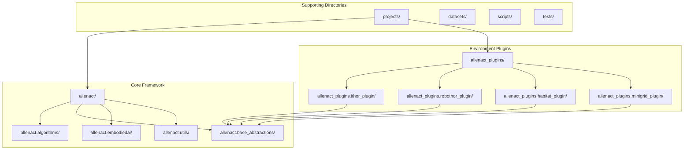

Sources: [allenact/setup.py:111](), [allenact_plugins/setup.py:122](), [docs/getting_started/structure.md:7-20]()

### Repository Directory Structure

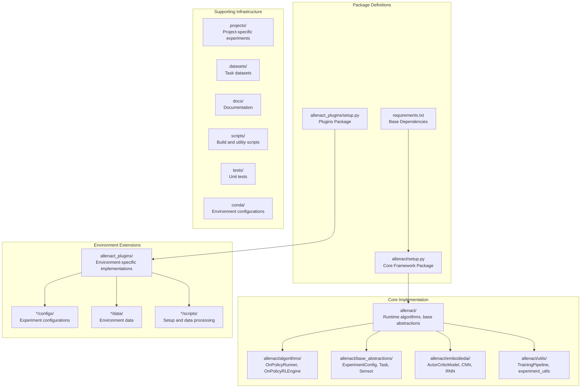

Sources: [docs/getting_started/structure.md:3-78](), [allenact/setup.py:1-137](), [allenact_plugins/setup.py:1-131]()

## Core Framework Package (`allenact`)

The `allenact` package contains the framework's core functionality and is designed to be environment-agnostic. It provides the fundamental abstractions and algorithms needed for embodied AI research.

### Key Modules

| Module | Purpose | Key Classes |
|--------|---------|-------------|
| `allenact.algorithms` | On-policy and off-policy training algorithms | `OnPolicyRunner`, `OnPolicyRLEngine`, `PPO`, `A2C` |
| `allenact.base_abstractions` | Core abstractions for experiments | `ExperimentConfig`, `Task`, `TaskSampler`, `Sensor` |
| `allenact.embodiedai` | Basic models for embodied AI | `ActorCriticModel`, `SimpleCNN`, `RNNStateEncoder` |
| `allenact.utils` | Utilities and experiment configuration | `TrainingPipeline`, `PipelineStage`, `Builder` |

The core package includes essential dependencies like PyTorch, OpenCV, and TensorboardX, as defined in [allenact/setup.py:112-128]().

Sources: [docs/getting_started/structure.md:12-19](), [allenact/setup.py:86-133]()

## Plugin Architecture (`allenact_plugins`)

The `allenact_plugins` package contains environment-specific implementations that extend the core framework. Each plugin follows a consistent structure with three subdirectories.

### Plugin Structure Pattern

Each plugin directory (`{environment}_plugin`) contains:

- **`configs/`** - Experiment configurations specific to the environment
- **`data/`** - Environment-specific data files 
- **`scripts/`** - Setup scripts and data processing utilities

### Available Plugins

| Plugin | Environment | Key Components |
|--------|-------------|----------------|
| `ithor_plugin` | AI2-THOR Interactive | `IThorEnvironment`, `ObjectNaviThorGridTask`, `RGBSensorThor` |
| `robothor_plugin` | AI2-THOR Robotic | `RobothorEnvironment`, `PointNavTask`, `ObjectNavTask` |
| `habitat_plugin` | Habitat Simulator | `HabitatEnvironment`, `PointNavHabitatTask` |
| `minigrid_plugin` | MiniGrid | `MiniGridEnvironment`, `MiniGridTask` |

The plugins package uses dynamic dependency resolution, with each plugin's extra requirements defined in `extra_requirements.txt` files that are parsed during setup [allenact_plugins/setup.py:70-83]().

Sources: [docs/getting_started/structure.md:37-44](), [allenact_plugins/setup.py:60-127]()

## Package Dependencies and Installation

### Dependency Architecture

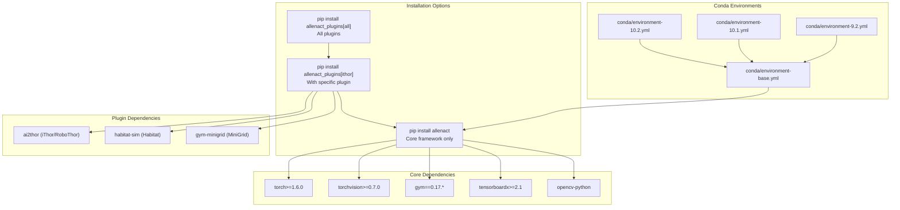

The framework provides flexible installation through setuptools extras, allowing users to install only the components they need. The `allenact_plugins` package depends on the core `allenact` package [allenact_plugins/setup.py:123](), ensuring version compatibility.

### Console Script Entry Point

The core package provides a console script entry point `allenact` that maps to `allenact.main:main` [allenact/setup.py:131](), enabling command-line usage:

```bash
allenact experiment_name -b projects/directory
```

Sources: [allenact/setup.py:112-133](), [allenact_plugins/setup.py:69-127](), [conda/environment-base.yml:1-43](), [requirements.txt:1-35]()

## Supporting Directories

### Project Organization

- **`projects/`** - Contains project-specific experiment configurations and result processing scripts
- **`datasets/`** - Stores task-specific datasets, populated by download scripts  
- **`scripts/`** - Framework-wide utilities for documentation, formatting, and testing
- **`tests/`** - Unit tests for the core `allenact` package
- **`docs/`** - Documentation source files and configuration
- **`overrides/`** - Documentation theme customizations for MkDocs

The `datasets/` directory structure follows plugin organization, with subdirectories like `robothor-pointnav/` created by download scripts [docs/getting_started/structure.md:23-25]().

Sources: [docs/getting_started/structure.md:21-78]()

---

# Page: Getting Started

# Getting Started

<details>
<summary>Relevant source files</summary>

The following files were used as context for generating this wiki page:

- [allenact/setup.py](allenact/setup.py)
- [allenact_plugins/gym_plugin/extra_environment.yml](allenact_plugins/gym_plugin/extra_environment.yml)
- [allenact_plugins/setup.py](allenact_plugins/setup.py)
- [conda/environment-10.1.yml](conda/environment-10.1.yml)
- [conda/environment-10.2.yml](conda/environment-10.2.yml)
- [conda/environment-9.2.yml](conda/environment-9.2.yml)
- [conda/environment-base.yml](conda/environment-base.yml)
- [docs/getting_started/abstractions.md](docs/getting_started/abstractions.md)
- [docs/getting_started/running-your-first-experiment.md](docs/getting_started/running-your-first-experiment.md)
- [docs/getting_started/structure.md](docs/getting_started/structure.md)
- [docs/howtos/changing-rewards-and-losses.md](docs/howtos/changing-rewards-and-losses.md)
- [docs/howtos/defining-a-new-model.md](docs/howtos/defining-a-new-model.md)
- [docs/howtos/defining-a-new-task.md](docs/howtos/defining-a-new-task.md)
- [docs/howtos/defining-an-experiment.md](docs/howtos/defining-an-experiment.md)
- [main.py](main.py)
- [requirements.txt](requirements.txt)

</details>


This page provides an overview of how to begin using AllenAct, from installation through running your first experiment. It covers the essential concepts and entry points needed to start training embodied AI agents. 

For detailed installation instructions across different environments, see [Installation and Setup](#2.1). For a step-by-step guide to running a complete experiment, see [Running Your First Experiment](#2.2). For comprehensive information about the core abstractions used throughout the framework, see page 4.

## Framework Overview

AllenAct is structured around a central training engine that orchestrates experiments defined through configuration classes. The framework separates core functionality (`allenact` package) from environment-specific implementations (`allenact_plugins` package).

**Main Entry Point and Training Flow**

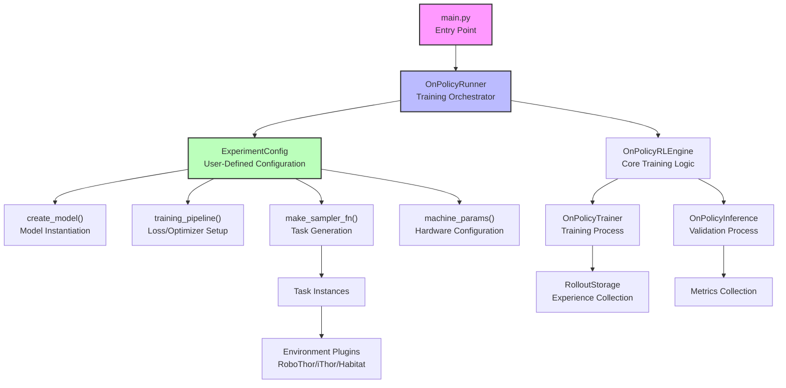

Sources: [main.py:1-8](), [docs/getting_started/running-your-first-experiment.md:1-52](), [docs/getting_started/abstractions.md:1-86]()

## Package Structure and Key Files

AllenAct's codebase is organized into distinct packages with clear separation of concerns:

**Core Framework Architecture**

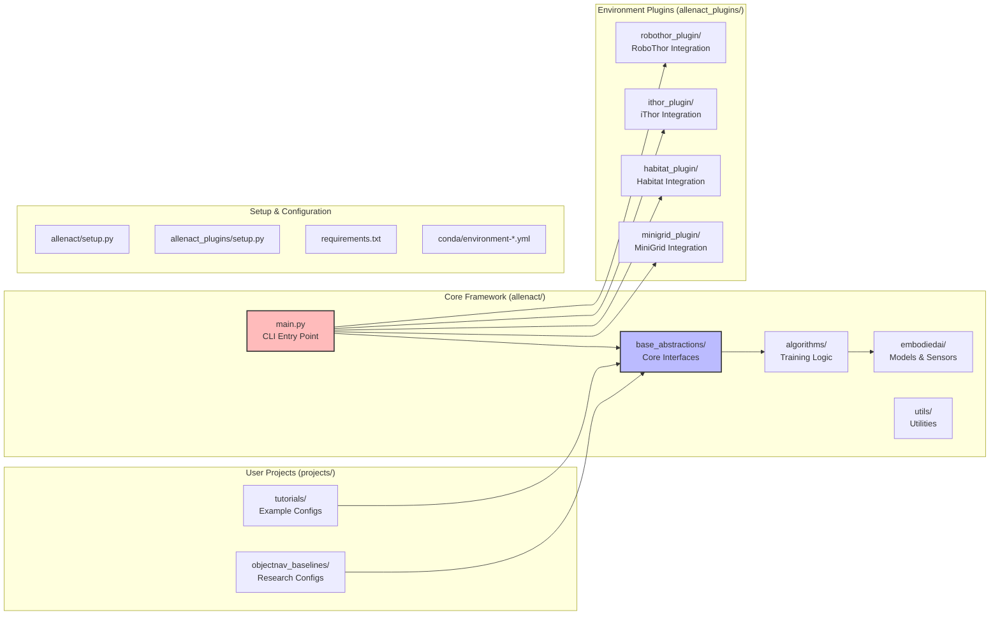

Sources: [docs/getting_started/structure.md:1-79](), [allenact/setup.py:1-138](), [allenact_plugins/setup.py:1-132]()

| Package | Purpose | Key Components |
|---------|---------|----------------|
| `allenact` | Core framework | Training algorithms, base abstractions, models |
| `allenact_plugins` | Environment integrations | RoboThor, iThor, Habitat, MiniGrid plugins |
| `projects` | User experiments | Tutorial configs, baseline implementations |
| `datasets` | Task-specific data | Navigation datasets, scene definitions |
| `scripts` | Build utilities | Documentation, formatting, testing scripts |

## Installation Overview

AllenAct supports installation through multiple methods depending on your needs:

### Package Installation Options

1. **Core Framework Only**: Install just `allenact` for custom environments
2. **With Environment Plugins**: Install `allenact_plugins[ENVIRONMENT]` for specific simulators
3. **Full Installation**: Install all plugins with `allenact_plugins[all]`

The framework requires Python 3.6+ and PyTorch 1.6+. CUDA support is optional but recommended for training.

**Dependency Structure**

| Component | Dependencies | Installation Command |
|-----------|-------------|---------------------|
| Core Framework | PyTorch, TensorboardX, OpenCV | `pip install allenact` |
| RoboThor Plugin | AI2-THOR | `pip install allenact_plugins[robothor]` |
| Habitat Plugin | Habitat-Sim | `pip install allenact_plugins[habitat]` |
| All Plugins | All simulators | `pip install allenact_plugins[all]` |

For detailed installation instructions including Conda environments and CUDA configurations, see [Installation and Setup](#2.1).

Sources: [allenact/setup.py:112-133](), [allenact_plugins/setup.py:68-83](), [requirements.txt:1-35](), [conda/environment-base.yml:1-43]()

## Running Your First Experiment

AllenAct experiments are launched through the `main.py` entry point with an experiment configuration name. The framework includes tutorial experiments that demonstrate core functionality.

### Basic Command Structure

```bash
PYTHONPATH=. python allenact/main.py EXPERIMENT_NAME -b PROJECT_DIR [OPTIONS]
```

**Command Line Arguments**

| Argument | Purpose | Example |
|----------|---------|---------|
| `EXPERIMENT_NAME` | Configuration class name | `minigrid_tutorial` |
| `-b PROJECT_DIR` | Base directory for configs | `-b projects/tutorials` |
| `-o OUTPUT_DIR` | Output directory | `-o experiment_output/minigrid` |
| `-m PROCESSES` | Number of processes | `-m 8` |
| `-s SEED` | Random seed | `-s 12345` |

### Tutorial Experiment

The simplest way to verify your installation is to run the MiniGrid tutorial:

```bash
PYTHONPATH=. python allenact/main.py minigrid_tutorial -b projects/tutorials -m 8 -o experiment_output/minigrid -s 12345
```

This command will:
1. Load the `minigrid_tutorial` experiment configuration from `projects/tutorials/`
2. Train a simple navigation agent in MiniGrid environments
3. Save checkpoints and logs to `experiment_output/minigrid/`
4. Use 8 parallel processes for faster training

For a complete walkthrough of this tutorial, see [Running Your First Experiment](#2.2).

Sources: [main.py:1-8](), [docs/getting_started/running-your-first-experiment.md:6-17]()

## Key Concepts for New Users

### ExperimentConfig: The Central Abstraction

All AllenAct experiments are defined by subclassing `ExperimentConfig`. This class provides methods that the training system calls to configure your experiment:

**Essential ExperimentConfig Methods**

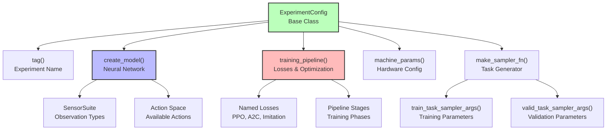

Sources: [docs/getting_started/abstractions.md:11-22](), [docs/howtos/defining-an-experiment.md:40-49]()

### Task and Environment System

AllenAct separates task definition (what the agent should accomplish) from environment implementation (how the agent interacts with the world):

- **Tasks**: Define goals, rewards, and termination conditions
- **TaskSamplers**: Generate sequences of task instances
- **Environments**: Provide simulation capabilities (RoboThor, iThor, Habitat, etc.)
- **Sensors**: Extract observations from environments or tasks

### Training Pipeline Components

The framework uses a flexible pipeline system that supports:
- Multiple loss functions (PPO, A2C, Imitation Learning)
- Multi-stage training (e.g., DAgger followed by PPO)
- Auxiliary tasks for improved learning
- Distributed training across multiple GPUs/machines

## Next Steps

1. **Set up your environment**: Follow the detailed instructions in [Installation and Setup](#2.1)
2. **Run the tutorial**: Complete the walkthrough in [Running Your First Experiment](#2.2)
3. **Explore the tutorials**: See page 7 for step-by-step tutorials on different types of experiments
4. **Learn the core abstractions**: Review page 4 for detailed information about Tasks, Sensors, and Models
5. **Understand the training system**: See page 3 for in-depth coverage of the training architecture

Sources: [docs/getting_started/structure.md:1-79](), [docs/getting_started/abstractions.md:1-86]()

---

# Page: Installation and Setup

# Installation and Setup

<details>
<summary>Relevant source files</summary>

The following files were used as context for generating this wiki page:

- [allenact/setup.py](allenact/setup.py)
- [allenact_plugins/gym_plugin/extra_environment.yml](allenact_plugins/gym_plugin/extra_environment.yml)
- [allenact_plugins/setup.py](allenact_plugins/setup.py)
- [conda/environment-10.1.yml](conda/environment-10.1.yml)
- [conda/environment-10.2.yml](conda/environment-10.2.yml)
- [conda/environment-9.2.yml](conda/environment-9.2.yml)
- [conda/environment-base.yml](conda/environment-base.yml)
- [datasets/download_navigation_datasets.sh](datasets/download_navigation_datasets.sh)
- [docs/installation/download-datasets.md](docs/installation/download-datasets.md)
- [docs/installation/installation-allenact.md](docs/installation/installation-allenact.md)
- [docs/installation/installation-framework.md](docs/installation/installation-framework.md)
- [docs/tutorials/training-a-pointnav-model.md](docs/tutorials/training-a-pointnav-model.md)
- [docs/tutorials/transfering-to-a-different-environment-framework.md](docs/tutorials/transfering-to-a-different-environment-framework.md)
- [requirements.txt](requirements.txt)

</details>


This document provides detailed installation instructions for AllenAct, including the core framework, plugins, and environment-specific configurations. It covers multiple installation approaches to accommodate different use cases, from basic framework usage to full development setups with all supported simulation environments.

For information about running your first experiment after installation, see [Running Your First Experiment](#2.2). For environment-specific configuration details, see the individual environment sections under [Simulation Environments](#5).

## Installation Overview

AllenAct supports three primary installation approaches, each targeting different user needs and development workflows:

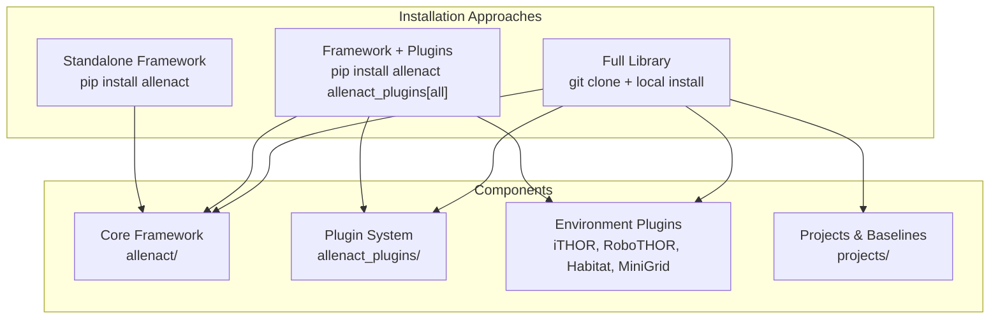

Sources: [docs/installation/installation-allenact.md:19-32](), [allenact/setup.py:86-133](), [allenact_plugins/setup.py:98-127]()

## System Requirements

| Component | Requirements |
|-----------|-------------|
| Python Version | 3.6, 3.7, 3.8, 3.9, or 3.10 |
| PyTorch | ≥1.6.0, !=1.8.0, <2.0.0 |
| CUDA | Optional, auto-detected or manual configuration |
| Memory | ≥8GB RAM recommended for training |
| Storage | ≥10GB for full installation with datasets |

The framework automatically detects available hardware and configures GPU usage accordingly. For older CUDA versions, manual PyTorch installation may be required.

Sources: [allenact/setup.py:100-105](), [allenact/setup.py:113-128](), [docs/installation/installation-allenact.md:3-10]()

## Standalone Framework Installation

The minimal installation provides core AllenAct functionality without environment-specific plugins:

```bash
pip install allenact
```

This installs the essential components defined in the core setup configuration:

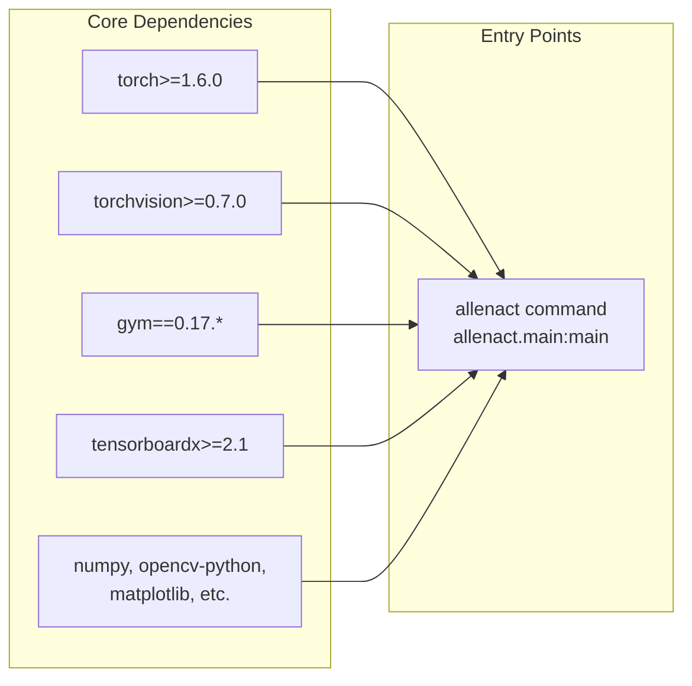

For bleeding-edge installations directly from GitHub:

```bash
pip install -e "git+https://github.com/allenai/allenact.git@main#egg=allenact&subdirectory=allenact"
```

Sources: [docs/installation/installation-allenact.md:34-43](), [allenact/setup.py:112-128](), [allenact/setup.py:131]()

## Framework and Plugins Installation

To install AllenAct with environment plugins for simulation support:

```bash
# Install all available plugins
pip install allenact allenact_plugins[all]

# Install specific plugins only
pip install allenact allenact_plugins[ithor,minigrid]
```

The plugin system dynamically discovers and configures available environments:

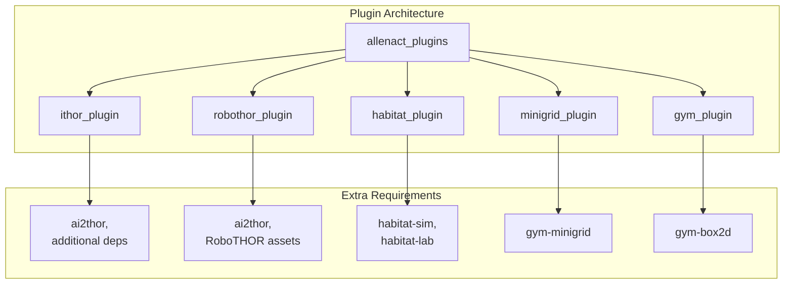

Sources: [docs/installation/installation-allenact.md:64-81](), [allenact_plugins/setup.py:69-83]()

## Full Library Installation

For development and access to all baselines and projects:

```bash
git clone git@github.com:allenai/allenact.git
cd allenact
```

### Using pip

Install core requirements and development dependencies:

```bash
pip install -r requirements.txt
pip install -r dev_requirements.txt
```

Install plugin-specific requirements:

```bash
pip install -r allenact_plugins/<PLUGIN_NAME>_plugin/extra_requirements.txt
```

### Using conda

Set up a conda environment with all dependencies:

```bash
export MY_ENV_NAME=allenact
export CONDA_BASE="$(dirname $(dirname "${CONDA_EXE}"))"
export PIP_SRC="${CONDA_BASE}/envs/${MY_ENV_NAME}/pipsrc"
conda env create --file ./conda/environment-base.yml --name $MY_ENV_NAME
```

For specific CUDA versions:

```bash
conda env update --file ./conda/environment-<CUDA_VERSION>.yml --name allenact
```

Available environment files:

| File | Purpose |
|------|---------|
| `environment-base.yml` | Base dependencies with latest CUDA |
| `environment-dev.yml` | Development dependencies |
| `environment-cpu.yml` | CPU-only installation |
| `environment-9.2.yml` | CUDA 9.2 compatibility |
| `environment-10.1.yml` | CUDA 10.1 compatibility |
| `environment-10.2.yml` | CUDA 10.2 compatibility |

Sources: [docs/installation/installation-allenact.md:84-172](), [conda/environment-base.yml:1-43](), [conda/environment-10.2.yml:1-8]()

## Environment-Specific Setup

### iTHOR/RoboTHOR Configuration

For headless server environments without attached displays:

```bash
sudo python scripts/startx.py &
```

The AI2-THOR environments automatically download required assets on first use.

### Habitat Installation

Install Habitat components after setting up the base environment:

```bash
# For machines with display
conda env update --file allenact_plugins/habitat_plugin/extra_environment.yml --name $MY_ENV_NAME

# For headless servers
conda env update --file allenact_plugins/habitat_plugin/extra_environment_headless.yml --name $MY_ENV_NAME
```

Additional requirements include downloading scene assets (Gibson/Matterport) and task datasets separately.

### MiniGrid Setup

MiniGrid environments require minimal additional configuration and work out-of-the-box after plugin installation.

Sources: [docs/installation/installation-framework.md:11-104](), [allenact_plugins/gym_plugin/extra_environment.yml:1-6]()

## Dataset Installation

AllenAct provides automated scripts for downloading navigation datasets:

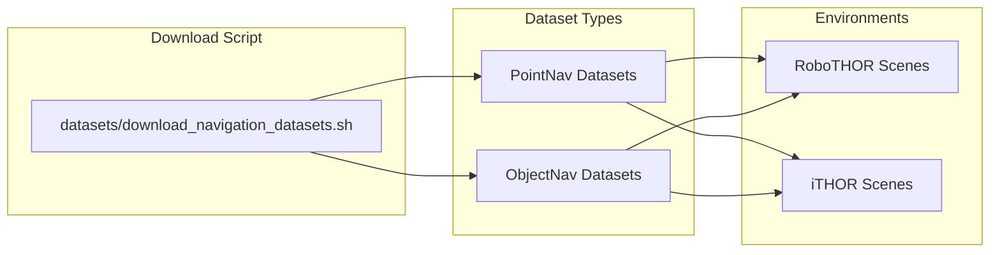

Download specific datasets:

```bash
# RoboTHOR PointNav
bash datasets/download_navigation_datasets.sh robothor-pointnav

# iTHOR ObjectNav  
bash datasets/download_navigation_datasets.sh ithor-objectnav

# All THOR datasets
bash datasets/download_navigation_datasets.sh all-thor
```

The script automatically:
1. Downloads compressed dataset archives
2. Extracts them to appropriate directories
3. Generates debug datasets for testing

Sources: [datasets/download_navigation_datasets.sh:1-65](), [docs/installation/download-datasets.md:16-47]()

## Installation Verification

Verify your installation by running a simple experiment:

```bash
# Activate your environment (if using conda)
conda activate allenact

# Test with MiniGrid tutorial
PYTHONPATH=. python allenact/main.py training_a_pointnav_model -o storage/test -b projects/tutorials

# Check available plugins
python -c "import allenact_plugins; print('Plugins installed successfully')"
```

The installation is complete when:
- The `allenact` command is available
- Required plugins import without errors
- Test experiments can be launched
- Datasets are accessible in the `datasets/` directory

Sources: [docs/tutorials/training-a-pointnav-model.md:534-540](), [allenact/setup.py:131]()

---

# Page: Running Your First Experiment

# Running Your First Experiment

<details>
<summary>Relevant source files</summary>

The following files were used as context for generating this wiki page:

- [docs/getting_started/abstractions.md](docs/getting_started/abstractions.md)
- [docs/getting_started/running-your-first-experiment.md](docs/getting_started/running-your-first-experiment.md)
- [docs/getting_started/structure.md](docs/getting_started/structure.md)
- [docs/howtos/changing-rewards-and-losses.md](docs/howtos/changing-rewards-and-losses.md)
- [docs/howtos/defining-a-new-model.md](docs/howtos/defining-a-new-model.md)
- [docs/howtos/defining-a-new-task.md](docs/howtos/defining-a-new-task.md)
- [docs/howtos/defining-an-experiment.md](docs/howtos/defining-an-experiment.md)
- [main.py](main.py)
- [projects/tutorials/minigrid_tutorial.py](projects/tutorials/minigrid_tutorial.py)

</details>


This page provides a step-by-step guide to executing your first training experiment in AllenAct. It covers the command-line interface, experiment configuration basics, output structure, and monitoring tools needed to get started with training agents.

For detailed information about creating custom experiment configurations, see [Experiment Configuration](#4). For understanding the underlying training architecture, see [Core Training Architecture](#3).

## Quick Start

The simplest way to run your first experiment is using the provided MiniGrid tutorial:

```bash
PYTHONPATH=. python allenact/main.py minigrid_tutorial -b projects/tutorials -m 8 -o experiment_output/minigrid -s 12345
```

This command trains a simple navigation agent in a grid environment and demonstrates all core AllenAct functionality.

**Sources:** [docs/getting_started/running-your-first-experiment.md:6-8](), [projects/tutorials/minigrid_tutorial.py:320-322]()

## Command Line Interface

AllenAct experiments are executed through the main entry point with the following structure:

```bash
PYTHONPATH=. python allenact/main.py <experiment_name> [options]
```

### Core Arguments

| Argument | Description | Example |
|----------|-------------|---------|
| `experiment_name` | Name of experiment config class (without .py extension) | `minigrid_tutorial` |
| `-b, --base_dir` | Directory containing experiment configs | `projects/tutorials` |
| `-o, --output_dir` | Output directory for results and checkpoints | `experiment_output/minigrid` |
| `-s, --seed` | Random seed for reproducibility | `12345` |
| `-m, --max_processes` | Maximum number of worker processes | `8` |

### Evaluation Arguments

| Argument | Description |
|----------|-------------|
| `--eval` | Run in evaluation mode instead of training |
| `--checkpoint` | Path to checkpoint file for evaluation |

**Sources:** [docs/getting_started/running-your-first-experiment.md:12-16](), [projects/tutorials/minigrid_tutorial.py:325-330]()

## Execution Flow

The following diagram shows how command-line arguments flow through AllenAct's execution system:

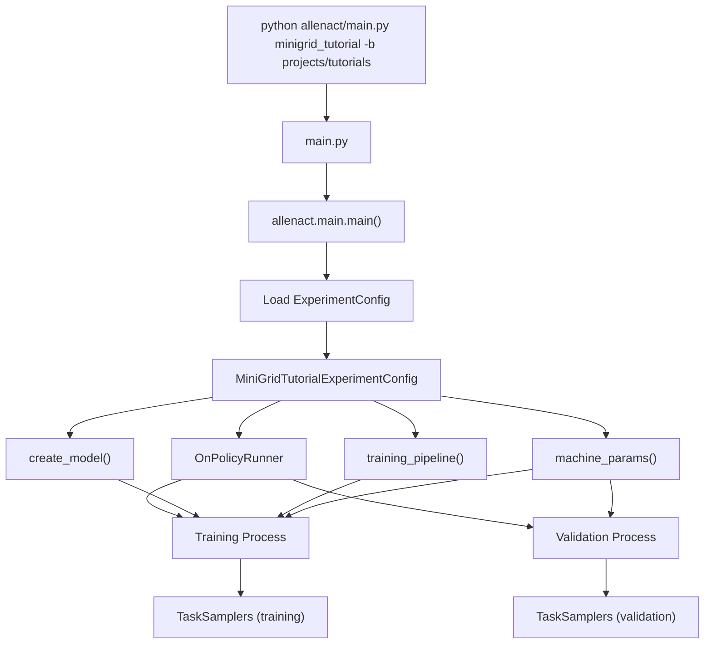

**Sources:** [main.py:1-7](), [projects/tutorials/minigrid_tutorial.py:46-50]()

## Experiment Configuration Basics

Every experiment requires an `ExperimentConfig` class that defines the training setup. The configuration specifies:

### Key Configuration Methods

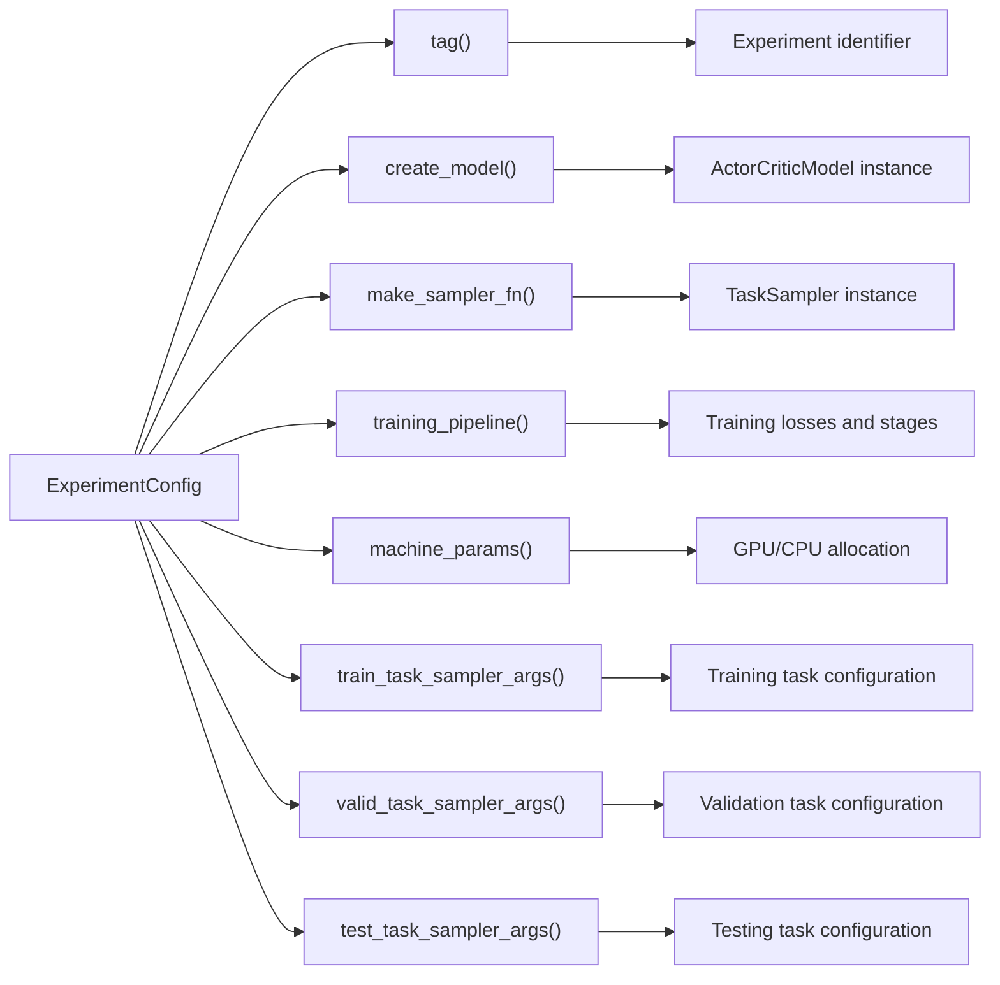

### Example Configuration Structure

The `MiniGridTutorialExperimentConfig` demonstrates the essential components:

- **Sensors**: Define observation types (e.g., `EgocentricMiniGridSensor`)
- **Model**: Actor-critic network architecture (`MiniGridSimpleConvRNN`)
- **Task Sampler**: Environment and task generation (`MiniGridTaskSampler`)
- **Training Pipeline**: Loss functions and optimization (`PPO`)

**Sources:** [projects/tutorials/minigrid_tutorial.py:100-308](), [docs/getting_started/abstractions.md:11-22]()

## Output Structure

When an experiment runs, AllenAct creates a structured output directory:

```
experiment_output/minigrid/
├── checkpoints/
│   └── MiniGridTutorial/
│       └── 2024-01-15_14-30-45/
│           ├── exp_MiniGridTutorial__stage_00__steps_000010000.pt
│           ├── exp_MiniGridTutorial__stage_00__steps_000020000.pt
│           └── ...
├── used_configs/
│   └── MiniGridTutorial/
│       └── 2024-01-15_14-30-45/
│           └── config.json
└── tb/
    └── MiniGridTutorial/
        └── 2024-01-15_14-30-45/
            └── events.out.tfevents.*
```

### Directory Contents

| Directory | Purpose |
|-----------|---------|
| `checkpoints/` | Model weight checkpoints saved during training |
| `used_configs/` | Configuration files used for reproducibility |
| `tb/` | TensorBoard log files for monitoring |

The timestamp format `YYYY-MM-DD_HH-MM-SS` records when the experiment started.

**Sources:** [docs/getting_started/running-your-first-experiment.md:19-26]()

## Monitoring Training Progress

### TensorBoard Integration

Start TensorBoard to monitor training metrics:

```bash
tensorboard --logdir experiment_output/minigrid/tb
```

Access the dashboard at [http://localhost:6006/](http://localhost:6006/).

### Key Metrics to Watch

- **Success Rate**: Percentage of tasks completed successfully
- **Episode Length**: Average number of steps per task
- **Reward**: Cumulative reward per episode
- **Loss Values**: Training loss convergence

For the MiniGrid tutorial, expect:
- Valid success rate converging to 1.0
- Mean episode length below 4 steps
- Training completing in ~150,000 steps

**Sources:** [docs/getting_started/running-your-first-experiment.md:28-44](), [projects/tutorials/minigrid_tutorial.py:332-348]()

## Testing Trained Models

### Evaluation Mode

After training completes, evaluate checkpoints using the `--eval` flag:

```bash
PYTHONPATH=. python allenact/main.py minigrid_tutorial \
    -b projects/tutorials \
    -m 1 \
    -o experiment_output/minigrid \
    -s 12345 \
    --eval \
    --checkpoint experiment_output/minigrid/checkpoints/MiniGridTutorial/2024-01-15_14-30-45/exp_MiniGridTutorial__stage_00__steps_000150000.pt
```

### Evaluation Configuration

The experiment configuration automatically handles evaluation differences:

- **Training**: Infinite task sampling (`max_tasks=None`)
- **Validation**: Fixed task sets (20 tasks)  
- **Testing**: Larger fixed sets (40 tasks)
- **Sampling**: Deterministic for validation/testing, random for training

**Sources:** [projects/tutorials/minigrid_tutorial.py:356-364](), [projects/tutorials/minigrid_tutorial.py:208-241]()

## Process Architecture

AllenAct distributes training across multiple processes for efficiency:

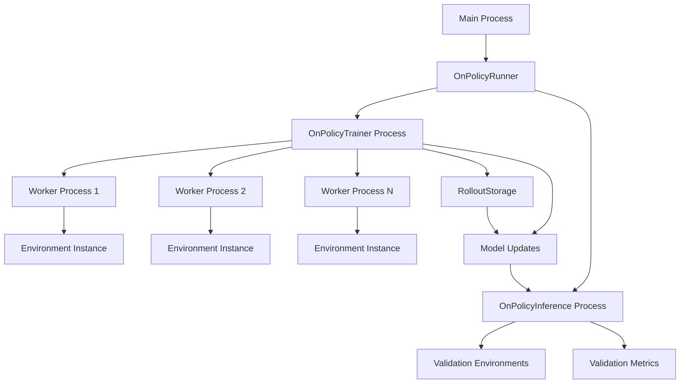

### Process Allocation

The `-m` argument controls process distribution:
- **Training**: 128 task samplers across 8 subprocesses (16 samplers each)
- **Validation**: 16 task samplers for concurrent evaluation
- **Memory**: Each process maintains separate environment instances

**Sources:** [projects/tutorials/minigrid_tutorial.py:268-271](), [docs/getting_started/running-your-first-experiment.md:13-14]()

## Common Issues and Solutions

### Environment Setup

Ensure the Python path includes the AllenAct root:
```bash
PYTHONPATH=. python allenact/main.py ...
```

### Memory and Performance

- Reduce `-m` value if experiencing memory issues
- Use CPU training for simple environments (`devices: []`)
- Monitor GPU memory usage for complex visual environments

### Configuration Errors

- Verify experiment config file exists in specified base directory
- Check that all required dependencies are installed
- Ensure sensor and model compatibility

**Sources:** [projects/tutorials/minigrid_tutorial.py:14-20](), [docs/getting_started/running-your-first-experiment.md:3-4]()

---

# Page: Core Training Architecture

# Core Training Architecture

<details>
<summary>Relevant source files</summary>

The following files were used as context for generating this wiki page:

- [allenact/algorithms/onpolicy_sync/engine.py](allenact/algorithms/onpolicy_sync/engine.py)
- [allenact/algorithms/onpolicy_sync/runner.py](allenact/algorithms/onpolicy_sync/runner.py)
- [allenact/algorithms/onpolicy_sync/storage.py](allenact/algorithms/onpolicy_sync/storage.py)
- [allenact/algorithms/onpolicy_sync/vector_sampled_tasks.py](allenact/algorithms/onpolicy_sync/vector_sampled_tasks.py)
- [allenact/base_abstractions/callbacks.py](allenact/base_abstractions/callbacks.py)
- [allenact/base_abstractions/preprocessor.py](allenact/base_abstractions/preprocessor.py)
- [allenact/base_abstractions/task.py](allenact/base_abstractions/task.py)
- [allenact/embodiedai/mapping/mapping_utils/map_builders.py](allenact/embodiedai/mapping/mapping_utils/map_builders.py)
- [allenact/embodiedai/mapping/mapping_utils/point_cloud_utils.py](allenact/embodiedai/mapping/mapping_utils/point_cloud_utils.py)
- [allenact/main.py](allenact/main.py)
- [allenact/utils/experiment_utils.py](allenact/utils/experiment_utils.py)
- [allenact/utils/misc_utils.py](allenact/utils/misc_utils.py)
- [allenact_plugins/ithor_plugin/ithor_sensors.py](allenact_plugins/ithor_plugin/ithor_sensors.py)
- [allenact_plugins/robothor_plugin/robothor_sensors.py](allenact_plugins/robothor_plugin/robothor_sensors.py)

</details>


This document describes AllenAct's core training system, which is the framework's most critical component responsible for orchestrating reinforcement learning training, validation, and testing processes. The training architecture handles distributed execution, experience collection, model updates, and checkpoint management across multiple environments and workers.

For information about experiment configuration and setup, see [Experiment Configuration](#4). For details about specific simulation environments, see [Simulation Environments](#5). For model architecture details, see [Models and Algorithms](#6).

## System Overview

AllenAct's training architecture is built around a hierarchical system where `OnPolicyRunner` serves as the main orchestrator, spawning and managing multiple `OnPolicyRLEngine` worker processes. Each worker specializes in either training (`OnPolicyTrainer`) or inference (`OnPolicyInference`) tasks.

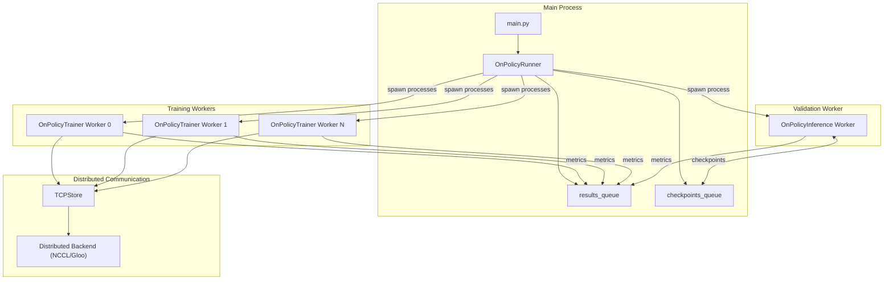

**Training System Architecture Overview**

Sources: [allenact/algorithms/onpolicy_sync/runner.py:80-141](), [allenact/algorithms/onpolicy_sync/engine.py:93-101](), [allenact/main.py:463-525]()

## OnPolicyRunner - Training Orchestration

The `OnPolicyRunner` class serves as the primary controller for the entire training system. It handles process spawning, resource management, and coordination between training and validation workers.

### Runner Initialization and Process Management

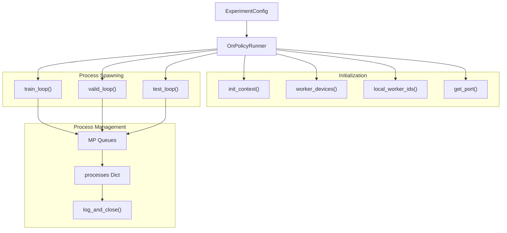

**OnPolicyRunner Process Management Flow**

The `OnPolicyRunner` manages the following key responsibilities:

| Component | Purpose | Implementation |
|-----------|---------|----------------|
| **Process Spawning** | Creates worker processes for training/validation | `start_train()`, `start_test()` methods |
| **Queue Management** | Handles inter-process communication | `mp.Queue` for results and checkpoints |
| **Resource Allocation** | Distributes GPU/CPU devices across workers | `worker_devices()`, `local_worker_ids()` |
| **Distributed Coordination** | Sets up TCP communication for multi-machine training | `get_port()`, distributed IP/port management |

Sources: [allenact/algorithms/onpolicy_sync/runner.py:495-669](), [allenact/algorithms/onpolicy_sync/runner.py:671-769]()

### Training and Validation Process Coordination

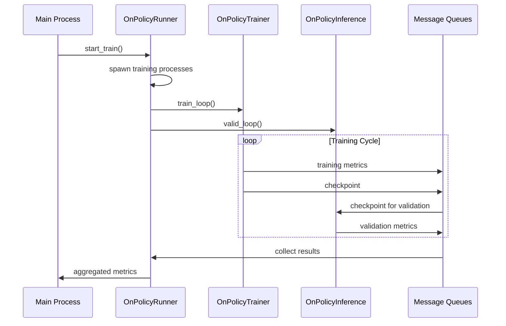

**Training and Validation Coordination Sequence**

Sources: [allenact/algorithms/onpolicy_sync/runner.py:404-429](), [allenact/algorithms/onpolicy_sync/runner.py:432-442](), [allenact/algorithms/onpolicy_sync/runner.py:445-453]()

## OnPolicyRLEngine Architecture

The `OnPolicyRLEngine` serves as the base class for all training and inference workers. It provides the core RL functionality and is specialized into `OnPolicyTrainer` and `OnPolicyInference` subclasses.

### Engine Class Hierarchy

```mermaid
graph TB
    Engine["OnPolicyRLEngine"]
    Trainer["OnPolicyTrainer"]
    Inference["OnPolicyInference"]
    
    subgraph "Core Components"
        ActorCritic["ActorCriticModel"]
        VectorTasks["VectorSampledTasks"]
        Storage["RolloutStorage"]
        Pipeline["TrainingPipeline"]
    end
    
    subgraph "Training Specific"
        Optimizer["optimizer"]
        LRScheduler["lr_scheduler"]
        Updates["compute_losses_track_them_and_backprop()"]
    end
    
    subgraph "Distributed Training"
        TCPStore["TCPStore"]
        DistBackend["Distributed Backend"]
        AllReduce["distributed_weighted_sum()"]
    end
    
    Engine --> Trainer
    Engine --> Inference
    
    Engine --> ActorCritic
    Engine --> VectorTasks
    Engine --> Storage
    Engine --> Pipeline
    
    Trainer --> Optimizer
    Trainer --> LRScheduler
    Trainer --> Updates
    
    Engine --> TCPStore
    TCPStore --> DistBackend
    Engine --> AllReduce
```

**OnPolicyRLEngine Class Architecture**

### Core Engine Functionality

The `OnPolicyRLEngine` implements several critical systems:

| System | Purpose | Key Methods |
|--------|---------|-------------|
| **Experience Collection** | Manages interaction with environments | `collect_step_across_all_task_samplers()` |
| **Model Management** | Handles neural network operations | `act()`, model loading/saving |
| **Storage Integration** | Coordinates with experience storage | `initialize_storage_and_viz()` |
| **Distributed Communication** | Handles multi-worker coordination | `distributed_weighted_sum()`, `distributed_reduce()` |

Sources: [allenact/algorithms/onpolicy_sync/engine.py:103-281](), [allenact/algorithms/onpolicy_sync/engine.py:532-547]()

### Training vs Inference Specialization

```mermaid
graph LR
    subgraph "OnPolicyTrainer"
        TrainMethod["train()"]
        BackpropStep["backprop_step()"]
        LossComputation["compute_losses_track_them_and_backprop()"]
        OptimStep["optimizer.step()"]
    end
    
    subgraph "OnPolicyInference"
        ProcessCheckpoints["process_checkpoints()"]
        RunEval["run_eval()"]
        EvalLoop["evaluation loop"]
    end
    
    subgraph "Shared Base"
        CollectStep["collect_step_across_all_task_samplers()"]
        AggregateLogs["aggregate_and_send_logging_package()"]
        ModelAct["act()"]
    end
    
    TrainMethod --> CollectStep
    ProcessCheckpoints --> CollectStep
    CollectStep --> AggregateLogs
    CollectStep --> ModelAct
```

**Training vs Inference Specialization**

Sources: [allenact/algorithms/onpolicy_sync/engine.py:823-966]()

## Experience Collection and Storage

The training system uses `VectorSampledTasks` to manage multiple environment instances and `RolloutStorage` to accumulate experience for training updates.

### VectorSampledTasks Architecture

```mermaid
graph TB
    subgraph "Main Process"
        VST["VectorSampledTasks"]
        ConnectionReads["connection_read_fns"]
        ConnectionWrites["connection_write_fns"]
    end
    
    subgraph "Worker Processes"
        Worker1["Worker Process 1"]
        Worker2["Worker Process 2"]
        WorkerN["Worker Process N"]
    end
    
    subgraph "SingleProcess Components"
        SPVST["SingleProcessVectorSampledTasks"]
        TaskSamplers["TaskSampler instances"]
        Tasks["Task instances"]
    end
    
    VST --> ConnectionReads
    VST --> ConnectionWrites
    
    ConnectionWrites -->|"commands"| Worker1
    ConnectionWrites -->|"commands"| Worker2
    ConnectionWrites -->|"commands"| WorkerN
    
    Worker1 -->|"results"| ConnectionReads
    Worker2 -->|"results"| ConnectionReads
    WorkerN -->|"results"| ConnectionReads
    
    Worker1 --> SPVST
    Worker2 --> SPVST
    WorkerN --> SPVST
    
    SPVST --> TaskSamplers
    TaskSamplers --> Tasks
```

**VectorSampledTasks Multiprocess Architecture**

The `VectorSampledTasks` system handles:

- **Process Management**: Spawns worker processes using `_spawn_workers()`
- **Command Distribution**: Sends actions via `step()`, `call_at()`, etc.
- **Result Aggregation**: Collects observations and rewards from all workers
- **Task Lifecycle**: Manages task completion and resampling via `auto_resample_when_done`

Sources: [allenact/algorithms/onpolicy_sync/vector_sampled_tasks.py:116-259](), [allenact/algorithms/onpolicy_sync/vector_sampled_tasks.py:329-422]()

### RolloutStorage and Experience Management

```mermaid
graph TD
    subgraph "Storage Components"
        Storage["RolloutStorage"]
        Observations["observations"]
        Actions["actions"]
        Rewards["rewards"]
        Values["value_preds"]
        Masks["masks"]
        Memory["memory_first_last"]
    end
    
    subgraph "Update Process"
        BeforeUpdates["before_updates()"]
        ComputeReturns["compute_returns()"]
        ComputeAdvantages["compute advantages"]
        BatchGenerator["batched_experience_generator()"]
        AfterUpdates["after_updates()"]
    end
    
    subgraph "Data Flow"
        Add["add()"]
        SamplerSelect["sampler_select()"]
        AgentInput["agent_input_for_next_step()"]
    end
    
    Storage --> Observations
    Storage --> Actions
    Storage --> Rewards
    Storage --> Values
    Storage --> Masks
    Storage --> Memory
    
    Add --> Storage
    Storage --> SamplerSelect
    Storage --> AgentInput
    
    Storage --> BeforeUpdates
    BeforeUpdates --> ComputeReturns
    BeforeUpdates --> ComputeAdvantages
    Storage --> BatchGenerator
    Storage --> AfterUpdates
```

**RolloutStorage Experience Management**

The `RolloutStorage` provides:

| Function | Purpose | Key Features |
|----------|---------|-------------|
| **Experience Accumulation** | Stores agent trajectories | Dynamic storage sizing, multi-sampler support |
| **Advantage Computation** | Calculates GAE advantages | Configurable γ and λ parameters |
| **Batch Generation** | Creates mini-batches for training | Supports both mini-batch and streaming modes |
| **Memory Management** | Handles recurrent model states | First/last memory storage for RNNs |

Sources: [allenact/algorithms/onpolicy_sync/storage.py:130-567](), [allenact/algorithms/onpolicy_sync/storage.py:438-501]()

## Distributed Training System

AllenAct supports distributed training across multiple machines and GPUs using PyTorch's distributed backend with `TCPStore` for coordination.

### Distributed Communication Architecture

```mermaid
graph TB
    subgraph "Machine 0 (Master)"
        Master["OnPolicyRunner machine_id=0"]
        MasterWorkers["Training Workers 0-N"]
        TCPServer["TCPStore Server"]
    end
    
    subgraph "Machine 1"
        Worker1["OnPolicyRunner machine_id=1"]
        M1Workers["Training Workers"]
        TCPClient1["TCPStore Client"]
    end
    
    subgraph "Machine K"
        WorkerK["OnPolicyRunner machine_id=K"]
        MKWorkers["Training Workers"]
        TCPClientK["TCPStore Client"]
    end
    
    subgraph "Communication Layer"
        DistBackend["PyTorch Distributed Backend"]
        AllReduce["All-Reduce Operations"]
        Barrier["Barrier Synchronization"]
    end
    
    Master --> TCPServer
    Worker1 --> TCPClient1
    WorkerK --> TCPClientK
    
    TCPServer <--> TCPClient1
    TCPServer <--> TCPClientK
    
    MasterWorkers --> DistBackend
    M1Workers --> DistBackend
    MKWorkers --> DistBackend
    
    DistBackend --> AllReduce
    DistBackend --> Barrier
```

**Distributed Training Communication Architecture**

### Distributed Training Coordination

The distributed training system coordinates through several mechanisms:

| Component | Purpose | Implementation |
|-----------|---------|----------------|
| **TCPStore** | Shared key-value store for coordination | `torch.distributed.TCPStore` with master/worker setup |
| **Process Groups** | Grouped communication for workers | NCCL for GPU, Gloo for CPU/testing |
| **All-Reduce** | Gradient synchronization | `distributed_weighted_sum()`, `distributed_reduce()` |
| **Barriers** | Synchronization points | Used before loss computation and updates |

```mermaid
sequenceDiagram
    participant M as Machine 0 (Master)
    participant W1 as Machine 1 Worker
    participant W2 as Machine 2 Worker
    participant Store as TCPStore
    
    M->>Store: Initialize TCPStore server
    W1->>Store: Connect as client
    W2->>Store: Connect as client
    
    loop Training Step
        M->>Store: Barrier sync
        W1->>Store: Barrier sync  
        W2->>Store: Barrier sync
        
        Note over M,W2: Collect experiences in parallel
        
        M->>Store: All-reduce gradients
        W1->>Store: All-reduce gradients
        W2->>Store: All-reduce gradients
        
        Note over M,W2: Apply synchronized updates
    end
```

**Distributed Training Synchronization Sequence**

Sources: [allenact/algorithms/onpolicy_sync/engine.py:242-274](), [allenact/algorithms/onpolicy_sync/engine.py:776-802]()

## Training Pipeline and Configuration

The training system is configured through `TrainingPipeline` and `PipelineStage` objects that define losses, learning schedules, and training progression.

### Pipeline Architecture

```mermaid
graph TB
    subgraph "TrainingPipeline"
        Pipeline["TrainingPipeline"]
        Stages["pipeline_stages[]"]
        Losses["named_losses Dict"]
        Storage["storage_uuid_to_storage"]
    end
    
    subgraph "PipelineStage"
        Stage["PipelineStage"]
        LossNames["loss_names"]
        MaxSteps["max_stage_steps"]
        TrainingSettings["training_settings"]
        StageComponents["stage_components"]
    end
    
    subgraph "StageComponent"
        Component["StageComponent"]
        ComponentUUID["uuid"]
        ComponentLosses["loss_names"]
        ComponentSettings["training_settings"]
    end
    
    subgraph "Training Execution"
        CurrentStage["current_stage"]
        StepsTaken["steps_taken_in_stage"]
        EarlyStop["early_stopping_criterion"]
    end
    
    Pipeline --> Stages
    Pipeline --> Losses
    Pipeline --> Storage
    
    Stages --> Stage
    Stage --> LossNames
    Stage --> MaxSteps
    Stage --> TrainingSettings
    Stage --> StageComponents
    
    StageComponents --> Component
    Component --> ComponentUUID
    Component --> ComponentLosses
    Component --> ComponentSettings
    
    Pipeline --> CurrentStage
    Stage --> StepsTaken
    Stage --> EarlyStop
```

**Training Pipeline Configuration Architecture**

### Pipeline Execution Flow

The training pipeline executes in stages with configurable loss functions and training settings:

| Stage Element | Purpose | Configuration |
|---------------|---------|---------------|
| **Loss Functions** | Define training objectives | PPO, A2C, auxiliary losses |
| **Training Settings** | Control update parameters | Learning rate, batch size, update repeats |
| **Early Stopping** | Terminate stages early | Custom criteria based on metrics |
| **Stage Components** | Custom training components | Override settings per component |

Sources: [allenact/utils/experiment_utils.py:612-814](), [allenact/utils/experiment_utils.py:469-494](), [allenact/utils/experiment_utils.py:570-610]()

## Process Lifecycle and Error Handling

The training system includes robust process management with graceful shutdown and error recovery mechanisms.

### Process Management and Cleanup

```mermaid
graph TD
    subgraph "Process Initialization"
        InitProcess["init_process()"]
        SignalHandlers["SIGTERM/SIGINT handlers"]
        ProcessTitle["setproctitle()"]
    end
    
    subgraph "Normal Operation"
        TrainingLoop["Training/Validation Loop"]
        QueueComm["Queue Communication"]
        ResultsCollection["Results Collection"]
    end
    
    subgraph "Error Handling"
        ExceptionCatch["Exception Handling"]
        RestartLogic["try_restart_after_task_error"]
        ErrorLogging["Error Logging"]
    end
    
    subgraph "Cleanup"
        GracefulClose["Graceful Shutdown"]
        ResourceCleanup["Resource Cleanup"]
        ProcessExit["Process Exit"]
    end
    
    InitProcess --> SignalHandlers
    InitProcess --> ProcessTitle
    SignalHandlers --> TrainingLoop
    
    TrainingLoop --> QueueComm
    QueueComm --> ResultsCollection
    
    TrainingLoop --> ExceptionCatch
    ExceptionCatch --> RestartLogic
    ExceptionCatch --> ErrorLogging
    
    SignalHandlers --> GracefulClose
    GracefulClose --> ResourceCleanup
    ResourceCleanup --> ProcessExit
```

**Process Lifecycle and Error Handling**

The system provides comprehensive process management including:

- **Signal Handling**: Graceful shutdown on SIGTERM/SIGINT
- **Error Recovery**: Optional restart after task errors
- **Resource Cleanup**: Proper cleanup of multiprocessing resources
- **Logging Integration**: Comprehensive error logging and debugging support

Sources: [allenact/algorithms/onpolicy_sync/runner.py:342-377](), [allenact/algorithms/onpolicy_sync/runner.py:379-392](), [allenact/algorithms/onpolicy_sync/engine.py:125-157]()

---

# Page: OnPolicyRunner and Training Orchestration

# OnPolicyRunner and Training Orchestration

<details>
<summary>Relevant source files</summary>

The following files were used as context for generating this wiki page:

- [allenact/algorithms/onpolicy_sync/engine.py](allenact/algorithms/onpolicy_sync/engine.py)
- [allenact/algorithms/onpolicy_sync/runner.py](allenact/algorithms/onpolicy_sync/runner.py)
- [allenact/algorithms/onpolicy_sync/storage.py](allenact/algorithms/onpolicy_sync/storage.py)
- [allenact/algorithms/onpolicy_sync/vector_sampled_tasks.py](allenact/algorithms/onpolicy_sync/vector_sampled_tasks.py)
- [allenact/base_abstractions/callbacks.py](allenact/base_abstractions/callbacks.py)
- [allenact/base_abstractions/preprocessor.py](allenact/base_abstractions/preprocessor.py)
- [allenact/base_abstractions/task.py](allenact/base_abstractions/task.py)
- [allenact/embodiedai/mapping/mapping_utils/map_builders.py](allenact/embodiedai/mapping/mapping_utils/map_builders.py)
- [allenact/embodiedai/mapping/mapping_utils/point_cloud_utils.py](allenact/embodiedai/mapping/mapping_utils/point_cloud_utils.py)
- [allenact/main.py](allenact/main.py)
- [allenact/utils/experiment_utils.py](allenact/utils/experiment_utils.py)
- [allenact/utils/misc_utils.py](allenact/utils/misc_utils.py)
- [allenact_plugins/ithor_plugin/ithor_sensors.py](allenact_plugins/ithor_plugin/ithor_sensors.py)
- [allenact_plugins/robothor_plugin/robothor_sensors.py](allenact_plugins/robothor_plugin/robothor_sensors.py)
- [main.py](main.py)

</details>


This document covers the `OnPolicyRunner` class and its role as the central orchestrator for training, validation, and testing in AllenAct. The `OnPolicyRunner` manages the lifecycle of distributed training processes, coordinates communication between components, and handles experiment state management.

For information about the specific RL training algorithms and loss computation, see [OnPolicyRLEngine and Training Logic](#3.2). For details on distributed training mechanics, see [Distributed Training System](#3.3).

## System Overview

The `OnPolicyRunner` serves as the main coordinator that:
- Spawns and manages training/validation worker processes  
- Handles distributed training coordination across multiple machines
- Manages inter-process communication via queues
- Orchestrates experiment lifecycle (initialization, checkpointing, logging, cleanup)
- Integrates with the experiment configuration system

```mermaid
graph TD
    subgraph "Main Process"
        MAIN["main()"] --> RUNNER["OnPolicyRunner"]
        RUNNER --> CONFIG["ExperimentConfig"]
        RUNNER --> QUEUES["results_queue<br/>checkpoints_queue"]
    end
    
    subgraph "Training Processes"
        TRAINER1["OnPolicyTrainer<br/>Worker 0"]
        TRAINER2["OnPolicyTrainer<br/>Worker 1"]
        TRAINERN["OnPolicyTrainer<br/>Worker N"]
    end
    
    subgraph "Validation Process"
        VALIDATOR["OnPolicyInference<br/>Validation"]
    end
    
    subgraph "Communication Layer"
        TCPSTORE["torch.distributed.TCPStore"]
        MPQUEUE["multiprocessing.Queue"]
    end
    
    RUNNER -->|"spawn via mp_ctx.Process"| TRAINER1
    RUNNER -->|"spawn via mp_ctx.Process"| TRAINER2  
    RUNNER -->|"spawn via mp_ctx.Process"| TRAINERN
    RUNNER -->|"spawn via mp_ctx.Process"| VALIDATOR
    
    TRAINER1 --> TCPSTORE
    TRAINER2 --> TCPSTORE
    TRAINERN --> TCPSTORE
    
    TRAINER1 --> MPQUEUE
    TRAINER2 --> MPQUEUE
    TRAINERN --> MPQUEUE
    VALIDATOR --> MPQUEUE
    
    MPQUEUE --> QUEUES
```

**OnPolicyRunner Process Orchestration**

Sources: [allenact/algorithms/onpolicy_sync/runner.py:80-151](), [allenact/main.py:474-521]()

## OnPolicyRunner Architecture

The `OnPolicyRunner` class is instantiated from the main entry point and coordinates the entire training pipeline:

```mermaid
graph TB
    subgraph "OnPolicyRunner Responsibilities"
        INIT["__init__()<br/>• Configure multiprocessing<br/>• Setup distributed params<br/>• Initialize queues"]
        TRAIN["start_train()<br/>• Spawn training workers<br/>• Spawn validation worker<br/>• Coordinate logging"]
        TEST["start_test()<br/>• Spawn testing workers<br/>• Process checkpoints<br/>• Collect results"]
        MGMT["Process Management<br/>• worker_devices()<br/>• local_worker_ids()<br/>• Signal handling"]
    end
    
    subgraph "Key Configuration"
        CONFIG["ExperimentConfig"]
        MACHINE["MachineParams"]
        PIPELINE["TrainingPipeline"]
    end
    
    subgraph "Process Communication"
        RESULTS["results_queue<br/>LoggingPackage"]
        CHECKPOINTS["checkpoints_queue<br/>checkpoint paths"]
        DISTRIBUTED["distributed_ip_and_port<br/>TCPStore coordination"]
    end
    
    INIT --> CONFIG
    INIT --> MACHINE
    TRAIN --> RESULTS
    TRAIN --> CHECKPOINTS
    TRAIN --> DISTRIBUTED
    TEST --> RESULTS
    TEST --> CHECKPOINTS
```

**OnPolicyRunner Core Architecture**

### Key Attributes and Methods

| Component | Purpose | Key Methods/Attributes |
|-----------|---------|----------------------|
| `config` | Experiment configuration | `ExperimentConfig` instance |
| `mp_ctx` | Multiprocessing context | `multiprocessing.get_context()` |
| `queues` | Inter-process communication | `results_queue`, `checkpoints_queue` |
| `processes` | Worker process tracking | `Dict[str, List[BaseProcess]]` |
| `distributed_ip_and_port` | Distributed coordination | TCP address for worker sync |

Sources: [allenact/algorithms/onpolicy_sync/runner.py:81-151](), [allenact/algorithms/onpolicy_sync/runner.py:470-474]()

## Training Orchestration Flow

The training orchestration follows a specific sequence managed by `start_train()`:

```mermaid
sequenceDiagram
    participant Main as "main.py"
    participant Runner as "OnPolicyRunner"
    participant Config as "ExperimentConfig" 
    participant Workers as "Training Workers"
    participant Validator as "Validation Worker"
    participant Queue as "results_queue"
    
    Main->>Runner: OnPolicyRunner(config, ...)
    Runner->>Runner: _initialize_start_train_or_start_test()
    Runner->>Runner: save_project_state()
    Runner->>Config: create_model()
    Note over Runner,Config: Ensure consistent model init
    
    Runner->>Workers: spawn OnPolicyTrainer processes
    Note over Workers: train_loop() with shared TCPStore
    
    Runner->>Validator: spawn OnPolicyInference process
    Note over Validator: valid_loop() consuming checkpoints_queue
    
    loop Training Loop
        Workers->>Queue: LoggingPackage(metrics, losses)
        Validator->>Queue: LoggingPackage(validation metrics)
        Runner->>Runner: log_and_close() aggregation
    end
```

**Training Orchestration Sequence**

### Process Spawning Logic

The `start_train()` method follows this pattern:

1. **Initialize shared state** - Create queues, acquire unique time string
2. **Model synchronization** - Ensure all workers start with identical model weights  
3. **Spawn training workers** - One per device, sharing distributed coordination
4. **Spawn validation worker** - Single process consuming checkpoint queue
5. **Monitor and aggregate** - Collect results via queues until completion

Sources: [allenact/algorithms/onpolicy_sync/runner.py:495-670](), [allenact/algorithms/onpolicy_sync/runner.py:404-430]()

## Distributed Training Coordination

For multi-worker training, the `OnPolicyRunner` sets up distributed coordination:

```mermaid
graph LR
    subgraph "Machine 0 (machine_id=0)"
        RUNNER0["OnPolicyRunner"]
        WORKER0A["Worker 0"]
        WORKER0B["Worker 1"] 
    end
    
    subgraph "Machine 1 (machine_id=1)"
        RUNNER1["OnPolicyRunner"]
        WORKER1A["Worker 2"]
        WORKER1B["Worker 3"]
    end
    
    subgraph "Distributed Coordination"
        TCPSTORE["torch.distributed.TCPStore<br/>Host: Machine 0<br/>Port: distributed_port"]
        NCCL["NCCL Backend<br/>Gradient synchronization"]
    end
    
    WORKER0A --> TCPSTORE
    WORKER0B --> TCPSTORE
    WORKER1A --> TCPSTORE
    WORKER1B --> TCPSTORE
    
    WORKER0A --> NCCL
    WORKER0B --> NCCL
    WORKER1A --> NCCL
    WORKER1B --> NCCL
```

**Distributed Training Architecture**

### Key Distributed Components

- **TCPStore**: Centralized key-value store for worker synchronization
- **Process Groups**: PyTorch distributed groups for gradient communication
- **Machine IDs**: Coordinate which machine hosts the master process
- **Port Management**: `find_free_port()` for automatic port allocation

Sources: [allenact/algorithms/onpolicy_sync/runner.py:477-494](), [allenact/algorithms/onpolicy_sync/engine.py:242-274]()

## Process Management and Communication

The `OnPolicyRunner` uses multiprocessing queues and signal handling for robust process management:

### Queue-Based Communication

| Queue | Producer | Consumer | Content |
|-------|----------|----------|---------|
| `results_queue` | Training/Validation workers | `OnPolicyRunner.log_and_close()` | `LoggingPackage` with metrics |
| `checkpoints_queue` | Training workers | Validation workers | Checkpoint file paths |

### Signal Handling and Cleanup

The runner implements graceful shutdown via signal handlers:

```mermaid
stateDiagram-v2
    [*] --> Running
    Running --> Received_SIGTERM : Signal received
    Running --> Received_SIGINT : KeyboardInterrupt
    Received_SIGTERM --> Closing : worker.close()
    Received_SIGINT --> Closing : worker.close()
    Closing --> Closed : All processes terminated
    Closed --> [*]
```

**Process Lifecycle Management**

Sources: [allenact/algorithms/onpolicy_sync/runner.py:342-378](), [allenact/algorithms/onpolicy_sync/runner.py:845-932]()

## Integration with Core Components

The `OnPolicyRunner` integrates with several key AllenAct systems:

### ExperimentConfig Integration

```mermaid
graph TD
    RUNNER["OnPolicyRunner"] --> CONFIG["ExperimentConfig"]
    CONFIG --> MACHINE["machine_params(mode)"]
    CONFIG --> SAMPLER["make_sampler_fn"]  
    CONFIG --> MODEL["create_model()"]
    CONFIG --> PIPELINE["training_pipeline()"]
    
    MACHINE --> DEVICES["devices: List[torch.device]"]
    MACHINE --> NPROC["nprocesses: List[int]"]
    MACHINE --> PREPROC["sensor_preprocessor_graph"]
    
    SAMPLER --> TASKS["TaskSampler instances"]
    MODEL --> AC["ActorCriticModel"]
    PIPELINE --> STAGES["PipelineStage[]"]
```

**ExperimentConfig Dependencies**

### Worker Process Templates

Each worker process follows the same initialization pattern via static methods:

- `train_loop()`: Template for training worker processes
- `valid_loop()`: Template for validation worker processes  
- `test_loop()`: Template for testing worker processes
- `init_worker()`: Common worker initialization with error handling

Sources: [allenact/algorithms/onpolicy_sync/runner.py:404-454](), [allenact/base_abstractions/experiment_config.py]()

The `OnPolicyRunner` serves as the central orchestration layer that transforms a declarative `ExperimentConfig` into a running distributed training system, managing the complexity of process coordination, communication, and lifecycle management.

---

# Page: OnPolicyRLEngine and Training Logic

# OnPolicyRLEngine and Training Logic

<details>
<summary>Relevant source files</summary>

The following files were used as context for generating this wiki page:

- [allenact/algorithms/onpolicy_sync/engine.py](allenact/algorithms/onpolicy_sync/engine.py)
- [allenact/algorithms/onpolicy_sync/runner.py](allenact/algorithms/onpolicy_sync/runner.py)
- [allenact/algorithms/onpolicy_sync/storage.py](allenact/algorithms/onpolicy_sync/storage.py)
- [allenact/algorithms/onpolicy_sync/vector_sampled_tasks.py](allenact/algorithms/onpolicy_sync/vector_sampled_tasks.py)
- [allenact/base_abstractions/callbacks.py](allenact/base_abstractions/callbacks.py)
- [allenact/base_abstractions/preprocessor.py](allenact/base_abstractions/preprocessor.py)
- [allenact/base_abstractions/task.py](allenact/base_abstractions/task.py)
- [allenact/embodiedai/mapping/mapping_utils/map_builders.py](allenact/embodiedai/mapping/mapping_utils/map_builders.py)
- [allenact/embodiedai/mapping/mapping_utils/point_cloud_utils.py](allenact/embodiedai/mapping/mapping_utils/point_cloud_utils.py)
- [allenact/main.py](allenact/main.py)
- [allenact/utils/experiment_utils.py](allenact/utils/experiment_utils.py)
- [allenact/utils/misc_utils.py](allenact/utils/misc_utils.py)
- [allenact_plugins/ithor_plugin/ithor_sensors.py](allenact_plugins/ithor_plugin/ithor_sensors.py)
- [allenact_plugins/robothor_plugin/robothor_sensors.py](allenact_plugins/robothor_plugin/robothor_sensors.py)

</details>


This document covers the core reinforcement learning training engine in AllenAct, specifically the `OnPolicyRLEngine` class and its implementations for training and inference. This engine handles the fundamental RL operations including experience collection, loss computation, model updates, and distributed training coordination.

For information about the orchestration layer that manages these engines across processes, see [OnPolicyRunner and Training Orchestration](#3.1). For details about experience storage mechanisms, see [Experience Storage and Memory Management](#3.4). For distributed training coordination, see [Distributed Training System](#3.3).

## Core OnPolicyRLEngine Architecture

The `OnPolicyRLEngine` serves as the base class for all on-policy reinforcement learning operations in AllenAct. It provides a common interface for both training and inference while handling device management, experience collection, and interaction with the vectorized task environment.

```mermaid
classDiagram
    class OnPolicyRLEngine {
        +actor_critic: ActorCriticModel
        +vector_tasks: VectorSampledTasks
        +training_pipeline: TrainingPipeline
        +mode: str
        +device: torch.device
        +__init__(config, results_queue, checkpoints_queue)
        +collect_step_across_all_task_samplers()
        +aggregate_and_send_logging_package()
        +backprop_step()
        +close()
    }
    
    class OnPolicyTrainer {
        +optimizer: Optimizer
        +lr_scheduler: LRScheduler
        +train(checkpoint_file_name, restart_pipeline)
        +backprop_step(total_loss, max_grad_norm)
        +save_checkpoint()
    }
    
    class OnPolicyInference {
        +process_checkpoints()
        +run_eval(checkpoint_path)
        +backprop_step()
    }
    
    OnPolicyRLEngine <|-- OnPolicyTrainer
    OnPolicyRLEngine <|-- OnPolicyInference
    
    OnPolicyRLEngine --> ActorCriticModel
    OnPolicyRLEngine --> VectorSampledTasks
    OnPolicyRLEngine --> TrainingPipeline
```

**Sources:** [allenact/algorithms/onpolicy_sync/engine.py:93-300]()

## Training Implementation

The `OnPolicyTrainer` class implements the training-specific logic, including optimizer management, checkpoint saving, and the main training loop. It extends the base engine with training-specific functionality while maintaining the common interface for experience collection.

### Training Loop Structure

```mermaid
flowchart TD
    A["OnPolicyTrainer.train()"] --> B["Load checkpoint if specified"]
    B --> C["Initialize training pipeline"]
    C --> D["Training Loop"]
    
    D --> E["Collect rollout experiences"]
    E --> F["compute_losses_track_them_and_backprop()"]
    F --> G["Update model parameters"]
    G --> H["Log metrics and save checkpoints"]
    H --> I{"Pipeline complete?"}
    
    I -->|No| D
    I -->|Yes| J["Training finished"]
    
    E --> E1["collect_step_across_all_task_samplers()"]
    E1 --> E2["vector_tasks.step(actions)"]
    E2 --> E3["storage.add(observations, rewards, masks)"]
    
    F --> F1["Iterate through loss components"]
    F1 --> F2["Compute loss values"]
    F2 --> F3["backprop_step(total_loss)"]
    F3 --> F4["optimizer.step()"]
```

**Sources:** [allenact/algorithms/onpolicy_sync/engine.py:1540-1670](), [allenact/algorithms/onpolicy_sync/engine.py:804-975]()

### Experience Collection Process

The experience collection process is the core mechanism by which the training engine gathers data from the environment. This involves coordinating with vectorized tasks, processing observations, and storing experiences for later use in loss computation.

```mermaid
sequenceDiagram
    participant T as OnPolicyTrainer
    participant E as OnPolicyRLEngine
    participant A as ActorCriticModel
    participant V as VectorSampledTasks
    participant S as RolloutStorage
    
    T->>E: collect_step_across_all_task_samplers()
    E->>E: act(rollout_storage)
    E->>A: actor_critic(**agent_input)
    A-->>E: actions, values, log_probs
    E->>V: vector_tasks.step(actions)
    V-->>E: observations, rewards, dones
    E->>E: remove_paused(observations)
    E->>S: storage.add(obs, memory, actions, rewards)
    E-->>T: npaused
```

**Sources:** [allenact/algorithms/onpolicy_sync/engine.py:656-774](), [allenact/algorithms/onpolicy_sync/engine.py:532-547]()

## Inference Implementation

The `OnPolicyInference` class handles validation and testing operations. Unlike training, it processes checkpoints from a queue and runs evaluation episodes without updating model parameters.

### Checkpoint Processing Flow

```mermaid
flowchart TD
    A["OnPolicyInference.process_checkpoints()"] --> B["Wait for checkpoint from queue"]
    B --> C{"Checkpoint type?"}
    
    C -->|"eval"| D["run_eval(checkpoint_path)"]
    C -->|"quit"| E["Shutdown process"]
    
    D --> D1["Load checkpoint"]
    D1 --> D2["Initialize validation pipeline"]
    D2 --> D3["Run evaluation episodes"]
    D3 --> D4["Aggregate metrics"]
    D4 --> D5["Send results to queue"]
    D5 --> B
    
    D3 --> D3a["collect_step_across_all_task_samplers()"]
    D3a --> D3b["Compute losses (no backprop)"]
    D3b --> D3c["Track metrics"]
```

**Sources:** [allenact/algorithms/onpolicy_sync/engine.py:1672-1750](), [allenact/algorithms/onpolicy_sync/engine.py:1808-1890]()

## Loss Computation and Model Updates

The engine coordinates loss computation across different pipeline stages and handles the complexities of distributed training, mixed precision, and gradient accumulation.

### Loss Computation Pipeline

```mermaid
flowchart TD
    A["compute_losses_track_them_and_backprop()"] --> B["Get stage components"]
    B --> C["Iterate through loss update repeats"]
    C --> D["Generate mini-batches"]
    
    D --> E["Process batch"]
    E --> F["Compute individual losses"]
    F --> G["Aggregate total loss"]
    G --> H{"skip_backprop?"}
    
    H -->|No| I["backprop_step()"]
    H -->|Yes| J["Track metrics only"]
    
    I --> I1["Scale loss for distributed training"]
    I1 --> I2["total_loss.backward()"]
    I2 --> I3["Clip gradients"]
    I3 --> I4["optimizer.step()"]
    I4 --> I5["lr_scheduler.step()"]
    
    J --> K["Update tracking info"]
    I5 --> K
    K --> L{"More batches?"}
    L -->|Yes| D
    L -->|No| M["Return tracking info"]
```

**Sources:** [allenact/algorithms/onpolicy_sync/engine.py:823-975](), [allenact/algorithms/onpolicy_sync/engine.py:1388-1435]()

## Distributed Training Coordination

The engine includes built-in support for distributed training using PyTorch's distributed communication primitives. It handles synchronization, gradient aggregation, and coordination of training across multiple workers.

### Distributed Operations

| Operation | Method | Purpose |
|-----------|---------|---------|
| Weight Synchronization | `distributed_reduce()` | Aggregate scalars across workers |
| Gradient All-Reduce | `dist.all_reduce()` | Sum gradients from all workers |
| Barrier Synchronization | `dist.barrier()` | Synchronize worker execution |
| Insufficient Data Handling | `insufficient_data_for_update` | Coordinate when workers lack training data |

**Sources:** [allenact/algorithms/onpolicy_sync/engine.py:776-802](), [allenact/algorithms/onpolicy_sync/engine.py:242-274]()

## Key Components and Their Interactions

The `OnPolicyRLEngine` orchestrates several key components to implement the training loop:

### Core Component Relationships

```mermaid
graph TD
    subgraph "OnPolicyRLEngine"
        A["actor_critic: ActorCriticModel"]
        B["vector_tasks: VectorSampledTasks"] 
        C["training_pipeline: TrainingPipeline"]
        D["optimizer: Optimizer"]
        E["lr_scheduler: LRScheduler"]
    end
    
    subgraph "External Systems"
        F["results_queue: mp.Queue"]
        G["checkpoints_queue: mp.Queue"]
        H["RolloutStorage"]
        I["ExperimentConfig"]
    end
    
    A --> B
    B --> H
    C --> A
    C --> D
    C --> E
    
    OnPolicyRLEngine --> F
    OnPolicyRLEngine --> G
    OnPolicyRLEngine --> H
    I --> OnPolicyRLEngine
```

**Sources:** [allenact/algorithms/onpolicy_sync/engine.py:103-300](), [allenact/algorithms/onpolicy_sync/engine.py:288-299]()

## Engine Lifecycle and State Management

The engine maintains several important state variables and follows a specific lifecycle for proper resource management:

### State Variables

- `_is_closing`: Indicates the engine is shutting down
- `_is_closed`: Indicates the engine has completed shutdown
- `step_count`: Current step within the training pipeline
- `training_pipeline`: Manages loss functions, optimizers, and training stages
- `insufficient_data_for_update`: Distributed coordination for data availability

The engine ensures proper cleanup of vectorized tasks, model parameters, and distributed communication resources through its `close()` method.

**Sources:** [allenact/algorithms/onpolicy_sync/engine.py:278-286](), [allenact/algorithms/onpolicy_sync/engine.py:815-822]()

---

# Page: Distributed Training System

# Distributed Training System

<details>
<summary>Relevant source files</summary>

The following files were used as context for generating this wiki page:

- [allenact/algorithms/onpolicy_sync/engine.py](allenact/algorithms/onpolicy_sync/engine.py)
- [allenact/algorithms/onpolicy_sync/runner.py](allenact/algorithms/onpolicy_sync/runner.py)
- [allenact/algorithms/onpolicy_sync/storage.py](allenact/algorithms/onpolicy_sync/storage.py)
- [allenact/algorithms/onpolicy_sync/vector_sampled_tasks.py](allenact/algorithms/onpolicy_sync/vector_sampled_tasks.py)
- [allenact/base_abstractions/callbacks.py](allenact/base_abstractions/callbacks.py)
- [allenact/base_abstractions/preprocessor.py](allenact/base_abstractions/preprocessor.py)
- [allenact/base_abstractions/task.py](allenact/base_abstractions/task.py)
- [allenact/embodiedai/mapping/mapping_utils/map_builders.py](allenact/embodiedai/mapping/mapping_utils/map_builders.py)
- [allenact/embodiedai/mapping/mapping_utils/point_cloud_utils.py](allenact/embodiedai/mapping/mapping_utils/point_cloud_utils.py)
- [allenact/main.py](allenact/main.py)
- [allenact/utils/experiment_utils.py](allenact/utils/experiment_utils.py)
- [allenact/utils/misc_utils.py](allenact/utils/misc_utils.py)
- [allenact_plugins/ithor_plugin/ithor_sensors.py](allenact_plugins/ithor_plugin/ithor_sensors.py)
- [allenact_plugins/robothor_plugin/robothor_sensors.py](allenact_plugins/robothor_plugin/robothor_sensors.py)
- [scripts/dkill.py](scripts/dkill.py)
- [scripts/dmain.py](scripts/dmain.py)

</details>


This document describes AllenAct's distributed training system, which enables training across multiple processes and machines. The system coordinates multiple worker processes to parallelize experience collection and model updates while maintaining synchronization through PyTorch's distributed communication primitives.

For information about the core training pipeline architecture, see [Core Training Architecture](#3). For experiment configuration, see [Experiment Configuration](#4).

## Architecture Overview

AllenAct's distributed training system operates at two levels: machine-level distribution (multiple physical or virtual machines) and process-level distribution (multiple processes/GPUs within a machine). The `OnPolicyRunner` orchestrates the entire system, spawning training and validation workers that communicate through PyTorch's distributed backend.

**Distributed Training Architecture**
```mermaid
graph TD
    subgraph "Machine 0 (Master)"
        RUNNER0["OnPolicyRunner<br/>machine_id=0"]
        TRAIN0_0["OnPolicyTrainer<br/>worker_id=0"]
        TRAIN0_1["OnPolicyTrainer<br/>worker_id=1"] 
        VALID0["OnPolicyInference<br/>validation"]
    end
    
    subgraph "Machine 1"
        RUNNER1["OnPolicyRunner<br/>machine_id=1"]
        TRAIN1_0["OnPolicyTrainer<br/>worker_id=2"]
        TRAIN1_1["OnPolicyTrainer<br/>worker_id=3"]
    end
    
    subgraph "Communication Infrastructure"
        TCPSTORE["torch.distributed.TCPStore<br/>distributed_ip_and_port"]
        NCCL["NCCL/Gloo Backend"]
        QUEUES["mp.Queue Results/Checkpoints"]
    end
    
    RUNNER0 --> TRAIN0_0
    RUNNER0 --> TRAIN0_1  
    RUNNER0 --> VALID0
    RUNNER1 --> TRAIN1_0
    RUNNER1 --> TRAIN1_1
    
    TRAIN0_0 <--> TCPSTORE
    TRAIN0_1 <--> TCPSTORE
    TRAIN1_0 <--> TCPSTORE
    TRAIN1_1 <--> TCPSTORE
    
    TCPSTORE <--> NCCL
    
    TRAIN0_0 --> QUEUES
    TRAIN0_1 --> QUEUES
    TRAIN1_0 --> QUEUES  
    TRAIN1_1 --> QUEUES
    VALID0 --> QUEUES
```

Sources: [allenact/algorithms/onpolicy_sync/runner.py:80-150](), [allenact/algorithms/onpolicy_sync/engine.py:93-280]()

## Worker Process Coordination

The distributed training system creates multiple `OnPolicyTrainer` processes and coordinates them through a combination of multiprocessing queues and PyTorch's distributed communication primitives. Each worker handles a subset of environment samplers and contributes gradients to shared model updates.

**Worker Process Communication Flow**
```mermaid
graph TB
    subgraph "OnPolicyRunner Main Process"
        QUEUES_RESULTS["results_queue<br/>mp.Queue"]
        QUEUES_CKPT["checkpoints_queue<br/>mp.Queue"]
        LOGGING["LoggingPackage<br/>Aggregation"]
    end
    
    subgraph "Training Workers"
        TRAINER0["OnPolicyTrainer 0<br/>VectorSampledTasks<br/>RolloutStorage"]
        TRAINER1["OnPolicyTrainer 1<br/>VectorSampledTasks<br/>RolloutStorage"] 
        TRAINER2["OnPolicyTrainer N<br/>VectorSampledTasks<br/>RolloutStorage"]
    end
    
    subgraph "Validation Worker"
        VALIDATOR["OnPolicyInference<br/>VectorSampledTasks<br/>RolloutStorage"]
    end
    
    subgraph "Distributed Communication"
        STORE["torch.distributed.TCPStore"]
        BARRIER["dist.barrier()"]
        ALLREDUCE["dist.all_reduce()"]
    end
    
    TRAINER0 --> QUEUES_RESULTS
    TRAINER1 --> QUEUES_RESULTS
    TRAINER2 --> QUEUES_RESULTS
    VALIDATOR --> QUEUES_RESULTS
    
    QUEUES_CKPT --> VALIDATOR
    
    TRAINER0 <--> STORE
    TRAINER1 <--> STORE  
    TRAINER2 <--> STORE
    
    STORE --> BARRIER
    STORE --> ALLREDUCE
    
    QUEUES_RESULTS --> LOGGING
```

Sources: [allenact/algorithms/onpolicy_sync/engine.py:242-275](), [allenact/algorithms/onpolicy_sync/runner.py:495-640]()

## Machine-Level Distribution

The `dmain.py` script coordinates training across multiple machines by using SSH to launch AllenAct processes on remote hosts. Each machine runs its own `OnPolicyRunner` instance with a unique `machine_id`, and all workers coordinate through a shared TCP store.

### Distributed Launch Process

The `dmain.py` script performs the following steps:

1. **Code Synchronization**: Uses `rsync` to synchronize the codebase across all machines
2. **Process Spawning**: Launches `main.py` on each machine with appropriate `machine_id` and distributed parameters
3. **Screen Management**: Runs each process in a named `screen` session for monitoring and management
4. **Cleanup Tracking**: Creates killfiles for later termination via `dkill.py`

Key distributed launch parameters:
- `--distributed_ip_and_port`: Specifies the master node's IP and port for the TCP store
- `--machine_id`: Unique identifier for each machine (0 = master)
- `--runs_on`: Comma-separated list of machine IP addresses

Sources: [scripts/dmain.py:130-220](), [allenact/main.py:257-275]()

## Process-Level Distribution

Within each machine, the `OnPolicyRunner` spawns multiple training worker processes based on the `MachineParams.nprocesses` configuration. Each worker is assigned to specific GPU devices and handles a subset of environment samplers.

### Worker Process Creation

The `OnPolicyRunner.start_train()` method creates worker processes as follows:

```python
# From OnPolicyRunner.start_train()
for trainer_id in worker_ids:
    train: BaseProcess = self.mp_ctx.Process(
        target=self.train_loop,
        kwargs=training_kwargs,
    )
    train.start()
    self.processes[TRAIN_MODE_STR].append(train)
```

Each `OnPolicyTrainer` worker:
- Manages its own `VectorSampledTasks` for environment interaction
- Maintains separate `RolloutStorage` for experience collection  
- Participates in distributed gradient synchronization
- Reports metrics via shared result queues

Sources: [allenact/algorithms/onpolicy_sync/runner.py:547-605](), [allenact/algorithms/onpolicy_sync/engine.py:103-195]()

## Communication Mechanisms

The distributed training system uses multiple communication mechanisms for different purposes:

| Mechanism | Purpose | Scope |
|-----------|---------|-------|
| `torch.distributed.TCPStore` | Worker coordination and discovery | All workers across machines |
| `dist.barrier()` | Synchronization points | All workers |
| `dist.all_reduce()` | Gradient aggregation | All workers |
| `mp.Queue` | Metrics and checkpoint passing | Within machine |

### TCP Store Configuration

The distributed TCP store is configured in `OnPolicyRLEngine.__init__()`:

```python
if self.num_workers > 1:
    self.store = torch.distributed.TCPStore(
        host_name=self.distributed_ip,
        port=self.distributed_port,
        world_size=self.num_workers,
        is_master=self.worker_id == 0,
        timeout=datetime.timedelta(seconds=300)
    )
```

### Gradient Synchronization

Gradient synchronization occurs in the `distributed_weighted_sum()` and `distributed_reduce()` methods, which aggregate values across all workers:

```python
def distributed_weighted_sum(self, to_share, weight):
    if self.is_distributed:
        aggregate = torch.tensor(to_share * weight).to(self.device)
        dist.all_reduce(aggregate)
        return aggregate.item()
```

Sources: [allenact/algorithms/onpolicy_sync/engine.py:243-275](), [allenact/algorithms/onpolicy_sync/engine.py:776-802]()

## Synchronization and Checkpointing

Distributed training requires careful synchronization to ensure all workers remain coordinated and can recover from failures.

### Barrier Synchronization

Workers synchronize at key points using `dist.barrier()`:
- Before computing losses and updates
- During insufficient data checks
- At training stage transitions

### Distributed Checkpointing

Checkpoints are managed centrally by the master machine (machine_id=0):
- Only the master saves checkpoints to avoid conflicts
- Validation workers receive checkpoints via the `checkpoints_queue`
- Model state synchronization ensures all workers start with identical parameters

The `initial_model_state_dict` parameter ensures deterministic initialization across workers:

```python
if initial_model_state_dict is not None:
    if isinstance(initial_model_state_dict, int):
        # Verify hash matches expected model initialization
        assert md5_hash_of_state_dict(self.actor_critic.state_dict()) == initial_model_state_dict
    else:
        self.actor_critic.load_state_dict(initial_model_state_dict)
```

Sources: [allenact/algorithms/onpolicy_sync/engine.py:834-842](), [allenact/algorithms/onpolicy_sync/engine.py:214-235]()

## Scripts and Entry Points

The distributed training system provides several entry points and utilities:

### Main Entry Points

| Script | Purpose | Key Parameters |
|--------|---------|----------------|
| `main.py` | Single-machine training/testing | `--distributed_ip_and_port`, `--machine_id` |
| `dmain.py` | Multi-machine distributed launch | `--runs_on`, `--ssh_cmd`, `--env_activate_path` |
| `dkill.py` | Distributed process termination | `--screen_ids_file`, `--ssh_cmd` |

### Usage Example

```bash
# Launch distributed training across 3 machines
python scripts/dmain.py \
    experiments/objectnav_robothor_large_config.py \
    --runs_on "192.168.1.100,192.168.1.101,192.168.1.102" \
    --distributed_ip_and_port "192.168.1.100:8888" \
    --env_activate_path "/home/user/miniconda3/envs/allenact/bin/activate" \
    --output_dir experiments/distributed_output

# Terminate distributed training
python scripts/dkill.py --screen_ids_file ~/.allenact/killfile
```

### Signal Handling

Worker processes implement signal handlers for graceful shutdown:
- `SIGTERM`: Graceful termination with cleanup
- `SIGINT`: Interrupt handling with state preservation

Sources: [allenact/main.py:463-525](), [scripts/dmain.py:167-215](), [scripts/dkill.py:48-106](), [allenact/algorithms/onpolicy_sync/runner.py:342-378]()

---

# Page: Experience Storage and Memory Management

# Experience Storage and Memory Management

<details>
<summary>Relevant source files</summary>

The following files were used as context for generating this wiki page:

- [allenact/algorithms/onpolicy_sync/engine.py](allenact/algorithms/onpolicy_sync/engine.py)
- [allenact/algorithms/onpolicy_sync/runner.py](allenact/algorithms/onpolicy_sync/runner.py)
- [allenact/algorithms/onpolicy_sync/storage.py](allenact/algorithms/onpolicy_sync/storage.py)
- [allenact/algorithms/onpolicy_sync/vector_sampled_tasks.py](allenact/algorithms/onpolicy_sync/vector_sampled_tasks.py)
- [allenact/base_abstractions/callbacks.py](allenact/base_abstractions/callbacks.py)
- [allenact/base_abstractions/preprocessor.py](allenact/base_abstractions/preprocessor.py)
- [allenact/base_abstractions/task.py](allenact/base_abstractions/task.py)
- [allenact/embodiedai/mapping/mapping_utils/map_builders.py](allenact/embodiedai/mapping/mapping_utils/map_builders.py)
- [allenact/embodiedai/mapping/mapping_utils/point_cloud_utils.py](allenact/embodiedai/mapping/mapping_utils/point_cloud_utils.py)
- [allenact/main.py](allenact/main.py)
- [allenact/utils/experiment_utils.py](allenact/utils/experiment_utils.py)
- [allenact/utils/misc_utils.py](allenact/utils/misc_utils.py)
- [allenact_plugins/ithor_plugin/ithor_sensors.py](allenact_plugins/ithor_plugin/ithor_sensors.py)
- [allenact_plugins/robothor_plugin/robothor_sensors.py](allenact_plugins/robothor_plugin/robothor_sensors.py)

</details>


This document covers AllenAct's experience storage and memory management systems, which handle the collection, organization, and retrieval of agent experiences during training and evaluation. The system manages experiences from multiple parallel environments, batches them efficiently for neural network training, and maintains memory states for recurrent models.

For information about the training orchestration that uses these storage systems, see [OnPolicyRunner and Training Orchestration](#3.1). For details about the distributed training coordination, see [Distributed Training System](#3.3).

## Core Storage Architecture

AllenAct implements a hierarchical storage system built around abstract base classes that define different storage patterns and concrete implementations optimized for specific use cases.

### Storage Class Hierarchy

```mermaid
graph TB
    ExperienceStorage["ExperienceStorage<br/>(Abstract Base)"]
    RolloutStorage["RolloutStorage<br/>(Abstract Base)"]
    RolloutBlockStorage["RolloutBlockStorage<br/>(Concrete Implementation)"]
    
    MiniBatchMixin["MiniBatchStorageMixin<br/>(Interface)"]
    StreamingMixin["StreamingStorageMixin<br/>(Interface)"]
    
    ExperienceStorage --> RolloutStorage
    RolloutStorage --> RolloutBlockStorage
    MiniBatchMixin --> RolloutBlockStorage
    
    ExperienceStorage --> |"initialize()"|StorageOps1["• to(device)<br/>• set_partition()<br/>• add()"]
    RolloutStorage --> |"extends"|StorageOps2["• agent_input_for_next_step()<br/>• sampler_select()"]
    MiniBatchMixin --> |"provides"|BatchOps["• batched_experience_generator()"]
    StreamingMixin --> |"provides"|StreamOps["• next_batch()<br/>• reset_stream()"]
```

**Sources:** [allenact/algorithms/onpolicy_sync/storage.py:34-83](), [allenact/algorithms/onpolicy_sync/storage.py:85-106](), [allenact/algorithms/onpolicy_sync/storage.py:121-128](), [allenact/algorithms/onpolicy_sync/storage.py:108-119]()

### RolloutBlockStorage Implementation

The `RolloutBlockStorage` class serves as the primary storage implementation for on-policy algorithms, managing experiences in fixed-size blocks with automatic resizing capabilities.

```mermaid
graph LR
    subgraph "RolloutBlockStorage Internal Structure"
        Observations["_observations_full<br/>(Memory object)"]
        Actions["_actions_full<br/>(Tensor)"]
        Rewards["_rewards_full<br/>(Tensor)"]
        Values["_value_preds_full<br/>(Tensor)"]
        Returns["_returns_full<br/>(Tensor)"]
        Masks["_masks_full<br/>(Tensor)"]
        Memory["memory_first_last<br/>(Memory object)"]
        
        StepPointer["step<br/>(current position)"]
        FullSize["full_size<br/>(capacity)"]
        
        StepPointer --> |"indexes into"|Observations
        StepPointer --> |"indexes into"|Actions
        StepPointer --> |"indexes into"|Rewards
    end
    
    subgraph "Key Operations"
        Add["add()"]
        BeforeUpdate["before_updates()"]
        AfterUpdate["after_updates()"]
        
        Add --> |"increments"|StepPointer
        BeforeUpdate --> |"computes"|Advantages["advantages &<br/>normalized_advantages"]
        AfterUpdate --> |"resets"|StepPointer
    end
```

**Sources:** [allenact/algorithms/onpolicy_sync/storage.py:130-171](), [allenact/algorithms/onpolicy_sync/storage.py:438-501](), [allenact/algorithms/onpolicy_sync/storage.py:519-544]()

## Experience Collection System

The experience collection system coordinates multiple parallel environments through the `VectorSampledTasks` class, which manages task samplers across multiple processes and handles the aggregation of experiences.

### VectorSampledTasks Architecture

```mermaid
graph TB
    subgraph "Main Process"
        VST["VectorSampledTasks"]
        ConnWrite["_connection_write_fns<br/>(List[Callable])"]
        ConnRead["_connection_read_fns<br/>(List[Callable])"]
    end
    
    subgraph "Worker Process 1"
        SPVST1["SingleProcessVectorSampledTasks"]
        Samplers1["TaskSampler instances"]
        Tasks1["Active Task instances"]
    end
    
    subgraph "Worker Process 2"
        SPVST2["SingleProcessVectorSampledTasks"]
        Samplers2["TaskSampler instances"]
        Tasks2["Active Task instances"]
    end
    
    subgraph "Worker Process N"
        SPVSTN["SingleProcessVectorSampledTasks"]
        SamplersN["TaskSampler instances"]
        TasksN["Active Task instances"]
    end
    
    VST --> |"commands"|ConnWrite
    ConnWrite --> |"step, next_task,<br/>render, etc."|SPVST1
    ConnWrite --> |"step, next_task,<br/>render, etc."|SPVST2
    ConnWrite --> |"step, next_task,<br/>render, etc."|SPVSTN
    
    SPVST1 --> |"RLStepResult"|ConnRead
    SPVST2 --> |"RLStepResult"|ConnRead
    SPVSTN --> |"RLStepResult"|ConnRead
    ConnRead --> |"observations,<br/>rewards, dones"|VST
    
    SPVST1 --> Samplers1
    SPVST1 --> Tasks1
    SPVST2 --> Samplers2
    SPVST2 --> Tasks2
    SPVSTN --> SamplersN
    SPVSTN --> TasksN
```

**Sources:** [allenact/algorithms/onpolicy_sync/vector_sampled_tasks.py:116-166](), [allenact/algorithms/onpolicy_sync/vector_sampled_tasks.py:328-422]()

### Experience Collection Flow

The experience collection process involves coordination between the engine, vector tasks, and storage systems:

```mermaid
sequenceDiagram
    participant Engine as "OnPolicyRLEngine"
    participant VST as "VectorSampledTasks"
    participant Storage as "RolloutStorage"
    participant ActorCritic as "ActorCriticModel"
    
    Engine->>Storage: agent_input_for_next_step()
    Storage->>Engine: observations, memory
    Engine->>ActorCritic: forward(observations, memory)
    ActorCritic->>Engine: actions, values, log_probs
    Engine->>VST: step(actions)
    VST->>Engine: RLStepResult list
    Engine->>Storage: add(observations, actions, rewards, etc.)
    
    Note over Engine,Storage: Repeat for rollout_length steps
    
    Engine->>Storage: before_updates()
    Storage->>Storage: compute advantages & returns
    Engine->>Storage: batched_experience_generator()
    Storage->>Engine: mini-batches for training
```

**Sources:** [allenact/algorithms/onpolicy_sync/engine.py:656-774](), [allenact/algorithms/onpolicy_sync/engine.py:532-547]()

## Memory Management for Recurrent Models

AllenAct provides sophisticated memory management for recurrent neural networks, handling both short-term memory states during rollouts and long-term memory persistence across episodes.

### Memory Specification System

```mermaid
graph LR
    subgraph "Memory Specification"
        MemSpec["FullMemorySpecType<br/>(Dict[str, Tuple])"]
        DimTemplate["dims_template<br/>(List[Tuple[str, int]])"]
        DType["dtype<br/>(torch.dtype)"]
        
        MemSpec --> |"key -> (dims, dtype)"|DimTemplate
        MemSpec --> DType
    end
    
    subgraph "Memory Storage"
        MemoryObj["Memory<br/>(Dict-like container)"]
        Tensors["torch.Tensor instances<br/>with sampler_dim tracking"]
        
        MemoryObj --> |"stores"|Tensors
    end
    
    subgraph "Memory Operations"
        CreateMem["create_memory()"]
        SamplerSelect["sampler_select()"]
        SliceOp["slice()"]
        
        MemSpec --> |"used by"|CreateMem
        CreateMem --> MemoryObj
        MemoryObj --> SamplerSelect
        MemoryObj --> SliceOp
    end
```

**Sources:** [allenact/algorithms/onpolicy_sync/storage.py:254-277](), [allenact/base_abstractions/misc.py:1-50]()

### Memory Lifecycle in RolloutBlockStorage

The storage system maintains two key memory components: the full memory trace for training and the first/last memory states for efficient rollout continuation:

```mermaid
graph TB
    subgraph "Memory Management Timeline"
        InitMem["Initial Memory State<br/>(from previous rollout)"]
        StepMem["Per-Step Memory<br/>(during rollout)"]
        FinalMem["Final Memory State<br/>(for next rollout)"]
        
        InitMem --> |"memory_first_last[0]"|StepMem
        StepMem --> |"insert_memory()"|FinalMem
        FinalMem --> |"memory_first_last[1]"|NextRollout["Next Rollout"]
    end
    
    subgraph "Memory Storage Strategy"
        FirstLast["memory_first_last<br/>(only stores positions 0 and 1)"]
        FullTrace["Not stored in RolloutBlockStorage<br/>(recomputed during training)"]
        
        Note1["Optimization: Only store<br/>boundary states, not full trace"]
        Note2["Full memory trace reconstructed<br/>by re-running model forward pass"]
    end
```

**Sources:** [allenact/algorithms/onpolicy_sync/storage.py:309-327](), [allenact/algorithms/onpolicy_sync/storage.py:546-562]()

## Integration with Training Pipeline

The storage and memory systems integrate tightly with AllenAct's training pipeline, providing the interface between experience collection and neural network updates.

### Storage-Pipeline Integration

```mermaid
graph TB
    subgraph "Training Pipeline Integration"
        PipelineStage["PipelineStage"]
        TrainingSettings["TrainingSettings"]
        Loss["Loss Functions"]
        
        PipelineStage --> TrainingSettings
        PipelineStage --> Loss
    end
    
    subgraph "Storage Operations"
        Storage["ExperienceStorage"]
        BeforeUpdates["before_updates()"]
        BatchGen["batched_experience_generator()"]
        AfterUpdates["after_updates()"]
        
        Storage --> BeforeUpdates
        Storage --> BatchGen
        Storage --> AfterUpdates
    end
    
    subgraph "Engine Coordination"
        Engine["OnPolicyRLEngine"]
        ComputeLoss["compute_losses_track_them_and_backprop()"]
        
        Engine --> ComputeLoss
    end
    
    TrainingSettings --> |"num_mini_batch,<br/>update_repeats"|BatchGen
    BeforeUpdates --> |"advantages,<br/>returns"|BatchGen
    BatchGen --> |"experience batches"|ComputeLoss
    ComputeLoss --> |"gradients"|Loss
    Loss --> |"update complete"|AfterUpdates
```

**Sources:** [allenact/algorithms/onpolicy_sync/engine.py:823-1021](), [allenact/utils/experiment_utils.py:869-906]()

### Storage Partitioning for Distributed Training

For distributed training, storage systems implement partitioning to ensure each worker processes a distinct subset of experiences:

```mermaid
graph LR
    subgraph "Distributed Storage Partitioning"
        Worker0["Worker 0<br/>Storage Partition"]
        Worker1["Worker 1<br/>Storage Partition"]
        Worker2["Worker 2<br/>Storage Partition"]
        
        PartitionIndex["set_partition(index, num_parts)"]
        
        PartitionIndex --> Worker0
        PartitionIndex --> Worker1
        PartitionIndex --> Worker2
    end
    
    subgraph "Experience Distribution"
        TotalExp["Total Experiences"]
        Partition0["Experiences 0:N/3"]
        Partition1["Experiences N/3:2N/3"]
        Partition2["Experiences 2N/3:N"]
        
        TotalExp --> Partition0
        TotalExp --> Partition1
        TotalExp --> Partition2
        
        Partition0 --> Worker0
        Partition1 --> Worker1
        Partition2 --> Worker2
    end
```

**Sources:** [allenact/algorithms/onpolicy_sync/storage.py:76-77](), [allenact/algorithms/onpolicy_sync/storage.py:218-219]()

The experience storage and memory management system forms the foundation of AllenAct's training efficiency, enabling scalable multi-environment training while maintaining the complex state requirements of modern reinforcement learning algorithms.

---

# Page: Experiment Configuration

# Experiment Configuration

<details>
<summary>Relevant source files</summary>

The following files were used as context for generating this wiki page:

- [allenact/base_abstractions/experiment_config.py](allenact/base_abstractions/experiment_config.py)
- [allenact/utils/viz_utils.py](allenact/utils/viz_utils.py)
- [docs/tutorials/gym-tutorial.md](docs/tutorials/gym-tutorial.md)
- [docs/tutorials/index.md](docs/tutorials/index.md)
- [docs/tutorials/minigrid-tutorial.md](docs/tutorials/minigrid-tutorial.md)
- [docs/tutorials/offpolicy-tutorial.md](docs/tutorials/offpolicy-tutorial.md)
- [docs/tutorials/running-inference-on-a-pretrained-model.md](docs/tutorials/running-inference-on-a-pretrained-model.md)
- [projects/objectnav_baselines/experiments/ithor/objectnav_ithor_base.py](projects/objectnav_baselines/experiments/ithor/objectnav_ithor_base.py)
- [projects/objectnav_baselines/experiments/robothor/objectnav_robothor_base.py](projects/objectnav_baselines/experiments/robothor/objectnav_robothor_base.py)
- [projects/pointnav_baselines/experiments/habitat/pointnav_habitat_base.py](projects/pointnav_baselines/experiments/habitat/pointnav_habitat_base.py)
- [projects/pointnav_baselines/experiments/ithor/pointnav_ithor_base.py](projects/pointnav_baselines/experiments/ithor/pointnav_ithor_base.py)
- [projects/pointnav_baselines/experiments/robothor/pointnav_robothor_base.py](projects/pointnav_baselines/experiments/robothor/pointnav_robothor_base.py)
- [projects/tutorials/gym_tutorial.py](projects/tutorials/gym_tutorial.py)
- [projects/tutorials/minigrid_offpolicy_tutorial.py](projects/tutorials/minigrid_offpolicy_tutorial.py)
- [projects/tutorials/object_nav_ithor_dagger_then_ppo_one_object_viz.py](projects/tutorials/object_nav_ithor_dagger_then_ppo_one_object_viz.py)
- [projects/tutorials/pointnav_habitat_rgb_ddppo.py](projects/tutorials/pointnav_habitat_rgb_ddppo.py)
- [projects/tutorials/pointnav_ithor_rgb_ddppo.py](projects/tutorials/pointnav_ithor_rgb_ddppo.py)
- [projects/tutorials/running_inference_tutorial.py](projects/tutorials/running_inference_tutorial.py)
- [projects/tutorials/training_a_pointnav_model.py](projects/tutorials/training_a_pointnav_model.py)

</details>


This document covers AllenAct's experiment configuration system, which provides a declarative way to define complete embodied AI experiments through the `ExperimentConfig` abstraction. This system handles model creation, task sampling, training pipelines, hardware allocation, and evaluation parameters.

For information about the core training execution that uses these configurations, see [Core Training Architecture](#3). For details about specific simulation environments, see [Simulation Environments](#5).

## ExperimentConfig Abstract Base Class

The `ExperimentConfig` class serves as the foundation for all experiments in AllenAct. It defines a comprehensive interface that specifies every aspect of an experiment, from model architecture to hardware allocation.

```mermaid
graph TB
    subgraph "ExperimentConfig Abstract Interface"
        CONFIG["ExperimentConfig<br/>(Abstract Base)"]
        CONFIG --> TAG["tag()<br/>Experiment Identifier"]
        CONFIG --> MODEL["create_model()<br/>Neural Network Creation"]
        CONFIG --> SAMPLER["make_sampler_fn()<br/>TaskSampler Factory"]
        CONFIG --> PIPELINE["training_pipeline()<br/>TrainingPipeline Setup"]
        CONFIG --> MACHINE["machine_params()<br/>Hardware Configuration"]
        CONFIG --> TRAIN_ARGS["train_task_sampler_args()<br/>Training Parameters"]
        CONFIG --> VALID_ARGS["valid_task_sampler_args()<br/>Validation Parameters"]
        CONFIG --> TEST_ARGS["test_task_sampler_args()<br/>Test Parameters"]
    end
    
    subgraph "Key Components"
        TASKSAMPLER["TaskSampler<br/>Episode Generation"]
        TRAININGPIPELINE["TrainingPipeline<br/>Loss & Optimization"]
        MACHINEPARAMS["MachineParams<br/>GPU/CPU Allocation"]
    end
    
    SAMPLER --> TASKSAMPLER
    PIPELINE --> TRAININGPIPELINE
    MACHINE --> MACHINEPARAMS
```

**Core ExperimentConfig Methods**

The `ExperimentConfig` abstract base class requires implementation of eight essential methods:

| Method | Purpose | Returns |
|--------|---------|---------|
| `tag()` | Unique experiment identifier | `str` |
| `create_model()` | Instantiate the neural network | `nn.Module` |
| `make_sampler_fn()` | Create task sampler instance | `TaskSampler` |
| `training_pipeline()` | Define losses and optimization | `TrainingPipeline` |
| `machine_params()` | Configure hardware allocation | `MachineParams` |
| `train_task_sampler_args()` | Training task parameters | `Dict[str, Any]` |
| `valid_task_sampler_args()` | Validation task parameters | `Dict[str, Any]` |
| `test_task_sampler_args()` | Test task parameters | `Dict[str, Any]` |

Sources: [allenact/base_abstractions/experiment_config.py:188-314]()

## Configuration Components

### TaskSampler Configuration

TaskSamplers generate episodes for training, validation, and testing. The three `*_task_sampler_args` methods provide different parameters for different phases:

```mermaid
graph LR
    subgraph "Task Sampler Configuration Flow"
        CONFIG["ExperimentConfig"]
        CONFIG --> TRAIN_ARGS["train_task_sampler_args()<br/>process_ind, total_processes"]
        CONFIG --> VALID_ARGS["valid_task_sampler_args()<br/>process_ind, total_processes"]
        CONFIG --> TEST_ARGS["test_task_sampler_args()<br/>process_ind, total_processes"]
        
        TRAIN_ARGS --> TRAIN_SAMPLER["Training TaskSampler<br/>Infinite episodes"]
        VALID_ARGS --> VALID_SAMPLER["Validation TaskSampler<br/>Fixed episode count"]
        TEST_ARGS --> TEST_SAMPLER["Test TaskSampler<br/>Fixed episode count"]
        
        MAKE_SAMPLER["make_sampler_fn()"]
        MAKE_SAMPLER --> TRAIN_SAMPLER
        MAKE_SAMPLER --> VALID_SAMPLER
        MAKE_SAMPLER --> TEST_SAMPLER
    end
```

### TrainingPipeline Configuration

The `TrainingPipeline` defines the complete training process including losses, optimizers, learning rate schedules, and multi-stage training:

```mermaid
graph TB
    subgraph "TrainingPipeline Components"
        PIPELINE["TrainingPipeline"]
        PIPELINE --> LOSSES["named_losses<br/>Dict[str, Loss]"]
        PIPELINE --> STAGES["pipeline_stages<br/>List[PipelineStage]"]
        PIPELINE --> OPTIMIZER["optimizer_builder<br/>Builder[Optimizer]"]
        PIPELINE --> SCHEDULER["lr_scheduler_builder<br/>Builder[LRScheduler]"]
        
        STAGES --> STAGE1["PipelineStage<br/>loss_names, max_stage_steps"]
        STAGE1 --> PPO_LOSS["PPO Loss"]
        STAGE1 --> IMITATION_LOSS["Imitation Loss"]
        
        LOSSES --> PPO["PPO(clip_param=0.2)"]
        LOSSES --> BC["BehaviorCloning()"]
    end
```

### MachineParams Configuration

`MachineParams` handles hardware allocation, process distribution, and preprocessing graphs:

```mermaid
graph TB
    subgraph "MachineParams Structure"
        PARAMS["MachineParams"]
        PARAMS --> NPROC["nprocesses<br/>int | Sequence[int]"]
        PARAMS --> DEVICES["devices<br/>List[torch.device]"]
        PARAMS --> SAMPLER_DEV["sampler_devices<br/>List[torch.device]"]
        PARAMS --> PREPROC["sensor_preprocessor_graph<br/>SensorPreprocessorGraph"]
        PARAMS --> VIZ["visualizer<br/>VizSuite"]
        
        NPROC --> DIST["Process Distribution<br/>Across GPUs"]
        DEVICES --> GPU_ALLOC["GPU Allocation<br/>Per Process"]
        PREPROC --> SENSORS["Sensor Processing<br/>ResNet, etc."]
    end
```

Sources: [allenact/base_abstractions/experiment_config.py:27-161](), [allenact/utils/experiment_utils.py]()

## Configuration Hierarchy and Inheritance

AllenAct experiments typically use inheritance to share common configurations across related tasks and environments:

```mermaid
graph TB
    subgraph "Configuration Inheritance Patterns"
        BASE["ExperimentConfig<br/>(Abstract)"]
        
        subgraph "Task-Specific Bases"
            POINTNAV_BASE["PointNavBaseConfig<br/>Common PointNav Logic"]
            OBJECTNAV_BASE["ObjectNavBaseConfig<br/>Common ObjectNav Logic"]
        end
        
        subgraph "Environment-Specific Bases"
            ROBOTHOR_BASE["PointNavRoboThorBaseConfig<br/>RoboThor Settings"]
            ITHOR_BASE["PointNaviThorBaseConfig<br/>iThor Settings"]
            HABITAT_BASE["PointNavHabitatBaseConfig<br/>Habitat Settings"]
        end
        
        subgraph "Concrete Experiments"
            ROBOTHOR_RGB["PointNavRoboThorRGBPPO<br/>RGB + PPO"]
            ROBOTHOR_DEPTH["PointNavRoboThorDepthPPO<br/>Depth + PPO"]
            ITHOR_RGB["PointNaviThorRGBPPO<br/>RGB + PPO"]
        end
        
        BASE --> POINTNAV_BASE
        BASE --> OBJECTNAV_BASE
        
        POINTNAV_BASE --> ROBOTHOR_BASE
        POINTNAV_BASE --> ITHOR_BASE
        POINTNAV_BASE --> HABITAT_BASE
        
        ROBOTHOR_BASE --> ROBOTHOR_RGB
        ROBOTHOR_BASE --> ROBOTHOR_DEPTH
        ITHOR_BASE --> ITHOR_RGB
    end
```

This hierarchy allows sharing of:
- **Task logic** (reward functions, sensors, action spaces)
- **Environment settings** (dataset paths, simulation parameters)
- **Model architectures** (common network designs)
- **Training parameters** (hyperparameters, schedules)

Sources: [projects/pointnav_baselines/experiments/robothor/pointnav_robothor_base.py:1-16](), [projects/pointnav_baselines/experiments/ithor/pointnav_ithor_base.py:1-16](), [projects/objectnav_baselines/experiments/robothor/objectnav_robothor_base.py:1-60]()

## Environment-Specific Configurations

### RoboThor Configuration Example

RoboThor configurations typically define dataset paths, simulation parameters, and hardware allocation:

```mermaid
graph LR
    subgraph "RoboThor PointNav Configuration"
        CONFIG["PointNavRoboThorRGBPPOExperimentConfig"]
        
        CONFIG --> DATASETS["Dataset Paths<br/>TRAIN_DATASET_DIR<br/>VAL_DATASET_DIR"]
        CONFIG --> SENSORS["Sensors<br/>RGBSensorThor<br/>GPSCompassSensorRoboThor"]
        CONFIG --> ENV_ARGS["Environment Args<br/>rotateStepDegrees: 30<br/>gridSize: 0.25"]
        CONFIG --> MACHINE["Machine Config<br/>NUM_PROCESSES: 60<br/>TRAINING_GPUS: [0,1,2,3]"]
        
        DATASETS --> EPISODES["Episode Files<br/>*.json.gz"]
        SENSORS --> OBSERVATIONS["Observations<br/>rgb_lowres<br/>target_coordinates_ind"]
        ENV_ARGS --> SIMULATOR["AI2-THOR Simulator<br/>Physics Settings"]
        MACHINE --> DISTRIBUTED["Distributed Training<br/>Process per GPU"]
    end
```

### Habitat Configuration Example

Habitat configurations use a different approach with habitat-specific config objects:

```mermaid
graph LR
    subgraph "Habitat PointNav Configuration"
        CONFIG["PointNavHabitatBaseConfig"]
        
        CONFIG --> HABITAT_CONFIG["create_pointnav_config()<br/>habitat.Config object"]
        CONFIG --> SCENE_DATASETS["Scene Datasets<br/>Gibson environments"]
        CONFIG --> TASK_CONFIG["Task Configuration<br/>SUCCESS_DISTANCE<br/>MAX_EPISODE_STEPS"]
        
        HABITAT_CONFIG --> SIMULATOR_CONFIG["Simulator Config<br/>RGB_SENSOR settings<br/>DEPTH_SENSOR settings"]
        SCENE_DATASETS --> TRAIN_SCENES["Training Scenes<br/>gibson/v1/train"]
        TASK_CONFIG --> MEASUREMENTS["Measurements<br/>DISTANCE_TO_GOAL<br/>SUCCESS, SPL"]
    end
```

Sources: [projects/pointnav_baselines/experiments/habitat/pointnav_habitat_base.py:34-97](), [projects/tutorials/pointnav_habitat_rgb_ddppo.py:44-281]()

## Tutorial Examples

### MiniGrid Configuration

The MiniGrid tutorial demonstrates a minimal but complete configuration:

```mermaid
graph TB
    subgraph "MiniGrid Tutorial Configuration"
        TUTORIAL["MiniGridTutorialExperimentConfig"]
        
        TUTORIAL --> SIMPLE_MODEL["MiniGridSimpleConvRNN<br/>Lightweight RNN model"]
        TUTORIAL --> SIMPLE_SENSOR["EgocentricMiniGridSensor<br/>agent_view_size: 5"]
        TUTORIAL --> SIMPLE_SAMPLER["MiniGridTaskSampler<br/>EmptyRandomEnv5x5"]
        TUTORIAL --> SIMPLE_PIPELINE["PPO Training<br/>150k steps, CPU only"]
        
        SIMPLE_SAMPLER --> TRAIN_MODE["Train: infinite tasks<br/>random sampling"]
        SIMPLE_SAMPLER --> VALID_MODE["Valid: 20 tasks<br/>deterministic seeds"]
        SIMPLE_SAMPLER --> TEST_MODE["Test: 40 tasks<br/>deterministic seeds"]
    end
```

### Advanced Configuration Features

More complex configurations can include:

- **Multi-stage training** (DAgger → PPO)
- **Auxiliary losses** (inverse dynamics, CPCA)
- **Visualization setup** for testing
- **Distributed training** across multiple nodes

```mermaid
graph TB
    subgraph "Advanced Configuration Features"
        ADV_CONFIG["Advanced ExperimentConfig"]
        
        ADV_CONFIG --> MULTI_STAGE["Multi-stage Pipeline<br/>Stage 1: Imitation<br/>Stage 2: RL"]
        ADV_CONFIG --> AUX_LOSSES["Auxiliary Losses<br/>InverseDynamicsLoss<br/>CPCALoss"]
        ADV_CONFIG --> VISUALIZATION["Visualization Suite<br/>TrajectoryViz<br/>AgentViewViz"]
        ADV_CONFIG --> PREPROCESSING["Preprocessing Graph<br/>ResNetPreprocessor<br/>Custom transforms"]
        
        MULTI_STAGE --> STAGE_COMPONENTS["StageComponent<br/>Different storage/losses<br/>per stage"]
        AUX_LOSSES --> MULTI_LOSS["Multiple named_losses<br/>Combined optimization"]
        VISUALIZATION --> VIZ_SUITE["VizSuite<br/>Test-time visualization"]
    end
```

Sources: [docs/tutorials/minigrid-tutorial.md:32-279](), [projects/tutorials/training_a_pointnav_model.py:133-468](), [projects/tutorials/running_inference_tutorial.py:118-182]()

---

# Page: ExperimentConfig Fundamentals

# ExperimentConfig Fundamentals

<details>
<summary>Relevant source files</summary>

The following files were used as context for generating this wiki page:

- [allenact/base_abstractions/experiment_config.py](allenact/base_abstractions/experiment_config.py)
- [allenact/utils/viz_utils.py](allenact/utils/viz_utils.py)
- [docs/getting_started/abstractions.md](docs/getting_started/abstractions.md)
- [docs/getting_started/running-your-first-experiment.md](docs/getting_started/running-your-first-experiment.md)
- [docs/getting_started/structure.md](docs/getting_started/structure.md)
- [docs/howtos/changing-rewards-and-losses.md](docs/howtos/changing-rewards-and-losses.md)
- [docs/howtos/defining-a-new-model.md](docs/howtos/defining-a-new-model.md)
- [docs/howtos/defining-a-new-task.md](docs/howtos/defining-a-new-task.md)
- [docs/howtos/defining-an-experiment.md](docs/howtos/defining-an-experiment.md)
- [docs/tutorials/gym-tutorial.md](docs/tutorials/gym-tutorial.md)
- [docs/tutorials/index.md](docs/tutorials/index.md)
- [docs/tutorials/minigrid-tutorial.md](docs/tutorials/minigrid-tutorial.md)
- [docs/tutorials/offpolicy-tutorial.md](docs/tutorials/offpolicy-tutorial.md)
- [docs/tutorials/running-inference-on-a-pretrained-model.md](docs/tutorials/running-inference-on-a-pretrained-model.md)
- [projects/tutorials/gym_tutorial.py](projects/tutorials/gym_tutorial.py)
- [projects/tutorials/minigrid_offpolicy_tutorial.py](projects/tutorials/minigrid_offpolicy_tutorial.py)
- [projects/tutorials/object_nav_ithor_dagger_then_ppo_one_object_viz.py](projects/tutorials/object_nav_ithor_dagger_then_ppo_one_object_viz.py)
- [projects/tutorials/running_inference_tutorial.py](projects/tutorials/running_inference_tutorial.py)
- [projects/tutorials/training_a_pointnav_model.py](projects/tutorials/training_a_pointnav_model.py)

</details>


This document covers the core `ExperimentConfig` abstraction that serves as the primary interface for defining experiments in AllenAct. It explains the fundamental components, their relationships, and implementation patterns that enable reproducible machine learning experiments in embodied AI.

For information about the training orchestration system that executes these experiments, see [OnPolicyRunner and Training Orchestration](#3.1). For details about specific navigation task configurations, see [Navigation Experiment Configurations](#4.2).

## Core Purpose and Architecture

The `ExperimentConfig` class serves as a declarative specification that defines every aspect of a machine learning experiment. Rather than using configuration files, AllenAct uses Python classes that implement the `ExperimentConfig` interface to ensure type safety and programmatic validation.

### Primary Experiment Components

```mermaid
graph TB
    subgraph "ExperimentConfig Interface"
        EC[ExperimentConfig]
        TAG["tag()"]
        CREATE["create_model()"]
        PIPELINE["training_pipeline()"]
        MACHINE["machine_params()"]
        SAMPLER["make_sampler_fn()"]
        TRAIN_ARGS["train_task_sampler_args()"]
        VALID_ARGS["valid_task_sampler_args()"]
        TEST_ARGS["test_task_sampler_args()"]
    end

    subgraph "Core Components"
        TP[TrainingPipeline]
        MP[MachineParams] 
        TS[TaskSampler]
        MODEL[nn.Module]
        SENSORS[SensorSuite]
    end

    EC --> TAG
    EC --> CREATE
    EC --> PIPELINE
    EC --> MACHINE
    EC --> SAMPLER
    EC --> TRAIN_ARGS
    EC --> VALID_ARGS
    EC --> TEST_ARGS

    CREATE --> MODEL
    PIPELINE --> TP
    MACHINE --> MP
    SAMPLER --> TS
    MODEL --> SENSORS
```

**Sources:** [allenact/base_abstractions/experiment_config.py:188-314](), [docs/tutorials/minigrid-tutorial.md:40-58]()

## ExperimentConfig Abstract Interface

The `ExperimentConfig` class defines the contract that all experiment configurations must implement:

### Required Abstract Methods

| Method | Purpose | Returns |
|--------|---------|---------|
| `tag()` | Unique experiment identifier | `str` |
| `training_pipeline()` | Defines losses, optimization, and training stages | `TrainingPipeline` |
| `machine_params()` | Hardware configuration for train/valid/test | `MachineParams` or `Dict[str, Any]` |
| `create_model()` | Instantiates the neural network model | `nn.Module` |
| `make_sampler_fn()` | Creates task samplers for episodes | `TaskSampler` |
| `train_task_sampler_args()` | Training sampler configuration | `Dict[str, Any]` |
| `valid_task_sampler_args()` | Validation sampler configuration | `Dict[str, Any]` |
| `test_task_sampler_args()` | Testing sampler configuration | `Dict[str, Any]` |

**Sources:** [allenact/base_abstractions/experiment_config.py:198-314]()

### Class-Level Immutability

The `ExperimentConfig` uses the `FrozenClassVariables` metaclass to prevent modification of class-level attributes during multiprocessing, ensuring experiment reproducibility:

```mermaid
graph TB
    METACLASS[FrozenClassVariables]
    EC[ExperimentConfig]
    SETATTR["__setattr__()"]
    ERROR[RuntimeError]
    
    METACLASS --> EC
    EC --> SETATTR
    SETATTR --> ERROR
    
    SETATTR --> |"Prevents class-level<br/>attribute modification"| ERROR
```

**Sources:** [allenact/base_abstractions/experiment_config.py:163-186]()

## MachineParams Configuration

The `MachineParams` class encapsulates hardware and process configuration for distributed training:

### Core MachineParams Components

```mermaid
graph TB
    subgraph "MachineParams Structure"
        MP[MachineParams]
        NPROC["nprocesses: Union[int, Sequence[int]]"]
        DEVICES["devices: Sequence[torch.device]"]
        SAMPLER_DEVICES["sampler_devices: Sequence[torch.device]"]
        PREPROCESSOR["sensor_preprocessor_graph: SensorPreprocessorGraph"]
        VIZ["visualizer: VizSuite"]
    end

    subgraph "Device Management"
        STANDARDIZE["_standardize_devices()"]
        CPU[torch.device("cpu")]
        GPU[torch.device("cuda:0")]
    end

    MP --> NPROC
    MP --> DEVICES
    MP --> SAMPLER_DEVICES
    MP --> PREPROCESSOR
    MP --> VIZ

    DEVICES --> STANDARDIZE
    STANDARDIZE --> CPU
    STANDARDIZE --> GPU
```

**Sources:** [allenact/base_abstractions/experiment_config.py:27-161]()

### Device Assignment Pattern

The framework automatically distributes processes across available devices:

```python
# From split_processes_onto_devices function
def split_processes_onto_devices(nprocesses: int, ndevices: int):
    res = [0] * ndevices
    for it in range(nprocesses):
        res[it % ndevices] += 1
    return res
```

**Sources:** [allenact/base_abstractions/experiment_config.py:17-24]()

## TrainingPipeline Architecture

The `TrainingPipeline` defines the learning algorithm, loss functions, and optimization schedule:

### TrainingPipeline Structure

```mermaid
graph TB
    subgraph "TrainingPipeline Components"
        TP[TrainingPipeline]
        LOSSES["named_losses: Dict[str, Loss]"]
        STAGES["pipeline_stages: List[PipelineStage]"]
        OPTIMIZER["optimizer_builder: Builder[Optimizer]"]
        SCHEDULER["lr_scheduler_builder: Builder[LRScheduler]"]
    end

    subgraph "Pipeline Stages"
        PS1[PipelineStage1]
        PS2[PipelineStage2]
        PSN[PipelineStageN]
        
        STAGE_LOSSES["loss_names: List[str]"]
        MAX_STEPS["max_stage_steps: int"]
        TEACHER_FORCING["teacher_forcing: Optional[LinearDecay]"]
    end

    subgraph "Loss Types"
        PPO[PPO]
        A2C[A2C] 
        IMITATION[Imitation]
        CUSTOM[CustomLoss]
    end

    TP --> LOSSES
    TP --> STAGES
    TP --> OPTIMIZER
    TP --> SCHEDULER

    STAGES --> PS1
    STAGES --> PS2
    STAGES --> PSN

    PS1 --> STAGE_LOSSES
    PS1 --> MAX_STEPS
    PS1 --> TEACHER_FORCING

    LOSSES --> PPO
    LOSSES --> A2C
    LOSSES --> IMITATION
    LOSSES --> CUSTOM
```

**Sources:** [allenact/utils/experiment_utils.py](), [docs/tutorials/minigrid-tutorial.md:254-278]()

## TaskSampler Integration

The experiment configuration integrates with task sampling through the `make_sampler_fn` method and mode-specific argument methods:

### Task Sampling Flow

```mermaid
graph TB
    subgraph "Task Sampling Configuration"
        MAKE_SAMPLER["make_sampler_fn()"]
        TRAIN_ARGS["train_task_sampler_args()"]
        VALID_ARGS["valid_task_sampler_args()"]
        TEST_ARGS["test_task_sampler_args()"]
    end

    subgraph "Runtime Task Sampling"
        TASK_SAMPLER[TaskSampler]
        TASKS[Task Instances]
        ENVIRONMENTS[Environment Instances]
    end

    subgraph "Process Distribution"
        PROC0["Process 0"]
        PROC1["Process 1"]
        PROCN["Process N"]
    end

    MAKE_SAMPLER --> TASK_SAMPLER
    TRAIN_ARGS --> TASK_SAMPLER
    VALID_ARGS --> TASK_SAMPLER  
    TEST_ARGS --> TASK_SAMPLER

    TASK_SAMPLER --> TASKS
    TASKS --> ENVIRONMENTS

    TASK_SAMPLER --> PROC0
    TASK_SAMPLER --> PROC1
    TASK_SAMPLER --> PROCN
```

**Sources:** [allenact/base_abstractions/experiment_config.py:244-313](), [docs/tutorials/minigrid-tutorial.md:150-222]()

## Implementation Patterns

### Basic ExperimentConfig Implementation

The most common pattern for implementing `ExperimentConfig` involves defining class-level constants and implementing required methods:

```python
class MyExperimentConfig(ExperimentConfig):
    # Class-level configuration
    SENSORS = [RGBSensorThor(...), DepthSensorThor(...)]
    MAX_STEPS = 500
    
    @classmethod
    def tag(cls) -> str:
        return "MyExperiment"
    
    @classmethod
    def create_model(cls, **kwargs) -> nn.Module:
        return ActorCriticModel(...)
    
    @classmethod
    def training_pipeline(cls, **kwargs) -> TrainingPipeline:
        return TrainingPipeline(...)
```

**Sources:** [docs/tutorials/minigrid-tutorial.md:88-131](), [projects/tutorials/training_a_pointnav_model.py:133-298]()

### Multi-Stage Training Pipeline

For complex training scenarios, pipelines can include multiple stages with different loss combinations:

```mermaid
graph TB
    subgraph "Multi-Stage Pipeline Example"
        STAGE1["Stage 1: DAgger"]
        STAGE2["Stage 2: DAgger + PPO"] 
        STAGE3["Stage 3: PPO Only"]
    end

    subgraph "Stage 1 Configuration"
        S1_LOSSES["loss_names: ['imitation_loss']"]
        S1_TF["teacher_forcing: LinearDecay(1.0 → 0.0)"]
        S1_STEPS["max_stage_steps: 30,000"]
    end

    subgraph "Stage 2 Configuration"
        S2_LOSSES["loss_names: ['imitation_loss', 'ppo_loss']"]
        S2_TF["teacher_forcing: None"]
        S2_STEPS["max_stage_steps: 30,000"]
    end

    subgraph "Stage 3 Configuration"
        S3_LOSSES["loss_names: ['ppo_loss']"]
        S3_TF["teacher_forcing: None"]
        S3_STEPS["max_stage_steps: 1,000,000"]
    end

    STAGE1 --> S1_LOSSES
    STAGE1 --> S1_TF
    STAGE1 --> S1_STEPS

    STAGE2 --> S2_LOSSES
    STAGE2 --> S2_TF
    STAGE2 --> S2_STEPS

    STAGE3 --> S3_LOSSES
    STAGE3 --> S3_TF
    STAGE3 --> S3_STEPS
```

**Sources:** [docs/howtos/defining-an-experiment.md:149-208](), [docs/howtos/changing-rewards-and-losses.md:55-90]()

### Configuration Inheritance

AllenAct encourages configuration reuse through class inheritance:

```mermaid
graph TB
    BASE[BaseExperimentConfig]
    RGB[RGBVariant]
    DEPTH[DepthVariant]
    RGBD[RGBDVariant]
    
    BASE --> RGB
    BASE --> DEPTH
    BASE --> RGBD
    
    RGB --> |"Override sensors,<br/>model architecture"| RGB_IMPL[RGB Implementation]
    DEPTH --> |"Override sensors,<br/>model architecture"| DEPTH_IMPL[Depth Implementation]
    RGBD --> |"Override sensors,<br/>model architecture"| RGBD_IMPL[RGBD Implementation]
```

**Sources:** [docs/howtos/defining-an-experiment.md:210-215]()

## Builder Pattern for Deferred Instantiation

The framework uses the `Builder` pattern to defer object instantiation until runtime when all dependencies are available:

### Builder Usage Pattern

```mermaid
graph TB
    subgraph "Configuration Time"
        CONFIG[ExperimentConfig]
        BUILDER_DEF["Builder(optim.Adam, dict(lr=1e-4))"]
    end

    subgraph "Runtime Instantiation" 
        MODEL[Model Created]
        OPTIMIZER[Optimizer Instantiated]
        PARAMS[Model Parameters Available]
    end

    CONFIG --> BUILDER_DEF
    MODEL --> PARAMS
    PARAMS --> OPTIMIZER
    BUILDER_DEF --> |"Deferred until<br/>model available"| OPTIMIZER
```

**Sources:** [allenact/utils/experiment_utils.py](), [docs/tutorials/minigrid-tutorial.md:279-280]()

## Integration with Training System

The `ExperimentConfig` serves as the primary interface between user-defined experiments and the AllenAct training infrastructure:

### Experiment Execution Flow

```mermaid
graph TB
    subgraph "User Definition"
        CONFIG_FILE["my_experiment.py"]
        CONFIG_CLASS[MyExperimentConfig]
    end

    subgraph "AllenAct Framework"
        MAIN["allenact/main.py"]
        RUNNER[OnPolicyRunner]
        TRAINER[OnPolicyTrainer]
        VALIDATOR[OnPolicyInference]
    end

    subgraph "Runtime Components"
        MODEL[Neural Network]
        SAMPLERS[TaskSamplers]
        PIPELINE[TrainingPipeline]
        MACHINE[MachineParams]
    end

    CONFIG_FILE --> CONFIG_CLASS
    CONFIG_CLASS --> MAIN
    MAIN --> RUNNER

    RUNNER --> TRAINER
    RUNNER --> VALIDATOR

    CONFIG_CLASS --> MODEL
    CONFIG_CLASS --> SAMPLERS
    CONFIG_CLASS --> PIPELINE
    CONFIG_CLASS --> MACHINE

    TRAINER --> MODEL
    TRAINER --> SAMPLERS
    TRAINER --> PIPELINE
    VALIDATOR --> MODEL
    VALIDATOR --> SAMPLERS
```

**Sources:** [allenact/main.py](), [docs/getting_started/running-your-first-experiment.md:1-16]()

The `ExperimentConfig` abstraction provides a powerful and flexible foundation for defining reproducible machine learning experiments in AllenAct, ensuring that all aspects of an experiment are explicitly specified and version-controlled through code rather than configuration files.

---

# Page: Navigation Experiment Configurations

# Navigation Experiment Configurations

<details>
<summary>Relevant source files</summary>

The following files were used as context for generating this wiki page:

- [projects/objectnav_baselines/experiments/ithor/objectnav_ithor_base.py](projects/objectnav_baselines/experiments/ithor/objectnav_ithor_base.py)
- [projects/objectnav_baselines/experiments/robothor/objectnav_robothor_base.py](projects/objectnav_baselines/experiments/robothor/objectnav_robothor_base.py)
- [projects/pointnav_baselines/experiments/habitat/pointnav_habitat_base.py](projects/pointnav_baselines/experiments/habitat/pointnav_habitat_base.py)
- [projects/pointnav_baselines/experiments/habitat/pointnav_habitat_depth_simpleconvgru_ddppo.py](projects/pointnav_baselines/experiments/habitat/pointnav_habitat_depth_simpleconvgru_ddppo.py)
- [projects/pointnav_baselines/experiments/habitat/pointnav_habitat_rgb_simpleconvgru_ddppo.py](projects/pointnav_baselines/experiments/habitat/pointnav_habitat_rgb_simpleconvgru_ddppo.py)
- [projects/pointnav_baselines/experiments/habitat/pointnav_habitat_rgbd_simpleconvgru_ddppo.py](projects/pointnav_baselines/experiments/habitat/pointnav_habitat_rgbd_simpleconvgru_ddppo.py)
- [projects/pointnav_baselines/experiments/ithor/pointnav_ithor_base.py](projects/pointnav_baselines/experiments/ithor/pointnav_ithor_base.py)
- [projects/pointnav_baselines/experiments/ithor/pointnav_ithor_depth_simpleconvgru_ddppo.py](projects/pointnav_baselines/experiments/ithor/pointnav_ithor_depth_simpleconvgru_ddppo.py)
- [projects/pointnav_baselines/experiments/ithor/pointnav_ithor_rgb_simpleconvgru_ddppo.py](projects/pointnav_baselines/experiments/ithor/pointnav_ithor_rgb_simpleconvgru_ddppo.py)
- [projects/pointnav_baselines/experiments/ithor/pointnav_ithor_rgbd_simpleconvgru_ddppo.py](projects/pointnav_baselines/experiments/ithor/pointnav_ithor_rgbd_simpleconvgru_ddppo.py)
- [projects/pointnav_baselines/experiments/robothor/pointnav_robothor_base.py](projects/pointnav_baselines/experiments/robothor/pointnav_robothor_base.py)
- [projects/pointnav_baselines/experiments/robothor/pointnav_robothor_depth_simpleconvgru_ddppo.py](projects/pointnav_baselines/experiments/robothor/pointnav_robothor_depth_simpleconvgru_ddppo.py)
- [projects/pointnav_baselines/experiments/robothor/pointnav_robothor_rgb_simpleconvgru_ddppo.py](projects/pointnav_baselines/experiments/robothor/pointnav_robothor_rgb_simpleconvgru_ddppo.py)
- [projects/pointnav_baselines/experiments/robothor/pointnav_robothor_rgbd_simpleconvgru_ddppo.py](projects/pointnav_baselines/experiments/robothor/pointnav_robothor_rgbd_simpleconvgru_ddppo.py)
- [projects/tutorials/pointnav_habitat_rgb_ddppo.py](projects/tutorials/pointnav_habitat_rgb_ddppo.py)
- [projects/tutorials/pointnav_ithor_rgb_ddppo.py](projects/tutorials/pointnav_ithor_rgb_ddppo.py)

</details>


## Purpose and Scope

This document covers the specific experiment configuration classes used for navigation tasks in AllenAct, focusing on PointNav and ObjectNav configurations across different simulation environments (RoboThor, iThor, Habitat, MiniGrid). These configurations define the complete experimental setup including sensors, models, training parameters, and environment-specific settings.

For general experiment configuration concepts and the base `ExperimentConfig` class, see [ExperimentConfig Fundamentals](#4.1). For training pipeline and loss configuration details, see [Training Pipelines and Loss Functions](#4.3).

## Configuration Hierarchy Overview

Navigation experiment configurations follow a clear inheritance hierarchy that separates task types, environments, and specific experimental variants:

```mermaid
graph TB
    subgraph "Base Classes"
        ExperimentConfig["ExperimentConfig<br/>(allenact.base_abstractions)"]
        PointNavBase["PointNavBaseConfig<br/>(projects.pointnav_baselines)"]
        ObjectNavBase["ObjectNavBaseConfig<br/>(projects.objectnav_baselines)"]
    end
    
    subgraph "Environment Base Classes"
        PointNavThor["PointNavThorBaseConfig"]
        PointNavHabitat["PointNavHabitatBaseConfig"]
        ObjectNavThor["ObjectNavThorBaseConfig"]
        
        PointNavRoboThor["PointNavRoboThorBaseConfig"]
        PointNaviThor["PointNaviThorBaseConfig"]
        ObjectNavRoboThor["ObjectNavRoboThorBaseConfig"]
        ObjectNaviThor["ObjectNaviThorBaseConfig"]
    end
    
    subgraph "Concrete Experiments"
        PointNavRGB["PointNavRoboThorRGBSimpleConv"]
        PointNavDepth["PointNavRoboThorDepthSimpleConv"]
        PointNavRGBD["PointNavRoboThorRGBDSimpleConv"]
        ObjectNavBaseline["ObjectNavRoboThorBaseline"]
        TutorialConfigs["Tutorial Configurations"]
    end
    
    ExperimentConfig --> PointNavBase
    ExperimentConfig --> ObjectNavBase
    
    PointNavBase --> PointNavThor
    PointNavBase --> PointNavHabitat
    ObjectNavBase --> ObjectNavThor
    
    PointNavThor --> PointNavRoboThor
    PointNavThor --> PointNaviThor
    ObjectNavThor --> ObjectNavRoboThor
    ObjectNavThor --> ObjectNaviThor
    
    PointNavRoboThor --> PointNavRGB
    PointNavRoboThor --> PointNavDepth
    PointNavRoboThor --> PointNavRGBD
    ObjectNavRoboThor --> ObjectNavBaseline
    PointNaviThor --> TutorialConfigs
```

Sources: [projects/pointnav_baselines/experiments/robothor/pointnav_robothor_base.py:9-10](), [projects/objectnav_baselines/experiments/robothor/objectnav_robothor_base.py:13-14](), [projects/pointnav_baselines/experiments/habitat/pointnav_habitat_base.py:99-100]()

## PointNav Configuration Classes

### Base Configuration Structure

PointNav configurations inherit from `PointNavBaseConfig` and are specialized for different environments:

| Configuration Class | Environment | Key Features |
|---------------------|-------------|--------------|
| `PointNavRoboThorBaseConfig` | RoboThor | 60 processes, locobot agent mode |
| `PointNaviThorBaseConfig` | iThor | 40 processes, default agent mode |
| `PointNavHabitatBaseConfig` | Habitat | Dynamic GPU allocation, Gibson scenes |

### RoboThor PointNav Configuration

The `PointNavRoboThorBaseConfig` provides the foundation for RoboThor-based point navigation:

```mermaid
graph LR
    subgraph "PointNavRoboThorBaseConfig"
        Processes["NUM_PROCESSES: 60"]
        DatasetDirs["TRAIN_DATASET_DIR<br/>VAL_DATASET_DIR"]
        BaseConfig["Inherits PointNavThorBaseConfig"]
    end
    
    subgraph "Concrete Implementations"
        RGB["RGB + SimpleConv"]
        Depth["Depth + SimpleConv"] 
        RGBD["RGBD + SimpleConv"]
        ResNet["RGB + ResNet"]
    end
    
    BaseConfig --> RGB
    BaseConfig --> Depth
    BaseConfig --> RGBD
    BaseConfig --> ResNet
    
    Processes --> RGB
    DatasetDirs --> RGB
```

Sources: [projects/pointnav_baselines/experiments/robothor/pointnav_robothor_base.py:9-16]()

### Habitat PointNav Configuration

The Habitat configuration is more complex, dynamically creating environment configs:

```mermaid
graph TB
    subgraph "PointNavHabitatBaseConfig Initialization"
        CreateConfig["create_pointnav_config()"]
        TrainConfig["TRAIN_CONFIG"]
        ValidConfig["VALID_CONFIG"]
        TestConfig["TEST_CONFIG"]
    end
    
    subgraph "Dynamic Configuration"
        ScenePaths["train_scenes_path()<br/>valid_scenes_path()<br/>test_scenes_path()"]
        GPUDistribution["train_gpu_ids<br/>val_gpu_ids<br/>test_gpu_ids"]
        ProcessConfigs["TRAIN_CONFIGS_PER_PROCESS"]
    end
    
    CreateConfig --> TrainConfig
    CreateConfig --> ValidConfig  
    CreateConfig --> TestConfig
    
    ScenePaths --> CreateConfig
    GPUDistribution --> CreateConfig
    TrainConfig --> ProcessConfigs
```

Sources: [projects/pointnav_baselines/experiments/habitat/pointnav_habitat_base.py:172-224](), [projects/pointnav_baselines/experiments/habitat/pointnav_habitat_base.py:236-245]()

## ObjectNav Configuration Classes

### Target Object Specification

ObjectNav configurations define specific target object types for each environment:

| Environment | Target Objects | Count |
|-------------|----------------|-------|
| RoboThor | AlarmClock, Apple, BaseballBat, BasketBall, Bowl, GarbageCan, HousePlant, Laptop, Mug, SprayBottle, Television, Vase | 12 |
| iThor | AlarmClock, Apple, Book, Bowl, Box, Candle, GarbageCan, HousePlant, Laptop, SoapBottle, Television, Toaster | 12 |

### ObjectNav Environment Configuration

```mermaid
graph LR
    subgraph "ObjectNavRoboThorBaseConfig"
        AgentMode["AGENT_MODE: 'locobot'"]
        CommitID["THOR_COMMIT_ID"]
        TargetTypes["TARGET_TYPES: 12 objects"]
        Processes["DEFAULT_NUM_TRAIN_PROCESSES: 60"]
    end
    
    subgraph "Dataset Configuration"
        TrainDir["TRAIN_DATASET_DIR"]
        ValDir["VAL_DATASET_DIR"] 
        TestDir["TEST_DATASET_DIR"]
    end
    
    subgraph "Special Features"
        RandMaterials["randomize_train_materials"]
        MaterialCommit["THOR_COMMIT_ID_FOR_RAND_MATERIALS"]
    end
    
    AgentMode --> TrainDir
    TargetTypes --> TrainDir
    RandMaterials --> MaterialCommit
```

Sources: [projects/objectnav_baselines/experiments/robothor/objectnav_robothor_base.py:16-44](), [projects/objectnav_baselines/experiments/ithor/objectnav_ithor_base.py:22-39]()

## Sensor and Model Selection Patterns

### Common Sensor Configurations

Navigation experiments typically use these sensor combinations:

```mermaid
graph TB
    subgraph "Visual Sensors"
        RGB["RGBSensorThor<br/>RGBSensorHabitat"]
        Depth["DepthSensorThor<br/>DepthSensorHabitat"]
        RGBD["RGB + Depth"]
    end
    
    subgraph "Navigation Sensors"
        GPS["GPSCompassSensorRoboThor"]
        Target["TargetCoordinatesSensorHabitat"]
    end
    
    subgraph "Model Architectures"
        SimpleConv["Simple CNN + GRU"]
        ResNet["ResNet + Preprocessor"]
        CLIP["CLIP-based Models"]
    end
    
    RGB --> SimpleConv
    Depth --> SimpleConv
    RGBD --> SimpleConv
    RGB --> ResNet
    
    GPS --> SimpleConv
    Target --> ResNet
```

### Tutorial Configuration Example

The tutorial configurations demonstrate complete experiment setup:

```mermaid
graph LR
    subgraph "PointNaviThorRGBPPOExperimentConfig"
        Sensors["RGBSensorThor + GPSCompassSensorRoboThor"]
        Preprocessors["ResNetPreprocessor"]
        Model["ResnetTensorNavActorCritic"]
        Pipeline["PPO Training Pipeline"]
    end
    
    subgraph "Configuration Methods"
        MachineParams["machine_params()"]
        TaskSampler["make_sampler_fn()"]
        TrainArgs["train_task_sampler_args()"]
        ValidArgs["valid_task_sampler_args()"]
    end
    
    Sensors --> Model
    Preprocessors --> Model
    Model --> Pipeline
    
    MachineParams --> TrainArgs
    TaskSampler --> TrainArgs
```

Sources: [projects/tutorials/pointnav_ithor_rgb_ddppo.py:67-98](), [projects/tutorials/pointnav_ithor_rgb_ddppo.py:192-201]()

## Environment-Specific Configuration Details

### Dataset Directory Structure

Each environment follows specific dataset organization patterns:

```mermaid
graph TB
    subgraph "RoboThor Structure"
        RoboTrain["datasets/robothor-pointnav/train"]
        RoboVal["datasets/robothor-pointnav/val"]
    end
    
    subgraph "iThor Structure"  
        iThorTrain["datasets/ithor-pointnav/train"]
        iThorVal["datasets/ithor-pointnav/val"]
    end
    
    subgraph "Habitat Structure"
        HabitatTrain["HABITAT_DATASETS_DIR/pointnav/gibson/v1/train/train.json.gz"]
        HabitatVal["HABITAT_DATASETS_DIR/pointnav/gibson/v1/val/val.json.gz"]
        HabitatTest["HABITAT_DATASETS_DIR/pointnav/gibson/v1/test/test.json.gz"]
    end
    
    subgraph "ObjectNav Structure"
        ObjNavTrain["datasets/robothor-objectnav/train"]
        ObjNavVal["datasets/robothor-objectnav/val"]
        ObjNavTest["datasets/robothor-objectnav/test"]
    end
```

### Process and GPU Allocation

Different environments use different default process counts and GPU allocation strategies:

| Configuration | Train Processes | GPU Strategy |
|---------------|----------------|--------------|
| RoboThor PointNav | 60 | Fixed allocation |
| iThor PointNav | 40 | Fixed allocation |
| Habitat PointNav | 5 × GPU count | Dynamic per GPU |
| RoboThor ObjectNav | 60 | Fixed allocation |
| iThor ObjectNav | 40 | Fixed allocation |

Sources: [projects/pointnav_baselines/experiments/robothor/pointnav_robothor_base.py:12](), [projects/pointnav_baselines/experiments/ithor/pointnav_ithor_base.py:12](), [projects/pointnav_baselines/experiments/habitat/pointnav_habitat_base.py:132-134]()

### Task Sampler Arguments

Each configuration provides environment-specific task sampler arguments through the `train_task_sampler_args()`, `valid_task_sampler_args()`, and `test_task_sampler_args()` methods. These methods handle:

- Scene distribution across processes
- Environment-specific parameters
- GPU device assignment
- Dataset looping and sampling strategies

Sources: [projects/pointnav_baselines/experiments/habitat/pointnav_habitat_base.py:299-351](), [projects/tutorials/pointnav_ithor_rgb_ddppo.py:260-332]()

---

# Page: Training Pipelines and Loss Functions

# Training Pipelines and Loss Functions

<details>
<summary>Relevant source files</summary>

The following files were used as context for generating this wiki page:

- [allenact/algorithms/offpolicy_sync/losses/abstract_offpolicy_loss.py](allenact/algorithms/offpolicy_sync/losses/abstract_offpolicy_loss.py)
- [allenact/algorithms/onpolicy_sync/losses/a2cacktr.py](allenact/algorithms/onpolicy_sync/losses/a2cacktr.py)
- [allenact/algorithms/onpolicy_sync/losses/abstract_loss.py](allenact/algorithms/onpolicy_sync/losses/abstract_loss.py)
- [allenact/algorithms/onpolicy_sync/losses/imitation.py](allenact/algorithms/onpolicy_sync/losses/imitation.py)
- [allenact/algorithms/onpolicy_sync/losses/ppo.py](allenact/algorithms/onpolicy_sync/losses/ppo.py)
- [allenact/algorithms/onpolicy_sync/misc.py](allenact/algorithms/onpolicy_sync/misc.py)
- [allenact/base_abstractions/distributions.py](allenact/base_abstractions/distributions.py)
- [allenact/base_abstractions/experiment_config.py](allenact/base_abstractions/experiment_config.py)
- [allenact/base_abstractions/misc.py](allenact/base_abstractions/misc.py)
- [allenact/base_abstractions/sensor.py](allenact/base_abstractions/sensor.py)
- [allenact/embodiedai/storage/vdr_storage.py](allenact/embodiedai/storage/vdr_storage.py)
- [allenact/utils/spaces_utils.py](allenact/utils/spaces_utils.py)
- [allenact/utils/system.py](allenact/utils/system.py)
- [allenact/utils/viz_utils.py](allenact/utils/viz_utils.py)
- [allenact_plugins/minigrid_plugin/__init__.py](allenact_plugins/minigrid_plugin/__init__.py)
- [docs/tutorials/gym-tutorial.md](docs/tutorials/gym-tutorial.md)
- [docs/tutorials/index.md](docs/tutorials/index.md)
- [docs/tutorials/minigrid-tutorial.md](docs/tutorials/minigrid-tutorial.md)
- [docs/tutorials/offpolicy-tutorial.md](docs/tutorials/offpolicy-tutorial.md)
- [docs/tutorials/running-inference-on-a-pretrained-model.md](docs/tutorials/running-inference-on-a-pretrained-model.md)
- [projects/tutorials/gym_tutorial.py](projects/tutorials/gym_tutorial.py)
- [projects/tutorials/minigrid_offpolicy_tutorial.py](projects/tutorials/minigrid_offpolicy_tutorial.py)
- [projects/tutorials/object_nav_ithor_dagger_then_ppo_one_object_viz.py](projects/tutorials/object_nav_ithor_dagger_then_ppo_one_object_viz.py)
- [projects/tutorials/running_inference_tutorial.py](projects/tutorials/running_inference_tutorial.py)
- [projects/tutorials/training_a_pointnav_model.py](projects/tutorials/training_a_pointnav_model.py)
- [tests/mapping/test_ai2thor_mapping.py](tests/mapping/test_ai2thor_mapping.py)

</details>


This page covers how to configure training pipelines, loss functions, and optimization schedules in AllenAct. Training pipelines define the complete training process including which losses to use, how to organize training into stages, optimization parameters, and learning rate schedules.

For fundamental concepts about ExperimentConfig and its role in defining experiments, see [ExperimentConfig Fundamentals](#4.1). For specific pre-built configurations for navigation tasks, see [Navigation Experiment Configurations](#4.2).

## TrainingPipeline Overview

The `TrainingPipeline` class is the core abstraction for defining how training should proceed. It is created by implementing the `training_pipeline` method in your `ExperimentConfig` class and supports both simple single-stage training and complex multi-stage training workflows.

```mermaid
graph TD
    subgraph "ExperimentConfig"
        TP["training_pipeline()"] 
    end
    
    subgraph "TrainingPipeline Components"
        NL["named_losses<br/>Dict[str, Loss]"]
        PS["pipeline_stages<br/>List[PipelineStage]"]
        OB["optimizer_builder<br/>Builder[Optimizer]"]
        LS["lr_scheduler_builder<br/>Builder[LRScheduler]"]
        TS["Training Settings<br/>(batch_size, update_repeats, etc.)"]
    end
    
    subgraph "Loss Functions"
        PPO["PPO Loss"]
        A2C["A2C Loss"] 
        IM["Imitation Loss"]
        CUSTOM["Custom Losses"]
    end
    
    subgraph "Pipeline Stages"
        PS1["Stage 1<br/>PipelineStage"]
        PS2["Stage 2<br/>PipelineStage"] 
        PSN["Stage N<br/>PipelineStage"]
    end
    
    TP --> NL
    TP --> PS
    TP --> OB
    TP --> LS
    TP --> TS
    
    NL --> PPO
    NL --> A2C
    NL --> IM
    NL --> CUSTOM
    
    PS --> PS1
    PS --> PS2
    PS --> PSN
```

**TrainingPipeline Core Components**

The `TrainingPipeline` constructor accepts several key parameters that define the complete training configuration:

- `named_losses`: Dictionary mapping loss names to loss function instances
- `pipeline_stages`: List of `PipelineStage` objects defining training progression
- `optimizer_builder`: `Builder` object for creating the optimizer
- `lr_scheduler_builder`: Optional `Builder` for learning rate scheduling
- Training hyperparameters: `num_mini_batch`, `update_repeats`, `num_steps`, etc.

Sources: [docs/tutorials/minigrid-tutorial.md:251-278](), [projects/tutorials/minigrid_offpolicy_tutorial.py:206-277]()

## Loss Functions

AllenAct provides several built-in loss functions and supports custom loss implementations. Loss functions fall into two main categories: on-policy losses for reinforcement learning and off-policy losses for imitation learning or replay-based training.

### On-Policy Loss Functions

```mermaid
graph TD
    subgraph "AbstractActorCriticLoss"
        AAL["loss(step_count, batch, actor_critic_output)"]
    end
    
    subgraph "Built-in On-Policy Losses"
        PPO["PPO<br/>Proximal Policy Optimization"]
        A2C["A2CACKTR<br/>Advantage Actor-Critic"]
        IM["Imitation<br/>Expert Imitation"]
    end
    
    subgraph "PPO Configuration"
        PC["PPOConfig<br/>clip_param=0.1<br/>value_loss_coef=0.5<br/>entropy_coef=0.01"]
    end
    
    AAL --> PPO
    AAL --> A2C
    AAL --> IM
    
    PPO --> PC
```

**PPO Loss Implementation**

The `PPO` class implements Proximal Policy Optimization with clipping. Key parameters include:

- `clip_param`: Clipping parameter for policy ratio (default 0.1)
- `value_loss_coef`: Weight for value function loss (default 0.5) 
- `entropy_coef`: Weight for entropy regularization (default 0.01)
- `use_clipped_value_loss`: Whether to clip value function updates
- `normalize_advantage`: Whether to normalize advantages

**A2C Loss Implementation**

The `A2CACKTR` class implements Advantage Actor-Critic training:

- `value_loss_coef`: Weight for value function loss
- `entropy_coef`: Weight for entropy regularization  
- `acktr`: Whether to use ACKTR variant (partially supported)

**Imitation Loss Implementation**

The `Imitation` class supports expert imitation learning by minimizing cross-entropy between agent actions and expert actions. It requires expert action observations from an `AbstractExpertSensor`.

Sources: [allenact/algorithms/onpolicy_sync/losses/ppo.py:15-224](), [allenact/algorithms/onpolicy_sync/losses/a2cacktr.py:16-91](), [allenact/algorithms/onpolicy_sync/losses/imitation.py:23-214]()

### Off-Policy Loss Functions

For off-policy training scenarios like imitation learning from fixed datasets, AllenAct provides the `GenericAbstractLoss` interface:

```mermaid
graph TD
    subgraph "GenericAbstractLoss Interface"
        GAL["loss(model, batch, batch_memory, stream_memory)"]
        LO["LossOutput<br/>(value, info, per_epoch_info, memories, bsize)"]
    end
    
    subgraph "Custom Off-Policy Examples"
        MGCE["MiniGridOffPolicyExpertCELoss<br/>Cross-entropy with expert actions"]
        IDVDR["InverseDynamicsVDRLoss<br/>Visual dynamics replay"]
    end
    
    GAL --> LO
    GAL --> MGCE
    GAL --> IDVDR
```

Off-policy losses return a `LossOutput` object containing the loss value, logging information, and updated memory states. The interface supports both `batch_memory` (reset per batch) and `stream_memory` (persistent across batches).

Sources: [allenact/base_abstractions/misc.py:368-432](), [projects/tutorials/minigrid_offpolicy_tutorial.py:127-188](), [allenact/embodiedai/storage/vdr_storage.py:31-66]()

## Pipeline Stages and Components

Training pipelines can be organized into multiple stages, each with different loss functions, training settings, or data sources. This enables complex training workflows like curriculum learning or multi-phase training.

```mermaid
graph TD
    subgraph "PipelineStage"
        PS["PipelineStage"]
        LN["loss_names: List[str]"]
        MSS["max_stage_steps: int"]
        SC["stage_components: List[StageComponent]"]
    end
    
    subgraph "StageComponent"
        SCO["StageComponent"]
        UUID["uuid: str"]
        SU["storage_uuid: str"]
        SCLN["loss_names: List[str]"]
        TSE["training_settings: TrainingSettings"]
    end
    
    subgraph "Training Workflows"
        SIMPLE["Simple: Single Stage<br/>One loss, one storage"]
        MULTI["Multi-Stage: Sequential<br/>Different losses per stage"]
        MIXED["Mixed: On/Off-Policy<br/>Multiple components per stage"]
    end
    
    PS --> LN
    PS --> MSS
    PS --> SC
    
    SC --> SCO
    SCO --> UUID
    SCO --> SU
    SCO --> SCLN
    SCO --> TSE
    
    PS --> SIMPLE
    PS --> MULTI
    PS --> MIXED
```

**Simple Single-Stage Configuration**

Most basic experiments use a single stage with one loss function:

```python
pipeline_stages=[
    PipelineStage(
        loss_names=["ppo_loss"], 
        max_stage_steps=150000
    )
]
```

**Multi-Stage Configuration**

Complex training can involve multiple sequential stages with different objectives:

```python
pipeline_stages=[
    PipelineStage(
        loss_names=["imitation_loss"],
        max_stage_steps=50000  # Imitation learning phase
    ),
    PipelineStage(
        loss_names=["ppo_loss"],
        max_stage_steps=100000  # RL fine-tuning phase
    )
]
```

**Mixed On-Policy/Off-Policy Configuration**

Advanced configurations can combine on-policy and off-policy training within the same stage using `StageComponent` objects:

```python
stage_components=[
    StageComponent(
        uuid="offpolicy",
        storage_uuid="expert_demos",
        loss_names=["imitation_loss"],
        training_settings=TrainingSettings(
            update_repeats=4,
            num_mini_batch=1
        )
    )
]
```

Sources: [docs/tutorials/minigrid-tutorial.md:258-264](), [projects/tutorials/minigrid_offpolicy_tutorial.py:252-268]()

## Optimization Configuration

Training pipelines specify optimization settings including optimizers, learning rate schedules, and training hyperparameters.

### Optimizer Configuration

Optimizers are specified using the `Builder` pattern to delay instantiation until model parameters are available:

```mermaid
graph TD
    subgraph "Optimizer Builder Pattern"
        OB["optimizer_builder<br/>Builder[Optimizer]"]
        ADAM["Builder(optim.Adam, {'lr': 1e-4})"]
        SGD["Builder(optim.SGD, {'lr': 0.01, 'momentum': 0.9})"]
    end
    
    subgraph "Learning Rate Schedulers" 
        LRS["lr_scheduler_builder<br/>Builder[LRScheduler]"]
        LD["LinearDecay(steps=150000)"]
        LAMBDA["LambdaLR({'lr_lambda': decay_fn})"]
        STEP["StepLR({'step_size': 1000, 'gamma': 0.9})"]
    end
    
    OB --> ADAM
    OB --> SGD
    
    LRS --> LD
    LRS --> LAMBDA  
    LRS --> STEP
```

**Common Optimizer Configurations**

- **Adam**: `Builder(optim.Adam, dict(lr=1e-4))` - Most common choice
- **SGD**: `Builder(optim.SGD, dict(lr=0.01, momentum=0.9))` - For specific scenarios
- **RMSprop**: `Builder(optim.RMSprop, dict(lr=7e-4))` - Alternative option

**Learning Rate Scheduling**

The `lr_scheduler_builder` parameter accepts a `Builder` for PyTorch learning rate schedulers:

- **Linear Decay**: `Builder(LambdaLR, {"lr_lambda": LinearDecay(steps=ppo_steps)})`
- **Step Decay**: `Builder(StepLR, {"step_size": 1000, "gamma": 0.9})`
- **Exponential**: `Builder(ExponentialLR, {"gamma": 0.995})`

Sources: [docs/tutorials/minigrid-tutorial.md:274-276](), [allenact/utils/experiment_utils.py]()

### Training Hyperparameters

Key training hyperparameters are specified directly in the `TrainingPipeline` constructor:

| Parameter | Description | Typical Values |
|-----------|-------------|----------------|
| `num_mini_batch` | Number of mini-batches per update | 4-32 |
| `update_repeats` | Epochs per batch of experience | 3-10 |
| `num_steps` | Rollout length | 16-128 |
| `gamma` | Discount factor | 0.99 |
| `use_gae` | Use Generalized Advantage Estimation | True |
| `gae_lambda` | GAE lambda parameter | 0.95 |
| `max_grad_norm` | Gradient clipping threshold | 0.5 |

**Training Schedule Parameters**

- `save_interval`: Steps between checkpoint saves
- `metric_accumulate_interval`: Steps between metric logging
- `advance_scene_rollout_period`: Episode advancement schedule

Sources: [docs/tutorials/minigrid-tutorial.md:264-276]()

## Common Training Pipeline Patterns

### Basic PPO Configuration

The most common configuration uses PPO with standard hyperparameters:

```python
@classmethod
def training_pipeline(cls, **kwargs) -> TrainingPipeline:
    return TrainingPipeline(
        named_losses=dict(ppo_loss=PPO(**PPOConfig)),
        pipeline_stages=[
            PipelineStage(
                loss_names=["ppo_loss"], 
                max_stage_steps=150000
            )
        ],
        optimizer_builder=Builder(optim.Adam, dict(lr=1e-4)),
        num_mini_batch=4,
        update_repeats=3,
        max_grad_norm=0.5,
        num_steps=16,
        gamma=0.99,
        use_gae=True,
        gae_lambda=0.95,
        lr_scheduler_builder=Builder(
            LambdaLR, {"lr_lambda": LinearDecay(steps=150000)}
        ),
    )
```

### DAgger + PPO Multi-Stage Training

Sequential imitation learning followed by reinforcement learning:

```python
pipeline_stages=[
    PipelineStage(  # DAgger phase
        loss_names=["imitation_loss"],
        max_stage_steps=50000,
        teacher_forcing=LinearDecay(steps=50000)
    ),
    PipelineStage(  # PPO phase  
        loss_names=["ppo_loss"],
        max_stage_steps=100000
    )
]
```

### Mixed On-Policy/Off-Policy Training

Combining reinforcement learning with expert demonstrations:

```python
named_storages={
    "rollout": RolloutBlockStorage(),
    "expert_demos": ExpertTrajectoryStorage(...)
},
pipeline_stages=[
    PipelineStage(
        loss_names=["ppo_loss", "imitation_loss"],
        max_stage_steps=200000,
        stage_components=[
            StageComponent(
                uuid="offpolicy",
                storage_uuid="expert_demos", 
                loss_names=["imitation_loss"],
                training_settings=TrainingSettings(
                    update_repeats=1,
                    num_mini_batch=1
                )
            )
        ]
    )
]
```

Sources: [docs/tutorials/minigrid-tutorial.md:251-278](), [projects/tutorials/minigrid_offpolicy_tutorial.py:232-277](), [docs/tutorials/offpolicy-tutorial.md:206-277]()

---

# Page: Simulation Environments

# Simulation Environments

<details>
<summary>Relevant source files</summary>

The following files were used as context for generating this wiki page:

- [allenact_plugins/ithor_plugin/ithor_environment.py](allenact_plugins/ithor_plugin/ithor_environment.py)
- [allenact_plugins/ithor_plugin/ithor_util.py](allenact_plugins/ithor_plugin/ithor_util.py)
- [allenact_plugins/robothor_plugin/robothor_environment.py](allenact_plugins/robothor_plugin/robothor_environment.py)
- [allenact_plugins/robothor_plugin/robothor_task_samplers.py](allenact_plugins/robothor_plugin/robothor_task_samplers.py)
- [allenact_plugins/robothor_plugin/robothor_tasks.py](allenact_plugins/robothor_plugin/robothor_tasks.py)
- [projects/objectnav_baselines/experiments/objectnav_base.py](projects/objectnav_baselines/experiments/objectnav_base.py)
- [projects/objectnav_baselines/experiments/objectnav_thor_base.py](projects/objectnav_baselines/experiments/objectnav_thor_base.py)
- [projects/pointnav_baselines/experiments/pointnav_thor_base.py](projects/pointnav_baselines/experiments/pointnav_thor_base.py)

</details>


AllenAct provides a plugin architecture for integrating various simulation environments used in embodied AI research. This document covers the supported simulation environments, their integration patterns, environment wrapper classes, and configuration approaches. For information about training algorithms and model architectures, see [Core Training Architecture](#3) and [Models and Algorithms](#6).

## Supported Simulation Environments

AllenAct currently supports four primary simulation environments through dedicated plugins:

| Environment | Plugin Path | Primary Use Cases |
|-------------|------------|-------------------|
| **RoboThor** | `allenact_plugins/robothor_plugin/` | Robotic navigation in realistic indoor scenes |
| **iThor** | `allenact_plugins/ithor_plugin/` | Interactive scenes with manipulation tasks |
| **Habitat** | `allenact_plugins/habitat_plugin/` | Photorealistic navigation environments |
| **MiniGrid** | `allenact_plugins/minigrid_plugin/` | Simple grid-world environments for prototyping |

Each environment plugin provides environment wrappers, task definitions, sensors, and configuration utilities that integrate with AllenAct's core training system.

## Environment Integration Architecture

```mermaid
graph TB
    subgraph "AllenAct Core"
        TS["TaskSampler"]
        TASK["Task"]
        ENV["Environment (Abstract)"]
        SENSORS["Sensor"]
    end
    
    subgraph "RoboThor Plugin"
        RTE["RoboThorEnvironment"]
        RTS["ObjectNavDatasetTaskSampler"]
        RTS2["PointNavDatasetTaskSampler"]
        RTASK["ObjectNavTask"]
        RTASK2["PointNavTask"]
        RGBSENSOR["RGBSensorThor"]
        DEPTHSENSOR["DepthSensorThor"]
    end
    
    subgraph "iThor Plugin"
        ITE["IThorEnvironment"]
        ITASK["iThor Tasks"]
        ISENSORS["iThor Sensors"]
    end
    
    subgraph "AI2-THOR Backend"
        CONTROLLER["ai2thor.Controller"]
        EVENTS["ai2thor.server.Event"]
    end
    
    TS --> RTS
    TS --> RTS2
    TASK --> RTASK
    TASK --> RTASK2
    ENV --> RTE
    ENV --> ITE
    SENSORS --> RGBSENSOR
    SENSORS --> DEPTHSENSOR
    
    RTE --> CONTROLLER
    ITE --> CONTROLLER
    CONTROLLER --> EVENTS
    
    RTS --> RTASK
    RTS2 --> RTASK2
    RTASK --> RTE
    RTASK2 --> RTE
```

Sources: [allenact_plugins/robothor_plugin/robothor_environment.py:18-30](), [allenact_plugins/ithor_plugin/ithor_environment.py:20-30](), [allenact_plugins/robothor_plugin/robothor_task_samplers.py:22-40]()

## RoboThor Environment Integration

The `RoboThorEnvironment` class provides the primary interface for robotic navigation tasks in AI2-THOR scenes. It wraps the underlying `ai2thor.Controller` and adds functionality for path planning, distance computation, and agent state management.

### Core RoboThor Components

```mermaid
graph TB
    subgraph "RoboThor Environment Layer"
        RTE["RoboThorEnvironment"]
        CACHE["DynamicDistanceCache"]
        REACHABLE["scene_to_reachable_positions"]
    end
    
    subgraph "AI2-THOR Interface"
        CONTROLLER["ai2thor.Controller"]
        FIFO["FifoServer"]
        EVENT["ai2thor.server.Event"]
    end
    
    subgraph "Navigation Methods"
        PATHFIND["path_from_point_to_object_type()"]
        DISTANCE["distance_to_object_type()"]
        TELEPORT["teleport()"]
        RANDOM["randomize_agent_location()"]
    end
    
    subgraph "State Management"
        AGENT_STATE["agent_state()"]
        SCENE_NAME["scene_name"]
        CURRENT_FRAME["current_frame"]
        CURRENT_DEPTH["current_depth"]
    end
    
    RTE --> CONTROLLER
    RTE --> CACHE
    RTE --> REACHABLE
    CONTROLLER --> FIFO
    CONTROLLER --> EVENT
    
    RTE --> PATHFIND
    RTE --> DISTANCE
    RTE --> TELEPORT
    RTE --> RANDOM
    
    RTE --> AGENT_STATE
    RTE --> SCENE_NAME
    RTE --> CURRENT_FRAME
    RTE --> CURRENT_DEPTH
```

Sources: [allenact_plugins/robothor_plugin/robothor_environment.py:18-78](), [allenact_plugins/robothor_plugin/robothor_environment.py:105-188]()

### Key RoboThor Environment Features

The `RoboThorEnvironment` provides several key capabilities:

**Path Planning and Distance Computation**
- `path_from_point_to_object_type()` - Computes shortest path to objects of a given type
- `distance_to_object_type()` - Returns geodesic distance to nearest object of specified type  
- `distance_to_point()` - Computes geodesic distance between two points
- Uses `DynamicDistanceCache` for efficient repeated distance queries

**Agent State Management**
- `agent_state()` - Returns current agent position, rotation, and horizon
- `teleport()` - Precisely positions agent at specified location and orientation
- `randomize_agent_location()` - Places agent at random reachable position

**Scene Information**
- `currently_reachable_points` - Dynamic list of reachable positions in current scene
- `scene_to_reachable_positions` - Cached reachable positions per scene
- `all_objects()` - Metadata for all objects in scene
- `visible_objects()` - Objects currently visible to agent

Sources: [allenact_plugins/robothor_plugin/robothor_environment.py:105-144](), [allenact_plugins/robothor_plugin/robothor_environment.py:271-394](), [allenact_plugins/robothor_plugin/robothor_environment.py:486-508]()

## iThor Environment Integration

The `IThorEnvironment` class provides similar functionality to `RoboThorEnvironment` but is designed for more general AI2-THOR interactions including manipulation tasks.

### iThor Environment Configuration

Key configuration parameters for `IThorEnvironment`:

```python
IThorEnvironment(
    x_display="0.0",                    # X display for rendering
    visibility_distance=1.0,            # Object visibility range
    fov=90.0,                           # Camera field of view  
    player_screen_width=300,            # Image width
    player_screen_height=300,           # Image height
    restrict_to_initially_reachable_points=False,  # Movement constraints
    make_agents_visible=True,           # Agent visibility
    object_open_speed=1.0,              # Animation speed
    simplify_physics=False              # Physics simulation level
)
```

**Distinctive iThor Features**
- `object_pixels_in_frame()` - Pixel mask for specific objects
- `object_in_hand()` - Metadata for held objects
- `initially_reachable_points` - Fixed set of reachable positions from scene start
- `teleport_agent_to()` - More flexible teleportation with validation

Sources: [allenact_plugins/ithor_plugin/ithor_environment.py:32-76](), [allenact_plugins/ithor_plugin/ithor_environment.py:418-452](), [allenact_plugins/ithor_plugin/ithor_environment.py:273-376]()

## Task Sampling and Environment Interaction

Task samplers bridge environments with AllenAct's training system by generating task instances and managing episode data.

### RoboThor Task Sampling Architecture

```mermaid
graph TB
    subgraph "Task Sampler Types"
        ODTS["ObjectNavDatasetTaskSampler"]
        PDTS["PointNavDatasetTaskSampler"]
        OTS["ObjectNavTaskSampler"]
        PTS["PointNavTaskSampler"]
    end
    
    subgraph "Dataset Management"
        EPISODES["episodes/scene.json.gz"]
        LOAD["load_dataset()"]
        SCENES["scenes: List[str]"]
        SCENE_DIR["scene_directory"]
    end
    
    subgraph "Task Creation"
        NEXT_TASK["next_task()"]
        TASK_INFO["task_info: Dict"]
        ENV_RESET["env.reset()"]
        TELEPORT["env.teleport()"]
    end
    
    subgraph "Generated Tasks"
        OBJNAV["ObjectNavTask"]
        POINTNAV["PointNavTask"]
    end
    
    ODTS --> LOAD
    PDTS --> LOAD
    LOAD --> EPISODES
    EPISODES --> SCENES
    
    ODTS --> NEXT_TASK
    PDTS --> NEXT_TASK
    NEXT_TASK --> TASK_INFO
    NEXT_TASK --> ENV_RESET
    NEXT_TASK --> TELEPORT
    
    NEXT_TASK --> OBJNAV
    NEXT_TASK --> POINTNAV
    
    SCENES --> SCENE_DIR
```

Sources: [allenact_plugins/robothor_plugin/robothor_task_samplers.py:292-368](), [allenact_plugins/robothor_plugin/robothor_task_samplers.py:757-815](), [allenact_plugins/robothor_plugin/robothor_task_samplers.py:445-522]()

### Dataset-Based Task Sampling

The `ObjectNavDatasetTaskSampler` and `PointNavDatasetTaskSampler` classes load pre-generated episode datasets:

**Dataset Structure**
- Episodes stored as compressed JSON files (`scene.json.gz`)
- Each episode contains initial position, target information, and optimal path
- Scenes distributed across processes for parallel training

**Key Sampling Parameters**
- `loop_dataset: bool` - Whether to repeat dataset infinitely or stop after one pass
- `allow_flipping: bool` - Enable horizontal mirroring for data augmentation
- `randomize_materials_in_training: bool` - Randomize textures in training scenes

**Episode Loading Process**
1. `load_dataset()` reads compressed episode files for each scene
2. Episodes filtered by target object types if specified
3. Task sampler cycles through scenes and episodes within each scene
4. Environment reset and agent teleported to episode starting position

Sources: [allenact_plugins/robothor_plugin/robothor_task_samplers.py:371-385](), [allenact_plugins/robothor_plugin/robothor_task_samplers.py:445-522](), [allenact_plugins/robothor_plugin/robothor_task_samplers.py:292-365]()

## Environment Configuration Patterns

Environment integration follows consistent patterns across the experiment configuration system.

### Base Configuration Structure

Environment configurations inherit from base classes and define environment-specific parameters:

```python
class ObjectNavThorBaseConfig(ObjectNavBaseConfig, ABC):
    THOR_COMMIT_ID = "your_commit_id"
    AGENT_MODE = "locobot"
    
    def env_args(self):
        return dict(
            width=self.CAMERA_WIDTH,
            height=self.CAMERA_HEIGHT,
            continuousMode=True,
            agentMode=self.AGENT_MODE,
            rotateStepDegrees=self.ROTATION_DEGREES,
            gridSize=self.STEP_SIZE,
            # ... additional parameters
        )
```

**Machine Parameters Configuration**
- Distributes processes across available GPUs
- Configures different process counts for train/valid/test modes
- Handles sensor preprocessing graphs
- Manages X-display allocation for headless servers

**Task Sampler Arguments**
- Scene dataset directories for train/validation/test splits
- Process-specific scene assignment to avoid overlap
- Environment arguments passed to simulator initialization
- Reward configuration and episode constraints

Sources: [projects/objectnav_baselines/experiments/objectnav_thor_base.py:98-122](), [projects/objectnav_baselines/experiments/objectnav_thor_base.py:124-181](), [projects/objectnav_baselines/experiments/objectnav_thor_base.py:276-367]()

## Environment Plugin Development

To integrate a new simulation environment:

1. **Create Environment Wrapper** - Implement environment-specific interface extending AllenAct base classes
2. **Define Task Classes** - Implement task types with action spaces, rewards, and success conditions  
3. **Implement Task Samplers** - Create samplers that generate task instances from datasets or procedurally
4. **Configure Sensors** - Define sensor classes that extract observations from environment state
5. **Add Experiment Configs** - Create configuration classes that set up training pipelines

Each plugin should follow the established patterns for consistency with AllenAct's training infrastructure and experiment configuration system.

Sources: [allenact_plugins/robothor_plugin/robothor_environment.py:18-30](), [allenact_plugins/robothor_plugin/robothor_tasks.py:41-85](), [allenact_plugins/robothor_plugin/robothor_task_samplers.py:22-96]()

---

# Page: RoboThor Integration

# RoboThor Integration

<details>
<summary>Relevant source files</summary>

The following files were used as context for generating this wiki page:

- [allenact_plugins/ithor_plugin/ithor_environment.py](allenact_plugins/ithor_plugin/ithor_environment.py)
- [allenact_plugins/ithor_plugin/ithor_util.py](allenact_plugins/ithor_plugin/ithor_util.py)
- [allenact_plugins/robothor_plugin/robothor_environment.py](allenact_plugins/robothor_plugin/robothor_environment.py)
- [allenact_plugins/robothor_plugin/robothor_task_samplers.py](allenact_plugins/robothor_plugin/robothor_task_samplers.py)
- [allenact_plugins/robothor_plugin/robothor_tasks.py](allenact_plugins/robothor_plugin/robothor_tasks.py)
- [projects/objectnav_baselines/experiments/objectnav_base.py](projects/objectnav_baselines/experiments/objectnav_base.py)
- [projects/objectnav_baselines/experiments/objectnav_thor_base.py](projects/objectnav_baselines/experiments/objectnav_thor_base.py)
- [projects/pointnav_baselines/experiments/pointnav_thor_base.py](projects/pointnav_baselines/experiments/pointnav_thor_base.py)

</details>


This page provides a comprehensive guide to integrating RoboThor simulation environments with AllenAct for embodied AI research. RoboThor is AI2's robotic simulation platform that provides realistic household environments for navigation and manipulation tasks.

For information about other simulation environments, see iThor Integration ([5.2](#5.2)), Habitat Integration ([5.3](#5.3)), or MiniGrid Integration ([5.4](#5.4)). For general navigation task configuration, see Navigation Experiment Configurations ([4.2](#4.2)).

## RoboThor Environment Architecture

The RoboThor integration centers around the `RoboThorEnvironment` class, which wraps the AI2-THOR controller with additional functionality for reinforcement learning tasks.

### Core Environment Components

```mermaid
graph TB
    subgraph "RoboThor Integration Layer"
        ENV["RoboThorEnvironment<br/>Primary Environment Wrapper"]
        CONTROLLER["ai2thor.Controller<br/>Core Thor Controller"]
        CACHE["DynamicDistanceCache<br/>Path Distance Caching"]
    end
    
    subgraph "Task Layer"
        OBJNAV["ObjectNavTask<br/>Object Navigation Task"]
        POINTNAV["PointNavTask<br/>Point Navigation Task"]
        PARTNER["NavToPartnerTask<br/>Multi-Agent Navigation"]
    end
    
    subgraph "Sampling Layer"
        OBJSAMPLER["ObjectNavDatasetTaskSampler<br/>Dataset-based Object Nav"]
        POINTSAMPLER["PointNavDatasetTaskSampler<br/>Dataset-based Point Nav"]
        RANDOMSAMPLER["ObjectNavTaskSampler<br/>Random Scene Sampling"]
    end
    
    subgraph "Configuration Layer"
        OBJCONFIG["ObjectNavThorBaseConfig<br/>Object Nav Base Config"]
        POINTCONFIG["PointNavThorBaseConfig<br/>Point Nav Base Config"]
    end
    
    ENV --> CONTROLLER
    ENV --> CACHE
    
    OBJNAV --> ENV
    POINTNAV --> ENV
    PARTNER --> ENV
    
    OBJSAMPLER --> OBJNAV
    POINTSAMPLER --> POINTNAV
    RANDOMSAMPLER --> OBJNAV
    
    OBJCONFIG --> OBJSAMPLER
    POINTCONFIG --> POINTSAMPLER
```

**Sources:** [allenact_plugins/robothor_plugin/robothor_environment.py:18-30](), [allenact_plugins/robothor_plugin/robothor_tasks.py:41-85](), [allenact_plugins/robothor_plugin/robothor_task_samplers.py:22-40]()

### Environment Capabilities

The `RoboThorEnvironment` provides core simulation functionality:

| Feature | Method | Description |
|---------|--------|-------------|
| Agent Control | `step()`, `teleport()` | Execute actions and position agent |
| Scene Management | `reset()`, `scene_name` | Load and switch between scenes |
| Spatial Queries | `distance_to_point()`, `distance_to_object_type()` | Geodesic distance computation |
| Navigation | `path_from_point_to_point()`, `currently_reachable_points` | Path planning and reachability |
| Visual Data | `current_frame`, `current_depth` | RGB and depth image access |
| Object Interaction | `visible_objects()`, `set_object_filter()` | Object detection and filtering |

**Sources:** [allenact_plugins/robothor_plugin/robothor_environment.py:31-58](), [allenact_plugins/robothor_plugin/robothor_environment.py:467-485]()

## Task Types and Implementation

### ObjectNav Task Structure

```mermaid
graph TB
    subgraph "ObjectNavTask Execution Flow"
        INIT["Task Initialization<br/>ObjectNavTask.__init__()"]
        ACTIONS["Action Space<br/>[MOVE_AHEAD, ROTATE_LEFT,<br/>ROTATE_RIGHT, END,<br/>LOOK_UP, LOOK_DOWN]"]
        STEP["Step Execution<br/>_step(action)"]
        JUDGE["Reward Calculation<br/>judge() + shaping()"]
        SUCCESS["Success Check<br/>_is_goal_in_range()"]
    end
    
    subgraph "Navigation Components"
        GEODIST["Geodesic Distance<br/>env.distance_to_object_type()"]
        VISIBLE["Object Visibility<br/>env.visible_objects()"]
        EXPERT["Expert Policy<br/>query_expert()"]
    end
    
    INIT --> ACTIONS
    ACTIONS --> STEP
    STEP --> JUDGE
    STEP --> SUCCESS
    
    JUDGE --> GEODIST
    SUCCESS --> VISIBLE
    SUCCESS --> EXPERT
```

**Sources:** [allenact_plugins/robothor_plugin/robothor_tasks.py:207-264](), [allenact_plugins/robothor_plugin/robothor_tasks.py:315-320]()

### Task Action Definitions

```mermaid
graph LR
    subgraph "Action Constants"
        MA["MOVE_AHEAD<br/>Forward Movement"]
        RL["ROTATE_LEFT<br/>30° Left Turn"]
        RR["ROTATE_RIGHT<br/>30° Right Turn"]
        END["END<br/>Task Termination"]
        LU["LOOK_UP<br/>Camera Tilt Up"]
        LD["LOOK_DOWN<br/>Camera Tilt Down"]
    end
    
    subgraph "Task Types"
        POINT["PointNavTask<br/>Actions: [MA, RL, RR, END]"]
        OBJ["ObjectNavTask<br/>Actions: [MA, RL, RR, END, LU, LD]"]
        PARTNER["NavToPartnerTask<br/>Actions: [MA, RL, RR] x2 agents"]
    end
    
    MA --> POINT
    RL --> POINT
    RR --> POINT
    END --> POINT
    
    MA --> OBJ
    RL --> OBJ
    RR --> OBJ
    END --> OBJ
    LU --> OBJ
    LD --> OBJ
    
    MA --> PARTNER
    RL --> PARTNER
    RR --> PARTNER
```

**Sources:** [allenact_plugins/robothor_plugin/robothor_constants.py:1-6](), [allenact_plugins/robothor_plugin/robothor_tasks.py:42-43](), [allenact_plugins/robothor_plugin/robothor_tasks.py:208-209]()

## Dataset-Based Task Sampling

### Task Sampler Architecture

The RoboThor plugin provides multiple task sampling strategies:

```mermaid
graph TD
    subgraph "TaskSampler Hierarchy"
        BASE["TaskSampler<br/>Abstract Base"]
        DATASET["ObjectNavDatasetTaskSampler<br/>Episode-based Sampling"]
        RANDOM["ObjectNavTaskSampler<br/>Random Scene Sampling"]
        POINTDATASET["PointNavDatasetTaskSampler<br/>Point Nav Episodes"]
    end
    
    subgraph "Episode Loading"
        JSONFILE["episodes/*.json.gz<br/>Compressed Episode Data"]
        EPISODE["Episode Structure<br/>{scene, object_type, initial_position,<br/>initial_orientation, shortest_path}"]
    end
    
    subgraph "Scene Management"
        SCENES["Scene List<br/>scenes parameter"]
        FILTER["Object Filtering<br/>set_object_filter()"]
        MATERIAL["Material Randomization<br/>randomize_materials_in_training"]
    end
    
    BASE --> DATASET
    BASE --> RANDOM
    BASE --> POINTDATASET
    
    DATASET --> JSONFILE
    JSONFILE --> EPISODE
    
    DATASET --> SCENES
    DATASET --> FILTER
    DATASET --> MATERIAL
```

**Sources:** [allenact_plugins/robothor_plugin/robothor_task_samplers.py:292-309](), [allenact_plugins/robothor_plugin/robothor_task_samplers.py:371-385]()

### Episode Data Structure

| Field | Type | Description |
|-------|------|-------------|
| `scene` | `str` | Scene name (e.g., "FloorPlan1_physics") |
| `object_type` | `str` | Target object type for ObjectNav |
| `initial_position` | `Dict[str, float]` | Starting {x, y, z} coordinates |
| `initial_orientation` | `float` | Starting rotation in degrees |
| `shortest_path_length` | `float` | Optimal geodesic distance |
| `shortest_path` | `List[Dict]` | Waypoint coordinates |
| `id` | `str` | Unique episode identifier |

**Sources:** [allenact_plugins/robothor_plugin/robothor_task_samplers.py:493-499]()

## Configuration System

### Base Configuration Classes

```mermaid
graph TB
    subgraph "Configuration Inheritance"
        EXPCONFIG["ExperimentConfig<br/>Base Framework Config"]
        NAVBASE["ObjectNavBaseConfig<br/>Navigation Task Base"]
        THORBASE["ObjectNavThorBaseConfig<br/>Thor-Specific Base"]
        CONCRETE["Concrete Experiment Configs<br/>ResNet/CLIP variants"]
    end
    
    subgraph "Configuration Components"
        MACHINE["MachineParams<br/>GPU/Process Setup"]
        SENSORS["Sensor Configuration<br/>RGB/Depth/GPS sensors"]
        REWARDS["Reward Configuration<br/>step_penalty, success_reward"]
        ENVARGS["Environment Arguments<br/>width, height, agentMode"]
    end
    
    EXPCONFIG --> NAVBASE
    NAVBASE --> THORBASE
    THORBASE --> CONCRETE
    
    THORBASE --> MACHINE
    THORBASE --> SENSORS
    THORBASE --> REWARDS
    THORBASE --> ENVARGS
```

**Sources:** [projects/objectnav_baselines/experiments/objectnav_thor_base.py:45-47](), [projects/objectnav_baselines/experiments/objectnav_base.py:10-11]()

### Environment Configuration Parameters

| Parameter | Default | Description |
|-----------|---------|-------------|
| `agentMode` | `"locobot"` | Robot agent type |
| `gridSize` | `0.25` | Movement discretization |
| `rotateStepDegrees` | `30.0` | Rotation increment |
| `visibilityDistance` | `1.0` | Object visibility range |
| `width`, `height` | `640x480` | Image resolution |
| `continuousMode` | `True` | Smooth movement mode |
| `snapToGrid` | `False` | Disable grid snapping |

**Sources:** [allenact_plugins/robothor_plugin/robothor_environment.py:32-43](), [projects/objectnav_baselines/experiments/objectnav_thor_base.py:98-122]()

## Sensors and Data Types

### Available Sensor Types

```mermaid
graph LR
    subgraph "Visual Sensors"
        RGB["RGBSensorThor<br/>RGB Images"]
        DEPTH["DepthSensorThor<br/>Depth Maps"]
    end
    
    subgraph "Navigation Sensors"
        GPS["GPSCompassSensorRoboThor<br/>Position/Heading"]
        TARGET["TargetCoordinatesSensorThor<br/>Target Location"]
    end
    
    subgraph "Expert Sensors"
        EXPERT["ExpertActionSensor<br/>Oracle Actions"]
    end
    
    subgraph "Environment Interface"
        ENV["RoboThorEnvironment"]
    end
    
    RGB --> ENV
    DEPTH --> ENV
    GPS --> ENV
    TARGET --> ENV
    EXPERT --> ENV
```

**Sources:** [allenact_plugins/robothor_plugin/robothor_sensors.py:1-50](), [projects/objectnav_baselines/experiments/objectnav_thor_base.py:121]()

### Data Processing Pipeline

The sensor data flows through the following pipeline:

1. **Environment Step**: `RoboThorEnvironment.step()` executes action
2. **Data Extraction**: Sensors query environment state via `current_frame`, `current_depth`, `agent_state`
3. **Preprocessing**: Optional transformations via `SensorPreprocessorGraph`
4. **Task Consumption**: Task receives processed observations for policy input

**Sources:** [allenact_plugins/robothor_plugin/robothor_environment.py:467-477](), [projects/objectnav_baselines/experiments/objectnav_thor_base.py:161-172]()

## Distributed Training Setup

### Multi-Process Configuration

```mermaid
graph TB
    subgraph "Process Distribution"
        MAIN["Main Process<br/>OnPolicyRunner"]
        TRAIN["Training Processes<br/>OnPolicyTrainer instances"]
        VALID["Validation Process<br/>OnPolicyInference"]
    end
    
    subgraph "GPU Assignment"
        GPU0["GPU 0<br/>Training Workers"]
        GPU1["GPU 1<br/>Training Workers"]
        GPUN["GPU N-1<br/>Validation Worker"]
    end
    
    subgraph "Scene Distribution"
        SCENES["Scene Episodes<br/>*.json.gz files"]
        SPLIT["Scene Splitting<br/>_partition_inds()"]
        WORKER1["Worker 1<br/>scenes[0:k]"]
        WORKER2["Worker 2<br/>scenes[k:2k]"]
    end
    
    MAIN --> TRAIN
    MAIN --> VALID
    
    TRAIN --> GPU0
    TRAIN --> GPU1
    VALID --> GPUN
    
    SCENES --> SPLIT
    SPLIT --> WORKER1
    SPLIT --> WORKER2
```

**Sources:** [projects/objectnav_baselines/experiments/objectnav_thor_base.py:124-156](), [projects/objectnav_baselines/experiments/objectnav_thor_base.py:187-234]()

### Machine Parameters Configuration

The `machine_params()` method configures distributed training:

- **Training Mode**: Multiple processes per GPU with scene-based work distribution
- **Validation Mode**: Single process for deterministic evaluation  
- **Test Mode**: Configurable process count for evaluation throughput
- **Device Assignment**: Automatic GPU allocation based on availability

**Sources:** [projects/objectnav_baselines/experiments/objectnav_thor_base.py:124-181]()

This integration provides a complete framework for training navigation agents in realistic robotic simulation environments, with support for both dataset-based and procedural task generation.

---

# Page: iThor Integration

# iThor Integration

<details>
<summary>Relevant source files</summary>

The following files were used as context for generating this wiki page:

- [allenact_plugins/ithor_plugin/ithor_environment.py](allenact_plugins/ithor_plugin/ithor_environment.py)
- [allenact_plugins/ithor_plugin/ithor_util.py](allenact_plugins/ithor_plugin/ithor_util.py)
- [allenact_plugins/robothor_plugin/robothor_environment.py](allenact_plugins/robothor_plugin/robothor_environment.py)
- [allenact_plugins/robothor_plugin/robothor_task_samplers.py](allenact_plugins/robothor_plugin/robothor_task_samplers.py)
- [allenact_plugins/robothor_plugin/robothor_tasks.py](allenact_plugins/robothor_plugin/robothor_tasks.py)
- [projects/objectnav_baselines/experiments/ithor/objectnav_ithor_base.py](projects/objectnav_baselines/experiments/ithor/objectnav_ithor_base.py)
- [projects/objectnav_baselines/experiments/objectnav_thor_base.py](projects/objectnav_baselines/experiments/objectnav_thor_base.py)
- [projects/objectnav_baselines/experiments/robothor/objectnav_robothor_base.py](projects/objectnav_baselines/experiments/robothor/objectnav_robothor_base.py)
- [projects/pointnav_baselines/experiments/habitat/pointnav_habitat_base.py](projects/pointnav_baselines/experiments/habitat/pointnav_habitat_base.py)
- [projects/pointnav_baselines/experiments/ithor/pointnav_ithor_base.py](projects/pointnav_baselines/experiments/ithor/pointnav_ithor_base.py)
- [projects/pointnav_baselines/experiments/pointnav_thor_base.py](projects/pointnav_baselines/experiments/pointnav_thor_base.py)
- [projects/pointnav_baselines/experiments/robothor/pointnav_robothor_base.py](projects/pointnav_baselines/experiments/robothor/pointnav_robothor_base.py)
- [projects/tutorials/pointnav_habitat_rgb_ddppo.py](projects/tutorials/pointnav_habitat_rgb_ddppo.py)
- [projects/tutorials/pointnav_ithor_rgb_ddppo.py](projects/tutorials/pointnav_ithor_rgb_ddppo.py)

</details>


This document covers AllenAct's integration with the iThor (interactive THOR) simulation environment, including environment setup, configuration classes, and task implementations. iThor provides interactive indoor scenes for embodied AI research, particularly navigation tasks.

For RoboThor integration, see [RoboThor Integration](#5.1). For Habitat integration, see [Habitat Integration](#5.3).

## iThor Environment Overview

The core iThor integration is built around the `IThorEnvironment` class, which wraps the AI2-THOR controller and provides additional functionality for AllenAct tasks.

```mermaid
graph TB
    subgraph "iThor Integration Architecture"
        EXP["ExperimentConfig"]
        ITHORBASE["ObjectNaviThorBaseConfig<br/>PointNaviThorBaseConfig"]
        SAMPLER["Task Samplers"]
        ENV["IThorEnvironment"]
        CONTROLLER["AI2-THOR Controller"]
        TASKS["PointNavTask<br/>ObjectNavTask"]
    end
    
    EXP --> ITHORBASE
    ITHORBASE --> SAMPLER
    SAMPLER --> ENV
    ENV --> CONTROLLER
    SAMPLER --> TASKS
    TASKS --> ENV
```

**iThor Environment Architecture**

The `IThorEnvironment` class provides:
- Scene management and agent teleportation
- Reachable position computation and caching
- Object visibility and interaction capabilities
- Camera and sensor data access
- Action execution and validation

Sources: [allenact_plugins/ithor_plugin/ithor_environment.py:20-100]()

## Configuration Base Classes

AllenAct provides base configuration classes specifically for iThor experiments that handle common setup patterns.

### ObjectNav iThor Configuration

The `ObjectNaviThorBaseConfig` class provides the foundation for object navigation experiments in iThor:

```mermaid
graph TB
    subgraph "ObjectNav Configuration Hierarchy"
        BASE["ObjectNavThorBaseConfig"]
        ITHOR["ObjectNaviThorBaseConfig"]
        CONCRETE["Concrete Experiment Configs"]
    end
    
    BASE --> ITHOR
    ITHOR --> CONCRETE
    
    subgraph "Key Parameters"
        THOR_COMMIT["THOR_COMMIT_ID"]
        AGENT_MODE["AGENT_MODE = 'default'"]
        PROCESSES["DEFAULT_NUM_TRAIN_PROCESSES = 40"]
        DATASETS["TRAIN/VAL_DATASET_DIR"]
        TARGETS["TARGET_TYPES (12 objects)"]
    end
    
    ITHOR --> THOR_COMMIT
    ITHOR --> AGENT_MODE
    ITHOR --> PROCESSES
    ITHOR --> DATASETS
    ITHOR --> TARGETS
```

**ObjectNav iThor Configuration Structure**

Key configuration parameters include:
- **THOR_COMMIT_ID**: Specific AI2-THOR version for reproducibility
- **AGENT_MODE**: Set to `"default"` for standard iThor agent
- **DEFAULT_NUM_TRAIN_PROCESSES**: 40 parallel training processes (GPU dependent)
- **TARGET_TYPES**: 12 object types for navigation tasks

Sources: [projects/objectnav_baselines/experiments/ithor/objectnav_ithor_base.py:11-40]()

### PointNav iThor Configuration

The `PointNaviThorBaseConfig` provides similar functionality for point navigation tasks:

| Parameter | Value | Purpose |
|-----------|-------|---------|
| `NUM_PROCESSES` | 40 | Training process count |
| `TRAIN_DATASET_DIR` | `datasets/ithor-pointnav/train` | Training episode directory |
| `VAL_DATASET_DIR` | `datasets/ithor-pointnav/val` | Validation episode directory |

Sources: [projects/pointnav_baselines/experiments/ithor/pointnav_ithor_base.py:9-16]()

## Environment Setup and Parameters

### Core Environment Arguments

The iThor environment accepts several key parameters through the `env_args()` method:

```mermaid
graph LR
    subgraph "Environment Configuration Flow"
        CONFIG["ExperimentConfig"]
        ENV_ARGS["env_args()"]
        THOR_ENV["IThorEnvironment"]
        CONTROLLER["AI2-THOR Controller"]
    end
    
    CONFIG --> ENV_ARGS
    ENV_ARGS --> THOR_ENV
    THOR_ENV --> CONTROLLER
    
    subgraph "Key Parameters"
        DIMS["width/height"]
        COMMIT["commit_id"]
        AGENT["agentMode"]
        PHYSICS["stochastic/continuousMode"]
        VISION["fieldOfView/visibilityDistance"]
    end
    
    ENV_ARGS --> DIMS
    ENV_ARGS --> COMMIT
    ENV_ARGS --> AGENT
    ENV_ARGS --> PHYSICS
    ENV_ARGS --> VISION
```

**Environment Parameter Flow**

Essential environment parameters include:
- **Camera dimensions**: Width/height from `CAMERA_WIDTH`/`CAMERA_HEIGHT`
- **Physics settings**: Continuous mode, action noise, grid size
- **Agent configuration**: Field of view, visibility distance, rotation degrees
- **Scene handling**: Private scene inclusion, depth rendering

Sources: [projects/objectnav_baselines/experiments/objectnav_thor_base.py:98-122]()

### Display and GPU Management

iThor requires proper display management, especially on Linux systems:

```python
# X Display assignment for multi-GPU setups
x_display = x_displays[process_ind % len(x_displays)]
device_dict = dict(x_display=x_display)
```

The system automatically:
- Detects available X displays using `get_open_x_displays()`
- Distributes processes across available displays
- Warns when GPU count exceeds display count

Sources: [allenact_plugins/ithor_plugin/ithor_util.py:65-98](), [projects/objectnav_baselines/experiments/objectnav_thor_base.py:236-258]()

## Task Samplers and Dataset Handling

### Dataset Task Sampling

iThor experiments use dataset-based task sampling with pre-generated episode files:

```mermaid
graph TB
    subgraph "Task Sampling Architecture"
        EPISODES["Episode JSON Files"]
        SAMPLER["ObjectNavDatasetTaskSampler"]
        SCENES["Scene Management"]
        TELEPORT["Agent Teleportation"]
        TASK["Task Creation"]
    end
    
    EPISODES --> SAMPLER
    SAMPLER --> SCENES
    SCENES --> TELEPORT
    TELEPORT --> TASK
    
    subgraph "Episode Data Structure"
        SCENE["scene"]
        OBJECT["object_type"]  
        POSITION["initial_position"]
        ORIENTATION["initial_orientation"]
        PATH["shortest_path"]
    end
    
    EPISODES --> SCENE
    EPISODES --> OBJECT
    EPISODES --> POSITION
    EPISODES --> ORIENTATION
    EPISODES --> PATH
```

**Dataset Task Sampling Flow**

The sampling process involves:
1. Loading compressed episode files (`*.json.gz`) from dataset directories
2. Filtering episodes by target object types
3. Cycling through scenes and episodes with optional shuffling
4. Teleporting agents to episode-specified starting positions
5. Creating task instances with all necessary metadata

Sources: [allenact_plugins/robothor_plugin/robothor_task_samplers.py:292-385]()

### Scene and Episode Management

The task sampler handles scene transitions and episode cycling:

| Method | Purpose |
|--------|---------|
| `load_dataset()` | Load and shuffle episodes from compressed files |
| `next_task()` | Generate next task instance with proper scene/episode |
| `reset()` | Reset episode indices and task counters |

Key features include:
- **Scene caching**: Avoids unnecessary scene reloads
- **Episode shuffling**: Randomizes training order
- **Material randomization**: Optional for training scenes
- **Flipping support**: Horizontal mirroring for data augmentation

Sources: [allenact_plugins/robothor_plugin/robothor_task_samplers.py:371-385](), [allenact_plugins/robothor_plugin/robothor_task_samplers.py:445-523]()

## Sensors and Observations

### Available Sensor Types

iThor supports multiple sensor types for different observation modalities:

```mermaid
graph LR
    subgraph "iThor Sensor Ecosystem"
        RGB["RGBSensorThor"]
        DEPTH["DepthSensorThor"] 
        GPS["GPSCompassSensorRoboThor"]
        TARGET["Target Sensors"]
    end
    
    subgraph "Preprocessors"
        RESNET["ResNetPreprocessor"]
        NORM["Normalization"]
    end
    
    subgraph "Model Input"
        PROCESSED["Processed Observations"]
    end
    
    RGB --> RESNET
    DEPTH --> NORM
    GPS --> PROCESSED
    TARGET --> PROCESSED
    RESNET --> PROCESSED
    NORM --> PROCESSED
```

**Sensor Processing Pipeline**

Common sensor configurations include:
- **RGB sensors**: With ResNet preprocessing for visual features
- **Depth sensors**: For spatial understanding
- **GPS/Compass**: For position and orientation information
- **Target coordinate sensors**: For goal specification

Sources: [projects/tutorials/pointnav_ithor_rgb_ddppo.py:67-76]()

### Sensor Configuration Example

A typical sensor suite setup:

```python
SENSORS = [
    RGBSensorThor(
        height=SCREEN_SIZE,
        width=SCREEN_SIZE, 
        use_resnet_normalization=True,
        uuid="rgb_lowres"
    ),
    GPSCompassSensorRoboThor(),
]
```

This configuration provides RGB visual input with proper normalization and positional information for navigation tasks.

Sources: [projects/tutorials/pointnav_ithor_rgb_ddppo.py:67-75]()

## Integration with Training Pipeline

### Machine Parameters and Process Distribution

iThor experiments require careful resource management across multiple processes and GPUs:

```mermaid
graph TB
    subgraph "Resource Distribution"
        CONFIG["MachineParams Configuration"]
        PROCESSES["Process Allocation"]
        GPUS["GPU Assignment"]
        DISPLAYS["X Display Management"]
    end
    
    CONFIG --> PROCESSES
    CONFIG --> GPUS
    GPUS --> DISPLAYS
    
    subgraph "Training Modes"
        TRAIN["Train: 40 processes"]
        VALID["Valid: 1 process"]
        TEST["Test: 10 processes"]
    end
    
    PROCESSES --> TRAIN
    PROCESSES --> VALID
    PROCESSES --> TEST
```

**Resource Management Architecture**

The system automatically:
- Distributes processes evenly across available GPUs
- Assigns X displays to prevent conflicts
- Configures sensor preprocessing graphs per mode
- Handles CPU fallback when GPUs unavailable

Sources: [projects/pointnav_baselines/experiments/pointnav_thor_base.py:70-114]()

### Task Sampler Arguments

Each process receives specific arguments for consistent task sampling:

| Argument | Purpose |
|----------|---------|
| `scenes` | Subset of scenes for this process |
| `object_types` | Target object types (ObjectNav only) |
| `sensors` | Sensor suite configuration |
| `env_args` | Environment parameters including display |
| `rewards_config` | Reward structure specification |

Sources: [projects/objectnav_baselines/experiments/objectnav_thor_base.py:260-274]()

---

# Page: Habitat Integration

# Habitat Integration

<details>
<summary>Relevant source files</summary>

The following files were used as context for generating this wiki page:

- [allenact/utils/inference.py](allenact/utils/inference.py)
- [allenact_plugins/habitat_plugin/habitat_environment.py](allenact_plugins/habitat_plugin/habitat_environment.py)
- [allenact_plugins/habitat_plugin/habitat_sensors.py](allenact_plugins/habitat_plugin/habitat_sensors.py)
- [allenact_plugins/habitat_plugin/habitat_task_samplers.py](allenact_plugins/habitat_plugin/habitat_task_samplers.py)
- [allenact_plugins/habitat_plugin/habitat_tasks.py](allenact_plugins/habitat_plugin/habitat_tasks.py)
- [allenact_plugins/minigrid_plugin/minigrid_models.py](allenact_plugins/minigrid_plugin/minigrid_models.py)
- [allenact_plugins/minigrid_plugin/minigrid_tasks.py](allenact_plugins/minigrid_plugin/minigrid_tasks.py)
- [projects/objectnav_baselines/experiments/clip/mixins.py](projects/objectnav_baselines/experiments/clip/mixins.py)
- [projects/objectnav_baselines/experiments/habitat/clip/objectnav_habitat_rgb_clipresnet50gru_ddppo.py](projects/objectnav_baselines/experiments/habitat/clip/objectnav_habitat_rgb_clipresnet50gru_ddppo.py)
- [projects/objectnav_baselines/experiments/habitat/clip/objectnav_habitat_rgb_clipresnet50gru_ddppo_increasingrollouts.py](projects/objectnav_baselines/experiments/habitat/clip/objectnav_habitat_rgb_clipresnet50gru_ddppo_increasingrollouts.py)
- [projects/objectnav_baselines/experiments/habitat/objectnav_habitat_base.py](projects/objectnav_baselines/experiments/habitat/objectnav_habitat_base.py)
- [projects/objectnav_baselines/experiments/robothor/clip/objectnav_robothor_rgb_clipresnet50gru_ddppo.py](projects/objectnav_baselines/experiments/robothor/clip/objectnav_robothor_rgb_clipresnet50gru_ddppo.py)
- [projects/objectnav_baselines/experiments/robothor/clip/objectnav_robothor_rgb_clipresnet50x16gru_ddppo.py](projects/objectnav_baselines/experiments/robothor/clip/objectnav_robothor_rgb_clipresnet50x16gru_ddppo.py)
- [projects/objectnav_baselines/mixins.py](projects/objectnav_baselines/mixins.py)
- [projects/pointnav_baselines/experiments/habitat/clip/pointnav_habitat_rgb_clipresnet50gru_ddppo.py](projects/pointnav_baselines/experiments/habitat/clip/pointnav_habitat_rgb_clipresnet50gru_ddppo.py)
- [projects/tutorials/minigrid_tutorial_conds.py](projects/tutorials/minigrid_tutorial_conds.py)
- [tests/hierarchical_policies/__init__.py](tests/hierarchical_policies/__init__.py)
- [tests/hierarchical_policies/test_minigrid_conditional.py](tests/hierarchical_policies/test_minigrid_conditional.py)
- [tests/sync_algs_cpu/test_to_to_obj_trains.py](tests/sync_algs_cpu/test_to_to_obj_trains.py)

</details>


## Purpose and Scope

This document covers AllenAct's integration with the Habitat simulator, a photorealistic 3D environment for embodied AI research. Habitat provides high-quality visual environments based on real-world 3D scans from datasets like Matterport3D (MP3D) and HM3D. For information about other simulator integrations, see [RoboThor Integration](#5.1), [iThor Integration](#5.2), and [MiniGrid Integration](#5.4).

The Habitat integration supports point navigation and object navigation tasks with RGB and depth sensors, and provides distributed training capabilities across multiple GPUs and scenes.

## Habitat Integration Architecture

```mermaid
graph TB
    subgraph "AllenAct Core"
        ExperimentConfig["ExperimentConfig"]
        TaskSampler["TaskSampler"]
        Task["Task"]
        Sensor["Sensor"]
    end
    
    subgraph "Habitat Plugin (allenact_plugins.habitat_plugin)"
        HabitatEnvironment["HabitatEnvironment"]
        HabitatTask["HabitatTask"]
        PointNavTask["PointNavTask"]
        ObjectNavTask["ObjectNavTask"]
        PointNavTaskSampler["PointNavTaskSampler"]
        ObjectNavTaskSampler["ObjectNavTaskSampler"]
        RGBSensorHabitat["RGBSensorHabitat"]
        DepthSensorHabitat["DepthSensorHabitat"]
        TargetCoordinatesSensorHabitat["TargetCoordinatesSensorHabitat"]
        TargetObjectSensorHabitat["TargetObjectSensorHabitat"]
    end
    
    subgraph "Habitat Simulator"
        HabitatEnv["habitat.Env"]
        HabitatConfig["habitat.Config"]
        HabitatDataset["habitat.Dataset"]
    end
    
    subgraph "Experiment Configs"
        ObjectNavHabitatBaseConfig["ObjectNavHabitatBaseConfig"]
        PointNavHabitatBaseConfig["PointNavHabitatBaseConfig"]
        ConcreteConfigs["CLIP/ResNet Configs"]
    end
    
    ExperimentConfig --> ObjectNavHabitatBaseConfig
    ExperimentConfig --> PointNavHabitatBaseConfig
    ObjectNavHabitatBaseConfig --> ConcreteConfigs
    
    TaskSampler --> PointNavTaskSampler
    TaskSampler --> ObjectNavTaskSampler
    
    Task --> HabitatTask
    HabitatTask --> PointNavTask
    HabitatTask --> ObjectNavTask
    
    Sensor --> RGBSensorHabitat
    Sensor --> DepthSensorHabitat
    Sensor --> TargetCoordinatesSensorHabitat
    Sensor --> TargetObjectSensorHabitat
    
    HabitatEnvironment --> HabitatEnv
    HabitatEnvironment --> HabitatConfig
    HabitatEnvironment --> HabitatDataset
    
    PointNavTaskSampler --> PointNavTask
    ObjectNavTaskSampler --> ObjectNavTask
    PointNavTask --> HabitatEnvironment
    ObjectNavTask --> HabitatEnvironment
```

Sources: [allenact_plugins/habitat_plugin/habitat_environment.py:1-81](), [allenact_plugins/habitat_plugin/habitat_tasks.py:1-421](), [allenact_plugins/habitat_plugin/habitat_sensors.py:1-147](), [allenact_plugins/habitat_plugin/habitat_task_samplers.py:1-253]()

## Core Components

### HabitatEnvironment

The `HabitatEnvironment` class serves as the main interface between AllenAct and the Habitat simulator. It wraps the native `habitat.Env` and provides a consistent API for environment interaction.

**Key Features:**
- Wraps `habitat.Env` with AllenAct-compatible interface
- Manages episode iteration and scene switching
- Provides caching for geodesic distance calculations
- Handles environment reset and stepping

**Core Methods:**
- `step(action_dict)` - Execute actions in the environment
- `reset()` - Reset to a new episode
- `get_location()` - Get agent's current position
- `get_rotation()` - Get agent's current orientation
- `get_shortest_path()` - Compute shortest path between states

Sources: [allenact_plugins/habitat_plugin/habitat_environment.py:17-81]()

### Habitat Tasks

#### Task Hierarchy

```mermaid
graph TB
    HabitatTask["HabitatTask<br/>(Abstract Base)"]
    PointNavTask["PointNavTask<br/>Navigate to coordinates"]
    ObjectNavTask["ObjectNavTask<br/>Navigate to object category"]
    
    HabitatTask --> PointNavTask
    HabitatTask --> ObjectNavTask
    
    subgraph "Actions"
        PointNavActions["MOVE_AHEAD<br/>ROTATE_LEFT<br/>ROTATE_RIGHT<br/>END"]
        ObjectNavActions["MOVE_AHEAD<br/>ROTATE_LEFT<br/>ROTATE_RIGHT<br/>END<br/>LOOK_UP<br/>LOOK_DOWN"]
    end
    
    PointNavTask --> PointNavActions
    ObjectNavTask --> ObjectNavActions
    
    subgraph "Expert Policies"
        ShortestPathFollower["ShortestPathFollower<br/>Geodesic path planning"]
    end
    
    PointNavTask --> ShortestPathFollower
    ObjectNavTask --> ShortestPathFollower
```

#### PointNavTask

Point navigation task where agents navigate to specific coordinates. The task provides:
- 4 discrete actions: move forward, turn left, turn right, end episode
- Reward based on geodesic distance progress toward target
- Success determined by reaching within threshold distance
- Expert policy using `ShortestPathFollower`

#### ObjectNavTask

Object navigation task where agents find specific object categories. Enhanced features include:
- 6 discrete actions: navigation actions plus look up/down
- Optional look constraints to limit vertical movement
- Success based on Habitat's SPL (Success weighted by Path Length) metric
- Tracking of invalid actions and minimum distance to goal

Sources: [allenact_plugins/habitat_plugin/habitat_tasks.py:28-421]()

### Habitat Sensors

The plugin provides specialized sensors for extracting observations from Habitat environments:

| Sensor | Purpose | Output |
|--------|---------|--------|
| `RGBSensorHabitat` | RGB camera observations | 3-channel images |
| `DepthSensorHabitat` | Depth camera observations | 1-channel depth maps |
| `TargetCoordinatesSensorHabitat` | Goal coordinates for PointNav | 2D polar coordinates |
| `TargetObjectSensorHabitat` | Target object category for ObjectNav | Discrete object ID |
| `AgentCoordinatesSensorHabitat` | Agent position and orientation | Position (x,y,z) + rotation |

**Key Features:**
- Automatic normalization for deep learning models
- ResNet-compatible preprocessing options
- Configurable image dimensions and field of view
- Integration with CLIP preprocessing

Sources: [allenact_plugins/habitat_plugin/habitat_sensors.py:17-147]()

### Task Samplers

#### Data Flow Architecture

```mermaid
graph LR
    subgraph "Dataset Management"
        HabitatDataset["habitat.Dataset<br/>(Episodes from JSON)"]
        FilterFunc["filter_dataset_func<br/>(Optional filtering)"]
        EpisodeIterator["EpisodeIterator<br/>(Scene management)"]
    end
    
    subgraph "Task Sampling"
        TaskSampler["PointNavTaskSampler/<br/>ObjectNavTaskSampler"]
        TaskCreation["Task Creation<br/>(Per episode)"]
        HabitatEnvironment["HabitatEnvironment<br/>(Sim wrapper)"]
    end
    
    subgraph "Configuration"
        HabitatConfig["habitat.Config<br/>(Simulator params)"]
        SceneDatasets["Scene Datasets<br/>(MP3D/HM3D)"]
        GPUAllocation["GPU Allocation<br/>(Multi-GPU support)"]
    end
    
    HabitatDataset --> FilterFunc
    FilterFunc --> EpisodeIterator
    HabitatConfig --> HabitatEnvironment
    SceneDatasets --> HabitatConfig
    GPUAllocation --> HabitatConfig
    
    EpisodeIterator --> TaskSampler
    TaskSampler --> TaskCreation
    TaskCreation --> HabitatEnvironment
```

Both `PointNavTaskSampler` and `ObjectNavTaskSampler` manage episode iteration and task creation:

- **Episode Management**: Load episodes from Habitat datasets (train/val/test splits)
- **Environment Creation**: Initialize Habitat environments with proper GPU allocation
- **Task Generation**: Create task instances with episode-specific information
- **Filtering Support**: Optional dataset filtering for custom episode subsets

Sources: [allenact_plugins/habitat_plugin/habitat_task_samplers.py:14-253]()

## Experiment Configuration

### ObjectNavHabitatBaseConfig

The base configuration class provides a foundation for object navigation experiments in Habitat:

#### Scene Dataset Support

```mermaid
graph TB
    subgraph "Scene Datasets"
        MP3D["Matterport3D (MP3D)<br/>21 object categories<br/>Train: 61 scenes<br/>Val: 14 scenes"]
        HM3D["Habitat-Matterport 3D (HM3D)<br/>6 object categories<br/>Train: 800+ scenes<br/>Val: 100+ scenes"]
    end
    
    subgraph "Configuration Generation"
        CreateConfig["create_objectnav_config()<br/>Habitat config builder"]
        BaseConfigYAML["Base YAML Config<br/>objectnav_mp3d.yaml<br/>objectnav_hm3d.yaml"]
        TaskDataDir["Task Data Directory<br/>Episode JSON files"]
    end
    
    subgraph "GPU Distribution"
        ConfigPerProcess["TRAIN_CONFIGS_PER_PROCESS<br/>Scene-to-GPU mapping"]
        MemoryBalancing["Memory-based Load Balancing<br/>Scene file size consideration"]
        GPUAllocation["GPU Device Assignment<br/>Multi-GPU training"]
    end
    
    MP3D --> CreateConfig
    HM3D --> CreateConfig
    CreateConfig --> BaseConfigYAML
    CreateConfig --> TaskDataDir
    CreateConfig --> ConfigPerProcess
    ConfigPerProcess --> MemoryBalancing
    MemoryBalancing --> GPUAllocation
```

#### Key Configuration Parameters

| Parameter | MP3D | HM3D | Purpose |
|-----------|------|------|---------|
| Object Categories | 21 | 6 | Target object types |
| Camera Resolution | 224x224 | 224x224 | RGB/Depth sensor size |
| Action Space | 6 actions | 6 actions | Movement + look actions |
| Max Episode Steps | 500 | 500 | Episode length limit |
| Success Distance | 0.1m | 0.1m | Goal reach threshold |

#### GPU Memory Management

The configuration includes sophisticated GPU memory management for multi-GPU training:

1. **Scene-based Partitioning**: Distributes scenes across GPUs based on file size
2. **Memory Load Balancing**: Considers 3D model complexity for even GPU utilization  
3. **Dynamic Config Generation**: Creates per-process configs with appropriate GPU assignment

Sources: [projects/objectnav_baselines/experiments/habitat/objectnav_habitat_base.py:111-491](), [projects/objectnav_baselines/experiments/habitat/objectnav_habitat_base.py:39-108]()

### Configuration Methods

**Core Configuration Methods:**
- `_create_config()` - Generate Habitat configuration for train/val/test
- `train_scenes_path()` - Path to training episode data
- `valid_scenes_path()` - Path to validation episode data  
- `make_sampler_fn()` - Create task sampler instances
- `machine_params()` - Configure GPU allocation and processes

**Task Sampler Arguments:**
- `train_task_sampler_args()` - Training sampler configuration
- `valid_task_sampler_args()` - Validation sampler configuration
- `test_task_sampler_args()` - Testing sampler configuration

Sources: [projects/objectnav_baselines/experiments/habitat/objectnav_habitat_base.py:193-491]()

## Model Integration

### CLIP Integration Example

The Habitat plugin integrates seamlessly with CLIP-based models for object navigation:

```mermaid
graph TB
    subgraph "Input Processing"
        RGBSensorHabitat["RGBSensorHabitat<br/>224x224 RGB images"]
        TargetObjectSensorHabitat["TargetObjectSensorHabitat<br/>Object category ID"]
        CLIPPreprocessor["ClipResNetPreprocessor<br/>CLIP normalization"]
    end
    
    subgraph "Model Architecture"
        CLIPResNet["CLIP ResNet Backbone<br/>RN50/RN50x16"]
        ResnetTensorNavActorCritic["ResnetTensorNavActorCritic<br/>GRU + Actor-Critic head"]
        ActionDistribution["CategoricalDistr<br/>6 discrete actions"]
    end
    
    subgraph "Training"
        PPOLoss["PPO Loss"]
        AuxiliaryLosses["Auxiliary Losses<br/>InverseDynamics, CPCA"]
        DDPPOTraining["DD-PPO Training<br/>Distributed across GPUs"]
    end
    
    RGBSensorHabitat --> CLIPPreprocessor
    CLIPPreprocessor --> CLIPResNet
    TargetObjectSensorHabitat --> ResnetTensorNavActorCritic
    CLIPResNet --> ResnetTensorNavActorCritic
    ResnetTensorNavActorCritic --> ActionDistribution
    
    ActionDistribution --> PPOLoss
    PPOLoss --> DDPPOTraining
    AuxiliaryLosses --> DDPPOTraining
```

**Example Configuration:**
- `ObjectNavHabitatRGBClipResNet50GRUDDPPOExperimentConfig` - CLIP ResNet50 + GRU model
- `ClipResNetPreprocessGRUActorCriticMixin` - Preprocessing and model creation
- CLIP normalization: `mean=[0.48145466, 0.4578275, 0.40821073]`, `std=[0.26862954, 0.26130258, 0.27577711]`

Sources: [projects/objectnav_baselines/experiments/habitat/clip/objectnav_habitat_rgb_clipresnet50gru_ddppo.py:22-78](), [projects/objectnav_baselines/experiments/clip/mixins.py:60-155]()

## Training Pipeline Configuration

### Progressive Rollout Length Training

Habitat experiments support progressive training with increasing rollout lengths:

```mermaid
graph LR
    subgraph "Stage 1: Short Rollouts"
        Stage1["10M steps<br/>32-step rollouts<br/>Fast iteration"]
    end
    
    subgraph "Stage 2: Medium Rollouts"  
        Stage2["10M steps<br/>64-step rollouts<br/>Better estimates"]
    end
    
    subgraph "Stage 3: Long Rollouts"
        Stage3["Remaining steps<br/>128-step rollouts<br/>Final training"]
    end
    
    Stage1 --> Stage2
    Stage2 --> Stage3
```

This approach balances training speed and gradient estimate quality by starting with shorter rollouts and progressively increasing length.

Sources: [projects/objectnav_baselines/experiments/habitat/clip/objectnav_habitat_rgb_clipresnet50gru_ddppo_increasingrollouts.py:18-109]()

### Training Configuration Parameters

| Parameter | Value | Purpose |
|-----------|-------|---------|
| Learning Rate | 1e-4 | Adam optimizer rate |
| Num Mini Batch | 1 | Gradient accumulation |
| Update Repeats | 4 | PPO updates per rollout |
| Gamma | 0.99 | Discount factor |
| GAE Lambda | 0.95 | Advantage estimation |
| Max Grad Norm | 0.5 | Gradient clipping |

Sources: [projects/objectnav_baselines/mixins.py:332-393]()

## Usage Examples

### Basic Object Navigation Setup

```python
# Import required components
from allenact_plugins.habitat_plugin.habitat_task_samplers import ObjectNavTaskSampler
from allenact_plugins.habitat_plugin.habitat_sensors import RGBSensorHabitat, TargetObjectSensorHabitat
from projects.objectnav_baselines.experiments.habitat.objectnav_habitat_base import ObjectNavHabitatBaseConfig

# Create sensors for RGB input and object target
sensors = [
    RGBSensorHabitat(height=224, width=224, use_resnet_normalization=True),
    TargetObjectSensorHabitat(num_objects=21)  # MP3D has 21 object categories
]

# Configure for MP3D dataset
config = ObjectNavHabitatBaseConfig(
    scene_dataset="mp3d",
    num_train_processes=40,  # Multi-GPU training
    train_gpu_ids=[0, 1, 2, 3]  # 4 GPUs
)
```

### Task Sampler Configuration

Task samplers handle episode loading and environment management:

```python
# Training task sampler (infinite episodes)
def train_task_sampler_args(self, process_ind, total_processes, **kwargs):
    config = self.TRAIN_CONFIGS_PER_PROCESS[process_ind]  # Pre-assigned scene config
    return {
        "env_config": config,
        "max_steps": 500,
        "sensors": self.SENSORS,
        "action_space": gym.spaces.Discrete(6)  # 6 object navigation actions
    }

# Validation task sampler (fixed episodes)
def valid_task_sampler_args(self, process_ind, total_processes, **kwargs):
    return {
        "env_config": self.VALID_CONFIG,
        "max_steps": 500,
        "sensors": self.SENSORS,
        "action_space": gym.spaces.Discrete(6)
    }
```

Sources: [projects/objectnav_baselines/experiments/habitat/objectnav_habitat_base.py:437-491]()

---

# Page: MiniGrid Integration

# MiniGrid Integration

<details>
<summary>Relevant source files</summary>

The following files were used as context for generating this wiki page:

- [allenact_plugins/habitat_plugin/habitat_environment.py](allenact_plugins/habitat_plugin/habitat_environment.py)
- [allenact_plugins/habitat_plugin/habitat_sensors.py](allenact_plugins/habitat_plugin/habitat_sensors.py)
- [allenact_plugins/habitat_plugin/habitat_task_samplers.py](allenact_plugins/habitat_plugin/habitat_task_samplers.py)
- [allenact_plugins/minigrid_plugin/minigrid_models.py](allenact_plugins/minigrid_plugin/minigrid_models.py)
- [allenact_plugins/minigrid_plugin/minigrid_tasks.py](allenact_plugins/minigrid_plugin/minigrid_tasks.py)
- [projects/tutorials/minigrid_tutorial.py](projects/tutorials/minigrid_tutorial.py)
- [projects/tutorials/minigrid_tutorial_conds.py](projects/tutorials/minigrid_tutorial_conds.py)
- [tests/hierarchical_policies/__init__.py](tests/hierarchical_policies/__init__.py)
- [tests/hierarchical_policies/test_minigrid_conditional.py](tests/hierarchical_policies/test_minigrid_conditional.py)
- [tests/sync_algs_cpu/test_to_to_obj_trains.py](tests/sync_algs_cpu/test_to_to_obj_trains.py)

</details>


This document covers AllenAct's integration with the [MiniGrid](https://github.com/maximecb/gym-minigrid) environment, which provides simple grid-world environments for navigation tasks. MiniGrid integration is primarily designed for educational purposes, prototyping, and testing framework components with minimal computational requirements.

For more complex navigation environments, see RoboThor Integration ([5.1](#5.1)), iThor Integration ([5.2](#5.2)), or Habitat Integration ([5.3](#5.3)). For complete training tutorials using MiniGrid, see the MiniGrid Tutorial ([7.1](#7.1)).

## Architecture Overview

The MiniGrid plugin follows AllenAct's standard environment integration pattern, providing task wrappers, sensors, models, and samplers specifically designed for grid-world environments.

```mermaid
graph TB
    subgraph "MiniGrid Environment Integration"
        ENV["gym_minigrid.envs<br/>EmptyRandomEnv5x5<br/>CrossingEnv"]
        
        TASK["MiniGridTask<br/>Task Wrapper"]
        SAMPLER["MiniGridTaskSampler<br/>Task Generation"]
        
        SENSOR["EgocentricMiniGridSensor<br/>Observation Processing"]
        
        MODEL_BASE["MiniGridSimpleConvBase<br/>Base Model"]
        MODEL_RNN["MiniGridSimpleConvRNN<br/>Recurrent Model"]
        MODEL_CONV["MiniGridSimpleConv<br/>Non-recurrent Model"]
    end
    
    subgraph "AllenAct Core"
        EXPCONFIG["ExperimentConfig<br/>Training Setup"]
        TRAINER["OnPolicyTrainer<br/>Training Loop"]
    end
    
    ENV --> TASK
    TASK --> SAMPLER
    SENSOR --> TASK
    
    MODEL_BASE --> MODEL_RNN
    MODEL_BASE --> MODEL_CONV
    
    SAMPLER --> EXPCONFIG
    MODEL_RNN --> EXPCONFIG
    SENSOR --> EXPCONFIG
    
    EXPCONFIG --> TRAINER
```

Sources: [allenact_plugins/minigrid_plugin/minigrid_tasks.py:25-124](), [allenact_plugins/minigrid_plugin/minigrid_models.py:22-260](), [projects/tutorials/minigrid_tutorial.py:100-308]()

## Core Components

### MiniGridTask

The `MiniGridTask` class wraps MiniGrid environments to work with AllenAct's task abstraction. It handles action translation, observation processing, and expert policy integration.

| Component | Purpose | Key Methods |
|-----------|---------|-------------|
| Action Translation | Maps AllenAct actions to MiniGrid actions | `_step()`, `action_space` |
| Expert Integration | Provides shortest-path expert policy | `query_expert()`, `generate_graph()` |
| Metrics Collection | Tracks success and episode statistics | `metrics()` |

The task supports three primary actions: left turn, right turn, and move forward, mapped through `_ACTION_IND_TO_MINIGRID_IND`.

Sources: [allenact_plugins/minigrid_plugin/minigrid_tasks.py:25-124]()

### MiniGridTaskSampler

The `MiniGridTaskSampler` generates tasks for training, validation, and testing with configurable sampling strategies.

```mermaid
graph LR
    subgraph "Task Sampling Configuration"
        TRAIN["Training Mode<br/>max_tasks=None<br/>deterministic_sampling=False"]
        VALID["Validation Mode<br/>max_tasks=20<br/>deterministic_sampling=True"]
        TEST["Test Mode<br/>max_tasks=40<br/>deterministic_sampling=True"]
    end
    
    subgraph "Sampling Process"
        SEEDS["task_seeds_list<br/>Deterministic Seeds"]
        CACHE["Graph Caching<br/>cache_graphs=True"]
        ENV_CREATE["Environment Creation<br/>env_class()"]
    end
    
    TRAIN --> ENV_CREATE
    VALID --> SEEDS
    TEST --> SEEDS
    SEEDS --> CACHE
    CACHE --> ENV_CREATE
```

Key configuration parameters:

- `max_tasks`: Controls finite vs infinite task generation
- `deterministic_sampling`: Ensures reproducible evaluation
- `cache_graphs`: Enables graph reuse for expert policies
- `task_seeds_list`: Provides deterministic task sequences

Sources: [allenact_plugins/minigrid_plugin/minigrid_tasks.py:387-560](), [projects/tutorials/minigrid_tutorial.py:172-241]()

### Neural Network Models

The plugin provides two main model architectures optimized for grid-world observations.

#### MiniGridSimpleConvBase

Base class that handles MiniGrid-specific observation processing through embeddings:

- **Object Embedding**: Maps grid objects to learned representations
- **Color Embedding**: Encodes object colors 
- **State Embedding**: Represents object states

#### MiniGridSimpleConvRNN

Recurrent model combining convolutional processing with RNN memory:

```mermaid
graph LR
    subgraph "Model Architecture"
        INPUT["minigrid_ego_image<br/>[agent_view_x, agent_view_y, 3]"]
        
        EMBED_OBJ["object_embedding<br/>nn.Embedding"]
        EMBED_COLOR["color_embedding<br/>nn.Embedding"] 
        EMBED_STATE["state_embedding<br/>nn.Embedding"]
        
        CONCAT["torch.cat<br/>Feature Concatenation"]
        
        RNN["RNNActorCritic<br/>Recurrent Processing"]
        
        OUTPUT["ActorCriticOutput<br/>Actions + Values"]
    end
    
    INPUT --> EMBED_OBJ
    INPUT --> EMBED_COLOR
    INPUT --> EMBED_STATE
    
    EMBED_OBJ --> CONCAT
    EMBED_COLOR --> CONCAT
    EMBED_STATE --> CONCAT
    
    CONCAT --> RNN
    RNN --> OUTPUT
```

Sources: [allenact_plugins/minigrid_plugin/minigrid_models.py:22-209]()

### Sensors

The `EgocentricMiniGridSensor` processes MiniGrid observations into a format suitable for neural networks.

| Parameter | Purpose | Default |
|-----------|---------|---------|
| `agent_view_size` | Size of agent's field of view | 5 |
| `view_channels` | Number of observation channels | 3 |
| `num_objects` | Object vocabulary size | - |
| `num_colors` | Color vocabulary size | - |
| `num_states` | State vocabulary size | - |

The sensor extracts a partial observation around the agent, simulating limited field of view constraints typical in navigation tasks.

Sources: [projects/tutorials/minigrid_tutorial.py:120-122]()

## Expert Policy Integration

MiniGrid tasks include sophisticated expert policy support through graph-based shortest path computation.

### Graph Generation

The `generate_graph()` method creates a navigation graph from the fully observable environment:

1. **Node Creation**: Each (x, y, rotation) state becomes a graph node
2. **Edge Creation**: Valid transitions between adjacent states  
3. **Action Labeling**: Edges labeled with required actions ("left", "right", "forward")

### Expert Querying

The `query_expert()` method provides optimal actions using NetworkX shortest path algorithms:

```python
paths.append(nx.shortest_path(self.graph, source_state_key, "unified_goal"))
```

This enables:
- **Imitation Learning**: Training agents to follow expert demonstrations
- **Curriculum Learning**: Gradually reducing expert guidance
- **Evaluation**: Comparing agent performance to optimal policies

Sources: [allenact_plugins/minigrid_plugin/minigrid_tasks.py:250-347]()

## Usage Patterns

### Basic Experiment Configuration

A typical MiniGrid experiment configuration includes:

```python
class MiniGridTutorialExperimentConfig(ExperimentConfig):
    SENSORS = [EgocentricMiniGridSensor(agent_view_size=5, view_channels=3)]
    
    @classmethod
    def create_model(cls, **kwargs) -> nn.Module:
        return MiniGridSimpleConvRNN(
            action_space=gym.spaces.Discrete(len(MiniGridTask.class_action_names())),
            observation_space=SensorSuite(cls.SENSORS).observation_spaces,
            num_objects=cls.SENSORS[0].num_objects,
            num_colors=cls.SENSORS[0].num_colors,
            num_states=cls.SENSORS[0].num_states,
        )
```

### Training Configuration

Training typically uses PPO with linear learning rate decay:

| Parameter | Value | Purpose |
|-----------|-------|---------|
| `num_steps` | 16 | Rollout length |
| `num_mini_batch` | 4 | Batch size for updates |
| `update_repeats` | 3 | SGD steps per rollout |
| `lr` | 1e-4 | Initial learning rate |
| `total_steps` | 150,000 | Total training steps |

Sources: [projects/tutorials/minigrid_tutorial.py:285-308]()

### Hierarchical Policies

The plugin supports hierarchical action spaces through conditional distributions:

```mermaid
graph TB
    subgraph "Hierarchical Action Structure"
        HIGHER["Higher-level Policy<br/>gym.spaces.Discrete(2)"]
        LOWER["Lower-level Policy<br/>gym.spaces.Discrete(2)"]
        
        COND["ConditionalDistr<br/>Sequential Execution"]
        
        ACTION_MAP["Action Mapping<br/>action[lower] + 2 * action[higher]"]
        MINIGRID_ACTION["MiniGrid Action<br/>{left, right, forward, pickup}"]
    end
    
    HIGHER --> COND
    LOWER --> COND
    COND --> ACTION_MAP
    ACTION_MAP --> MINIGRID_ACTION
```

This enables training policies with compositional action spaces and expert supervision at multiple levels.

Sources: [projects/tutorials/minigrid_tutorial_conds.py:305-352](), [tests/hierarchical_policies/test_minigrid_conditional.py:30-175]()

## Testing Integration

The MiniGrid plugin includes comprehensive test coverage demonstrating various training scenarios:

- **Basic PPO Training**: Standard reinforcement learning setup
- **Hierarchical Policies**: Multi-level action spaces with conditional distributions  
- **Imitation Learning**: Expert-guided training with teacher forcing
- **Custom Storage**: Integration with different experience storage backends

Test configurations provide minimal computational requirements while validating core framework functionality.

Sources: [tests/sync_algs_cpu/test_to_to_obj_trains.py:126-204](), [tests/hierarchical_policies/test_minigrid_conditional.py:177-220]()

---

# Page: Models and Algorithms

# Models and Algorithms

<details>
<summary>Relevant source files</summary>

The following files were used as context for generating this wiki page:

- [allenact/algorithms/offpolicy_sync/losses/abstract_offpolicy_loss.py](allenact/algorithms/offpolicy_sync/losses/abstract_offpolicy_loss.py)
- [allenact/algorithms/onpolicy_sync/losses/a2cacktr.py](allenact/algorithms/onpolicy_sync/losses/a2cacktr.py)
- [allenact/algorithms/onpolicy_sync/losses/abstract_loss.py](allenact/algorithms/onpolicy_sync/losses/abstract_loss.py)
- [allenact/algorithms/onpolicy_sync/losses/imitation.py](allenact/algorithms/onpolicy_sync/losses/imitation.py)
- [allenact/algorithms/onpolicy_sync/losses/ppo.py](allenact/algorithms/onpolicy_sync/losses/ppo.py)
- [allenact/algorithms/onpolicy_sync/misc.py](allenact/algorithms/onpolicy_sync/misc.py)
- [allenact/base_abstractions/distributions.py](allenact/base_abstractions/distributions.py)
- [allenact/base_abstractions/misc.py](allenact/base_abstractions/misc.py)
- [allenact/base_abstractions/sensor.py](allenact/base_abstractions/sensor.py)
- [allenact/embodiedai/aux_losses/losses.py](allenact/embodiedai/aux_losses/losses.py)
- [allenact/embodiedai/models/aux_models.py](allenact/embodiedai/models/aux_models.py)
- [allenact/embodiedai/models/fusion_models.py](allenact/embodiedai/models/fusion_models.py)
- [allenact/embodiedai/models/resnet.py](allenact/embodiedai/models/resnet.py)
- [allenact/embodiedai/models/visual_nav_models.py](allenact/embodiedai/models/visual_nav_models.py)
- [allenact/embodiedai/storage/vdr_storage.py](allenact/embodiedai/storage/vdr_storage.py)
- [allenact/utils/model_utils.py](allenact/utils/model_utils.py)
- [allenact/utils/spaces_utils.py](allenact/utils/spaces_utils.py)
- [allenact/utils/system.py](allenact/utils/system.py)
- [allenact_plugins/minigrid_plugin/__init__.py](allenact_plugins/minigrid_plugin/__init__.py)
- [allenact_plugins/navigation_plugin/objectnav/models.py](allenact_plugins/navigation_plugin/objectnav/models.py)
- [allenact_plugins/navigation_plugin/pointnav/models.py](allenact_plugins/navigation_plugin/pointnav/models.py)
- [allenact_plugins/robothor_plugin/robothor_models.py](allenact_plugins/robothor_plugin/robothor_models.py)
- [tests/mapping/test_ai2thor_mapping.py](tests/mapping/test_ai2thor_mapping.py)

</details>


This page covers the neural network architectures and reinforcement learning algorithms implemented in AllenAct. It focuses on the core model classes, auxiliary learning frameworks, action distributions, and training losses that power embodied AI agents. For information about configuring these models in experiments, see [Experiment Configuration](#4). For details about the training orchestration that uses these models, see [Core Training Architecture](#3).

## Actor-Critic Model Architecture

AllenAct implements a modular actor-critic architecture centered around the `VisualNavActorCritic` base class. This design separates visual encoding, recurrent state processing, and auxiliary task integration into composable components.

### Core Architecture Hierarchy

```mermaid
graph TD
    subgraph "Base Classes"
        ActorCriticModel["ActorCriticModel[DistributionType]<br/>Base abstract model"]
        VisualNavActorCritic["VisualNavActorCritic<br/>Base navigation model"]
    end
    
    subgraph "Task-Specific Models"
        ObjectNavActorCritic["ObjectNavActorCritic<br/>Object navigation model"]
        PointNavActorCritic["PointNavActorCritic<br/>Point navigation model"]
        ResnetTensorNavActorCritic["ResnetTensorNavActorCritic<br/>ResNet-based navigation"]
    end
    
    subgraph "Core Components"
        RNNStateEncoder["RNNStateEncoder<br/>GRU/LSTM processing"]
        LinearActorHead["LinearActorHead<br/>Policy outputs"]
        LinearCriticHead["LinearCriticHead<br/>Value estimates"]
        AuxiliaryModel["AuxiliaryModel<br/>Self-supervised tasks"]
    end
    
    subgraph "Visual Encoders"
        SimpleCNN["SimpleCNN<br/>Basic convnet"]
        GroupNormResNetEncoder["GroupNormResNetEncoder<br/>ResNet backbone"]
        ResnetTensorGoalEncoder["ResnetTensorGoalEncoder<br/>Goal-conditioned ResNet"]
    end
    
    ActorCriticModel --> VisualNavActorCritic
    VisualNavActorCritic --> ObjectNavActorCritic
    VisualNavActorCritic --> PointNavActorCritic
    VisualNavActorCritic --> ResnetTensorNavActorCritic
    
    VisualNavActorCritic --> RNNStateEncoder
    VisualNavActorCritic --> LinearActorHead
    VisualNavActorCritic --> LinearCriticHead
    VisualNavActorCritic --> AuxiliaryModel
    
    ObjectNavActorCritic --> SimpleCNN
    ObjectNavActorCritic --> GroupNormResNetEncoder
    PointNavActorCritic --> GroupNormResNetEncoder
    ResnetTensorNavActorCritic --> ResnetTensorGoalEncoder
```

Sources: [allenact/embodiedai/models/visual_nav_models.py:29-278](), [allenact_plugins/navigation_plugin/objectnav/models.py:39-203](), [allenact_plugins/navigation_plugin/pointnav/models.py:23-146]()

### Model Forward Pass Flow

The `VisualNavActorCritic` implements a standardized forward pass that all navigation models inherit:

```mermaid
graph TD
    observations["observations<br/>Dict[str, Tensor]"] --> forward_encoder["forward_encoder()<br/>Abstract method"]
    forward_encoder --> obs_embeds["obs_embeds<br/>Tensor"]
    
    prev_actions["prev_actions<br/>Tensor"] --> prev_action_embedder["prev_action_embedder<br/>FeatureEmbedding"]
    prev_action_embedder --> prev_actions_embeds["prev_actions_embeds<br/>Tensor"]
    
    obs_embeds --> joint_embeds["joint_embeds<br/>Concat observations + actions"]
    prev_actions_embeds --> joint_embeds
    
    joint_embeds --> state_encoders["state_encoders<br/>Dict[str, RNNStateEncoder]"]
    memory["memory<br/>Memory"] --> state_encoders
    masks["masks<br/>Tensor"] --> state_encoders
    
    state_encoders --> beliefs_dict["beliefs_dict<br/>Dict[str, Tensor]"]
    beliefs_dict --> fuse_beliefs["fuse_beliefs()<br/>Combine multiple beliefs"]
    obs_embeds --> fuse_beliefs
    
    fuse_beliefs --> beliefs["beliefs<br/>Fused representations"]
    beliefs --> actor["actor<br/>LinearActorHead"]
    beliefs --> critic["critic<br/>LinearCriticHead"]
    
    actor --> distributions["distributions<br/>Action probabilities"]
    critic --> values["values<br/>State values"]
    
    beliefs_dict --> extras["extras<br/>Auxiliary task data"]
    obs_embeds --> extras
    
    distributions --> ActorCriticOutput["ActorCriticOutput<br/>Final output"]
    values --> ActorCriticOutput
    extras --> ActorCriticOutput
```

Sources: [allenact/embodiedai/models/visual_nav_models.py:195-277]()

## Visual Navigation Models

### ObjectNavActorCritic

The `ObjectNavActorCritic` handles object navigation tasks where agents must navigate to specific object types. It combines visual perception with goal object embeddings.

Key components:
- **Visual Encoder**: Supports `SimpleCNN`, `GroupNormResNetEncoder`, or simple projection layers
- **Goal Embedding**: Maps object type IDs to learned embeddings via `nn.Embedding`
- **Observation Fusion**: Concatenates visual features with goal embeddings

```python
# Core encoding logic from ObjectNavActorCritic
def forward_encoder(self, observations: ObservationType) -> torch.Tensor:
    target_encoding = self.get_object_type_encoding(observations)
    obs_embeds = [target_encoding]
    
    if not self.is_blind:
        perception_embed = self.visual_encoder(observations)
        obs_embeds = [perception_embed] + obs_embeds
    
    return torch.cat(obs_embeds, dim=-1)
```

Sources: [allenact_plugins/navigation_plugin/objectnav/models.py:191-202]()

### PointNavActorCritic

The `PointNavActorCritic` handles point navigation where agents navigate to specific coordinates. It processes spatial goal coordinates alongside visual observations.

Key features:
- **Coordinate Embedding**: Optional learned embedding of 2D target coordinates
- **Sensor Fusion**: Can combine RGB and depth through learned linear fusion
- **Flexible Backbones**: Supports both CNN and ResNet visual encoders

Sources: [allenact_plugins/navigation_plugin/pointnav/models.py:23-146]()

### ResNet-based Models

AllenAct provides sophisticated ResNet-based encoders through `GroupNormResNetEncoder` supporting:
- **Group Normalization**: More stable than BatchNorm for RL
- **Multiple Architectures**: ResNet-18, ResNet-50, ResNeXt variants
- **Squeeze-and-Excitation**: Optional attention mechanisms
- **Multi-modal Input**: Combined RGB and depth processing

Sources: [allenact/embodiedai/models/resnet.py:315-418]()

## Auxiliary Task Framework

AllenAct implements a comprehensive auxiliary learning system to improve sample efficiency and representation learning through self-supervised objectives.

### Auxiliary Model Architecture

```mermaid
graph TD
    subgraph "Auxiliary Losses"
        InverseDynamicsLoss["InverseDynamicsLoss<br/>Predict actions from state transitions"]
        TemporalDistanceLoss["TemporalDistanceLoss<br/>Predict temporal distances"]
        CPCALoss["CPCALoss<br/>Contrastive predictive coding"]
        CPCASoftMaxLoss["CPCASoftMaxLoss<br/>Multi-class contrastive learning"]
        MultiAuxTaskNegEntropyLoss["MultiAuxTaskNegEntropyLoss<br/>Task weight entropy regularization"]
    end
    
    subgraph "Auxiliary Models"
        AuxiliaryModel["AuxiliaryModel<br/>Configures task-specific decoders"]
        InvDynDecoder["Linear Decoder<br/>obs_t + obs_t+1 + belief → action"]
        TempDistDecoder["Linear Decoder<br/>obs_t + obs_t+k + belief → distance"]
        CPCAClassifier["MLP Classifier<br/>context + observation → MI score"]
        CPCAContextModel["GRU Model<br/>action sequence → future context"]
    end
    
    subgraph "Multi-Task Fusion"
        Fusion["Fusion Models"]
        AverageFusion["AverageFusion<br/>Uniform weighting"]
        SoftmaxFusion["SoftmaxFusion<br/>Observation-based weighting"]
        AttentiveFusion["AttentiveFusion<br/>Attention-based fusion"]
    end
    
    InverseDynamicsLoss --> AuxiliaryModel
    TemporalDistanceLoss --> AuxiliaryModel
    CPCALoss --> AuxiliaryModel
    CPCASoftMaxLoss --> AuxiliaryModel
    
    AuxiliaryModel --> InvDynDecoder
    AuxiliaryModel --> TempDistDecoder
    AuxiliaryModel --> CPCAClassifier
    AuxiliaryModel --> CPCAContextModel
    
    MultiAuxTaskNegEntropyLoss --> Fusion
    Fusion --> AverageFusion
    Fusion --> SoftmaxFusion
    Fusion --> AttentiveFusion
```

Sources: [allenact/embodiedai/aux_losses/losses.py:1-798](), [allenact/embodiedai/models/aux_models.py:21-112](), [allenact/embodiedai/models/fusion_models.py:14-120]()

### Auxiliary Loss Implementation

The auxiliary task system integrates seamlessly with the main actor-critic training:

| Auxiliary Task | Purpose | Input | Output |
|---|---|---|---|
| `InverseDynamicsLoss` | Action prediction from state transitions | `obs_t`, `obs_t+1`, `belief_t` | Action logits |
| `TemporalDistanceLoss` | Temporal distance prediction | `obs_t`, `obs_t+k`, `belief_t` | Scalar distance |
| `CPCALoss` | Contrastive predictive coding | Action sequences, observations | Binary classification |
| `CPCASoftMaxLoss` | Multi-class contrastive learning | Action sequences, observations | Multi-class classification |

Sources: [allenact/embodiedai/aux_losses/losses.py:146-701]()

### Multi-Belief Integration

For models using multiple auxiliary tasks, AllenAct supports different fusion strategies:

```python
# Multiple belief fusion in VisualNavActorCritic
def fuse_beliefs(self, beliefs_dict: Dict[str, torch.FloatTensor], 
                obs_embeds: torch.FloatTensor) -> Tuple[torch.FloatTensor, Optional[torch.FloatTensor]]:
    all_beliefs = torch.stack(list(beliefs_dict.values()), dim=-1)
    
    if self.multiple_beliefs:  # Use fusion model
        return self.fusion_model(all_beliefs=all_beliefs, obs_embeds=obs_embeds)
    
    # Single belief case
    beliefs = all_beliefs.squeeze(-1)
    return beliefs, None
```

Sources: [allenact/embodiedai/models/visual_nav_models.py:182-193]()

## Action Distributions and Expert Policies

AllenAct provides a flexible distribution system supporting various action spaces and expert-guided learning.

### Distribution Hierarchy

```mermaid
graph TD
    subgraph "Base Distributions"
        Distr["Distr<br/>Abstract base class"]
        CategoricalDistr["CategoricalDistr<br/>Discrete action distributions"]
    end
    
    subgraph "Hierarchical Distributions"
        ConditionalDistr["ConditionalDistr<br/>Conditional on previous actions"]
        SequentialDistr["SequentialDistr<br/>Sequential action selection"]
    end
    
    subgraph "Expert-Guided Distributions"
        TeacherForcingDistr["TeacherForcingDistr<br/>Expert action integration"]
        AbstractExpertSensor["AbstractExpertSensor<br/>Expert policy/action provider"]
        ExpertActionSensor["ExpertActionSensor<br/>Discrete expert actions"]
        ExpertPolicySensor["ExpertPolicySensor<br/>Expert policy distributions"]
    end
    
    Distr --> CategoricalDistr
    Distr --> ConditionalDistr
    ConditionalDistr --> SequentialDistr
    
    CategoricalDistr --> TeacherForcingDistr
    SequentialDistr --> TeacherForcingDistr
    
    AbstractExpertSensor --> ExpertActionSensor
    AbstractExpertSensor --> ExpertPolicySensor
    TeacherForcingDistr --> AbstractExpertSensor
```

Sources: [allenact/base_abstractions/distributions.py:22-376](), [allenact/base_abstractions/sensor.py:137-408]()

### Teacher Forcing Implementation

The `TeacherForcingDistr` enables curriculum learning by gradually transitioning from expert to learned policies:

```python
# Teacher forcing with annealing schedule
def sample(self, sample_shape=torch.Size()):
    teacher_force_info = {
        "teacher_ratio/enforced": self.teacher_forcing(self.approx_steps),
    }
    
    # Sample from model distribution
    model_sample = self.distr.sample(sample_shape)
    
    # Replace with expert actions based on annealing schedule
    return self.enforce(model_sample, self.action_space, 
                       self.expert, teacher_force_info)
```

Sources: [allenact/base_abstractions/distributions.py:316-350]()

## Loss Functions and Training Algorithms

AllenAct implements several reinforcement learning algorithms through modular loss functions.

### Primary RL Losses

```mermaid
graph TD
    subgraph "Abstract Base"
        AbstractActorCriticLoss["AbstractActorCriticLoss<br/>Base loss interface"]
    end
    
    subgraph "Policy Gradient Losses"
        PPO["PPO<br/>Proximal Policy Optimization"]
        A2C["A2C<br/>Advantage Actor-Critic"]
        ACKTR["ACKTR<br/>Natural gradients (partial)"]
    end
    
    subgraph "Imitation Learning"
        Imitation["Imitation<br/>Expert imitation loss"]
    end
    
    subgraph "Auxiliary Losses"
        AuxiliaryLoss["AuxiliaryLoss<br/>Base auxiliary loss"]
        InverseDynamicsLoss_Loss["InverseDynamicsLoss"]
        CPCALoss_Loss["CPCALoss"]
        TemporalDistanceLoss_Loss["TemporalDistanceLoss"]
    end
    
    AbstractActorCriticLoss --> PPO
    AbstractActorCriticLoss --> A2C
    AbstractActorCriticLoss --> ACKTR
    AbstractActorCriticLoss --> Imitation
    AbstractActorCriticLoss --> AuxiliaryLoss
    
    AuxiliaryLoss --> InverseDynamicsLoss_Loss
    AuxiliaryLoss --> CPCALoss_Loss
    AuxiliaryLoss --> TemporalDistanceLoss_Loss
```

Sources: [allenact/algorithms/onpolicy_sync/losses/ppo.py:15-224](), [allenact/algorithms/onpolicy_sync/losses/a2cacktr.py:16-179](), [allenact/algorithms/onpolicy_sync/losses/imitation.py:23-215]()

### PPO Implementation Details

The PPO loss implements clipped surrogate objectives with optional value function clipping:

| Component | Formula | Purpose |
|---|---|---|
| **Policy Loss** | `min(r_t * A_t, clip(r_t, 1-ε, 1+ε) * A_t)` | Clipped policy improvement |
| **Value Loss** | `max((V - V_target)², (V_clipped - V_target)²)` | Clipped value function updates |
| **Entropy Loss** | `-H(π)` | Exploration encouragement |

Where `r_t = π_new(a|s) / π_old(a|s)` is the probability ratio and `A_t` is the advantage estimate.

Sources: [allenact/algorithms/onpolicy_sync/losses/ppo.py:62-163]()

## Sensor System Integration

Models integrate with AllenAct's sensor system to process diverse input modalities and expert demonstrations.

### Expert Sensor Framework

```mermaid
graph TD
    subgraph "Sensor Base Classes"
        Sensor["Sensor[EnvType, SubTaskType]<br/>Base sensor interface"]
        SensorSuite["SensorSuite<br/>Manages sensor collections"]
    end
    
    subgraph "Expert Sensors"
        AbstractExpertSensor_Sensor["AbstractExpertSensor<br/>Base expert sensor"]
        AbstractExpertActionSensor_Sensor["AbstractExpertActionSensor<br/>Expert action provider"]
        AbstractExpertPolicySensor_Sensor["AbstractExpertPolicySensor<br/>Expert policy provider"]
        ExpertActionSensor_Sensor["ExpertActionSensor<br/>Concrete action sensor"]
        ExpertPolicySensor_Sensor["ExpertPolicySensor<br/>Concrete policy sensor"]
    end
    
    subgraph "Output Format"
        ActionPolicyLabel["ACTION_POLICY_LABEL<br/>Expert action/policy"]
        ExpertSuccessLabel["EXPERT_SUCCESS_LABEL<br/>Success flag"]
    end
    
    Sensor --> SensorSuite
    Sensor --> AbstractExpertSensor_Sensor
    AbstractExpertSensor_Sensor --> AbstractExpertActionSensor_Sensor
    AbstractExpertSensor_Sensor --> AbstractExpertPolicySensor_Sensor
    AbstractExpertActionSensor_Sensor --> ExpertActionSensor_Sensor
    AbstractExpertPolicySensor_Sensor --> ExpertPolicySensor_Sensor
    
    ExpertActionSensor_Sensor --> ActionPolicyLabel
    ExpertActionSensor_Sensor --> ExpertSuccessLabel
    ExpertPolicySensor_Sensor --> ActionPolicyLabel
    ExpertPolicySensor_Sensor --> ExpertSuccessLabel
```

Sources: [allenact/base_abstractions/sensor.py:38-408]()

The expert sensor system provides standardized interfaces for incorporating expert demonstrations into model training, supporting both discrete action sequences and continuous policy distributions for imitation learning and teacher forcing scenarios.

---

# Page: Visual Navigation Models

# Visual Navigation Models

<details>
<summary>Relevant source files</summary>

The following files were used as context for generating this wiki page:

- [allenact/embodiedai/aux_losses/losses.py](allenact/embodiedai/aux_losses/losses.py)
- [allenact/embodiedai/models/aux_models.py](allenact/embodiedai/models/aux_models.py)
- [allenact/embodiedai/models/fusion_models.py](allenact/embodiedai/models/fusion_models.py)
- [allenact/embodiedai/models/resnet.py](allenact/embodiedai/models/resnet.py)
- [allenact/embodiedai/models/visual_nav_models.py](allenact/embodiedai/models/visual_nav_models.py)
- [allenact/utils/model_utils.py](allenact/utils/model_utils.py)
- [allenact_plugins/navigation_plugin/objectnav/models.py](allenact_plugins/navigation_plugin/objectnav/models.py)
- [allenact_plugins/navigation_plugin/pointnav/models.py](allenact_plugins/navigation_plugin/pointnav/models.py)
- [allenact_plugins/robothor_plugin/robothor_models.py](allenact_plugins/robothor_plugin/robothor_models.py)

</details>


This document covers the neural network architectures used for visual navigation tasks in AllenAct. These models combine visual perception, recurrent memory, and auxiliary learning to enable agents to navigate in embodied AI environments. For information about the training pipeline that uses these models, see [Core Training Architecture](#3). For sensor and preprocessing details, see [Sensors and Preprocessors](#6.3).

## Architecture Overview

Visual navigation models in AllenAct follow a modular actor-critic architecture with several key components working together:

```mermaid
graph TB
    subgraph "Visual Navigation Model Architecture"
        OBS["observations<br/>{rgb, depth, goal}"]
        ENCODER["forward_encoder()<br/>Visual + Goal Encoding"]
        PREV_ACT["prev_actions<br/>Previous Action Embedding"]
        
        subgraph "State Management"
            RNN_DICT["state_encoders<br/>ModuleDict[belief_name -> RNNStateEncoder]"]
            MEMORY["Memory<br/>Recurrent Hidden States"]
        end
        
        subgraph "Belief Processing"
            BELIEFS["beliefs_dict<br/>{belief_name -> tensor}"]
            FUSION["fuse_beliefs()<br/>Belief Fusion Logic"]
            FINAL_BELIEF["beliefs<br/>Final Belief State"]
        end
        
        subgraph "Output Heads"
            ACTOR["LinearActorHead<br/>Action Distribution"]
            CRITIC["LinearCriticHead<br/>Value Estimation"]
        end
        
        subgraph "Auxiliary Tasks"
            AUX_MODELS["aux_models<br/>ModuleDict[uuid -> AuxiliaryModel]"]
            EXTRAS["extras<br/>Auxiliary Task Data"]
        end
    end
    
    OBS --> ENCODER
    ENCODER --> RNN_DICT
    PREV_ACT --> RNN_DICT
    MEMORY --> RNN_DICT
    
    RNN_DICT --> BELIEFS
    BELIEFS --> FUSION
    FUSION --> FINAL_BELIEF
    
    FINAL_BELIEF --> ACTOR
    FINAL_BELIEF --> CRITIC
    
    ENCODER --> AUX_MODELS
    BELIEFS --> AUX_MODELS
    AUX_MODELS --> EXTRAS
```

Sources: [allenact/embodiedai/models/visual_nav_models.py:29-278]()

## Base VisualNavActorCritic Class

The `VisualNavActorCritic` class serves as the foundation for all visual navigation models in AllenAct. It implements the core actor-critic pattern with support for auxiliary tasks and multi-belief systems.

### Core Components

| Component | Type | Purpose |
|-----------|------|---------|
| `state_encoders` | `nn.ModuleDict` | Maps belief names to RNN encoders |
| `actor` | `LinearActorHead` | Generates action distributions |
| `critic` | `LinearCriticHead` | Estimates state values |
| `aux_models` | `nn.ModuleDict` | Auxiliary task models |
| `prev_action_embedder` | `FeatureEmbedding` | Embeds previous actions |

### Key Methods

The abstract `forward_encoder()` method must be implemented by subclasses to define how observations are processed into embeddings:

```mermaid
graph LR
    subgraph "VisualNavActorCritic.forward() Flow"
        START["forward()"] --> ENC["forward_encoder()<br/>(Abstract Method)"]
        ENC --> PREV["prev_action_embedder()"]
        PREV --> CAT["torch.cat()<br/>Combine Embeddings"]
        CAT --> RNN["state_encoders[belief]()"]
        RNN --> FUSE["fuse_beliefs()"]
        FUSE --> HEAD["actor() + critic()"]
        HEAD --> OUTPUT["ActorCriticOutput"]
    end
```

The `forward()` method orchestrates the complete forward pass, processing observations through visual encoding, combining with previous actions, updating recurrent states, and producing actor-critic outputs.

Sources: [allenact/embodiedai/models/visual_nav_models.py:29-278]()

## Concrete Model Implementations

### ObjectNavActorCritic

The `ObjectNavActorCritic` is designed for object navigation tasks where agents must find specific object types in the environment.

```mermaid
graph TB
    subgraph "ObjectNavActorCritic Architecture"
        GOAL_SENSOR["goal_sensor_uuid<br/>Object Type ID"]
        OBJ_EMBED["object_type_embedding<br/>nn.Embedding"]
        
        subgraph "Visual Processing"
            RGB["rgb_uuid (optional)"]
            DEPTH["depth_uuid (optional)"]
            VIS_ENC["visual_encoder<br/>(SimpleCNN | ResNet | Identity)"]
        end
        
        COMBINE["torch.cat()<br/>Concatenate Embeddings"]
        FORWARD["forward_encoder()<br/>Combined Output"]
    end
    
    GOAL_SENSOR --> OBJ_EMBED
    RGB --> VIS_ENC
    DEPTH --> VIS_ENC
    
    OBJ_EMBED --> COMBINE
    VIS_ENC --> COMBINE
    COMBINE --> FORWARD
```

Key features:
- Supports multiple visual backbone options: `"simple_cnn"`, `"gnresnet18"`, `"identity"`, `"projection"`
- Object goal embedding using `nn.Embedding` for discrete object types
- Optional RGB and depth sensor fusion

Sources: [allenact_plugins/navigation_plugin/objectnav/models.py:39-203]()

### PointNavActorCritic

The `PointNavActorCritic` is designed for point navigation tasks where agents navigate to specific coordinate locations.

```mermaid
graph TB
    subgraph "PointNavActorCritic Architecture"
        GOAL_COORD["goal_sensor_uuid<br/>Target Coordinates"]
        EMBED_CHECK{"embed_coordinates?"}
        COORD_EMBED["coordinate_embedding<br/>nn.Linear"]
        RAW_COORD["Raw Coordinates"]
        
        subgraph "Visual Processing"
            SENSOR_CHECK{"sensor_fusion?"}
            VIS_ENC["visual_encoder<br/>(SimpleCNN | ResNet)"]
            SENSOR_FUSE["sensor_fuser<br/>nn.Linear(hidden*2, hidden)"]
        end
        
        COMBINE["torch.cat()<br/>Concatenate Embeddings"]
        FORWARD["forward_encoder()<br/>Combined Output"]
    end
    
    GOAL_COORD --> EMBED_CHECK
    EMBED_CHECK -->|True| COORD_EMBED
    EMBED_CHECK -->|False| RAW_COORD
    
    VIS_ENC --> SENSOR_CHECK
    SENSOR_CHECK -->|True| SENSOR_FUSE
    SENSOR_CHECK -->|False| COMBINE
    SENSOR_FUSE --> COMBINE
    
    COORD_EMBED --> COMBINE
    RAW_COORD --> COMBINE
    COMBINE --> FORWARD
```

Key features:
- Optional coordinate embedding through `nn.Linear` transformation
- Sensor fusion capability for combining RGB and depth modalities
- Configurable coordinate dimensions and embedding dimensions

Sources: [allenact_plugins/navigation_plugin/pointnav/models.py:23-146]()

## Visual Encoder Architectures

### ResNet-Based Encoders

The `GroupNormResNetEncoder` provides state-of-the-art visual feature extraction:

| Component | Purpose |
|-----------|---------|
| `backbone` | GroupNorm ResNet variants (18, 50, ResNeXt, SE) |
| `compression` | Reduces feature map channels for efficiency |
| `head` | Linear layer + ReLU for final feature output |

### ResNet Tensor Encoders

For more complex goal-conditioned models, AllenAct provides tensor-based ResNet encoders:

- `ResnetTensorGoalEncoder`: Single ResNet stream with goal conditioning
- `ResnetDualTensorGoalEncoder`: Dual RGB/depth ResNet streams

```mermaid
graph LR
    subgraph "ResNet Encoder Processing"
        INPUT["Input Observations<br/>(T, N, H, W, C)"]
        RESHAPE["Reshape to<br/>(-1, H, W, C)"]
        PERMUTE["Permute to<br/>(-1, C, H, W)"]
        POOL["F.avg_pool2d<br/>2x Downsampling"]
        BACKBONE["backbone()<br/>GroupNormResNet"]
        COMPRESS["compression<br/>Conv2d Layers"]
        HEAD["head<br/>Flatten + Linear + ReLU"]
        OUTPUT["Output Features<br/>(T, N, hidden_size)"]
    end
    
    INPUT --> RESHAPE
    RESHAPE --> PERMUTE
    PERMUTE --> POOL
    POOL --> BACKBONE
    BACKBONE --> COMPRESS
    COMPRESS --> HEAD
    HEAD --> OUTPUT
```

Sources: [allenact/embodiedai/models/resnet.py:315-459](), [allenact_plugins/navigation_plugin/objectnav/models.py:295-583]()

## Auxiliary Task Integration

Visual navigation models seamlessly integrate with auxiliary learning tasks to improve sample efficiency and representation learning.

### Auxiliary Model Types

| UUID | Model Class | Purpose |
|------|-------------|---------|
| `"InvDyn"` | `InverseDynamicsLoss` | Predict actions from state transitions |
| `"TempDist"` | `TemporalDistanceLoss` | Predict temporal distances between states |
| `"CPCA"` | `CPCALoss` | Contrastive predictive coding for planning |

### Integration Architecture

```mermaid
graph TB
    subgraph "Auxiliary Task Integration"
        VIS_NAV["VisualNavActorCritic"]
        AUX_UUIDS["auxiliary_uuids<br/>List[str]"]
        
        subgraph "Auxiliary Models"
            AUX_CLASS["auxiliary_model_class<br/>AuxiliaryModel"]
            INV_DYN["InverseDynamicsLoss"]
            TEMP_DIST["TemporalDistanceLoss"]
            CPCA["CPCALoss variants"]
        end
        
        subgraph "Training Integration"
            EXTRAS["extras dict"]
            BELIEFS["beliefs"]
            OBS_EMBEDS["obs_embeds"]
            AUX_MODEL["aux_model instance"]
        end
    end
    
    VIS_NAV --> AUX_UUIDS
    AUX_UUIDS --> AUX_CLASS
    AUX_CLASS --> INV_DYN
    AUX_CLASS --> TEMP_DIST
    AUX_CLASS --> CPCA
    
    VIS_NAV --> EXTRAS
    EXTRAS --> BELIEFS
    EXTRAS --> OBS_EMBEDS
    EXTRAS --> AUX_MODEL
```

The auxiliary tasks receive model beliefs and observation embeddings through the `extras` dictionary returned by the main forward pass.

Sources: [allenact/embodiedai/models/visual_nav_models.py:141-155](), [allenact/embodiedai/models/aux_models.py:21-112]()

## Multi-Belief and Fusion Systems

AllenAct supports multi-belief models where different auxiliary tasks maintain separate belief states that are then fused for action selection.

### Belief Management

```mermaid
graph TB
    subgraph "Multi-Belief System"
        MULTI_CHECK{"multiple_beliefs?"}
        
        subgraph "Single Belief"
            SINGLE_RNN["state_encoders['single_belief']<br/>RNNStateEncoder"]
        end
        
        subgraph "Multiple Beliefs"
            AUX_LOOP["for aux_uuid in auxiliary_uuids"]
            MULTI_RNN["state_encoders[aux_uuid]<br/>RNNStateEncoder"]
            FUSION_MODEL["beliefs_fusion<br/>Fusion instance"]
        end
        
        BELIEFS_DICT["beliefs_dict<br/>{belief_name -> tensor}"]
        FUSE_BELIEFS["fuse_beliefs()"]
        FINAL_BELIEFS["Final fused beliefs"]
    end
    
    MULTI_CHECK -->|False| SINGLE_RNN
    MULTI_CHECK -->|True| AUX_LOOP
    AUX_LOOP --> MULTI_RNN
    MULTI_RNN --> FUSION_MODEL
    
    SINGLE_RNN --> BELIEFS_DICT
    MULTI_RNN --> BELIEFS_DICT
    BELIEFS_DICT --> FUSE_BELIEFS
    FUSION_MODEL --> FUSE_BELIEFS
    FUSE_BELIEFS --> FINAL_BELIEFS
```

### Fusion Strategies

| Fusion Type | Class | Strategy |
|-------------|-------|----------|
| `"avg"` | `AverageFusion` | Simple averaging of all beliefs |
| `"smax"` | `SoftmaxFusion` | Observation-conditioned softmax weighting |
| `"attn"` | `AttentiveFusion` | Scaled dot-product attention mechanism |

Sources: [allenact/embodiedai/models/visual_nav_models.py:68-121](), [allenact/embodiedai/models/fusion_models.py:14-120]()

## Memory and State Management

Visual navigation models maintain recurrent hidden states across time steps to enable temporal reasoning and memory.

### Memory Specification

The `_recurrent_memory_specification()` method defines the structure of memory tensors:

```python
{
    memory_key: (
        (
            ("layer", self.num_recurrent_layers),
            ("sampler", None),
            ("hidden", self.recurrent_hidden_state_size),
        ),
        torch.float32,
    )
    for memory_key in self.belief_names
}
```

### State Encoder Configuration

| Parameter | Purpose |
|-----------|---------|
| `rnn_input_size` | Combined observation + action embedding size |
| `hidden_size` | RNN hidden state dimensionality |
| `num_rnn_layers` | Number of stacked RNN layers |
| `rnn_type` | RNN variant ("GRU", "LSTM") |
| `trainable_masked_hidden_state` | Whether to learn initial hidden states |

Sources: [allenact/embodiedai/models/visual_nav_models.py:166-177](), [allenact/embodiedai/models/basic_models.py]()

---

# Page: Auxiliary Task Framework

# Auxiliary Task Framework

<details>
<summary>Relevant source files</summary>

The following files were used as context for generating this wiki page:

- [allenact/embodiedai/aux_losses/losses.py](allenact/embodiedai/aux_losses/losses.py)
- [allenact/embodiedai/models/aux_models.py](allenact/embodiedai/models/aux_models.py)
- [allenact/embodiedai/models/fusion_models.py](allenact/embodiedai/models/fusion_models.py)
- [allenact/embodiedai/models/resnet.py](allenact/embodiedai/models/resnet.py)
- [allenact/embodiedai/models/visual_nav_models.py](allenact/embodiedai/models/visual_nav_models.py)
- [allenact/utils/model_utils.py](allenact/utils/model_utils.py)
- [allenact_plugins/navigation_plugin/objectnav/models.py](allenact_plugins/navigation_plugin/objectnav/models.py)
- [allenact_plugins/navigation_plugin/pointnav/models.py](allenact_plugins/navigation_plugin/pointnav/models.py)
- [allenact_plugins/robothor_plugin/robothor_models.py](allenact_plugins/robothor_plugin/robothor_models.py)

</details>


The auxiliary task framework in AllenAct provides a systematic way to add self-supervised learning objectives alongside the primary reinforcement learning task. These auxiliary tasks help improve sample efficiency, generalization, and representation learning by leveraging additional supervision signals derived from the agent's experience.

For information about the core visual navigation models that integrate with this framework, see [Visual Navigation Models](#6.1). For details about training pipeline configuration, see [Training Pipelines and Loss Functions](#4.3).

## Overview and Architecture

The auxiliary task framework consists of three main components: auxiliary loss functions, auxiliary models, and integration mechanisms with the main actor-critic architecture. The system supports both single-task and multi-task auxiliary learning with belief fusion capabilities.

### Core Components Architecture

```mermaid
graph TB
    subgraph "Main Model Architecture"
        VAC["VisualNavActorCritic"]
        SE["State Encoders (RNN)"]
        OBS["Observation Encoder"]
    end
    
    subgraph "Auxiliary Task System"
        AUX_MODELS["AuxiliaryModel"]
        AUX_LOSSES["AuxiliaryLoss Classes"]
        FUSION["Fusion Models"]
    end
    
    subgraph "Loss Types"
        INVDYN["InverseDynamicsLoss"]
        TEMPDIST["TemporalDistanceLoss"] 
        CPCA["CPCALoss"]
        CPCA_SOFT["CPCASoftMaxLoss"]
        MULTITASK["MultiAuxTaskNegEntropyLoss"]
    end
    
    VAC --> AUX_MODELS
    VAC --> FUSION
    SE --> AUX_MODELS
    OBS --> AUX_MODELS
    
    AUX_MODELS --> INVDYN
    AUX_MODELS --> TEMPDIST
    AUX_MODELS --> CPCA
    AUX_MODELS --> CPCA_SOFT
    
    FUSION --> MULTITASK
    
    AUX_LOSSES --> INVDYN
    AUX_LOSSES --> TEMPDIST
    AUX_LOSSES --> CPCA
    AUX_LOSSES --> CPCA_SOFT
    AUX_LOSSES --> MULTITASK
```

Sources: [allenact/embodiedai/models/visual_nav_models.py:19-70](), [allenact/embodiedai/aux_losses/losses.py:72-114](), [allenact/embodiedai/models/aux_models.py:21-57]()

## Auxiliary Loss Classes

### Base Auxiliary Loss

The `AuxiliaryLoss` class provides the foundation for all auxiliary tasks. It inherits from `AbstractActorCriticLoss` and defines the interface for auxiliary loss computation.

```mermaid
graph TB
    subgraph "Loss Hierarchy"
        ABSTRACT["AbstractActorCriticLoss"]
        AUX_BASE["AuxiliaryLoss"]
        
        ABSTRACT --> AUX_BASE
        
        AUX_BASE --> INVDYN_IMPL["InverseDynamicsLoss"]
        AUX_BASE --> TEMP_IMPL["TemporalDistanceLoss"]
        AUX_BASE --> CPCA_IMPL["CPCALoss"]
        AUX_BASE --> CPCA_SOFT_IMPL["CPCASoftMaxLoss"]
    end
    
    subgraph "Loss Components"
        UUID["aux_uuid: str"]
        GET_LOSS["get_aux_loss()"]
        LOSS_METHOD["loss()"]
    end
    
    AUX_BASE --> UUID
    AUX_BASE --> GET_LOSS
    AUX_BASE --> LOSS_METHOD
```

The base class handles extraction of auxiliary information from `ActorCriticOutput.extras` and delegates specific loss computation to subclasses through the `get_aux_loss` method.

Sources: [allenact/embodiedai/aux_losses/losses.py:72-114]()

### Inverse Dynamics Loss

`InverseDynamicsLoss` predicts the action taken between two consecutive observations. This encourages the model to learn representations that capture action-relevant information.

**Key Features:**
- **UUID**: `"InvDyn"`
- **Input**: Current observation embedding, next observation embedding, and final belief state
- **Output**: Action logits (cross-entropy loss)
- **Subsampling**: Configurable subsampling rate to reduce computational overhead

The loss computation uses:
```
decoder_input = concat([obs_embeds[t], obs_embeds[t+1], final_beliefs[t]])
predicted_actions = aux_model(decoder_input)
loss = CrossEntropyLoss(predicted_actions, true_actions[t])
```

Sources: [allenact/embodiedai/aux_losses/losses.py:146-249]()

### Temporal Distance Loss

`TemporalDistanceLoss` predicts the temporal distance between observation pairs within an episode, encouraging temporal reasoning capabilities.

**Key Features:**
- **UUID**: `"TempDist"`
- **Input**: Two observation embeddings and initial belief state
- **Output**: Predicted temporal distance (MSE loss)
- **Sampling**: Random pairs within episodes with configurable episode length constraints

Sources: [allenact/embodiedai/aux_losses/losses.py:251-371]()

### Contrastive Predictive Coding (CPCA)

The CPCA family implements contrastive predictive coding with actions, learning representations that can predict future observations given action sequences.

#### CPCALoss (Binary Classification)

**Key Features:**
- **UUID**: `"CPCA"`
- **Mechanism**: Autoregressive GRU predicts future contexts, binary classifier distinguishes positive/negative pairs
- **Planning Steps**: Configurable lookahead horizon (1, 2, 4, 8, 16 step variants available)

```mermaid
graph LR
    subgraph "CPCA Architecture"
        BELIEF["Current Belief b_t"]
        ACTIONS["Action Sequence a_t:t+k"]
        GRU["Context GRU"]
        CONTEXT["Future Context c_t+1:t+k"]
        CLASSIFIER["Binary Classifier"]
        
        BELIEF --> GRU
        ACTIONS --> GRU
        GRU --> CONTEXT
        CONTEXT --> CLASSIFIER
    end
    
    subgraph "Contrastive Learning"
        POS["Positive: Real z_t+k"]
        NEG["Negative: Random z"]
        CLASSIFIER --> POS
        CLASSIFIER --> NEG
    end
```

#### CPCASoftMaxLoss (Multi-class Classification)

**Key Features:**
- **UUID**: `"cpcA_SOFTMAX"`
- **Mechanism**: Uses softmax over all possible future observations instead of binary classification
- **Efficiency**: More computationally efficient than binary variant

Sources: [allenact/embodiedai/aux_losses/losses.py:373-797]()

## Auxiliary Models

The `AuxiliaryModel` class creates task-specific neural network components based on the auxiliary loss UUID.

### Model Initialization by Task Type

```mermaid
graph TB
    subgraph "AuxiliaryModel Factory"
        INIT["initialize_model_given_aux_uuid()"]
        
        INIT --> INVDYN_INIT["init_inverse_dynamics()"]
        INIT --> TEMP_INIT["init_temporal_distance()"] 
        INIT --> CPCA_INIT["init_cpca()"]
        INIT --> CPCA_SOFT_INIT["init_cpca_softmax()"]
    end
    
    subgraph "Model Components"
        DECODER["Linear Decoder"]
        ACTION_EMB["Action Embedder"]
        CONTEXT_GRU["Context GRU"]
        CLASSIFIER["Classifier"]
        VISUAL_MLP["Visual MLP"]
        BELIEF_MLP["Belief MLP"]
    end
    
    INVDYN_INIT --> DECODER
    TEMP_INIT --> DECODER
    CPCA_INIT --> ACTION_EMB
    CPCA_INIT --> CONTEXT_GRU
    CPCA_INIT --> CLASSIFIER
    CPCA_SOFT_INIT --> ACTION_EMB
    CPCA_SOFT_INIT --> CONTEXT_GRU
    CPCA_SOFT_INIT --> VISUAL_MLP
    CPCA_SOFT_INIT --> BELIEF_MLP
```

**Component Details:**
- **Linear Decoder**: Used for inverse dynamics and temporal distance prediction
- **Action Embedder**: `FeatureEmbedding` with action_dim + 1 inputs (extra for padding)
- **Context GRU**: Autoregressive model for CPCA variants
- **Classifier/MLPs**: Task-specific output layers

Sources: [allenact/embodiedai/models/aux_models.py:46-111]()

## Multi-Task Learning and Belief Fusion

### Multiple Beliefs System

When `multiple_beliefs=True` in `VisualNavActorCritic`, the framework creates separate RNN state encoders for each auxiliary task, allowing task-specific representation learning.

```mermaid
graph TB
    subgraph "Multiple Belief Architecture"
        OBS["Observation + Prev Action"]
        
        RNN1["RNN State Encoder 1"]
        RNN2["RNN State Encoder 2"] 
        RNNN["RNN State Encoder N"]
        
        BELIEF1["Belief 1"]
        BELIEF2["Belief 2"]
        BELIEFN["Belief N"]
        
        FUSION_MODEL["Fusion Model"]
        FUSED_BELIEF["Fused Belief"]
        
        OBS --> RNN1
        OBS --> RNN2
        OBS --> RNNN
        
        RNN1 --> BELIEF1
        RNN2 --> BELIEF2
        RNNN --> BELIEFN
        
        BELIEF1 --> FUSION_MODEL
        BELIEF2 --> FUSION_MODEL
        BELIEFN --> FUSION_MODEL
        
        FUSION_MODEL --> FUSED_BELIEF
    end
```

Sources: [allenact/embodiedai/models/visual_nav_models.py:86-121]()

### Fusion Models

The framework provides several strategies for combining multiple task-specific beliefs:

| Fusion Type | UUID | Description |
|-------------|------|-------------|
| `AverageFusion` | `"avg"` | Simple average of all beliefs |
| `SoftmaxFusion` | `"smax"` | Observation-dependent softmax weighting |
| `AttentiveFusion` | `"attn"` | Scaled dot-product attention mechanism |

#### Attention-Based Fusion

```mermaid
graph LR
    subgraph "AttentiveFusion Mechanism"
        OBS_EMB["Observation Embedding"]
        LINEAR["Linear Query Transform"]
        QUERY["Query Vector"]
        BELIEFS["All Beliefs [K x H]"]
        SCORES["Attention Scores"]
        WEIGHTS["Softmax Weights"]
        FUSED["Fused Belief"]
        
        OBS_EMB --> LINEAR
        LINEAR --> QUERY
        QUERY --> SCORES
        BELIEFS --> SCORES
        SCORES --> WEIGHTS
        WEIGHTS --> FUSED
        BELIEFS --> FUSED
    end
```

The fusion process generates task weights that are used by `MultiAuxTaskNegEntropyLoss` to encourage diversity in task utilization.

Sources: [allenact/embodiedai/models/fusion_models.py:98-120]()

## Integration with Main Architecture

### Actor-Critic Integration

The auxiliary task framework integrates seamlessly with `VisualNavActorCritic` through several mechanisms:

```mermaid
graph TB
    subgraph "Integration Flow"
        INIT["Model Initialization"]
        FORWARD["Forward Pass"]
        OUTPUT["ActorCriticOutput"]
        EXTRAS["extras Dictionary"]
        
        INIT --> CREATE_AUX["create_aux_models()"]
        INIT --> CREATE_STATE["create_state_encoders()"]
        
        FORWARD --> ENCODE["forward_encoder()"]
        FORWARD --> BELIEFS["Generate Beliefs"]
        FORWARD --> FUSE["fuse_beliefs()"]
        
        OUTPUT --> EXTRAS
        
        EXTRAS --> BELIEF_INFO["belief states"]
        EXTRAS --> OBS_INFO["observation embeddings"] 
        EXTRAS --> MODEL_INFO["auxiliary models"]
        EXTRAS --> WEIGHT_INFO["task weights"]
    end
```

**Key Integration Points:**
1. **Initialization**: `auxiliary_uuids` parameter specifies which auxiliary tasks to enable
2. **State Encoders**: Created for each auxiliary task when using multiple beliefs
3. **Auxiliary Models**: Task-specific models instantiated via `AuxiliaryModel`
4. **Forward Pass**: Auxiliary information passed through `extras` dictionary

Sources: [allenact/embodiedai/models/visual_nav_models.py:141-277]()

### Training Pipeline Integration

Auxiliary losses are added to the training pipeline through the `TrainingPipeline` configuration. Each auxiliary loss is instantiated with its specific parameters and added to the loss computation.

**Example Configuration Pattern:**
```python
auxiliary_uuids = ["InvDyn", "CPCA_4"]
losses = [
    PPOLoss(),
    InverseDynamicsLoss(auxiliary_uuid="InvDyn"),
    CPCA4Loss(auxiliary_uuid="CPCA_4"),
]
```

The framework automatically handles:
- Loss scaling and weighting
- Gradient computation for auxiliary objectives
- Memory management for multi-task scenarios

Sources: [allenact/embodiedai/aux_losses/losses.py:84-99]()

## Usage Examples and Best Practices

### Single Auxiliary Task Configuration

For simple auxiliary task integration:
- Set `auxiliary_uuids=["InvDyn"]` in model configuration
- Add corresponding loss to training pipeline
- Use `multiple_beliefs=False` for shared representations

### Multi-Task Configuration

For multiple auxiliary tasks with belief fusion:
- Set `auxiliary_uuids=["InvDyn", "CPCA_4", "TempDist"]`
- Enable `multiple_beliefs=True`
- Choose appropriate fusion strategy (`beliefs_fusion=AttentiveFusion`)
- Add `MultiAuxTaskNegEntropyLoss` for task weight regularization

### Performance Considerations

- **Subsampling**: Use subsample rates (0.1-0.2) for computationally expensive losses
- **Planning Steps**: Start with smaller values (1-4) for CPCA variants
- **Memory**: Multiple beliefs increase memory usage proportionally to number of tasks

Sources: [allenact/embodiedai/models/visual_nav_models.py:38-66](), [allenact/embodiedai/aux_losses/losses.py:155-164]()

---

# Page: Sensors and Preprocessors

# Sensors and Preprocessors

<details>
<summary>Relevant source files</summary>

The following files were used as context for generating this wiki page:

- [allenact/algorithms/offpolicy_sync/losses/abstract_offpolicy_loss.py](allenact/algorithms/offpolicy_sync/losses/abstract_offpolicy_loss.py)
- [allenact/algorithms/onpolicy_sync/losses/a2cacktr.py](allenact/algorithms/onpolicy_sync/losses/a2cacktr.py)
- [allenact/algorithms/onpolicy_sync/losses/abstract_loss.py](allenact/algorithms/onpolicy_sync/losses/abstract_loss.py)
- [allenact/algorithms/onpolicy_sync/losses/imitation.py](allenact/algorithms/onpolicy_sync/losses/imitation.py)
- [allenact/algorithms/onpolicy_sync/losses/ppo.py](allenact/algorithms/onpolicy_sync/losses/ppo.py)
- [allenact/algorithms/onpolicy_sync/misc.py](allenact/algorithms/onpolicy_sync/misc.py)
- [allenact/base_abstractions/distributions.py](allenact/base_abstractions/distributions.py)
- [allenact/base_abstractions/misc.py](allenact/base_abstractions/misc.py)
- [allenact/base_abstractions/sensor.py](allenact/base_abstractions/sensor.py)
- [allenact/embodiedai/storage/vdr_storage.py](allenact/embodiedai/storage/vdr_storage.py)
- [allenact/utils/spaces_utils.py](allenact/utils/spaces_utils.py)
- [allenact/utils/system.py](allenact/utils/system.py)
- [allenact_plugins/ithor_plugin/ithor_environment.py](allenact_plugins/ithor_plugin/ithor_environment.py)
- [allenact_plugins/ithor_plugin/ithor_util.py](allenact_plugins/ithor_plugin/ithor_util.py)
- [allenact_plugins/minigrid_plugin/__init__.py](allenact_plugins/minigrid_plugin/__init__.py)
- [allenact_plugins/robothor_plugin/robothor_environment.py](allenact_plugins/robothor_plugin/robothor_environment.py)
- [allenact_plugins/robothor_plugin/robothor_task_samplers.py](allenact_plugins/robothor_plugin/robothor_task_samplers.py)
- [allenact_plugins/robothor_plugin/robothor_tasks.py](allenact_plugins/robothor_plugin/robothor_tasks.py)
- [projects/objectnav_baselines/experiments/objectnav_thor_base.py](projects/objectnav_baselines/experiments/objectnav_thor_base.py)
- [projects/pointnav_baselines/experiments/pointnav_thor_base.py](projects/pointnav_baselines/experiments/pointnav_thor_base.py)
- [tests/mapping/test_ai2thor_mapping.py](tests/mapping/test_ai2thor_mapping.py)

</details>


This page covers AllenAct's sensor and preprocessor system, which handles data collection from environments and transformation of observations for model consumption. Sensors are responsible for extracting specific types of information (RGB images, depth maps, GPS coordinates, etc.) from simulation environments, while preprocessors transform this raw sensor data into formats suitable for neural network training.

For information about how sensors integrate with specific environments, see [Simulation Environments](#5). For details on how sensor data flows through training pipelines, see [Core Training Architecture](#3).

## Core Sensor Architecture

AllenAct's sensor system is built around a hierarchical abstraction that separates data collection responsibilities from data transformation. The base `Sensor` class defines the interface, while specialized implementations handle specific data types and environments.

```mermaid
graph TD
    Sensor["Sensor&lt;EnvType, SubTaskType&gt;<br/>[allenact/base_abstractions/sensor.py]"]
    SensorSuite["SensorSuite&lt;EnvType&gt;<br/>[sensor.py:74-135]"]
    AbstractExpertSensor["AbstractExpertSensor<br/>[sensor.py:137+]"]
    
    Sensor --> DepthSensor["DepthSensorThor<br/>[robothor_plugin]"]
    Sensor --> RGBSensor["RGB Sensors"]
    Sensor --> MappingSensors["Mapping Sensors<br/>[ithor_plugin]"]
    
    AbstractExpertSensor --> ExpertActionSensor["ExpertActionSensor<br/>[sensor.py:356]"]
    AbstractExpertSensor --> ExpertPolicySensor["ExpertPolicySensor<br/>[sensor.py:398]"]
    
    SensorSuite --> ManagesMultiple["Manages Multiple Sensors<br/>observation_spaces: gym.Dict"]
    
    DepthSensor --> EnvironmentData["Environment Data"]
    RGBSensor --> EnvironmentData
    MappingSensors --> EnvironmentData
    
    ExpertActionSensor --> ExpertData["Expert Demonstrations"]
    ExpertPolicySensor --> ExpertData
```

**Sources:** [allenact/base_abstractions/sensor.py:38-72](), [allenact/base_abstractions/sensor.py:74-135](), [allenact/base_abstractions/sensor.py:137-408]()

## Base Sensor Interface

The `Sensor` class provides the fundamental interface that all sensors must implement:

```mermaid
graph LR
    Environment["Environment<br/>(RoboThor, iThor, etc.)"] 
    Task["Task<br/>(ObjectNav, PointNav)"]
    Sensor["Sensor.get_observation()"]
    ObservationSpace["observation_space<br/>(gym.Space)"]
    
    Environment --> Sensor
    Task --> Sensor
    Sensor --> RawObservation["Raw Observation Data"]
    ObservationSpace --> Sensor
    
    Sensor --> UUID["uuid: str<br/>(unique identifier)"]
```

Key components of the base sensor interface:
- `uuid`: Unique string identifier for the sensor
- `observation_space`: Gym space defining the structure and bounds of sensor output
- `get_observation()`: Core method that extracts data from environment/task

**Sources:** [allenact/base_abstractions/sensor.py:38-72]()

## Sensor Suite Management

The `SensorSuite` class manages collections of sensors and provides unified observation collection:

```mermaid
graph TD
    SensorSuite["SensorSuite<br/>[sensor.py:87-103]"]
    
    SensorA["Sensor A<br/>uuid='rgb'"]
    SensorB["Sensor B<br/>uuid='depth'"] 
    SensorC["Sensor C<br/>uuid='gps'"]
    
    SensorSuite --> SensorA
    SensorSuite --> SensorB
    SensorSuite --> SensorC
    
    SensorSuite --> ObservationSpaces["observation_spaces<br/>gym.Dict({'rgb': Box(...), 'depth': Box(...), 'gps': Box(...)})"]
    
    GetObservations["get_observations()<br/>[sensor.py:117-134]"] --> OutputDict["Dict[str, Any]<br/>{'rgb': array, 'depth': array, 'gps': array}"]
    
    SensorSuite --> GetObservations
```

The sensor suite ensures:
- No duplicate sensor UUIDs within a suite
- Unified observation space as a `gym.Dict`
- Batch observation collection from all sensors

**Sources:** [allenact/base_abstractions/sensor.py:87-103](), [allenact/base_abstractions/sensor.py:117-134]()

## Sensor Types and Implementations

AllenAct includes several categories of sensors for different data types and environments:

| Sensor Category | Examples | Purpose | Environment Support |
|-----------------|----------|---------|-------------------|
| **Visual Sensors** | RGB, Depth, Segmentation | Image-based perception | AI2-THOR, Habitat |
| **Positional Sensors** | GPS, Compass, Relative Position | Navigation and localization | AI2-THOR, Habitat |
| **Mapping Sensors** | Point Cloud, Semantic Map | Spatial understanding | AI2-THOR |
| **Expert Sensors** | Expert Actions, Expert Policies | Imitation learning | All environments |
| **Task-Specific** | Target Coordinates, Object Visibility | Task-dependent information | Environment-specific |

### Depth Sensors

Depth sensors extract depth information from 3D environments:

```mermaid
graph LR
    DepthSensorThor["DepthSensorThor<br/>[robothor_plugin]"]
    Environment["AI2-THOR Environment<br/>depth_frame property"]
    
    DepthSensorThor --> GetObservation["get_observation()"]
    Environment --> DepthSensorThor
    GetObservation --> DepthArray["np.ndarray<br/>depth values"]
    
    DepthSensorThor --> Parameters["height: int<br/>width: int<br/>use_normalization: bool<br/>uuid: str"]
```

**Sources:** [projects/objectnav_baselines/experiments/objectnav_thor_base.py:25](), [tests/mapping/test_ai2thor_mapping.py:94-99]()

### Mapping Sensors

Advanced mapping sensors build spatial representations incrementally:

```mermaid
graph TD
    MappingSensors["Mapping Sensors"]
    
    RelativePosition["RelativePositionChangeTHORSensor<br/>[ithor_plugin]"]
    ReachableBounds["ReachableBoundsTHORSensor<br/>[ithor_plugin]"] 
    PointCloudMap["BinnedPointCloudMapTHORSensor<br/>[ithor_plugin]"]
    SemanticMap["SemanticMapTHORSensor<br/>[ithor_plugin]"]
    
    MappingSensors --> RelativePosition
    MappingSensors --> ReachableBounds
    MappingSensors --> PointCloudMap
    MappingSensors --> SemanticMap
    
    PointCloudMap --> FreeSpaceMap["Free Space Metric Map<br/>RGB encoding by height"]
    SemanticMap --> ObjectMap["Semantic Object Map<br/>Per-object-type channels"]
    
    MapInfo["map_range_sensor<br/>vision_range_in_cm<br/>map_size_in_cm<br/>resolution_in_cm"] --> PointCloudMap
    MapInfo --> SemanticMap
```

**Sources:** [tests/mapping/test_ai2thor_mapping.py:84-111]()

## Expert Sensors for Imitation Learning

Expert sensors provide ground-truth demonstrations for imitation learning by querying optimal actions or policies from tasks:

```mermaid
graph TD
    AbstractExpertSensor["AbstractExpertSensor<br/>[sensor.py:137-325]"]
    
    AbstractExpertSensor --> ActionSensor["AbstractExpertActionSensor<br/>[sensor.py:327-354]"]
    AbstractExpertSensor --> PolicySensor["AbstractExpertPolicySensor<br/>[sensor.py:368-396]"]
    
    ActionSensor --> ExpertActionSensor["ExpertActionSensor<br/>[sensor.py:356-366]"]
    PolicySensor --> ExpertPolicySensor["ExpertPolicySensor<br/>[sensor.py:398-408]"]
    
    ExpertActionSensor --> TaskQuery["task.query_expert()"]
    ExpertPolicySensor --> TaskQuery
    
    TaskQuery --> ExpertOutput["Expert Action/Policy<br/>+ Success Flag"]
    
    ActionSpace["action_space<br/>(gym.Space)"] --> AbstractExpertSensor
    UseGroups["use_dict_as_groups<br/>(bool)"] --> AbstractExpertSensor
```

Expert sensors provide two key pieces of information:
- **Expert Action/Policy**: The optimal action or action distribution
- **Expert Success Flag**: Whether the expert could determine the optimal action

**Sources:** [allenact/base_abstractions/sensor.py:137-325](), [allenact/base_abstractions/sensor.py:327-408]()

### Expert Sensor Output Format

Expert sensors flatten their output for neural network consumption:

```mermaid
graph LR
    ExpertSensor["Expert Sensor"]
    
    FlaggedSpace["flagged_group_space()<br/>[sensor.py:340-353]"]
    ObservationSpace["observation_space<br/>gym.Dict"]
    
    ExpertSensor --> FlaggedSpace
    FlaggedSpace --> ObservationSpace
    
    ObservationSpace --> ActionPolicy["ACTION_POLICY_LABEL<br/>(expert action/policy)"]
    ObservationSpace --> SuccessFlag["EXPERT_SUCCESS_LABEL<br/>(success flag)"]
    
    FlattenOutput["flatten_output()<br/>[sensor.py:271-279]"] --> NumpyArray["Flattened numpy array"]
    
    ActionPolicy --> FlattenOutput
    SuccessFlag --> FlattenOutput
```

**Sources:** [allenact/base_abstractions/sensor.py:340-353](), [allenact/base_abstractions/sensor.py:271-279]()

## Preprocessors and Data Transformation

Preprocessors transform raw sensor observations into formats suitable for neural network training. The `SensorPreprocessorGraph` manages preprocessing pipelines:

```mermaid
graph TD
    RawObservations["Raw Sensor Observations<br/>Dict[str, Any]"]
    
    SensorPreprocessorGraph["SensorPreprocessorGraph<br/>[base_abstractions/preprocessor.py]"]
    
    Preprocessor1["Preprocessor 1<br/>(e.g., normalization)"]
    Preprocessor2["Preprocessor 2<br/>(e.g., resizing)"]
    Preprocessor3["Preprocessor 3<br/>(e.g., channel conversion)"]
    
    RawObservations --> SensorPreprocessorGraph
    SensorPreprocessorGraph --> Preprocessor1
    Preprocessor1 --> Preprocessor2
    Preprocessor2 --> Preprocessor3
    Preprocessor3 --> ProcessedObservations["Processed Observations<br/>Ready for model input"]
    
    ObservationSpaces["source_observation_spaces<br/>gym.Dict"] --> SensorPreprocessorGraph
    SensorPreprocessorGraph --> OutputSpaces["Transformed observation spaces"]
```

### Preprocessor Integration in Experiments

Experiment configurations define preprocessing pipelines through the `preprocessors()` method:

```mermaid
graph LR
    ExperimentConfig["ExperimentConfig<br/>preprocessors()"]
    
    MachineParams["MachineParams<br/>[objectnav_thor_base.py:174-181]"]
    
    SensorSuite["SensorSuite<br/>observation_spaces"]
    PreprocessorList["List of Preprocessors<br/>from preprocessors()"]
    
    ExperimentConfig --> PreprocessorList
    SensorSuite --> SensorPreprocessorGraph
    PreprocessorList --> SensorPreprocessorGraph
    
    SensorPreprocessorGraph --> MachineParams
    MachineParams --> TrainingProcess["Training Process"]
```

**Sources:** [projects/objectnav_baselines/experiments/objectnav_thor_base.py:161-172](), [projects/pointnav_baselines/experiments/pointnav_thor_base.py:94-105]()

## Sensor Integration with Tasks and Environments

Sensors integrate with the broader AllenAct ecosystem through tasks and environment wrappers:

```mermaid
graph TD
    TaskSampler["TaskSampler<br/>[task_samplers.py]"]
    
    SensorList["sensors: List[Sensor]<br/>[objectnav_thor_base.py:264-268]"]
    TaskSampler --> SensorList
    
    Task["Task Instance<br/>(ObjectNavTask, PointNavTask)"]
    Environment["Environment<br/>(RoboThorEnvironment)"]
    
    TaskSampler --> Task
    Task --> Environment
    Task --> SensorList
    
    GetObservations["get_observations()<br/>Task method"]
    SensorList --> GetObservations
    Environment --> GetObservations
    
    GetObservations --> ObservationDict["Dict[str, Any]<br/>sensor_uuid -> observation"]
    
    ExpertSensor["Expert Sensors<br/>(if include_expert_sensor)"] --> SensorList
    NonExpertSensor["Regular Sensors<br/>(RGB, Depth, etc.)"] --> SensorList
```

The sensor filtering mechanism allows different sensor sets for training vs. evaluation:

```python
# Training includes expert sensors
sensors = [s for s in self.SENSORS]

# Validation/test excludes expert sensors  
sensors = [s for s in self.SENSORS if not isinstance(s, ExpertActionSensor)]
```

**Sources:** [projects/objectnav_baselines/experiments/objectnav_thor_base.py:157-160](), [projects/objectnav_baselines/experiments/objectnav_thor_base.py:264-268](), [projects/pointnav_baselines/experiments/pointnav_thor_base.py:180-184]()

## Usage Patterns and Best Practices

### Sensor Configuration in Experiment Configs

```mermaid
graph TD
    BaseConfig["Base Experiment Config"]
    
    SENSORS["SENSORS: List[Sensor]<br/>(class attribute)"]
    BaseConfig --> SENSORS
    
    RGB["RGB Sensor"]
    Depth["Depth Sensor"] 
    GPS["GPS/Compass Sensor"]
    Expert["Expert Action Sensor"]
    
    SENSORS --> RGB
    SENSORS --> Depth
    SENSORS --> GPS
    SENSORS --> Expert
    
    TaskSamplerArgs["task_sampler_args<br/>methods"] --> SensorFiltering["Sensor Filtering Logic<br/>(train vs eval)"]
    
    SENSORS --> SensorFiltering
    SensorFiltering --> FilteredSensors["Filtered Sensor List<br/>for specific stage"]
```

### Environment-Specific Sensor Support

Different simulation environments support different sensor types:

| Environment | RGB | Depth | Semantic | Expert | Mapping |
|-------------|-----|-------|----------|--------|---------|
| **RoboThor** | ✓ | ✓ | ✓ | ✓ | ✓ |
| **iThor** | ✓ | ✓ | ✓ | ✓ | ✓ |
| **Habitat** | ✓ | ✓ | ✓ | ✓ | Limited |
| **MiniGrid** | ✓ | ✗ | ✓ | ✓ | ✗ |

**Sources:** [allenact_plugins/robothor_plugin/robothor_environment.py:417-441](), [allenact_plugins/ithor_plugin/ithor_environment.py:109-116](), [tests/mapping/test_ai2thor_mapping.py:91-111]()

---

# Page: Action Distributions and Expert Policies

# Action Distributions and Expert Policies

<details>
<summary>Relevant source files</summary>

The following files were used as context for generating this wiki page:

- [allenact/algorithms/offpolicy_sync/losses/abstract_offpolicy_loss.py](allenact/algorithms/offpolicy_sync/losses/abstract_offpolicy_loss.py)
- [allenact/algorithms/onpolicy_sync/losses/a2cacktr.py](allenact/algorithms/onpolicy_sync/losses/a2cacktr.py)
- [allenact/algorithms/onpolicy_sync/losses/abstract_loss.py](allenact/algorithms/onpolicy_sync/losses/abstract_loss.py)
- [allenact/algorithms/onpolicy_sync/losses/imitation.py](allenact/algorithms/onpolicy_sync/losses/imitation.py)
- [allenact/algorithms/onpolicy_sync/losses/ppo.py](allenact/algorithms/onpolicy_sync/losses/ppo.py)
- [allenact/algorithms/onpolicy_sync/misc.py](allenact/algorithms/onpolicy_sync/misc.py)
- [allenact/base_abstractions/distributions.py](allenact/base_abstractions/distributions.py)
- [allenact/base_abstractions/misc.py](allenact/base_abstractions/misc.py)
- [allenact/base_abstractions/sensor.py](allenact/base_abstractions/sensor.py)
- [allenact/embodiedai/storage/vdr_storage.py](allenact/embodiedai/storage/vdr_storage.py)
- [allenact/utils/spaces_utils.py](allenact/utils/spaces_utils.py)
- [allenact/utils/system.py](allenact/utils/system.py)
- [allenact_plugins/minigrid_plugin/__init__.py](allenact_plugins/minigrid_plugin/__init__.py)
- [tests/mapping/test_ai2thor_mapping.py](tests/mapping/test_ai2thor_mapping.py)

</details>


This document covers AllenAct's action distribution system and expert policy integration mechanisms. These components handle how agents sample actions during training and inference, and how expert demonstrations can be incorporated to guide learning through imitation and teacher forcing.

For information about the core training architecture that uses these distributions, see [Core Training Architecture](#3). For details about specific model architectures that output these distributions, see [Visual Navigation Models](#6.1).

## Action Distribution System

AllenAct provides a flexible action distribution framework that extends PyTorch's distribution classes to work seamlessly with the framework's training infrastructure.

### Distribution Hierarchy

```mermaid
graph TD
    Distr["Distr<br/>(Abstract Base)"] --> CategoricalDistr["CategoricalDistr<br/>(Discrete Actions)"]
    Distr --> ConditionalDistr["ConditionalDistr<br/>(Conditional on Input)"]
    Distr --> SequentialDistr["SequentialDistr<br/>(Hierarchical Actions)"]
    
    ConditionalDistr --> SequentialDistr
    
    TeacherForcingDistr["TeacherForcingDistr<br/>(Wrapper)"] --> Distr
    
    CategoricalDistr -.-> TorchCategorical["torch.distributions.Categorical"]
    
    Distr --> log_prob["log_prob()"]
    Distr --> entropy["entropy()"]
    Distr --> sample["sample()"]
    Distr --> mode["mode()"]
```

**Distribution Types:**
- `CategoricalDistr`: For discrete action spaces, extends PyTorch's Categorical distribution
- `ConditionalDistr`: Actions conditioned on previously sampled actions in hierarchical policies
- `SequentialDistr`: Combines multiple conditional distributions for complex action spaces
- `TeacherForcingDistr`: Wrapper that enables expert action injection during training

Sources: [allenact/base_abstractions/distributions.py:22-154]()

### Key Distribution Methods

| Method | Purpose | Usage in Training |
|--------|---------|-------------------|
| `log_prob()` | Compute log probability of actions | Policy gradient losses (PPO, A2C) |
| `entropy()` | Distribution entropy | Entropy regularization |
| `sample()` | Sample actions | Action selection during rollouts |
| `mode()` | Most likely action | Deterministic evaluation |

Sources: [allenact/base_abstractions/distributions.py:22-44]()

## Expert Policy Integration

AllenAct supports integrating expert demonstrations through a sensor-based approach that provides expert actions or policies alongside environment observations.

### Expert Sensor Architecture

```mermaid
graph TB
    AbstractExpertSensor["AbstractExpertSensor<br/>(Base Class)"] --> AbstractExpertActionSensor["AbstractExpertActionSensor<br/>(Discrete Actions)"]
    AbstractExpertSensor --> AbstractExpertPolicySensor["AbstractExpertPolicySensor<br/>(Policy Distributions)"]
    
    AbstractExpertActionSensor --> ExpertActionSensor["ExpertActionSensor<br/>(Concrete Implementation)"]
    AbstractExpertPolicySensor --> ExpertPolicySensor["ExpertPolicySensor<br/>(Concrete Implementation)"]
    
    AbstractExpertSensor --> flagged_space["flagged_space()<br/>(Wraps with Success Flag)"]
    AbstractExpertSensor --> query_expert["query_expert()<br/>(Get Expert Data)"]
    
    ExpertActionSensor --> Task["Task.query_expert()"]
    ExpertPolicySensor --> Task
```

**Expert Data Format:**
- Actions wrapped with success flags indicating whether expert could provide guidance
- Support for both single actions and grouped action spaces
- Flattened observation format compatible with AllenAct's sensor system

Sources: [allenact/base_abstractions/sensor.py:137-408]()

### Expert Data Structure

Expert sensors produce observations containing:

```mermaid
graph LR
    ExpertObs["Expert Observation"] --> ActionPolicy["action_or_policy<br/>(Expert Action/Policy)"]
    ExpertObs --> SuccessFlag["expert_success<br/>(Binary Flag)"]
    
    ActionPolicy --> DiscreteAction["Discrete Action<br/>(for ExpertActionSensor)"]
    ActionPolicy --> PolicyDistribution["Policy Distribution<br/>(for ExpertPolicySensor)"]
```

The `expert_success` flag enables masking when the expert cannot provide guidance (e.g., in novel situations).

Sources: [allenact/base_abstractions/sensor.py:141-143]()

## Teacher Forcing Mechanism

Teacher forcing allows injecting expert actions during training with configurable probability, enabling curriculum learning and improved exploration.

### Teacher Forcing Workflow

```mermaid
graph TB
    ModelDistribution["Model Distribution<br/>(Agent's Policy)"] --> TeacherForcingDistr["TeacherForcingDistr<br/>(Wrapper)"]
    ExpertObservations["Expert Observations<br/>(from Expert Sensor)"] --> TeacherForcingDistr
    
    TeacherForcingDistr --> SampleAction["sample()"]
    SampleAction --> BernoulliSample["Bernoulli Sampling<br/>(teacher_forcing probability)"]
    
    BernoulliSample --> UseExpert["Use Expert Action<br/>(with probability p)"]
    BernoulliSample --> UseModel["Use Model Action<br/>(with probability 1-p)"]
    
    UseExpert --> ExpertMask["Expert Success Mask<br/>(only if expert available)"]
    UseModel --> FinalAction["Final Action"]
    ExpertMask --> FinalAction
```

**Annealing Support:**
- Teacher forcing probability can decay over training steps
- Configurable through `TeacherForcingAnnealingType` functions
- Tracks metrics for monitoring expert usage

Sources: [allenact/base_abstractions/distributions.py:216-351]()

## Integration with Training Losses

Action distributions integrate seamlessly with AllenAct's loss functions for both reinforcement learning and imitation learning.

### PPO Loss Integration

```mermaid
graph LR
    ActorCriticOutput["ActorCriticOutput"] --> Distributions["distributions"]
    ActorCriticOutput --> Values["values"]
    
    Distributions --> LogProb["log_prob(actions)"]
    Distributions --> Entropy["entropy()"]
    
    LogProb --> RatioCalc["exp(log_prob - old_log_prob)"]
    RatioCalc --> ClippedRatio["clamp(ratio, 1-ε, 1+ε)"]
    
    ClippedRatio --> PPOLoss["PPO Policy Loss"]
    Entropy --> EntropyLoss["Entropy Regularization"]
```

Sources: [allenact/algorithms/onpolicy_sync/losses/ppo.py:74-91]()

### Imitation Learning Integration

The imitation loss directly uses expert observations to train the policy:

```mermaid
graph TB
    ExpertObs["Expert Observations<br/>(expert_action or expert_policy)"] --> ImitationLoss["Imitation Loss"]
    ModelDistribution["Model Distribution"] --> ImitationLoss
    
    ImitationLoss --> ActionLoss["Expert Action Loss<br/>(Cross-Entropy)"]
    ImitationLoss --> PolicyLoss["Expert Policy Loss<br/>(KL Divergence)"]
    
    ActionLoss --> MaskedLoss["Masked by Expert Success"]
    PolicyLoss --> MaskedLoss
```

**Key Features:**
- Automatic masking based on expert success flags
- Support for grouped action spaces in `SequentialDistr`
- Integration with standard RL losses for hybrid training

Sources: [allenact/algorithms/onpolicy_sync/losses/imitation.py:23-214]()

## Key Classes and Interfaces

### Core Distribution Classes

| Class | Purpose | Key Methods |
|-------|---------|-------------|
| `CategoricalDistr` | Discrete action sampling | `log_prob()`, `mode()`, `probs_tensor` |
| `SequentialDistr` | Hierarchical action spaces | `conditional_entropy()`, grouped sampling |
| `TeacherForcingDistr` | Expert action injection | `enforce()`, configurable annealing |

### Expert Sensor Classes

| Class | Output Type | Use Case |
|-------|-------------|----------|
| `ExpertActionSensor` | Discrete actions | Direct action imitation |
| `ExpertPolicySensor` | Policy distributions | Policy distillation |
| `AbstractExpertSensor` | Base interface | Custom expert integration |

### Training Integration Points

```mermaid
graph LR
    OnPolicyTrainer["OnPolicyTrainer"] --> ActorCritic["ActorCritic Model"]
    ActorCritic --> Distributions["Action Distributions"]
    
    Distributions --> PPOLoss["PPO Loss"]
    Distributions --> ImitationLoss["Imitation Loss"]
    Distributions --> A2CLoss["A2C Loss"]
    
    ExpertSensors["Expert Sensors"] --> Observations["Observations"]
    Observations --> ImitationLoss
    Observations --> TeacherForcing["Teacher Forcing"]
    TeacherForcing --> Distributions
```

This system enables flexible action representation and expert guidance, supporting both pure reinforcement learning and imitation learning approaches within AllenAct's unified training framework.

Sources: [allenact/base_abstractions/distributions.py](), [allenact/base_abstractions/sensor.py](), [allenact/algorithms/onpolicy_sync/losses/ppo.py](), [allenact/algorithms/onpolicy_sync/losses/imitation.py]()

---

# Page: Tutorials

# Tutorials

<details>
<summary>Relevant source files</summary>

The following files were used as context for generating this wiki page:

- [datasets/download_navigation_datasets.sh](datasets/download_navigation_datasets.sh)
- [docs/installation/download-datasets.md](docs/installation/download-datasets.md)
- [docs/installation/installation-allenact.md](docs/installation/installation-allenact.md)
- [docs/installation/installation-framework.md](docs/installation/installation-framework.md)
- [docs/tutorials/training-a-pointnav-model.md](docs/tutorials/training-a-pointnav-model.md)
- [docs/tutorials/transfering-to-a-different-environment-framework.md](docs/tutorials/transfering-to-a-different-environment-framework.md)
- [projects/tutorials/minigrid_tutorial.py](projects/tutorials/minigrid_tutorial.py)

</details>


This document provides an overview of AllenAct's tutorial system and available learning materials. The tutorials are designed to teach users how to configure experiments, train agents, and work with different simulation environments through practical, hands-on examples.

For information about the core training architecture that these tutorials demonstrate, see [Core Training Architecture](#3). For details about specific environment integrations used in tutorials, see [Simulation Environments](#5).

## Tutorial Structure and Organization

AllenAct tutorials are structured as complete, runnable experiment configurations that demonstrate specific concepts and capabilities. Each tutorial consists of:

- **Experiment Configuration Classes**: Complete `ExperimentConfig` implementations that can be executed directly
- **Documentation**: Detailed explanations of concepts and code walkthrough
- **Datasets**: Sample or debug datasets for quick experimentation
- **Command Examples**: Ready-to-run commands for training and evaluation

### Tutorial Code Organization

```mermaid
graph TB
    subgraph "Tutorial Projects"
        PROJECTS["projects/tutorials/"]
        MINIGRID["minigrid_tutorial.py"]
        POINTNAV["training_a_pointnav_model.py"]
    end
    
    subgraph "Tutorial Documentation"
        DOCS["docs/tutorials/"]
        POINTNAV_MD["training-a-pointnav-model.md"]
        TRANSFER_MD["transfering-to-a-different-environment-framework.md"]
    end
    
    subgraph "Core Tutorial Components"
        EXPCONFIG["ExperimentConfig"]
        TASKSAMPLER["TaskSampler"]
        PIPELINE["TrainingPipeline"]
        SENSORS["Sensor Classes"]
        MODELS["ActorCritic Models"]
    end
    
    subgraph "Environment Integration"
        MINIGRID_ENV["MiniGrid Environments"]
        ROBOTHOR_ENV["RoboTHOR Environments"]
        ITHOR_ENV["iTHOR Environments"]
        HABITAT_ENV["Habitat Environments"]
    end
    
    PROJECTS --> MINIGRID
    PROJECTS --> POINTNAV
    DOCS --> POINTNAV_MD
    DOCS --> TRANSFER_MD
    
    MINIGRID --> EXPCONFIG
    POINTNAV --> EXPCONFIG
    EXPCONFIG --> TASKSAMPLER
    EXPCONFIG --> PIPELINE
    EXPCONFIG --> SENSORS
    EXPCONFIG --> MODELS
    
    MINIGRID --> MINIGRID_ENV
    POINTNAV --> ROBOTHOR_ENV
    TRANSFER_MD --> ITHOR_ENV
    TRANSFER_MD --> HABITAT_ENV
```

Sources: [projects/tutorials/minigrid_tutorial.py:1-372](), [docs/tutorials/training-a-pointnav-model.md:1-558](), [docs/tutorials/transfering-to-a-different-environment-framework.md:1-172]()

### Tutorial Execution Pattern

All tutorials follow a consistent execution pattern using the main entry point:

```mermaid
graph LR
    MAIN["allenact/main.py"] --> RUNNER["OnPolicyRunner"]
    RUNNER --> CONFIG["Tutorial ExperimentConfig"]
    CONFIG --> SAMPLER["make_sampler_fn()"]
    CONFIG --> MODEL["create_model()"]
    CONFIG --> PIPELINE["training_pipeline()"]
    CONFIG --> MACHINE["machine_params()"]
    
    SAMPLER --> TASKS["Task Generation"]
    MODEL --> TRAINING["Training Process"]
    PIPELINE --> TRAINING
    MACHINE --> TRAINING
```

Sources: [docs/tutorials/training-a-pointnav-model.md:73-74](), [projects/tutorials/minigrid_tutorial.py:320-324]()

## Available Tutorials

### MiniGrid Tutorial

The MiniGrid tutorial provides the simplest introduction to AllenAct's core concepts using grid-world environments.

| Component | Implementation | Purpose |
|-----------|---------------|---------|
| **Environment** | `EmptyRandomEnv5x5` | Simple 5x5 grid navigation |
| **Config Class** | `MiniGridTutorialExperimentConfig` | Complete experiment definition |
| **Model** | `MiniGridSimpleConvRNN` | Lightweight CNN-RNN architecture |
| **Sensor** | `EgocentricMiniGridSensor` | Grid observation processing |
| **Task Sampler** | `MiniGridTaskSampler` | Random task generation |

**Key Learning Points:**
- Basic `ExperimentConfig` structure
- Task sampler configuration for train/valid/test modes
- Simple model definition and sensor usage
- Training pipeline setup with PPO

Sources: [projects/tutorials/minigrid_tutorial.py:100-308]()

### PointNav Training Tutorial

The PointNav tutorial demonstrates navigation training in photorealistic environments using RoboTHOR.

| Component | Implementation | Purpose |
|-----------|---------------|---------|
| **Environment** | RoboTHOR scenes | Photorealistic indoor navigation |
| **Config Class** | `PointNavRoboThorRGBPPOExperimentConfig` | Complete RoboTHOR experiment |
| **Model** | `ResnetTensorPointNavActorCritic` | ResNet-based navigation model |
| **Sensors** | `RGBSensorThor`, `GPSCompassSensorRoboThor` | RGB vision and GPS/compass |
| **Task Sampler** | `PointNavDatasetTaskSampler` | Dataset-based task loading |
| **Preprocessor** | `ResNetPreprocessor` | ResNet feature extraction |

**Key Learning Points:**
- Dataset-based training configuration
- Multi-sensor integration (RGB + GPS/Compass)
- ResNet preprocessing for visual inputs
- Distributed training across multiple processes
- Reward function configuration

Sources: [docs/tutorials/training-a-pointnav-model.md:126-526]()

### Environment Transfer Tutorial

The environment transfer tutorial shows how to adapt experiments across different simulation frameworks.

**Supported Transfers:**
- RoboTHOR → iTHOR: Simple dataset path changes
- RoboTHOR → Habitat: Complete sensor and config adaptation

**Key Learning Points:**
- Cross-platform experiment adaptation
- Environment-specific sensor replacement
- Configuration object management for different simulators

Sources: [docs/tutorials/transfering-to-a-different-environment-framework.md:17-171]()

## Tutorial Learning Path

### Beginner Path

1. **Start with MiniGrid Tutorial**
   - Understand basic `ExperimentConfig` structure
   - Learn task sampler concepts
   - Practice with simple training pipeline

2. **Move to PointNav Tutorial**  
   - Work with realistic environments
   - Learn multi-sensor integration
   - Understand dataset-based training

3. **Experiment with Environment Transfer**
   - Practice cross-platform adaptation
   - Learn environment-specific configurations

### Tutorial Execution Flow

```mermaid
flowchart TD
    START["Setup Environment"] --> INSTALL["Install Dependencies"]
    INSTALL --> DATASET["Download Datasets"]
    DATASET --> CONFIG["Choose Tutorial Config"]
    
    CONFIG --> MINIGRID["MiniGrid Tutorial<br/>minigrid_tutorial.py"]
    CONFIG --> POINTNAV["PointNav Tutorial<br/>training_a_pointnav_model.py"]
    
    MINIGRID --> TRAIN_MG["Train MiniGrid Agent"]
    POINTNAV --> TRAIN_PN["Train PointNav Agent"]
    
    TRAIN_MG --> EVAL_MG["Evaluate MiniGrid"]
    TRAIN_PN --> EVAL_PN["Evaluate PointNav"]
    
    EVAL_MG --> TRANSFER["Environment Transfer"]
    EVAL_PN --> TRANSFER
    
    TRANSFER --> ITHOR["Adapt to iTHOR"]
    TRANSFER --> HABITAT["Adapt to Habitat"]
```

Sources: [docs/tutorials/training-a-pointnav-model.md:58-66](), [projects/tutorials/minigrid_tutorial.py:320-370]()

## Getting Started with Tutorials

### Prerequisites

| Requirement | Installation Command | Purpose |
|-------------|---------------------|---------|
| **Base AllenAct** | `pip install allenact allenact_plugins[all]` | Core framework |
| **MiniGrid Plugin** | `pip install -r allenact_plugins/minigrid_plugin/extra_requirements.txt` | Grid environments |
| **RoboTHOR Plugin** | `pip install -r allenact_plugins/robothor_plugin/extra_requirements.txt` | RoboTHOR environments |
| **Datasets** | `bash datasets/download_navigation_datasets.sh robothor-pointnav` | Training data |

Sources: [docs/installation/installation-allenact.md:69-79](), [projects/tutorials/minigrid_tutorial.py:18-20](), [datasets/download_navigation_datasets.sh:22-28]()

### Running Your First Tutorial

**MiniGrid Tutorial (CPU-based, fast):**
```bash
PYTHONPATH=. python allenact/main.py minigrid_tutorial -b projects/tutorials -m 8 -o minigrid_output -s 12345
```

**PointNav Tutorial (GPU recommended):**
```bash
PYTHONPATH=. python allenact/main.py training_a_pointnav_model -o storage/robothor-pointnav-rgb-resnet-resnet -b projects/tutorials
```

Sources: [projects/tutorials/minigrid_tutorial.py:320-324](), [docs/tutorials/training-a-pointnav-model.md:538-540]()

### Tutorial Command Structure

```mermaid
graph LR
    MAIN["main.py"] --> CONFIG_NAME["Tutorial Config Name"]
    CONFIG_NAME --> BASE_DIR["-b projects/tutorials"]
    BASE_DIR --> OUTPUT["-o output_directory"]
    OUTPUT --> PROCESSES["-m num_processes"]
    PROCESSES --> SEED["-s random_seed"]
    SEED --> OPTIONAL["Optional Flags"]
    
    OPTIONAL --> EVAL["--eval (for testing)"]
    OPTIONAL --> CHECKPOINT["--checkpoint path"]
```

Sources: [projects/tutorials/minigrid_tutorial.py:320-324](), [docs/tutorials/training-a-pointnav-model.md:534-540]()

---

# Page: MiniGrid Tutorial

# MiniGrid Tutorial

<details>
<summary>Relevant source files</summary>

The following files were used as context for generating this wiki page:

- [allenact/base_abstractions/experiment_config.py](allenact/base_abstractions/experiment_config.py)
- [allenact/utils/viz_utils.py](allenact/utils/viz_utils.py)
- [docs/tutorials/gym-tutorial.md](docs/tutorials/gym-tutorial.md)
- [docs/tutorials/index.md](docs/tutorials/index.md)
- [docs/tutorials/minigrid-tutorial.md](docs/tutorials/minigrid-tutorial.md)
- [docs/tutorials/offpolicy-tutorial.md](docs/tutorials/offpolicy-tutorial.md)
- [docs/tutorials/running-inference-on-a-pretrained-model.md](docs/tutorials/running-inference-on-a-pretrained-model.md)
- [projects/tutorials/gym_tutorial.py](projects/tutorials/gym_tutorial.py)
- [projects/tutorials/minigrid_offpolicy_tutorial.py](projects/tutorials/minigrid_offpolicy_tutorial.py)
- [projects/tutorials/minigrid_tutorial.py](projects/tutorials/minigrid_tutorial.py)
- [projects/tutorials/object_nav_ithor_dagger_then_ppo_one_object_viz.py](projects/tutorials/object_nav_ithor_dagger_then_ppo_one_object_viz.py)
- [projects/tutorials/running_inference_tutorial.py](projects/tutorials/running_inference_tutorial.py)
- [projects/tutorials/training_a_pointnav_model.py](projects/tutorials/training_a_pointnav_model.py)

</details>


This document provides a comprehensive guide to the MiniGrid tutorial in AllenAct, which demonstrates how to train an agent to navigate in simple grid-world environments. The tutorial covers the complete workflow from defining an experiment configuration to training and evaluating a navigation agent.

For more complex navigation tasks in 3D environments, see [PointNav Training Tutorial](#7.2). For off-policy training approaches, see [Off-policy Training Tutorial](#7.3).

## Tutorial Overview

The MiniGrid tutorial teaches users how to train an agent to complete the `MiniGrid-Empty-Random-5x5-v0` task, where an agent must navigate from a random starting position to the bottom-right corner of a 5x5 grid using three possible actions: rotate left, rotate right, and move forward.

The tutorial demonstrates:
- Writing an `ExperimentConfig` from scratch
- Integrating with the MiniGrid environment
- Configuring sensors, models, and task samplers
- Setting up training pipelines with PPO
- Running training, validation, and testing

**Tutorial Architecture Overview**

```mermaid
graph TB
    subgraph "Environment Layer"
        MG["MiniGrid-Empty-Random-5x5-v0<br/>Grid World Environment"]
    end
    
    subgraph "AllenAct Components"
        SENSOR["EgocentricMiniGridSensor<br/>Observation Processing"]
        MODEL["MiniGridSimpleConvRNN<br/>Actor-Critic Model"]
        SAMPLER["MiniGridTaskSampler<br/>Task Generation"]
        CONFIG["MiniGridTutorialExperimentConfig<br/>Experiment Definition"]
    end
    
    subgraph "Training Infrastructure"
        PPO_LOSS["PPO Loss Function<br/>Policy Optimization"]
        PIPELINE["TrainingPipeline<br/>Learning Configuration"]
        RUNNER["OnPolicyRunner<br/>Training Orchestration"]
    end
    
    MG --> SENSOR
    SENSOR --> MODEL
    SAMPLER --> MG
    CONFIG --> SENSOR
    CONFIG --> MODEL
    CONFIG --> SAMPLER
    CONFIG --> PPO_LOSS
    CONFIG --> PIPELINE
    PIPELINE --> RUNNER
    PPO_LOSS --> PIPELINE
```

Sources: [projects/tutorials/minigrid_tutorial.py:1-372](), [docs/tutorials/minigrid-tutorial.md:1-338]()

## Core Components

### ExperimentConfig Implementation

The tutorial centers around the `MiniGridTutorialExperimentConfig` class, which implements the `ExperimentConfig` abstraction to define all aspects of the experiment.

**ExperimentConfig Component Relationships**

```mermaid
graph TB
    subgraph "MiniGridTutorialExperimentConfig Methods"
        TAG["tag()<br/>Returns 'MiniGridTutorial'"]
        CREATE_MODEL["create_model()<br/>Returns MiniGridSimpleConvRNN"]
        MAKE_SAMPLER["make_sampler_fn()<br/>Returns MiniGridTaskSampler"]
        TRAIN_ARGS["train_task_sampler_args()<br/>Training Configuration"]
        VALID_ARGS["valid_task_sampler_args()<br/>Validation Configuration"]
        TEST_ARGS["test_task_sampler_args()<br/>Test Configuration"]
        MACHINE["machine_params()<br/>Hardware Settings"]
        PIPELINE["training_pipeline()<br/>PPO Configuration"]
    end
    
    subgraph "Core Components"
        SENSORS["SENSORS = [EgocentricMiniGridSensor]"]
        GET_SAMPLER_ARGS["_get_sampler_args()<br/>Helper Method"]
        MAKE_ENV["make_env()<br/>Returns EmptyRandomEnv5x5"]
    end
    
    CREATE_MODEL --> SENSORS
    MAKE_SAMPLER --> GET_SAMPLER_ARGS
    TRAIN_ARGS --> GET_SAMPLER_ARGS
    VALID_ARGS --> GET_SAMPLER_ARGS
    TEST_ARGS --> GET_SAMPLER_ARGS
    GET_SAMPLER_ARGS --> MAKE_ENV
    GET_SAMPLER_ARGS --> SENSORS
```

Sources: [projects/tutorials/minigrid_tutorial.py:100-307]()

### Sensor Configuration

The tutorial uses `EgocentricMiniGridSensor` to provide observations from the MiniGrid environment:

| Parameter | Value | Purpose |
|-----------|-------|---------|
| `agent_view_size` | 5 | Size of agent's field of view |
| `view_channels` | 3 | Objects, colors, and states channels |

The sensor processes the environment's partial observations into a format consumable by the neural network model.

Sources: [projects/tutorials/minigrid_tutorial.py:120-122]()

### Model Architecture

The tutorial employs `MiniGridSimpleConvRNN`, a lightweight actor-critic model with recurrent memory designed specifically for MiniGrid environments:

```python
MiniGridSimpleConvRNN(
    action_space=gym.spaces.Discrete(len(MiniGridTask.class_action_names())),
    observation_space=SensorSuite(cls.SENSORS).observation_spaces,
    num_objects=cls.SENSORS[0].num_objects,
    num_colors=cls.SENSORS[0].num_colors,
    num_states=cls.SENSORS[0].num_states,
)
```

Sources: [projects/tutorials/minigrid_tutorial.py:138-145]()

## Task Sampling Strategy

The tutorial implements different sampling strategies for training versus evaluation phases:

**Task Sampling Configuration**

```mermaid
graph LR
    subgraph "Training Mode"
        TRAIN_INFINITE["max_tasks = None<br/>Infinite Tasks"]
        TRAIN_RANDOM["deterministic_sampling = False<br/>Random Sampling"]
        TRAIN_NO_SEEDS["task_seeds_list = None<br/>No Fixed Seeds"]
    end
    
    subgraph "Validation Mode"
        VALID_LIMITED["max_tasks = 20<br/>Limited Tasks"]
        VALID_DETERMINISTIC["deterministic_sampling = True<br/>Fixed Sampling"]
        VALID_SEEDS["task_seeds_list = [process_ind * 20, ...]<br/>Fixed Seeds"]
    end
    
    subgraph "Test Mode"
        TEST_MORE["max_tasks = 40<br/>More Tasks"]
        TEST_DETERMINISTIC["deterministic_sampling = True<br/>Fixed Sampling"]
        TEST_SEEDS["task_seeds_list = [process_ind * 40, ...]<br/>Fixed Seeds"]
    end
    
    TRAIN_INFINITE --> TRAIN_RANDOM
    TRAIN_RANDOM --> TRAIN_NO_SEEDS
    VALID_LIMITED --> VALID_DETERMINISTIC
    VALID_DETERMINISTIC --> VALID_SEEDS
    TEST_MORE --> TEST_DETERMINISTIC
    TEST_DETERMINISTIC --> TEST_SEEDS
```

Sources: [projects/tutorials/minigrid_tutorial.py:208-241]()

### Environment Factory

The `make_env()` static method returns `EmptyRandomEnv5x5()` instances, which create 5x5 grid environments where agents spawn at random locations and must navigate to the goal.

Sources: [projects/tutorials/minigrid_tutorial.py:244-245]()

## Machine Configuration

The tutorial configures hardware parameters optimized for CPU training:

| Mode | Processes | Devices | Purpose |
|------|-----------|---------|---------|
| Training | 128 | `[]` (CPU) | Maximum parallelism for training |
| Validation/Test | 16 | `[]` (CPU) | Sufficient for evaluation |

The empty device list defaults to CPU usage, making the tutorial accessible without GPU requirements.

Sources: [projects/tutorials/minigrid_tutorial.py:267-271]()

## Training Pipeline

The tutorial implements a single-stage PPO training pipeline with the following configuration:

| Parameter | Value | Purpose |
|-----------|-------|---------|
| `ppo_steps` | 150,000 | Total training steps |
| `lr` | 1e-4 | Initial learning rate |
| `num_mini_batch` | 4 | Batch subdivision |
| `update_repeats` | 3 | Updates per rollout |
| `num_steps` | 16 | Rollout length |
| `save_interval` | 10,000 | Checkpoint frequency |

**Training Pipeline Flow**

```mermaid
graph TB
    subgraph "PPO Configuration"
        PPO_LOSS["PPO Loss<br/>PPOConfig defaults"]
        OPTIMIZER["Adam Optimizer<br/>lr=1e-4"]
        SCHEDULER["LambdaLR Scheduler<br/>LinearDecay over 150k steps"]
    end
    
    subgraph "Training Settings"
        STEPS["num_steps=16<br/>Rollout Length"]
        BATCHES["num_mini_batch=4<br/>Batch Subdivision"]
        REPEATS["update_repeats=3<br/>Updates per Rollout"]
        GAMMA["gamma=0.99<br/>Discount Factor"]
        GAE["use_gae=True<br/>gae_lambda=0.95"]
    end
    
    subgraph "Pipeline Stage"
        STAGE["PipelineStage<br/>loss_names=['ppo_loss']<br/>max_stage_steps=150000"]
    end
    
    PPO_LOSS --> STAGE
    OPTIMIZER --> STAGE
    SCHEDULER --> STAGE
    STEPS --> STAGE
    BATCHES --> STAGE
    REPEATS --> STAGE
    GAMMA --> STAGE
    GAE --> STAGE
```

Sources: [projects/tutorials/minigrid_tutorial.py:286-307]()

## Training and Evaluation Workflow

### Training Execution

The tutorial is executed using AllenAct's main runner with the following command structure:

```bash
PYTHONPATH=. python allenact/main.py minigrid_tutorial -b projects/tutorials -m 8 -o /PATH/TO/minigrid_output -s 12345
```

Command line parameters:
- `-b projects/tutorials`: Base directory for experiment configs
- `-m 8`: Limit to 8 subprocesses (each running 16 of 128 task samplers)
- `-o`: Output directory for results and logs
- `-s`: Random seed for reproducibility

Sources: [docs/tutorials/minigrid-tutorial.md:287-297]()

### Performance Expectations

The tutorial provides specific performance benchmarks:

| Metric | Expected Value | Notes |
|--------|----------------|-------|
| Valid Success Rate | 1.0 | Perfect navigation |
| Mean Episode Length | <4 steps | Optimal path length ≈3.75 |
| Training Duration | 150,000 steps | Complete training cycle |

### Testing Evaluation

Testing is performed on saved checkpoints using the `--eval` flag:

```bash
PYTHONPATH=. python allenact/main.py minigrid_tutorial \
-b projects/tutorials \
-m 1 \
-o /PATH/TO/minigrid_output \
-s 12345 \
--eval \
--checkpoint /PATH/TO/checkpoint.pt
```

The evaluation process loads the trained model and runs it on the test task distribution to measure final performance.

Sources: [docs/tutorials/minigrid-tutorial.md:323-337]()

## Integration with AllenAct Framework

The MiniGrid tutorial demonstrates integration with AllenAct's core training infrastructure:

**Framework Integration Points**

```mermaid
graph TB
    subgraph "Main Entry Point"
        MAIN["allenact/main.py<br/>CLI Runner"]
    end
    
    subgraph "Training Engine"
        RUNNER["OnPolicyRunner<br/>Training Orchestration"]
        TRAINER["OnPolicyTrainer<br/>Training Process"]
        VALIDATOR["OnPolicyInference<br/>Validation Process"]
    end
    
    subgraph "Tutorial Components"
        CONFIG["MiniGridTutorialExperimentConfig<br/>Experiment Definition"]
        SENSOR["EgocentricMiniGridSensor<br/>Observation Processing"]
        MODEL["MiniGridSimpleConvRNN<br/>Neural Network"]
        SAMPLER["MiniGridTaskSampler<br/>Task Generation"]
    end
    
    MAIN --> RUNNER
    RUNNER --> TRAINER
    RUNNER --> VALIDATOR
    RUNNER --> CONFIG
    CONFIG --> SENSOR
    CONFIG --> MODEL
    CONFIG --> SAMPLER
    TRAINER --> MODEL
    VALIDATOR --> MODEL
```

Sources: [docs/tutorials/minigrid-tutorial.md:44-50](), [projects/tutorials/minigrid_tutorial.py:1-372]()

The tutorial serves as an entry point for understanding AllenAct's experiment configuration system while providing a simple, reproducible example of reinforcement learning in grid environments.

---

# Page: PointNav Training Tutorial

# PointNav Training Tutorial

<details>
<summary>Relevant source files</summary>

The following files were used as context for generating this wiki page:

- [datasets/download_navigation_datasets.sh](datasets/download_navigation_datasets.sh)
- [docs/installation/download-datasets.md](docs/installation/download-datasets.md)
- [docs/installation/installation-allenact.md](docs/installation/installation-allenact.md)
- [docs/installation/installation-framework.md](docs/installation/installation-framework.md)
- [docs/tutorials/training-a-pointnav-model.md](docs/tutorials/training-a-pointnav-model.md)
- [docs/tutorials/transfering-to-a-different-environment-framework.md](docs/tutorials/transfering-to-a-different-environment-framework.md)
- [projects/pointnav_baselines/experiments/habitat/pointnav_habitat_depth_simpleconvgru_ddppo.py](projects/pointnav_baselines/experiments/habitat/pointnav_habitat_depth_simpleconvgru_ddppo.py)
- [projects/pointnav_baselines/experiments/habitat/pointnav_habitat_rgb_simpleconvgru_ddppo.py](projects/pointnav_baselines/experiments/habitat/pointnav_habitat_rgb_simpleconvgru_ddppo.py)
- [projects/pointnav_baselines/experiments/habitat/pointnav_habitat_rgbd_simpleconvgru_ddppo.py](projects/pointnav_baselines/experiments/habitat/pointnav_habitat_rgbd_simpleconvgru_ddppo.py)
- [projects/pointnav_baselines/experiments/ithor/pointnav_ithor_depth_simpleconvgru_ddppo.py](projects/pointnav_baselines/experiments/ithor/pointnav_ithor_depth_simpleconvgru_ddppo.py)
- [projects/pointnav_baselines/experiments/ithor/pointnav_ithor_rgb_simpleconvgru_ddppo.py](projects/pointnav_baselines/experiments/ithor/pointnav_ithor_rgb_simpleconvgru_ddppo.py)
- [projects/pointnav_baselines/experiments/ithor/pointnav_ithor_rgbd_simpleconvgru_ddppo.py](projects/pointnav_baselines/experiments/ithor/pointnav_ithor_rgbd_simpleconvgru_ddppo.py)
- [projects/pointnav_baselines/experiments/robothor/pointnav_robothor_depth_simpleconvgru_ddppo.py](projects/pointnav_baselines/experiments/robothor/pointnav_robothor_depth_simpleconvgru_ddppo.py)
- [projects/pointnav_baselines/experiments/robothor/pointnav_robothor_rgb_simpleconvgru_ddppo.py](projects/pointnav_baselines/experiments/robothor/pointnav_robothor_rgb_simpleconvgru_ddppo.py)
- [projects/pointnav_baselines/experiments/robothor/pointnav_robothor_rgbd_simpleconvgru_ddppo.py](projects/pointnav_baselines/experiments/robothor/pointnav_robothor_rgbd_simpleconvgru_ddppo.py)

</details>


This tutorial demonstrates how to train a Point Navigation (PointNav) agent using AllenAct's reinforcement learning framework. It covers creating an experiment configuration, setting up sensors and models, configuring the training pipeline, and executing training in the RoboTHOR environment. The tutorial uses RGB visual input with ResNet preprocessing and DD-PPO reinforcement learning.

For information about the core training architecture that underlies this tutorial, see [Core Training Architecture](#3). For guidance on using other environments like Habitat or iTHOR, see [Simulation Environments](#5).

## Prerequisites and Setup

### Installation Requirements

Before starting this tutorial, you must install AllenAct with RoboTHOR support and download the required datasets:

1. **Install AllenAct with RoboTHOR plugin**: Follow the [full library installation](#2.1) to ensure you have access to all tutorial components
2. **Download RoboTHOR PointNav dataset**: Use the dataset download script to obtain training and validation episodes

```bash
bash datasets/download_navigation_datasets.sh robothor-pointnav
```

This creates the dataset structure at `datasets/robothor-pointnav` with training episodes, validation episodes, and precomputed distance caches.

### Display Setup for Headless Systems

If running on a server without a display, you need to start X server processes:

```bash
sudo python scripts/startx.py &
```

Sources: [docs/installation/installation-framework.md:17-33](), [docs/installation/download-datasets.md:16-28]()

## Point Navigation Task Overview

### Task Definition

Point Navigation requires an agent to navigate to a target location specified by relative coordinates (distance and direction). The agent receives:

- **Visual observations**: RGB camera feed from first-person perspective
- **Goal coordinates**: Distance and angle to target location
- **Actions**: Move forward, turn left, turn right, stop

### Training Environment Structure

```mermaid
graph TD
    subgraph "PointNav Training Components"
        TASK[PointNavTask<br/>"Navigation episodes with start/goal positions"]
        SAMPLER[PointNavDatasetTaskSampler<br/>"Loads episodes from dataset files"]
        ENV[RoboTHOR<br/>"Simulates 3D indoor environments"]
        SENSORS[Sensor Suite<br/>"RGB camera + GPS compass"]
    end
    
    subgraph "Episode Data Flow"
        EPISODES[Episode Dataset<br/>"JSON files with start/goal pairs"]
        CACHE[Distance Cache<br/>"Precomputed shortest paths"]
        REWARDS[Reward Function<br/>"Goal success + shaping rewards"]
    end
    
    EPISODES --> SAMPLER
    CACHE --> SAMPLER
    SAMPLER --> TASK
    TASK --> ENV
    ENV --> SENSORS
    SENSORS --> REWARDS
```

Sources: [docs/tutorials/training-a-pointnav-model.md:6-33]()

## Experiment Configuration Components

### Core Configuration Class

The experiment configuration inherits from `ExperimentConfig` and defines all training parameters:

```mermaid
graph TB
    subgraph "PointNavRoboThorRGBPPOExperimentConfig"
        CONFIG[ExperimentConfig<br/>"Base configuration class"]
        PARAMS[Task Parameters<br/>"MAX_STEPS=500<br/>REWARD_CONFIG"]
        HARDWARE[Hardware Setup<br/>"NUM_PROCESSES=20<br/>TRAINING_GPUS=[0]"]
        DATASET[Dataset Paths<br/>"TRAIN_DATASET_DIR<br/>VAL_DATASET_DIR"]
    end
    
    subgraph "Sensor Configuration"
        RGB[RGBSensorThor<br/>"224x224 RGB images<br/>ResNet normalization"]
        GPS[GPSCompassSensorRoboThor<br/>"Target distance/direction"]
        SENSORS_LIST[SENSORS list<br/>"Combined sensor suite"]
    end
    
    subgraph "Preprocessing Pipeline"
        RESNET[ResNetPreprocessor<br/>"ResNet18 feature extraction<br/>Output: 7x7x512"]
        PREPROC[PREPROCESSORS list<br/>"Neural preprocessing chain"]
    end
    
    CONFIG --> PARAMS
    CONFIG --> HARDWARE
    CONFIG --> DATASET
    SENSORS_LIST --> RGB
    SENSORS_LIST --> GPS
    PREPROC --> RESNET
```

Sources: [docs/tutorials/training-a-pointnav-model.md:125-256]()

### Task and Reward Configuration

| Parameter | Value | Purpose |
|-----------|-------|---------|
| `MAX_STEPS` | 500 | Maximum episode length |
| `step_penalty` | -0.01 | Encourages efficiency |
| `goal_success_reward` | 10.0 | Reward for reaching target |
| `failed_stop_reward` | 0.0 | No penalty for wrong stops |
| `shaping_weight` | 1.0 | Distance-based reward shaping |

### Environment Configuration

| Parameter | Value | Purpose |
|-----------|-------|---------|
| `CAMERA_WIDTH` | 640 | Simulator rendering width |
| `CAMERA_HEIGHT` | 480 | Simulator rendering height |
| `SCREEN_SIZE` | 224 | Neural network input size |
| `rotateStepDegrees` | 30.0 | Turn action magnitude |
| `gridSize` | 0.25 | Move forward distance (meters) |

Sources: [docs/tutorials/training-a-pointnav-model.md:134-255]()

## Model Architecture and Training Pipeline

### Actor-Critic Model Structure

```mermaid
graph TD
    subgraph "ResnetTensorPointNavActorCritic Model"
        RGB_IN[RGB Input<br/>"224x224x3"]
        GPS_IN[GPS Input<br/>"Distance, angle"]
        
        RESNET[ResNet18<br/>"Frozen feature extractor<br/>Output: 7x7x512"]
        GPS_EMBED[Goal Embedding<br/>"32-dimensional vector"]
        
        CONCAT[Feature Concatenation<br/>"RGB features + goal embedding"]
        GRU[GRU Layer<br/>"512 hidden units<br/>Recurrent memory"]
        
        ACTOR[Actor Head<br/>"Action probabilities"]
        CRITIC[Critic Head<br/>"Value estimation"]
    end
    
    RGB_IN --> RESNET
    GPS_IN --> GPS_EMBED
    RESNET --> CONCAT
    GPS_EMBED --> CONCAT
    CONCAT --> GRU
    GRU --> ACTOR
    GRU --> CRITIC
```

### Training Pipeline Configuration

The training pipeline uses DD-PPO (Decentralized Distributed PPO) with the following key parameters:

| Parameter | Value | Description |
|-----------|-------|-------------|
| Total Steps | 250M | Training duration |
| Learning Rate | 3e-4 | Adam optimizer rate |
| Rollout Length | 30 | Steps per policy update |
| Mini-batches | 1 | Gradient update batches |
| Update Repeats | 3 | PPO epochs per rollout |
| GAE Lambda | 0.95 | Advantage estimation |
| Gamma | 0.99 | Discount factor |

Sources: [docs/tutorials/training-a-pointnav-model.md:273-305](), [docs/tutorials/training-a-pointnav-model.md:357-375]()

## Training Execution and Process Distribution

### Multi-Process Training Setup

```mermaid
graph TB
    subgraph "Training Process Architecture"
        MAIN[main.py<br/>"Entry point script"]
        RUNNER[OnPolicyRunner<br/>"Training orchestration"]
        
        TRAIN_PROC[Training Processes<br/>"NUM_PROCESSES=20<br/>Parallel environment sampling"]
        VALID_PROC[Validation Process<br/>"Periodic model evaluation"]
        
        SCENES[Scene Distribution<br/>"60 RoboTHOR scenes<br/>Distributed across processes"]
        SAMPLERS[Task Samplers<br/>"PointNavDatasetTaskSampler<br/>Per-process episode loading"]
    end
    
    subgraph "Hardware Utilization"
        GPU[Training GPUs<br/>"Model updates"]
        VAL_GPU[Validation GPU<br/>"Evaluation metrics"]
        STORAGE[Model Checkpoints<br/>"Periodic saves"]
    end
    
    MAIN --> RUNNER
    RUNNER --> TRAIN_PROC
    RUNNER --> VALID_PROC
    TRAIN_PROC --> SCENES
    SCENES --> SAMPLERS
    TRAIN_PROC --> GPU
    VALID_PROC --> VAL_GPU
    RUNNER --> STORAGE
```

### Command Line Execution

Training execution uses the AllenAct main script with the experiment configuration:

```bash
PYTHONPATH=. python allenact/main.py training_a_pointnav_model \
    -o storage/robothor-pointnav-rgb-resnet \
    -b projects/tutorials
```

The command structure breaks down as:
- `training_a_pointnav_model`: Configuration module name
- `-o storage/robothor-pointnav-rgb-resnet`: Output directory for logs and checkpoints
- `-b projects/tutorials`: Base directory containing the experiment

Sources: [docs/tutorials/training-a-pointnav-model.md:533-540](), [docs/tutorials/training-a-pointnav-model.md:310-355]()

## Sensor Variants and Extensions

### Alternative Sensor Configurations

The tutorial configuration uses RGB + GPS sensors, but AllenAct supports multiple sensor combinations:

| Sensor Type | Class | Purpose |
|-------------|-------|---------|
| RGB Camera | `RGBSensorThor` | Visual observations |
| Depth Camera | `DepthSensorThor` | Distance measurements |
| GPS/Compass | `GPSCompassSensorRoboThor` | Target localization |

### Multi-Environment Support

The same model architecture can be adapted to different environments by changing the sensor classes and dataset paths:

```mermaid
graph LR
    subgraph "Environment Variants"
        ROBOTHOR[RoboTHOR<br/>"Physical robot simulation"]
        ITHOR[iTHOR<br/>"Interactive indoor scenes"]
        HABITAT[Habitat<br/>"Photorealistic environments"]
    end
    
    subgraph "Sensor Adaptation"
        RTHOR_SENS[RoboTHOR Sensors<br/>"RGBSensorThor<br/>GPSCompassSensorRoboThor"]
        ITHOR_SENS[iTHOR Sensors<br/>"RGBSensorThor<br/>GPSCompassSensorRoboThor"]
        HAB_SENS[Habitat Sensors<br/>"RGBSensorHabitat<br/>TargetCoordinatesSensorHabitat"]
    end
    
    ROBOTHOR --> RTHOR_SENS
    ITHOR --> ITHOR_SENS  
    HABITAT --> HAB_SENS
```

Sources: [projects/pointnav_baselines/experiments/robothor/pointnav_robothor_rgb_simpleconvgru_ddppo.py:19-27](), [projects/pointnav_baselines/experiments/ithor/pointnav_ithor_rgb_simpleconvgru_ddppo.py:16-24](), [projects/pointnav_baselines/experiments/habitat/pointnav_habitat_rgb_simpleconvgru_ddppo.py:21-28]()

## Performance Monitoring and Results

### Training Metrics

During training, AllenAct logs key performance metrics:

- **Success Rate**: Percentage of episodes where agent reaches target
- **SPL (Success weighted by Path Length)**: Efficiency metric comparing agent path to optimal
- **Episode Length**: Average steps taken per episode
- **Reward**: Cumulative reward including shaping signals

### Debug Dataset Training

For initial testing, the tutorial includes a debug dataset with only 4 episodes, allowing quick verification of the training setup (approximately 20 minutes on GPU).

Full dataset training requires significant computational resources (nearly 2 days on 8 GPUs for 250M steps).

Sources: [docs/tutorials/training-a-pointnav-model.md:529-548]()

---

# Page: ObjectNav Training Tutorial

# ObjectNav Training Tutorial

<details>
<summary>Relevant source files</summary>

The following files were used as context for generating this wiki page:

- [allenact/utils/inference.py](allenact/utils/inference.py)
- [allenact_plugins/habitat_plugin/habitat_tasks.py](allenact_plugins/habitat_plugin/habitat_tasks.py)
- [projects/objectnav_baselines/experiments/clip/mixins.py](projects/objectnav_baselines/experiments/clip/mixins.py)
- [projects/objectnav_baselines/experiments/habitat/clip/objectnav_habitat_rgb_clipresnet50gru_ddppo.py](projects/objectnav_baselines/experiments/habitat/clip/objectnav_habitat_rgb_clipresnet50gru_ddppo.py)
- [projects/objectnav_baselines/experiments/habitat/clip/objectnav_habitat_rgb_clipresnet50gru_ddppo_increasingrollouts.py](projects/objectnav_baselines/experiments/habitat/clip/objectnav_habitat_rgb_clipresnet50gru_ddppo_increasingrollouts.py)
- [projects/objectnav_baselines/experiments/habitat/objectnav_habitat_base.py](projects/objectnav_baselines/experiments/habitat/objectnav_habitat_base.py)
- [projects/objectnav_baselines/experiments/ithor/objectnav_ithor_base.py](projects/objectnav_baselines/experiments/ithor/objectnav_ithor_base.py)
- [projects/objectnav_baselines/experiments/robothor/clip/objectnav_robothor_rgb_clipresnet50gru_ddppo.py](projects/objectnav_baselines/experiments/robothor/clip/objectnav_robothor_rgb_clipresnet50gru_ddppo.py)
- [projects/objectnav_baselines/experiments/robothor/clip/objectnav_robothor_rgb_clipresnet50x16gru_ddppo.py](projects/objectnav_baselines/experiments/robothor/clip/objectnav_robothor_rgb_clipresnet50x16gru_ddppo.py)
- [projects/objectnav_baselines/experiments/robothor/objectnav_robothor_base.py](projects/objectnav_baselines/experiments/robothor/objectnav_robothor_base.py)
- [projects/objectnav_baselines/mixins.py](projects/objectnav_baselines/mixins.py)
- [projects/pointnav_baselines/experiments/habitat/clip/pointnav_habitat_rgb_clipresnet50gru_ddppo.py](projects/pointnav_baselines/experiments/habitat/clip/pointnav_habitat_rgb_clipresnet50gru_ddppo.py)
- [projects/pointnav_baselines/experiments/habitat/pointnav_habitat_base.py](projects/pointnav_baselines/experiments/habitat/pointnav_habitat_base.py)
- [projects/pointnav_baselines/experiments/ithor/pointnav_ithor_base.py](projects/pointnav_baselines/experiments/ithor/pointnav_ithor_base.py)
- [projects/pointnav_baselines/experiments/robothor/pointnav_robothor_base.py](projects/pointnav_baselines/experiments/robothor/pointnav_robothor_base.py)
- [projects/tutorials/pointnav_habitat_rgb_ddppo.py](projects/tutorials/pointnav_habitat_rgb_ddppo.py)
- [projects/tutorials/pointnav_ithor_rgb_ddppo.py](projects/tutorials/pointnav_ithor_rgb_ddppo.py)

</details>


This tutorial covers training object navigation agents in AllenAct across different simulation environments. Object navigation is a fundamental embodied AI task where agents must navigate to find specific objects in complex 3D environments.

For point navigation training (navigating to coordinates), see [PointNav Training Tutorial](#7.2). For basic AllenAct concepts and setup, see [Getting Started](#2).

## What is Object Navigation

Object navigation (ObjectNav) is an embodied AI task where an agent must explore an environment to locate and navigate to a specific target object category. Unlike point navigation which uses GPS coordinates as targets, ObjectNav requires visual understanding to identify objects in the environment.

```mermaid
graph LR
    START[Agent Start Position] --> EXPLORE["Visual Exploration"]
    EXPLORE --> IDENTIFY["Object Identification"] 
    IDENTIFY --> NAVIGATE["Navigate to Object"]
    NAVIGATE --> SUCCESS["Success: Object Found"]
    
    EXPLORE --> EXPLORE
    IDENTIFY --> EXPLORE
```

**Key ObjectNav Components:**

| Component | Description | Code Reference |
|-----------|-------------|----------------|
| Task Definition | Navigate to target object within episode step limit | `ObjectNavTask` |
| Action Space | Movement + look actions (6 actions total) | `_actions = (MOVE_AHEAD, ROTATE_LEFT, ROTATE_RIGHT, END, LOOK_UP, LOOK_DOWN)` |
| Success Criteria | Agent within success distance of target object | `_is_goal_in_range()` |
| Reward Structure | Distance-based shaping + success bonus | `judge()` method |

Sources: [allenact_plugins/habitat_plugin/habitat_tasks.py:234-421]()

## Simulation Environments

AllenAct supports ObjectNav training across three major simulation environments, each with different characteristics and object sets.

```mermaid
graph TB
    subgraph "ObjectNav Environments"
        ROBOTHOR["RoboTHOR ObjectNav<br/>ObjectNavRoboThorBaseConfig"]
        ITHOR["iTHOR ObjectNav<br/>ObjectNaviThorBaseConfig"] 
        HABITAT["Habitat ObjectNav<br/>ObjectNavHabitatBaseConfig"]
    end
    
    subgraph "Target Objects"
        ROBO_OBJS["12 Objects:<br/>AlarmClock, Apple, BaseballBat<br/>BasketBall, Bowl, GarbageCan<br/>HousePlant, Laptop, Mug<br/>SprayBottle, Television, Vase"]
        ITHOR_OBJS["12 Objects:<br/>AlarmClock, Apple, Book<br/>Bowl, Box, Candle<br/>GarbageCan, HousePlant, Laptop<br/>SoapBottle, Television, Toaster"]
        HABITAT_OBJS["MP3D: 21 Objects<br/>HM3D: 6 Objects<br/>chair, table, picture, etc."]
    end
    
    ROBOTHOR --> ROBO_OBJS
    ITHOR --> ITHOR_OBJS  
    HABITAT --> HABITAT_OBJS
```

### RoboTHOR ObjectNav Configuration

RoboTHOR provides realistic robotic navigation scenarios with a Locobot agent.

```mermaid
graph LR
    BASE["ObjectNavThorBaseConfig"] --> ROBOTHOR["ObjectNavRoboThorBaseConfig"]
    ROBOTHOR --> DATASETS["datasets/robothor-objectnav/<br/>train/, val/, test/"]
    ROBOTHOR --> AGENT["agent_mode: locobot"]
    ROBOTHOR --> PROCESSES["60 training processes"]
```

**Key Configuration Parameters:**

- **Agent Mode**: `locobot` for realistic robot embodiment
- **Training Processes**: 60 (GPU-dependent)
- **Dataset Path**: `datasets/robothor-objectnav/`
- **Target Objects**: 12 household objects
- **THOR Commit**: Specific AI2-THOR version for reproducibility

Sources: [projects/objectnav_baselines/experiments/robothor/objectnav_robothor_base.py:13-60]()

### iTHOR ObjectNav Configuration  

iTHOR provides interactive household environments with different object sets than RoboTHOR.

**Key Differences from RoboTHOR:**
- **Agent Mode**: `default` instead of `locobot`
- **Training Processes**: 40 instead of 60
- **Object Set**: Includes Book, Box, Candle, SoapBottle, Toaster (different from RoboTHOR)
- **Dataset Path**: `datasets/ithor-objectnav/`

Sources: [projects/objectnav_baselines/experiments/ithor/objectnav_ithor_base.py:11-40]()

### Habitat ObjectNav Configuration

Habitat provides photorealistic environments using MP3D and HM3D scene datasets with more sophisticated configuration options.

```mermaid
graph TB
    subgraph "Habitat Configuration"
        BASE_HAB["ObjectNavHabitatBaseConfig"]
        SCENES["Scene Dataset<br/>mp3d or hm3d"]
        CONFIGS["Environment Configs<br/>Per-scene distribution"]
        GPU_DIST["GPU Distribution<br/>Memory-aware scene allocation"]
    end
    
    BASE_HAB --> SCENES
    BASE_HAB --> CONFIGS  
    BASE_HAB --> GPU_DIST
    
    subgraph "Object Categories"
        MP3D_CATS["MP3D: 21 categories<br/>chair, table, picture, cabinet<br/>cushion, sofa, bed, etc."]
        HM3D_CATS["HM3D: 6 categories<br/>chair, bed, plant<br/>toilet, tv_monitor, sofa"]
    end
    
    SCENES --> MP3D_CATS
    SCENES --> HM3D_CATS
```

**Advanced Habitat Features:**
- **Multi-GPU Training**: Automatic scene distribution across GPUs based on memory usage
- **Scene Dataset Support**: MP3D (21 object categories) and HM3D (6 object categories)  
- **Flexible Configuration**: Debug mode, look constraints, auxiliary losses
- **Memory Optimization**: Scene allocation based on file sizes

Sources: [projects/objectnav_baselines/experiments/habitat/objectnav_habitat_base.py:111-491]()

## Model Architectures

ObjectNav agents use different visual encoding architectures depending on the complexity and requirements of the task.

```mermaid
graph TB
    subgraph "Model Architecture Options"
        RESNET["ResNet-based Models<br/>ResnetTensorNavActorCritic"]
        CLIP["CLIP-based Models<br/>ClipResNetPreprocessor"]
        UNFROZEN["Unfrozen Models<br/>ObjectNavActorCritic"]
    end
    
    subgraph "Visual Encoders"
        RESNET_ENC["ResNet18/34/50/101/152<br/>ImageNet pretrained"]
        CLIP_ENC["CLIP RN50/RN50x16<br/>Vision-language pretrained"] 
        CUSTOM_ENC["Custom CNN<br/>Trainable from scratch"]
    end
    
    subgraph "Sensor Inputs"
        RGB["RGB Camera"]
        DEPTH["Depth Camera"]  
        GOAL["Goal Object Type"]
        GPS["GPS/Compass"]
    end
    
    RESNET --> RESNET_ENC
    CLIP --> CLIP_ENC
    UNFROZEN --> CUSTOM_ENC
    
    RGB --> RESNET
    RGB --> CLIP
    DEPTH --> RESNET
    DEPTH --> CLIP
    GOAL --> RESNET
    GOAL --> CLIP
```

### ResNet-based Models

ResNet models use ImageNet-pretrained backbones for visual feature extraction.

**Key Components:**
- **Preprocessor**: `ResNetPreprocessor` extracts 7x7x512 or 7x7x2048 features
- **Actor-Critic**: `ResnetTensorNavActorCritic` with GRU memory
- **Goal Integration**: Object type embeddings combined with visual features
- **Variants**: RN18, RN34, RN50, RN101, RN152

```python
# Example configuration in mixins
if self.resnet_type in ["RN18", "RN34"]:
    output_shape = (512, 7, 7)
elif self.resnet_type in ["RN50", "RN101", "RN152"]:
    output_shape = (2048, 7, 7)
```

Sources: [projects/objectnav_baselines/mixins.py:50-129]()

### CLIP-based Models

CLIP models leverage vision-language pretraining for better object understanding.

**Key Advantages:**
- **Object Recognition**: Better generalization to novel objects
- **Language Grounding**: Implicit understanding of object categories  
- **Transfer Learning**: Pretrained on web-scale image-text data
- **Model Variants**: RN50, RN50x16 available

**Configuration Requirements:**
- **Normalization**: Must use CLIP-specific RGB normalization
- **Preprocessor**: `ClipResNetPreprocessor` instead of standard ResNet
- **Memory**: Higher memory requirements than standard ResNet

Sources: [projects/objectnav_baselines/experiments/clip/mixins.py:60-155]()

## Training Configuration Classes

ObjectNav experiments follow a hierarchical configuration structure that allows code reuse across environments while enabling environment-specific customizations.

```mermaid
graph TB
    subgraph "Configuration Hierarchy"
        EXP_CONFIG["ExperimentConfig<br/>Base AllenAct class"]
        OBJ_BASE["ObjectNavBaseConfig<br/>Common ObjectNav settings"]
        THOR_BASE["ObjectNavThorBaseConfig<br/>THOR-specific settings"]
        
        ROBOTHOR_BASE["ObjectNavRoboThorBaseConfig<br/>RoboTHOR environment"]
        ITHOR_BASE["ObjectNaviThorBaseConfig<br/>iTHOR environment"]
        HABITAT_BASE["ObjectNavHabitatBaseConfig<br/>Habitat environment"]
        
        CONCRETE["Concrete Experiment Configs<br/>Specific model + environment"]
    end
    
    EXP_CONFIG --> OBJ_BASE
    OBJ_BASE --> THOR_BASE
    THOR_BASE --> ROBOTHOR_BASE
    THOR_BASE --> ITHOR_BASE
    OBJ_BASE --> HABITAT_BASE
    
    ROBOTHOR_BASE --> CONCRETE
    ITHOR_BASE --> CONCRETE
    HABITAT_BASE --> CONCRETE
```

### Base Configuration Components

Each configuration class defines specific aspects of the training setup:

| Component | Purpose | Key Methods |
|-----------|---------|-------------|
| `SENSORS` | Define observation space | RGB, Depth, Goal sensors |
| `preprocessors()` | Visual preprocessing pipeline | ResNet or CLIP feature extraction |
| `create_model()` | Neural network architecture | Actor-critic model instantiation |
| `training_pipeline()` | Loss functions and optimization | PPO, auxiliary losses, schedules |
| `machine_params()` | Hardware configuration | GPU allocation, process distribution |
| `make_sampler_fn()` | Task sampling strategy | Dataset loading and episode generation |

Sources: [projects/objectnav_baselines/experiments/objectnav_base.py](), [allenact/base_abstractions/experiment_config.py]()

### Training Pipeline Configuration

ObjectNav training uses PPO (Proximal Policy Optimization) with optional auxiliary losses for improved learning.

```mermaid
graph LR
    subgraph "Training Pipeline"
        PPO["PPO Loss<br/>Policy optimization"]
        AUX["Auxiliary Losses<br/>InverseDynamics, CPCA, etc."]
        SCHED["LR Scheduler<br/>Linear decay"]
        OPT["Optimizer<br/>Adam"]
    end
    
    subgraph "Hyperparameters"  
        LR["Learning Rate: 3e-4"]
        STEPS["Rollout Steps: 128"]
        EPOCHS["Update Epochs: 4"]
        BATCH["Mini Batch: 1"]
        CLIP["PPO Clip: 0.2"]
    end
    
    PPO --> STEPS
    AUX --> PPO
    SCHED --> LR
    OPT --> LR
```

**Key Training Parameters:**
- **Learning Rate**: 3e-4 with linear decay over 300M steps
- **Rollout Length**: 128 steps per environment
- **Update Frequency**: 4 epochs per rollout batch
- **PPO Clipping**: 0.2 for stable policy updates
- **Auxiliary Loss Weight**: 2.0 total weight distributed across losses

Sources: [projects/objectnav_baselines/mixins.py:332-392]()

## Concrete Experiment Examples

This section shows how to configure and run specific ObjectNav experiments with different model architectures and environments.

### RoboTHOR + CLIP ResNet50

```mermaid
graph LR
    subgraph "RoboTHOR CLIP Experiment"
        CONFIG["ObjectNavRoboThorClipRGBPPOExperimentConfig"]
        SENSORS["RGB + Goal Object Type"]
        PREPROCESS["ClipResNetPreprocessor<br/>RN50"]
        MODEL["ResnetTensorNavActorCritic<br/>+ CLIP features"]
        TRAINING["PPO Training Pipeline"]
    end
    
    CONFIG --> SENSORS
    SENSORS --> PREPROCESS  
    PREPROCESS --> MODEL
    MODEL --> TRAINING
```

**Key Configuration:**
```python
CLIP_MODEL_TYPE = "RN50"
SENSORS = [
    RGBSensorThor(use_resnet_normalization=True, 
                  mean=ClipResNetPreprocessor.CLIP_RGB_MEANS,
                  stdev=ClipResNetPreprocessor.CLIP_RGB_STDS),
    GoalObjectTypeThorSensor(object_types=TARGET_TYPES)
]
```

Sources: [projects/objectnav_baselines/experiments/robothor/clip/objectnav_robothor_rgb_clipresnet50gru_ddppo.py:21-72]()

### Habitat + MP3D + CLIP ResNet50

```python
# Initialize with scene dataset and learning rate
config = ObjectNavHabitatRGBClipResNet50GRUDDPPOExperimentConfig(
    scene_dataset="mp3d", 
    lr=3e-4
)
```

**Key Features:**
- **Scene Dataset**: MP3D with 21 object categories
- **Multi-GPU**: Automatic scene distribution across available GPUs
- **Memory Management**: Scenes allocated based on file sizes
- **CLIP Preprocessing**: RN50 model with proper normalization

Sources: [projects/objectnav_baselines/experiments/habitat/clip/objectnav_habitat_rgb_clipresnet50gru_ddppo.py:22-78]()

## Running ObjectNav Experiments

ObjectNav experiments are run using AllenAct's command-line interface with experiment configuration files.

```mermaid
graph LR
    subgraph "Training Command"
        CLI["allenact main.py"]
        CONFIG["experiment_config.py"]
        OUTPUT["output_dir/"]
        LOGS["tensorboard_logs/"]
    end
    
    CLI --> CONFIG
    CONFIG --> OUTPUT
    OUTPUT --> LOGS
```

### Basic Training Command

```bash
# RoboTHOR ObjectNav with CLIP
python allenact/main.py \
    projects/objectnav_baselines/experiments/robothor/clip/objectnav_robothor_rgb_clipresnet50gru_ddppo \
    --output_dir output/robothor_objectnav_clip \
    --num_train_processes 60 \
    --gpus 0,1,2,3

# Habitat ObjectNav with MP3D
python allenact/main.py \
    projects/objectnav_baselines/experiments/habitat/clip/objectnav_habitat_rgb_clipresnet50gru_ddppo \
    --extra_tag mp3d \
    --output_dir output/habitat_objectnav_mp3d \
    --config_kwargs '{"scene_dataset": "mp3d", "lr": 3e-4}'
```

### Dataset Requirements

Before training, ensure datasets are downloaded and structured correctly:

```bash
# RoboTHOR ObjectNav datasets
datasets/
├── robothor-objectnav/
│   ├── train/
│   ├── val/
│   └── test/

# Habitat datasets  
datasets/
├── habitat/
│   ├── objectnav/
│   │   ├── mp3d/v1/train/
│   │   └── mp3d/v1/val/
│   └── scene_datasets/mp3d/
```

### Monitoring Training Progress

Training metrics are logged to TensorBoard and can be monitored in real-time:

```bash
# Start TensorBoard
tensorboard --logdir output/robothor_objectnav_clip/tb/

# Key metrics to monitor:
# - success_rate: Episode success percentage
# - spl: Success weighted by Path Length  
# - ep_length: Average episode length
# - total_reward: Cumulative reward per episode
```

**Important Training Considerations:**
- **Memory Requirements**: CLIP models require more GPU memory than ResNet
- **Training Time**: ObjectNav typically requires 100M+ training steps for convergence
- **Validation Frequency**: Run validation every 5M steps to monitor progress
- **Checkpointing**: Models are saved every 5M steps automatically

Sources: [allenact/main.py](), [allenact/utils/inference.py:43-86]()

---

# Page: Inference and Model Deployment

# Inference and Model Deployment

<details>
<summary>Relevant source files</summary>

The following files were used as context for generating this wiki page:

- [.VERSION](.VERSION)
- [allenact/base_abstractions/experiment_config.py](allenact/base_abstractions/experiment_config.py)
- [allenact/utils/viz_utils.py](allenact/utils/viz_utils.py)
- [docs/tutorials/gym-tutorial.md](docs/tutorials/gym-tutorial.md)
- [docs/tutorials/index.md](docs/tutorials/index.md)
- [docs/tutorials/minigrid-tutorial.md](docs/tutorials/minigrid-tutorial.md)
- [docs/tutorials/offpolicy-tutorial.md](docs/tutorials/offpolicy-tutorial.md)
- [docs/tutorials/running-inference-on-a-pretrained-model.md](docs/tutorials/running-inference-on-a-pretrained-model.md)
- [projects/tutorials/gym_tutorial.py](projects/tutorials/gym_tutorial.py)
- [projects/tutorials/minigrid_offpolicy_tutorial.py](projects/tutorials/minigrid_offpolicy_tutorial.py)
- [projects/tutorials/object_nav_ithor_dagger_then_ppo_one_object_viz.py](projects/tutorials/object_nav_ithor_dagger_then_ppo_one_object_viz.py)
- [projects/tutorials/running_inference_tutorial.py](projects/tutorials/running_inference_tutorial.py)
- [projects/tutorials/training_a_pointnav_model.py](projects/tutorials/training_a_pointnav_model.py)
- [tests/manipulathor_plugin/__init__.py](tests/manipulathor_plugin/__init__.py)
- [tests/utils/test_inference_agent.py](tests/utils/test_inference_agent.py)
- [tests/vision/test_pillow_rescaling.py](tests/vision/test_pillow_rescaling.py)

</details>


This page covers how to deploy and run inference with trained AllenAct models. It includes both command-line evaluation using the main training script and programmatic inference using the `InferenceAgent` class. For information about the training process itself, see [Core Training Architecture](#3). For model architectures and algorithms, see [Models and Algorithms](#6).

## Overview

AllenAct provides two primary methods for running inference on trained models:

1. **Command-line evaluation** using `allenact/main.py` with the `--eval` flag
2. **Programmatic inference** using the `InferenceAgent` class for custom applications

Both approaches support loading checkpoints, running models on test/validation datasets, and generating visualizations of results.

```mermaid
graph TD
    subgraph "Trained Model Assets"
        CKPT["Checkpoint File<br/>(.pt)"]
        CONFIG["ExperimentConfig<br/>(Python class)"]
        DATASET["Test/Validation<br/>Dataset"]
    end
    
    subgraph "Inference Methods"
        CLI["Command-line Inference<br/>main.py --eval"]
        PROG["Programmatic Inference<br/>InferenceAgent"]
    end
    
    subgraph "Inference Outputs"
        METRICS["Performance Metrics<br/>(success rate, SPL, etc.)"]
        VIZ["Visualizations<br/>(trajectories, videos)"]
        LOGS["Tensorboard Logs"]
    end
    
    CKPT --> CLI
    CKPT --> PROG
    CONFIG --> CLI
    CONFIG --> PROG
    DATASET --> CLI
    DATASET --> PROG
    
    CLI --> METRICS
    CLI --> VIZ
    CLI --> LOGS
    PROG --> METRICS
    PROG --> VIZ
```

Sources: [projects/tutorials/running_inference_tutorial.py:32-63](), [tests/utils/test_inference_agent.py:46-97](), [docs/tutorials/running-inference-on-a-pretrained-model.md:34-62]()

## Command-line Inference

The simplest way to run inference is using the main training script with evaluation flags. This approach leverages the same `OnPolicyInference` system used during training validation.

### Basic Evaluation Command

```bash
PYTHONPATH=. python allenact/main.py <experiment_name> \
    -b <base_directory> \
    -o <output_directory> \
    -c <checkpoint_path> \
    --eval
```

### Key Parameters

| Parameter | Description | Example |
|-----------|-------------|---------|
| `<experiment_name>` | Name of the experiment config class | `training_a_pointnav_model` |
| `-b <base_directory>` | Directory containing experiment config | `projects/tutorials` |
| `-o <output_directory>` | Output directory for results | `./results` |
| `-c <checkpoint_path>` | Path to checkpoint file or directory | `./checkpoints/model.pt` |
| `--eval` | Enable evaluation mode | Required flag |

### Checkpoint Loading Options

The system supports loading either individual checkpoint files or entire checkpoint directories:

```bash
# Single checkpoint
-c ./checkpoints/exp_PointNav__stage_00__steps_000039031200.pt

# All checkpoints in directory  
-c ./checkpoints/PointNavRobothorRGBPPO/2020-08-31_12-13-30

# Skip checkpoints with interval
--approx_ckpt_step_interval 800000
```

```mermaid
graph LR
    subgraph "OnPolicyRunner"
        MAIN["main.py entry point"]
        RUNNER["OnPolicyRunner"]
    end
    
    subgraph "Inference Process"
        VALIDATOR["OnPolicyInference"]
        VTASKS["VectorSampledTasks"]
        STORAGE["RolloutStorage"]
    end
    
    subgraph "Model Assets"
        CKPT_LOAD["Checkpoint Loading"]
        MODEL["ActorCriticModel"]
        CONFIG_LOAD["ExperimentConfig"]
    end
    
    MAIN --> RUNNER
    RUNNER --> VALIDATOR
    VALIDATOR --> VTASKS
    VALIDATOR --> STORAGE
    
    CKPT_LOAD --> MODEL
    CONFIG_LOAD --> MODEL
    MODEL --> VALIDATOR
```

Sources: [docs/tutorials/running-inference-on-a-pretrained-model.md:34-63](), [docs/tutorials/gym-tutorial.md:313-327](), [docs/tutorials/minigrid-tutorial.md:321-337]()

## Programmatic Inference

The `InferenceAgent` class provides a clean API for running inference programmatically within custom applications.

### Creating an InferenceAgent

```python
from allenact.utils.inference import InferenceAgent
import torch

# Create agent from experiment config
agent = InferenceAgent.from_experiment_config(
    exp_config=experiment_config_instance,
    device=torch.device("cpu"),  # or cuda device
)
```

### Basic Inference Loop

```python
# Reset agent for new episode
agent.reset()

# Get initial observations from task
observations = task.get_observations()

# Run inference loop
while not task.is_done():
    action = agent.act(observations=observations)
    observations = task.step(action).observation

# Get final metrics
metrics = task.metrics()
```

```mermaid
graph TD
    subgraph "InferenceAgent Workflow"
        CREATE["InferenceAgent.from_experiment_config()"]
        RESET["agent.reset()"]
        OBS["task.get_observations()"]
        ACT["agent.act(observations)"]
        STEP["task.step(action)"]
        DONE{"task.is_done()"}
        METRICS["task.metrics()"]
    end
    
    CREATE --> RESET
    RESET --> OBS
    OBS --> ACT
    ACT --> STEP
    STEP --> DONE
    DONE -->|No| ACT
    DONE -->|Yes| METRICS
```

### InferenceAgent Components

The `InferenceAgent` encapsulates several key components:

| Component | Purpose | Key Methods |
|-----------|---------|-------------|
| `ActorCriticModel` | Neural network for action prediction | `forward()` |
| `TaskSampler` | Generates test tasks | `next_task()` |
| `Preprocessors` | Input preprocessing pipeline | `process()` |
| `Device Management` | GPU/CPU allocation | `to(device)` |

Sources: [tests/utils/test_inference_agent.py:46-97](), [allenact/utils/inference.py]()

## Checkpoint Management

AllenAct saves model checkpoints periodically during training, and these can be loaded for inference using specific naming conventions.

### Checkpoint File Structure

```
checkpoints/
├── ExperimentName/
│   └── YYYY-MM-DD_HH-MM-SS/
│       ├── exp_ExperimentName__stage_00__steps_000001000.pt
│       ├── exp_ExperimentName__stage_00__steps_000005000.pt
│       └── ...
```

### Checkpoint Loading Process

```mermaid
graph TD
    subgraph "Checkpoint Discovery"
        PATH["Checkpoint Path"]
        SINGLE{"Single File?"}
        MULTI["Directory with<br/>Multiple Files"]
        FILTER["Filter by Step Interval"]
    end
    
    subgraph "Loading Process"
        LOAD["torch.load()"]
        STATE["Model State Dict"]
        RESTORE["model.load_state_dict()"]
    end
    
    PATH --> SINGLE
    SINGLE -->|Yes| LOAD
    SINGLE -->|No| MULTI
    MULTI --> FILTER
    FILTER --> LOAD
    
    LOAD --> STATE
    STATE --> RESTORE
```

### Loading Strategies

The system supports different checkpoint loading strategies:

- **Latest checkpoint**: Load the most recent checkpoint from a directory
- **Best checkpoint**: Load checkpoint with best validation performance  
- **Specific step**: Load checkpoint from a specific training step
- **Interval sampling**: Load checkpoints at regular step intervals

Sources: [docs/tutorials/running-inference-on-a-pretrained-model.md:53-63](), [docs/tutorials/gym-tutorial.md:284-295]()

## Visualization and Analysis

AllenAct provides extensive visualization capabilities for analyzing inference results through the `VizSuite` framework.

### Visualization Types

| Visualization | Purpose | Data Source |
|---------------|---------|-------------|
| `TrajectoryViz` | 2D trajectory plotting | Task output |
| `AgentViewViz` | Egocentric video generation | Vector task render |
| `ActorViz` | Action probability heatmaps | Actor-critic output |
| `TensorViz1D` | Scalar time series | Rollout storage |
| `TensorViz2D` | Vector evolution over time | Rollout storage |

### Setting Up Visualizations

```python
from allenact.utils.viz_utils import VizSuite, TrajectoryViz, AgentViewViz

viz = VizSuite(
    episode_ids=["episode_1", "episode_2"],
    mode="test",
    base_trajectory=TrajectoryViz(
        path_to_target_location=("task_info", "target")
    ),
    egocentric=AgentViewViz(
        max_video_length=100,
        fps=30
    )
)
```

```mermaid
graph TD
    subgraph "Visualization Pipeline"
        DATA["Inference Data"]
        SUITE["VizSuite"]
        TRAJ["TrajectoryViz"]
        VIDEO["AgentViewViz"] 
        ACTOR["ActorViz"]
        TENSOR["TensorViz"]
    end
    
    subgraph "Output Formats"
        TB["Tensorboard Logs"]
        IMAGES["Static Images"]
        VIDEOS["MP4 Videos"]
        PLOTS["Matplotlib Plots"]
    end
    
    DATA --> SUITE
    SUITE --> TRAJ
    SUITE --> VIDEO
    SUITE --> ACTOR
    SUITE --> TENSOR
    
    TRAJ --> PLOTS
    VIDEO --> VIDEOS
    ACTOR --> IMAGES
    TENSOR --> PLOTS
    
    PLOTS --> TB
    VIDEOS --> TB
    IMAGES --> TB
```

### Enabling Visualizations

Visualizations are configured in the `machine_params` method of the experiment config:

```python
def machine_params(self, mode="train", **kwargs):
    params = super().machine_params(mode, **kwargs)
    if mode == "test":
        params.set_visualizer(self.get_viz(mode))
    return params
```

Sources: [projects/tutorials/running_inference_tutorial.py:118-182](), [allenact/utils/viz_utils.py:693-805](), [docs/tutorials/running-inference-on-a-pretrained-model.md:97-174]()

## Performance Evaluation

The inference system automatically computes standard embodied AI metrics during evaluation.

### Common Metrics

| Metric | Description | Task Types |
|--------|-------------|------------|
| `success` | Task completion rate | Navigation, Manipulation |
| `spl` | Success weighted by Path Length | Navigation |
| `ep_length` | Average episode length | All tasks |
| `reward` | Average episode reward | All tasks |

### Metric Collection Process

```mermaid
graph LR
    subgraph "Episode Execution"
        START["Episode Start"]
        STEPS["Action Steps"]
        END["Episode End"]
    end
    
    subgraph "Metric Computation"
        TASK_METRICS["task.metrics()"]
        AGGREGATE["Aggregate Across Episodes"]
        LOG["Log to Tensorboard"]
    end
    
    START --> STEPS
    STEPS --> END
    END --> TASK_METRICS
    TASK_METRICS --> AGGREGATE
    AGGREGATE --> LOG
```

### Custom Metrics

Tasks can implement custom metrics by overriding the `metrics()` method:

```python
def metrics(self) -> Dict[str, Any]:
    metrics = super().metrics()
    metrics.update({
        "custom_metric": self.compute_custom_metric(),
        "normalized_reward": self.reward / self.max_steps
    })
    return metrics
```

Sources: [tests/utils/test_inference_agent.py:74-86](), [docs/tutorials/minigrid-tutorial.md:310-337]()

## Deployment Considerations

### Resource Management

- **Memory**: Each inference process loads environment and model into memory
- **GPU**: Model can be moved between CPU/GPU using device parameters
- **Parallelization**: Multiple processes can run inference simultaneously

### Scaling Inference

```mermaid
graph TD
    subgraph "Single Process"
        PROC1["Process 1<br/>Episodes 1-N"]
        MODEL1["Model Copy 1"]
        ENV1["Environment 1"]
    end
    
    subgraph "Multi Process"
        PROC2["Process 2<br/>Episodes N-2N"]
        MODEL2["Model Copy 2"] 
        ENV2["Environment 2"]
    end
    
    subgraph "Shared Resources"
        CKPT["Shared Checkpoint"]
        CONFIG["Shared Config"]
        RESULTS["Aggregated Results"]
    end
    
    CKPT --> MODEL1
    CKPT --> MODEL2
    CONFIG --> PROC1
    CONFIG --> PROC2
    
    PROC1 --> RESULTS
    PROC2 --> RESULTS
```

### Production Deployment

For production deployment, consider:

- **Checkpoint versioning**: Track model versions and experiment metadata
- **Input validation**: Validate observations before inference
- **Error handling**: Graceful handling of malformed inputs or model failures
- **Monitoring**: Track inference latency and accuracy metrics
- **Caching**: Cache preprocessed inputs when possible

Sources: [allenact/base_abstractions/experiment_config.py:17-125](), [projects/tutorials/training_a_pointnav_model.py:351-430]()

---

# Page: Development and Contributing

# Development and Contributing

<details>
<summary>Relevant source files</summary>

The following files were used as context for generating this wiki page:

- [.github/workflows/publish.yml](.github/workflows/publish.yml)
- [.github/workflows/pytest.yml](.github/workflows/pytest.yml)
- [.pre-commit-config.yaml](.pre-commit-config.yaml)
- [allenact_plugins/babyai_plugin/extra_requirements.txt](allenact_plugins/babyai_plugin/extra_requirements.txt)
- [allenact_plugins/habitat_plugin/habitat_constants.py](allenact_plugins/habitat_plugin/habitat_constants.py)
- [allenact_plugins/habitat_plugin/habitat_environment.py](allenact_plugins/habitat_plugin/habitat_environment.py)
- [allenact_plugins/habitat_plugin/habitat_preprocessors.py](allenact_plugins/habitat_plugin/habitat_preprocessors.py)
- [allenact_plugins/habitat_plugin/habitat_sensors.py](allenact_plugins/habitat_plugin/habitat_sensors.py)
- [allenact_plugins/habitat_plugin/habitat_task_samplers.py](allenact_plugins/habitat_plugin/habitat_task_samplers.py)
- [allenact_plugins/habitat_plugin/habitat_utils.py](allenact_plugins/habitat_plugin/habitat_utils.py)
- [allenact_plugins/minigrid_plugin/minigrid_models.py](allenact_plugins/minigrid_plugin/minigrid_models.py)
- [allenact_plugins/minigrid_plugin/minigrid_tasks.py](allenact_plugins/minigrid_plugin/minigrid_tasks.py)
- [conda/environment-dev.yml](conda/environment-dev.yml)
- [dev_requirements.txt](dev_requirements.txt)
- [mypy.ini](mypy.ini)
- [projects/tutorials/minigrid_tutorial_conds.py](projects/tutorials/minigrid_tutorial_conds.py)
- [scripts/auto_format.sh](scripts/auto_format.sh)
- [tests/hierarchical_policies/__init__.py](tests/hierarchical_policies/__init__.py)
- [tests/hierarchical_policies/test_minigrid_conditional.py](tests/hierarchical_policies/test_minigrid_conditional.py)
- [tests/sync_algs_cpu/test_to_to_obj_trains.py](tests/sync_algs_cpu/test_to_to_obj_trains.py)

</details>


This page provides comprehensive guidance for developers contributing to AllenAct, covering testing frameworks, continuous integration, development environment setup, and release processes. This documentation focuses on the technical infrastructure and workflows that support AllenAct development.

For information about running experiments and using the framework, see [Getting Started](#2). For details about the core training architecture, see [Core Training Architecture](#3).

## Testing Framework

AllenAct employs a comprehensive testing strategy using pytest as the primary testing framework. The test suite validates both core functionality and plugin integrations across different environments.

### Test Organization

The testing infrastructure is organized into several key areas:

**Core Algorithm Tests**: Located in `tests/sync_algs_cpu/`, these tests validate the core training algorithms. The `TestGoToObjTrains` class in [tests/sync_algs_cpu/test_to_to_obj_trains.py:261-374]() demonstrates a complete end-to-end training validation that:

- Creates a custom experiment configuration (`PPOBabyAIGoToObjTestExperimentConfig`)
- Runs training with `OnPolicyRunner` 
- Validates training metrics and checkpoint creation
- Executes testing with multiple checkpoints
- Verifies convergence criteria (success rate > 0.95)

**Hierarchical Policy Tests**: The [tests/hierarchical_policies/test_minigrid_conditional.py:177-220]() file tests complex policy architectures with conditional action distributions, validating both training and inference modes.

### Test Infrastructure Components

The testing framework utilizes several key components:

```mermaid
graph TB
    subgraph "Test Execution"
        PYTEST["pytest"] --> RUNNER["OnPolicyRunner"]
        RUNNER --> TRAIN["Training Process"]
        RUNNER --> VALID["Validation Process"] 
        RUNNER --> TEST["Testing Process"]
    end
    
    subgraph "Test Utilities"
        REDIRECT["RedirectOutput"] --> CAPTURE["Output Capture"]
        MOCK["Mock Classes"] --> STORAGE["SillyStorage"]
        MOCK --> LOSS["FixedConstantLoss"]
    end
    
    subgraph "Configuration"
        CONFIG["Test ExperimentConfig"] --> PIPELINE["TrainingPipeline"]
        CONFIG --> SAMPLER["TaskSampler"]
        CONFIG --> MODEL["Test Models"]
    end
    
    PYTEST --> REDIRECT
    PYTEST --> CONFIG
    TEST --> METRICS["Metric Validation"]
    
    style PYTEST fill:#e1f5fe
    style RUNNER fill:#f3e5f5
    style CONFIG fill:#e8f5e8
```

**Custom Test Classes**: Tests define specialized classes like `FixedConstantLoss` [tests/sync_algs_cpu/test_to_to_obj_trains.py:37-48]() and `SillyStorage` [tests/sync_algs_cpu/test_to_to_obj_trains.py:51-104]() to create controlled testing environments with predictable behavior.

**Output Redirection**: The `RedirectOutput` context manager [tests/sync_algs_cpu/test_to_to_obj_trains.py:220-258]() handles output capture for pytest compatibility, managing both stdout/stderr and pytest's capture systems.

Sources: [tests/sync_algs_cpu/test_to_to_obj_trains.py:1-375](), [tests/hierarchical_policies/test_minigrid_conditional.py:1-224]()

## CI/CD Pipeline

AllenAct uses GitHub Actions for continuous integration, automated testing, and package publishing. The pipeline ensures code quality and facilitates reliable releases.

### Automated Testing Workflow

The primary CI workflow is defined in [.github/workflows/pytest.yml:1-41]():

```mermaid
graph LR
    subgraph "GitHub Actions Workflow"
        TRIGGER["Push Event"] --> SETUP["Environment Setup"]
        SETUP --> DEPS["Install Dependencies"]
        DEPS --> TEST["Run pytest"]
        TEST --> STATUS["Update Commit Status"]
    end
    
    subgraph "Dependencies Installation"
        PIP["pip install"] --> CORE["allenact core"]
        PIP --> PLUGINS["allenact_plugins[all]"]
        PIP --> BABYAI["babyai from git"]
        PIP --> EXTRAS["Additional packages"]
    end
    
    subgraph "Test Execution"
        PYTEST["pytest --capture=tee-sys"] --> TESTS["tests/"]
        TESTS --> RESULTS["Test Results"]
    end
    
    DEPS --> PIP
    TEST --> PYTEST
    
    style TRIGGER fill:#e1f5fe
    style TEST fill:#f3e5f5
    style RESULTS fill:#e8f5e8
```

The workflow executes the following steps:
1. **Environment Setup**: Configures Python 3.9 environment
2. **Dependency Installation**: Installs core framework, plugins, and test dependencies
3. **Test Execution**: Runs pytest with output capture
4. **Status Updates**: Updates commit status badges regardless of test outcome

### Package Publishing Pipeline

The publishing workflow [.github/workflows/publish.yml:1-30]() handles automated package deployment:

- **Manual Trigger**: Uses `workflow_dispatch` for controlled releases
- **Multi-package Build**: Builds both `allenact` and `allenact_plugins` packages
- **PyPI Upload**: Uses Twine with token authentication for secure publishing

Sources: [.github/workflows/pytest.yml:1-41](), [.github/workflows/publish.yml:1-30]()

## Development Environment Setup

Setting up a development environment requires specific tooling and dependencies for code quality, testing, and documentation generation.

### Core Development Dependencies

The development requirements are specified in multiple files:

**Primary Development Tools** [dev_requirements.txt:1-14]():
- `black==24.2.0` - Code formatting
- `pytest` - Testing framework  
- `mypy` - Type checking
- `pre-commit` - Git hooks
- `mkdocs` and related packages - Documentation generation

**Conda Environment** [conda/environment-dev.yml:1-18]():
Provides additional tools including `docformatter`, `gitpython`, and `pydoc-markdown` for comprehensive development support.

### Code Quality Configuration

**Type Checking**: MyPy configuration [mypy.ini:1-10]() enforces type safety with Python 3.7 compatibility and lenient settings for demo code.

**Pre-commit Hooks**: The [.pre-commit-config.yaml:1-11]() configures automatic code formatting and type checking:
- Black formatting with Python 3.7
- MyPy type checking with import skipping

### Plugin-Specific Dependencies

Environment plugins have specialized requirements:

**BabyAI Plugin** [allenact_plugins/babyai_plugin/extra_requirements.txt:1-2]():
- Specific BabyAI commit from Lucaweihs fork
- NetworkX for graph algorithms

Sources: [dev_requirements.txt:1-14](), [conda/environment-dev.yml:1-18](), [mypy.ini:1-10](), [.pre-commit-config.yaml:1-11]()

## Code Quality and Formatting

AllenAct maintains consistent code quality through automated formatting and quality checks integrated into the development workflow.

### Automated Formatting Pipeline

The formatting process is managed by [scripts/auto_format.sh:1-15]():

```mermaid
graph TB
    subgraph "Auto-formatting Workflow"
        START["scripts/auto_format.sh"] --> BLACK["Black Formatter"]
        BLACK --> DOCFORMATTER["Docformatter"]
        DOCFORMATTER --> COMPLETE["Formatting Complete"]
    end
    
    subgraph "Black Configuration"
        BLACK --> EXCLUDE["Exclude: src/, external_projects/"]
        BLACK --> TARGET["Target: All .py files"]
    end
    
    subgraph "Docformatter Configuration"  
        DOCFORMATTER --> FIND["Find .py files"]
        FIND --> FILTER["Filter exclusions"]
        FILTER --> FORMAT["In-place formatting"]
    end
    
    style START fill:#e1f5fe
    style BLACK fill:#f3e5f5
    style DOCFORMATTER fill:#e8f5e8
```

**Black Formatting**: Applies consistent code formatting while excluding source and external project directories.

**Docstring Formatting**: Uses docformatter to standardize docstring formatting across the codebase with in-place modifications.

### Pre-commit Integration

The pre-commit configuration ensures quality checks run automatically:
- **Black Integration**: Enforces formatting standards before commits
- **MyPy Integration**: Validates type annotations with import skipping for external dependencies

Sources: [scripts/auto_format.sh:1-15](), [.pre-commit-config.yaml:1-11]()

## Plugin Development and Testing

AllenAct's plugin architecture requires specialized testing approaches to validate environment integrations and maintain compatibility across different simulation platforms.

### Environment Plugin Testing

Plugin tests validate integration with external simulators:

**MiniGrid Integration**: The [tests/hierarchical_policies/test_minigrid_conditional.py:30-176]() demonstrates comprehensive plugin testing with:
- Custom experiment configurations
- Conditional action distributions  
- Multi-stage training pipelines
- Expert policy validation

**Task Sampler Validation**: Tests verify proper task sampling behavior across different modes (train/valid/test) with deterministic and random sampling strategies.

### Plugin Dependency Management

Each plugin maintains its own requirements:

```mermaid
graph TB
    subgraph "Plugin Dependencies"
        BABYAI["BabyAI Plugin"] --> BABYAI_REQ["babyai from git"]
        BABYAI --> NETWORKX["networkx"]
        
        HABITAT["Habitat Plugin"] --> HABITAT_REQ["habitat-lab"]
        HABITAT --> HABITAT_DATA["Scene datasets"]
        
        MINIGRID["MiniGrid Plugin"] --> MINIGRID_REQ["gym-minigrid"]
        MINIGRID --> NUMPY["numpy dependencies"]
    end
    
    subgraph "Testing Integration"
        PLUGIN_TESTS["Plugin Tests"] --> ENV_CREATION["Environment Creation"]
        ENV_CREATION --> TASK_SAMPLING["Task Sampling"]
        TASK_SAMPLING --> TRAINING_VALIDATION["Training Validation"]
    end
    
    BABYAI --> PLUGIN_TESTS
    HABITAT --> PLUGIN_TESTS
    MINIGRID --> PLUGIN_TESTS
    
    style BABYAI fill:#e1f5fe
    style HABITAT fill:#f3e5f5
    style MINIGRID fill:#e8f5e8
```

Sources: [tests/hierarchical_policies/test_minigrid_conditional.py:1-224](), [allenact_plugins/babyai_plugin/extra_requirements.txt:1-2]()

## Release Process and Package Management

AllenAct follows a structured release process that builds and publishes both core framework and plugin packages to PyPI.

### Multi-Package Architecture

The framework is distributed as two primary packages:
- **allenact**: Core framework functionality
- **allenact_plugins**: Environment-specific integrations

### Automated Release Workflow

The release process [.github/workflows/publish.yml:1-30]() implements:

1. **Manual Trigger**: Releases are initiated through GitHub's workflow dispatch
2. **Environment Setup**: Configures Python 3.7 environment for compatibility
3. **Build Process**: Executes `python scripts/release.py` to prepare distributions
4. **Secure Publishing**: Uses PyPI tokens for authenticated uploads via Twine

### Version Management

| Component | Purpose | Dependencies |
|-----------|---------|--------------|
| Core Release Script | `scripts/release.py` | Handles version bumping and package building |
| Twine Upload | Package publishing | Secure token-based authentication |
| Multi-package Support | Simultaneous release | Coordinates core and plugin versions |

Sources: [.github/workflows/publish.yml:1-30]()

## Contributing Guidelines

### Development Workflow

1. **Environment Setup**: Install development dependencies using `conda/environment-dev.yml` or `dev_requirements.txt`
2. **Code Quality**: Run `scripts/auto_format.sh` before committing changes
3. **Testing**: Execute `pytest tests/` to validate changes
4. **Pre-commit Hooks**: Install and configure pre-commit for automated quality checks

### Test Requirements

New contributions should include:
- **Unit Tests**: For new functionality using pytest framework
- **Integration Tests**: For plugin or cross-component features
- **Performance Tests**: For training algorithm modifications
- **Documentation**: Updated docstrings and markdown documentation

### Code Standards

- **Type Annotations**: Required for public APIs, validated by MyPy
- **Formatting**: Automatic Black formatting with consistent style
- **Documentation**: Comprehensive docstrings formatted by docformatter
- **Import Organization**: Clean imports following MyPy skip patterns for external dependencies

Sources: [dev_requirements.txt:1-14](), [scripts/auto_format.sh:1-15](), [tests/sync_algs_cpu/test_to_to_obj_trains.py:1-375]()

---

# Page: Testing Framework

# Testing Framework

<details>
<summary>Relevant source files</summary>

The following files were used as context for generating this wiki page:

- [.github/workflows/publish.yml](.github/workflows/publish.yml)
- [.github/workflows/pytest.yml](.github/workflows/pytest.yml)
- [.pre-commit-config.yaml](.pre-commit-config.yaml)
- [allenact_plugins/babyai_plugin/extra_requirements.txt](allenact_plugins/babyai_plugin/extra_requirements.txt)
- [allenact_plugins/habitat_plugin/habitat_constants.py](allenact_plugins/habitat_plugin/habitat_constants.py)
- [allenact_plugins/habitat_plugin/habitat_environment.py](allenact_plugins/habitat_plugin/habitat_environment.py)
- [allenact_plugins/habitat_plugin/habitat_preprocessors.py](allenact_plugins/habitat_plugin/habitat_preprocessors.py)
- [allenact_plugins/habitat_plugin/habitat_sensors.py](allenact_plugins/habitat_plugin/habitat_sensors.py)
- [allenact_plugins/habitat_plugin/habitat_task_samplers.py](allenact_plugins/habitat_plugin/habitat_task_samplers.py)
- [allenact_plugins/habitat_plugin/habitat_utils.py](allenact_plugins/habitat_plugin/habitat_utils.py)
- [allenact_plugins/minigrid_plugin/minigrid_models.py](allenact_plugins/minigrid_plugin/minigrid_models.py)
- [allenact_plugins/minigrid_plugin/minigrid_tasks.py](allenact_plugins/minigrid_plugin/minigrid_tasks.py)
- [conda/environment-dev.yml](conda/environment-dev.yml)
- [dev_requirements.txt](dev_requirements.txt)
- [mypy.ini](mypy.ini)
- [projects/tutorials/minigrid_tutorial_conds.py](projects/tutorials/minigrid_tutorial_conds.py)
- [scripts/auto_format.sh](scripts/auto_format.sh)
- [tests/hierarchical_policies/__init__.py](tests/hierarchical_policies/__init__.py)
- [tests/hierarchical_policies/test_minigrid_conditional.py](tests/hierarchical_policies/test_minigrid_conditional.py)
- [tests/sync_algs_cpu/test_to_to_obj_trains.py](tests/sync_algs_cpu/test_to_to_obj_trains.py)

</details>


## Purpose and Scope

This document covers AllenAct's comprehensive testing infrastructure, including the CI/CD pipeline, test organization, test utilities, and code quality tools. The testing framework ensures code reliability through automated testing, static analysis, and consistent code formatting.

For information about the core training system that these tests validate, see [Core Training Architecture](#3). For development workflows and contributing guidelines, see [Development and Contributing](#8).

## Testing Architecture Overview

AllenAct's testing framework consists of multiple layers working together to ensure code quality and functionality.

### Overall Testing Infrastructure

```mermaid
graph TB
    subgraph "CI/CD Pipeline"
        GHA["GitHub Actions<br/>.github/workflows/pytest.yml"]
        STATUS["Commit Status Updater<br/>ouzi-dev/commit-status-updater"]
    end
    
    subgraph "Test Execution"
        PYTEST["pytest<br/>Main Test Runner"]
        CAPTURE["--capture=tee-sys<br/>Output Capture"]
    end
    
    subgraph "Test Organization"
        SYNC_TESTS["tests/sync_algs_cpu/<br/>Integration Tests"]
        HIER_TESTS["tests/hierarchical_policies/<br/>Policy Tests"] 
        TEST_CLASSES["TestGoToObjTrains<br/>TestMiniGridCond"]
    end
    
    subgraph "Test Utilities"
        REDIRECT["RedirectOutput<br/>Output Management"]
        CUSTOM_STORAGE["SillyStorage<br/>Mock Storage"]
        CUSTOM_LOSS["FixedConstantLoss<br/>Mock Loss"]
    end
    
    subgraph "Code Quality"
        BLACK["black<br/>Code Formatting"]
        MYPY["mypy<br/>Type Checking"]
        PRECOMMIT["pre-commit<br/>Git Hooks"]
    end
    
    GHA --> PYTEST
    GHA --> STATUS
    PYTEST --> SYNC_TESTS
    PYTEST --> HIER_TESTS
    SYNC_TESTS --> TEST_CLASSES
    HIER_TESTS --> TEST_CLASSES
    TEST_CLASSES --> REDIRECT
    TEST_CLASSES --> CUSTOM_STORAGE
    TEST_CLASSES --> CUSTOM_LOSS
    
    BLACK --> PRECOMMIT
    MYPY --> PRECOMMIT
```

Sources: [.github/workflows/pytest.yml:1-41](), [tests/sync_algs_cpu/test_to_to_obj_trains.py:1-375](), [tests/hierarchical_policies/test_minigrid_conditional.py:1-224]()

## CI/CD Pipeline

### GitHub Actions Workflow

The primary CI pipeline is defined in `.github/workflows/pytest.yml` and executes on every push:

| Component | Configuration | Purpose |
|-----------|---------------|---------|
| **Python Version** | 3.9 | Standard runtime environment |
| **Test Runner** | `pytest --capture=tee-sys tests` | Execute all tests with output capture |
| **Dependencies** | pytest, wandb, allenact packages | Core testing and framework dependencies |
| **Status Updates** | `ouzi-dev/commit-status-updater` | GitHub commit status integration |

The workflow installs AllenAct in editable mode and includes plugin dependencies:

```bash
python -m pip install --editable="./allenact"
python -m pip install --editable="./allenact_plugins[all]"
```

Sources: [.github/workflows/pytest.yml:14-35]()

### Test Environment Setup

```mermaid
graph LR
    subgraph "Environment Setup"
        PYTHON["Python 3.9<br/>setup-python@v2"]
        PIP["pip install<br/>Dependencies"]
        EDITABLE["Editable Install<br/>allenact + plugins"]
    end
    
    subgraph "External Dependencies"
        BABYAI["BabyAI<br/>git+github.com/Lucaweihs/babyai"]
        COMPRESS["compress_pickle<br/>Mapping Tests"]
        WANDB["wandb<br/>Experiment Tracking"]
    end
    
    subgraph "Test Execution"
        PYTEST_CMD["pytest --capture=tee-sys tests"]
        STATUS_UPDATE["Commit Status Update"]
    end
    
    PYTHON --> PIP
    PIP --> EDITABLE
    PIP --> BABYAI
    PIP --> COMPRESS
    PIP --> WANDB
    EDITABLE --> PYTEST_CMD
    PYTEST_CMD --> STATUS_UPDATE
```

Sources: [.github/workflows/pytest.yml:18-31](), [allenact_plugins/babyai_plugin/extra_requirements.txt:1-2]()

## Test Types and Organization

### Integration Tests

#### OnPolicy Training Tests

The primary integration test is `TestGoToObjTrains` in [tests/sync_algs_cpu/test_to_to_obj_trains.py:261-370](), which validates the complete training pipeline:

| Test Component | Implementation | Validation |
|----------------|----------------|------------|
| **Training Config** | `PPOBabyAIGoToObjTestExperimentConfig` | Reduced-scale BabyAI experiment |
| **Training Runner** | `OnPolicyRunner(mode="train")` | Full training execution |
| **Test Runner** | `OnPolicyRunner(mode="test")` | Model evaluation |
| **Convergence Check** | `success > 0.95` | Training effectiveness |

#### Hierarchical Policy Tests

The `TestMiniGridCond` class tests conditional/hierarchical policies:

```mermaid
graph TD
    subgraph "MiniGridCondTestExperimentConfig"
        SENSORS["EgocentricMiniGridSensor<br/>ExpertActionSensor"]
        MODEL["ConditionedMiniGridSimpleConvRNN"]
        ACTION_SPACE["Dict[higher=Discrete(2), lower=Discrete(2)]"]
    end
    
    subgraph "Test Execution Flow"
        TRAIN_RUNNER["OnPolicyRunner<br/>mode='train'"]
        TEST_RUNNER["OnPolicyRunner<br/>mode='test'"]
        CHECKPOINT["Checkpoint Loading<br/>start_time_str pattern"]
    end
    
    subgraph "Validation"
        VALID_RESULTS["len(valid_results) > 0"]
        EP_LENGTH["test-metrics/ep_length < 4"]
        EXPERT_INFERENCE["inference_expert=True"]
    end
    
    SENSORS --> TRAIN_RUNNER
    MODEL --> TRAIN_RUNNER
    ACTION_SPACE --> TRAIN_RUNNER
    TRAIN_RUNNER --> CHECKPOINT
    CHECKPOINT --> TEST_RUNNER
    TEST_RUNNER --> VALID_RESULTS
    TEST_RUNNER --> EP_LENGTH
    TEST_RUNNER --> EXPERT_INFERENCE
```

Sources: [tests/hierarchical_policies/test_minigrid_conditional.py:177-220](), [projects/tutorials/minigrid_tutorial_conds.py:354-498]()

### Custom Test Utilities

#### Mock Components for Testing

The testing framework includes several mock components for isolation:

| Component | Purpose | Key Features |
|-----------|---------|--------------|
| **`SillyStorage`** | Mock experience storage | Implements `ExperienceStorage` and `StreamingStorageMixin` |
| **`FixedConstantLoss`** | Deterministic loss function | Returns constant value for predictable testing |
| **`AverageBatchValueLoss`** | Simple batch aggregation loss | Tests generic loss interface |

```python
# Example from SillyStorage implementation
class SillyStorage(ExperienceStorage, StreamingStorageMixin):
    def next_batch(self) -> Dict[str, Any]:
        return {
            "value": torch.tensor([self.values_to_return[self.index]] * self.repeats[self.index])
        }
```

Sources: [tests/sync_algs_cpu/test_to_to_obj_trains.py:51-124]()

#### Output Management

The `RedirectOutput` context manager handles output capture in test environments:

```mermaid
graph LR
    subgraph "Output Capture"
        STDOUT["stdout<br/>redirect_stdout"]
        STDERR["stderr<br/>redirect_stderr"]
        CAPSYS["pytest capsys<br/>readouterr()"]
        CAPFD["pytest capfd<br/>readouterr()"]
    end
    
    subgraph "RedirectOutput"
        STRINGIO["io.StringIO<br/>Buffer"]
        COMBINED["get_output()<br/>Combined Output"]
    end
    
    STDOUT --> STRINGIO
    STDERR --> STRINGIO
    CAPSYS --> COMBINED
    CAPFD --> COMBINED
    STRINGIO --> COMBINED
```

Sources: [tests/sync_algs_cpu/test_to_to_obj_trains.py:218-259]()

## Test Configuration and Validation

### Test-Specific Experiment Configs

Test experiments use reduced configurations for faster execution:

| Configuration Aspect | Production | Test Override |
|----------------------|------------|---------------|
| **Training Steps** | `TOTAL_RL_TRAIN_STEPS` | Inherited (reduced) |
| **Validation Processes** | Multiple | `nprocesses=1` |
| **Checkpoint Saving** | Standard interval | `NUM_CKPTS_TO_SAVE = 2` |
| **Pipeline Stages** | Full complexity | Simplified with mock components |

### Metrics Validation

Tests validate both training metrics and convergence:

```python
# Training metrics validation
assert train_metrics["global_batch_size"] == 256

# Validation metrics validation  
assert valid_metrics["3_loss/3_loss"] == 3
assert valid_metrics["new_tasks_completed"] == cfg.NUM_TEST_TASKS

# Convergence validation
assert tr["test-metrics/success"] > 0.95
```

Sources: [tests/sync_algs_cpu/test_to_to_obj_trains.py:312-359]()

## Running Tests

### Local Test Execution

| Command | Purpose | Scope |
|---------|---------|-------|
| `pytest tests/` | Run all tests | Complete test suite |
| `pytest tests/sync_algs_cpu/` | Integration tests | Core training validation |
| `pytest tests/hierarchical_policies/` | Policy tests | Hierarchical model validation |
| `pytest --capture=tee-sys` | Capture output | Match CI behavior |

### Development Dependencies

Core testing dependencies are defined in multiple files:

```yaml
# conda/environment-dev.yml
dependencies:
  - pytest>=6.1.1
  - mypy
  - black>=24.2.0
  - pre-commit
```

Sources: [conda/environment-dev.yml:14](), [dev_requirements.txt:6]()

## Code Quality and Formatting

### Automated Formatting

The `scripts/auto_format.sh` script provides consistent code formatting:

```bash
# Black formatting (excluding external projects)
black . --exclude src --exclude external_projects

# Docstring formatting
find . -name "*.py" | grep -v ^./src | xargs docformatter --in-place -r
```

### Pre-commit Hooks

Pre-commit configuration ensures code quality before commits:

| Hook | Tool | Configuration |
|------|------|---------------|
| **Code Formatting** | `black` | Python 3.7 compatibility |
| **Type Checking** | `mypy` | `--follow-imports=skip` |
| **Git Integration** | `pre-commit` | Automated on commit |

Sources: [scripts/auto_format.sh:6-12](), [.pre-commit-config.yaml:2-11](), [mypy.ini:1-10]()

### Type Checking Configuration

MyPy configuration emphasizes practical type safety:

```ini
[mypy]
python_version = 3.7
follow_imports = skip
ignore_missing_imports = True
strict_optional = False
```

Sources: [mypy.ini:1-6]()

---

# Page: CI/CD and Release Process

# CI/CD and Release Process

<details>
<summary>Relevant source files</summary>

The following files were used as context for generating this wiki page:

- [.github/workflows/publish.yml](.github/workflows/publish.yml)
- [.github/workflows/pytest.yml](.github/workflows/pytest.yml)
- [.pre-commit-config.yaml](.pre-commit-config.yaml)
- [allenact_plugins/babyai_plugin/extra_requirements.txt](allenact_plugins/babyai_plugin/extra_requirements.txt)
- [allenact_plugins/habitat_plugin/habitat_constants.py](allenact_plugins/habitat_plugin/habitat_constants.py)
- [allenact_plugins/habitat_plugin/habitat_preprocessors.py](allenact_plugins/habitat_plugin/habitat_preprocessors.py)
- [allenact_plugins/habitat_plugin/habitat_utils.py](allenact_plugins/habitat_plugin/habitat_utils.py)
- [conda/environment-dev.yml](conda/environment-dev.yml)
- [dev_requirements.txt](dev_requirements.txt)
- [mypy.ini](mypy.ini)
- [scripts/auto_format.sh](scripts/auto_format.sh)

</details>


This document covers the continuous integration, continuous deployment, and release processes for the AllenAct framework. It explains how code changes are automatically tested, validated, and eventually published as packages. For information about the testing framework itself, see [Testing Framework](#8.1). For documentation system details, see [Documentation System](#8.3).

## Continuous Integration Pipeline

AllenAct uses GitHub Actions for automated testing and validation of all code changes. The primary CI workflow is triggered on every push to the repository and ensures code quality through comprehensive testing.

### Primary CI Workflow

The main CI pipeline is defined in [.github/workflows/pytest.yml:1-41]() and executes the following stages:

```mermaid
graph TD
    PUSH["Code Push"] --> CHECKOUT["Checkout Code"]
    CHECKOUT --> STATUS_PENDING["Set Status: Pending"]
    STATUS_PENDING --> SETUP_PYTHON["Setup Python 3.9"]
    SETUP_PYTHON --> INSTALL_DEPS["Install Dependencies"]
    INSTALL_DEPS --> RUN_TESTS["Run PyTest Suite"]
    RUN_TESTS --> UPDATE_STATUS["Update Commit Status"]
    
    INSTALL_DEPS --> INSTALL_CORE["pip install ./allenact"]
    INSTALL_DEPS --> INSTALL_PLUGINS["pip install ./allenact_plugins[all]"]
    INSTALL_DEPS --> INSTALL_BABYAI["Install BabyAI from Git"]
    INSTALL_DEPS --> INSTALL_EXTRAS["Install compress_pickle"]
    
    RUN_TESTS --> TEST_RESULTS["pytest --capture=tee-sys tests"]
    UPDATE_STATUS --> SUCCESS["✓ Success"]
    UPDATE_STATUS --> FAILURE["✗ Failure"]
```

**Key Dependencies Installation**

The CI process installs both core and plugin packages in editable mode:
- Core framework: `pip install --editable="./allenact"`
- All plugins: `pip install --editable="./allenact_plugins[all]"`
- External dependency: BabyAI from specific commit [.github/workflows/pytest.yml:29]()

Sources: [.github/workflows/pytest.yml:1-41]()

### Commit Status Integration

The workflow uses `ouzi-dev/commit-status-updater` to provide real-time feedback on commit status, updating GitHub's commit status badges to show pending, success, or failure states [.github/workflows/pytest.yml:16-17](), [.github/workflows/pytest.yml:37-40]().

Sources: [.github/workflows/pytest.yml:16-17](), [.github/workflows/pytest.yml:37-40]()

## Code Quality and Formatting

AllenAct enforces consistent code quality through automated formatting and type checking tools integrated into both the development workflow and CI pipeline.

### Pre-commit Hooks

Pre-commit hooks are configured in [.pre-commit-config.yaml:1-11]() to automatically run quality checks before commits:

| Tool | Purpose | Version |
|------|---------|---------|
| Black | Code formatting | 19.10b0 |
| MyPy | Static type checking | v0.761 |

The hooks run with specific configurations:
- Black uses Python 3.7 language version
- MyPy follows imports skip mode and specific argument flags

### Automated Formatting Script

The [scripts/auto_format.sh:1-15]() script provides comprehensive code formatting:

```mermaid
graph LR
    START["auto_format.sh"] --> BLACK["Black Formatting"]
    BLACK --> DOCFORMATTER["Docformatter"]
    DOCFORMATTER --> COMPLETE["Formatting Complete"]
    
    BLACK --> EXCLUDE_SRC["Exclude /src"]
    BLACK --> EXCLUDE_EXTERNAL["Exclude /external_projects"]
    
    DOCFORMATTER --> FIND_PY["Find .py files"]
    FIND_PY --> APPLY_FORMAT["Apply in-place formatting"]
```

**Exclusions**: The script specifically excludes `src` and `external_projects` directories, as well as `used_configs` from formatting operations.

Sources: [.pre-commit-config.yaml:1-11](), [scripts/auto_format.sh:1-15]()

### Type Checking Configuration

MyPy configuration is defined in [mypy.ini:1-10]() with the following settings:

- Python version: 3.7
- Follow imports: skip
- Ignore missing imports: True
- Strict optional: False
- Demo modules are ignored for type checking

Sources: [mypy.ini:1-10]()

## Development Environment Setup

AllenAct provides comprehensive development environment configurations supporting both pip and conda-based workflows.

### Development Dependencies

Core development tools are specified in [dev_requirements.txt:1-14]():

| Category | Tools |
|----------|-------|
| Code Quality | black==24.2.0, mypy, pre-commit |
| Documentation | mkdocs==1.1.2, mkdocs-material==5.5.3, pydoc-markdown==3.4.0 |
| Testing | pytest, compress-pickle==1.2.0 |
| Formatting | docformatter==1.3.1, docstr-coverage==1.2.0 |

### Conda Environment

The conda development environment is defined in [conda/environment-dev.yml:1-18]() and includes:

- All core development tools from multiple channels (defaults, conda-forge)
- Specific versions for critical tools like black>=24.2.0
- Additional pip-based packages for documentation generation

Sources: [dev_requirements.txt:1-14](), [conda/environment-dev.yml:1-18]()

## Release and Publishing Process

AllenAct uses a manual release process through GitHub Actions to publish packages to PyPI. This ensures controlled releases with proper validation.

### Publishing Workflow

The publishing pipeline is defined in [.github/workflows/publish.yml:1-30]() and follows this process:

```mermaid
graph TD
    MANUAL_TRIGGER["Manual Workflow Dispatch"] --> SETUP_ENV["Setup Ubuntu Environment"]
    SETUP_ENV --> SETUP_PYTHON["Setup Python 3.7"]
    SETUP_PYTHON --> INSTALL_TOOLS["Install setuptools & twine"]
    INSTALL_TOOLS --> RUN_RELEASE["Execute release.py script"]
    RUN_RELEASE --> BUILD_PACKAGES["Build Distribution Packages"]
    BUILD_PACKAGES --> UPLOAD_PYPI["Upload to PyPI via twine"]
    
    UPLOAD_PYPI --> CORE_PACKAGE["allenact package"]
    UPLOAD_PYPI --> PLUGINS_PACKAGE["allenact_plugins package"]
```

**Key Release Components**:

- **Trigger**: Manual workflow dispatch (on-demand releases)
- **Build Script**: `python scripts/release.py` handles package preparation
- **Authentication**: Uses PyPI token stored in GitHub secrets (`PYPI_PASSWORD`)
- **Upload Tool**: Twine with token-based authentication (`twine upload -u __token__`)

### Package Structure

The release process handles two main packages:
1. **allenact**: Core framework package
2. **allenact_plugins**: Environment-specific plugins package

Both packages are built and uploaded simultaneously during the release process.

Sources: [.github/workflows/publish.yml:1-30]()

### Plugin-Specific Requirements

Individual plugins may have additional requirements defined in separate files, such as [allenact_plugins/babyai_plugin/extra_requirements.txt:1-2]() which specifies:
- BabyAI from specific Git commit
- Additional dependencies like networkx

Sources: [allenact_plugins/babyai_plugin/extra_requirements.txt:1-2]()

## Testing Integration

The CI/CD pipeline integrates closely with AllenAct's testing framework, executing the full test suite on every code change. Tests are run using pytest with specific capture settings [.github/workflows/pytest.yml:35]() to ensure comprehensive output logging.

The testing process includes:
- Unit tests for core functionality
- Integration tests for plugin systems
- Environment-specific tests requiring external dependencies
- Mapping tests requiring compress_pickle dependency

Sources: [.github/workflows/pytest.yml:35](), [.github/workflows/pytest.yml:30]()

---

# Page: Documentation System

# Documentation System

<details>
<summary>Relevant source files</summary>

The following files were used as context for generating this wiki page:

- [README.md](README.md)
- [docs/img/AI2_Logo_Square_Gradients_crop.png](docs/img/AI2_Logo_Square_Gradients_crop.png)
- [docs/img/PRIORLogoBlackEmbedded.png](docs/img/PRIORLogoBlackEmbedded.png)
- [mkdocs.yml](mkdocs.yml)
- [scripts/build_docs.py](scripts/build_docs.py)

</details>


This document covers AllenAct's documentation infrastructure, including the MkDocs-based website generation, automated API documentation building, and the build processes that transform source code and markdown files into the published documentation website.

For information about the testing framework, see [Testing Framework](#8.1). For details about the CI/CD pipeline that deploys documentation, see [CI/CD and Release Process](#8.2).

## Documentation Architecture Overview

AllenAct uses a sophisticated documentation system built on MkDocs with automated API documentation generation. The system transforms both hand-written markdown files and Python source code into a comprehensive documentation website.

```mermaid
graph TB
    subgraph "Source Materials"
        MKDOCS[mkdocs.yml]
        MANUAL[Manual Docs<br/>docs/*.md]
        README[README.md]
        PROJECTS[Project READMEs<br/>projects/**/README.md]
        PYTHON[Python Source<br/>allenact/*.py<br/>allenact_plugins/*.py]
    end
    
    subgraph "Build Process"
        BUILD[scripts/build_docs.py]
        PYDOCMD[pydoc-markdown]
        LITERATE[scripts/literate.py]
    end
    
    subgraph "Generated Content"
        API_DOCS[API Documentation<br/>docs/api/**/*.md]
        COPIED[Copied READMEs<br/>docs/projects/**/*.md]
        PROCESSED[Processed Docs]
    end
    
    subgraph "Output"
        WEBSITE[Documentation Website<br/>allenact.org]
    end
    
    MKDOCS --> BUILD
    MANUAL --> BUILD
    README --> BUILD
    PROJECTS --> BUILD
    PYTHON --> BUILD
    
    BUILD --> PYDOCMD
    BUILD --> LITERATE
    PYDOCMD --> API_DOCS
    LITERATE --> API_DOCS
    BUILD --> COPIED
    
    MKDOCS --> PROCESSED
    MANUAL --> PROCESSED
    API_DOCS --> PROCESSED
    COPIED --> PROCESSED
    
    PROCESSED --> WEBSITE
```

Sources: [mkdocs.yml:1-353](), [scripts/build_docs.py:1-357]()

## MkDocs Configuration

The documentation system is configured through `mkdocs.yml`, which defines the site structure, theme, and build settings.

### Site Configuration

| Setting | Value | Purpose |
|---------|--------|---------|
| **Theme** | Material | Modern, responsive documentation theme |
| **Site URL** | https://allenact.org | Primary documentation website |
| **Repository** | allenai/allenact | GitHub integration for source links |
| **Analytics** | UA-120916510-8 | Google Analytics tracking |

### Theme Customization

The Material theme is customized with:
- **Logo**: AI2 Avatar (white version for dark backgrounds)
- **Favicon**: AllenAct logo
- **Color Scheme**: Blue primary, grey accent
- **Code Highlighting**: Python and TypeScript support
- **Custom CSS**: Additional styling in `css/extra.css`

Sources: [mkdocs.yml:5-21]()

### Navigation Structure

The documentation follows a hierarchical structure defined in the `nav` section:

```mermaid
graph LR
    subgraph "Main Sections"
        OVERVIEW["Overview"]
        INSTALL["Installation"]
        GETTING["Getting Started"]
        TUTORIALS["Tutorials"]
        HOWTOS["HowTos"]
        PROJECTS["Projects"]
        FAQ["FAQ/Contributing"]
        API["API Reference"]
    end
    
    subgraph "Installation Subsections"
        INSTALL_ALLENACT["Install AllenAct"]
        INSTALL_ENV["Install Environments"]
        INSTALL_DATA["Download Datasets"]
    end
    
    subgraph "API Subsections"
        API_ALLENACT["allenact.*"]
        API_PLUGINS["allenact_plugins.*"]
        API_PROJECTS["projects.*"]
        API_TESTS["tests.*"]
    end
    
    INSTALL --> INSTALL_ALLENACT
    INSTALL --> INSTALL_ENV
    INSTALL --> INSTALL_DATA
    
    API --> API_ALLENACT
    API --> API_PLUGINS
    API --> API_PROJECTS
    API --> API_TESTS
```

Sources: [mkdocs.yml:28-338]()

## Documentation Build Process

The build process is orchestrated by `scripts/build_docs.py`, which automates the generation of API documentation and organization of content.

### Build Script Workflow

```mermaid
flowchart TD
    START[Start build_docs.py] --> COPY_README[Copy README.md to docs/index.md]
    COPY_README --> COPY_PROJECTS[Copy project READMEs to docs/projects/]
    COPY_PROJECTS --> COPY_FILES[Copy LICENSE and CONTRIBUTING.md]
    COPY_FILES --> LOAD_CONFIG[Load mkdocs.yml configuration]
    
    LOAD_CONFIG --> GET_DIRS[Get Git-tracked directories]
    GET_DIRS --> FILTER_DIRS[Filter out ignored directories]
    FILTER_DIRS --> BUILD_API[Build API documentation]
    
    BUILD_API --> RENDER_FILES[Render Python files in parallel]
    RENDER_FILES --> UPDATE_NAV[Update navigation structure]
    UPDATE_NAV --> SAVE_CONFIG[Save updated mkdocs.yml]
    
    subgraph "Parallel Rendering"
        LITERATE[Try literate_python_to_markdown]
        PYDOC[Fall back to pydoc-markdown]
        THREADS[Multiple render threads]
    end
    
    RENDER_FILES --> LITERATE
    LITERATE --> PYDOC
    PYDOC --> THREADS
```

Sources: [scripts/build_docs.py:254-354]()

### File Processing Logic

The build script implements sophisticated logic for processing different types of files:

#### Excluded Files
Files automatically excluded from documentation generation:
- `.DS_Store`, `__init__.py`, `README.md`
- `version.py`, `run.py`, `setup.py`, `main.py`

#### Directory Filtering
Directories excluded from processing:
- `docs`, `scripts`, `experiments`, `src`
- `.pip_src`, `dist`, `build`
- Non-Git-tracked directories

Sources: [scripts/build_docs.py:34-43](), [scripts/build_docs.py:309-324]()

## API Documentation Generation

The system supports two methods for generating API documentation from Python source files:

### Literate Programming Support

The `literate_python_to_markdown()` function attempts to process files as literate documentation first, allowing for embedded markdown within Python files.

### PyDoc-Markdown Generation

When literate processing fails, the system falls back to `pydoc-markdown` with the following configuration:

```python
pydoc_config = {
    'renderer': {
        'type': 'markdown',
        'code_headers': True,
        'descriptive_class_title': False,
        'add_method_class_prefix': True,
        'source_linker': {'type': 'github', 'repo': 'allenai/allenact'},
        'header_level_by_type': {
            'Module': 1,
            'Class': 2,
            'Method': 3,
            'Function': 3,
            'Data': 3,
        }
    }
}
```

This configuration ensures consistent formatting and proper GitHub source linking for all generated API documentation.

Sources: [scripts/build_docs.py:77-92](), [scripts/build_docs.py:56-66]()

### Rendering Process

The `render_file()` function handles the actual documentation generation:

```mermaid
flowchart TD
    INPUT[Python source file] --> TRY_LITERATE[Try literate processing]
    TRY_LITERATE --> LITERATE_SUCCESS{Literate success?}
    LITERATE_SUCCESS -->|Yes| DONE[Documentation generated]
    LITERATE_SUCCESS -->|No| BUILD_NAMESPACE[Build pydoc namespace]
    
    BUILD_NAMESPACE --> CALL_PYDOC[Call pydoc-markdown]
    CALL_PYDOC --> PYDOC_SUCCESS{pydoc success?}
    PYDOC_SUCCESS -->|Yes| CLEAN_OUTPUT[Clean and format output]
    PYDOC_SUCCESS -->|No| SKIP[Skip file with warning]
    
    CLEAN_OUTPUT --> WRITE_FILE[Write markdown file]
    WRITE_FILE --> DONE
    SKIP --> DONE
```

Sources: [scripts/build_docs.py:46-121]()

## Parallel Processing and Performance

The build system uses threading to process multiple files simultaneously:

### Thread Management
- **Thread Creation**: One thread per Python file
- **Thread Coordination**: All threads joined before proceeding
- **Error Handling**: Individual file failures don't stop the build

### Performance Optimizations
- **Parallel Processing**: Multiple files processed simultaneously
- **Smart Filtering**: Only Git-tracked files are processed
- **Incremental Updates**: Navigation structure updated after all files processed

Sources: [scripts/build_docs.py:134-137](), [scripts/build_docs.py:336-337]()

## Navigation Structure Generation

The build script dynamically generates the API section navigation based on the discovered Python modules:

### Navigation Building Algorithm

```mermaid
flowchart TD
    START[Start navigation build] --> SCAN[Scan directory tree]
    SCAN --> IS_DIR{Is directory?}
    IS_DIR -->|Yes| RECURSE[Recurse into subdirectory]
    IS_DIR -->|No| IS_PYTHON{Is Python file?}
    
    IS_PYTHON -->|Yes| CREATE_ENTRY[Create navigation entry]
    IS_PYTHON -->|No| SKIP[Skip file]
    
    RECURSE --> COLLECT_CHILDREN[Collect child entries]
    COLLECT_CHILDREN --> HAS_CHILDREN{Has children?}
    HAS_CHILDREN -->|Yes| ADD_SECTION[Add section to navigation]
    HAS_CHILDREN -->|No| SKIP
    
    CREATE_ENTRY --> ADD_TO_NAV[Add to navigation list]
    ADD_SECTION --> ADD_TO_NAV
    ADD_TO_NAV --> CONTINUE[Continue processing]
    SKIP --> CONTINUE
    
    CONTINUE --> MORE_FILES{More files?}
    MORE_FILES -->|Yes| SCAN
    MORE_FILES -->|No| SORT[Sort navigation entries]
    SORT --> PRUNE[Prune invalid entries]
    PRUNE --> UPDATE_YAML[Update mkdocs.yml]
```

Sources: [scripts/build_docs.py:142-194](), [scripts/build_docs.py:230-252]()

### Project README Integration

Project README files are automatically discovered and integrated into the documentation structure:

1. **Discovery**: Find all `README.md` files in `projects/` subdirectories
2. **Copy**: Copy to `docs/projects/` maintaining directory structure  
3. **Navigation**: Build nested navigation structure matching directory hierarchy

Sources: [scripts/build_docs.py:264-270](), [scripts/build_docs.py:197-227]()

## Build Output and File Organization

The documentation build produces a structured output in the `docs/` directory:

### Generated Directory Structure

| Path | Content | Source |
|------|---------|---------|
| `docs/index.md` | Main landing page | `README.md` |
| `docs/api/` | Auto-generated API docs | Python source files |
| `docs/projects/` | Project documentation | `projects/**/README.md` |
| `docs/LICENSE.md` | License information | `LICENSE` |
| `docs/CONTRIBUTING.md` | Contribution guidelines | `CONTRIBUTING.md` |

### File Naming Conventions

- **API Files**: `{module_name}.md` (e.g., `experiment_config.md`)
- **Navigation Paths**: `api/{relative_path}/{filename}.md`
- **Project Files**: `projects/{project_path}/README.md`

Sources: [scripts/build_docs.py:128-132](), [scripts/build_docs.py:272-276]()

---

# Page: API Reference

# API Reference

<details>
<summary>Relevant source files</summary>

The following files were used as context for generating this wiki page:

- [allenact/algorithms/offpolicy_sync/losses/abstract_offpolicy_loss.py](allenact/algorithms/offpolicy_sync/losses/abstract_offpolicy_loss.py)
- [allenact/algorithms/onpolicy_sync/losses/a2cacktr.py](allenact/algorithms/onpolicy_sync/losses/a2cacktr.py)
- [allenact/algorithms/onpolicy_sync/losses/abstract_loss.py](allenact/algorithms/onpolicy_sync/losses/abstract_loss.py)
- [allenact/algorithms/onpolicy_sync/losses/imitation.py](allenact/algorithms/onpolicy_sync/losses/imitation.py)
- [allenact/algorithms/onpolicy_sync/losses/ppo.py](allenact/algorithms/onpolicy_sync/losses/ppo.py)
- [allenact/algorithms/onpolicy_sync/misc.py](allenact/algorithms/onpolicy_sync/misc.py)
- [allenact/base_abstractions/distributions.py](allenact/base_abstractions/distributions.py)
- [allenact/base_abstractions/misc.py](allenact/base_abstractions/misc.py)
- [allenact/base_abstractions/sensor.py](allenact/base_abstractions/sensor.py)
- [allenact/embodiedai/storage/vdr_storage.py](allenact/embodiedai/storage/vdr_storage.py)
- [allenact/utils/spaces_utils.py](allenact/utils/spaces_utils.py)
- [allenact/utils/system.py](allenact/utils/system.py)
- [allenact_plugins/minigrid_plugin/__init__.py](allenact_plugins/minigrid_plugin/__init__.py)
- [docs/getting_started/abstractions.md](docs/getting_started/abstractions.md)
- [docs/getting_started/running-your-first-experiment.md](docs/getting_started/running-your-first-experiment.md)
- [docs/getting_started/structure.md](docs/getting_started/structure.md)
- [docs/howtos/changing-rewards-and-losses.md](docs/howtos/changing-rewards-and-losses.md)
- [docs/howtos/defining-a-new-model.md](docs/howtos/defining-a-new-model.md)
- [docs/howtos/defining-a-new-task.md](docs/howtos/defining-a-new-task.md)
- [docs/howtos/defining-an-experiment.md](docs/howtos/defining-an-experiment.md)
- [tests/mapping/test_ai2thor_mapping.py](tests/mapping/test_ai2thor_mapping.py)

</details>


This section provides detailed API documentation for AllenAct's core classes, functions, and abstractions. It covers the fundamental building blocks that developers use when implementing experiments, models, and training pipelines in AllenAct.

For information about setting up experiments and training pipelines, see [Experiment Configuration](#4). For tutorials on using these APIs in practice, see [Tutorials](#7).

## Core Abstractions Overview

AllenAct's architecture is built around several key abstractions that work together to enable embodied AI research. The following diagram shows the primary abstractions and their relationships:

```mermaid
graph TB
    subgraph "Environment Interface"
        Task["Task"]
        Sensor["Sensor"] 
        SensorSuite["SensorSuite"]
    end
    
    subgraph "Model Interface"
        ActorCriticModel["ActorCriticModel"]
        ActorCriticOutput["ActorCriticOutput"]
        Memory["Memory"]
    end
    
    subgraph "Action System"
        Distr["Distr"]
        CategoricalDistr["CategoricalDistr"]
        SequentialDistr["SequentialDistr"]
        TeacherForcingDistr["TeacherForcingDistr"]
    end
    
    subgraph "Training System"
        AbstractActorCriticLoss["AbstractActorCriticLoss"]
        PPO["PPO"]
        A2C["A2C"]
        Imitation["Imitation"]
    end
    
    subgraph "Experience Collection"
        RLStepResult["RLStepResult"]
        ExperienceStorage["ExperienceStorage"]
    end
    
    Task --> RLStepResult
    SensorSuite --> Sensor
    Task --> SensorSuite
    ActorCriticModel --> ActorCriticOutput
    ActorCriticOutput --> Distr
    ActorCriticModel --> Memory
    
    CategoricalDistr --> Distr
    SequentialDistr --> Distr
    TeacherForcingDistr --> Distr
    
    PPO --> AbstractActorCriticLoss
    A2C --> AbstractActorCriticLoss
    Imitation --> AbstractActorCriticLoss
    
    RLStepResult --> ExperienceStorage
    ActorCriticOutput --> AbstractActorCriticLoss
```

Sources: [allenact/base_abstractions/distributions.py:22-45](), [allenact/base_abstractions/sensor.py:38-52](), [allenact/base_abstractions/misc.py:55-79](), [allenact/algorithms/onpolicy_sync/losses/abstract_loss.py:13-15]()

## Action Distributions and Policies

AllenAct provides a comprehensive system for representing action distributions that extends PyTorch's distribution classes. The distribution hierarchy supports both simple discrete actions and complex hierarchical action spaces.

### Distribution Hierarchy

```mermaid
graph TB
    Distr["Distr (ABC)"]
    CategoricalDistr["CategoricalDistr"]
    ConditionalDistr["ConditionalDistr"]
    SequentialDistr["SequentialDistr"]
    TeacherForcingDistr["TeacherForcingDistr"]
    PyTorchCategorical["torch.distributions.Categorical"]
    
    Distr --> CategoricalDistr
    Distr --> ConditionalDistr
    Distr --> SequentialDistr
    Distr --> TeacherForcingDistr
    PyTorchCategorical --> CategoricalDistr
    
    ConditionalDistr --> SequentialDistr
```

Sources: [allenact/base_abstractions/distributions.py:22-44](), [allenact/base_abstractions/distributions.py:46-82](), [allenact/base_abstractions/distributions.py:83-153]()

### Core Distribution Classes

| Class | Purpose | Key Methods |
|-------|---------|-------------|
| `Distr` | Abstract base for all distributions | `log_prob()`, `entropy()`, `sample()`, `mode()` |
| `CategoricalDistr` | Discrete action distributions | Extends PyTorch Categorical with broadcasting control |
| `ConditionalDistr` | Actions conditioned on previous actions | `condition_on_input()`, `reset()` |
| `SequentialDistr` | Sequential action sampling | Manages multiple conditional distributions |
| `TeacherForcingDistr` | Teacher forcing wrapper | `enforce()` for expert action enforcement |

#### CategoricalDistr

The `CategoricalDistr` class extends PyTorch's `Categorical` distribution with additional safety checks and shape handling. It prevents unexpected broadcasting behavior that can occur with the standard PyTorch implementation.

Key features:
- **Shape validation**: Enforces explicit shape requirements for action tensors [allenact/base_abstractions/distributions.py:56-72]()
- **Mode computation**: Provides deterministic action selection via `mode()` [allenact/base_abstractions/distributions.py:53-54]()
- **Lazy properties**: Efficient computation of log probabilities and probabilities [allenact/base_abstractions/distributions.py:74-80]()

#### Sequential and Conditional Distributions

For complex action spaces requiring multiple sequential decisions, AllenAct provides `SequentialDistr` and `ConditionalDistr`:

```mermaid
graph LR
    subgraph "Sequential Action Process"
        A["Action Group 1"] --> B["Condition on A"]
        B --> C["Action Group 2"] 
        C --> D["Condition on A,B"]
        D --> E["Action Group 3"]
    end
    
    subgraph "Implementation"
        ConditionalDistr1["ConditionalDistr"] --> ConditionalDistr2["ConditionalDistr"]
        ConditionalDistr2 --> ConditionalDistr3["ConditionalDistr"]
        SequentialDistr["SequentialDistr"] --> ConditionalDistr1
        SequentialDistr --> ConditionalDistr2  
        SequentialDistr --> ConditionalDistr3
    end
```

Sources: [allenact/base_abstractions/distributions.py:155-210](), [allenact/base_abstractions/distributions.py:83-153]()

#### Teacher Forcing

The `TeacherForcingDistr` enables training with expert demonstrations by probabilistically replacing sampled actions with expert actions:

```mermaid
graph TB
    subgraph "Teacher Forcing Process"
        Sample["Sample from Policy"] --> Expert["Get Expert Action"]
        Expert --> Mask["Generate Bernoulli Mask"]
        Mask --> Enforce["Enforce Expert Action"]
        Enforce --> FinalAction["Final Action"]
    end
    
    subgraph "Components"
        TeacherForcingDistr --> ExpertSensor["AbstractExpertSensor"]
        TeacherForcingDistr --> AnnealingFn["Annealing Function"]
        ExpertSensor --> ExpertActions["Expert Actions"]
        AnnealingFn --> TeacherRatio["Teacher Forcing Ratio"]
    end
```

Sources: [allenact/base_abstractions/distributions.py:216-351](), [allenact/base_abstractions/sensor.py:137-408]()

## Sensor System

Sensors provide the interface between environments and agents, extracting observations that models can process. AllenAct's sensor system supports both environment observations (like RGB images) and task-specific information (like goal specifications).

### Sensor Architecture

```mermaid
graph TB
    subgraph "Sensor Types"
        Sensor["Sensor[EnvType, TaskType]"]
        AbstractExpertSensor["AbstractExpertSensor"]
        AbstractExpertActionSensor["AbstractExpertActionSensor"]  
        AbstractExpertPolicySensor["AbstractExpertPolicySensor"]
    end
    
    subgraph "Sensor Management"
        SensorSuite["SensorSuite"]
        ObservationSpaces["observation_spaces: gym.spaces.Dict"]
    end
    
    subgraph "Output"
        Observations["observations: Dict[str, Any]"]
        ExpertData["expert_action/expert_policy"]
    end
    
    Sensor --> AbstractExpertSensor
    AbstractExpertSensor --> AbstractExpertActionSensor
    AbstractExpertSensor --> AbstractExpertPolicySensor
    
    SensorSuite --> Sensor
    SensorSuite --> ObservationSpaces
    SensorSuite --> Observations
    
    AbstractExpertActionSensor --> ExpertData
    AbstractExpertPolicySensor --> ExpertData
```

Sources: [allenact/base_abstractions/sensor.py:38-135](), [allenact/base_abstractions/sensor.py:137-408]()

### Core Sensor Classes

| Class | Purpose | Key Attributes |
|-------|---------|----------------|
| `Sensor` | Base sensor interface | `uuid`, `observation_space`, `get_observation()` |
| `SensorSuite` | Manages collections of sensors | `sensors`, `observation_spaces` |
| `AbstractExpertSensor` | Base for expert sensors | `ACTION_POLICY_LABEL`, `EXPERT_SUCCESS_LABEL` |

#### Sensor Implementation

Each sensor must implement:
- **UUID identification**: Unique string identifier [allenact/base_abstractions/sensor.py:45-51]()
- **Observation space**: `gym.Space` defining the output format [allenact/base_abstractions/sensor.py:51]()
- **Observation method**: `get_observation()` that extracts data from environment/task [allenact/base_abstractions/sensor.py:57-71]()

#### Expert Sensors

Expert sensors provide ground-truth actions or policies for imitation learning:

```mermaid
graph TB
    subgraph "Expert Sensor Types"
        ExpertAction["expert_action"]
        ExpertPolicy["expert_policy"]
    end
    
    subgraph "Data Structure"
        ActionData["action_or_policy: action/policy data"]
        SuccessFlag["expert_success: binary success flag"]
    end
    
    subgraph "Action Spaces"
        DiscreteSpace["gym.spaces.Discrete → action index"]
        PolicySpace["policy_space() → probability distribution"]
    end
    
    ExpertAction --> ActionData
    ExpertAction --> SuccessFlag
    ExpertAction --> DiscreteSpace
    
    ExpertPolicy --> ActionData  
    ExpertPolicy --> SuccessFlag
    ExpertPolicy --> PolicySpace
```

Sources: [allenact/base_abstractions/sensor.py:327-408](), [allenact/utils/spaces_utils.py:177-219]()

## Memory Management

AllenAct provides a flexible memory system for managing recurrent model states and sharing computation across losses during training.

### Memory System Architecture

```mermaid
graph TB
    subgraph "Memory Types"
        Memory["Memory"]
        BatchMemory["batch_memory"]
        StreamMemory["stream_memory"]
    end
    
    subgraph "Memory Operations"
        SamplerSelect["sampler_select()"]
        StepSelect["step_select()"]
        StepSqueeze["step_squeeze()"]
        SliceOp["slice()"]
    end
    
    subgraph "Memory Content"
        Tensor["tensor: torch.Tensor"]
        SamplerDim["sampler_dim: int"]
        MemorySpec["(tensor, sampler_dim)"]
    end
    
    Memory --> BatchMemory
    Memory --> StreamMemory
    Memory --> SamplerSelect
    Memory --> StepSelect
    Memory --> StepSqueeze
    Memory --> SliceOp
    
    Memory --> MemorySpec
    MemorySpec --> Tensor
    MemorySpec --> SamplerDim
```

Sources: [allenact/base_abstractions/misc.py:81-352]()

### Memory Usage Patterns

The `Memory` class supports two primary usage patterns:

1. **Batch Memory**: Shared computation within a single training batch [allenact/base_abstractions/misc.py:386-402]()
2. **Stream Memory**: Persistent state across batches (e.g., RNN hidden states) [allenact/base_abstractions/misc.py:404-414]()

Key operations:
- **Tensor management**: Store and retrieve tensors with associated sampler dimensions [allenact/base_abstractions/misc.py:146-172]()
- **Indexing**: Select specific samplers or time steps [allenact/base_abstractions/misc.py:174-284]()
- **Device management**: Move memory to different devices [allenact/base_abstractions/misc.py:346-351]()

## Training Losses

AllenAct implements several standard reinforcement learning and imitation learning losses. All losses inherit from `AbstractActorCriticLoss` and operate on batched experience data.

### Loss System Architecture

```mermaid
graph TB
    subgraph "Loss Hierarchy"
        AbstractActorCriticLoss["AbstractActorCriticLoss"]
        PPO["PPO"]
        A2C["A2C"] 
        Imitation["Imitation"]
        PPOValue["PPOValue"]
    end
    
    subgraph "Loss Components"
        ValueLoss["value_loss"]
        ActionLoss["action_loss"] 
        EntropyLoss["entropy_loss"]
        ExpertLoss["expert_cross_entropy"]
    end
    
    subgraph "Training Data"
        Batch["batch: ObservationType"]
        ActorCriticOutput["ActorCriticOutput"]
        Advantages["advantages"]
        Returns["returns"]
    end
    
    AbstractActorCriticLoss --> PPO
    AbstractActorCriticLoss --> A2C
    AbstractActorCriticLoss --> Imitation
    AbstractActorCriticLoss --> PPOValue
    
    PPO --> ValueLoss
    PPO --> ActionLoss
    PPO --> EntropyLoss
    
    A2C --> ValueLoss
    A2C --> ActionLoss
    A2C --> EntropyLoss
    
    Imitation --> ExpertLoss
    
    Batch --> AbstractActorCriticLoss
    ActorCriticOutput --> AbstractActorCriticLoss
```

Sources: [allenact/algorithms/onpolicy_sync/losses/abstract_loss.py:13-51](), [allenact/algorithms/onpolicy_sync/losses/ppo.py:15-164](), [allenact/algorithms/onpolicy_sync/losses/a2cacktr.py:16-178]()

### Loss Implementation Details

| Loss Class | Purpose | Key Parameters |
|------------|---------|----------------|
| `PPO` | Proximal Policy Optimization | `clip_param`, `value_loss_coef`, `entropy_coef` |
| `A2C` | Advantage Actor-Critic | `value_loss_coef`, `entropy_coef` |
| `Imitation` | Expert imitation learning | `expert_sensor` |

#### PPO Loss Components

The PPO implementation includes several sophisticated features:

- **Ratio clipping**: Prevents large policy updates [allenact/algorithms/onpolicy_sync/losses/ppo.py:89-97]()
- **Value function clipping**: Optional clipping of value loss [allenact/algorithms/onpolicy_sync/losses/ppo.py:99-109]()
- **Advantage normalization**: Supports both normalized and unnormalized advantages [allenact/algorithms/onpolicy_sync/losses/ppo.py:57-60]()
- **Entropy regularization**: Encourages exploration through entropy bonus [allenact/algorithms/onpolicy_sync/losses/ppo.py:116]()

#### Imitation Learning

The `Imitation` loss supports both action-based and policy-based expert supervision:

```mermaid
graph TB
    subgraph "Expert Data Types"
        ExpertAction["expert_action: discrete actions"]
        ExpertPolicy["expert_policy: action probabilities"]
    end
    
    subgraph "Loss Computation"
        ActionCE["Cross-entropy with expert actions"]
        PolicyKL["KL divergence with expert policies"]
        GroupLoss["Per-group loss for sequential actions"]
    end
    
    subgraph "Masking"
        ExpertMask["expert_success mask"]
        ValidSamples["Only compute loss on valid examples"]
    end
    
    ExpertAction --> ActionCE
    ExpertPolicy --> PolicyKL
    ActionCE --> GroupLoss
    PolicyKL --> GroupLoss
    
    ExpertMask --> ValidSamples
    ValidSamples --> GroupLoss
```

Sources: [allenact/algorithms/onpolicy_sync/losses/imitation.py:23-214]()

## Utility Functions and Space Handling

AllenAct provides extensive utilities for working with `gym.Space` objects and converting between different data formats.

### Space Utilities

The `spaces_utils` module provides functions for manipulating observation and action spaces:

| Function | Purpose | Input/Output |
|----------|---------|--------------|
| `flatdim()` | Get flattened dimension count | `gym.Space → int` |
| `flatten()` | Flatten space data | `(gym.Space, torch.Tensor) → torch.Tensor` |
| `unflatten()` | Restore original structure | `(gym.Space, torch.Tensor) → structured data` |
| `policy_space()` | Convert action space to policy space | `gym.Space → gym.Space` |

```mermaid
graph LR
    subgraph "Space Conversion Pipeline"
        StructuredData["Structured Data"] --> Flatten["flatten()"]
        Flatten --> FlatTensor["Flat Tensor"]
        FlatTensor --> Unflatten["unflatten()"]
        Unflatten --> StructuredData
    end
    
    subgraph "Policy Space Conversion" 
        ActionSpace["Action Space"] --> PolicySpace["policy_space()"]
        PolicySpace --> PolicyData["Policy Data"]
    end
    
    subgraph "Supported Spaces"
        BoxSpace["gym.Box"]
        DiscreteSpace["gym.Discrete"] 
        DictSpace["gym.Dict"]
        TupleSpace["gym.Tuple"]
    end
```

Sources: [allenact/utils/spaces_utils.py:16-243]()

### System Utilities

The system utilities provide logging, device management, and other infrastructure support:

- **Logging system**: Colored, configurable logging with multiprocessing support [allenact/utils/system.py:64-188]()
- **Port finding**: Automatic free port detection for distributed training [allenact/utils/system.py:118-129]()
- **Import checking**: Graceful handling of optional dependencies [allenact/utils/system.py:229-239]()

## Model Interface and Actor-Critic Output

All models in AllenAct must implement the `ActorCriticModel` interface, which standardizes how models process observations and produce action distributions and value estimates.

### ActorCriticOutput Structure

```mermaid
graph TB
    subgraph "ActorCriticOutput"
        Distributions["distributions: DistributionType"]
        Values["values: torch.FloatTensor"]
        Extras["extras: Dict[str, Any]"]
    end
    
    subgraph "Distribution Types"
        CategoricalDistr["CategoricalDistr"]
        SequentialDistr["SequentialDistr"] 
        CustomDistr["Custom Distribution"]
    end
    
    subgraph "Value Outputs"
        StateValues["State Values"]
        AuxiliaryValues["Auxiliary Values"]
    end
    
    ActorCriticOutput --> Distributions
    ActorCriticOutput --> Values
    ActorCriticOutput --> Extras
    
    Distributions --> CategoricalDistr
    Distributions --> SequentialDistr
    Distributions --> CustomDistr
    
    Values --> StateValues
    Values --> AuxiliaryValues
```

Sources: [allenact/base_abstractions/misc.py:55-79]()

The `ActorCriticOutput` serves as the standardized interface between models and the training system, ensuring consistent handling of policy outputs across different model architectures and action spaces.

---

# Page: Core Abstractions

# Core Abstractions

<details>
<summary>Relevant source files</summary>

The following files were used as context for generating this wiki page:

- [allenact/algorithms/offpolicy_sync/losses/abstract_offpolicy_loss.py](allenact/algorithms/offpolicy_sync/losses/abstract_offpolicy_loss.py)
- [allenact/algorithms/onpolicy_sync/losses/a2cacktr.py](allenact/algorithms/onpolicy_sync/losses/a2cacktr.py)
- [allenact/algorithms/onpolicy_sync/losses/abstract_loss.py](allenact/algorithms/onpolicy_sync/losses/abstract_loss.py)
- [allenact/algorithms/onpolicy_sync/losses/imitation.py](allenact/algorithms/onpolicy_sync/losses/imitation.py)
- [allenact/algorithms/onpolicy_sync/losses/ppo.py](allenact/algorithms/onpolicy_sync/losses/ppo.py)
- [allenact/algorithms/onpolicy_sync/misc.py](allenact/algorithms/onpolicy_sync/misc.py)
- [allenact/base_abstractions/distributions.py](allenact/base_abstractions/distributions.py)
- [allenact/base_abstractions/misc.py](allenact/base_abstractions/misc.py)
- [allenact/base_abstractions/sensor.py](allenact/base_abstractions/sensor.py)
- [allenact/embodiedai/storage/vdr_storage.py](allenact/embodiedai/storage/vdr_storage.py)
- [allenact/utils/spaces_utils.py](allenact/utils/spaces_utils.py)
- [allenact/utils/system.py](allenact/utils/system.py)
- [allenact_plugins/minigrid_plugin/__init__.py](allenact_plugins/minigrid_plugin/__init__.py)
- [docs/getting_started/abstractions.md](docs/getting_started/abstractions.md)
- [docs/getting_started/running-your-first-experiment.md](docs/getting_started/running-your-first-experiment.md)
- [docs/getting_started/structure.md](docs/getting_started/structure.md)
- [docs/howtos/changing-rewards-and-losses.md](docs/howtos/changing-rewards-and-losses.md)
- [docs/howtos/defining-a-new-model.md](docs/howtos/defining-a-new-model.md)
- [docs/howtos/defining-a-new-task.md](docs/howtos/defining-a-new-task.md)
- [docs/howtos/defining-an-experiment.md](docs/howtos/defining-an-experiment.md)
- [tests/mapping/test_ai2thor_mapping.py](tests/mapping/test_ai2thor_mapping.py)

</details>


This document covers the fundamental abstract base classes and interfaces that define AllenAct's architecture. These abstractions provide the core building blocks for defining experiments, tasks, sensors, models, and training procedures. For information about specific training algorithms and distributed training, see [Training and Storage APIs](#9.2). For environment-specific implementations, see [Environment Plugin APIs](#9.3).

## Overview

AllenAct's core abstractions form a layered architecture where each abstraction has specific responsibilities and well-defined interfaces. The following diagram shows the primary abstractions and their relationships:

```mermaid
graph TD
    subgraph "Experiment Definition"
        ExperimentConfig["ExperimentConfig<br/>Base experiment specification"]
    end
    
    subgraph "Task System"
        TaskSampler["TaskSampler<br/>Generates task sequences"]
        Task["Task<br/>Agent-environment interaction"]
        RLStepResult["RLStepResult<br/>Step outcome data"]
    end
    
    subgraph "Observation System"
        Sensor["Sensor<br/>Environment data extraction"]
        SensorSuite["SensorSuite<br/>Sensor collection manager"]
    end
    
    subgraph "Model System"
        ActorCriticModel["ActorCriticModel<br/>Neural network interface"]
        ActorCriticOutput["ActorCriticOutput<br/>Model forward pass result"]
        Memory["Memory<br/>Recurrent state management"]
    end
    
    subgraph "Action System"
        Distr["Distr<br/>Action distribution interface"]
        CategoricalDistr["CategoricalDistr<br/>Discrete action distribution"]
    end
    
    subgraph "Loss System"
        AbstractActorCriticLoss["AbstractActorCriticLoss<br/>Training loss interface"]
        Loss["Loss<br/>Base loss abstraction"]
    end
    
    ExperimentConfig --> TaskSampler
    ExperimentConfig --> ActorCriticModel
    ExperimentConfig --> AbstractActorCriticLoss
    
    TaskSampler --> Task
    Task --> RLStepResult
    Task --> Sensor
    
    Sensor --> SensorSuite
    
    ActorCriticModel --> ActorCriticOutput
    ActorCriticModel --> Memory
    ActorCriticOutput --> Distr
    Distr --> CategoricalDistr
    
    AbstractActorCriticLoss --> Loss
```

Sources: [allenact/base_abstractions/sensor.py](), [allenact/base_abstractions/misc.py](), [allenact/base_abstractions/distributions.py](), [allenact/algorithms/onpolicy_sync/losses/abstract_loss.py]()

## Task Abstractions

### Task

The `Task` abstraction defines the core interface for agent-environment interaction. Tasks encapsulate the logic for action execution, reward computation, termination conditions, and performance metrics.

```mermaid
classDiagram
    class Task {
        <<abstract>>
        +action_space: gym.Space
        +env: EnvType
        +sensors: List[Sensor]
        +task_info: Dict[str, Any]
        +max_steps: int
        +step(action) RLStepResult
        +get_observations() Dict[str, Any]
        +metrics() Dict[str, Any]
        +is_done() bool
        +query_expert(**kwargs) Tuple[Any, bool]
        +close() None
    }
    
    class RLStepResult {
        +observation: Optional[Any]
        +reward: Optional[Union[float, List[float]]]
        +done: Optional[bool]
        +info: Optional[Dict[str, Any]]
        +clone(new_info) RLStepResult
        +merge(other) RLStepResult
    }
    
    Task --> RLStepResult : returns
```

Key responsibilities:
- **Action Processing**: Execute actions in the environment via `step()`
- **Reward Computation**: Calculate rewards based on current state and action outcomes
- **Termination Logic**: Determine when episodes end via `is_done()`
- **Metric Collection**: Provide performance measurements via `metrics()`
- **Expert Interface**: Optionally provide expert actions via `query_expert()`

Sources: [allenact/base_abstractions/misc.py:23-53]()

### TaskSampler

The `TaskSampler` abstraction manages the generation and lifecycle of task instances. It provides an interface for creating sequences of tasks for training, validation, and testing.

| Method | Purpose |
|--------|---------|
| `next_task()` | Generate the next task instance |
| `reset()` | Reset sampler state |
| `close()` | Clean up resources |
| `set_seed()` | Set random seed for reproducibility |
| `__len__()` | Number of available tasks |
| `total_unique()` | Number of unique task configurations |

Sources: [docs/howtos/defining-a-new-task.md:142-246]()

## Sensor System

### Sensor

The `Sensor[EnvType, SubTaskType]` abstraction defines how environmental and task data is extracted and formatted for agent consumption.

```mermaid
classDiagram
    class Sensor {
        <<abstract>>
        +uuid: str
        +observation_space: gym.Space
        +get_observation(env, task, **kwargs) Any
    }
    
    class SensorSuite {
        +sensors: Dict[str, Sensor]
        +observation_spaces: gym.spaces.Dict
        +get(uuid) Sensor
        +get_observations(env, task, **kwargs) Dict[str, Any]
    }
    
    class AbstractExpertSensor {
        <<abstract>>
        +ACTION_POLICY_LABEL: str
        +EXPERT_SUCCESS_LABEL: str
        +action_space: gym.Space
        +query_expert(task, group_name) Tuple[Any, bool]
        +flagged_space(action_space) gym.spaces.Dict
    }
    
    SensorSuite --> Sensor : manages
    AbstractExpertSensor --|> Sensor : extends
```

**Core Sensor Interface**:
- `uuid`: Unique identifier for the sensor
- `observation_space`: Gym space describing the sensor's output format
- `get_observation()`: Extract and format observations from environment/task

**SensorSuite Management**:
- Aggregates multiple sensors with unique UUIDs
- Provides unified observation collection via `get_observations()`
- Manages observation space composition

**Expert Sensor Specialization**:
- `AbstractExpertSensor` provides expert action/policy data
- Used for imitation learning and teacher forcing
- Includes success flags for masking invalid expert data

Sources: [allenact/base_abstractions/sensor.py:38-135](), [allenact/base_abstractions/sensor.py:137-325]()

## Model Abstractions

### ActorCriticModel and ActorCriticOutput

The model system centers around the `ActorCriticModel` interface, which defines how neural networks process observations and produce action distributions and value estimates.

```mermaid
classDiagram
    class ActorCriticModel {
        <<abstract>>
        +action_space: gym.Space
        +observation_space: gym.Space
        +recurrent_memory_specification() Dict
        +forward(observations, memory, prev_actions, masks) Tuple[ActorCriticOutput, Memory]
    }
    
    class ActorCriticOutput {
        +distributions: DistributionType
        +values: torch.FloatTensor
        +extras: Dict[str, Any]
    }
    
    class Memory {
        +check_append(key, tensor, sampler_dim) Memory
        +tensor(key) torch.Tensor
        +sampler_dim(key) int
        +sampler_select(keep) Memory
        +step_select(step) Memory
        +to(device) Memory
    }
    
    ActorCriticModel --> ActorCriticOutput : produces
    ActorCriticModel --> Memory : manages
```

**ActorCriticOutput Components**:
- `distributions`: Action probability distributions (e.g., `CategoricalDistr`)
- `values`: State value estimates for value-based RL algorithms
- `extras`: Additional model outputs (attention maps, auxiliary predictions, etc.)

**Memory Management**:
- Handles recurrent neural network hidden states
- Supports multiple memory types with different tensor dimensions
- Provides operations for batching, slicing, and device movement

Sources: [allenact/base_abstractions/misc.py:55-79](), [allenact/base_abstractions/misc.py:81-352]()

## Distribution System

### Action Distributions

AllenAct provides a hierarchy of action distribution abstractions for different action space types and training scenarios.

```mermaid
graph TD
    Distr["Distr<br/>Base distribution interface"]
    CategoricalDistr["CategoricalDistr<br/>Discrete action distribution"]
    ConditionalDistr["ConditionalDistr<br/>Hierarchical conditional distribution"]
    SequentialDistr["SequentialDistr<br/>Sequential action composition"]
    TeacherForcingDistr["TeacherForcingDistr<br/>Imitation learning wrapper"]
    
    Distr --> CategoricalDistr
    Distr --> ConditionalDistr
    Distr --> SequentialDistr
    Distr --> TeacherForcingDistr
    
    ConditionalDistr --> SequentialDistr
```

**Base Distribution Interface** (`Distr`):
| Method | Purpose |
|--------|---------|
| `log_prob(actions)` | Compute log probabilities of actions |
| `entropy()` | Calculate distribution entropy |
| `sample()` | Sample actions from distribution |
| `mode()` | Get most probable actions |

**Specialized Distributions**:
- **CategoricalDistr**: Extends PyTorch's Categorical for discrete actions with AllenAct-specific shape handling
- **ConditionalDistr**: Enables hierarchical action spaces where later actions depend on earlier ones
- **SequentialDistr**: Composes multiple conditional distributions for complex action sequences
- **TeacherForcingDistr**: Wrapper for imitation learning that probabilistically replaces sampled actions with expert actions

Sources: [allenact/base_abstractions/distributions.py:22-44](), [allenact/base_abstractions/distributions.py:46-82](), [allenact/base_abstractions/distributions.py:155-210](), [allenact/base_abstractions/distributions.py:216-351]()

## Loss Abstractions

### Training Loss Interface

The loss system provides abstractions for different training paradigms, with clear separation between on-policy and off-policy approaches.

```mermaid
classDiagram
    class Loss {
        <<abstract>>
    }
    
    class AbstractActorCriticLoss {
        <<abstract>>
        +loss(step_count, batch, actor_critic_output) Tuple[torch.Tensor, Dict[str, float]]
    }
    
    class GenericAbstractLoss {
        <<abstract>>
        +loss(model, batch, batch_memory, stream_memory) LossOutput
    }
    
    class LossOutput {
        +value: torch.Tensor
        +info: Dict[str, Union[float, int]]
        +per_epoch_info: Dict[str, Union[float, int]]
        +batch_memory: Memory
        +stream_memory: Memory
        +bsize: int
    }
    
    Loss <|-- AbstractActorCriticLoss
    Loss <|-- GenericAbstractLoss
    GenericAbstractLoss --> LossOutput : returns
```

**AbstractActorCriticLoss** (On-policy):
- Processes rollout experience from on-policy training
- Takes `ActorCriticOutput` and computes policy and value losses
- Used by PPO, A2C, and imitation learning losses

**GenericAbstractLoss** (General):
- More flexible interface supporting arbitrary model types
- Manages `batch_memory` for computation sharing across losses
- Supports `stream_memory` for temporal dependencies across batches

Sources: [allenact/base_abstractions/misc.py:354-432](), [allenact/algorithms/onpolicy_sync/losses/abstract_loss.py:13-51]()

## Integration and Usage

These abstractions work together to form complete training pipelines. The typical flow involves:

1. **ExperimentConfig** defines the experiment structure
2. **TaskSampler** generates **Task** instances 
3. **Task** uses **Sensor** instances to provide observations
4. **ActorCriticModel** processes observations to produce **ActorCriticOutput**
5. **Loss** functions compute gradients from model outputs and rollout data
6. Training engine manages the optimization loop

This modular design enables easy experimentation with different environments, models, and training algorithms while maintaining clean interfaces between components.

Sources: [docs/getting_started/abstractions.md:1-86](), [docs/howtos/defining-an-experiment.md:1-308]()

---

# Page: Training and Storage APIs

# Training and Storage APIs

<details>
<summary>Relevant source files</summary>

The following files were used as context for generating this wiki page:

- [allenact/algorithms/onpolicy_sync/engine.py](allenact/algorithms/onpolicy_sync/engine.py)
- [allenact/algorithms/onpolicy_sync/runner.py](allenact/algorithms/onpolicy_sync/runner.py)
- [allenact/algorithms/onpolicy_sync/storage.py](allenact/algorithms/onpolicy_sync/storage.py)
- [allenact/algorithms/onpolicy_sync/vector_sampled_tasks.py](allenact/algorithms/onpolicy_sync/vector_sampled_tasks.py)
- [allenact/base_abstractions/callbacks.py](allenact/base_abstractions/callbacks.py)
- [allenact/base_abstractions/preprocessor.py](allenact/base_abstractions/preprocessor.py)
- [allenact/base_abstractions/task.py](allenact/base_abstractions/task.py)
- [allenact/embodiedai/mapping/mapping_utils/map_builders.py](allenact/embodiedai/mapping/mapping_utils/map_builders.py)
- [allenact/embodiedai/mapping/mapping_utils/point_cloud_utils.py](allenact/embodiedai/mapping/mapping_utils/point_cloud_utils.py)
- [allenact/main.py](allenact/main.py)
- [allenact/utils/experiment_utils.py](allenact/utils/experiment_utils.py)
- [allenact/utils/misc_utils.py](allenact/utils/misc_utils.py)
- [allenact_plugins/ithor_plugin/ithor_sensors.py](allenact_plugins/ithor_plugin/ithor_sensors.py)
- [allenact_plugins/robothor_plugin/robothor_sensors.py](allenact_plugins/robothor_plugin/robothor_sensors.py)

</details>


This document covers the core APIs for training orchestration and experience storage in AllenAct. These APIs provide the foundation for running reinforcement learning experiments, managing experience data, and coordinating distributed training across multiple processes.

For information about experiment configuration and setup, see [Experiment Configuration](#4.1). For details about specific RL algorithms and loss functions, see [Training Pipelines and Loss Functions](#4.3).

## Core Training Orchestration APIs

The training system in AllenAct is built around a hierarchical architecture where `OnPolicyRunner` orchestrates multiple `OnPolicyRLEngine` instances across processes.

### OnPolicyRunner

The `OnPolicyRunner` class serves as the primary entry point for training, validation, and testing. It manages multiprocessing, checkpointing, and result aggregation.

**Key Methods:**
- `start_train()` - Initiates training with optional validation
- `start_test()` - Runs evaluation on checkpoints  
- `worker_devices()` - Determines device allocation across workers
- `log_and_close()` - Handles result collection and cleanup

```mermaid
graph TD
    USER["User Calls start_train()"] --> RUNNER["OnPolicyRunner"]
    RUNNER --> SPAWN_TRAIN["Spawn OnPolicyTrainer Processes"]
    RUNNER --> SPAWN_VALID["Spawn OnPolicyInference Process"]
    SPAWN_TRAIN --> TRAIN1["OnPolicyTrainer Process 1"]
    SPAWN_TRAIN --> TRAIN2["OnPolicyTrainer Process N"]
    SPAWN_VALID --> VALID["OnPolicyInference Process"]
    
    TRAIN1 --> RESULTS["results_queue"]
    TRAIN2 --> RESULTS
    VALID --> RESULTS
    
    TRAIN1 --> CHECKPOINTS["checkpoints_queue"]
    TRAIN2 --> CHECKPOINTS
    CHECKPOINTS --> VALID
    
    RESULTS --> RUNNER
    RUNNER --> LOGGING["Log Aggregation & Tensorboard"]
```

Sources: [allenact/algorithms/onpolicy_sync/runner.py:80-669]()

### OnPolicyRLEngine and Subclasses

The `OnPolicyRLEngine` is the abstract base class for training and inference engines. It has two main concrete implementations:

- **`OnPolicyTrainer`** - Handles training loops, gradient updates, and model synchronization
- **`OnPolicyInference`** - Handles validation and testing without gradient updates

**Key Methods:**
- `__init__()` - Initializes model, optimizers, and distributed communication
- `collect_step_across_all_task_samplers()` - Collects experience from environments
- `compute_losses_track_them_and_backprop()` - Runs loss computation and backpropagation
- `checkpoint_load()` / `checkpoint_save()` - Model persistence

```mermaid
graph TD
    ENGINE["OnPolicyRLEngine"] --> TRAINER["OnPolicyTrainer"]
    ENGINE --> INFERENCE["OnPolicyInference"]
    
    TRAINER --> TRAIN_LOOP["train() method"]
    INFERENCE --> EVAL_LOOP["process_checkpoints() method"]
    
    TRAIN_LOOP --> COLLECT["collect_step_across_all_task_samplers()"]
    TRAIN_LOOP --> COMPUTE["compute_losses_track_them_and_backprop()"]
    TRAIN_LOOP --> SYNC["Distributed Model Sync"]
    
    COLLECT --> VST["VectorSampledTasks"]
    COMPUTE --> STORAGE["RolloutStorage"]
    SYNC --> TCPSTORE["torch.distributed.TCPStore"]
```

Sources: [allenact/algorithms/onpolicy_sync/engine.py:93-1044](), [allenact/algorithms/onpolicy_sync/engine.py:1045-1263](), [allenact/algorithms/onpolicy_sync/engine.py:1264-1427]()

## Experience Storage APIs

AllenAct provides a flexible storage system for managing experience data during training and evaluation.

### ExperienceStorage Abstract Base Class

`ExperienceStorage` defines the interface for all storage implementations:

**Core Methods:**
- `initialize()` - Sets up storage with initial observations
- `add()` - Adds new experience tuples (observations, actions, rewards, etc.)
- `before_updates()` / `after_updates()` - Hooks for pre/post training updates
- `to()` - Device management for GPU/CPU
- `set_partition()` - Support for distributed training

### RolloutStorage and RolloutBlockStorage

`RolloutStorage` is the abstract base for on-policy storage, with `RolloutBlockStorage` as the primary implementation.

**Key Features:**
- Stores complete rollout trajectories
- Implements GAE (Generalized Advantage Estimation) computation
- Supports mini-batch generation for training
- Handles memory management for recurrent models

```mermaid
graph TD
    ABS["ExperienceStorage (Abstract)"] --> ROLLOUT["RolloutStorage (Abstract)"]
    ABS --> STREAM["StreamingStorageMixin"]
    ABS --> BATCH["MiniBatchStorageMixin"]
    
    ROLLOUT --> BLOCK["RolloutBlockStorage"]
    STREAM --> BLOCK
    BATCH --> BLOCK
    
    BLOCK --> INIT["initialize()"]
    BLOCK --> ADD["add()"]
    BLOCK --> BEFORE["before_updates()"]
    BLOCK --> BATCH_GEN["batched_experience_generator()"]
    
    INIT --> OBS["observations: ObservationType"]
    ADD --> EXPERIENCE["actions, rewards, masks, values"]
    BEFORE --> GAE["GAE Computation"]
    BATCH_GEN --> MINIBATCH["Mini-batch Iterator"]
```

**Storage Data Flow:**
1. `initialize()` with initial observations and model specifications
2. Repeated `add()` calls during rollout collection
3. `before_updates()` computes advantages and returns
4. `batched_experience_generator()` yields mini-batches for training
5. `after_updates()` prepares for next rollout

Sources: [allenact/algorithms/onpolicy_sync/storage.py:34-83](), [allenact/algorithms/onpolicy_sync/storage.py:130-671]()

## Task Management APIs

### VectorSampledTasks

`VectorSampledTasks` manages multiple task sampler processes for parallel environment interaction.

**Key Features:**
- Multi-process task execution with automatic respawning
- Synchronized stepping across all environments
- Communication via multiprocessing queues/pipes
- Support for different multiprocessing start methods

**Core Methods:**
- `step()` - Steps all unpaused tasks synchronously
- `pause_at()` / `resume_all()` - Task lifecycle management
- `call_at()` / `call()` - Invoke methods on specific or all tasks
- `get_observations()` - Collect current observations

```mermaid
graph TD
    VST["VectorSampledTasks"] --> PROCESSES["Worker Processes"]
    PROCESSES --> P1["Process 1"]
    PROCESSES --> P2["Process 2"]
    PROCESSES --> PN["Process N"]
    
    P1 --> SP1["SingleProcessVectorSampledTasks"]
    P2 --> SP2["SingleProcessVectorSampledTasks"]
    PN --> SPN["SingleProcessVectorSampledTasks"]
    
    SP1 --> SAMPLER1["TaskSampler instances"]
    SP2 --> SAMPLER2["TaskSampler instances"]
    SPN --> SAMPLERN["TaskSampler instances"]
    
    VST --> COMMANDS["Command Distribution"]
    COMMANDS --> STEP_CMD["STEP_COMMAND"]
    COMMANDS --> RENDER_CMD["RENDER_COMMAND"]
    COMMANDS --> CALL_CMD["CALL_COMMAND"]
    
    STEP_CMD --> ACTIONS["Action List"]
    ACTIONS --> RESULTS["RLStepResult List"]
```

Sources: [allenact/algorithms/onpolicy_sync/vector_sampled_tasks.py:116-227](), [allenact/algorithms/onpolicy_sync/vector_sampled_tasks.py:479-600]()

## Training Utilities APIs

### TrainingPipeline

The `TrainingPipeline` manages the overall training process including multiple stages, loss functions, and optimization schedules.

**Key Components:**
- `PipelineStage` - Individual training stages with specific loss configurations
- `TrainingSettings` - Hyperparameters like learning rate, batch size, etc.
- Loss management and weight scheduling
- Early stopping criteria

### LoggingPackage

`LoggingPackage` standardizes metric collection and reporting across training, validation, and testing.

**Key Features:**
- Metric aggregation with `ScalarMeanTracker`
- Task callback data collection
- Integration with TensorBoard logging
- Support for distributed metric reduction

```mermaid
graph TD
    PIPELINE["TrainingPipeline"] --> STAGES["PipelineStage List"]
    STAGES --> STAGE1["Stage 1: Loss A + B"]
    STAGES --> STAGE2["Stage 2: Loss B + C"]
    
    STAGE1 --> SETTINGS1["TrainingSettings"]
    STAGE2 --> SETTINGS2["TrainingSettings"]
    
    SETTINGS1 --> LR1["Learning Rate Schedule"]
    SETTINGS1 --> BATCH1["Batch Size"]
    SETTINGS1 --> UPDATES1["Update Repeats"]
    
    PIPELINE --> LOGGING["LoggingPackage"]
    LOGGING --> TRACKER["ScalarMeanTracker"]
    LOGGING --> METRICS["Task Metrics"]
    LOGGING --> CALLBACK["Callback Data"]
    
    TRACKER --> RESULTS["results_queue"]
    METRICS --> RESULTS
    CALLBACK --> RESULTS
```

Sources: [allenact/utils/experiment_utils.py:612-780](), [allenact/utils/experiment_utils.py:241-316](), [allenact/utils/experiment_utils.py:172-239]()

## Integration Overview

The training and storage APIs work together to provide a complete training framework:

```mermaid
graph LR
    CONFIG["ExperimentConfig"] --> RUNNER["OnPolicyRunner"]
    RUNNER --> ENGINE["OnPolicyRLEngine"]
    ENGINE --> VST["VectorSampledTasks"]
    ENGINE --> STORAGE["RolloutStorage"]
    
    VST --> ENV["Environment Interaction"]
    STORAGE --> EXPERIENCE["Experience Collection"]
    EXPERIENCE --> TRAINING["Loss Computation & Updates"]
    
    ENGINE --> PIPELINE["TrainingPipeline"]
    PIPELINE --> LOSSES["Loss Functions"]
    TRAINING --> LOGGING["LoggingPackage"]
    LOGGING --> RESULTS["Metrics & Checkpoints"]
```

This architecture enables:
- **Scalable Training**: Multi-process execution with distributed synchronization
- **Flexible Storage**: Pluggable storage backends for different algorithm needs  
- **Robust Logging**: Comprehensive metric collection and checkpoint management
- **Environment Abstraction**: Seamless integration with various simulation environments

Sources: [allenact/algorithms/onpolicy_sync/engine.py:93-300](), [allenact/algorithms/onpolicy_sync/runner.py:495-669](), [allenact/algorithms/onpolicy_sync/storage.py:130-220](), [allenact/algorithms/onpolicy_sync/vector_sampled_tasks.py:151-227]()

---

# Page: Environment Plugin APIs

# Environment Plugin APIs

<details>
<summary>Relevant source files</summary>

The following files were used as context for generating this wiki page:

- [allenact/utils/inference.py](allenact/utils/inference.py)
- [allenact_plugins/habitat_plugin/habitat_tasks.py](allenact_plugins/habitat_plugin/habitat_tasks.py)
- [allenact_plugins/ithor_plugin/ithor_environment.py](allenact_plugins/ithor_plugin/ithor_environment.py)
- [allenact_plugins/ithor_plugin/ithor_util.py](allenact_plugins/ithor_plugin/ithor_util.py)
- [allenact_plugins/robothor_plugin/robothor_environment.py](allenact_plugins/robothor_plugin/robothor_environment.py)
- [allenact_plugins/robothor_plugin/robothor_task_samplers.py](allenact_plugins/robothor_plugin/robothor_task_samplers.py)
- [allenact_plugins/robothor_plugin/robothor_tasks.py](allenact_plugins/robothor_plugin/robothor_tasks.py)
- [projects/objectnav_baselines/experiments/clip/mixins.py](projects/objectnav_baselines/experiments/clip/mixins.py)
- [projects/objectnav_baselines/experiments/habitat/clip/objectnav_habitat_rgb_clipresnet50gru_ddppo.py](projects/objectnav_baselines/experiments/habitat/clip/objectnav_habitat_rgb_clipresnet50gru_ddppo.py)
- [projects/objectnav_baselines/experiments/habitat/clip/objectnav_habitat_rgb_clipresnet50gru_ddppo_increasingrollouts.py](projects/objectnav_baselines/experiments/habitat/clip/objectnav_habitat_rgb_clipresnet50gru_ddppo_increasingrollouts.py)
- [projects/objectnav_baselines/experiments/habitat/objectnav_habitat_base.py](projects/objectnav_baselines/experiments/habitat/objectnav_habitat_base.py)
- [projects/objectnav_baselines/experiments/objectnav_thor_base.py](projects/objectnav_baselines/experiments/objectnav_thor_base.py)
- [projects/objectnav_baselines/experiments/robothor/clip/objectnav_robothor_rgb_clipresnet50gru_ddppo.py](projects/objectnav_baselines/experiments/robothor/clip/objectnav_robothor_rgb_clipresnet50gru_ddppo.py)
- [projects/objectnav_baselines/experiments/robothor/clip/objectnav_robothor_rgb_clipresnet50x16gru_ddppo.py](projects/objectnav_baselines/experiments/robothor/clip/objectnav_robothor_rgb_clipresnet50x16gru_ddppo.py)
- [projects/objectnav_baselines/mixins.py](projects/objectnav_baselines/mixins.py)
- [projects/pointnav_baselines/experiments/habitat/clip/pointnav_habitat_rgb_clipresnet50gru_ddppo.py](projects/pointnav_baselines/experiments/habitat/clip/pointnav_habitat_rgb_clipresnet50gru_ddppo.py)
- [projects/pointnav_baselines/experiments/pointnav_thor_base.py](projects/pointnav_baselines/experiments/pointnav_thor_base.py)

</details>


This document provides detailed API reference for AllenAct's environment plugin system. Environment plugins enable integration with simulation environments like AI2-THOR (RoboThor/iThor), Habitat, and MiniGrid. Each plugin provides standardized APIs for environment control, task definition, and experiment configuration.

For general information about using these environments in experiments, see [Simulation Environments](#5). For core framework abstractions that these plugins implement, see [Core Abstractions](#9.1).

## Environment Plugin Architecture

AllenAct's environment plugin system follows a layered architecture where each plugin provides three main components: environment wrappers, task implementations, and experiment configurations.

```mermaid
graph TB
    subgraph "Core AllenAct Framework"
        EXP_CONFIG["ExperimentConfig"]
        TASK_SAMPLER["TaskSampler"]
        TASK["Task"]
        ENV_BASE["Environment Base"]
    end
    
    subgraph "RoboThor Plugin"
        ROBOTHOR_ENV["RoboThorEnvironment"]
        ROBOTHOR_TASKS["ObjectNavTask<br/>PointNavTask"]
        ROBOTHOR_SAMPLERS["ObjectNavDatasetTaskSampler<br/>PointNavDatasetTaskSampler"]
        ROBOTHOR_CONFIG["ObjectNavRoboThorBaseConfig"]
    end
    
    subgraph "iThor Plugin" 
        ITHOR_ENV["IThorEnvironment"]
        ITHOR_TASKS["iThor Tasks"]
        ITHOR_SAMPLERS["iThor Task Samplers"]
        ITHOR_CONFIG["iThor Configs"]
    end
    
    subgraph "Habitat Plugin"
        HABITAT_ENV["HabitatEnvironment"] 
        HABITAT_TASKS["ObjectNavTask<br/>PointNavTask"]
        HABITAT_SAMPLERS["ObjectNavTaskSampler"]
        HABITAT_CONFIG["ObjectNavHabitatBaseConfig"]
    end
    
    EXP_CONFIG --> ROBOTHOR_CONFIG
    EXP_CONFIG --> ITHOR_CONFIG  
    EXP_CONFIG --> HABITAT_CONFIG
    
    TASK_SAMPLER --> ROBOTHOR_SAMPLERS
    TASK_SAMPLER --> ITHOR_SAMPLERS
    TASK_SAMPLER --> HABITAT_SAMPLERS
    
    TASK --> ROBOTHOR_TASKS
    TASK --> ITHOR_TASKS
    TASK --> HABITAT_TASKS
    
    ENV_BASE --> ROBOTHOR_ENV
    ENV_BASE --> ITHOR_ENV
    ENV_BASE --> HABITAT_ENV
    
    ROBOTHOR_CONFIG --> ROBOTHOR_SAMPLERS
    ITHOR_CONFIG --> ITHOR_SAMPLERS
    HABITAT_CONFIG --> HABITAT_SAMPLERS
    
    ROBOTHOR_SAMPLERS --> ROBOTHOR_TASKS
    ITHOR_SAMPLERS --> ITHOR_TASKS
    HABITAT_SAMPLERS --> HABITAT_TASKS
    
    ROBOTHOR_TASKS --> ROBOTHOR_ENV
    ITHOR_TASKS --> ITHOR_ENV
    HABITAT_TASKS --> HABITAT_ENV
```

Sources: [allenact_plugins/robothor_plugin/robothor_environment.py:18-30](), [allenact_plugins/ithor_plugin/ithor_environment.py:20-31](), [projects/objectnav_baselines/experiments/objectnav_thor_base.py:45-46](), [projects/objectnav_baselines/experiments/habitat/objectnav_habitat_base.py:111-112]()

## Environment Wrapper APIs

Environment wrappers provide a unified interface to different simulation backends while exposing environment-specific functionality.

### RoboThorEnvironment API

The `RoboThorEnvironment` class wraps the AI2-THOR RoboThor simulator and provides navigation-specific functionality.

**Core Methods:**
- `step(action_dict)` - Execute actions in the environment
- `reset(scene_name, filtered_objects)` - Reset to new scene with optional object filtering  
- `teleport(pose, rotation, horizon, agent_id)` - Teleport agent to specific location
- `randomize_agent_location(seed, partial_position, agent_id)` - Random valid agent placement

**Navigation Methods:**
- `distance_to_object_type(object_type, agent_id)` - Geodesic distance to nearest object of type
- `distance_to_point(target, agent_id)` - Geodesic distance to target coordinates
- `path_from_point_to_object_type(point, object_type, allowed_error)` - Get navigation path
- `random_reachable_state(seed)` - Generate random valid agent state

**State Access:**
- `agent_state(agent_id)` - Current agent position, rotation, and horizon
- `scene_name` - Current scene identifier
- `current_frame` - RGB observation
- `current_depth` - Depth observation
- `visible_objects()` - Objects visible to agent

Sources: [allenact_plugins/robothor_plugin/robothor_environment.py:18-508]()

### IThorEnvironment API

The `IThorEnvironment` class provides a more general AI2-THOR interface supporting manipulation and household tasks.

**Initialization Parameters:**
- `x_display` - X display for Linux systems
- `docker_enabled` - Use Docker container
- `visibility_distance` - Object visibility range
- `fov` - Camera field of view
- `player_screen_width/height` - Image resolution
- `restrict_to_initially_reachable_points` - Constrain agent movement

**Key Methods:**
- `start(scene_name, move_mag)` - Initialize controller
- `reset(scene_name, move_mag)` - Reset environment
- `teleport_agent_to(x, y, z, rotation, horizon)` - Precise agent positioning
- `object_pixels_in_frame(object_id)` - Get object segmentation mask
- `get_agent_location()` - Agent pose information

Sources: [allenact_plugins/ithor_plugin/ithor_environment.py:20-98](), [allenact_plugins/ithor_plugin/ithor_environment.py:166-211]()

## Task Sampler APIs

Task samplers generate task instances for training and evaluation. They implement the `TaskSampler` interface with environment-specific logic.

### Dataset-Based Task Samplers

Dataset task samplers load pre-generated episode data from compressed JSON files.

```mermaid
graph LR
    subgraph "Task Sampler Lifecycle"
        INIT["__init__<br/>Load dataset files"]
        NEXT["next_task()<br/>Sample episode"]
        CREATE_ENV["_create_environment()<br/>Initialize simulator"]
        CREATE_TASK["Create Task instance"]
        RESET["reset()<br/>Restart dataset"]
    end
    
    subgraph "Dataset Structure"
        EPISODES["episodes/*.json.gz"]
        SCENE_DATA["Scene-specific episodes"]
        METADATA["Episode metadata:<br/>- initial_position<br/>- object_type<br/>- shortest_path"]
    end
    
    INIT --> EPISODES
    EPISODES --> SCENE_DATA
    SCENE_DATA --> METADATA
    NEXT --> CREATE_ENV
    CREATE_ENV --> CREATE_TASK
    CREATE_TASK --> RESET
```

**ObjectNavDatasetTaskSampler Methods:**
- `__init__(scenes, scene_directory, sensors, max_steps, env_args, action_space, rewards_config)` - Initialize with dataset
- `next_task(force_advance_scene)` - Generate next task instance
- `load_dataset(scene, base_directory)` - Load episode data for scene
- `reset()` - Reset sampler state
- `close()` - Clean up environment resources

**Key Configuration:**
- `loop_dataset` - Whether to loop through episodes infinitely
- `allow_flipping` - Enable horizontal mirroring for data augmentation
- `randomize_materials_in_training` - Randomize object materials in training scenes

Sources: [allenact_plugins/robothor_plugin/robothor_task_samplers.py:292-533]()

### Procedural Task Samplers

Procedural samplers generate episodes dynamically using environment queries.

**ObjectNavTaskSampler Features:**
- Dynamic scene and object type selection
- Random agent placement within scenes
- Configurable scene switching periods
- Support for filtered object sets

**PointNavTaskSampler Features:**
- Random start/goal position generation
- Distance validation between start and target
- Scene rotation for variety

Sources: [allenact_plugins/robothor_plugin/robothor_task_samplers.py:22-291](), [allenact_plugins/robothor_plugin/robothor_task_samplers.py:535-755]()

## Task APIs

Tasks define the agent's objectives and provide reward signals. They implement the `Task` interface with environment and task-specific logic.

### Navigation Task Interface

Both ObjectNav and PointNav tasks share common navigation patterns:

**Core Task Methods:**
- `_step(action)` - Execute action and return `RLStepResult`
- `judge()` - Calculate reward for current step
- `metrics()` - Compute final episode metrics
- `reached_terminal_state()` - Check if episode is complete
- `render(mode)` - Generate visual observations

**Reward Components:**
- Step penalty - Small negative reward per timestep
- Shaping reward - Distance-based guidance signal  
- Success reward - Large positive reward for task completion
- Failure penalty - Negative reward for incorrect termination

### ObjectNavTask Specifics

The `ObjectNavTask` implements object-goal navigation where agents must find and approach target objects.

**Action Space:**
- `MOVE_AHEAD` - Move forward
- `ROTATE_LEFT/RIGHT` - Turn left/right
- `LOOK_UP/DOWN` - Adjust camera pitch
- `END` - Terminate episode

**Success Conditions:**
- Target object visible to agent when `END` action taken
- Uses `visible_objects()` environment query

**Mirroring Support:**
- Horizontal flipping for data augmentation
- Automatic action and observation mirroring
- Configured via `task_info["mirrored"]`

Sources: [allenact_plugins/robothor_plugin/robothor_tasks.py:207-411]()

### PointNavTask Specifics  

The `PointNavTask` implements coordinate-goal navigation to specific 3D locations.

**Success Conditions:**
- Agent within threshold distance of target coordinates
- Distance computed using environment geodesic pathfinding

**Expert Policy:**
- `query_expert()` provides optimal actions
- Uses environment shortest path algorithms
- Supports both greedy and planning-based experts

Sources: [allenact_plugins/robothor_plugin/robothor_tasks.py:41-205]()

## ExperimentConfig Integration Patterns

Environment plugins integrate with AllenAct through specialized `ExperimentConfig` subclasses that handle environment-specific setup.

### Configuration Hierarchy

```mermaid
graph TB
    subgraph "Configuration Classes"
        EXP_CONFIG["ExperimentConfig<br/>(Abstract Base)"]
        NAV_BASE["ObjectNavBaseConfig<br/>PointNavBaseConfig"]
        THOR_BASE["ObjectNavThorBaseConfig"]
        ROBOTHOR_BASE["ObjectNavRoboThorBaseConfig"] 
        ITHOR_BASE["ObjectNaviThorBaseConfig"]
        HABITAT_BASE["ObjectNavHabitatBaseConfig"]
        CONCRETE["Concrete Experiment<br/>Configurations"]
    end
    
    EXP_CONFIG --> NAV_BASE
    NAV_BASE --> THOR_BASE
    THOR_BASE --> ROBOTHOR_BASE
    THOR_BASE --> ITHOR_BASE
    NAV_BASE --> HABITAT_BASE
    ROBOTHOR_BASE --> CONCRETE
    ITHOR_BASE --> CONCRETE
    HABITAT_BASE --> CONCRETE
```

**Required Methods Implementation:**
- `env_args()` - Environment initialization parameters
- `make_sampler_fn(**kwargs)` - Task sampler factory
- `train_task_sampler_args(process_ind, total_processes)` - Training sampler configuration
- `valid_task_sampler_args(process_ind, total_processes)` - Validation sampler configuration
- `machine_params(mode)` - Hardware and process configuration

### Environment Arguments

Each plugin defines standard environment arguments:

**RoboThor Arguments:**
- `width/height` - Image resolution
- `rotateStepDegrees` - Rotation increment
- `gridSize` - Movement step size
- `visibilityDistance` - Object visibility range
- `agentMode` - Agent type ("bot" or "locobot")
- `renderDepthImage` - Enable depth rendering

**Habitat Arguments:**
- `simulator_gpu_ids` - GPU device assignment
- `num_processes` - Parallel environment count
- Environment config YAML paths
- Scene dataset directories

Sources: [projects/objectnav_baselines/experiments/objectnav_thor_base.py:98-123](), [projects/objectnav_baselines/experiments/habitat/objectnav_habitat_base.py:193-218]()

### Multi-Process Distribution

Environment plugins handle distributed training by partitioning scenes and episodes across processes:

**Scene Distribution:**
- `_partition_inds(n, num_parts)` - Divide episodes across processes
- `_get_sampler_args_for_scene_split()` - Generate per-process arguments
- Automatic load balancing for scene memory usage

**GPU Assignment:**
- X-display management for iThor/RoboThor on Linux
- CloudRendering platform support for headless servers
- Memory-aware scene distribution for Habitat

Sources: [projects/objectnav_baselines/experiments/objectnav_thor_base.py:187-274](), [projects/objectnav_baselines/experiments/habitat/objectnav_habitat_base.py:302-360]()

## Plugin-Specific Implementation Patterns

### Device and Display Management

Environment plugins must handle hardware resource allocation:

**X-Display Management (iThor/RoboThor):**
- `get_open_x_displays()` - Detect available X displays
- Automatic display assignment per process
- Fallback to CPU rendering when displays unavailable

**GPU Memory Management (Habitat):**
- Scene memory profiling for optimal GPU utilization
- Dynamic scene-to-GPU assignment
- Memory-based load balancing

Sources: [allenact_plugins/ithor_plugin/ithor_util.py:65-97](), [projects/objectnav_baselines/experiments/habitat/objectnav_habitat_base.py:305-345]()

### Dataset Loading and Caching

Environment plugins implement efficient data loading:

**Compressed Dataset Format:**
- Episodes stored as `.json.gz` files per scene
- Automatic decompression and JSON parsing
- Scene-based episode organization

**Distance Caching:**
- `DynamicDistanceCache` for geodesic distances
- Scene-aware cache partitioning  
- Automatic cache invalidation

Sources: [allenact_plugins/robothor_plugin/robothor_task_samplers.py:371-385](), [allenact_plugins/robothor_plugin/robothor_environment.py:63-71]()

### Error Handling and Robustness

Environment plugins implement robust error handling:

**Teleportation Retry Logic:**
- Multiple attempt strategies for agent placement
- Fallback to force actions when standard placement fails
- Validation of final agent positions

**Action Failure Handling:**
- Invalid action detection and logging
- Graceful degradation for failed environment steps
- Automatic environment reset on critical failures

Sources: [allenact_plugins/robothor_plugin/robothor_environment.py:357-393](), [allenact_plugins/ithor_plugin/ithor_environment.py:390-416]()