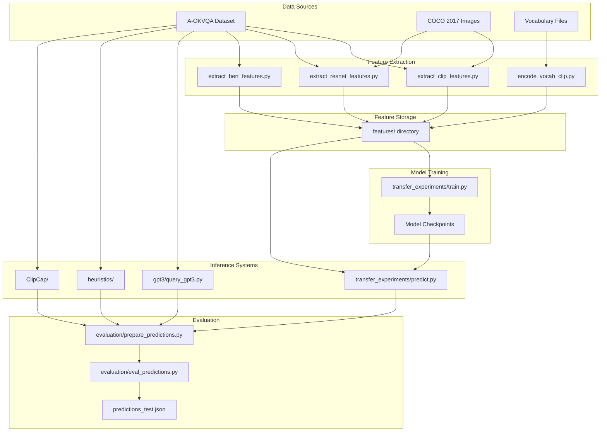
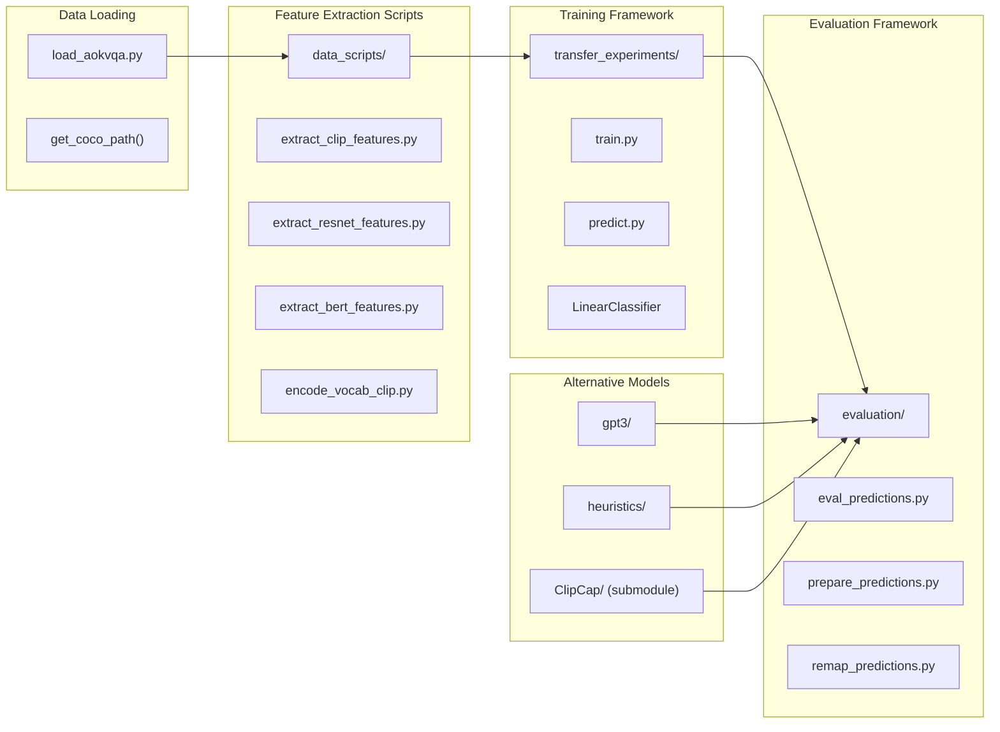

<!-- source: DeepWiki mcp.deepwiki.com · repo allenai/aokvqa · page 1 A-OKVQA Overview · fetched 2026-10-26 -->

# A-OKVQA Overview

<details>
<summary>Relevant source files</summary>

The following files were used as context for generating this wiki page:

- [README.md](README.md)

</details>


## Purpose and Scope

This document provides a comprehensive overview of the A-OKVQA repository, which implements a benchmark for Visual Question Answering (VQA) requiring world knowledge and commonsense reasoning. It covers the system's architecture, core components, and data flow from feature extraction through model training to evaluation.

For detailed information about specific subsystems, see: [Getting Started](#2), [Feature Extraction Pipeline](#3), [Model Training and Inference](#4), [Evaluation System](#5), and [Development Configuration](#6).

## What is A-OKVQA

A-OKVQA (A Benchmark for Visual Question Answering using World Knowledge) is a crowdsourced dataset and benchmark system containing approximately 25,000 questions that require broad commonsense and world knowledge to answer correctly. Unlike existing VQA datasets that rely on simple visual recognition, A-OKVQA questions demand reasoning about scenes depicted in COCO 2017 images using external knowledge that cannot be answered through simple knowledge base queries.

The system supports multiple evaluation modes:
- **Multiple Choice (MC)**: Select from 4 provided answer choices
- **Direct Answer (DA)**: Generate free-form answers using VQA accuracy metrics

Key dataset characteristics include diverse question types, requirement for world knowledge, and human-provided rationales explaining the reasoning process.

Sources: [README.md:1-9]()

## System Architecture Overview

The A-OKVQA repository implements a modular architecture supporting multiple modeling approaches through standardized interfaces:

### High-Level Data Flow



Sources: [README.md:130-208]()

### Core Components Integration



Sources: [README.md:64-72](), [README.md:194-199]()

## Key System Features

### Multi-Modal Feature Support

The system extracts features using multiple backbone models to enable comparative studies:

| Backbone | Purpose | Output Format | Script |
|----------|---------|---------------|---------|
| CLIP ViT-B/32 | Vision + Language | `.pt` tensors | `extract_clip_features.py` |
| ResNet-50 | Image features | `.pt` tensors | `extract_resnet_features.py` |
| BERT | Question encoding | `.pt` tensors | `extract_bert_features.py` |
| CLIP Text | Vocabulary encoding | `.pt` tensors | `encode_vocab_clip.py` |

### Modeling Approaches

The repository supports diverse modeling paradigms through unified interfaces:

- **Transfer Learning**: Primary experimental framework using `LinearClassifier` models
- **Zero-shot CLIP**: Direct CLIP inference without additional training  
- **GPT-3 Integration**: Large language model querying for knowledge-based reasoning
- **Heuristic Baselines**: Simple statistical methods for performance comparison
- **ClipCap Models**: Image captioning and answer generation with rationales

### Standardized Evaluation

All modeling approaches converge to common prediction formats enabling fair comparison:
- Multiple choice predictions: `{question_id: choice_index}` 
- Direct answer predictions: `{question_id: answer_string}`
- Unified evaluation through `eval_predictions.py`

Sources: [README.md:135-167](), [README.md:194-199]()

## Environment and Dependencies

### Core Setup

The system requires conda environment management and specific dependencies:

```bash
# Repository setup with submodules
git clone --single-branch --recurse-submodules https://github.com/allenai/aokvqa.git
cd aokvqa
export PYTHONPATH=.

# Environment creation
conda env create --name aokvqa
conda activate aokvqa
```

### Directory Structure

| Directory | Purpose | Environment Variable |
|-----------|---------|---------------------|
| `datasets/aokvqa/` | A-OKVQA dataset files | `AOKVQA_DIR` |
| `datasets/coco/` | COCO 2017 images | `COCO_DIR` |
| `features/` | Extracted feature tensors | `FEATURES_DIR` |
| `predictions/` | Model prediction outputs | `PREDS_DIR` |
| `logs/` | Training logs | `LOG_DIR` |
| `pretrained_models/` | Model checkpoints | `PT_MODEL_DIR` |

Sources: [README.md:28-36](), [README.md:171-176]()

## Dataset Integration

The A-OKVQA dataset integrates with COCO 2017 images through the `load_aokvqa()` function, which provides structured access to questions, multiple choice options, correct answers, and human rationales. The `get_coco_path()` utility maps image IDs to filesystem paths for seamless image loading during feature extraction and model training.

Each dataset entry contains:
- `question_id`: Unique identifier
- `image_id`: COCO image reference  
- `question`: Natural language question text
- `choices`: List of 4 multiple choice options
- `correct_choice_idx`: Index of correct choice
- `direct_answers`: List of acceptable direct answers
- `rationales`: Human explanations of reasoning process

Sources: [README.md:64-99]()

---

