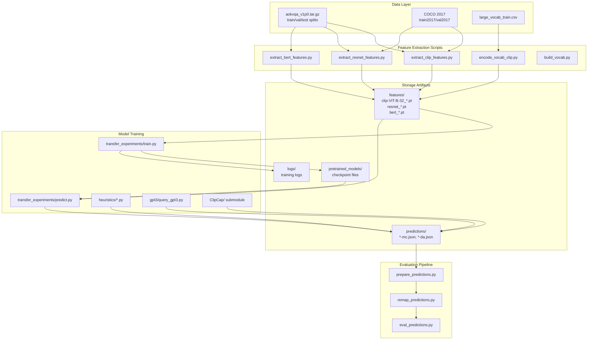
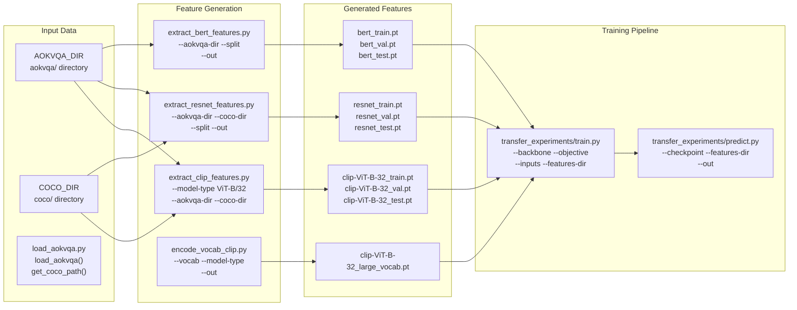
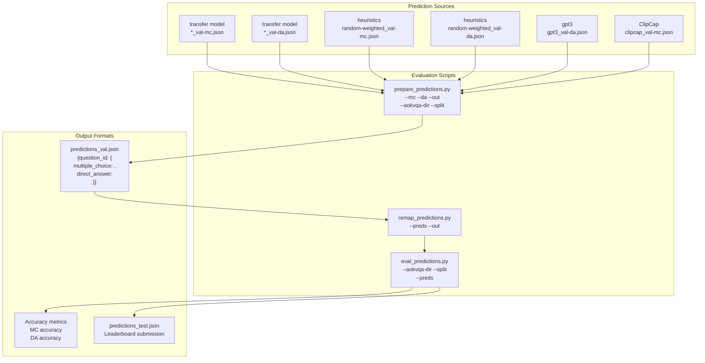

<!-- source: DeepWiki mcp.deepwiki.com · repo allenai/aokvqa · page 1.1 System Architecture · fetched 2026-10-26 -->

# System Architecture

Relevant source files

The following files were used as context for generating this wiki page:

- [.gitignore](.gitignore)
- [README.md](README.md)

## Purpose and Scope

This document describes the high-level architecture of the A-OKVQA repository, illustrating the data flow from feature extraction through model training to evaluation. The architecture supports multiple modeling approaches for Visual Question Answering (VQA) tasks requiring world knowledge and commonsense reasoning.

For detailed information about dataset structure and data loading utilities, see [Dataset and Data Loading](#1.2). For specific feature extraction implementations, see [Feature Extraction Pipeline](#3). For model training details, see [Model Training and Inference](#4).

## High-Level System Overview

The A-OKVQA system follows a modular architecture with clear separation between data preprocessing, model training, and evaluation phases.

**System Overview with Code Entities**

Sources: [README.md:1-208](), [.gitignore:1-6]()

## Data Flow Architecture

The system processes data through distinct stages, with each stage producing artifacts consumed by subsequent stages.

**Data Processing Pipeline with File Entities**

Sources: [README.md:131-167](), [README.md:67-73]()

## Component Interaction Matrix

The following table shows how different components interact through shared artifacts:

| Component | Input Artifacts | Output Artifacts | Configuration |
|-----------|----------------|------------------|---------------|
| `extract_clip_features.py` | A-OKVQA JSON, COCO images | `clip-ViT-B-32_*.pt` | `--model-type`, `--split` |
| `extract_resnet_features.py` | A-OKVQA JSON, COCO images | `resnet_*.pt` | `--split` |
| `extract_bert_features.py` | A-OKVQA JSON | `bert_*.pt` | `--split` |
| `encode_vocab_clip.py` | `large_vocab_train.csv` | `clip-ViT-B-32_large_vocab.pt` | `--model-type` |
| `transfer_experiments/train.py` | Feature files | Model checkpoints | `--backbone`, `--objective` |
| `transfer_experiments/predict.py` | Checkpoints, features | Prediction JSON | `--checkpoint` |
| `evaluation/eval_predictions.py` | Prediction JSON, ground truth | Accuracy metrics | `--split`, `--preds` |

Sources: [README.md:136-164](), [README.md:169-207]()

## Prediction and Evaluation Workflow

The system supports multiple prediction formats and evaluation modes through a standardized interface.

**Evaluation System Architecture**

Sources: [README.md:101-122](), [README.md:200-207]()

## Directory Structure and Artifact Management

The repository uses environment variables and standardized directory structures for artifact management:

| Environment Variable | Purpose | Example Value |
|---------------------|---------|---------------|
| `AOKVQA_DIR` | Dataset location | `./datasets/aokvqa/` |
| `COCO_DIR` | COCO images location | `./datasets/coco/` |
| `FEATURES_DIR` | Feature storage | `./features/` |
| `LOG_DIR` | Training logs | `./logs/` |
| `PREDS_DIR` | Predictions output | `./predictions/` |
| `PT_MODEL_DIR` | Pretrained models | `./pretrained_models/` |

The `.gitignore` file excludes these artifact directories from version control, allowing users to manage large data files locally while keeping the repository clean.

**Artifact Lifecycle**

```mermaid
graph LR
    subgraph "Data Preparation"
        ENV_SETUP["Environment variables<br/>AOKVQA_DIR, COCO_DIR"]
        DOWNLOAD["Dataset download<br/>curl + tar extraction"]
    end
    
    subgraph "Feature Generation"
        FEATURES_DIR_CREATE["mkdir -p FEATURES_DIR"]
        FEATURE_SCRIPTS["data_scripts/*.py<br/>Extract features"]
    end
    
    subgraph "Training Artifacts"
        LOGS_DIR_CREATE["mkdir -p LOG_DIR"]
        MODELS_DIR_CREATE["mkdir -p PT_MODEL_DIR"]
        TRAINING["Model training<br/>Checkpoint generation"]
    end
    
    subgraph "Evaluation Artifacts"
        PREDS_DIR_CREATE["mkdir -p PREDS_DIR"]
        PREDICTION_GEN["Prediction generation"]
        EVALUATION["Evaluation pipeline"]
    end
    
    ENV_SETUP --> DOWNLOAD
    DOWNLOAD --> FEATURES_DIR_CREATE
    FEATURES_DIR_CREATE --> FEATURE_SCRIPTS
    FEATURE_SCRIPTS --> LOGS_DIR_CREATE
    LOGS_DIR_CREATE --> MODELS_DIR_CREATE
    MODELS_DIR_CREATE --> TRAINING
    TRAINING --> PREDS_DIR_CREATE
    PREDS_DIR_CREATE --> PREDICTION_GEN
    PREDICTION_GEN --> EVALUATION
```

Sources: [README.md:40-62](), [README.md:131-176](), [.gitignore:1-6]()

The architecture provides flexibility for researchers to experiment with different feature representations, model architectures, and evaluation approaches while maintaining consistency in data formats and evaluation metrics.

---

