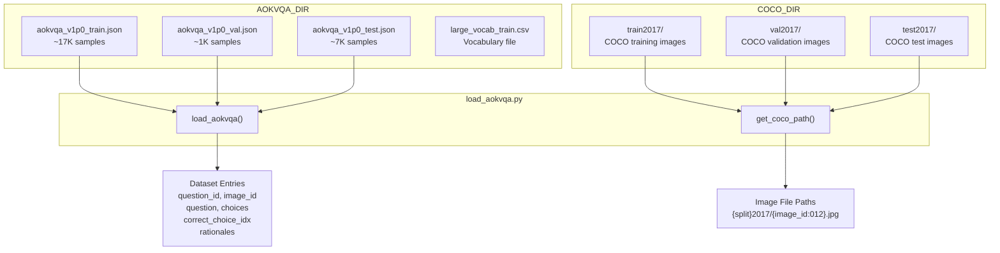
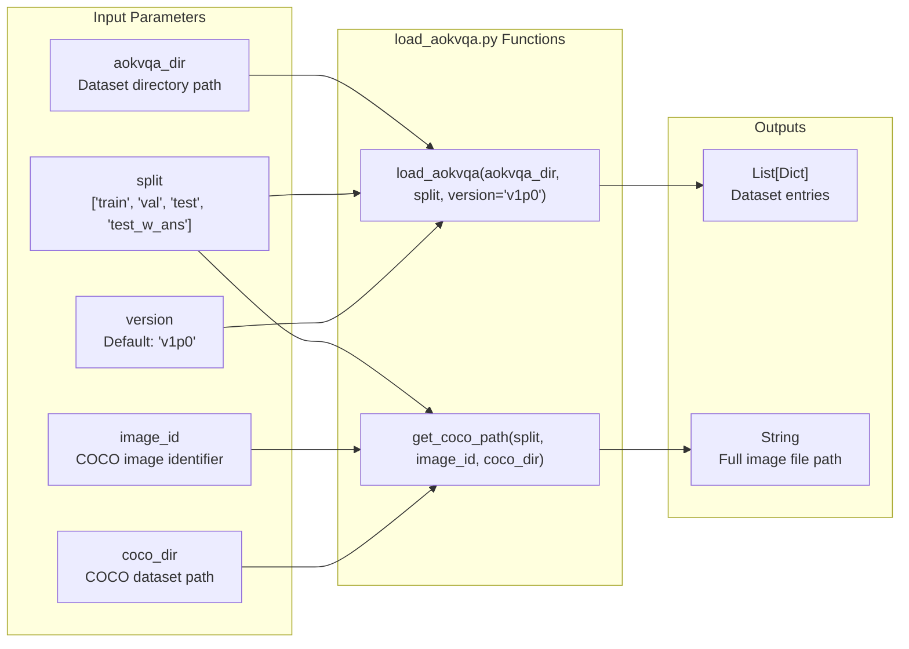

<!-- source: DeepWiki mcp.deepwiki.com · repo allenai/aokvqa · page 1.2 Dataset and Data Loading · fetched 2026-10-26 -->

# Dataset and Data Loading

<details>
<summary>Relevant source files</summary>

The following files were used as context for generating this wiki page:

- [README.md](README.md)
- [load_aokvqa.py](load_aokvqa.py)

</details>


This document covers the A-OKVQA dataset structure, data loading utilities, and integration with COCO images. It explains how to access the core dataset files and load them for use in experiments.

For information about feature extraction from the loaded data, see [Feature Extraction Pipeline](#3). For evaluation of predictions against the dataset, see [Evaluation System](#5).

## A-OKVQA Dataset Structure

The A-OKVQA dataset consists of approximately 25,000 visual question answering samples requiring world knowledge and commonsense reasoning. The dataset is organized into train, validation, and test splits, with each sample containing a question, multiple choice answers, rationales, and references to COCO images.

### Dataset File Organization



**Dataset Files and COCO Integration**

Sources: [README.md:40-72](), [load_aokvqa.py:1-14]()

### Dataset Entry Schema

Each dataset entry contains the following fields:

| Field | Type | Description |
|-------|------|-------------|
| `question_id` | string | Unique identifier for the question |
| `image_id` | integer | COCO image identifier |
| `question` | string | The question text |
| `choices` | list[string] | Four multiple choice options |
| `correct_choice_idx` | integer | Index of correct choice (0-3) |
| `rationales` | list[string] | Human-written explanations |

Sources: [README.md:76-98]()

## Data Loading Utilities

The primary data loading functionality is provided through the `load_aokvqa.py` module, which contains two core functions for accessing dataset content and COCO images.

### Core Loading Functions



**Data Loading Function Architecture**

The `load_aokvqa()` function handles JSON file loading and validation, while `get_coco_path()` constructs standardized COCO image paths using zero-padded 12-digit image IDs.

Sources: [load_aokvqa.py:5-14]()

### Usage Pattern

The typical data loading workflow involves setting environment variables for dataset directories and using the loading functions as shown in the repository documentation:

```python
# Environment setup
aokvqa_dir = os.getenv('AOKVQA_DIR')
coco_dir = os.getenv('COCO_DIR')

# Load dataset split
train_dataset = load_aokvqa(aokvqa_dir, 'train')

# Get image path for a sample
dataset_example = train_dataset[0]
image_path = get_coco_path('train', dataset_example['image_id'], coco_dir)
```

Sources: [README.md:66-85]()

## COCO Image Integration

A-OKVQA leverages COCO 2017 images as the visual component for questions. The integration requires downloading COCO datasets separately and using the provided utilities to construct proper file paths.

### COCO Directory Structure

| Split | Directory | Contains |
|-------|-----------|----------|
| `train` | `train2017/` | Training images referenced by A-OKVQA train split |
| `val` | `val2017/` | Validation images for A-OKVQA val/test splits |
| `test` | `test2017/` | Additional test images if needed |

### Image Path Construction

The `get_coco_path()` function constructs COCO image paths using the pattern `{coco_dir}/{split}2017/{image_id:012}.jpg`, where image IDs are zero-padded to 12 digits.

Sources: [README.md:47-62](), [load_aokvqa.py:12-14]()

## Dataset Splits and Versioning

### Available Splits

The dataset supports four splits through the `load_aokvqa()` function:

- **`train`**: Training data (~17K samples)
- **`val`**: Validation data (~1K samples) 
- **`test`**: Test data (~7K samples, answers withheld)
- **`test_w_ans`**: Test data with answers (if available)

### File Naming Convention

Dataset files follow the pattern `aokvqa_{version}_{split}.json` where:
- `version` defaults to `v1p0`
- `split` corresponds to the data split being loaded

Sources: [load_aokvqa.py:5-9]()

## Vocabulary and Auxiliary Files

The dataset includes a vocabulary file `large_vocab_train.csv` containing candidate answers for training. This vocabulary is used by various models and feature extraction scripts throughout the codebase.

The vocabulary file is referenced in feature extraction workflows, particularly for encoding answer choices using models like CLIP.

Sources: [README.md:138]()

---

