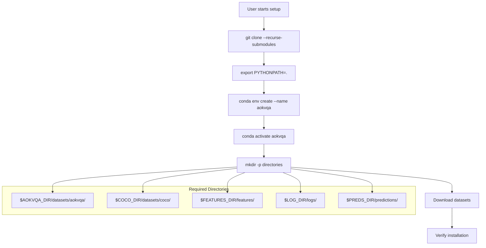
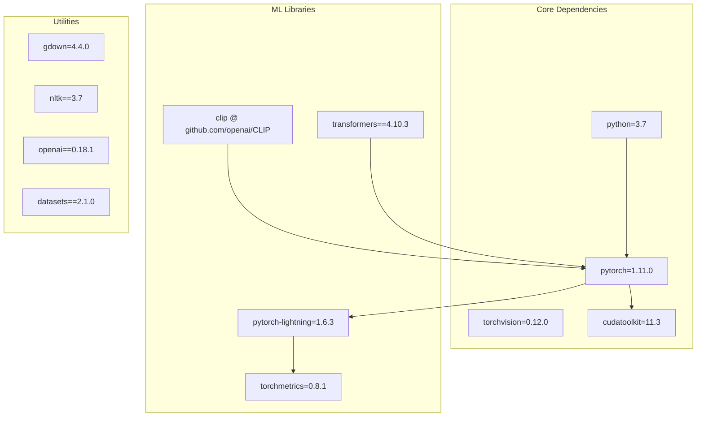
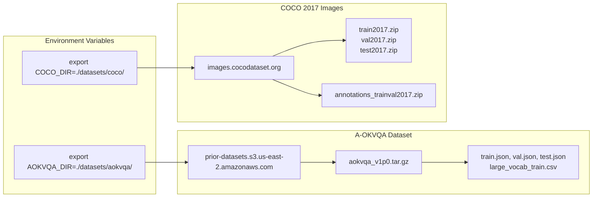
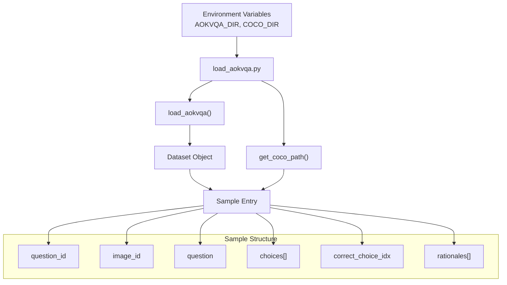

<!-- source: DeepWiki mcp.deepwiki.com · repo allenai/aokvqa · page 2 Getting Started · fetched 2026-10-26 -->

# Getting Started

<details>
<summary>Relevant source files</summary>

The following files were used as context for generating this wiki page:

- [README.md](README.md)
- [environment.yml](environment.yml)

</details>


This document provides step-by-step instructions for setting up the A-OKVQA benchmark environment and preparing the initial data required for running experiments. It covers repository setup, environment configuration, and basic data acquisition to get you ready for feature extraction and model training.

For detailed information about specific data preparation steps like vocabulary building, see [Data Preparation](#2.2). For comprehensive environment configuration details, see [Environment Setup](#2.1).

## Repository Setup and Initial Configuration

The A-OKVQA repository requires specific setup steps to properly initialize submodules and configure the Python environment.

### Repository Cloning and Structure

Clone the repository with all required submodules and configure the Python path:

```bash
git clone --single-branch --recurse-submodules https://github.com/allenai/aokvqa.git
cd aokvqa
export PYTHONPATH=.
```

**Setup Workflow Diagram**



Sources: [README.md:28-36]()

## Environment Configuration Overview

The A-OKVQA environment requires specific Python packages and CUDA support for optimal performance. The conda environment includes PyTorch, CLIP, transformers, and other deep learning dependencies.

**Environment Dependencies Structure**



### Environment Creation

Create and activate the conda environment using the provided configuration:

```bash
conda env create --name aokvqa
conda activate aokvqa
```

The `environment.yml` file specifies all required dependencies including CUDA toolkit version 11.3 and PyTorch 1.11.0 for optimal compatibility.

Sources: [README.md:34-36](), [environment.yml:1-37]()

## Data Acquisition Overview

The A-OKVQA benchmark requires the A-OKVQA dataset and optionally the COCO 2017 images for full functionality.

**Data Download and Organization Workflow**



### A-OKVQA Dataset Download

Download the core A-OKVQA dataset containing questions, answers, and vocabulary:

```bash
export AOKVQA_DIR=./datasets/aokvqa/
mkdir -p ${AOKVQA_DIR}
curl -fsSL https://prior-datasets.s3.us-east-2.amazonaws.com/aokvqa/aokvqa_v1p0.tar.gz | tar xvz -C ${AOKVQA_DIR}
```

### COCO Images Download (Optional)

For experiments requiring image features, download the COCO 2017 dataset:

```bash
export COCO_DIR=./datasets/coco/
mkdir -p ${COCO_DIR}

for split in train val test; do
    wget "http://images.cocodataset.org/zips/${split}2017.zip"
    unzip "${split}2017.zip" -d ${COCO_DIR}; rm "${split}2017.zip"
done
```

Sources: [README.md:40-62]()

## Data Loading Verification

Verify the setup by loading and examining the dataset using the provided utilities.

**Data Loading Flow**



### Basic Data Loading Test

Test the installation by loading a sample from the dataset:

```python
import os
aokvqa_dir = os.getenv('AOKVQA_DIR')

from load_aokvqa import load_aokvqa, get_coco_path
train_dataset = load_aokvqa(aokvqa_dir, 'train')

# Examine first entry
sample = train_dataset[0]
print(f"Question ID: {sample['question_id']}")
print(f"Question: {sample['question']}")
print(f"Choices: {sample['choices']}")
```

This verification step ensures that the dataset is properly downloaded and accessible through the provided loading utilities.

Sources: [README.md:64-98](), [load_aokvqa.py]()

## Directory Structure Preparation

Set up the required directory structure for storing features, logs, predictions, and pretrained models:

```bash
export FEATURES_DIR=./features/
export LOG_DIR=./logs/
export PREDS_DIR=./predictions/
export PT_MODEL_DIR=./pretrained_models/

mkdir -p ${FEATURES_DIR} ${LOG_DIR} ${PREDS_DIR} ${PT_MODEL_DIR}
```

These directories will be used throughout the experimentation pipeline for storing intermediate results and model artifacts.

Sources: [README.md:131-175]()

## Next Steps

After completing the getting started setup, you can proceed with:

1. **Environment Setup Details** - See [Environment Setup](#2.1) for comprehensive dependency management and troubleshooting
2. **Data Preparation** - See [Data Preparation](#2.2) for vocabulary building and preprocessing steps  
3. **Feature Extraction** - See [Feature Extraction Pipeline](#3) to generate multi-modal features using CLIP, ResNet, or BERT
4. **Model Training** - See [Model Training and Inference](#4) to begin running experiments with transfer learning or other approaches

The basic setup provides the foundation for all subsequent A-OKVQA benchmark experiments and evaluations.

Sources: [README.md:125-208]()

---

