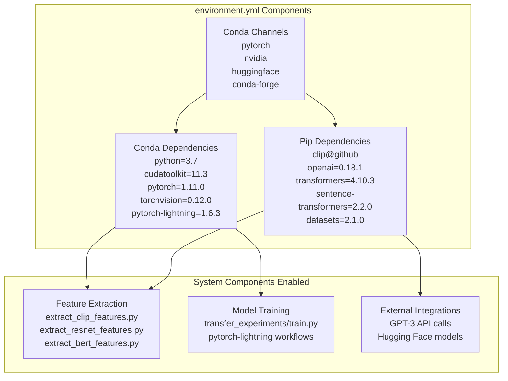
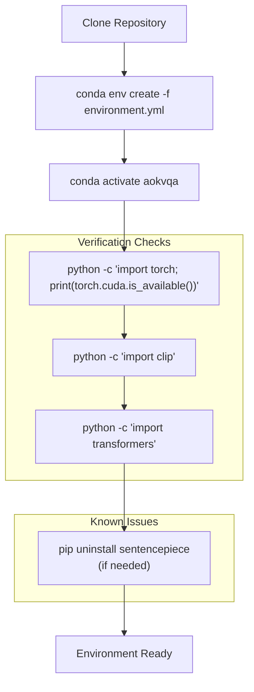

<!-- source: DeepWiki mcp.deepwiki.com · repo allenai/aokvqa · page 2.1 Environment Setup · fetched 2026-10-26 -->

# Environment Setup

<details>
<summary>Relevant source files</summary>

The following files were used as context for generating this wiki page:

- [environment.yml](environment.yml)

</details>


This document covers the technical requirements and setup procedures for the A-OKVQA development environment. The environment supports multi-modal feature extraction, neural model training, and integration with external services like OpenAI's GPT-3. For data preparation steps that follow environment setup, see [Data Preparation](#2.2). For feature extraction procedures that require this environment, see [Feature Extraction Pipeline](#3).

## Hardware and Software Prerequisites

The A-OKVQA system requires specific hardware and software configurations to support GPU-accelerated deep learning workflows and multi-modal processing.

### Hardware Requirements

| Component | Requirement | Purpose |
|-----------|-------------|---------|
| GPU | CUDA-compatible with 8GB+ VRAM | PyTorch training, CLIP/ResNet inference |
| RAM | 16GB+ system memory | Large feature tensor processing |
| Storage | 50GB+ available space | COCO images, extracted features, model checkpoints |

### Software Prerequisites

- **CUDA Toolkit 11.3**: Required for GPU acceleration as specified in [environment.yml:10]()
- **Anaconda/Miniconda**: For conda environment management
- **Git**: For cloning repository and managing submodules

## Conda Environment Configuration

The A-OKVQA environment is defined using a comprehensive conda specification that manages both conda and pip dependencies.

### Core Environment Specification



**Dependency Mapping for A-OKVQA System Components**

Sources: [environment.yml:1-37]()

### Installation Workflow



**Environment Setup and Verification Workflow**

Sources: [environment.yml:1-37]()

## Installation Steps

### 1. Create Conda Environment

```bash
conda env create -f environment.yml
conda activate aokvqa
```

The environment specification [environment.yml:1-37]() defines `aokvqa` as the environment name and configures channels for PyTorch, NVIDIA, and Hugging Face packages.

### 2. Verify Core Dependencies

**PyTorch and CUDA**:
```bash
python -c "import torch; print(f'PyTorch version: {torch.__version__}'); print(f'CUDA available: {torch.cuda.is_available()}')"
```

**CLIP Installation**:
The CLIP library is installed from a specific GitHub commit [environment.yml:25]() to ensure reproducibility:
```bash
python -c "import clip; print('CLIP loaded successfully')"
```

**Transformers and Language Models**:
```bash
python -c "import transformers; print(f'Transformers version: {transformers.__version__}')"
```

### 3. Resolve Known Conflicts

The environment specification includes a known conflict resolution step [environment.yml:35-36]():

```bash
pip uninstall sentencepiece
```

This resolves compatibility issues between `sentence-transformers` and `pytorch-lightning` packages.

## Dependency Analysis

### Core ML Framework Stack

| Package | Version | Purpose in A-OKVQA |
|---------|---------|-------------------|
| `pytorch` | 1.11.0 | Core tensor operations, model training |
| `torchvision` | 0.12.0 | Image preprocessing, ResNet models |
| `pytorch-lightning` | 1.6.3 | Training loop management in `transfer_experiments/` |
| `transformers` | 4.10.3 | BERT models for question encoding |
| `sentence-transformers` | 2.2.0 | Text similarity computations |

### External Service Integration

| Package | Version | Integration Point |
|---------|---------|------------------|
| `openai` | 0.18.1 | GPT-3 querying in `gpt3/` directory |
| `clip` | GitHub commit | Vision-language models in feature extraction |
| `datasets` | 2.1.0 | Hugging Face dataset loading utilities |

### Utility Dependencies

| Package | Version | Usage |
|---------|---------|-------|
| `gdown` | 4.4.0 | Google Drive file downloads |
| `nltk` | 3.7 | Text processing utilities |
| `sacrebleu` | 2.0.0 | Evaluation metrics |
| `tqdm` | 4.64.0 | Progress bars in scripts |

Sources: [environment.yml:8-33]()

## Verification and Testing

### Environment Health Check

Create a simple verification script to test all major components:

```bash
python -c "
import torch
import clip
import transformers
import openai
import pytorch_lightning as pl
print('✓ All core dependencies loaded successfully')
print(f'✓ PyTorch CUDA: {torch.cuda.is_available()}')
print(f'✓ Available devices: {torch.cuda.device_count()}')
"
```

### Component-Specific Testing

**CLIP Models**:
```bash
python -c "
import clip
model, preprocess = clip.load('ViT-B/32')
print('✓ CLIP ViT-B/32 model loaded')
"
```

**Transformers Models**:
```bash
python -c "
from transformers import BertTokenizer, BertModel
tokenizer = BertTokenizer.from_pretrained('bert-base-uncased')
print('✓ BERT tokenizer loaded')
"
```

## Troubleshooting Common Issues

### CUDA Compatibility

If CUDA is not detected:
1. Verify NVIDIA driver installation
2. Check CUDA toolkit version matches [environment.yml:10]()
3. Reinstall PyTorch with correct CUDA version

### Package Conflicts

The `sentencepiece` conflict [environment.yml:35-36]() is the most common issue. If you encounter import errors:

```bash
pip uninstall sentencepiece
conda install sentencepiece
```

### Memory Issues

For systems with limited RAM:
- Reduce batch sizes in training scripts
- Use CPU-only mode for feature extraction if necessary
- Monitor memory usage during large dataset processing

Sources: [environment.yml:35-36]()

---

