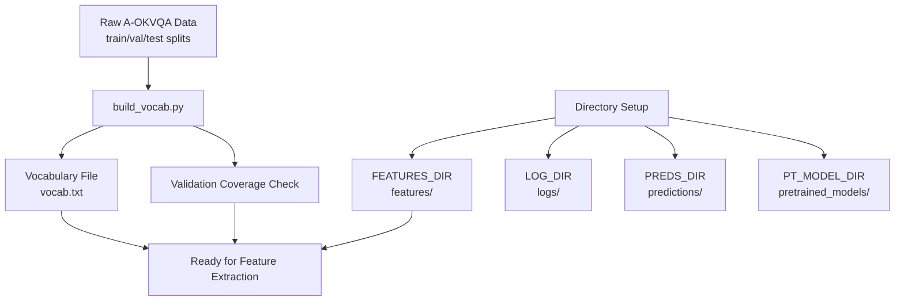
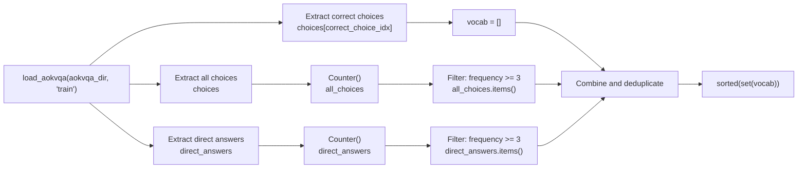
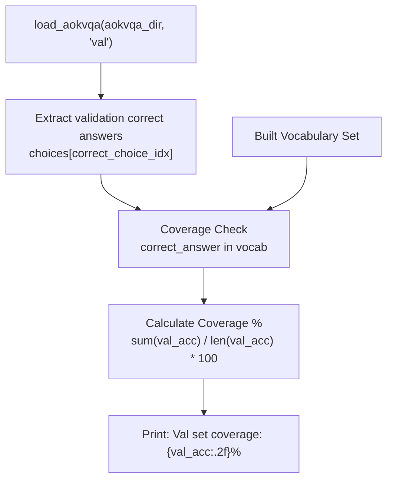

<!-- source: DeepWiki mcp.deepwiki.com · repo allenai/aokvqa · page 2.2 Data Preparation · fetched 2026-10-26 -->

# Data Preparation

<details>
<summary>Relevant source files</summary>

The following files were used as context for generating this wiki page:

- [README.md](README.md)
- [data_scripts/build_vocab.py](data_scripts/build_vocab.py)

</details>


This document covers the initial data preparation steps required before feature extraction and model training in the A-OKVQA benchmark system. The data preparation phase involves setting up directory structures, building vocabularies from the training data, and validating dataset coverage.

For information about feature extraction from images and text, see [Feature Extraction Pipeline](#3). For dataset downloading and loading utilities, see [Dataset and Data Loading](#1.2).

## Overview

The data preparation pipeline transforms the raw A-OKVQA dataset into a structured format suitable for downstream processing. The primary tasks include creating vocabulary files from training data and establishing the directory structure for storing extracted features.



**Directory Structure and Environment Setup**

Sources: [README.md:130-176]()

## Directory Structure Initialization

Before processing data, the system requires specific directory structures for organizing outputs. The preparation establishes four primary directories as environment variables:

| Directory | Purpose | Environment Variable |
|-----------|---------|---------------------|
| `features/` | Stores extracted feature files | `FEATURES_DIR` |
| `logs/` | Training and experiment logs | `LOG_DIR` |
| `predictions/` | Model prediction outputs | `PREDS_DIR` |
| `pretrained_models/` | Downloaded model weights | `PT_MODEL_DIR` |

```bash
export FEATURES_DIR=./features/
export LOG_DIR=./logs/
export PREDS_DIR=./predictions/
export PT_MODEL_DIR=./pretrained_models/
mkdir -p ${FEATURES_DIR} ${LOG_DIR} ${PREDS_DIR} ${PT_MODEL_DIR}
```

Sources: [README.md:131-176]()

## Vocabulary Construction Process

The vocabulary building process creates a comprehensive word list from the A-OKVQA training set, which serves as the answer space for multiple choice and direct answer evaluation modes.



**Vocabulary Building Algorithm**

The `build_vocab.py` script implements a frequency-based vocabulary construction algorithm:

1. **Correct Choices Collection**: All correct answers from training data multiple choice questions
2. **Frequent Choices Filtering**: Multiple choice options appearing 3+ times across the dataset  
3. **Frequent Direct Answers Filtering**: Direct answer strings appearing 3+ times across the dataset
4. **Deduplication and Sorting**: Creates final alphabetically sorted vocabulary

```python
vocab = []
all_choices = Counter()
direct_answers = Counter()

for i in train_set:
    vocab.append( i['choices'][i['correct_choice_idx']] )
    all_choices.update(i['choices'])
    direct_answers.update(set(i['direct_answers']))

vocab += [k for k,v in all_choices.items() if v >= 3]
vocab += [k for k,v in direct_answers.items() if v >= 3]
vocab = sorted(set(vocab))
```

Sources: [data_scripts/build_vocab.py:15-31]()

## Validation Coverage Analysis

The vocabulary construction process includes validation coverage analysis to ensure the built vocabulary adequately represents the validation set answers.



**Coverage Calculation Implementation**

The coverage analysis verifies what percentage of validation set correct answers are represented in the constructed vocabulary:

```python
val_set = load_aokvqa(args.aokvqa_dir, 'val')
val_acc = [v['choices'][v['correct_choice_idx']] in vocab for v in val_set]
val_acc = sum(val_acc) / len(val_acc) * 100
print(f"Val set coverage: {val_acc:.2f}" )
```

This metric provides early validation that the vocabulary construction strategy captures sufficient answer diversity for evaluation purposes.

Sources: [data_scripts/build_vocab.py:39-46]()

## Command Line Interface

The `build_vocab.py` script provides a command-line interface for vocabulary generation:

```bash
python data_scripts/build_vocab.py --aokvqa-dir ${AOKVQA_DIR} --out vocab.txt
```

| Parameter | Type | Purpose |
|-----------|------|---------|
| `--aokvqa-dir` | `pathlib.Path` | Path to A-OKVQA dataset directory |
| `--out` | `pathlib.Path` | Output path for generated vocabulary file |

The script uses the `load_aokvqa` function to access dataset splits and the `Counter` class for frequency analysis of answer candidates.

Sources: [data_scripts/build_vocab.py:9-12]()

## Prerequisites for Feature Extraction

Upon completion of data preparation, the system establishes the foundation for feature extraction pipelines. The prepared components include:

- **Vocabulary File**: Text file containing one vocabulary term per line
- **Directory Structure**: Organized storage locations for different artifact types
- **Coverage Validation**: Confirmed vocabulary adequacy for evaluation sets

The vocabulary file serves as input to vocabulary encoding scripts (`encode_vocab_clip.py`) while the directory structure provides storage for extracted features from image, text, and vocabulary encoding processes.

Sources: [README.md:135-143](), [data_scripts/build_vocab.py:33-37]()

---

