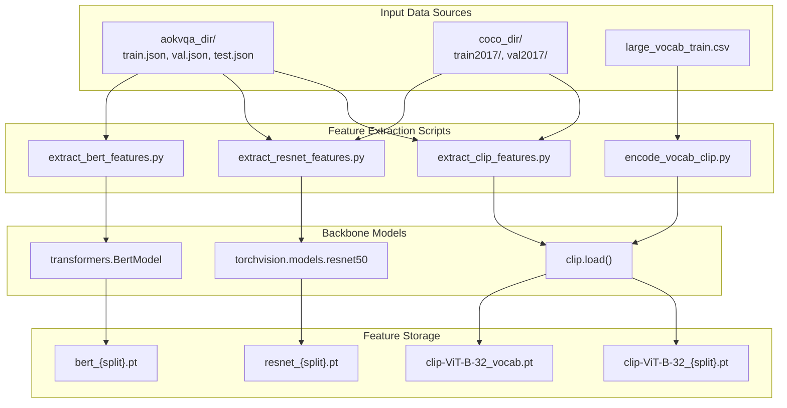
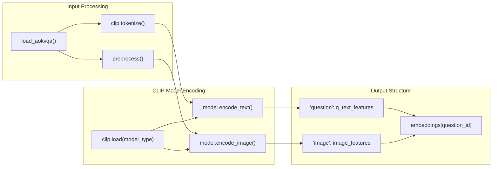
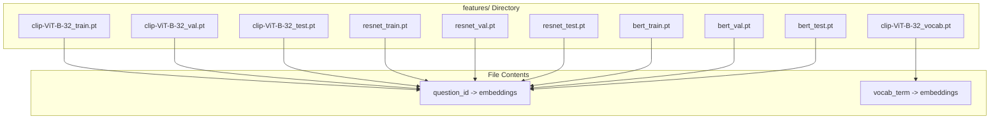

<!-- source: DeepWiki mcp.deepwiki.com · repo allenai/aokvqa · page 3 Feature Extraction Pipeline · fetched 2026-10-26 -->

# Feature Extraction Pipeline

<details>
<summary>Relevant source files</summary>

The following files were used as context for generating this wiki page:

- [README.md](README.md)
- [data_scripts/extract_clip_features.py](data_scripts/extract_clip_features.py)

</details>


## Purpose and Scope

The Feature Extraction Pipeline is the multi-modal preprocessing system that converts raw A-OKVQA dataset entries and COCO images into numerical embeddings suitable for machine learning models. This pipeline supports multiple backbone architectures including CLIP, ResNet, and BERT to enable comparative studies across different feature representations.

For information about using these extracted features in model training, see [Model Training and Inference](#4). For details about the dataset structure and loading utilities, see [Dataset and Data Loading](#1.2).

## Pipeline Overview

The feature extraction system processes three primary data modalities: images, questions, and vocabulary terms. Each modality can be processed using different neural network backbones depending on the experimental requirements.



Sources: [README.md:135-167](), [data_scripts/extract_clip_features.py:1-52]()

## Data Requirements and Configuration

The feature extraction pipeline requires specific directory structure and environment variables to locate input data and store outputs:

| Environment Variable | Purpose | Example Value |
|---------------------|---------|---------------|
| `AOKVQA_DIR` | A-OKVQA dataset location | `./datasets/aokvqa/` |
| `COCO_DIR` | COCO 2017 images location | `./datasets/coco/` |
| `FEATURES_DIR` | Feature output directory | `./features/` |

The pipeline processes data splits (`train`, `val`, `test`) sequentially, with each script supporting command-line arguments for split selection and model configuration.

Sources: [README.md:131-133](), [README.md:40-62]()

## CLIP Feature Extraction Workflow

The CLIP feature extraction process represents the core multi-modal pipeline, extracting both visual and textual embeddings using shared representation spaces.



The `extract_clip_features.py` script implements this workflow with the following key operations:

1. **Dataset Loading**: Uses `load_aokvqa()` to iterate through dataset entries [data_scripts/extract_clip_features.py:25]()
2. **Text Processing**: Tokenizes questions using `clip.tokenize()` [data_scripts/extract_clip_features.py:39]()
3. **Image Processing**: Loads and preprocesses COCO images using `get_coco_path()` [data_scripts/extract_clip_features.py:42-44]()
4. **Feature Encoding**: Generates embeddings using `model.encode_text()` and `model.encode_image()` [data_scripts/extract_clip_features.py:40,44]()
5. **Storage**: Saves features as dictionary with `question_id` keys [data_scripts/extract_clip_features.py:46-49]()

Sources: [data_scripts/extract_clip_features.py:34-51]()

## Supported Model Architectures

The pipeline supports multiple backbone architectures through command-line configuration:

### CLIP Models
Available through `--model-type` parameter in `extract_clip_features.py`:
- ResNet variants: `RN50`, `RN50x4`, `RN50x16`, `RN50x64`, `RN101`
- Vision Transformer variants: `ViT-B/32`, `ViT-B/16`, `ViT-L/14`, `ViT-L/14@336px`

### Alternative Backbones
- **ResNet-50**: Via `extract_resnet_features.py` for image-only features
- **BERT**: Via `extract_bert_features.py` for question-only features

Sources: [data_scripts/extract_clip_features.py:17](), [README.md:151-167]()

## Feature Storage Organization

The feature extraction pipeline organizes outputs in a standardized directory structure:



Each `.pt` file contains a dictionary structure where:
- **Split files**: Map `question_id` to feature embeddings
- **Vocabulary file**: Maps vocabulary terms to CLIP text embeddings
- **CLIP split files**: Include both `'question'` and `'image'` keys per entry
- **ResNet/BERT files**: Contain single-modality features

Sources: [README.md:138-143](), [README.md:156-165](), [data_scripts/extract_clip_features.py:46-49]()

## Execution Commands

The feature extraction pipeline is executed through a series of command-line scripts:

### CLIP Features (Standard Pipeline)
```bash
# Vocabulary encoding
python data_scripts/encode_vocab_clip.py --vocab ${AOKVQA_DIR}/large_vocab_train.csv --model-type ViT-B/32 --out ${FEATURES_DIR}/clip-ViT-B-32_large_vocab.pt

# Dataset features for all splits
for split in train val test; do
    python data_scripts/extract_clip_features.py --aokvqa-dir ${AOKVQA_DIR} --coco-dir ${COCO_DIR} --split ${split} --model-type ViT-B/32 --out ${FEATURES_DIR}/clip-ViT-B-32_${split}.pt
done
```

### Alternative Backbone Features
```bash
# ResNet features
for split in train val test; do
    python data_scripts/extract_resnet_features.py --aokvqa-dir ${AOKVQA_DIR} --coco-dir ${COCO_DIR} --split ${split} --out ${FEATURES_DIR}/resnet_${split}.pt
done

# BERT features  
for split in train val test; do
    python data_scripts/extract_bert_features.py --aokvqa-dir ${AOKVQA_DIR} --split ${split} --out ${FEATURES_DIR}/bert_${split}.pt
done
```

Sources: [README.md:138-165]()

---

