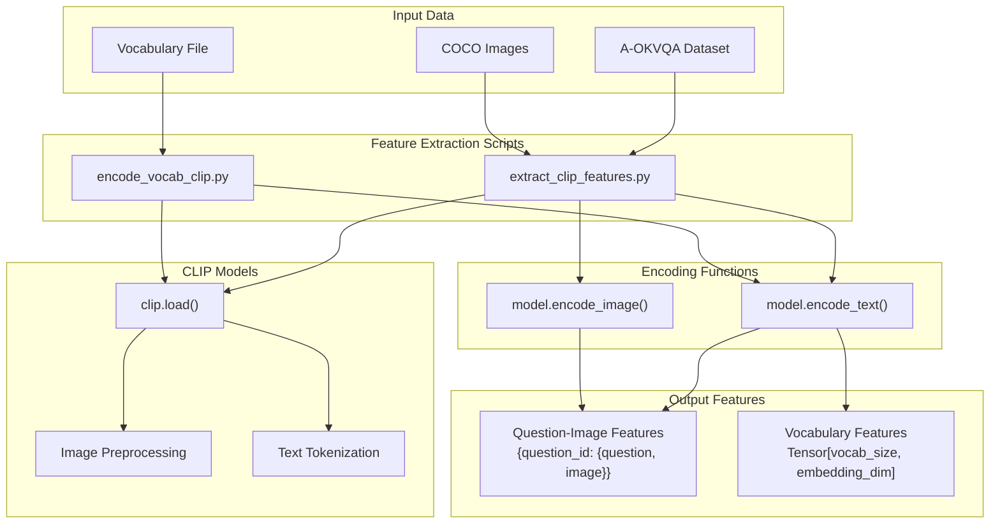
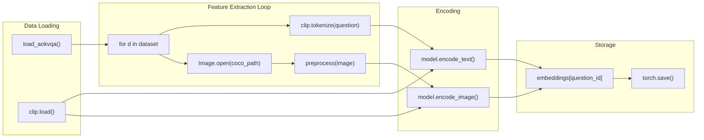
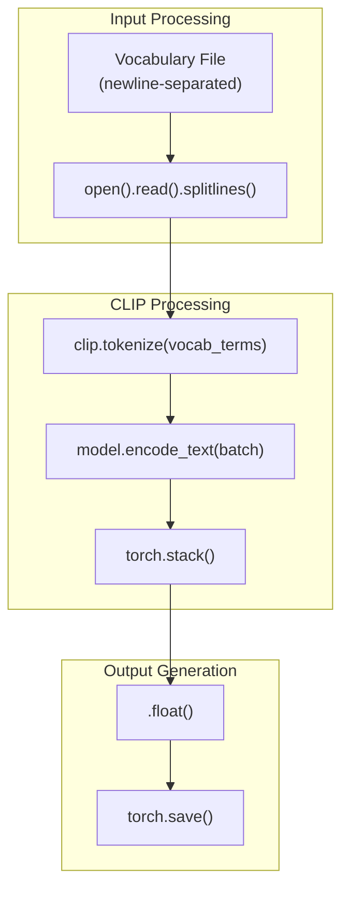

<!-- source: DeepWiki mcp.deepwiki.com · repo allenai/aokvqa · page 3.1 CLIP Feature Extraction · fetched 2026-10-26 -->

# CLIP Feature Extraction

<details>
<summary>Relevant source files</summary>

The following files were used as context for generating this wiki page:

- [LICENSE](LICENSE)
- [data_scripts/encode_vocab_clip.py](data_scripts/encode_vocab_clip.py)
- [data_scripts/extract_clip_features.py](data_scripts/extract_clip_features.py)

</details>


This document covers the CLIP (Contrastive Language-Image Pre-training) feature extraction pipeline in the A-OKVQA repository. This system extracts multimodal embeddings from images, questions, and vocabulary terms using pre-trained CLIP models. For ResNet-based feature extraction, see [ResNet Feature Extraction](#3.2). For BERT-based question encoding, see [BERT Feature Extraction](#3.3).

## Overview

The CLIP feature extraction pipeline consists of two main components: question-image pair encoding and vocabulary encoding. These components generate dense vector representations that capture semantic relationships between visual and textual content, enabling cross-modal reasoning in VQA tasks.

**Sources:** [data_scripts/extract_clip_features.py:1-52](), [data_scripts/encode_vocab_clip.py:1-27]()

## System Architecture



**Sources:** [data_scripts/extract_clip_features.py:23-51](), [data_scripts/encode_vocab_clip.py:17-26]()

## Question-Image Feature Extraction

The `extract_clip_features.py` script processes A-OKVQA dataset entries to generate paired question and image embeddings.

### Command Line Interface

| Parameter | Type | Description | Example |
|-----------|------|-------------|---------|
| `--aokvqa-dir` | Path | A-OKVQA dataset directory | `/path/to/aokvqa` |
| `--coco-dir` | Path | COCO images directory | `/path/to/coco` |
| `--split` | String | Dataset split | `train`, `val`, `test` |
| `--model-type` | String | CLIP architecture | `ViT-B/32`, `RN50` |
| `--out` | Path | Output file path | `features/clip-ViT-B-32_train.pt` |

**Sources:** [data_scripts/extract_clip_features.py:13-19]()

### Processing Pipeline



**Sources:** [data_scripts/extract_clip_features.py:25-51]()

### Output Format

The extracted features are saved as PyTorch tensors with the following structure:

```python
embeddings = {
    question_id: {
        'question': tensor[embedding_dim],  # Question text embedding
        'image': tensor[embedding_dim]      # Image embedding
    }
}
```

**Sources:** [data_scripts/extract_clip_features.py:46-49]()

## Vocabulary Encoding

The `encode_vocab_clip.py` script generates CLIP text embeddings for all vocabulary terms, enabling semantic similarity computations between questions and answer choices.

### Processing Flow



**Sources:** [data_scripts/encode_vocab_clip.py:21-26]()

### Command Line Interface

| Parameter | Type | Description | Example |
|-----------|------|-------------|---------|
| `--vocab` | Path | Vocabulary file path | `large_vocab_train.csv` |
| `--model-type` | String | CLIP architecture | `ViT-B/32` |
| `--out` | Path | Output tensor file | `clip-ViT-B-32_vocab.pt` |

**Sources:** [data_scripts/encode_vocab_clip.py:9-13]()

## Supported Model Architectures

Both scripts support the following CLIP model variants:

### ResNet-based Models
- `RN50` - ResNet-50 backbone
- `RN50x4` - ResNet-50 with 4x width
- `RN50x16` - ResNet-50 with 16x width  
- `RN50x64` - ResNet-50 with 64x width
- `RN101` - ResNet-101 backbone

### Vision Transformer Models
- `ViT-B/32` - Base ViT with 32x32 patches
- `ViT-B/16` - Base ViT with 16x16 patches
- `ViT-L/14` - Large ViT with 14x14 patches
- `ViT-L/14@336px` - Large ViT with 336px input resolution

**Sources:** [data_scripts/extract_clip_features.py:17](), [data_scripts/encode_vocab_clip.py:11]()

## Technical Implementation Details

### Device Management
Both scripts automatically detect CUDA availability and move models and tensors to the appropriate device:

```python
device = "cuda" if torch.cuda.is_available() else "cpu"
model, preprocess = clip.load(args.model_type, device=device)
```

**Sources:** [data_scripts/extract_clip_features.py:29-30](), [data_scripts/encode_vocab_clip.py:17-18]()

### Memory Management
Feature extraction operates within `torch.no_grad()` context to prevent gradient computation and reduce memory usage. Embeddings are converted to CPU tensors before storage to free GPU memory.

**Sources:** [data_scripts/extract_clip_features.py:34](), [data_scripts/extract_clip_features.py:47-48]()

### File Validation
Both scripts validate that output files have `.pt` extension to ensure consistent tensor serialization format.

**Sources:** [data_scripts/extract_clip_features.py:21](), [data_scripts/encode_vocab_clip.py:15]()

---

