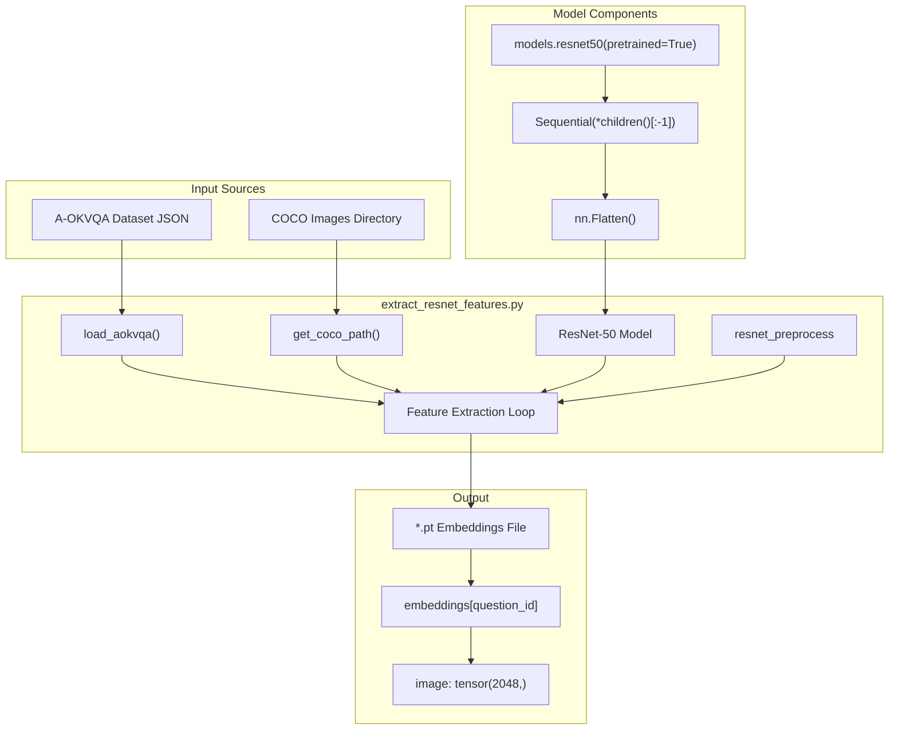
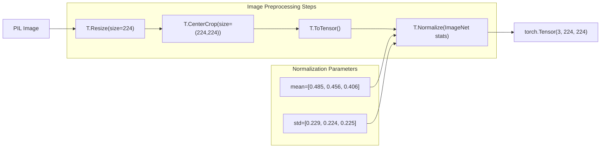
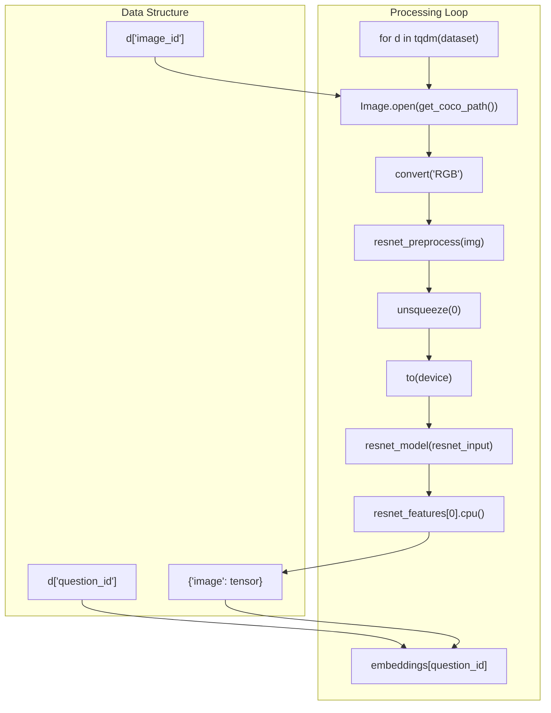
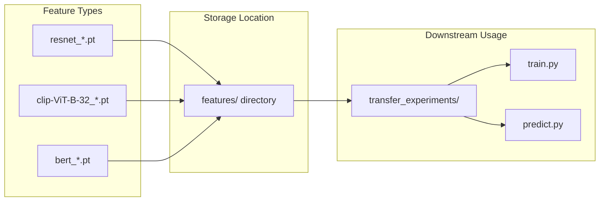

<!-- source: DeepWiki mcp.deepwiki.com · repo allenai/aokvqa · page 3.2 ResNet Feature Extraction · fetched 2026-10-26 -->

# ResNet Feature Extraction

<details>
<summary>Relevant source files</summary>

The following files were used as context for generating this wiki page:

- [data_scripts/extract_resnet_features.py](data_scripts/extract_resnet_features.py)

</details>


This document covers the ResNet-50 based image feature extraction pipeline used in the A-OKVQA benchmark. The system extracts 2048-dimensional image features from COCO images using a pretrained ResNet-50 backbone model.

This page focuses specifically on ResNet-based image feature extraction. For CLIP-based multimodal feature extraction, see [3.1](#3.1). For question text feature extraction using BERT, see [3.3](#3.3).

## Purpose and Scope

The ResNet feature extraction system provides a standardized method for generating image representations from COCO dataset images corresponding to A-OKVQA questions. The extracted features serve as image inputs for downstream VQA models in the transfer learning experiments.

The system processes images through a pretrained ResNet-50 model with the classification head removed, producing dense 2048-dimensional feature vectors that capture high-level visual semantics.

Sources: [data_scripts/extract_resnet_features.py:1-63]()

## System Architecture

### ResNet Feature Extraction Pipeline



Sources: [data_scripts/extract_resnet_features.py:24-62]()

## ResNet Model Configuration

### Model Architecture Setup

The ResNet feature extractor uses a modified torchvision ResNet-50 model:

| Component | Configuration | Purpose |
|-----------|---------------|---------|
| Base Model | `models.resnet50(pretrained=True)` | ImageNet pretrained ResNet-50 |
| Layer Removal | `*list(resnet_model.children())[:-1]` | Remove final classification layer |
| Flattening | `nn.Flatten()` | Convert spatial features to 1D vector |
| Output Dimension | 2048 | Final feature vector size |

The model modification is implemented through sequential composition:

```python
resnet_model = torch.nn.Sequential(
    *list(resnet_model.children())[:-1],
    nn.Flatten()
)
```

Sources: [data_scripts/extract_resnet_features.py:42-46]()

### Preprocessing Pipeline



The preprocessing transforms apply standard ImageNet normalization to ensure compatibility with the pretrained ResNet-50 weights.

Sources: [data_scripts/extract_resnet_features.py:30-38]()

## Feature Extraction Process

### Encoding Loop Implementation

The feature extraction process iterates through the A-OKVQA dataset and processes each associated COCO image:



Sources: [data_scripts/extract_resnet_features.py:51-61]()

### Command Line Interface

The script accepts the following required arguments:

| Argument | Type | Purpose |
|----------|------|---------|
| `--aokvqa-dir` | `pathlib.Path` | Path to A-OKVQA dataset directory |
| `--coco-dir` | `pathlib.Path` | Path to COCO images directory |
| `--split` | `str` | Dataset split: 'train', 'val', or 'test' |
| `--out` | `pathlib.Path` | Output .pt file path |

Sources: [data_scripts/extract_resnet_features.py:15-22]()

## Output Format and Storage

### Embeddings File Structure

The extracted features are saved as a PyTorch dictionary with the following structure:

```python
embeddings = {
    question_id: {
        'image': torch.Tensor(2048,)  # ResNet-50 features
    }
}
```

Each `question_id` corresponds to an A-OKVQA question, and the associated image features are extracted from the corresponding COCO image specified by `image_id`.

### Integration with Feature Pipeline

The ResNet features integrate with the broader feature extraction pipeline:



The ResNet features serve as one of the backbone options for image representation in the transfer learning experiments, providing an alternative to CLIP-based image features.

Sources: [data_scripts/extract_resnet_features.py:58-62]()

---

