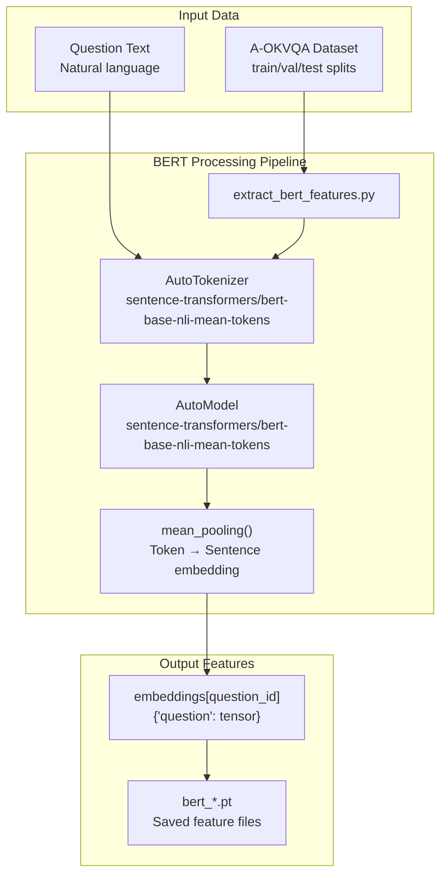
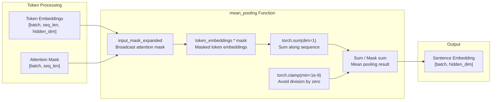
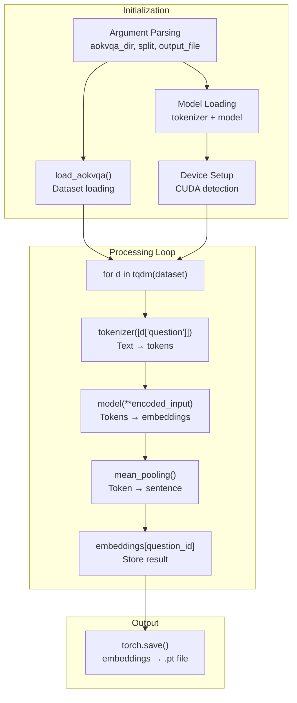

<!-- source: DeepWiki mcp.deepwiki.com · repo allenai/aokvqa · page 3.3 BERT Feature Extraction · fetched 2026-10-26 -->

# BERT Feature Extraction

<details>
<summary>Relevant source files</summary>

The following files were used as context for generating this wiki page:

- [data_scripts/extract_bert_features.py](data_scripts/extract_bert_features.py)

</details>


This document covers the BERT-based question feature extraction system in the A-OKVQA repository. This component generates contextualized embeddings for questions using a pre-trained BERT model, providing rich textual representations for downstream VQA models.

For information about other feature extraction approaches, see [CLIP Feature Extraction](#3.1) and [ResNet Feature Extraction](#3.2). For the overall feature extraction pipeline context, see [Feature Extraction Pipeline](#3).

## Purpose and System Overview

The BERT feature extraction system processes A-OKVQA questions to generate dense vector representations that capture semantic meaning and contextual relationships. Unlike CLIP's multimodal approach, this system focuses specifically on extracting high-quality text embeddings using BERT's transformer architecture.



**BERT Feature Extraction Data Flow**

Sources: [data_scripts/extract_bert_features.py:1-51]()

## Model Architecture and Implementation

The BERT feature extraction uses the `sentence-transformers/bert-base-nli-mean-tokens` model, which is specifically designed for generating meaningful sentence-level embeddings. The implementation includes custom mean pooling to aggregate token-level representations.

### Core Components

| Component | Purpose | Implementation |
|-----------|---------|----------------|
| `AutoTokenizer` | Text preprocessing and tokenization | Pre-trained sentence transformer tokenizer |
| `AutoModel` | BERT encoding | Pre-trained BERT model with NLI fine-tuning |
| `mean_pooling()` | Token aggregation | Custom pooling function for sentence embeddings |
| Device management | GPU acceleration | Automatic CUDA detection and model placement |

The `mean_pooling` function implements attention-weighted averaging to convert token-level embeddings into sentence-level representations:



**Mean Pooling Implementation Flow**

Sources: [data_scripts/extract_bert_features.py:32-35]()

## Processing Pipeline

The extraction script processes questions through a systematic pipeline that handles data loading, model initialization, and batch processing.

### Command Line Interface

The script accepts three required parameters:

- `--aokvqa-dir`: Path to A-OKVQA dataset directory
- `--split`: Dataset split (`train`, `val`, or `test`)
- `--out`: Output file path (must have `.pt` extension)

### Extraction Process



**BERT Feature Extraction Processing Flow**

Sources: [data_scripts/extract_bert_features.py:12-50]()

## Output Format and Integration

The BERT feature extraction produces structured embeddings that integrate with the broader A-OKVQA feature ecosystem.

### Output Structure

The script generates a dictionary with the following structure:

```
embeddings = {
    question_id: {
        'question': torch.Tensor  # Shape: [hidden_dim]
    }
}
```

Each question embedding is a dense vector representation capturing the semantic content of the question text. The embeddings are stored on CPU for compatibility with downstream processing.

### File Organization

BERT features are saved as PyTorch files in the features directory structure:

- File naming pattern: `bert_{split}.pt`
- Storage location: `features/` directory
- Format: PyTorch tensor dictionary
- Device: CPU tensors for portability

The output files integrate with the transfer learning experiments and can be loaded by training scripts that expect this standardized format.

Sources: [data_scripts/extract_bert_features.py:46-50]()

## Usage Examples

### Basic Extraction

```bash
python data_scripts/extract_bert_features.py \
    --aokvqa-dir ./aokvqa_v1p0 \
    --split train \
    --out features/bert_train.pt
```

### Processing All Splits

```bash
# Extract features for all dataset splits
for split in train val test; do
    python data_scripts/extract_bert_features.py \
        --aokvqa-dir ./aokvqa_v1p0 \
        --split $split \
        --out features/bert_${split}.pt
done
```

The extracted BERT features can then be used by transfer learning models that specify BERT-based question encoding in their input configuration.

Sources: [data_scripts/extract_bert_features.py:12-16]()

---

