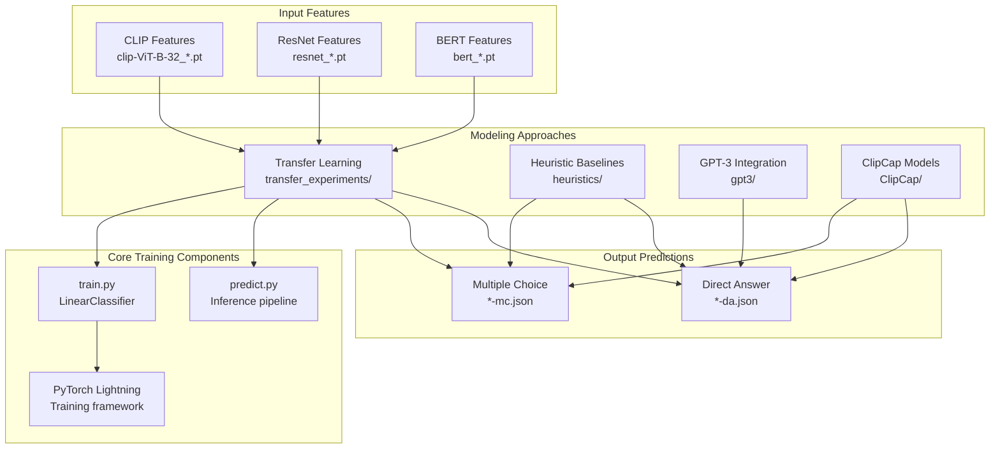
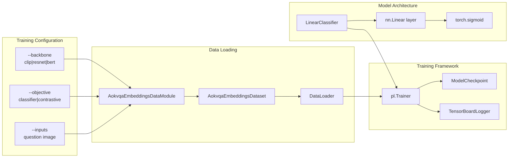

<!-- source: DeepWiki mcp.deepwiki.com · repo allenai/aokvqa · page 4 Model Training and Inference · fetched 2026-10-26 -->

# Model Training and Inference

<details>
<summary>Relevant source files</summary>

The following files were used as context for generating this wiki page:

- [README.md](README.md)
- [transfer_experiments/train.py](transfer_experiments/train.py)

</details>


This document provides an overview of the different modeling approaches available in the A-OKVQA benchmark for training VQA models and generating predictions. The A-OKVQA repository supports multiple methodologies ranging from simple heuristics to sophisticated neural models, all unified through a standardized evaluation framework.

For detailed information about dataset preparation and feature extraction, see [Feature Extraction Pipeline](#3). For evaluation procedures and metrics, see [Evaluation System](#5).

## Modeling Approaches Overview

The A-OKVQA benchmark provides four distinct modeling approaches, each serving different research purposes and baseline requirements:



**Sources**: [README.md:194-198](), [README.md:200-207]()

| Approach | Purpose | Complexity | Output Formats |
|----------|---------|------------|----------------|
| Transfer Learning | Main experimental framework for neural VQA models | High | Multiple Choice + Direct Answer |
| Heuristic Baselines | Simple baseline methods for performance comparison | Low | Multiple Choice + Direct Answer |
| GPT-3 Integration | Large language model approach with prompting | Medium | Direct Answer |
| ClipCap | Caption-based answer generation with rationales | High | Multiple Choice + Direct Answer + Rationales |

## Transfer Learning Framework

The transfer learning experiments form the core neural modeling approach, implemented through the `LinearClassifier` architecture that operates on pre-extracted features.

### Training Pipeline



**Sources**: [transfer_experiments/train.py:22-42](), [transfer_experiments/train.py:189-259]()

The training script supports multiple configuration options:

- **Backbone Models**: `clip`, `resnet`, `bert` - determines feature extraction method
- **Training Objectives**: `classifier` (multi-label), `contrastive` (embedding similarity)
- **Input Modalities**: `question`, `image`, or both combined
- **Model Types**: For CLIP backbone, supports multiple architectures like `ViT-B/32`, `RN50x4`

### Model Architecture

The `LinearClassifier` implements a simple yet effective architecture for VQA classification:

```python
# Key architectural components from LinearClassifier
self.linear = nn.Linear(emb_dim, out_dim)  # Main classification layer
```

**Sources**: [transfer_experiments/train.py:218](), [transfer_experiments/train.py:213-217]()

## Inference and Prediction Generation

All modeling approaches converge to standardized prediction formats enabling consistent evaluation and comparison.

### Prediction File Format

The repository enforces a consistent naming scheme: `{model-name}_{split}-{setting}.json`

```json
{
    "<question_id>": {
        "multiple_choice": "<prediction>",
        "direct_answer": "<prediction>"
    }
}
```

**Sources**: [README.md:200](), [README.md:105-112]()

### Inference Modes

```mermaid
graph TD
    subgraph "Inference Methods"
        CHECKPOINT["Checkpoint-based<br/>Trained model weights"]
        ZEROSHOT["Zero-shot CLIP<br/>No training required"]
        HEURISTIC["Heuristic Methods<br/>random_*, most_common_*"]
        GPT3_INF["GPT-3 Querying<br/>query_gpt3.py"]
    end
    
    subgraph "Input Processing"
        FEATURES["Pre-extracted Features<br/>*.pt files"]
        VOCAB["Vocabulary Encoding<br/>large_vocab_train.csv"]
        PROMPTS["Prompt Templates<br/>GPT-3 specific"]
    end
    
    subgraph "Prediction Generation"
        MC_GEN["Multiple Choice<br/>Choice selection"]
        DA_GEN["Direct Answer<br/>Open vocabulary"]
        RATIONALE["Rationale Generation<br/>ClipCap models"]
    end
    
    FEATURES --> CHECKPOINT
    FEATURES --> ZEROSHOT
    VOCAB --> HEURISTIC
    PROMPTS --> GPT3_INF
    
    CHECKPOINT --> MC_GEN
    CHECKPOINT --> DA_GEN
    ZEROSHOT --> MC_GEN
    ZEROSHOT --> DA_GEN
    HEURISTIC --> MC_GEN
    HEURISTIC --> DA_GEN
    GPT3_INF --> DA_GEN
    
    MC_GEN --> RATIONALE
    DA_GEN --> RATIONALE
```



**Sources**: [README.md:194-198](), [README.md:171-176]()

## Prediction Unification Pipeline

Before evaluation, predictions from different approaches are unified through standardized processing scripts:

```bash
python evaluation/prepare_predictions.py --aokvqa-dir ${AOKVQA_DIR} --split val --mc ./predictions_val-mc.json --da ./predictions_val-da.json --out ./predictions_val.json
```

**Sources**: [README.md:204-206]()

This unification enables:
- Consistent evaluation across different modeling approaches
- Support for models that only predict one format (MC or DA)
- Standardized leaderboard submission format

## Environment and Dependencies

The modeling framework requires specific environment setup:

```bash
export LOG_DIR=./logs/
export PREDS_DIR=./predictions/
export PT_MODEL_DIR=./pretrained_models/
```

**Sources**: [README.md:171-175]()

All models utilize the same base environment with PyTorch Lightning for training orchestration and standardized feature loading mechanisms. For detailed setup instructions, see [Environment Setup](#2.1).

For specific implementation details of each modeling approach:
- Transfer Learning: [Transfer Learning Experiments](#4.1)
- GPT-3 Integration: [GPT-3 Integration](#4.2)
- Heuristic Methods: [Heuristic Baselines](#4.3)
- ClipCap Models: [ClipCap Integration](#4.4)

---

