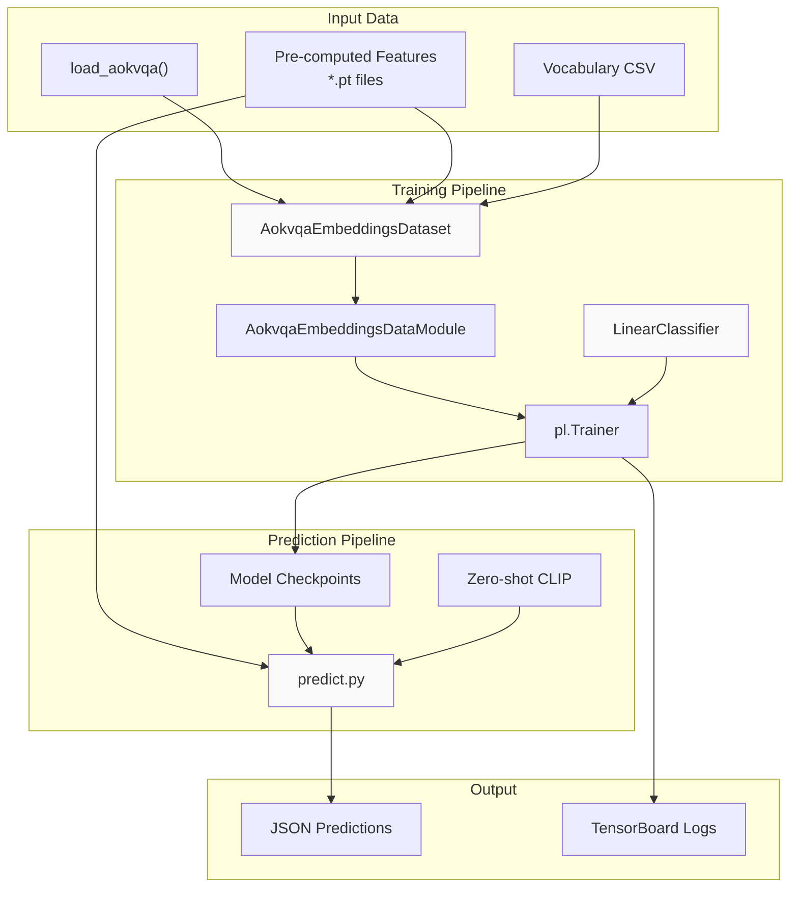
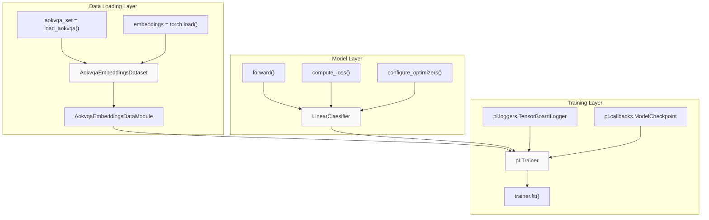
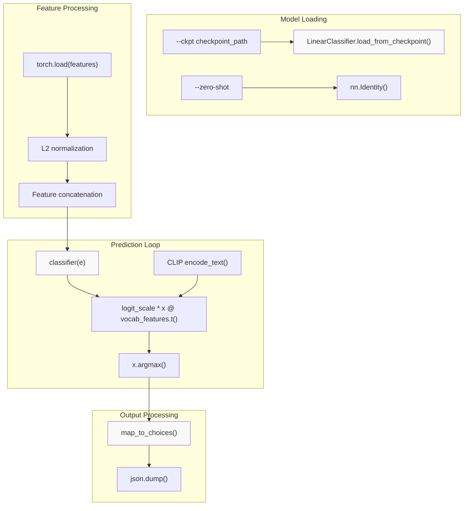

<!-- source: DeepWiki mcp.deepwiki.com · repo allenai/aokvqa · page 4.1 Transfer Learning Experiments · fetched 2026-10-26 -->

# Transfer Learning Experiments

<details>
<summary>Relevant source files</summary>

The following files were used as context for generating this wiki page:

- [transfer_experiments/README.md](transfer_experiments/README.md)
- [transfer_experiments/predict.py](transfer_experiments/predict.py)
- [transfer_experiments/train.py](transfer_experiments/train.py)

</details>


## Purpose and Scope

The transfer learning experiments system provides the core framework for training and evaluating visual question answering models on the A-OKVQA benchmark. This system enables training linear classifiers on top of frozen pre-computed features from various backbone models (CLIP, ResNet, BERT) and supports both supervised classification and contrastive learning objectives.

For feature extraction that feeds into this system, see [Feature Extraction Pipeline](#3). For evaluation of predictions generated by this system, see [Evaluation System](#5).

## System Architecture

The transfer learning framework follows a modular design that separates feature loading, model training, and prediction into distinct components:



The system supports three backbone architectures (`clip`, `resnet`, `bert`) and two training objectives (`classifier`, `contrastive`), enabling systematic comparison across different feature representations and learning paradigms.

**Sources:** [transfer_experiments/train.py:97-264](), [transfer_experiments/predict.py:1-127]()

## Training Pipeline

The training pipeline is built on PyTorch Lightning and consists of three main components that handle data loading, model definition, and training orchestration:



### AokvqaEmbeddingsDataset

The `AokvqaEmbeddingsDataset` class [transfer_experiments/train.py:97-149]() handles loading and preprocessing of pre-computed features:

- **Feature Loading**: Loads embeddings from `.pt` files and applies L2 normalization for CLIP features [transfer_experiments/train.py:106-114]()
- **Answer Processing**: Converts multiple correct answers into appropriate targets based on the training objective [transfer_experiments/train.py:121-127]()
- **Input Concatenation**: Combines question and image features when both modalities are used [transfer_experiments/train.py:130-136]()

### LinearClassifier

The `LinearClassifier` module [transfer_experiments/train.py:189-261]() implements a simple linear layer on top of frozen features:

| Component | Purpose | Implementation |
|-----------|---------|----------------|
| `__init__` | Configures output dimensions based on backbone and objective | [transfer_experiments/train.py:190-218]() |
| `forward` | Applies linear transformation and optional sigmoid activation | [transfer_experiments/train.py:220-224]() |
| `compute_loss` | Implements binary cross-entropy (classifier) or contrastive loss | [transfer_experiments/train.py:226-243]() |

**Sources:** [transfer_experiments/train.py:97-261]()

## Model Configuration

The system supports multiple configuration combinations through command-line arguments:

### Backbone Options

| Backbone | Input Modalities | Feature Dimension | Supported Objectives |
|----------|------------------|-------------------|---------------------|
| `clip` | `question`, `image`, or both | 512-1024 (model dependent) | `classifier`, `contrastive` |
| `resnet` | `image` only | 2048 | `classifier` only |
| `bert` | `question` only | 768 | `classifier` only |

### Training Objectives

- **Classifier**: Binary cross-entropy loss with sigmoid activation for multi-label classification [transfer_experiments/train.py:231-232]()
- **Contrastive**: Cosine similarity-based contrastive loss between embeddings and vocabulary features [transfer_experiments/train.py:234-236]()

The backbone and objective constraints are enforced in the dataset initialization [transfer_experiments/train.py:102-104]().

**Sources:** [transfer_experiments/train.py:27-36](), [transfer_experiments/train.py:195-217]()

## Prediction Pipeline

The prediction system supports both checkpoint-based inference and zero-shot CLIP evaluation:



### Prediction Modes

The prediction script [transfer_experiments/predict.py:51-58]() supports two mutually exclusive modes:

1. **Checkpoint Mode**: Loads a trained `LinearClassifier` from a `.ckpt` file
2. **Zero-shot Mode**: Uses an identity function with CLIP similarity scoring

### Multiple Choice vs Direct Answer

For multiple choice questions (`--mc` flag), the system dynamically encodes the provided choices using CLIP [transfer_experiments/predict.py:105-113](). For direct answer mode, it uses pre-computed vocabulary features and applies choice mapping for classifier objectives [transfer_experiments/predict.py:123-124]().

**Sources:** [transfer_experiments/predict.py:51-127]()

## Command Line Interface

The system provides two main entry points with extensive configuration options:

### Training Command Structure

```bash
python transfer_experiments/train.py \
  --aokvqa-dir ${AOKVQA_DIR} \
  --vocab ${AOKVQA_DIR}/large_vocab_train.csv \
  --log-dir ${LOG_DIR} \
  --backbone {clip,resnet,bert} \
  --objective {classifier,contrastive} \
  --inputs {question,image} \
  --train-features ${FEATURES_DIR}/*.pt \
  --val-features ${FEATURES_DIR}/*.pt
```

### Prediction Command Structure

```bash
python transfer_experiments/predict.py \
  --split {train,val,test} \
  --aokvqa-dir ${AOKVQA_DIR} \
  --features ${FEATURES_DIR}/*.pt \
  --out predictions.json \
  {--ckpt path/to/model.ckpt | --zero-shot} \
  [--mc] [--vocab vocab.csv] [--vocab-features vocab.pt]
```

The argument parsing includes validation logic that requires certain combinations (e.g., `--inputs` required when using `--zero-shot`) [transfer_experiments/predict.py:30-38]().

**Sources:** [transfer_experiments/README.md:5-41](), [transfer_experiments/train.py:22-42](), [transfer_experiments/predict.py:19-40]()

---

