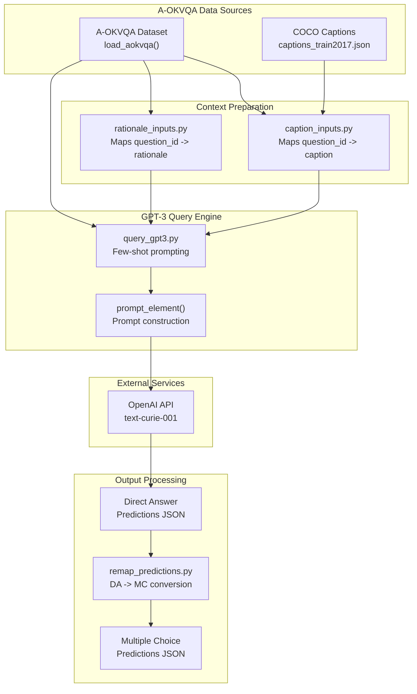
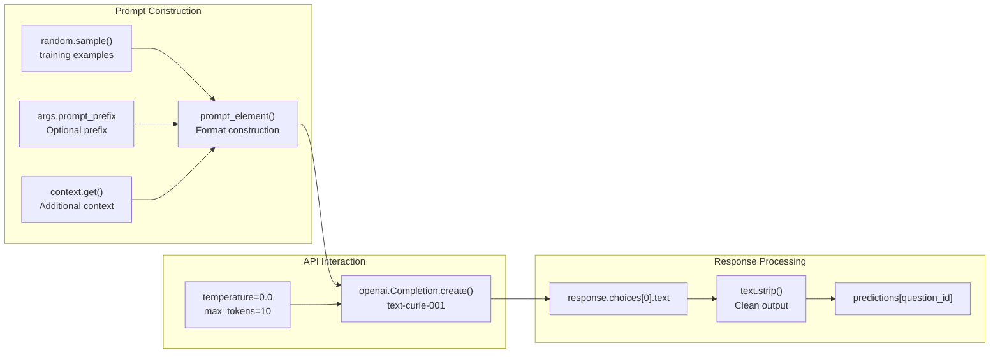
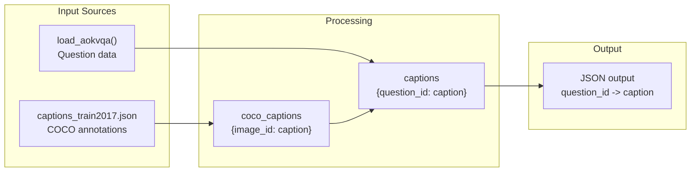
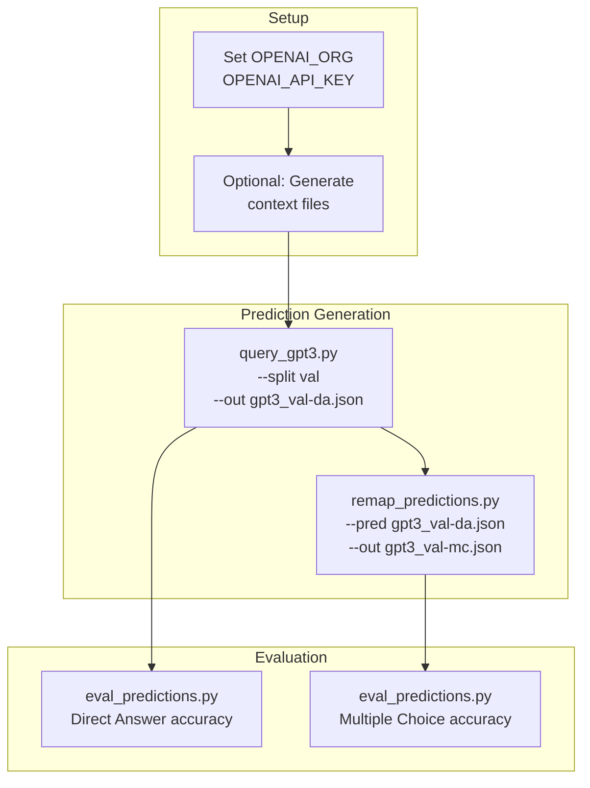

<!-- source: DeepWiki mcp.deepwiki.com · repo allenai/aokvqa · page 4.2 GPT-3 Integration · fetched 2026-10-26 -->

# GPT-3 Integration

<details>
<summary>Relevant source files</summary>

The following files were used as context for generating this wiki page:

- [gpt3/README.md](gpt3/README.md)
- [gpt3/caption_inputs.py](gpt3/caption_inputs.py)
- [gpt3/query_gpt3.py](gpt3/query_gpt3.py)
- [gpt3/rationale_inputs.py](gpt3/rationale_inputs.py)

</details>


This document covers the GPT-3 integration system within the A-OKVQA repository, which provides an alternative approach to Visual Question Answering using OpenAI's GPT-3 language model. The system implements few-shot prompting strategies to leverage GPT-3's knowledge for answering A-OKVQA questions.

For information about the main transfer learning approach, see [Transfer Learning Experiments](#4.1). For evaluation of GPT-3 predictions, see [Evaluation System](#5).

## System Overview

The GPT-3 integration operates as a standalone alternative to neural VQA models, using the OpenAI API to generate predictions through carefully constructed prompts. The system supports various input contexts and prompt configurations to optimize GPT-3 performance on the A-OKVQA task.



**GPT-3 Integration Architecture**

Sources: [gpt3/query_gpt3.py:1-80](), [gpt3/caption_inputs.py:1-24](), [gpt3/rationale_inputs.py:1-17](), [gpt3/README.md:1-15]()

## OpenAI API Configuration

The system requires valid OpenAI API credentials to function. Authentication is handled through environment variables that must be configured before running any GPT-3 queries.

| Environment Variable | Purpose | Example |
|---------------------|---------|---------|
| `OPENAI_ORG` | OpenAI organization ID | `org-xxxxxxxxx` |
| `OPENAI_API_KEY` | API authentication key | `sk-xxxxxxxxx` |

The credentials are loaded and configured in the query script:

```python
import openai
openai.organization = os.getenv('OPENAI_ORG')
openai.api_key = os.getenv('OPENAI_API_KEY')
```

Sources: [gpt3/README.md:3-8](), [gpt3/query_gpt3.py:8-10]()

## GPT-3 Query System

The core querying functionality is implemented in `query_gpt3.py`, which constructs few-shot prompts and queries the OpenAI API. The system uses the `text-curie-001` engine with specific parameters optimized for VQA tasks.



**GPT-3 Query Processing Flow**

### Key Components

**`prompt_element()` Function**: Constructs individual prompt segments containing question, optional context, choices, and answers. The function signature and logic:

```python
def prompt_element(d, context=None, include_choices=False, answer=False):
    return (f"Context: {context}\n" if context is not None else '') + \
            f"Q: {d['question']}\n" + \
           (f"Choices: {', '.join(d['choices'])}.\n" if include_choices else '') + \
            f"A:" + (f" {d['choices'][d['correct_choice_idx']]}" if answer else '')
```

**Configuration Parameters**:
- `--n`: Number of training examples for few-shot prompting (default: 10)
- `--include-choices`: Whether to include multiple choice options in prompts
- `--context`: JSON file containing additional context (captions, rationales)
- `--prefix`: Optional prompt prefix string

Sources: [gpt3/query_gpt3.py:18-80]()

## Context Preparation Utilities

The system includes utilities to prepare various types of context information that can enhance GPT-3 performance by providing additional visual or reasoning context.

### Caption Context Generation

The `caption_inputs.py` script maps A-OKVQA questions to corresponding COCO image captions:



**Caption Context Mapping Process**

### Rationale Context Generation

The `rationale_inputs.py` script extracts reasoning explanations from the A-OKVQA dataset:

```python
rationales = {d['question_id'] : d['rationales'][0] for d in aokvqa_set}
```

This creates a mapping from question IDs to the first available rationale, providing reasoning context for GPT-3 prompts.

Sources: [gpt3/caption_inputs.py:16-23](), [gpt3/rationale_inputs.py:14-16]()

## Usage Workflow

The complete GPT-3 prediction workflow follows a standard pattern that integrates with the broader A-OKVQA evaluation system:



**Complete GPT-3 Workflow**

### Standard Command Sequence

1. **Direct Answer Prediction**:
   ```bash
   python gpt3/query_gpt3.py --aokvqa-dir ${AOKVQA_DIR} --split val --out ${PREDS_DIR}/gpt3_val-da.json
   ```

2. **Multiple Choice Conversion**:
   ```bash
   python remap_predictions.py --aokvqa-dir ${AOKVQA_DIR} --split val --pred ${PREDS_DIR}/gpt3_val-da.json --out ${PREDS_DIR}/gpt3_val-mc.json
   ```

The output predictions follow the standard A-OKVQA prediction format, enabling direct comparison with other modeling approaches through the unified evaluation system.

Sources: [gpt3/README.md:10-14](), [gpt3/query_gpt3.py:19-28]()

---

