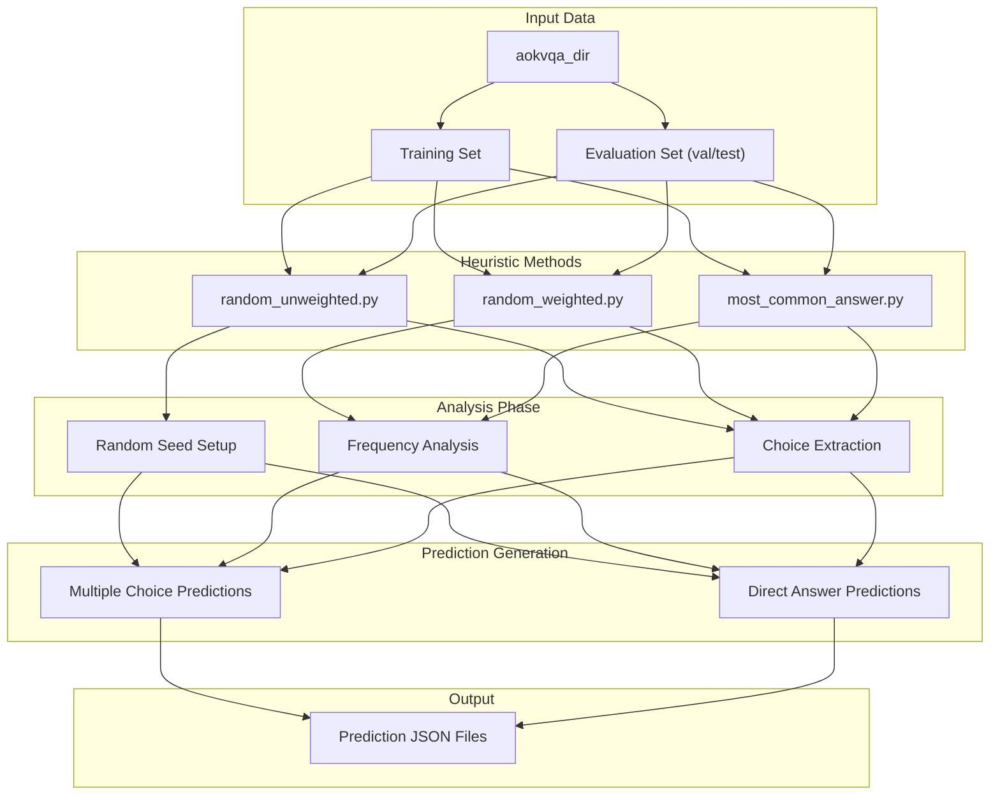
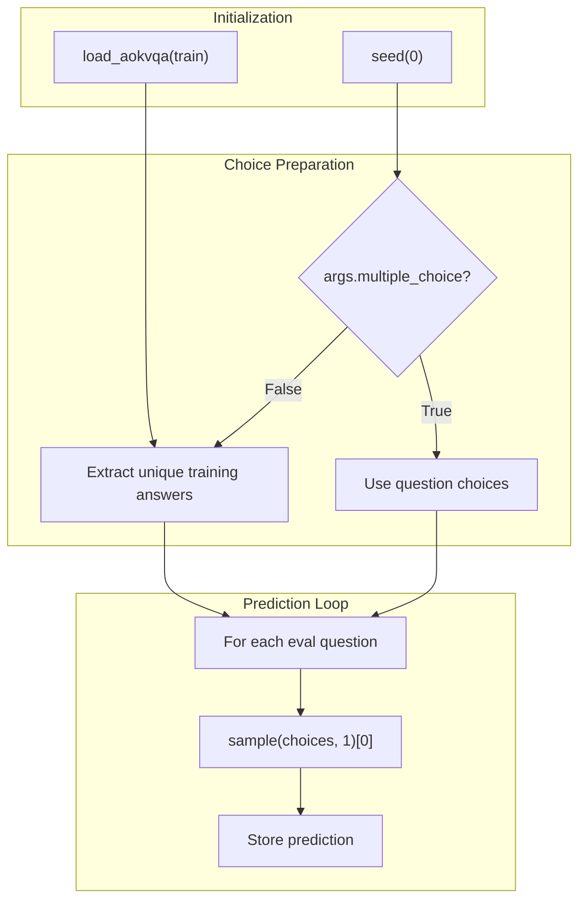
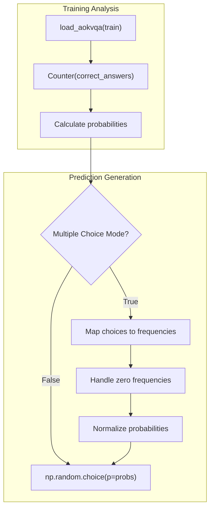
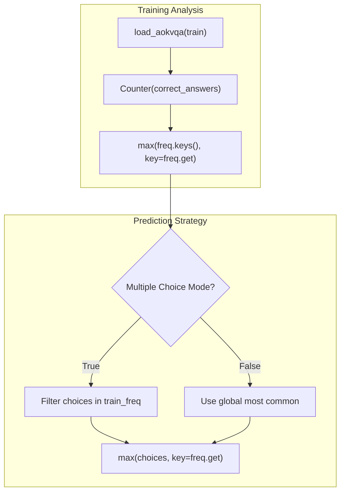
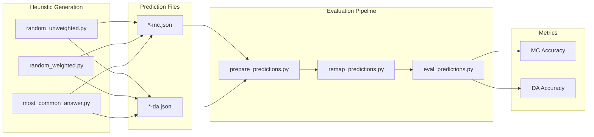

<!-- source: DeepWiki mcp.deepwiki.com · repo allenai/aokvqa · page 4.3 Heuristic Baselines · fetched 2026-10-26 -->

# Heuristic Baselines

<details>
<summary>Relevant source files</summary>

The following files were used as context for generating this wiki page:

- [heuristics/README.md](heuristics/README.md)
- [heuristics/most_common_answer.py](heuristics/most_common_answer.py)
- [heuristics/random_unweighted.py](heuristics/random_unweighted.py)
- [heuristics/random_weighted.py](heuristics/random_weighted.py)

</details>


This document covers the simple heuristic baseline methods provided in the A-OKVQA repository for establishing performance baselines on the VQA task. These baselines serve as fundamental comparison points for more sophisticated models and help establish lower bounds on task performance.

For information about advanced modeling approaches, see [Transfer Learning Experiments](#4.1), [GPT-3 Integration](#4.2), and [ClipCap Integration](#4.4). For evaluation of heuristic predictions, see [Evaluation Pipeline](#5.1).

## Overview

The heuristic baselines implement three simple strategies for answering VQA questions without using visual or textual understanding:

| Method | Strategy | Multiple Choice | Direct Answer |
|--------|----------|----------------|---------------|
| `random_unweighted` | Random selection with uniform probability | Random choice from 4 options | Random selection from training vocabulary |
| `random_weighted` | Random selection weighted by training frequency | Weighted by training frequency of choices | Weighted by answer frequency in training |
| `most_common_answer` | Always predict most frequent training answer | Most frequent choice among available options | Single most frequent training answer |

All methods support both multiple choice (MC) and direct answer (DA) evaluation modes, providing baselines for both A-OKVQA evaluation settings.

## Heuristic Baseline Architecture



**Sources:** [heuristics/README.md:1-12](), [heuristics/random_unweighted.py:1-38](), [heuristics/random_weighted.py:1-46](), [heuristics/most_common_answer.py:1-40]()

## Implementation Details

### Random Unweighted Baseline

The `random_unweighted.py` script implements uniform random selection:



Key implementation details:
- Uses `seed(0)` for reproducible randomization [heuristics/random_unweighted.py:17]()
- For direct answer mode, extracts unique correct answers from training [heuristics/random_unweighted.py:22-24]()
- For multiple choice mode, samples from the 4 provided choices [heuristics/random_unweighted.py:34-36]()

### Random Weighted Baseline

The `random_weighted.py` script implements frequency-weighted random selection:



Key implementation details:
- Uses `np.random.seed(0)` for reproducible randomization [heuristics/random_weighted.py:18]()
- Builds frequency counter from training correct answers [heuristics/random_weighted.py:21-23]()
- Handles cases where no choices have training frequency by uniform weighting [heuristics/random_weighted.py:39-40]()
- Normalizes probabilities before sampling [heuristics/random_weighted.py:41]()

### Most Common Answer Baseline

The `most_common_answer.py` script implements deterministic selection of the most frequent training answer:



Key implementation details:
- Finds single most common answer across all training data [heuristics/most_common_answer.py:22]()
- For multiple choice, filters to choices that appear in training [heuristics/most_common_answer.py:35-37]()
- Falls back to global most common if no choices appear in training [heuristics/most_common_answer.py:32]()

**Sources:** [heuristics/random_unweighted.py:17-38](), [heuristics/random_weighted.py:18-46](), [heuristics/most_common_answer.py:18-38]()

## Usage and Command Line Interface

All heuristic baseline scripts share a common command line interface:

| Argument | Type | Description | Example |
|----------|------|-------------|---------|
| `--aokvqa-dir` | Path | Path to A-OKVQA dataset directory | `/path/to/aokvqa` |
| `--split` | Choice | Dataset split to evaluate on | `val`, `test`, `train` |
| `--mc` | Flag | Enable multiple choice mode | Optional flag |
| `--out` | File | Output prediction file path | `predictions.json` |

### Example Usage

```bash
# Multiple choice predictions
python heuristics/random_unweighted.py \
    --aokvqa-dir ${AOKVQA_DIR} \
    --split val \
    --mc \
    --out ${PREDS_DIR}/random-unweighted_val-mc.json

# Direct answer predictions  
python heuristics/most_common_answer.py \
    --aokvqa-dir ${AOKVQA_DIR} \
    --split val \
    --out ${PREDS_DIR}/most-common_val-da.json
```

### Output Format

All scripts generate JSON files with question ID to prediction mappings:

```json
{
    "question_id_1": "predicted_answer_1",
    "question_id_2": "predicted_answer_2"
}
```

This format is compatible with the A-OKVQA evaluation pipeline described in [Prediction Formats and Metrics](#5.2).

**Sources:** [heuristics/README.md:3-11](), [heuristics/random_unweighted.py:10-15](), [heuristics/random_weighted.py:11-16](), [heuristics/most_common_answer.py:10-15]()

## Integration with Evaluation System

The heuristic baselines integrate seamlessly with the A-OKVQA evaluation framework:



The heuristic predictions follow the same JSON format as other model predictions, enabling direct comparison with transfer learning models, GPT-3 results, and ClipCap outputs through the unified evaluation system.

**Sources:** [heuristics/random_unweighted.py:38](), [heuristics/random_weighted.py:46](), [heuristics/most_common_answer.py:39]()

---

