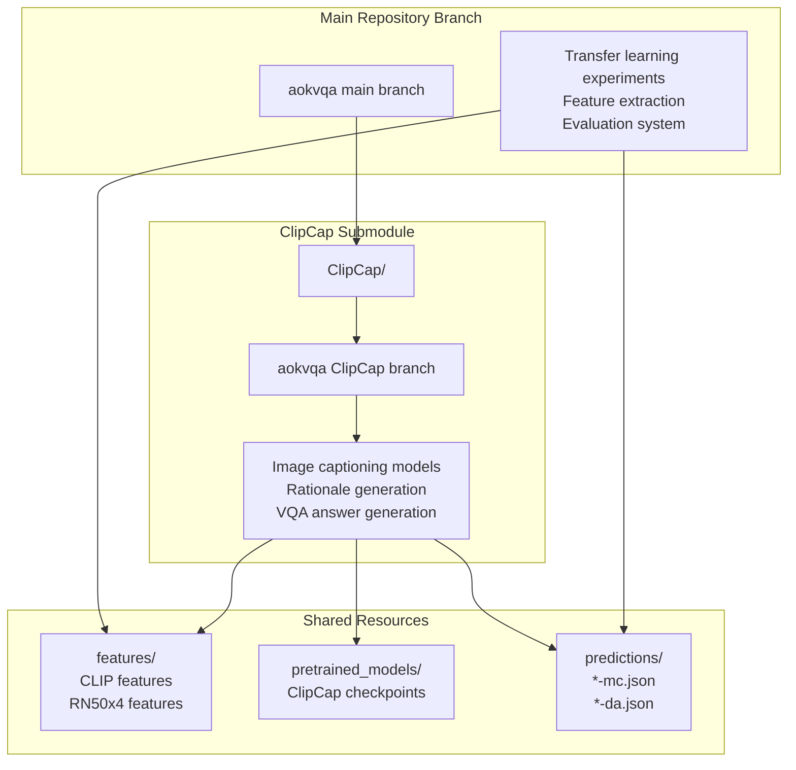
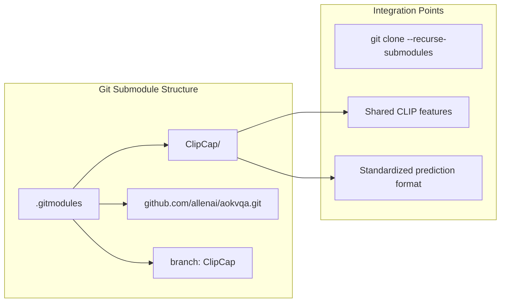
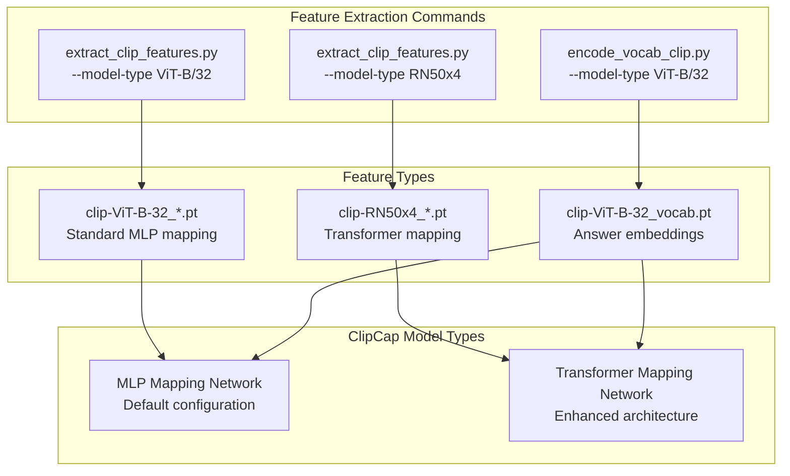
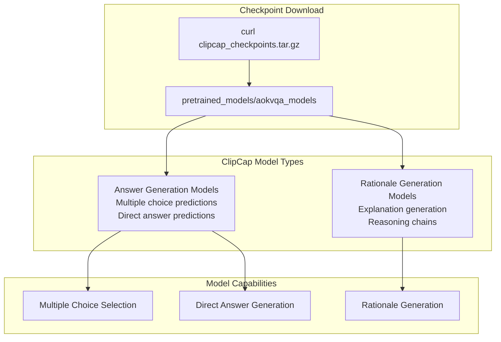
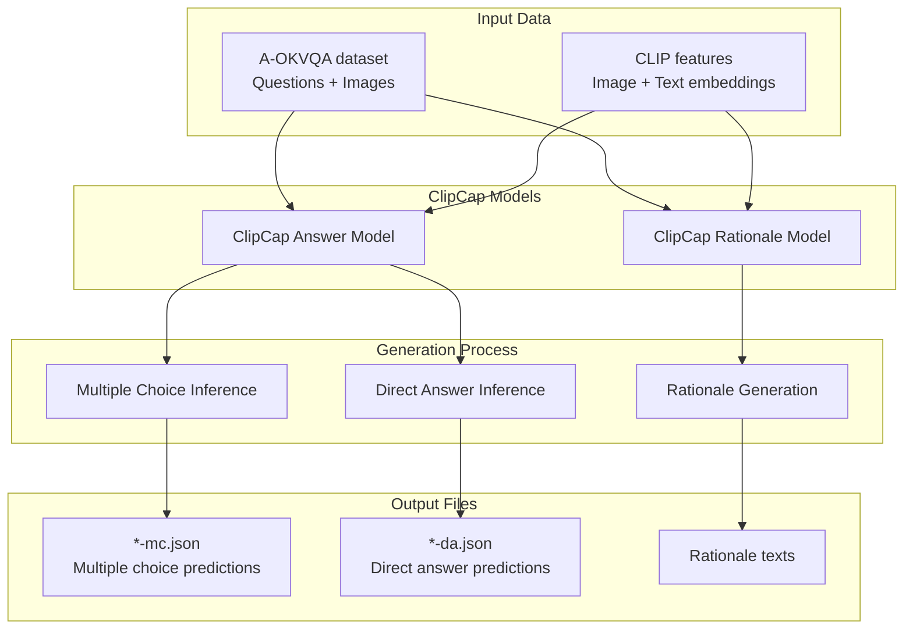
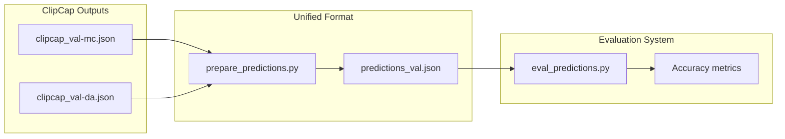
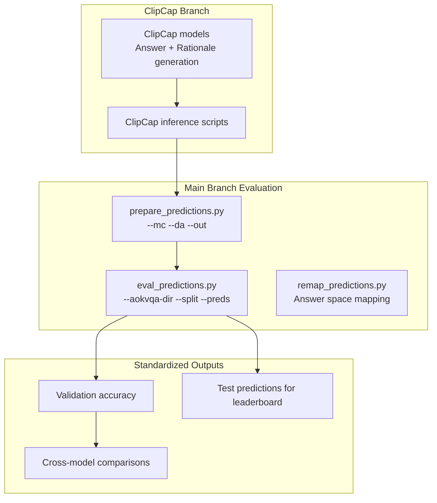

<!-- source: DeepWiki mcp.deepwiki.com · repo allenai/aokvqa · page 4.4 ClipCap Integration · fetched 2026-10-26 -->

# ClipCap Integration

Relevant source files

The following files were used as context for generating this wiki page:

- [.gitmodules](.gitmodules)
- [README.md](README.md)

## Purpose and Scope

This page documents the ClipCap integration within the A-OKVQA repository, which provides image captioning and visual question answering capabilities using CLIP-based features. ClipCap serves as an alternative modeling approach that generates both multiple choice and direct answer predictions for the A-OKVQA benchmark.

For information about other modeling approaches, see Transfer Learning Experiments ([4.1](#4.1)), GPT-3 Integration ([4.2](#4.2)), and Heuristic Baselines ([4.3](#4.3)). For evaluation of ClipCap predictions, see Evaluation Pipeline ([5.1](#5.1)).

Sources: [README.md:145-149](), [README.md:184-185](), [README.md:197-198]()

## ClipCap Submodule Architecture

ClipCap is implemented as a git submodule that points to a separate branch within the same repository, providing a modular approach to caption and rationale generation.

**ClipCap Submodule Configuration**

The ClipCap integration uses a git submodule configuration that allows independent development while maintaining integration with the main codebase.

Sources: [.gitmodules:1-5]()

## Feature Requirements and Extraction

ClipCap models require specific CLIP feature formats depending on the mapping network architecture being used.

**Feature Extraction Pipeline for ClipCap**

| Mapping Network | CLIP Model | Feature File Pattern | Use Case |
|-----------------|------------|---------------------|----------|
| MLP (Default) | ViT-B/32 | `clip-ViT-B-32_*.pt` | Standard ClipCap training |
| Transformer | RN50x4 | `clip-RN50x4_*.pt` | Enhanced mapping network |
| Vocabulary | ViT-B/32 | `clip-ViT-B-32_vocab.pt` | Answer space encoding |

Sources: [README.md:138-143](), [README.md:145-149]()

## Model Checkpoints and Training

ClipCap provides pretrained model checkpoints for both answer generation and rationale generation tasks.

**Checkpoint Management System**

**Training Configuration Options**

ClipCap supports different mapping network architectures with corresponding feature requirements:

| Component | MLP Configuration | Transformer Configuration |
|-----------|------------------|---------------------------|
| Input Features | ViT-B/32 CLIP features | RN50x4 CLIP features |
| Mapping Network | Multi-layer perceptron | Transformer architecture |
| Complexity | Standard | Enhanced |
| Performance | Baseline | Improved |

Sources: [README.md:184-186]()

## Prediction Generation and Output

ClipCap generates predictions in the standardized format used across all A-OKVQA modeling approaches.

**ClipCap Prediction Pipeline**

**Prediction Format Compatibility**

ClipCap outputs follow the same prediction file naming scheme as other models: `{model-name}_{split}-{setting}.json`, ensuring compatibility with the unified evaluation system.

Sources: [README.md:200-207]()

## Integration with Evaluation Pipeline

ClipCap predictions are processed through the same evaluation pipeline as other modeling approaches, enabling direct performance comparison.

**Evaluation Integration Workflow**

The evaluation system processes ClipCap predictions alongside transfer learning, heuristic, and GPT-3 predictions, providing unified benchmarking capabilities across all modeling approaches in the A-OKVQA repository.

Sources: [README.md:197-199](), [README.md:204-207]()

---

