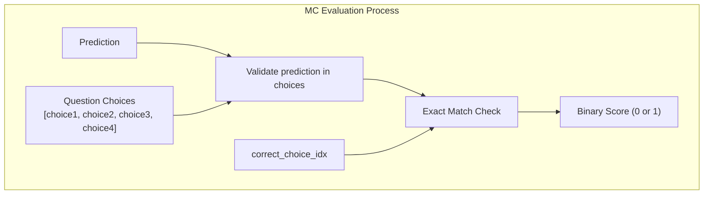
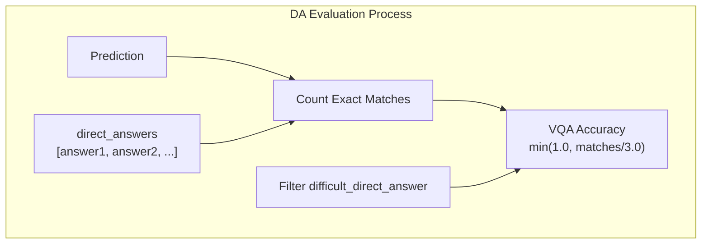
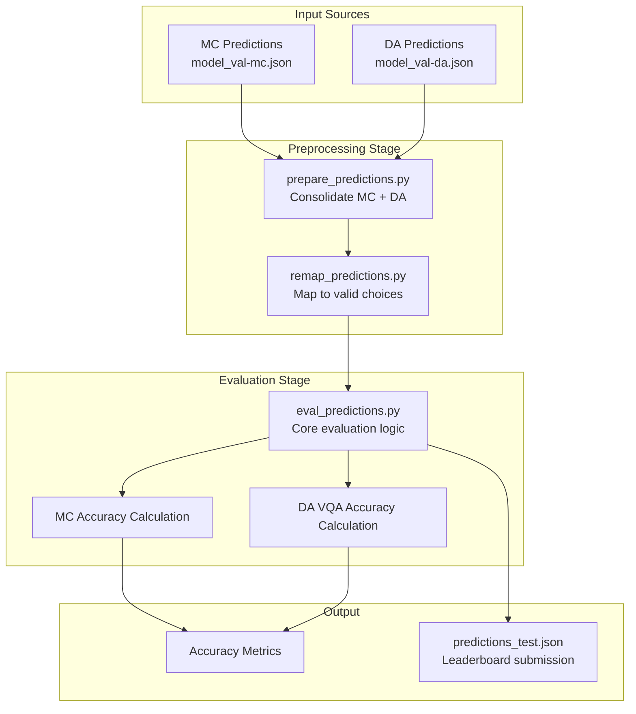
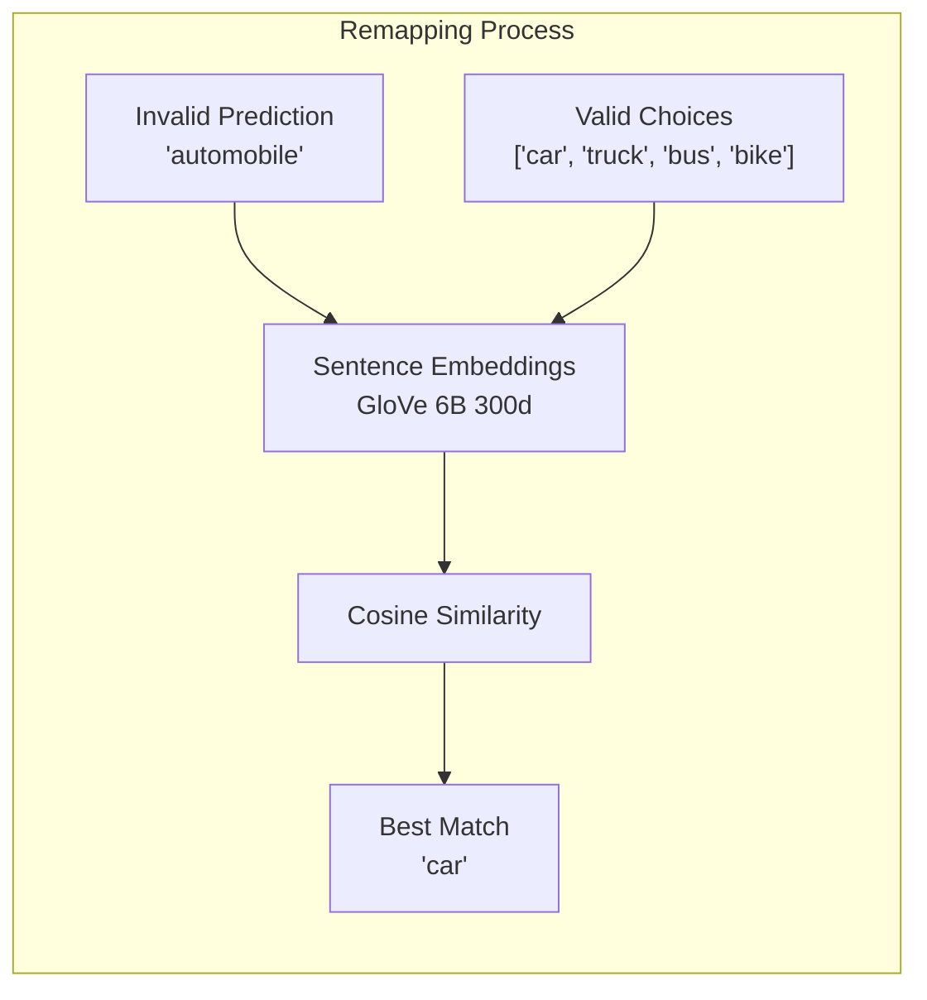

<!-- source: DeepWiki mcp.deepwiki.com · repo allenai/aokvqa · page 5 Evaluation System · fetched 2026-10-26 -->

# Evaluation System

<details>
<summary>Relevant source files</summary>

The following files were used as context for generating this wiki page:

- [README.md](README.md)
- [evaluation/eval_predictions.py](evaluation/eval_predictions.py)
- [evaluation/prepare_predictions.py](evaluation/prepare_predictions.py)
- [evaluation/remap_predictions.py](evaluation/remap_predictions.py)

</details>


The evaluation system provides a standardized framework for assessing Visual Question Answering (VQA) performance across different modeling approaches in the A-OKVQA benchmark. It supports both multiple choice and direct answer evaluation modes, handles prediction preprocessing and validation, and enables leaderboard submission.

For information about generating predictions from models, see [Model Training and Inference](#4). For details about specific evaluation pipelines for different model types, see [Evaluation Pipeline](#5.1).

## Evaluation Modes and Metrics

The A-OKVQA evaluation system supports two distinct evaluation settings, each with specific accuracy metrics:

### Multiple Choice (MC) Evaluation

Multiple choice evaluation measures exact match accuracy against the correct choice from a predefined set of four options. The system validates that predictions are valid choices and computes binary accuracy.



The multiple choice evaluation logic is implemented in [evaluation/eval_predictions.py:36-41]() where it performs exact string matching between the prediction and the correct choice.

### Direct Answer (DA) Evaluation

Direct answer evaluation uses VQA-style accuracy scoring, where multiple valid answers are considered and partial credit is awarded based on annotator agreement.



The VQA accuracy calculation follows the standard VQA evaluation protocol implemented in [evaluation/eval_predictions.py:44-46](), where a prediction receives score `min(1.0, num_matches / 3.0)` based on agreement with human annotators.

**Sources:** [evaluation/eval_predictions.py:9-51](), [README.md:101-118]()

## Prediction Format Specification

The evaluation system requires predictions in a standardized JSON format that supports both evaluation modes:

| Field | Type | Description | Required |
|-------|------|-------------|----------|
| `question_id` | string | Unique identifier for each question | Yes |
| `multiple_choice` | string | Prediction for MC evaluation | Optional |
| `direct_answer` | string | Prediction for DA evaluation | Optional |

```json
{
    "22MexNkBPpdZGX6sxbxVBH": {
        "multiple_choice": "cab",
        "direct_answer": "taxi"
    },
    "question_id_2": {
        "multiple_choice": "train"
    }
}
```

The prediction files follow a naming convention: `{model-name}_{split}-{setting}.json` for individual evaluation modes, or `predictions_{split}.json` for unified evaluation files.

**Sources:** [README.md:103-112](), [evaluation/eval_predictions.py:67-97]()

## Evaluation Pipeline Architecture

The evaluation system consists of three main processing stages that transform raw model outputs into standardized accuracy metrics:



### Prediction Preparation

The `prepare_predictions.py` script consolidates separate multiple choice and direct answer prediction files into the unified format required for evaluation. It iterates through the dataset and merges predictions by question ID.

### Prediction Remapping

The `remap_predictions.py` script handles cases where model predictions don't exactly match the provided multiple choice options. It uses sentence transformers with GloVe embeddings to find the most semantically similar choice via cosine similarity.



### Core Evaluation

The `eval_aokvqa()` function in `eval_predictions.py` performs the actual accuracy calculations for both evaluation modes, with support for strict and non-strict validation.

**Sources:** [evaluation/prepare_predictions.py:1-32](), [evaluation/remap_predictions.py:12-28](), [evaluation/eval_predictions.py:9-51]()

## Command Line Interface

The evaluation system provides a command-line interface for running evaluations on prediction files:

### Basic Evaluation
```bash
python evaluation/eval_predictions.py \
    --aokvqa-dir ${AOKVQA_DIR} \
    --split val \
    --preds ./predictions_val.json
```

### Prediction Preparation
```bash
python evaluation/prepare_predictions.py \
    --aokvqa-dir ${AOKVQA_DIR} \
    --split val \
    --mc ./predictions_val-mc.json \
    --da ./predictions_val-da.json \
    --out ./predictions_val.json
```

### Prediction Remapping
```bash
python evaluation/remap_predictions.py \
    --aokvqa-dir ${AOKVQA_DIR} \
    --split val \
    --pred ./raw_predictions.json \
    --out ./remapped_predictions.json
```

The evaluation scripts support glob patterns for batch evaluation of multiple prediction files and output results in the format: `{filename} {mode} {accuracy}`.

**Sources:** [evaluation/eval_predictions.py:53-98](), [evaluation/prepare_predictions.py:8-32](), [evaluation/remap_predictions.py:31-44](), [README.md:114-207]()

## Leaderboard Integration

The evaluation system connects to the A-OKVQA leaderboard through standardized test set prediction files. The `predictions_test.json` file format enables direct submission to the online leaderboard for official evaluation and comparison with other methods.

The leaderboard evaluation uses the same `eval_aokvqa()` function but restricts access to ground truth labels for the test set, maintaining evaluation integrity while enabling public comparison of different approaches.

**Sources:** [README.md:120-122](), [evaluation/eval_predictions.py:56]()

---

