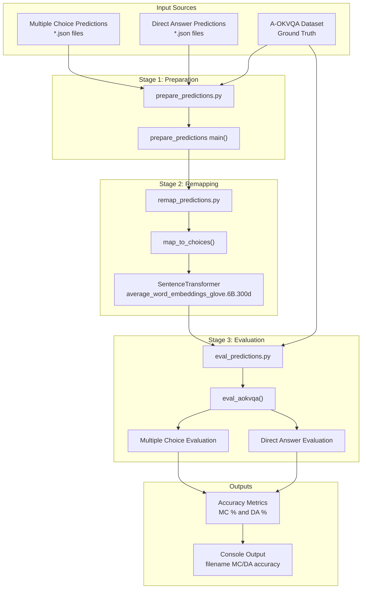
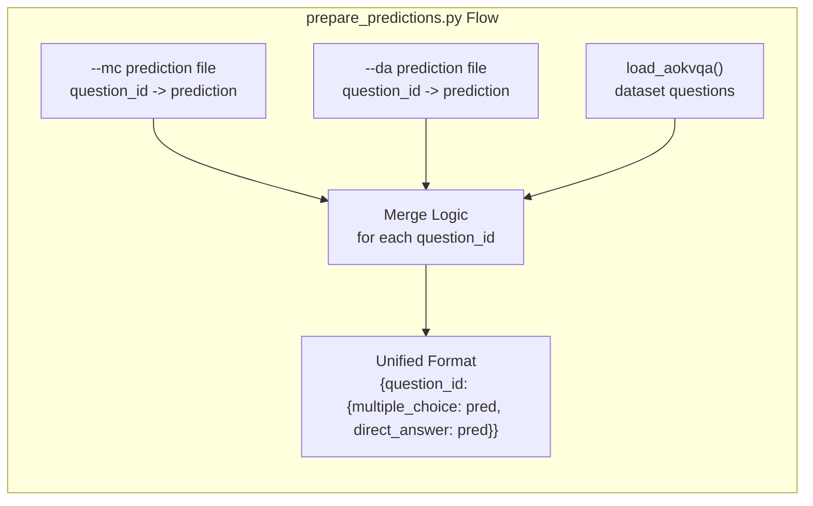
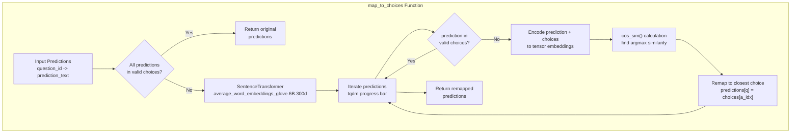

<!-- source: DeepWiki mcp.deepwiki.com · repo allenai/aokvqa · page 5.1 Evaluation Pipeline · fetched 2026-10-26 -->

# Evaluation Pipeline

<details>
<summary>Relevant source files</summary>

The following files were used as context for generating this wiki page:

- [evaluation/eval_predictions.py](evaluation/eval_predictions.py)
- [evaluation/prepare_predictions.py](evaluation/prepare_predictions.py)
- [evaluation/remap_predictions.py](evaluation/remap_predictions.py)

</details>


## Purpose and Scope

The evaluation pipeline provides a standardized system for assessing VQA model performance on the A-OKVQA benchmark. This pipeline handles prediction preprocessing, format validation, choice remapping, and accuracy computation for both multiple choice and direct answer evaluation modes.

For detailed information about prediction file formats and metrics calculations, see [Prediction Formats and Metrics](#5.2).

## Pipeline Architecture

The evaluation pipeline consists of three main processing stages that transform raw model predictions into standardized accuracy metrics:



**Sources:** [evaluation/prepare_predictions.py:1-32](), [evaluation/remap_predictions.py:1-45](), [evaluation/eval_predictions.py:1-98]()

## Core Evaluation Function

The `eval_aokvqa` function implements the dual evaluation modes required by the A-OKVQA benchmark:

```mermaid
graph TB
    subgraph "eval_aokvqa Function Flow"
        INPUT["Function Input<br/>dataset, preds, multiple_choice, strict"]
        
        DATASET_CHECK{"Dataset Type Check<br/>list vs dict"}
        CONVERT["Convert list to dict<br/>question_id as key"]
        
        MC_MODE{"multiple_choice<br/>parameter"}
        
        FILTER_DIFF["Filter difficult_direct_answer<br/>== False questions"]
        KEEP_ALL["Keep all questions"]
        
        STRICT_CHECK{"strict mode<br/>enabled?"}
        ASSERT_SUBSET["Assert dataset_qids.issubset(preds_qids)"]
        
        EVAL_LOOP["Iterate over dataset questions"]
        
        MC_LOGIC["Multiple Choice Logic<br/>pred == choices[correct_choice_idx]"]
        DA_LOGIC["Direct Answer Logic<br/>VQA accuracy: min(1.0, matches/3.0)"]
        
        CALC_ACC["Calculate final accuracy<br/>sum(acc) / len(acc) * 100"]
    end
    
    INPUT --> DATASET_CHECK
    DATASET_CHECK -->|"list"| CONVERT
    DATASET_CHECK -->|"dict"| MC_MODE
    CONVERT --> MC_MODE
    
    MC_MODE -->|"False"| FILTER_DIFF
    MC_MODE -->|"True"| KEEP_ALL
    
    FILTER_DIFF --> STRICT_CHECK
    KEEP_ALL --> STRICT_CHECK
    
    STRICT_CHECK -->|"True"| ASSERT_SUBSET
    STRICT_CHECK -->|"False"| EVAL_LOOP
    ASSERT_SUBSET --> EVAL_LOOP
    
    EVAL_LOOP --> MC_LOGIC
    EVAL_LOOP --> DA_LOGIC
    
    MC_LOGIC --> CALC_ACC
    DA_LOGIC --> CALC_ACC
```



**Sources:** [evaluation/eval_predictions.py:9-50]()

### Multiple Choice vs Direct Answer Evaluation

The evaluation function handles two distinct evaluation modes with different accuracy calculations:

| Mode | Question Filter | Accuracy Calculation | Ground Truth Source |
|------|----------------|---------------------|-------------------|
| Multiple Choice | All questions | Binary: `pred == choices[correct_choice_idx]` | `correct_choice_idx` field |
| Direct Answer | `difficult_direct_answer == False` | VQA: `min(1.0, num_matches / 3.0)` | `direct_answers` list |

**Sources:** [evaluation/eval_predictions.py:14-16](), [evaluation/eval_predictions.py:37-46]()

## Prediction Preparation and Consolidation

The `prepare_predictions.py` script consolidates separate multiple choice and direct answer prediction files into the unified format expected by the evaluation pipeline:



**Sources:** [evaluation/prepare_predictions.py:18-31]()

## Choice Remapping System

The `remap_predictions.py` script handles cases where model predictions don't exactly match the valid choice options using semantic similarity:



**Sources:** [evaluation/remap_predictions.py:12-28]()

## Usage Patterns

### Command Line Evaluation

The evaluation pipeline supports batch processing of prediction files with glob patterns:

```bash
python evaluation/eval_predictions.py \
    --aokvqa-dir /path/to/aokvqa \
    --split val \
    --preds "predictions/*.json"
```

The main evaluation script processes each matching file and extracts both multiple choice and direct answer predictions automatically:

**Sources:** [evaluation/eval_predictions.py:53-98]()

### Prediction Format Processing

The pipeline expects predictions in the unified format created by `prepare_predictions.py`:

```json
{
  "question_id": {
    "multiple_choice": "choice_text",
    "direct_answer": "answer_text"
  }
}
```

The evaluation script extracts the appropriate prediction type based on available keys in each question's prediction object.

**Sources:** [evaluation/eval_predictions.py:67-88]()

---

