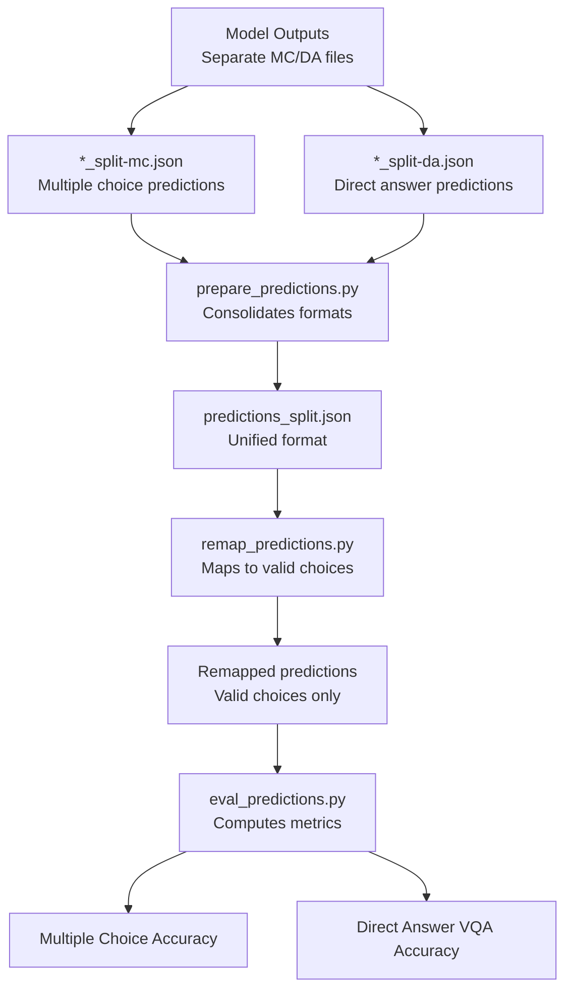
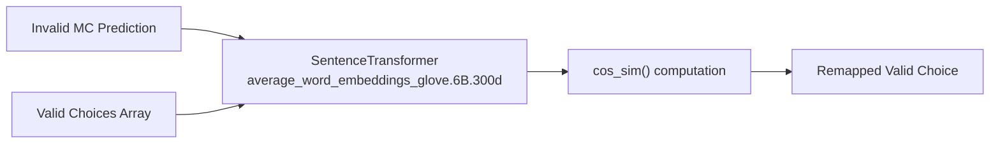

<!-- source: DeepWiki mcp.deepwiki.com · repo allenai/aokvqa · page 5.2 Prediction Formats and Metrics · fetched 2026-10-26 -->

# Prediction Formats and Metrics

<details>
<summary>Relevant source files</summary>

The following files were used as context for generating this wiki page:

- [README.md](README.md)
- [evaluation/eval_predictions.py](evaluation/eval_predictions.py)
- [evaluation/prepare_predictions.py](evaluation/prepare_predictions.py)
- [evaluation/remap_predictions.py](evaluation/remap_predictions.py)

</details>


This document specifies the standardized prediction file formats, evaluation metrics, and leaderboard submission process used throughout the A-OKVQA benchmark. It covers the data structures and computational methods that enable fair comparison across different VQA modeling approaches.

For information about the broader evaluation pipeline and workflow, see [Evaluation Pipeline](#5.1).

## Prediction File Format Specification

The A-OKVQA benchmark uses a standardized JSON format for all prediction files, supporting both multiple choice and direct answer evaluation modes. This unified format enables consistent evaluation across diverse modeling approaches.

### Unified Prediction Format

```json
{
    "<question_id>": {
        "multiple_choice": "<prediction>",
        "direct_answer": "<prediction>"
    }
}
```

The prediction file structure allows models to provide answers in either or both evaluation modes. The `question_id` corresponds to the unique identifier from the A-OKVQA dataset, while predictions are provided as string values.

### Format Requirements

| Field | Type | Required | Description |
|-------|------|----------|-------------|
| `question_id` | string | Yes | Unique identifier from A-OKVQA dataset |
| `multiple_choice` | string | Optional | Must be one of the four provided choices |
| `direct_answer` | string | Optional | Free-form answer text |

At least one prediction type (`multiple_choice` or `direct_answer`) must be provided per question.

Sources: [README.md:103-112](), [evaluation/prepare_predictions.py:23-29]()

## Evaluation Metrics

The A-OKVQA benchmark implements two distinct evaluation metrics corresponding to different answer formats, each designed to measure different aspects of VQA performance.

### Multiple Choice Accuracy

Multiple choice evaluation uses exact string matching against the correct choice from the provided options.

```
MC Accuracy = (Number of Exact Matches) / (Total Questions) × 100
```

The evaluation logic checks if the prediction exactly matches the choice at `correct_choice_idx` from the dataset's `choices` array.

### Direct Answer VQA Accuracy

Direct answer evaluation follows the VQA evaluation protocol, accounting for answer variability through multiple annotator responses.

```
VQA Accuracy = min(1.0, (Number of Matching Annotators) / 3.0)
```

This metric compares the prediction against up to 10 possible direct answers, with accuracy computed based on annotator agreement patterns.

### Evaluation Exclusions

The direct answer evaluation automatically excludes questions marked with `difficult_direct_answer: true`, focusing the metric on questions where direct answers are feasible.

Sources: [evaluation/eval_predictions.py:36-46](), [evaluation/eval_predictions.py:14-15]()

## Prediction Processing Pipeline

The evaluation system includes several processing stages that transform raw model outputs into standardized prediction files suitable for metric computation.

### Processing Workflow



### Format Consolidation

The `prepare_predictions.py` script merges separate multiple choice and direct answer prediction files into the unified format required for evaluation.

### Choice Remapping

The `remap_predictions.py` script ensures multiple choice predictions are valid by mapping invalid responses to the most semantically similar valid choice using sentence embeddings.



Sources: [evaluation/prepare_predictions.py:8-31](), [evaluation/remap_predictions.py:12-28]()

## Evaluation Execution

The evaluation system provides both programmatic and command-line interfaces for computing metrics on prediction files.

### Command Line Evaluation

```bash
python evaluation/eval_predictions.py \
    --aokvqa-dir ${AOKVQA_DIR} \
    --split val \
    --preds ./predictions_val.json
```

### Evaluation Function Interface

The core `eval_aokvqa()` function accepts dataset and prediction dictionaries, returning percentage accuracy scores. The function supports both evaluation modes through the `multiple_choice` parameter.

| Parameter | Type | Description |
|-----------|------|-------------|
| `dataset` | dict/list | A-OKVQA dataset entries |
| `preds` | dict | Question ID to prediction mapping |
| `multiple_choice` | bool | Evaluation mode selector |
| `strict` | bool | Enforce prediction validation |

Sources: [evaluation/eval_predictions.py:9-50](), [README.md:116-118]()

## Leaderboard Submission

The A-OKVQA leaderboard accepts prediction files in the standardized format for test set evaluation.

### Submission Requirements

- File name: `predictions_test.json`
- Format: Unified prediction format with question IDs as keys
- Content: Predictions for all test set questions
- Validation: Predictions automatically validated against choice constraints

### File Naming Convention

The repository follows a consistent naming scheme for prediction files:

```
{model-name}_{split}-{setting}.json
```

Examples:
- `random-weighted_val-mc.json` - Multiple choice validation predictions
- `clip-zero-shot_test-da.json` - Direct answer test predictions

Sources: [README.md:122](), [README.md:200]()

---

