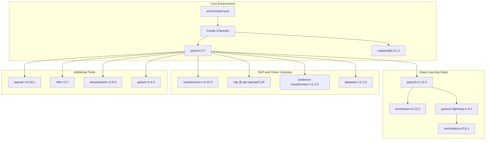
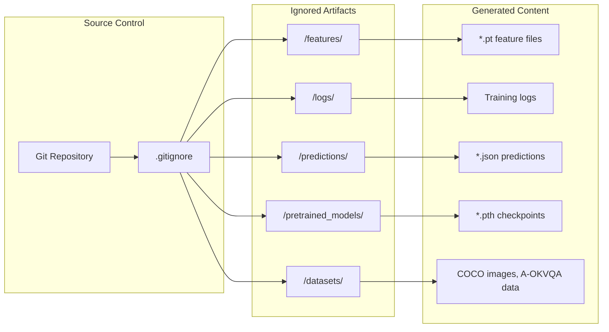
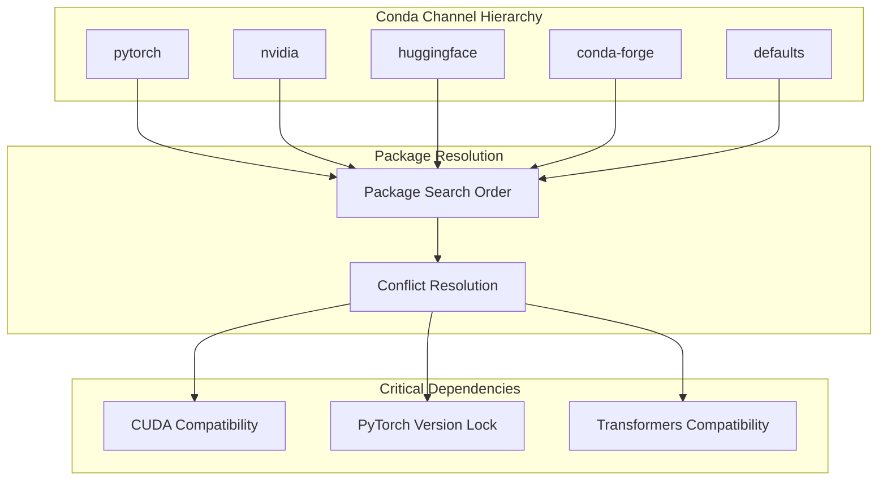
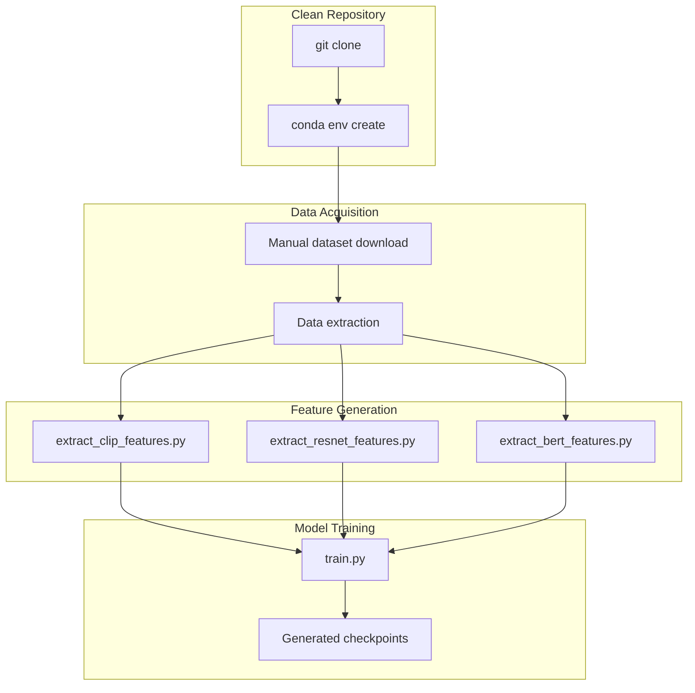

<!-- source: DeepWiki mcp.deepwiki.com · repo allenai/aokvqa · page 6 Development and Configuration · fetched 2026-10-26 -->

# Development and Configuration

<details>
<summary>Relevant source files</summary>

The following files were used as context for generating this wiki page:

- [.gitignore](.gitignore)
- [environment.yml](environment.yml)

</details>


This document provides essential information for developers working with the A-OKVQA codebase, covering environment setup, project structure, dependency management, and build artifact organization. For information about data preparation workflows, see [Data Preparation](#2.2). For details about external model integrations, see [External Dependencies and Submodules](#6.2).

## Development Environment Setup

The A-OKVQA repository uses conda for environment management with specific Python and CUDA toolkit versions to ensure reproducibility across different development setups.

### Environment Configuration

The primary development environment is defined in `environment.yml` with the following key specifications:

| Component | Version | Purpose |
|-----------|---------|---------|
| Python | 3.7 | Base runtime environment |
| CUDA Toolkit | 11.3 | GPU acceleration support |
| PyTorch | 1.11.0 | Deep learning framework |
| PyTorch Lightning | 1.6.3 | Training framework |
| Transformers | 4.10.3 | Pre-trained model access |

### Development Environment Dependencies



Sources: [environment.yml:1-37]()

## Project Directory Structure and Artifacts

The A-OKVQA repository follows a modular structure with clear separation between source code, generated artifacts, and external dependencies.

### Artifact Management Strategy

The `.gitignore` configuration defines which directories contain generated artifacts that should not be version controlled:



### Directory Organization

| Directory | Content Type | Generated By | Purpose |
|-----------|--------------|--------------|---------|
| `/features/` | `*.pt` files | Feature extraction scripts | Pre-computed embeddings storage |
| `/logs/` | Training logs | `train.py`, TensorBoard | Experiment tracking and debugging |
| `/predictions/` | `*.json` files | `predict.py`, evaluation scripts | Model output storage |
| `/pretrained_models/` | `*.pth` checkpoints | Training scripts | Saved model weights |
| `/datasets/` | Raw data files | Manual download/extraction | Source dataset storage |

Sources: [.gitignore:1-6]()

## Configuration Management

### Environment Channel Priority

The conda environment uses a specific channel hierarchy to ensure package compatibility:



### Known Configuration Issues

The environment file includes a comment highlighting a known dependency conflict:

```
# Next: resolve conflict between sentence-transfomers and pytorch-lightning
# pip uninstall sentencepiece
```

This indicates that `sentencepiece` may need manual resolution when using both `sentence-transformers` and `pytorch-lightning`.

Sources: [environment.yml:2-7](), [environment.yml:35-36]()

## Git Integration Management

### Version Control Strategy

The repository uses a selective ignore strategy to balance between reproducibility and repository size:

- **Ignored**: Large binary artifacts (`/features/`, `/pretrained_models/`, `/datasets/`)
- **Tracked**: Configuration files, source code, documentation
- **Regenerated**: Features and models can be recreated using documented scripts

### Artifact Regeneration Workflow



This workflow enables developers to reproduce the complete experimental pipeline from a clean repository checkout.

Sources: [.gitignore:1-6](), [environment.yml:1-37]()

---

