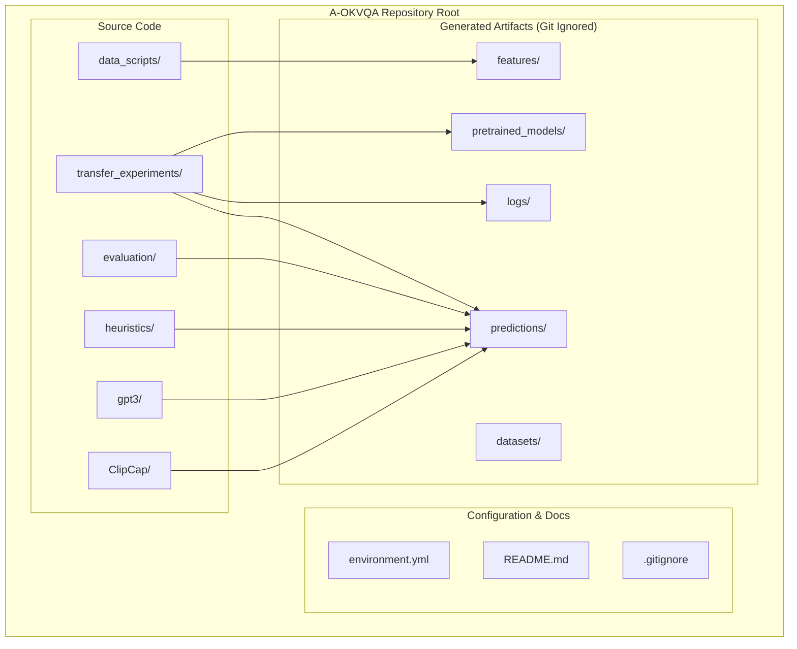
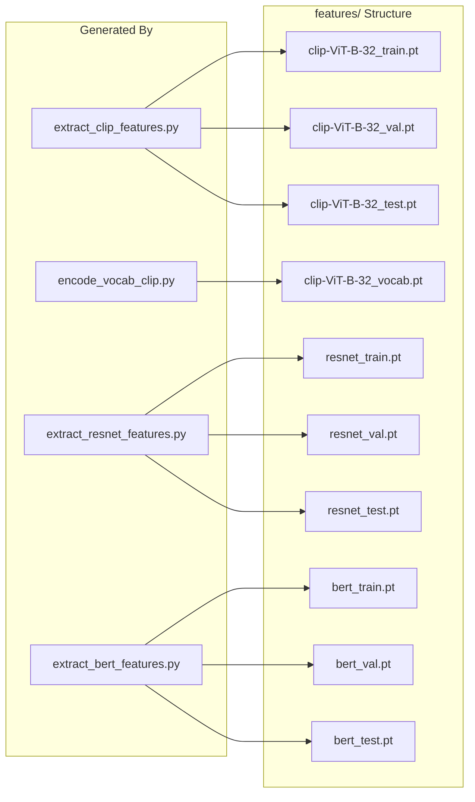
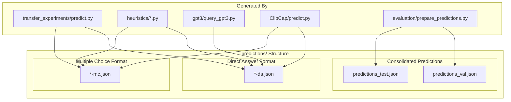
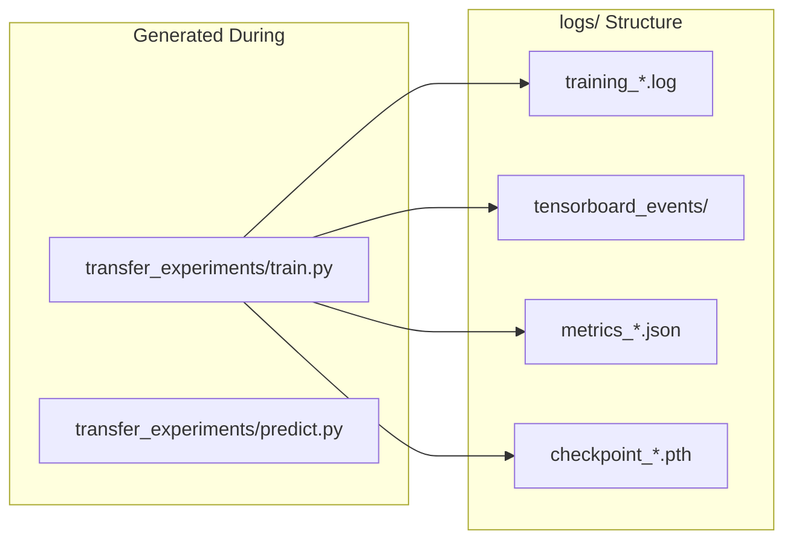
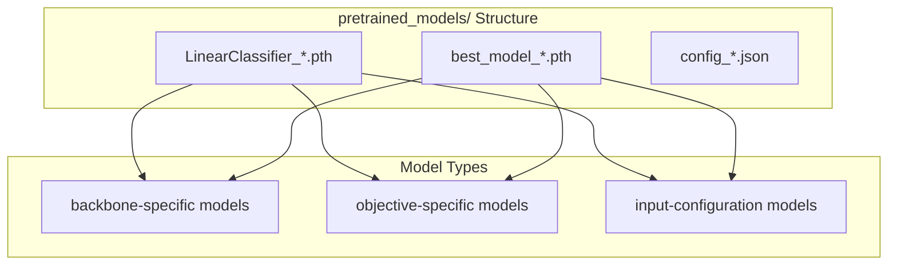
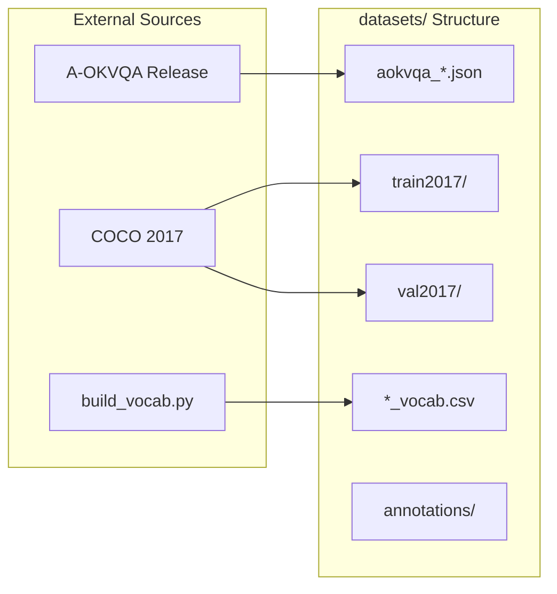
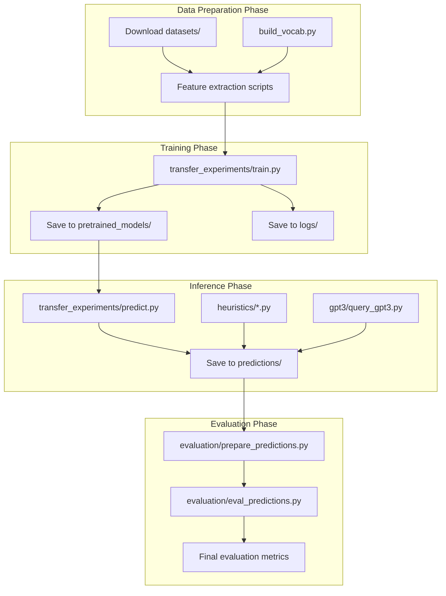

<!-- source: DeepWiki mcp.deepwiki.com · repo allenai/aokvqa · page 6.1 Project Structure and Artifacts · fetched 2026-10-26 -->

# Project Structure and Artifacts

Relevant source files

The following files were used as context for generating this wiki page:

- [.gitignore](.gitignore)

## Purpose and Scope

This document explains the directory organization of the A-OKVQA repository, focusing on how generated artifacts are stored and managed throughout the data processing and modeling pipeline. It covers the structure of artifact directories, git ignore patterns, and the lifecycle of generated files.

For information about external dependencies and submodules, see [External Dependencies and Submodules](#6.2). For details about specific data processing pipelines, see [Feature Extraction Pipeline](#3).

## Repository Directory Structure

The A-OKVQA repository follows a clear organizational pattern that separates source code, configuration, and generated artifacts.

### Directory Organization

**Sources**: [.gitignore:1-5]()

### Git Ignore Configuration

The repository uses a simple but effective `.gitignore` strategy that excludes all generated artifacts from version control:

| Directory | Purpose | Typical Size |
|-----------|---------|--------------|
| `/features/` | Pre-computed multimodal features | Several GB |
| `/logs/` | Training logs and metrics | Hundreds of MB |
| `/predictions/` | Model predictions and outputs | Tens of MB |
| `/pretrained_models/` | Trained model checkpoints | Hundreds of MB |
| `/datasets/` | Downloaded dataset files | Several GB |

**Sources**: [.gitignore:1-5]()

## Artifact Directory Details

### features/ Directory

The `features/` directory stores pre-computed embeddings and features extracted from different backbone models:

**Sources**: [.gitignore:1]()

### predictions/ Directory

The `predictions/` directory contains model outputs in standardized JSON formats:

**Sources**: [.gitignore:3]()

### logs/ Directory

Training logs and metrics are stored in the `logs/` directory with timestamps and configuration details:

**Sources**: [.gitignore:2]()

### pretrained_models/ Directory

Model checkpoints and saved weights are organized by experiment configuration:

**Sources**: [.gitignore:4]()

### datasets/ Directory

Raw and processed dataset files are stored separately from the main codebase:

**Sources**: [.gitignore:5]()

## Artifact Lifecycle and Management

### Artifact Generation Flow

**Sources**: [.gitignore:1-5]()

### Storage Considerations

The artifact directories can grow significantly during development:

- **features/**: Contains dense feature vectors for all dataset splits, typically requiring 2-8 GB depending on backbone model
- **pretrained_models/**: Accumulates model checkpoints across experiments, can reach several GB with multiple configurations
- **predictions/**: Relatively lightweight but numerous files from different model runs
- **logs/**: Contains detailed training logs and metrics, moderate storage requirements
- **datasets/**: Original dataset files, substantial but one-time download

The `.gitignore` configuration ensures these large artifacts don't impact repository performance or require network bandwidth during cloning and updates.

**Sources**: [.gitignore:1-5]()

---

