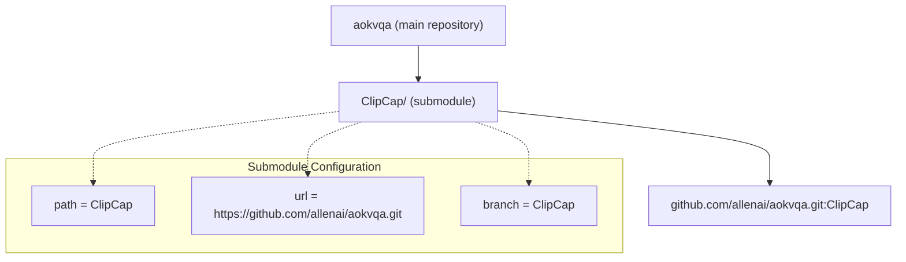
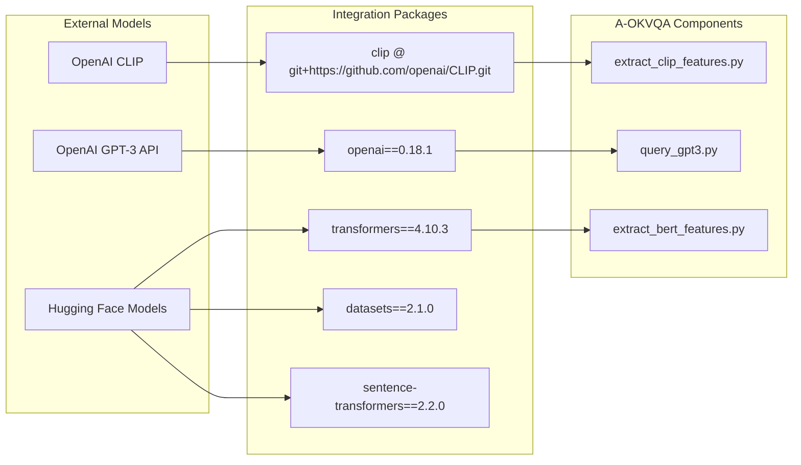
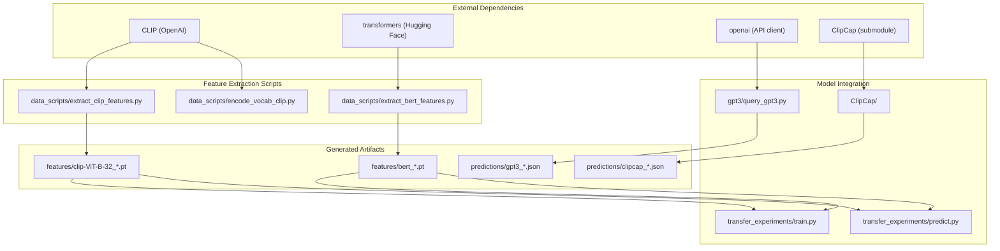

<!-- source: DeepWiki mcp.deepwiki.com · repo allenai/aokvqa · page 6.2 External Dependencies and Submodules · fetched 2026-10-26 -->

# External Dependencies and Submodules

Relevant source files

The following files were used as context for generating this wiki page:

- [.gitmodules](.gitmodules)
- [environment.yml](environment.yml)

This document covers the external dependencies, git submodules, and third-party integrations used in the A-OKVQA repository. It details how external libraries and models are integrated into the codebase and managed through conda environments and git submodules.

For information about the overall project structure and artifact organization, see [Project Structure and Artifacts](#6.1). For environment setup procedures, see [Environment Setup](#2.1).

## Git Submodules

The A-OKVQA repository uses git submodules to manage external code dependencies that require specific versions or modifications.

### ClipCap Submodule

The repository includes ClipCap as a git submodule for image captioning and VQA capabilities. The submodule configuration points to a specialized branch of the main repository.

The ClipCap submodule is configured to track the `ClipCap` branch of the same repository, allowing for modular development of captioning capabilities while maintaining version control.

**Sources:** [.gitmodules:1-4]()

## Python Dependencies

The repository manages Python dependencies through a conda environment specification that includes both conda and pip packages.

### Core Framework Dependencies

The environment includes several deep learning and NLP frameworks as primary dependencies:

| Category | Package | Version | Purpose |
|----------|---------|---------|---------|
| Deep Learning | `pytorch` | 1.11.0 | Core tensor operations and model training |
| Computer Vision | `torchvision` | 0.12.0 | Image processing and pretrained models |
| Training Framework | `pytorch-lightning` | 1.6.3 | High-level training abstractions |
| Metrics | `torchmetrics` | 0.8.1 | Evaluation metrics computation |
| CUDA Support | `cudatoolkit` | 11.3 | GPU acceleration |

**Sources:** [environment.yml:10-15]()

### External Model Integration Dependencies

Several pip-installed packages provide integration with external models and APIs:

Key external integrations include:

- **CLIP**: Installed directly from OpenAI's GitHub repository at commit `b46f5ac7587d2e1862f8b7b1573179d80dcdd620`
- **OpenAI API**: Version 0.18.1 for GPT-3 integration
- **Transformers**: Version 4.10.3 for BERT and other Hugging Face models
- **Sentence Transformers**: Version 2.2.0 for text embeddings

**Sources:** [environment.yml:25-33]()

### Utility and Processing Dependencies

Additional packages support data processing, evaluation, and utility functions:

| Package | Version | Purpose |
|---------|---------|---------|
| `gdown` | 4.4.0 | Google Drive file downloads |
| `nltk` | 3.7 | Natural language processing utilities |
| `sacrebleu` | 2.0.0 | BLEU score computation |
| `sacremoses` | 0.0.53 | Text tokenization |
| `ftfy` | 6.1.1 | Text encoding fixes |
| `regex` | 2022.3.15 | Advanced regular expressions |

**Sources:** [environment.yml:16-33]()

## Dependency Integration Points

The external dependencies integrate with the A-OKVQA codebase through specific modules and scripts:

**Sources:** [environment.yml:25-33](), [.gitmodules:1-4]()

## Dependency Conflicts and Resolutions

The environment configuration includes a known conflict resolution note regarding `sentencepiece` compatibility between `sentence-transformers` and `pytorch-lightning`. The recommended resolution involves uninstalling the conflicting `sentencepiece` package after environment creation.

**Sources:** [environment.yml:35-36]()

## Version Pinning Strategy

The repository uses a mixed versioning strategy:

- **Conda packages**: Pinned to specific versions for reproducibility
- **CLIP**: Pinned to a specific git commit hash for stability
- **Other pip packages**: Pinned to specific versions to ensure compatibility

This approach ensures reproducible builds while allowing controlled updates to external dependencies.

**Sources:** [environment.yml:9-33]()