# Page: A-OKVQA Overview

# A-OKVQA Overview

<details>
<summary>Relevant source files</summary>

The following files were used as context for generating this wiki page:

- [README.md](README.md)

</details>


## Purpose and Scope

This document provides a comprehensive overview of the A-OKVQA repository, which implements a benchmark for Visual Question Answering (VQA) requiring world knowledge and commonsense reasoning. It covers the system's architecture, core components, and data flow from feature extraction through model training to evaluation.

For detailed information about specific subsystems, see: [Getting Started](#2), [Feature Extraction Pipeline](#3), [Model Training and Inference](#4), [Evaluation System](#5), and [Development Configuration](#6).

## What is A-OKVQA

A-OKVQA (A Benchmark for Visual Question Answering using World Knowledge) is a crowdsourced dataset and benchmark system containing approximately 25,000 questions that require broad commonsense and world knowledge to answer correctly. Unlike existing VQA datasets that rely on simple visual recognition, A-OKVQA questions demand reasoning about scenes depicted in COCO 2017 images using external knowledge that cannot be answered through simple knowledge base queries.

The system supports multiple evaluation modes:
- **Multiple Choice (MC)**: Select from 4 provided answer choices
- **Direct Answer (DA)**: Generate free-form answers using VQA accuracy metrics

Key dataset characteristics include diverse question types, requirement for world knowledge, and human-provided rationales explaining the reasoning process.

Sources: [README.md:1-9]()

## System Architecture Overview

The A-OKVQA repository implements a modular architecture supporting multiple modeling approaches through standardized interfaces:

### High-Level Data Flow

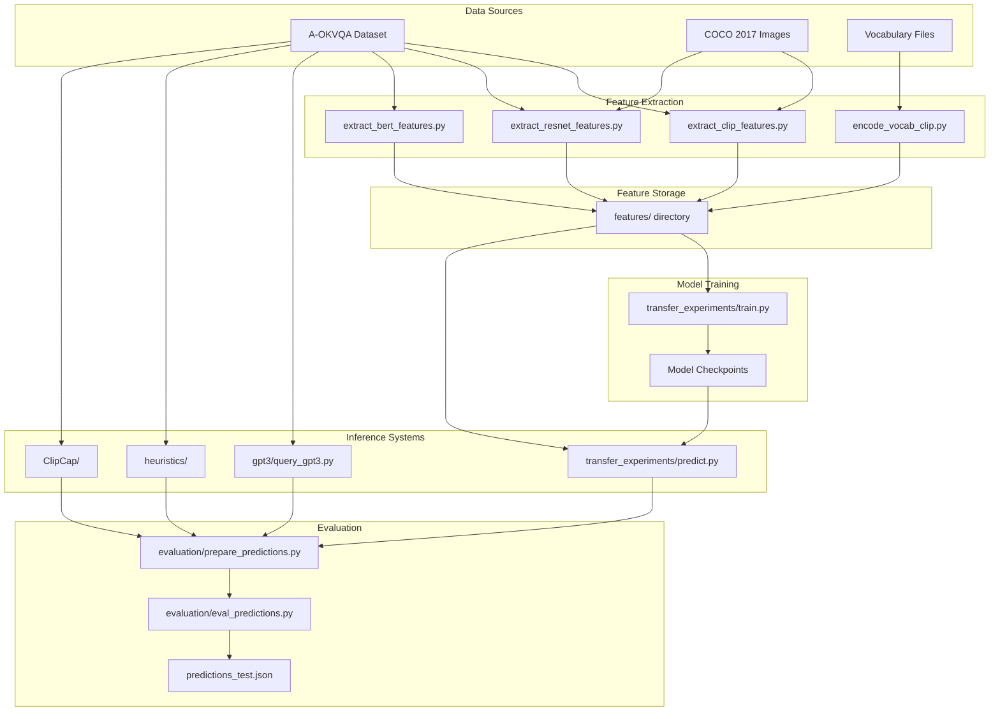

Sources: [README.md:130-208]()

### Core Components Integration

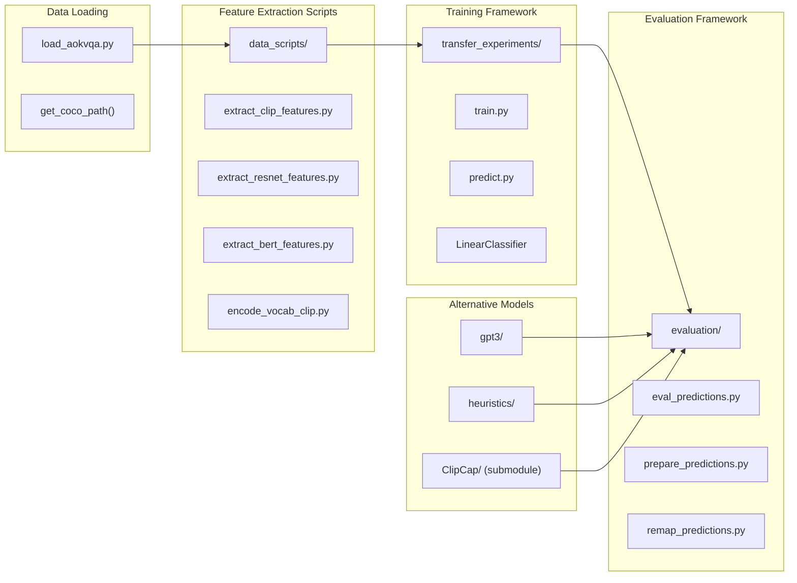

Sources: [README.md:64-72](), [README.md:194-199]()

## Key System Features

### Multi-Modal Feature Support

The system extracts features using multiple backbone models to enable comparative studies:

| Backbone | Purpose | Output Format | Script |
|----------|---------|---------------|---------|
| CLIP ViT-B/32 | Vision + Language | `.pt` tensors | `extract_clip_features.py` |
| ResNet-50 | Image features | `.pt` tensors | `extract_resnet_features.py` |
| BERT | Question encoding | `.pt` tensors | `extract_bert_features.py` |
| CLIP Text | Vocabulary encoding | `.pt` tensors | `encode_vocab_clip.py` |

### Modeling Approaches

The repository supports diverse modeling paradigms through unified interfaces:

- **Transfer Learning**: Primary experimental framework using `LinearClassifier` models
- **Zero-shot CLIP**: Direct CLIP inference without additional training  
- **GPT-3 Integration**: Large language model querying for knowledge-based reasoning
- **Heuristic Baselines**: Simple statistical methods for performance comparison
- **ClipCap Models**: Image captioning and answer generation with rationales

### Standardized Evaluation

All modeling approaches converge to common prediction formats enabling fair comparison:
- Multiple choice predictions: `{question_id: choice_index}` 
- Direct answer predictions: `{question_id: answer_string}`
- Unified evaluation through `eval_predictions.py`

Sources: [README.md:135-167](), [README.md:194-199]()

## Environment and Dependencies

### Core Setup

The system requires conda environment management and specific dependencies:

```bash
# Repository setup with submodules
git clone --single-branch --recurse-submodules https://github.com/allenai/aokvqa.git
cd aokvqa
export PYTHONPATH=.

# Environment creation
conda env create --name aokvqa
conda activate aokvqa
```

### Directory Structure

| Directory | Purpose | Environment Variable |
|-----------|---------|---------------------|
| `datasets/aokvqa/` | A-OKVQA dataset files | `AOKVQA_DIR` |
| `datasets/coco/` | COCO 2017 images | `COCO_DIR` |
| `features/` | Extracted feature tensors | `FEATURES_DIR` |
| `predictions/` | Model prediction outputs | `PREDS_DIR` |
| `logs/` | Training logs | `LOG_DIR` |
| `pretrained_models/` | Model checkpoints | `PT_MODEL_DIR` |

Sources: [README.md:28-36](), [README.md:171-176]()

## Dataset Integration

The A-OKVQA dataset integrates with COCO 2017 images through the `load_aokvqa()` function, which provides structured access to questions, multiple choice options, correct answers, and human rationales. The `get_coco_path()` utility maps image IDs to filesystem paths for seamless image loading during feature extraction and model training.

Each dataset entry contains:
- `question_id`: Unique identifier
- `image_id`: COCO image reference  
- `question`: Natural language question text
- `choices`: List of 4 multiple choice options
- `correct_choice_idx`: Index of correct choice
- `direct_answers`: List of acceptable direct answers
- `rationales`: Human explanations of reasoning process

Sources: [README.md:64-99]()

---

# Page: System Architecture

# System Architecture

<details>
<summary>Relevant source files</summary>

The following files were used as context for generating this wiki page:

- [.gitignore](.gitignore)
- [README.md](README.md)

</details>


## Purpose and Scope

This document describes the high-level architecture of the A-OKVQA repository, illustrating the data flow from feature extraction through model training to evaluation. The architecture supports multiple modeling approaches for Visual Question Answering (VQA) tasks requiring world knowledge and commonsense reasoning.

For detailed information about dataset structure and data loading utilities, see [Dataset and Data Loading](#1.2). For specific feature extraction implementations, see [Feature Extraction Pipeline](#3). For model training details, see [Model Training and Inference](#4).

## High-Level System Overview

The A-OKVQA system follows a modular architecture with clear separation between data preprocessing, model training, and evaluation phases.

**System Overview with Code Entities**

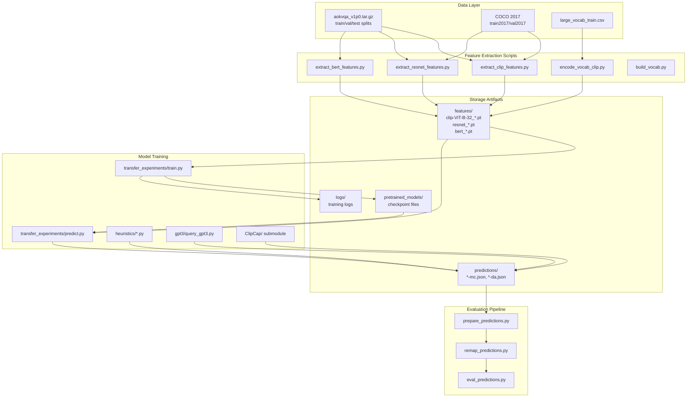

Sources: [README.md:1-208](), [.gitignore:1-6]()

## Data Flow Architecture

The system processes data through distinct stages, with each stage producing artifacts consumed by subsequent stages.

**Data Processing Pipeline with File Entities**

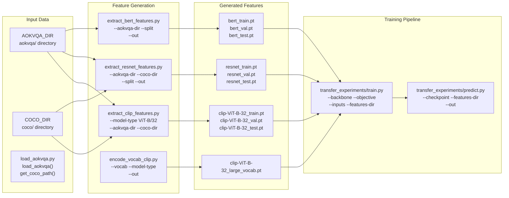

Sources: [README.md:131-167](), [README.md:67-73]()

## Component Interaction Matrix

The following table shows how different components interact through shared artifacts:

| Component | Input Artifacts | Output Artifacts | Configuration |
|-----------|----------------|------------------|---------------|
| `extract_clip_features.py` | A-OKVQA JSON, COCO images | `clip-ViT-B-32_*.pt` | `--model-type`, `--split` |
| `extract_resnet_features.py` | A-OKVQA JSON, COCO images | `resnet_*.pt` | `--split` |
| `extract_bert_features.py` | A-OKVQA JSON | `bert_*.pt` | `--split` |
| `encode_vocab_clip.py` | `large_vocab_train.csv` | `clip-ViT-B-32_large_vocab.pt` | `--model-type` |
| `transfer_experiments/train.py` | Feature files | Model checkpoints | `--backbone`, `--objective` |
| `transfer_experiments/predict.py` | Checkpoints, features | Prediction JSON | `--checkpoint` |
| `evaluation/eval_predictions.py` | Prediction JSON, ground truth | Accuracy metrics | `--split`, `--preds` |

Sources: [README.md:136-164](), [README.md:169-207]()

## Prediction and Evaluation Workflow

The system supports multiple prediction formats and evaluation modes through a standardized interface.

**Evaluation System Architecture**

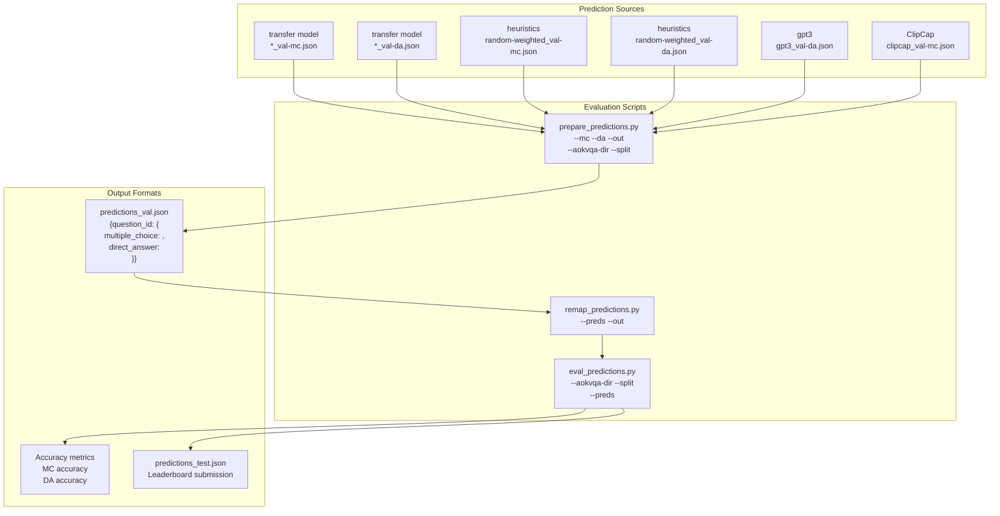

Sources: [README.md:101-122](), [README.md:200-207]()

## Directory Structure and Artifact Management

The repository uses environment variables and standardized directory structures for artifact management:

| Environment Variable | Purpose | Example Value |
|---------------------|---------|---------------|
| `AOKVQA_DIR` | Dataset location | `./datasets/aokvqa/` |
| `COCO_DIR` | COCO images location | `./datasets/coco/` |
| `FEATURES_DIR` | Feature storage | `./features/` |
| `LOG_DIR` | Training logs | `./logs/` |
| `PREDS_DIR` | Predictions output | `./predictions/` |
| `PT_MODEL_DIR` | Pretrained models | `./pretrained_models/` |

The `.gitignore` file excludes these artifact directories from version control, allowing users to manage large data files locally while keeping the repository clean.

**Artifact Lifecycle**

```mermaid
graph LR
    subgraph "Data Preparation"
        ENV_SETUP["Environment variables<br/>AOKVQA_DIR, COCO_DIR"]
        DOWNLOAD["Dataset download<br/>curl + tar extraction"]
    end
    
    subgraph "Feature Generation"
        FEATURES_DIR_CREATE["mkdir -p FEATURES_DIR"]
        FEATURE_SCRIPTS["data_scripts/*.py<br/>Extract features"]
    end
    
    subgraph "Training Artifacts"
        LOGS_DIR_CREATE["mkdir -p LOG_DIR"]
        MODELS_DIR_CREATE["mkdir -p PT_MODEL_DIR"]
        TRAINING["Model training<br/>Checkpoint generation"]
    end
    
    subgraph "Evaluation Artifacts"
        PREDS_DIR_CREATE["mkdir -p PREDS_DIR"]
        PREDICTION_GEN["Prediction generation"]
        EVALUATION["Evaluation pipeline"]
    end
    
    ENV_SETUP --> DOWNLOAD
    DOWNLOAD --> FEATURES_DIR_CREATE
    FEATURES_DIR_CREATE --> FEATURE_SCRIPTS
    FEATURE_SCRIPTS --> LOGS_DIR_CREATE
    LOGS_DIR_CREATE --> MODELS_DIR_CREATE
    MODELS_DIR_CREATE --> TRAINING
    TRAINING --> PREDS_DIR_CREATE
    PREDS_DIR_CREATE --> PREDICTION_GEN
    PREDICTION_GEN --> EVALUATION
```

Sources: [README.md:40-62](), [README.md:131-176](), [.gitignore:1-6]()

The architecture provides flexibility for researchers to experiment with different feature representations, model architectures, and evaluation approaches while maintaining consistency in data formats and evaluation metrics.

---

# Page: Dataset and Data Loading

# Dataset and Data Loading

<details>
<summary>Relevant source files</summary>

The following files were used as context for generating this wiki page:

- [README.md](README.md)
- [load_aokvqa.py](load_aokvqa.py)

</details>


This document covers the A-OKVQA dataset structure, data loading utilities, and integration with COCO images. It explains how to access the core dataset files and load them for use in experiments.

For information about feature extraction from the loaded data, see [Feature Extraction Pipeline](#3). For evaluation of predictions against the dataset, see [Evaluation System](#5).

## A-OKVQA Dataset Structure

The A-OKVQA dataset consists of approximately 25,000 visual question answering samples requiring world knowledge and commonsense reasoning. The dataset is organized into train, validation, and test splits, with each sample containing a question, multiple choice answers, rationales, and references to COCO images.

### Dataset File Organization

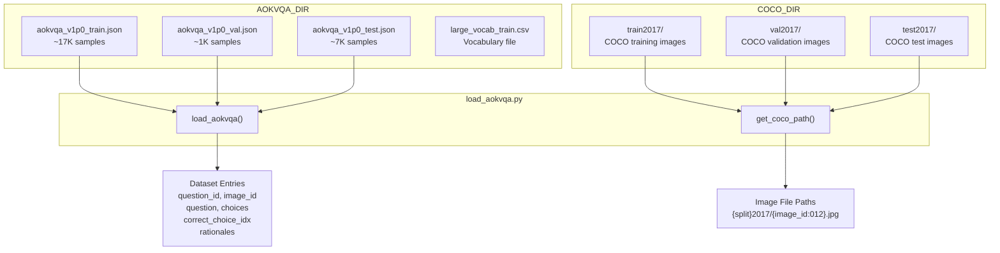

**Dataset Files and COCO Integration**

Sources: [README.md:40-72](), [load_aokvqa.py:1-14]()

### Dataset Entry Schema

Each dataset entry contains the following fields:

| Field | Type | Description |
|-------|------|-------------|
| `question_id` | string | Unique identifier for the question |
| `image_id` | integer | COCO image identifier |
| `question` | string | The question text |
| `choices` | list[string] | Four multiple choice options |
| `correct_choice_idx` | integer | Index of correct choice (0-3) |
| `rationales` | list[string] | Human-written explanations |

Sources: [README.md:76-98]()

## Data Loading Utilities

The primary data loading functionality is provided through the `load_aokvqa.py` module, which contains two core functions for accessing dataset content and COCO images.

### Core Loading Functions

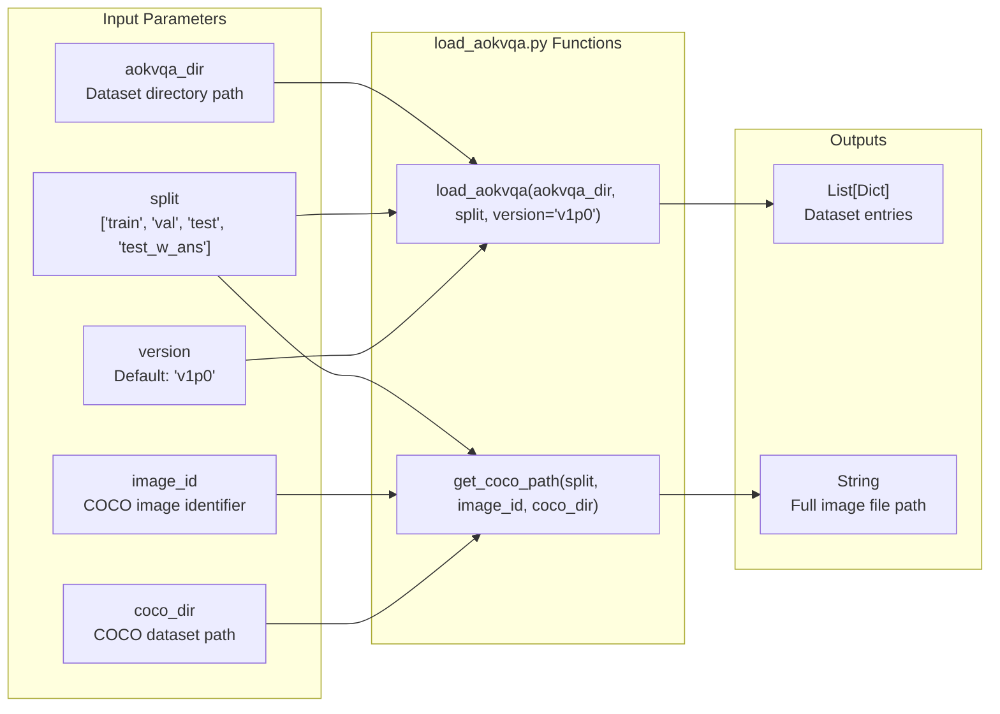

**Data Loading Function Architecture**

The `load_aokvqa()` function handles JSON file loading and validation, while `get_coco_path()` constructs standardized COCO image paths using zero-padded 12-digit image IDs.

Sources: [load_aokvqa.py:5-14]()

### Usage Pattern

The typical data loading workflow involves setting environment variables for dataset directories and using the loading functions as shown in the repository documentation:

```python
# Environment setup
aokvqa_dir = os.getenv('AOKVQA_DIR')
coco_dir = os.getenv('COCO_DIR')

# Load dataset split
train_dataset = load_aokvqa(aokvqa_dir, 'train')

# Get image path for a sample
dataset_example = train_dataset[0]
image_path = get_coco_path('train', dataset_example['image_id'], coco_dir)
```

Sources: [README.md:66-85]()

## COCO Image Integration

A-OKVQA leverages COCO 2017 images as the visual component for questions. The integration requires downloading COCO datasets separately and using the provided utilities to construct proper file paths.

### COCO Directory Structure

| Split | Directory | Contains |
|-------|-----------|----------|
| `train` | `train2017/` | Training images referenced by A-OKVQA train split |
| `val` | `val2017/` | Validation images for A-OKVQA val/test splits |
| `test` | `test2017/` | Additional test images if needed |

### Image Path Construction

The `get_coco_path()` function constructs COCO image paths using the pattern `{coco_dir}/{split}2017/{image_id:012}.jpg`, where image IDs are zero-padded to 12 digits.

Sources: [README.md:47-62](), [load_aokvqa.py:12-14]()

## Dataset Splits and Versioning

### Available Splits

The dataset supports four splits through the `load_aokvqa()` function:

- **`train`**: Training data (~17K samples)
- **`val`**: Validation data (~1K samples) 
- **`test`**: Test data (~7K samples, answers withheld)
- **`test_w_ans`**: Test data with answers (if available)

### File Naming Convention

Dataset files follow the pattern `aokvqa_{version}_{split}.json` where:
- `version` defaults to `v1p0`
- `split` corresponds to the data split being loaded

Sources: [load_aokvqa.py:5-9]()

## Vocabulary and Auxiliary Files

The dataset includes a vocabulary file `large_vocab_train.csv` containing candidate answers for training. This vocabulary is used by various models and feature extraction scripts throughout the codebase.

The vocabulary file is referenced in feature extraction workflows, particularly for encoding answer choices using models like CLIP.

Sources: [README.md:138]()

---

# Page: Getting Started

# Getting Started

<details>
<summary>Relevant source files</summary>

The following files were used as context for generating this wiki page:

- [README.md](README.md)
- [environment.yml](environment.yml)

</details>


This document provides step-by-step instructions for setting up the A-OKVQA benchmark environment and preparing the initial data required for running experiments. It covers repository setup, environment configuration, and basic data acquisition to get you ready for feature extraction and model training.

For detailed information about specific data preparation steps like vocabulary building, see [Data Preparation](#2.2). For comprehensive environment configuration details, see [Environment Setup](#2.1).

## Repository Setup and Initial Configuration

The A-OKVQA repository requires specific setup steps to properly initialize submodules and configure the Python environment.

### Repository Cloning and Structure

Clone the repository with all required submodules and configure the Python path:

```bash
git clone --single-branch --recurse-submodules https://github.com/allenai/aokvqa.git
cd aokvqa
export PYTHONPATH=.
```

**Setup Workflow Diagram**

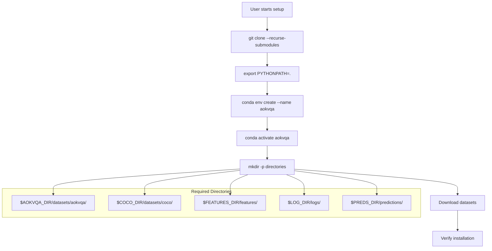

Sources: [README.md:28-36]()

## Environment Configuration Overview

The A-OKVQA environment requires specific Python packages and CUDA support for optimal performance. The conda environment includes PyTorch, CLIP, transformers, and other deep learning dependencies.

**Environment Dependencies Structure**

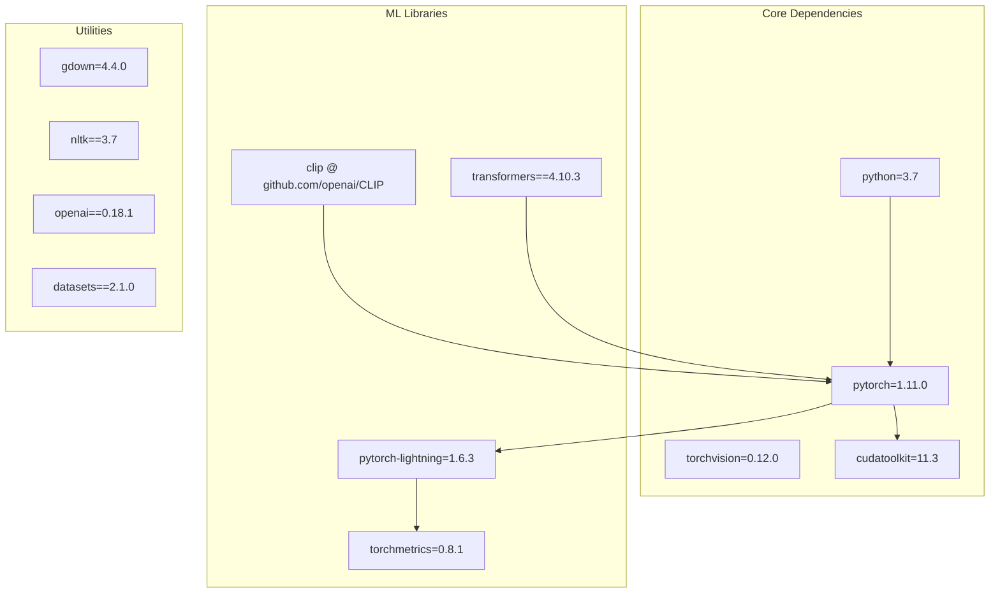

### Environment Creation

Create and activate the conda environment using the provided configuration:

```bash
conda env create --name aokvqa
conda activate aokvqa
```

The `environment.yml` file specifies all required dependencies including CUDA toolkit version 11.3 and PyTorch 1.11.0 for optimal compatibility.

Sources: [README.md:34-36](), [environment.yml:1-37]()

## Data Acquisition Overview

The A-OKVQA benchmark requires the A-OKVQA dataset and optionally the COCO 2017 images for full functionality.

**Data Download and Organization Workflow**

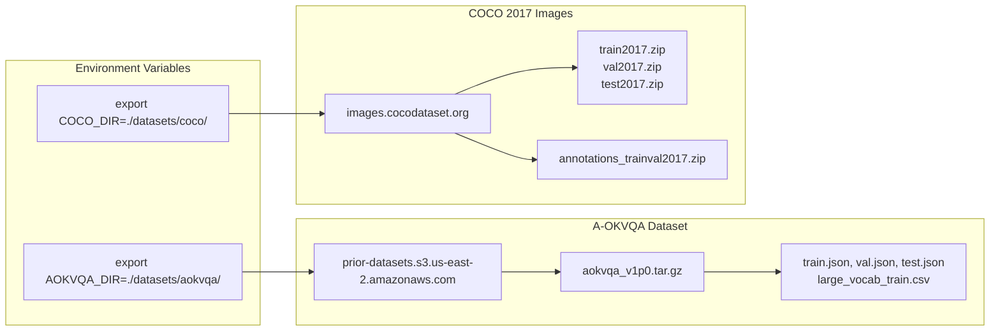

### A-OKVQA Dataset Download

Download the core A-OKVQA dataset containing questions, answers, and vocabulary:

```bash
export AOKVQA_DIR=./datasets/aokvqa/
mkdir -p ${AOKVQA_DIR}
curl -fsSL https://prior-datasets.s3.us-east-2.amazonaws.com/aokvqa/aokvqa_v1p0.tar.gz | tar xvz -C ${AOKVQA_DIR}
```

### COCO Images Download (Optional)

For experiments requiring image features, download the COCO 2017 dataset:

```bash
export COCO_DIR=./datasets/coco/
mkdir -p ${COCO_DIR}

for split in train val test; do
    wget "http://images.cocodataset.org/zips/${split}2017.zip"
    unzip "${split}2017.zip" -d ${COCO_DIR}; rm "${split}2017.zip"
done
```

Sources: [README.md:40-62]()

## Data Loading Verification

Verify the setup by loading and examining the dataset using the provided utilities.

**Data Loading Flow**

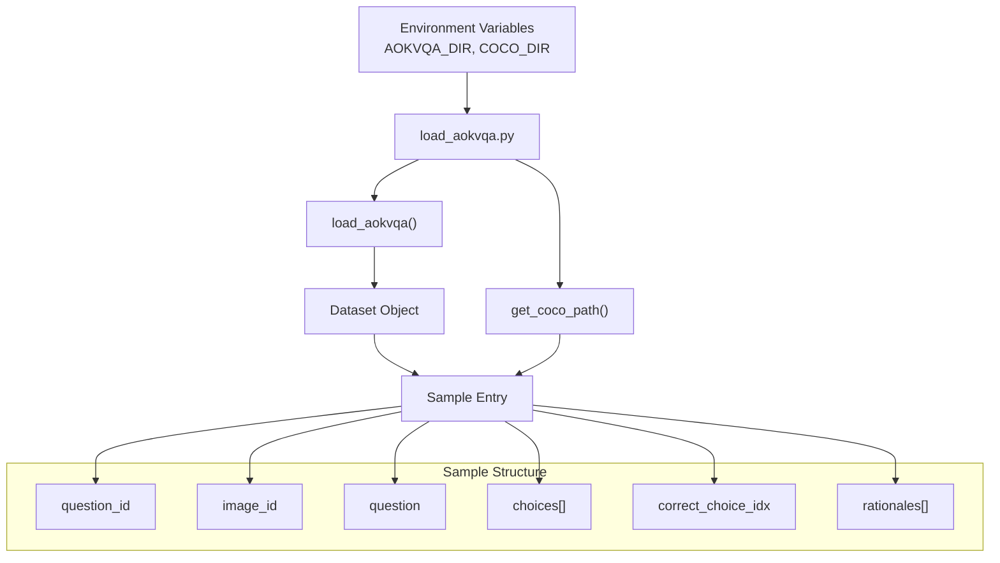

### Basic Data Loading Test

Test the installation by loading a sample from the dataset:

```python
import os
aokvqa_dir = os.getenv('AOKVQA_DIR')

from load_aokvqa import load_aokvqa, get_coco_path
train_dataset = load_aokvqa(aokvqa_dir, 'train')

# Examine first entry
sample = train_dataset[0]
print(f"Question ID: {sample['question_id']}")
print(f"Question: {sample['question']}")
print(f"Choices: {sample['choices']}")
```

This verification step ensures that the dataset is properly downloaded and accessible through the provided loading utilities.

Sources: [README.md:64-98](), [load_aokvqa.py]()

## Directory Structure Preparation

Set up the required directory structure for storing features, logs, predictions, and pretrained models:

```bash
export FEATURES_DIR=./features/
export LOG_DIR=./logs/
export PREDS_DIR=./predictions/
export PT_MODEL_DIR=./pretrained_models/

mkdir -p ${FEATURES_DIR} ${LOG_DIR} ${PREDS_DIR} ${PT_MODEL_DIR}
```

These directories will be used throughout the experimentation pipeline for storing intermediate results and model artifacts.

Sources: [README.md:131-175]()

## Next Steps

After completing the getting started setup, you can proceed with:

1. **Environment Setup Details** - See [Environment Setup](#2.1) for comprehensive dependency management and troubleshooting
2. **Data Preparation** - See [Data Preparation](#2.2) for vocabulary building and preprocessing steps  
3. **Feature Extraction** - See [Feature Extraction Pipeline](#3) to generate multi-modal features using CLIP, ResNet, or BERT
4. **Model Training** - See [Model Training and Inference](#4) to begin running experiments with transfer learning or other approaches

The basic setup provides the foundation for all subsequent A-OKVQA benchmark experiments and evaluations.

Sources: [README.md:125-208]()

---

# Page: Environment Setup

# Environment Setup

<details>
<summary>Relevant source files</summary>

The following files were used as context for generating this wiki page:

- [environment.yml](environment.yml)

</details>


This document covers the technical requirements and setup procedures for the A-OKVQA development environment. The environment supports multi-modal feature extraction, neural model training, and integration with external services like OpenAI's GPT-3. For data preparation steps that follow environment setup, see [Data Preparation](#2.2). For feature extraction procedures that require this environment, see [Feature Extraction Pipeline](#3).

## Hardware and Software Prerequisites

The A-OKVQA system requires specific hardware and software configurations to support GPU-accelerated deep learning workflows and multi-modal processing.

### Hardware Requirements

| Component | Requirement | Purpose |
|-----------|-------------|---------|
| GPU | CUDA-compatible with 8GB+ VRAM | PyTorch training, CLIP/ResNet inference |
| RAM | 16GB+ system memory | Large feature tensor processing |
| Storage | 50GB+ available space | COCO images, extracted features, model checkpoints |

### Software Prerequisites

- **CUDA Toolkit 11.3**: Required for GPU acceleration as specified in [environment.yml:10]()
- **Anaconda/Miniconda**: For conda environment management
- **Git**: For cloning repository and managing submodules

## Conda Environment Configuration

The A-OKVQA environment is defined using a comprehensive conda specification that manages both conda and pip dependencies.

### Core Environment Specification

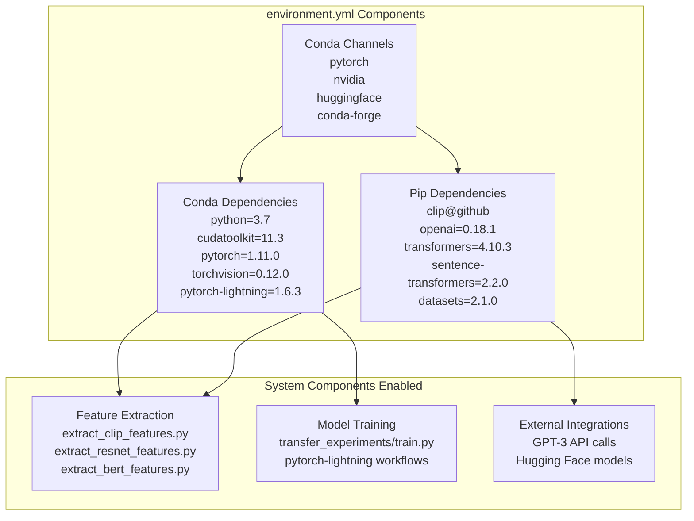

**Dependency Mapping for A-OKVQA System Components**

Sources: [environment.yml:1-37]()

### Installation Workflow

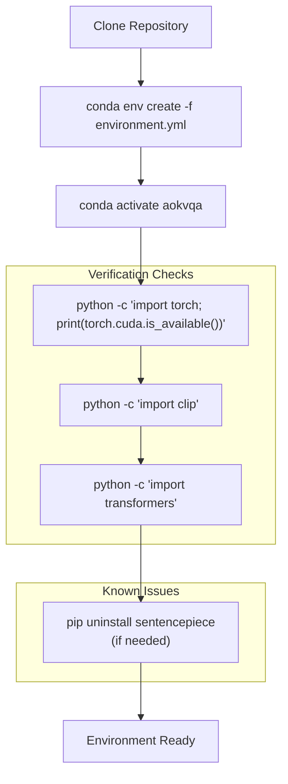

**Environment Setup and Verification Workflow**

Sources: [environment.yml:1-37]()

## Installation Steps

### 1. Create Conda Environment

```bash
conda env create -f environment.yml
conda activate aokvqa
```

The environment specification [environment.yml:1-37]() defines `aokvqa` as the environment name and configures channels for PyTorch, NVIDIA, and Hugging Face packages.

### 2. Verify Core Dependencies

**PyTorch and CUDA**:
```bash
python -c "import torch; print(f'PyTorch version: {torch.__version__}'); print(f'CUDA available: {torch.cuda.is_available()}')"
```

**CLIP Installation**:
The CLIP library is installed from a specific GitHub commit [environment.yml:25]() to ensure reproducibility:
```bash
python -c "import clip; print('CLIP loaded successfully')"
```

**Transformers and Language Models**:
```bash
python -c "import transformers; print(f'Transformers version: {transformers.__version__}')"
```

### 3. Resolve Known Conflicts

The environment specification includes a known conflict resolution step [environment.yml:35-36]():

```bash
pip uninstall sentencepiece
```

This resolves compatibility issues between `sentence-transformers` and `pytorch-lightning` packages.

## Dependency Analysis

### Core ML Framework Stack

| Package | Version | Purpose in A-OKVQA |
|---------|---------|-------------------|
| `pytorch` | 1.11.0 | Core tensor operations, model training |
| `torchvision` | 0.12.0 | Image preprocessing, ResNet models |
| `pytorch-lightning` | 1.6.3 | Training loop management in `transfer_experiments/` |
| `transformers` | 4.10.3 | BERT models for question encoding |
| `sentence-transformers` | 2.2.0 | Text similarity computations |

### External Service Integration

| Package | Version | Integration Point |
|---------|---------|------------------|
| `openai` | 0.18.1 | GPT-3 querying in `gpt3/` directory |
| `clip` | GitHub commit | Vision-language models in feature extraction |
| `datasets` | 2.1.0 | Hugging Face dataset loading utilities |

### Utility Dependencies

| Package | Version | Usage |
|---------|---------|-------|
| `gdown` | 4.4.0 | Google Drive file downloads |
| `nltk` | 3.7 | Text processing utilities |
| `sacrebleu` | 2.0.0 | Evaluation metrics |
| `tqdm` | 4.64.0 | Progress bars in scripts |

Sources: [environment.yml:8-33]()

## Verification and Testing

### Environment Health Check

Create a simple verification script to test all major components:

```bash
python -c "
import torch
import clip
import transformers
import openai
import pytorch_lightning as pl
print('✓ All core dependencies loaded successfully')
print(f'✓ PyTorch CUDA: {torch.cuda.is_available()}')
print(f'✓ Available devices: {torch.cuda.device_count()}')
"
```

### Component-Specific Testing

**CLIP Models**:
```bash
python -c "
import clip
model, preprocess = clip.load('ViT-B/32')
print('✓ CLIP ViT-B/32 model loaded')
"
```

**Transformers Models**:
```bash
python -c "
from transformers import BertTokenizer, BertModel
tokenizer = BertTokenizer.from_pretrained('bert-base-uncased')
print('✓ BERT tokenizer loaded')
"
```

## Troubleshooting Common Issues

### CUDA Compatibility

If CUDA is not detected:
1. Verify NVIDIA driver installation
2. Check CUDA toolkit version matches [environment.yml:10]()
3. Reinstall PyTorch with correct CUDA version

### Package Conflicts

The `sentencepiece` conflict [environment.yml:35-36]() is the most common issue. If you encounter import errors:

```bash
pip uninstall sentencepiece
conda install sentencepiece
```

### Memory Issues

For systems with limited RAM:
- Reduce batch sizes in training scripts
- Use CPU-only mode for feature extraction if necessary
- Monitor memory usage during large dataset processing

Sources: [environment.yml:35-36]()

---

# Page: Data Preparation

# Data Preparation

<details>
<summary>Relevant source files</summary>

The following files were used as context for generating this wiki page:

- [README.md](README.md)
- [data_scripts/build_vocab.py](data_scripts/build_vocab.py)

</details>


This document covers the initial data preparation steps required before feature extraction and model training in the A-OKVQA benchmark system. The data preparation phase involves setting up directory structures, building vocabularies from the training data, and validating dataset coverage.

For information about feature extraction from images and text, see [Feature Extraction Pipeline](#3). For dataset downloading and loading utilities, see [Dataset and Data Loading](#1.2).

## Overview

The data preparation pipeline transforms the raw A-OKVQA dataset into a structured format suitable for downstream processing. The primary tasks include creating vocabulary files from training data and establishing the directory structure for storing extracted features.

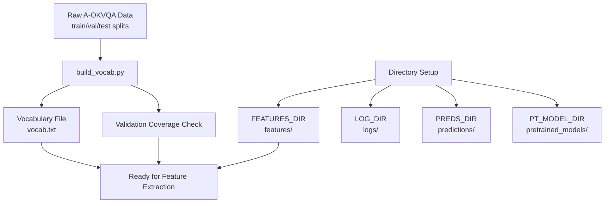

**Directory Structure and Environment Setup**

Sources: [README.md:130-176]()

## Directory Structure Initialization

Before processing data, the system requires specific directory structures for organizing outputs. The preparation establishes four primary directories as environment variables:

| Directory | Purpose | Environment Variable |
|-----------|---------|---------------------|
| `features/` | Stores extracted feature files | `FEATURES_DIR` |
| `logs/` | Training and experiment logs | `LOG_DIR` |
| `predictions/` | Model prediction outputs | `PREDS_DIR` |
| `pretrained_models/` | Downloaded model weights | `PT_MODEL_DIR` |

```bash
export FEATURES_DIR=./features/
export LOG_DIR=./logs/
export PREDS_DIR=./predictions/
export PT_MODEL_DIR=./pretrained_models/
mkdir -p ${FEATURES_DIR} ${LOG_DIR} ${PREDS_DIR} ${PT_MODEL_DIR}
```

Sources: [README.md:131-176]()

## Vocabulary Construction Process

The vocabulary building process creates a comprehensive word list from the A-OKVQA training set, which serves as the answer space for multiple choice and direct answer evaluation modes.

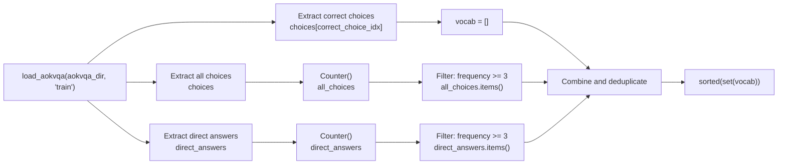

**Vocabulary Building Algorithm**

The `build_vocab.py` script implements a frequency-based vocabulary construction algorithm:

1. **Correct Choices Collection**: All correct answers from training data multiple choice questions
2. **Frequent Choices Filtering**: Multiple choice options appearing 3+ times across the dataset  
3. **Frequent Direct Answers Filtering**: Direct answer strings appearing 3+ times across the dataset
4. **Deduplication and Sorting**: Creates final alphabetically sorted vocabulary

```python
vocab = []
all_choices = Counter()
direct_answers = Counter()

for i in train_set:
    vocab.append( i['choices'][i['correct_choice_idx']] )
    all_choices.update(i['choices'])
    direct_answers.update(set(i['direct_answers']))

vocab += [k for k,v in all_choices.items() if v >= 3]
vocab += [k for k,v in direct_answers.items() if v >= 3]
vocab = sorted(set(vocab))
```

Sources: [data_scripts/build_vocab.py:15-31]()

## Validation Coverage Analysis

The vocabulary construction process includes validation coverage analysis to ensure the built vocabulary adequately represents the validation set answers.

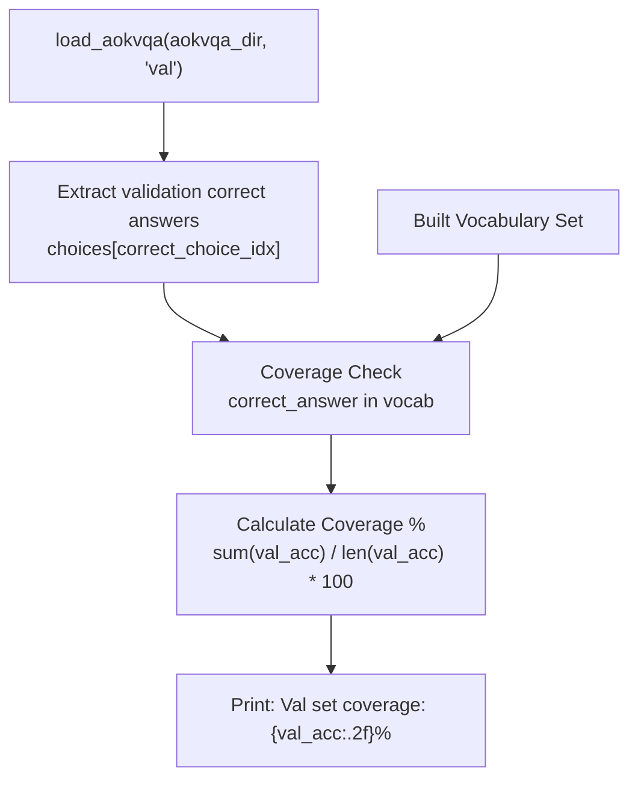

**Coverage Calculation Implementation**

The coverage analysis verifies what percentage of validation set correct answers are represented in the constructed vocabulary:

```python
val_set = load_aokvqa(args.aokvqa_dir, 'val')
val_acc = [v['choices'][v['correct_choice_idx']] in vocab for v in val_set]
val_acc = sum(val_acc) / len(val_acc) * 100
print(f"Val set coverage: {val_acc:.2f}" )
```

This metric provides early validation that the vocabulary construction strategy captures sufficient answer diversity for evaluation purposes.

Sources: [data_scripts/build_vocab.py:39-46]()

## Command Line Interface

The `build_vocab.py` script provides a command-line interface for vocabulary generation:

```bash
python data_scripts/build_vocab.py --aokvqa-dir ${AOKVQA_DIR} --out vocab.txt
```

| Parameter | Type | Purpose |
|-----------|------|---------|
| `--aokvqa-dir` | `pathlib.Path` | Path to A-OKVQA dataset directory |
| `--out` | `pathlib.Path` | Output path for generated vocabulary file |

The script uses the `load_aokvqa` function to access dataset splits and the `Counter` class for frequency analysis of answer candidates.

Sources: [data_scripts/build_vocab.py:9-12]()

## Prerequisites for Feature Extraction

Upon completion of data preparation, the system establishes the foundation for feature extraction pipelines. The prepared components include:

- **Vocabulary File**: Text file containing one vocabulary term per line
- **Directory Structure**: Organized storage locations for different artifact types
- **Coverage Validation**: Confirmed vocabulary adequacy for evaluation sets

The vocabulary file serves as input to vocabulary encoding scripts (`encode_vocab_clip.py`) while the directory structure provides storage for extracted features from image, text, and vocabulary encoding processes.

Sources: [README.md:135-143](), [data_scripts/build_vocab.py:33-37]()

---

# Page: Feature Extraction Pipeline

# Feature Extraction Pipeline

<details>
<summary>Relevant source files</summary>

The following files were used as context for generating this wiki page:

- [README.md](README.md)
- [data_scripts/extract_clip_features.py](data_scripts/extract_clip_features.py)

</details>


## Purpose and Scope

The Feature Extraction Pipeline is the multi-modal preprocessing system that converts raw A-OKVQA dataset entries and COCO images into numerical embeddings suitable for machine learning models. This pipeline supports multiple backbone architectures including CLIP, ResNet, and BERT to enable comparative studies across different feature representations.

For information about using these extracted features in model training, see [Model Training and Inference](#4). For details about the dataset structure and loading utilities, see [Dataset and Data Loading](#1.2).

## Pipeline Overview

The feature extraction system processes three primary data modalities: images, questions, and vocabulary terms. Each modality can be processed using different neural network backbones depending on the experimental requirements.

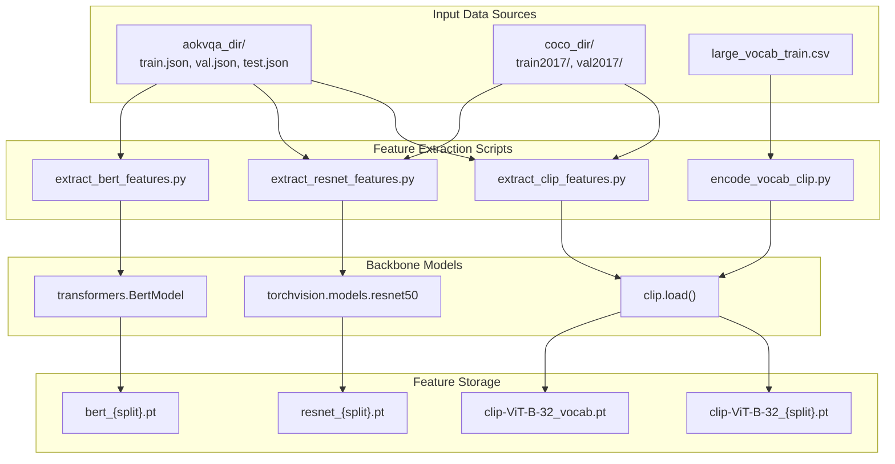

Sources: [README.md:135-167](), [data_scripts/extract_clip_features.py:1-52]()

## Data Requirements and Configuration

The feature extraction pipeline requires specific directory structure and environment variables to locate input data and store outputs:

| Environment Variable | Purpose | Example Value |
|---------------------|---------|---------------|
| `AOKVQA_DIR` | A-OKVQA dataset location | `./datasets/aokvqa/` |
| `COCO_DIR` | COCO 2017 images location | `./datasets/coco/` |
| `FEATURES_DIR` | Feature output directory | `./features/` |

The pipeline processes data splits (`train`, `val`, `test`) sequentially, with each script supporting command-line arguments for split selection and model configuration.

Sources: [README.md:131-133](), [README.md:40-62]()

## CLIP Feature Extraction Workflow

The CLIP feature extraction process represents the core multi-modal pipeline, extracting both visual and textual embeddings using shared representation spaces.

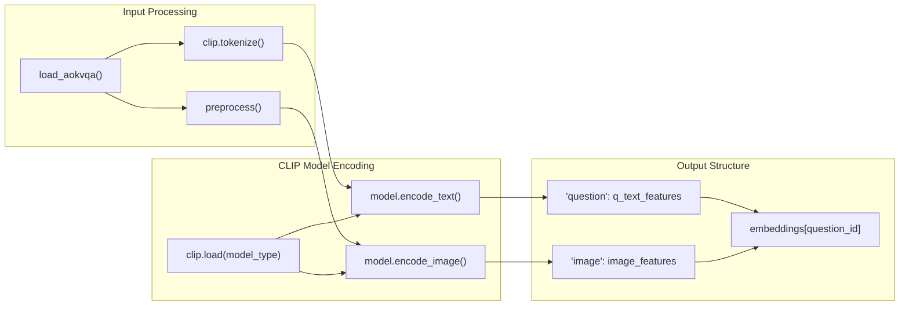

The `extract_clip_features.py` script implements this workflow with the following key operations:

1. **Dataset Loading**: Uses `load_aokvqa()` to iterate through dataset entries [data_scripts/extract_clip_features.py:25]()
2. **Text Processing**: Tokenizes questions using `clip.tokenize()` [data_scripts/extract_clip_features.py:39]()
3. **Image Processing**: Loads and preprocesses COCO images using `get_coco_path()` [data_scripts/extract_clip_features.py:42-44]()
4. **Feature Encoding**: Generates embeddings using `model.encode_text()` and `model.encode_image()` [data_scripts/extract_clip_features.py:40,44]()
5. **Storage**: Saves features as dictionary with `question_id` keys [data_scripts/extract_clip_features.py:46-49]()

Sources: [data_scripts/extract_clip_features.py:34-51]()

## Supported Model Architectures

The pipeline supports multiple backbone architectures through command-line configuration:

### CLIP Models
Available through `--model-type` parameter in `extract_clip_features.py`:
- ResNet variants: `RN50`, `RN50x4`, `RN50x16`, `RN50x64`, `RN101`
- Vision Transformer variants: `ViT-B/32`, `ViT-B/16`, `ViT-L/14`, `ViT-L/14@336px`

### Alternative Backbones
- **ResNet-50**: Via `extract_resnet_features.py` for image-only features
- **BERT**: Via `extract_bert_features.py` for question-only features

Sources: [data_scripts/extract_clip_features.py:17](), [README.md:151-167]()

## Feature Storage Organization

The feature extraction pipeline organizes outputs in a standardized directory structure:

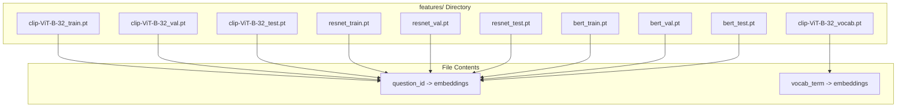

Each `.pt` file contains a dictionary structure where:
- **Split files**: Map `question_id` to feature embeddings
- **Vocabulary file**: Maps vocabulary terms to CLIP text embeddings
- **CLIP split files**: Include both `'question'` and `'image'` keys per entry
- **ResNet/BERT files**: Contain single-modality features

Sources: [README.md:138-143](), [README.md:156-165](), [data_scripts/extract_clip_features.py:46-49]()

## Execution Commands

The feature extraction pipeline is executed through a series of command-line scripts:

### CLIP Features (Standard Pipeline)
```bash
# Vocabulary encoding
python data_scripts/encode_vocab_clip.py --vocab ${AOKVQA_DIR}/large_vocab_train.csv --model-type ViT-B/32 --out ${FEATURES_DIR}/clip-ViT-B-32_large_vocab.pt

# Dataset features for all splits
for split in train val test; do
    python data_scripts/extract_clip_features.py --aokvqa-dir ${AOKVQA_DIR} --coco-dir ${COCO_DIR} --split ${split} --model-type ViT-B/32 --out ${FEATURES_DIR}/clip-ViT-B-32_${split}.pt
done
```

### Alternative Backbone Features
```bash
# ResNet features
for split in train val test; do
    python data_scripts/extract_resnet_features.py --aokvqa-dir ${AOKVQA_DIR} --coco-dir ${COCO_DIR} --split ${split} --out ${FEATURES_DIR}/resnet_${split}.pt
done

# BERT features  
for split in train val test; do
    python data_scripts/extract_bert_features.py --aokvqa-dir ${AOKVQA_DIR} --split ${split} --out ${FEATURES_DIR}/bert_${split}.pt
done
```

Sources: [README.md:138-165]()

---

# Page: CLIP Feature Extraction

# CLIP Feature Extraction

<details>
<summary>Relevant source files</summary>

The following files were used as context for generating this wiki page:

- [LICENSE](LICENSE)
- [data_scripts/encode_vocab_clip.py](data_scripts/encode_vocab_clip.py)
- [data_scripts/extract_clip_features.py](data_scripts/extract_clip_features.py)

</details>


This document covers the CLIP (Contrastive Language-Image Pre-training) feature extraction pipeline in the A-OKVQA repository. This system extracts multimodal embeddings from images, questions, and vocabulary terms using pre-trained CLIP models. For ResNet-based feature extraction, see [ResNet Feature Extraction](#3.2). For BERT-based question encoding, see [BERT Feature Extraction](#3.3).

## Overview

The CLIP feature extraction pipeline consists of two main components: question-image pair encoding and vocabulary encoding. These components generate dense vector representations that capture semantic relationships between visual and textual content, enabling cross-modal reasoning in VQA tasks.

**Sources:** [data_scripts/extract_clip_features.py:1-52](), [data_scripts/encode_vocab_clip.py:1-27]()

## System Architecture

```mermaid
graph TD
    subgraph "Input Data"
        AOKVQA["A-OKVQA Dataset"]
        COCO["COCO Images"]
        VOCAB["Vocabulary File"]
    end
    
    subgraph "CLIP Models"
        CLIP_MODEL["clip.load()"]
        PREPROCESS["Image Preprocessing"]
        TOKENIZE["Text Tokenization"]
    end
    
    subgraph "Feature Extraction Scripts"
        EXTRACT["extract_clip_features.py"]
        ENCODE_VOCAB["encode_vocab_clip.py"]
    end
    
    subgraph "Encoding Functions"
        ENCODE_TEXT["model.encode_text()"]
        ENCODE_IMAGE["model.encode_image()"]
    end
    
    subgraph "Output Features"
        QI_FEATURES["Question-Image Features\n{question_id: {question, image}}"]
        VOCAB_FEATURES["Vocabulary Features\nTensor[vocab_size, embedding_dim]"]
    end
    
    AOKVQA --> EXTRACT
    COCO --> EXTRACT
    VOCAB --> ENCODE_VOCAB
    
    EXTRACT --> CLIP_MODEL
    ENCODE_VOCAB --> CLIP_MODEL
    
    CLIP_MODEL --> PREPROCESS
    CLIP_MODEL --> TOKENIZE
    
    EXTRACT --> ENCODE_TEXT
    EXTRACT --> ENCODE_IMAGE
    ENCODE_VOCAB --> ENCODE_TEXT
    
    ENCODE_TEXT --> QI_FEATURES
    ENCODE_IMAGE --> QI_FEATURES
    ENCODE_TEXT --> VOCAB_FEATURES
```

**Sources:** [data_scripts/extract_clip_features.py:23-51](), [data_scripts/encode_vocab_clip.py:17-26]()

## Question-Image Feature Extraction

The `extract_clip_features.py` script processes A-OKVQA dataset entries to generate paired question and image embeddings.

### Command Line Interface

| Parameter | Type | Description | Example |
|-----------|------|-------------|---------|
| `--aokvqa-dir` | Path | A-OKVQA dataset directory | `/path/to/aokvqa` |
| `--coco-dir` | Path | COCO images directory | `/path/to/coco` |
| `--split` | String | Dataset split | `train`, `val`, `test` |
| `--model-type` | String | CLIP architecture | `ViT-B/32`, `RN50` |
| `--out` | Path | Output file path | `features/clip-ViT-B-32_train.pt` |

**Sources:** [data_scripts/extract_clip_features.py:13-19]()

### Processing Pipeline

```mermaid
graph LR
    subgraph "Data Loading"
        LOAD_DATASET["load_aokvqa()"]
        LOAD_MODEL["clip.load()"]
    end
    
    subgraph "Feature Extraction Loop"
        ITERATE["for d in dataset"]
        TOKENIZE_Q["clip.tokenize(question)"]
        LOAD_IMG["Image.open(coco_path)"]
        PREPROCESS_IMG["preprocess(image)"]
    end
    
    subgraph "Encoding"
        ENCODE_Q["model.encode_text()"]
        ENCODE_I["model.encode_image()"]
    end
    
    subgraph "Storage"
        EMBEDDINGS["embeddings[question_id]"]
        SAVE["torch.save()"]
    end
    
    LOAD_DATASET --> ITERATE
    LOAD_MODEL --> ENCODE_Q
    LOAD_MODEL --> ENCODE_I
    
    ITERATE --> TOKENIZE_Q
    ITERATE --> LOAD_IMG
    LOAD_IMG --> PREPROCESS_IMG
    
    TOKENIZE_Q --> ENCODE_Q
    PREPROCESS_IMG --> ENCODE_I
    
    ENCODE_Q --> EMBEDDINGS
    ENCODE_I --> EMBEDDINGS
    EMBEDDINGS --> SAVE
```

**Sources:** [data_scripts/extract_clip_features.py:25-51]()

### Output Format

The extracted features are saved as PyTorch tensors with the following structure:

```python
embeddings = {
    question_id: {
        'question': tensor[embedding_dim],  # Question text embedding
        'image': tensor[embedding_dim]      # Image embedding
    }
}
```

**Sources:** [data_scripts/extract_clip_features.py:46-49]()

## Vocabulary Encoding

The `encode_vocab_clip.py` script generates CLIP text embeddings for all vocabulary terms, enabling semantic similarity computations between questions and answer choices.

### Processing Flow

```mermaid
graph TD
    subgraph "Input Processing"
        VOCAB_FILE["Vocabulary File\n(newline-separated)"]
        READ_LINES["open().read().splitlines()"]
    end
    
    subgraph "CLIP Processing"
        TOKENIZE["clip.tokenize(vocab_terms)"]
        BATCH_ENCODE["model.encode_text(batch)"]
        STACK["torch.stack()"]
    end
    
    subgraph "Output Generation"
        FLOAT_CONVERT[".float()"]
        SAVE_TENSOR["torch.save()"]
    end
    
    VOCAB_FILE --> READ_LINES
    READ_LINES --> TOKENIZE
    TOKENIZE --> BATCH_ENCODE
    BATCH_ENCODE --> STACK
    STACK --> FLOAT_CONVERT
    FLOAT_CONVERT --> SAVE_TENSOR
```

**Sources:** [data_scripts/encode_vocab_clip.py:21-26]()

### Command Line Interface

| Parameter | Type | Description | Example |
|-----------|------|-------------|---------|
| `--vocab` | Path | Vocabulary file path | `large_vocab_train.csv` |
| `--model-type` | String | CLIP architecture | `ViT-B/32` |
| `--out` | Path | Output tensor file | `clip-ViT-B-32_vocab.pt` |

**Sources:** [data_scripts/encode_vocab_clip.py:9-13]()

## Supported Model Architectures

Both scripts support the following CLIP model variants:

### ResNet-based Models
- `RN50` - ResNet-50 backbone
- `RN50x4` - ResNet-50 with 4x width
- `RN50x16` - ResNet-50 with 16x width  
- `RN50x64` - ResNet-50 with 64x width
- `RN101` - ResNet-101 backbone

### Vision Transformer Models
- `ViT-B/32` - Base ViT with 32x32 patches
- `ViT-B/16` - Base ViT with 16x16 patches
- `ViT-L/14` - Large ViT with 14x14 patches
- `ViT-L/14@336px` - Large ViT with 336px input resolution

**Sources:** [data_scripts/extract_clip_features.py:17](), [data_scripts/encode_vocab_clip.py:11]()

## Technical Implementation Details

### Device Management
Both scripts automatically detect CUDA availability and move models and tensors to the appropriate device:

```python
device = "cuda" if torch.cuda.is_available() else "cpu"
model, preprocess = clip.load(args.model_type, device=device)
```

**Sources:** [data_scripts/extract_clip_features.py:29-30](), [data_scripts/encode_vocab_clip.py:17-18]()

### Memory Management
Feature extraction operates within `torch.no_grad()` context to prevent gradient computation and reduce memory usage. Embeddings are converted to CPU tensors before storage to free GPU memory.

**Sources:** [data_scripts/extract_clip_features.py:34](), [data_scripts/extract_clip_features.py:47-48]()

### File Validation
Both scripts validate that output files have `.pt` extension to ensure consistent tensor serialization format.

**Sources:** [data_scripts/extract_clip_features.py:21](), [data_scripts/encode_vocab_clip.py:15]()

---

# Page: ResNet Feature Extraction

# ResNet Feature Extraction

<details>
<summary>Relevant source files</summary>

The following files were used as context for generating this wiki page:

- [data_scripts/extract_resnet_features.py](data_scripts/extract_resnet_features.py)

</details>


This document covers the ResNet-50 based image feature extraction pipeline used in the A-OKVQA benchmark. The system extracts 2048-dimensional image features from COCO images using a pretrained ResNet-50 backbone model.

This page focuses specifically on ResNet-based image feature extraction. For CLIP-based multimodal feature extraction, see [3.1](#3.1). For question text feature extraction using BERT, see [3.3](#3.3).

## Purpose and Scope

The ResNet feature extraction system provides a standardized method for generating image representations from COCO dataset images corresponding to A-OKVQA questions. The extracted features serve as image inputs for downstream VQA models in the transfer learning experiments.

The system processes images through a pretrained ResNet-50 model with the classification head removed, producing dense 2048-dimensional feature vectors that capture high-level visual semantics.

Sources: [data_scripts/extract_resnet_features.py:1-63]()

## System Architecture

### ResNet Feature Extraction Pipeline

```mermaid
graph TD
    subgraph "Input Sources"
        AOKVQA_JSON["A-OKVQA Dataset JSON"]
        COCO_IMAGES["COCO Images Directory"]
    end
    
    subgraph "extract_resnet_features.py"
        LOAD_DATASET["load_aokvqa()"]
        GET_COCO_PATH["get_coco_path()"]
        RESNET_MODEL["ResNet-50 Model"]
        PREPROCESS["resnet_preprocess"]
        ENCODING_LOOP["Feature Extraction Loop"]
    end
    
    subgraph "Model Components"
        TORCHVISION_RESNET["models.resnet50(pretrained=True)"]
        STRIP_CLASSIFIER["Sequential(*children()[:-1])"]
        FLATTEN["nn.Flatten()"]
    end
    
    subgraph "Output"
        PT_FILE["*.pt Embeddings File"]
        QUESTION_ID_DICT["embeddings[question_id]"]
        IMAGE_FEATURES["image: tensor(2048,)"]
    end
    
    AOKVQA_JSON --> LOAD_DATASET
    COCO_IMAGES --> GET_COCO_PATH
    LOAD_DATASET --> ENCODING_LOOP
    GET_COCO_PATH --> ENCODING_LOOP
    
    TORCHVISION_RESNET --> STRIP_CLASSIFIER
    STRIP_CLASSIFIER --> FLATTEN
    FLATTEN --> RESNET_MODEL
    
    RESNET_MODEL --> ENCODING_LOOP
    PREPROCESS --> ENCODING_LOOP
    
    ENCODING_LOOP --> PT_FILE
    PT_FILE --> QUESTION_ID_DICT
    QUESTION_ID_DICT --> IMAGE_FEATURES
```

Sources: [data_scripts/extract_resnet_features.py:24-62]()

## ResNet Model Configuration

### Model Architecture Setup

The ResNet feature extractor uses a modified torchvision ResNet-50 model:

| Component | Configuration | Purpose |
|-----------|---------------|---------|
| Base Model | `models.resnet50(pretrained=True)` | ImageNet pretrained ResNet-50 |
| Layer Removal | `*list(resnet_model.children())[:-1]` | Remove final classification layer |
| Flattening | `nn.Flatten()` | Convert spatial features to 1D vector |
| Output Dimension | 2048 | Final feature vector size |

The model modification is implemented through sequential composition:

```python
resnet_model = torch.nn.Sequential(
    *list(resnet_model.children())[:-1],
    nn.Flatten()
)
```

Sources: [data_scripts/extract_resnet_features.py:42-46]()

### Preprocessing Pipeline

```mermaid
graph LR
    subgraph "Image Preprocessing Steps"
        RESIZE["T.Resize(size=224)"]
        CROP["T.CenterCrop(size=(224,224))"]
        TENSOR["T.ToTensor()"]
        NORMALIZE["T.Normalize(ImageNet stats)"]
    end
    
    subgraph "Normalization Parameters"
        MEAN["mean=[0.485, 0.456, 0.406]"]
        STD["std=[0.229, 0.224, 0.225]"]
    end
    
    PIL_IMAGE["PIL Image"] --> RESIZE
    RESIZE --> CROP
    CROP --> TENSOR
    TENSOR --> NORMALIZE
    NORMALIZE --> TORCH_TENSOR["torch.Tensor(3, 224, 224)"]
    
    MEAN --> NORMALIZE
    STD --> NORMALIZE
```

The preprocessing transforms apply standard ImageNet normalization to ensure compatibility with the pretrained ResNet-50 weights.

Sources: [data_scripts/extract_resnet_features.py:30-38]()

## Feature Extraction Process

### Encoding Loop Implementation

The feature extraction process iterates through the A-OKVQA dataset and processes each associated COCO image:

```mermaid
graph TB
    subgraph "Processing Loop"
        DATASET_ITER["for d in tqdm(dataset)"]
        LOAD_IMAGE["Image.open(get_coco_path())"]
        RGB_CONVERT["convert('RGB')"]
        APPLY_PREPROCESS["resnet_preprocess(img)"]
        ADD_BATCH_DIM["unsqueeze(0)"]
        TO_DEVICE["to(device)"]
        FORWARD_PASS["resnet_model(resnet_input)"]
        EXTRACT_FEATURES["resnet_features[0].cpu()"]
        STORE_EMBEDDING["embeddings[question_id]"]
    end
    
    subgraph "Data Structure"
        QUESTION_ID["d['question_id']"]
        IMAGE_ID["d['image_id']"]
        EMBEDDING_DICT["{'image': tensor}"]
    end
    
    DATASET_ITER --> LOAD_IMAGE
    LOAD_IMAGE --> RGB_CONVERT
    RGB_CONVERT --> APPLY_PREPROCESS
    APPLY_PREPROCESS --> ADD_BATCH_DIM
    ADD_BATCH_DIM --> TO_DEVICE
    TO_DEVICE --> FORWARD_PASS
    FORWARD_PASS --> EXTRACT_FEATURES
    
    QUESTION_ID --> STORE_EMBEDDING
    IMAGE_ID --> LOAD_IMAGE
    EXTRACT_FEATURES --> EMBEDDING_DICT
    EMBEDDING_DICT --> STORE_EMBEDDING
```

Sources: [data_scripts/extract_resnet_features.py:51-61]()

### Command Line Interface

The script accepts the following required arguments:

| Argument | Type | Purpose |
|----------|------|---------|
| `--aokvqa-dir` | `pathlib.Path` | Path to A-OKVQA dataset directory |
| `--coco-dir` | `pathlib.Path` | Path to COCO images directory |
| `--split` | `str` | Dataset split: 'train', 'val', or 'test' |
| `--out` | `pathlib.Path` | Output .pt file path |

Sources: [data_scripts/extract_resnet_features.py:15-22]()

## Output Format and Storage

### Embeddings File Structure

The extracted features are saved as a PyTorch dictionary with the following structure:

```python
embeddings = {
    question_id: {
        'image': torch.Tensor(2048,)  # ResNet-50 features
    }
}
```

Each `question_id` corresponds to an A-OKVQA question, and the associated image features are extracted from the corresponding COCO image specified by `image_id`.

### Integration with Feature Pipeline

The ResNet features integrate with the broader feature extraction pipeline:

```mermaid
graph LR
    subgraph "Feature Types"
        RESNET_FEATURES["resnet_*.pt"]
        CLIP_FEATURES["clip-ViT-B-32_*.pt"] 
        BERT_FEATURES["bert_*.pt"]
    end
    
    subgraph "Storage Location"
        FEATURES_DIR["features/ directory"]
    end
    
    subgraph "Downstream Usage"
        TRANSFER_EXPERIMENTS["transfer_experiments/"]
        TRAIN_PY["train.py"]
        PREDICT_PY["predict.py"]
    end
    
    RESNET_FEATURES --> FEATURES_DIR
    CLIP_FEATURES --> FEATURES_DIR
    BERT_FEATURES --> FEATURES_DIR
    
    FEATURES_DIR --> TRANSFER_EXPERIMENTS
    TRANSFER_EXPERIMENTS --> TRAIN_PY
    TRANSFER_EXPERIMENTS --> PREDICT_PY
```

The ResNet features serve as one of the backbone options for image representation in the transfer learning experiments, providing an alternative to CLIP-based image features.

Sources: [data_scripts/extract_resnet_features.py:58-62]()

---

# Page: BERT Feature Extraction

# BERT Feature Extraction

<details>
<summary>Relevant source files</summary>

The following files were used as context for generating this wiki page:

- [data_scripts/extract_bert_features.py](data_scripts/extract_bert_features.py)

</details>


This document covers the BERT-based question feature extraction system in the A-OKVQA repository. This component generates contextualized embeddings for questions using a pre-trained BERT model, providing rich textual representations for downstream VQA models.

For information about other feature extraction approaches, see [CLIP Feature Extraction](#3.1) and [ResNet Feature Extraction](#3.2). For the overall feature extraction pipeline context, see [Feature Extraction Pipeline](#3).

## Purpose and System Overview

The BERT feature extraction system processes A-OKVQA questions to generate dense vector representations that capture semantic meaning and contextual relationships. Unlike CLIP's multimodal approach, this system focuses specifically on extracting high-quality text embeddings using BERT's transformer architecture.

```mermaid
graph TB
    subgraph "Input Data"
        AOKVQA_JSON["A-OKVQA Dataset<br/>train/val/test splits"]
        QUESTIONS["Question Text<br/>Natural language"]
    end
    
    subgraph "BERT Processing Pipeline"
        EXTRACT_SCRIPT["extract_bert_features.py"]
        TOKENIZER["AutoTokenizer<br/>sentence-transformers/bert-base-nli-mean-tokens"]
        BERT_MODEL["AutoModel<br/>sentence-transformers/bert-base-nli-mean-tokens"]
        MEAN_POOL["mean_pooling()<br/>Token → Sentence embedding"]
    end
    
    subgraph "Output Features"
        EMBEDDINGS_DICT["embeddings[question_id]<br/>{'question': tensor}"]
        BERT_PT["bert_*.pt<br/>Saved feature files"]
    end
    
    AOKVQA_JSON --> EXTRACT_SCRIPT
    QUESTIONS --> TOKENIZER
    EXTRACT_SCRIPT --> TOKENIZER
    TOKENIZER --> BERT_MODEL
    BERT_MODEL --> MEAN_POOL
    MEAN_POOL --> EMBEDDINGS_DICT
    EMBEDDINGS_DICT --> BERT_PT
```

**BERT Feature Extraction Data Flow**

Sources: [data_scripts/extract_bert_features.py:1-51]()

## Model Architecture and Implementation

The BERT feature extraction uses the `sentence-transformers/bert-base-nli-mean-tokens` model, which is specifically designed for generating meaningful sentence-level embeddings. The implementation includes custom mean pooling to aggregate token-level representations.

### Core Components

| Component | Purpose | Implementation |
|-----------|---------|----------------|
| `AutoTokenizer` | Text preprocessing and tokenization | Pre-trained sentence transformer tokenizer |
| `AutoModel` | BERT encoding | Pre-trained BERT model with NLI fine-tuning |
| `mean_pooling()` | Token aggregation | Custom pooling function for sentence embeddings |
| Device management | GPU acceleration | Automatic CUDA detection and model placement |

The `mean_pooling` function implements attention-weighted averaging to convert token-level embeddings into sentence-level representations:

```mermaid
graph LR
    subgraph "Token Processing"
        TOKENS["Token Embeddings<br/>[batch, seq_len, hidden_dim]"]
        ATTENTION["Attention Mask<br/>[batch, seq_len]"]
    end
    
    subgraph "mean_pooling Function"
        EXPAND["input_mask_expanded<br/>Broadcast attention mask"]
        MULTIPLY["token_embeddings * mask<br/>Masked token embeddings"]
        SUM["torch.sum(dim=1)<br/>Sum along sequence"]
        CLAMP["torch.clamp(min=1e-9)<br/>Avoid division by zero"]
        DIVIDE["Sum / Mask sum<br/>Mean pooling result"]
    end
    
    subgraph "Output"
        SENTENCE_EMB["Sentence Embedding<br/>[batch, hidden_dim]"]
    end
    
    TOKENS --> EXPAND
    ATTENTION --> EXPAND
    EXPAND --> MULTIPLY
    MULTIPLY --> SUM
    SUM --> DIVIDE
    CLAMP --> DIVIDE
    DIVIDE --> SENTENCE_EMB
```

**Mean Pooling Implementation Flow**

Sources: [data_scripts/extract_bert_features.py:32-35]()

## Processing Pipeline

The extraction script processes questions through a systematic pipeline that handles data loading, model initialization, and batch processing.

### Command Line Interface

The script accepts three required parameters:

- `--aokvqa-dir`: Path to A-OKVQA dataset directory
- `--split`: Dataset split (`train`, `val`, or `test`)
- `--out`: Output file path (must have `.pt` extension)

### Extraction Process

```mermaid
graph TD
    subgraph "Initialization"
        ARGS["Argument Parsing<br/>aokvqa_dir, split, output_file"]
        LOAD_DATA["load_aokvqa()<br/>Dataset loading"]
        LOAD_MODEL["Model Loading<br/>tokenizer + model"]
        DEVICE_SETUP["Device Setup<br/>CUDA detection"]
    end
    
    subgraph "Processing Loop"
        DATASET_ITER["for d in tqdm(dataset)"]
        TOKENIZE["tokenizer([d['question']])<br/>Text → tokens"]
        ENCODE["model(**encoded_input)<br/>Tokens → embeddings"]
        POOL["mean_pooling()<br/>Token → sentence"]
        STORE["embeddings[question_id]<br/>Store result"]
    end
    
    subgraph "Output"
        SAVE["torch.save()<br/>embeddings → .pt file"]
    end
    
    ARGS --> LOAD_DATA
    ARGS --> LOAD_MODEL
    LOAD_MODEL --> DEVICE_SETUP
    LOAD_DATA --> DATASET_ITER
    DEVICE_SETUP --> DATASET_ITER
    DATASET_ITER --> TOKENIZE
    TOKENIZE --> ENCODE
    ENCODE --> POOL
    POOL --> STORE
    STORE --> SAVE
```

**BERT Feature Extraction Processing Flow**

Sources: [data_scripts/extract_bert_features.py:12-50]()

## Output Format and Integration

The BERT feature extraction produces structured embeddings that integrate with the broader A-OKVQA feature ecosystem.

### Output Structure

The script generates a dictionary with the following structure:

```
embeddings = {
    question_id: {
        'question': torch.Tensor  # Shape: [hidden_dim]
    }
}
```

Each question embedding is a dense vector representation capturing the semantic content of the question text. The embeddings are stored on CPU for compatibility with downstream processing.

### File Organization

BERT features are saved as PyTorch files in the features directory structure:

- File naming pattern: `bert_{split}.pt`
- Storage location: `features/` directory
- Format: PyTorch tensor dictionary
- Device: CPU tensors for portability

The output files integrate with the transfer learning experiments and can be loaded by training scripts that expect this standardized format.

Sources: [data_scripts/extract_bert_features.py:46-50]()

## Usage Examples

### Basic Extraction

```bash
python data_scripts/extract_bert_features.py \
    --aokvqa-dir ./aokvqa_v1p0 \
    --split train \
    --out features/bert_train.pt
```

### Processing All Splits

```bash
# Extract features for all dataset splits
for split in train val test; do
    python data_scripts/extract_bert_features.py \
        --aokvqa-dir ./aokvqa_v1p0 \
        --split $split \
        --out features/bert_${split}.pt
done
```

The extracted BERT features can then be used by transfer learning models that specify BERT-based question encoding in their input configuration.

Sources: [data_scripts/extract_bert_features.py:12-16]()

---

# Page: Model Training and Inference

# Model Training and Inference

<details>
<summary>Relevant source files</summary>

The following files were used as context for generating this wiki page:

- [README.md](README.md)
- [transfer_experiments/train.py](transfer_experiments/train.py)

</details>


This document provides an overview of the different modeling approaches available in the A-OKVQA benchmark for training VQA models and generating predictions. The A-OKVQA repository supports multiple methodologies ranging from simple heuristics to sophisticated neural models, all unified through a standardized evaluation framework.

For detailed information about dataset preparation and feature extraction, see [Feature Extraction Pipeline](#3). For evaluation procedures and metrics, see [Evaluation System](#5).

## Modeling Approaches Overview

The A-OKVQA benchmark provides four distinct modeling approaches, each serving different research purposes and baseline requirements:

```mermaid
graph TD
    subgraph "Modeling Approaches"
        TRANSFER["Transfer Learning<br/>transfer_experiments/"]
        HEURISTICS["Heuristic Baselines<br/>heuristics/"]
        GPT3["GPT-3 Integration<br/>gpt3/"]
        CLIPCAP["ClipCap Models<br/>ClipCap/"]
    end
    
    subgraph "Core Training Components"
        TRAIN_PY["train.py<br/>LinearClassifier"]
        PREDICT_PY["predict.py<br/>Inference pipeline"]
        LIGHTNING["PyTorch Lightning<br/>Training framework"]
    end
    
    subgraph "Input Features"
        CLIP_FEAT["CLIP Features<br/>clip-ViT-B-32_*.pt"]
        RESNET_FEAT["ResNet Features<br/>resnet_*.pt"]
        BERT_FEAT["BERT Features<br/>bert_*.pt"]
    end
    
    subgraph "Output Predictions"
        MC_PRED["Multiple Choice<br/>*-mc.json"]
        DA_PRED["Direct Answer<br/>*-da.json"]
    end
    
    TRANSFER --> TRAIN_PY
    TRANSFER --> PREDICT_PY
    TRAIN_PY --> LIGHTNING
    
    CLIP_FEAT --> TRANSFER
    RESNET_FEAT --> TRANSFER
    BERT_FEAT --> TRANSFER
    
    TRANSFER --> MC_PRED
    TRANSFER --> DA_PRED
    HEURISTICS --> MC_PRED
    HEURISTICS --> DA_PRED
    GPT3 --> DA_PRED
    CLIPCAP --> MC_PRED
    CLIPCAP --> DA_PRED
```

**Sources**: [README.md:194-198](), [README.md:200-207]()

| Approach | Purpose | Complexity | Output Formats |
|----------|---------|------------|----------------|
| Transfer Learning | Main experimental framework for neural VQA models | High | Multiple Choice + Direct Answer |
| Heuristic Baselines | Simple baseline methods for performance comparison | Low | Multiple Choice + Direct Answer |
| GPT-3 Integration | Large language model approach with prompting | Medium | Direct Answer |
| ClipCap | Caption-based answer generation with rationales | High | Multiple Choice + Direct Answer + Rationales |

## Transfer Learning Framework

The transfer learning experiments form the core neural modeling approach, implemented through the `LinearClassifier` architecture that operates on pre-extracted features.

### Training Pipeline

```mermaid
graph LR
    subgraph "Training Configuration"
        BACKBONE["--backbone<br/>clip|resnet|bert"]
        OBJECTIVE["--objective<br/>classifier|contrastive"]
        INPUTS["--inputs<br/>question image"]
    end
    
    subgraph "Data Loading"
        DATAMODULE["AokvqaEmbeddingsDataModule"]
        DATASET["AokvqaEmbeddingsDataset"]
        LOADER["DataLoader"]
    end
    
    subgraph "Model Architecture"
        LINEAR["LinearClassifier"]
        NN_LINEAR["nn.Linear layer"]
        SIGMOID["torch.sigmoid"]
    end
    
    subgraph "Training Framework"
        TRAINER["pl.Trainer"]
        CHECKPOINT["ModelCheckpoint"]
        LOGGER["TensorBoardLogger"]
    end
    
    BACKBONE --> DATAMODULE
    OBJECTIVE --> DATAMODULE
    INPUTS --> DATAMODULE
    
    DATAMODULE --> DATASET
    DATASET --> LOADER
    
    LINEAR --> NN_LINEAR
    NN_LINEAR --> SIGMOID
    
    LOADER --> TRAINER
    LINEAR --> TRAINER
    TRAINER --> CHECKPOINT
    TRAINER --> LOGGER
```

**Sources**: [transfer_experiments/train.py:22-42](), [transfer_experiments/train.py:189-259]()

The training script supports multiple configuration options:

- **Backbone Models**: `clip`, `resnet`, `bert` - determines feature extraction method
- **Training Objectives**: `classifier` (multi-label), `contrastive` (embedding similarity)
- **Input Modalities**: `question`, `image`, or both combined
- **Model Types**: For CLIP backbone, supports multiple architectures like `ViT-B/32`, `RN50x4`

### Model Architecture

The `LinearClassifier` implements a simple yet effective architecture for VQA classification:

```python
# Key architectural components from LinearClassifier
self.linear = nn.Linear(emb_dim, out_dim)  # Main classification layer
```

**Sources**: [transfer_experiments/train.py:218](), [transfer_experiments/train.py:213-217]()

## Inference and Prediction Generation

All modeling approaches converge to standardized prediction formats enabling consistent evaluation and comparison.

### Prediction File Format

The repository enforces a consistent naming scheme: `{model-name}_{split}-{setting}.json`

```json
{
    "<question_id>": {
        "multiple_choice": "<prediction>",
        "direct_answer": "<prediction>"
    }
}
```

**Sources**: [README.md:200](), [README.md:105-112]()

### Inference Modes

```mermaid
graph TD
    subgraph "Inference Methods"
        CHECKPOINT["Checkpoint-based<br/>Trained model weights"]
        ZEROSHOT["Zero-shot CLIP<br/>No training required"]
        HEURISTIC["Heuristic Methods<br/>random_*, most_common_*"]
        GPT3_INF["GPT-3 Querying<br/>query_gpt3.py"]
    end
    
    subgraph "Input Processing"
        FEATURES["Pre-extracted Features<br/>*.pt files"]
        VOCAB["Vocabulary Encoding<br/>large_vocab_train.csv"]
        PROMPTS["Prompt Templates<br/>GPT-3 specific"]
    end
    
    subgraph "Prediction Generation"
        MC_GEN["Multiple Choice<br/>Choice selection"]
        DA_GEN["Direct Answer<br/>Open vocabulary"]
        RATIONALE["Rationale Generation<br/>ClipCap models"]
    end
    
    FEATURES --> CHECKPOINT
    FEATURES --> ZEROSHOT
    VOCAB --> HEURISTIC
    PROMPTS --> GPT3_INF
    
    CHECKPOINT --> MC_GEN
    CHECKPOINT --> DA_GEN
    ZEROSHOT --> MC_GEN
    ZEROSHOT --> DA_GEN
    HEURISTIC --> MC_GEN
    HEURISTIC --> DA_GEN
    GPT3_INF --> DA_GEN
    
    MC_GEN --> RATIONALE
    DA_GEN --> RATIONALE
```

**Sources**: [README.md:194-198](), [README.md:171-176]()

## Prediction Unification Pipeline

Before evaluation, predictions from different approaches are unified through standardized processing scripts:

```bash
python evaluation/prepare_predictions.py --aokvqa-dir ${AOKVQA_DIR} --split val --mc ./predictions_val-mc.json --da ./predictions_val-da.json --out ./predictions_val.json
```

**Sources**: [README.md:204-206]()

This unification enables:
- Consistent evaluation across different modeling approaches
- Support for models that only predict one format (MC or DA)
- Standardized leaderboard submission format

## Environment and Dependencies

The modeling framework requires specific environment setup:

```bash
export LOG_DIR=./logs/
export PREDS_DIR=./predictions/
export PT_MODEL_DIR=./pretrained_models/
```

**Sources**: [README.md:171-175]()

All models utilize the same base environment with PyTorch Lightning for training orchestration and standardized feature loading mechanisms. For detailed setup instructions, see [Environment Setup](#2.1).

For specific implementation details of each modeling approach:
- Transfer Learning: [Transfer Learning Experiments](#4.1)
- GPT-3 Integration: [GPT-3 Integration](#4.2)
- Heuristic Methods: [Heuristic Baselines](#4.3)
- ClipCap Models: [ClipCap Integration](#4.4)

---

# Page: Transfer Learning Experiments

# Transfer Learning Experiments

<details>
<summary>Relevant source files</summary>

The following files were used as context for generating this wiki page:

- [transfer_experiments/README.md](transfer_experiments/README.md)
- [transfer_experiments/predict.py](transfer_experiments/predict.py)
- [transfer_experiments/train.py](transfer_experiments/train.py)

</details>


## Purpose and Scope

The transfer learning experiments system provides the core framework for training and evaluating visual question answering models on the A-OKVQA benchmark. This system enables training linear classifiers on top of frozen pre-computed features from various backbone models (CLIP, ResNet, BERT) and supports both supervised classification and contrastive learning objectives.

For feature extraction that feeds into this system, see [Feature Extraction Pipeline](#3). For evaluation of predictions generated by this system, see [Evaluation System](#5).

## System Architecture

The transfer learning framework follows a modular design that separates feature loading, model training, and prediction into distinct components:

```mermaid
graph TB
    subgraph "Input Data"
        AOKVQA["load_aokvqa()"]
        FEATURES["Pre-computed Features<br/>*.pt files"]
        VOCAB["Vocabulary CSV"]
    end
    
    subgraph "Training Pipeline"
        DATASET["AokvqaEmbeddingsDataset"]
        DATAMODULE["AokvqaEmbeddingsDataModule"] 
        MODEL["LinearClassifier"]
        TRAINER["pl.Trainer"]
    end
    
    subgraph "Prediction Pipeline"
        PREDICT_SCRIPT["predict.py"]
        CHECKPOINT["Model Checkpoints"]
        ZERO_SHOT["Zero-shot CLIP"]
    end
    
    subgraph "Output"
        PREDICTIONS["JSON Predictions"]
        LOGS["TensorBoard Logs"]
    end
    
    AOKVQA --> DATASET
    FEATURES --> DATASET
    VOCAB --> DATASET
    
    DATASET --> DATAMODULE
    DATAMODULE --> TRAINER
    MODEL --> TRAINER
    
    TRAINER --> CHECKPOINT
    TRAINER --> LOGS
    
    FEATURES --> PREDICT_SCRIPT
    CHECKPOINT --> PREDICT_SCRIPT
    ZERO_SHOT --> PREDICT_SCRIPT
    PREDICT_SCRIPT --> PREDICTIONS
    
    style DATASET fill:#f9f9f9
    style MODEL fill:#f9f9f9
    style PREDICT_SCRIPT fill:#f9f9f9
```

The system supports three backbone architectures (`clip`, `resnet`, `bert`) and two training objectives (`classifier`, `contrastive`), enabling systematic comparison across different feature representations and learning paradigms.

**Sources:** [transfer_experiments/train.py:97-264](), [transfer_experiments/predict.py:1-127]()

## Training Pipeline

The training pipeline is built on PyTorch Lightning and consists of three main components that handle data loading, model definition, and training orchestration:

```mermaid
graph TB
    subgraph "Data Loading Layer"
        AOKVQA_SET["aokvqa_set = load_aokvqa()"]
        EMBEDDINGS["embeddings = torch.load()"]
        DATASET["AokvqaEmbeddingsDataset"]
        DATAMODULE["AokvqaEmbeddingsDataModule"]
    end
    
    subgraph "Model Layer"
        LINEAR_CLASSIFIER["LinearClassifier"]
        FORWARD["forward()"]
        COMPUTE_LOSS["compute_loss()"]
        CONFIGURE_OPT["configure_optimizers()"]
    end
    
    subgraph "Training Layer"
        LOGGER["pl.loggers.TensorBoardLogger"]
        CHECKPOINT_CB["pl.callbacks.ModelCheckpoint"]
        TRAINER["pl.Trainer"]
        FIT["trainer.fit()"]
    end
    
    AOKVQA_SET --> DATASET
    EMBEDDINGS --> DATASET
    DATASET --> DATAMODULE
    
    DATAMODULE --> TRAINER
    LINEAR_CLASSIFIER --> TRAINER
    FORWARD --> LINEAR_CLASSIFIER
    COMPUTE_LOSS --> LINEAR_CLASSIFIER
    CONFIGURE_OPT --> LINEAR_CLASSIFIER
    
    LOGGER --> TRAINER
    CHECKPOINT_CB --> TRAINER
    TRAINER --> FIT
    
    style DATASET fill:#f9f9f9
    style LINEAR_CLASSIFIER fill:#f9f9f9
    style TRAINER fill:#f9f9f9
```

### AokvqaEmbeddingsDataset

The `AokvqaEmbeddingsDataset` class [transfer_experiments/train.py:97-149]() handles loading and preprocessing of pre-computed features:

- **Feature Loading**: Loads embeddings from `.pt` files and applies L2 normalization for CLIP features [transfer_experiments/train.py:106-114]()
- **Answer Processing**: Converts multiple correct answers into appropriate targets based on the training objective [transfer_experiments/train.py:121-127]()
- **Input Concatenation**: Combines question and image features when both modalities are used [transfer_experiments/train.py:130-136]()

### LinearClassifier

The `LinearClassifier` module [transfer_experiments/train.py:189-261]() implements a simple linear layer on top of frozen features:

| Component | Purpose | Implementation |
|-----------|---------|----------------|
| `__init__` | Configures output dimensions based on backbone and objective | [transfer_experiments/train.py:190-218]() |
| `forward` | Applies linear transformation and optional sigmoid activation | [transfer_experiments/train.py:220-224]() |
| `compute_loss` | Implements binary cross-entropy (classifier) or contrastive loss | [transfer_experiments/train.py:226-243]() |

**Sources:** [transfer_experiments/train.py:97-261]()

## Model Configuration

The system supports multiple configuration combinations through command-line arguments:

### Backbone Options

| Backbone | Input Modalities | Feature Dimension | Supported Objectives |
|----------|------------------|-------------------|---------------------|
| `clip` | `question`, `image`, or both | 512-1024 (model dependent) | `classifier`, `contrastive` |
| `resnet` | `image` only | 2048 | `classifier` only |
| `bert` | `question` only | 768 | `classifier` only |

### Training Objectives

- **Classifier**: Binary cross-entropy loss with sigmoid activation for multi-label classification [transfer_experiments/train.py:231-232]()
- **Contrastive**: Cosine similarity-based contrastive loss between embeddings and vocabulary features [transfer_experiments/train.py:234-236]()

The backbone and objective constraints are enforced in the dataset initialization [transfer_experiments/train.py:102-104]().

**Sources:** [transfer_experiments/train.py:27-36](), [transfer_experiments/train.py:195-217]()

## Prediction Pipeline

The prediction system supports both checkpoint-based inference and zero-shot CLIP evaluation:

```mermaid
graph TB
    subgraph "Model Loading"
        CKPT_PATH["--ckpt checkpoint_path"]
        ZERO_SHOT_FLAG["--zero-shot"]
        LOAD_CKPT["LinearClassifier.load_from_checkpoint()"]
        IDENTITY["nn.Identity()"]
    end
    
    subgraph "Feature Processing"
        LOAD_FEATURES["torch.load(features)"]
        NORMALIZE["L2 normalization"]
        CONCAT_FEATURES["Feature concatenation"]
    end
    
    subgraph "Prediction Loop"
        FORWARD_PASS["classifier(e)"]
        VOCAB_ENCODING["CLIP encode_text()"]
        SIMILARITY["logit_scale * x @ vocab_features.t()"]
        ARGMAX["x.argmax()"]
    end
    
    subgraph "Output Processing"
        MAP_CHOICES["map_to_choices()"]
        JSON_DUMP["json.dump()"]
    end
    
    CKPT_PATH --> LOAD_CKPT
    ZERO_SHOT_FLAG --> IDENTITY
    
    LOAD_FEATURES --> NORMALIZE
    NORMALIZE --> CONCAT_FEATURES
    
    CONCAT_FEATURES --> FORWARD_PASS
    FORWARD_PASS --> SIMILARITY
    VOCAB_ENCODING --> SIMILARITY
    SIMILARITY --> ARGMAX
    
    ARGMAX --> MAP_CHOICES
    MAP_CHOICES --> JSON_DUMP
    
    style LOAD_CKPT fill:#f9f9f9
    style FORWARD_PASS fill:#f9f9f9
    style MAP_CHOICES fill:#f9f9f9
```

### Prediction Modes

The prediction script [transfer_experiments/predict.py:51-58]() supports two mutually exclusive modes:

1. **Checkpoint Mode**: Loads a trained `LinearClassifier` from a `.ckpt` file
2. **Zero-shot Mode**: Uses an identity function with CLIP similarity scoring

### Multiple Choice vs Direct Answer

For multiple choice questions (`--mc` flag), the system dynamically encodes the provided choices using CLIP [transfer_experiments/predict.py:105-113](). For direct answer mode, it uses pre-computed vocabulary features and applies choice mapping for classifier objectives [transfer_experiments/predict.py:123-124]().

**Sources:** [transfer_experiments/predict.py:51-127]()

## Command Line Interface

The system provides two main entry points with extensive configuration options:

### Training Command Structure

```bash
python transfer_experiments/train.py \
  --aokvqa-dir ${AOKVQA_DIR} \
  --vocab ${AOKVQA_DIR}/large_vocab_train.csv \
  --log-dir ${LOG_DIR} \
  --backbone {clip,resnet,bert} \
  --objective {classifier,contrastive} \
  --inputs {question,image} \
  --train-features ${FEATURES_DIR}/*.pt \
  --val-features ${FEATURES_DIR}/*.pt
```

### Prediction Command Structure

```bash
python transfer_experiments/predict.py \
  --split {train,val,test} \
  --aokvqa-dir ${AOKVQA_DIR} \
  --features ${FEATURES_DIR}/*.pt \
  --out predictions.json \
  {--ckpt path/to/model.ckpt | --zero-shot} \
  [--mc] [--vocab vocab.csv] [--vocab-features vocab.pt]
```

The argument parsing includes validation logic that requires certain combinations (e.g., `--inputs` required when using `--zero-shot`) [transfer_experiments/predict.py:30-38]().

**Sources:** [transfer_experiments/README.md:5-41](), [transfer_experiments/train.py:22-42](), [transfer_experiments/predict.py:19-40]()

---

# Page: GPT-3 Integration

# GPT-3 Integration

<details>
<summary>Relevant source files</summary>

The following files were used as context for generating this wiki page:

- [gpt3/README.md](gpt3/README.md)
- [gpt3/caption_inputs.py](gpt3/caption_inputs.py)
- [gpt3/query_gpt3.py](gpt3/query_gpt3.py)
- [gpt3/rationale_inputs.py](gpt3/rationale_inputs.py)

</details>


This document covers the GPT-3 integration system within the A-OKVQA repository, which provides an alternative approach to Visual Question Answering using OpenAI's GPT-3 language model. The system implements few-shot prompting strategies to leverage GPT-3's knowledge for answering A-OKVQA questions.

For information about the main transfer learning approach, see [Transfer Learning Experiments](#4.1). For evaluation of GPT-3 predictions, see [Evaluation System](#5).

## System Overview

The GPT-3 integration operates as a standalone alternative to neural VQA models, using the OpenAI API to generate predictions through carefully constructed prompts. The system supports various input contexts and prompt configurations to optimize GPT-3 performance on the A-OKVQA task.

```mermaid
graph TB
    subgraph "External Services"
        OPENAI["OpenAI API<br/>text-curie-001"]
    end
    
    subgraph "A-OKVQA Data Sources"
        AOKVQA["A-OKVQA Dataset<br/>load_aokvqa()"]
        COCO_CAP["COCO Captions<br/>captions_train2017.json"]
    end
    
    subgraph "Context Preparation"
        CAP_PREP["caption_inputs.py<br/>Maps question_id -> caption"]
        RAT_PREP["rationale_inputs.py<br/>Maps question_id -> rationale"]
    end
    
    subgraph "GPT-3 Query Engine"
        QUERY["query_gpt3.py<br/>Few-shot prompting"]
        PROMPT_ELEM["prompt_element()<br/>Prompt construction"]
    end
    
    subgraph "Output Processing"
        DA_PRED["Direct Answer<br/>Predictions JSON"]
        REMAP["remap_predictions.py<br/>DA -> MC conversion"]
        MC_PRED["Multiple Choice<br/>Predictions JSON"]
    end
    
    AOKVQA --> CAP_PREP
    COCO_CAP --> CAP_PREP
    AOKVQA --> RAT_PREP
    
    CAP_PREP --> QUERY
    RAT_PREP --> QUERY
    AOKVQA --> QUERY
    
    QUERY --> PROMPT_ELEM
    PROMPT_ELEM --> OPENAI
    OPENAI --> DA_PRED
    
    DA_PRED --> REMAP
    REMAP --> MC_PRED
```

**GPT-3 Integration Architecture**

Sources: [gpt3/query_gpt3.py:1-80](), [gpt3/caption_inputs.py:1-24](), [gpt3/rationale_inputs.py:1-17](), [gpt3/README.md:1-15]()

## OpenAI API Configuration

The system requires valid OpenAI API credentials to function. Authentication is handled through environment variables that must be configured before running any GPT-3 queries.

| Environment Variable | Purpose | Example |
|---------------------|---------|---------|
| `OPENAI_ORG` | OpenAI organization ID | `org-xxxxxxxxx` |
| `OPENAI_API_KEY` | API authentication key | `sk-xxxxxxxxx` |

The credentials are loaded and configured in the query script:

```python
import openai
openai.organization = os.getenv('OPENAI_ORG')
openai.api_key = os.getenv('OPENAI_API_KEY')
```

Sources: [gpt3/README.md:3-8](), [gpt3/query_gpt3.py:8-10]()

## GPT-3 Query System

The core querying functionality is implemented in `query_gpt3.py`, which constructs few-shot prompts and queries the OpenAI API. The system uses the `text-curie-001` engine with specific parameters optimized for VQA tasks.

```mermaid
graph LR
    subgraph "Prompt Construction"
        TRAIN_SAMPLE["random.sample()<br/>training examples"]
        PROMPT_PREFIX["args.prompt_prefix<br/>Optional prefix"]
        CONTEXT["context.get()<br/>Additional context"]
        PROMPT_ELEM["prompt_element()<br/>Format construction"]
    end
    
    subgraph "API Interaction"
        COMPLETION["openai.Completion.create()<br/>text-curie-001"]
        PARAMS["temperature=0.0<br/>max_tokens=10"]
    end
    
    subgraph "Response Processing"
        RESPONSE["response.choices[0].text"]
        STRIP["text.strip()<br/>Clean output"]
        STORE["predictions[question_id]"]
    end
    
    TRAIN_SAMPLE --> PROMPT_ELEM
    PROMPT_PREFIX --> PROMPT_ELEM
    CONTEXT --> PROMPT_ELEM
    PROMPT_ELEM --> COMPLETION
    PARAMS --> COMPLETION
    COMPLETION --> RESPONSE
    RESPONSE --> STRIP
    STRIP --> STORE
```

**GPT-3 Query Processing Flow**

### Key Components

**`prompt_element()` Function**: Constructs individual prompt segments containing question, optional context, choices, and answers. The function signature and logic:

```python
def prompt_element(d, context=None, include_choices=False, answer=False):
    return (f"Context: {context}\n" if context is not None else '') + \
            f"Q: {d['question']}\n" + \
           (f"Choices: {', '.join(d['choices'])}.\n" if include_choices else '') + \
            f"A:" + (f" {d['choices'][d['correct_choice_idx']]}" if answer else '')
```

**Configuration Parameters**:
- `--n`: Number of training examples for few-shot prompting (default: 10)
- `--include-choices`: Whether to include multiple choice options in prompts
- `--context`: JSON file containing additional context (captions, rationales)
- `--prefix`: Optional prompt prefix string

Sources: [gpt3/query_gpt3.py:18-80]()

## Context Preparation Utilities

The system includes utilities to prepare various types of context information that can enhance GPT-3 performance by providing additional visual or reasoning context.

### Caption Context Generation

The `caption_inputs.py` script maps A-OKVQA questions to corresponding COCO image captions:

```mermaid
graph LR
    subgraph "Input Sources"
        AOKVQA_SET["load_aokvqa()<br/>Question data"]
        COCO_ANN["captions_train2017.json<br/>COCO annotations"]
    end
    
    subgraph "Processing"
        MAP_CAPTIONS["coco_captions<br/>{image_id: caption}"]
        MAP_QUESTIONS["captions<br/>{question_id: caption}"]
    end
    
    subgraph "Output"
        JSON_OUT["JSON output<br/>question_id -> caption"]
    end
    
    COCO_ANN --> MAP_CAPTIONS
    AOKVQA_SET --> MAP_QUESTIONS
    MAP_CAPTIONS --> MAP_QUESTIONS
    MAP_QUESTIONS --> JSON_OUT
```

**Caption Context Mapping Process**

### Rationale Context Generation

The `rationale_inputs.py` script extracts reasoning explanations from the A-OKVQA dataset:

```python
rationales = {d['question_id'] : d['rationales'][0] for d in aokvqa_set}
```

This creates a mapping from question IDs to the first available rationale, providing reasoning context for GPT-3 prompts.

Sources: [gpt3/caption_inputs.py:16-23](), [gpt3/rationale_inputs.py:14-16]()

## Usage Workflow

The complete GPT-3 prediction workflow follows a standard pattern that integrates with the broader A-OKVQA evaluation system:

```mermaid
graph TD
    subgraph "Setup"
        ENV["Set OPENAI_ORG<br/>OPENAI_API_KEY"]
        PREPARE["Optional: Generate<br/>context files"]
    end
    
    subgraph "Prediction Generation"
        QUERY_DA["query_gpt3.py<br/>--split val<br/>--out gpt3_val-da.json"]
        REMAP_MC["remap_predictions.py<br/>--pred gpt3_val-da.json<br/>--out gpt3_val-mc.json"]
    end
    
    subgraph "Evaluation"
        EVAL_DA["eval_predictions.py<br/>Direct Answer accuracy"]
        EVAL_MC["eval_predictions.py<br/>Multiple Choice accuracy"]
    end
    
    ENV --> PREPARE
    PREPARE --> QUERY_DA
    QUERY_DA --> REMAP_MC
    QUERY_DA --> EVAL_DA
    REMAP_MC --> EVAL_MC
```

**Complete GPT-3 Workflow**

### Standard Command Sequence

1. **Direct Answer Prediction**:
   ```bash
   python gpt3/query_gpt3.py --aokvqa-dir ${AOKVQA_DIR} --split val --out ${PREDS_DIR}/gpt3_val-da.json
   ```

2. **Multiple Choice Conversion**:
   ```bash
   python remap_predictions.py --aokvqa-dir ${AOKVQA_DIR} --split val --pred ${PREDS_DIR}/gpt3_val-da.json --out ${PREDS_DIR}/gpt3_val-mc.json
   ```

The output predictions follow the standard A-OKVQA prediction format, enabling direct comparison with other modeling approaches through the unified evaluation system.

Sources: [gpt3/README.md:10-14](), [gpt3/query_gpt3.py:19-28]()

---

# Page: Heuristic Baselines

# Heuristic Baselines

<details>
<summary>Relevant source files</summary>

The following files were used as context for generating this wiki page:

- [heuristics/README.md](heuristics/README.md)
- [heuristics/most_common_answer.py](heuristics/most_common_answer.py)
- [heuristics/random_unweighted.py](heuristics/random_unweighted.py)
- [heuristics/random_weighted.py](heuristics/random_weighted.py)

</details>


This document covers the simple heuristic baseline methods provided in the A-OKVQA repository for establishing performance baselines on the VQA task. These baselines serve as fundamental comparison points for more sophisticated models and help establish lower bounds on task performance.

For information about advanced modeling approaches, see [Transfer Learning Experiments](#4.1), [GPT-3 Integration](#4.2), and [ClipCap Integration](#4.4). For evaluation of heuristic predictions, see [Evaluation Pipeline](#5.1).

## Overview

The heuristic baselines implement three simple strategies for answering VQA questions without using visual or textual understanding:

| Method | Strategy | Multiple Choice | Direct Answer |
|--------|----------|----------------|---------------|
| `random_unweighted` | Random selection with uniform probability | Random choice from 4 options | Random selection from training vocabulary |
| `random_weighted` | Random selection weighted by training frequency | Weighted by training frequency of choices | Weighted by answer frequency in training |
| `most_common_answer` | Always predict most frequent training answer | Most frequent choice among available options | Single most frequent training answer |

All methods support both multiple choice (MC) and direct answer (DA) evaluation modes, providing baselines for both A-OKVQA evaluation settings.

## Heuristic Baseline Architecture

```mermaid
graph TB
    subgraph "Input Data"
        AOKVQA_DIR["aokvqa_dir"]
        TRAIN_SET["Training Set"]
        EVAL_SET["Evaluation Set (val/test)"]
    end
    
    subgraph "Heuristic Methods"
        RANDOM_UW["random_unweighted.py"]
        RANDOM_W["random_weighted.py"] 
        MOST_COMMON["most_common_answer.py"]
    end
    
    subgraph "Analysis Phase"
        FREQ_ANALYSIS["Frequency Analysis"]
        CHOICE_EXTRACTION["Choice Extraction"]
        SEED_SETUP["Random Seed Setup"]
    end
    
    subgraph "Prediction Generation"
        MC_PRED["Multiple Choice Predictions"]
        DA_PRED["Direct Answer Predictions"]
    end
    
    subgraph "Output"
        JSON_OUTPUT["Prediction JSON Files"]
    end
    
    AOKVQA_DIR --> TRAIN_SET
    AOKVQA_DIR --> EVAL_SET
    
    TRAIN_SET --> RANDOM_UW
    TRAIN_SET --> RANDOM_W
    TRAIN_SET --> MOST_COMMON
    
    EVAL_SET --> RANDOM_UW
    EVAL_SET --> RANDOM_W
    EVAL_SET --> MOST_COMMON
    
    RANDOM_UW --> SEED_SETUP
    RANDOM_W --> FREQ_ANALYSIS
    MOST_COMMON --> FREQ_ANALYSIS
    
    RANDOM_UW --> CHOICE_EXTRACTION
    RANDOM_W --> CHOICE_EXTRACTION
    MOST_COMMON --> CHOICE_EXTRACTION
    
    SEED_SETUP --> MC_PRED
    SEED_SETUP --> DA_PRED
    FREQ_ANALYSIS --> MC_PRED
    FREQ_ANALYSIS --> DA_PRED
    CHOICE_EXTRACTION --> MC_PRED
    CHOICE_EXTRACTION --> DA_PRED
    
    MC_PRED --> JSON_OUTPUT
    DA_PRED --> JSON_OUTPUT
```

**Sources:** [heuristics/README.md:1-12](), [heuristics/random_unweighted.py:1-38](), [heuristics/random_weighted.py:1-46](), [heuristics/most_common_answer.py:1-40]()

## Implementation Details

### Random Unweighted Baseline

The `random_unweighted.py` script implements uniform random selection:

```mermaid
graph TB
    subgraph "Initialization"
        SEED["seed(0)"]
        LOAD_TRAIN["load_aokvqa(train)"]
    end
    
    subgraph "Choice Preparation"
        MC_CHECK{"args.multiple_choice?"}
        EXTRACT_UNIQUE["Extract unique training answers"]
        USE_QUESTION_CHOICES["Use question choices"]
    end
    
    subgraph "Prediction Loop"
        FOR_EACH["For each eval question"]
        SAMPLE["sample(choices, 1)[0]"]
        STORE_PRED["Store prediction"]
    end
    
    SEED --> MC_CHECK
    LOAD_TRAIN --> EXTRACT_UNIQUE
    
    MC_CHECK -->|False| EXTRACT_UNIQUE
    MC_CHECK -->|True| USE_QUESTION_CHOICES
    
    EXTRACT_UNIQUE --> FOR_EACH
    USE_QUESTION_CHOICES --> FOR_EACH
    
    FOR_EACH --> SAMPLE
    SAMPLE --> STORE_PRED
```

Key implementation details:
- Uses `seed(0)` for reproducible randomization [heuristics/random_unweighted.py:17]()
- For direct answer mode, extracts unique correct answers from training [heuristics/random_unweighted.py:22-24]()
- For multiple choice mode, samples from the 4 provided choices [heuristics/random_unweighted.py:34-36]()

### Random Weighted Baseline

The `random_weighted.py` script implements frequency-weighted random selection:

```mermaid
graph TB
    subgraph "Training Analysis"
        LOAD_TRAIN["load_aokvqa(train)"]
        COUNT_FREQ["Counter(correct_answers)"]
        CALC_PROBS["Calculate probabilities"]
    end
    
    subgraph "Prediction Generation"
        MC_MODE{"Multiple Choice Mode?"}
        CHOICE_PROBS["Map choices to frequencies"]
        HANDLE_ZEROS["Handle zero frequencies"]
        NORMALIZE["Normalize probabilities"]
        NP_CHOICE["np.random.choice(p=probs)"]
    end
    
    LOAD_TRAIN --> COUNT_FREQ
    COUNT_FREQ --> CALC_PROBS
    
    CALC_PROBS --> MC_MODE
    MC_MODE -->|True| CHOICE_PROBS
    MC_MODE -->|False| NP_CHOICE
    
    CHOICE_PROBS --> HANDLE_ZEROS
    HANDLE_ZEROS --> NORMALIZE
    NORMALIZE --> NP_CHOICE
```

Key implementation details:
- Uses `np.random.seed(0)` for reproducible randomization [heuristics/random_weighted.py:18]()
- Builds frequency counter from training correct answers [heuristics/random_weighted.py:21-23]()
- Handles cases where no choices have training frequency by uniform weighting [heuristics/random_weighted.py:39-40]()
- Normalizes probabilities before sampling [heuristics/random_weighted.py:41]()

### Most Common Answer Baseline

The `most_common_answer.py` script implements deterministic selection of the most frequent training answer:

```mermaid
graph TB
    subgraph "Training Analysis"
        LOAD_TRAIN["load_aokvqa(train)"]
        COUNT_ANSWERS["Counter(correct_answers)"]
        FIND_MAX["max(freq.keys(), key=freq.get)"]
    end
    
    subgraph "Prediction Strategy"
        MC_MODE{"Multiple Choice Mode?"}
        FILTER_CHOICES["Filter choices in train_freq"]
        USE_GLOBAL["Use global most common"]
        SELECT_BEST["max(choices, key=freq.get)"]
    end
    
    LOAD_TRAIN --> COUNT_ANSWERS
    COUNT_ANSWERS --> FIND_MAX
    
    FIND_MAX --> MC_MODE
    MC_MODE -->|True| FILTER_CHOICES
    MC_MODE -->|False| USE_GLOBAL
    
    FILTER_CHOICES --> SELECT_BEST
    USE_GLOBAL --> SELECT_BEST
```

Key implementation details:
- Finds single most common answer across all training data [heuristics/most_common_answer.py:22]()
- For multiple choice, filters to choices that appear in training [heuristics/most_common_answer.py:35-37]()
- Falls back to global most common if no choices appear in training [heuristics/most_common_answer.py:32]()

**Sources:** [heuristics/random_unweighted.py:17-38](), [heuristics/random_weighted.py:18-46](), [heuristics/most_common_answer.py:18-38]()

## Usage and Command Line Interface

All heuristic baseline scripts share a common command line interface:

| Argument | Type | Description | Example |
|----------|------|-------------|---------|
| `--aokvqa-dir` | Path | Path to A-OKVQA dataset directory | `/path/to/aokvqa` |
| `--split` | Choice | Dataset split to evaluate on | `val`, `test`, `train` |
| `--mc` | Flag | Enable multiple choice mode | Optional flag |
| `--out` | File | Output prediction file path | `predictions.json` |

### Example Usage

```bash
# Multiple choice predictions
python heuristics/random_unweighted.py \
    --aokvqa-dir ${AOKVQA_DIR} \
    --split val \
    --mc \
    --out ${PREDS_DIR}/random-unweighted_val-mc.json

# Direct answer predictions  
python heuristics/most_common_answer.py \
    --aokvqa-dir ${AOKVQA_DIR} \
    --split val \
    --out ${PREDS_DIR}/most-common_val-da.json
```

### Output Format

All scripts generate JSON files with question ID to prediction mappings:

```json
{
    "question_id_1": "predicted_answer_1",
    "question_id_2": "predicted_answer_2"
}
```

This format is compatible with the A-OKVQA evaluation pipeline described in [Prediction Formats and Metrics](#5.2).

**Sources:** [heuristics/README.md:3-11](), [heuristics/random_unweighted.py:10-15](), [heuristics/random_weighted.py:11-16](), [heuristics/most_common_answer.py:10-15]()

## Integration with Evaluation System

The heuristic baselines integrate seamlessly with the A-OKVQA evaluation framework:

```mermaid
graph LR
    subgraph "Heuristic Generation"
        RANDOM_UW["random_unweighted.py"]
        RANDOM_W["random_weighted.py"]
        MOST_COMMON["most_common_answer.py"]
    end
    
    subgraph "Prediction Files"
        MC_JSON["*-mc.json"]
        DA_JSON["*-da.json"]
    end
    
    subgraph "Evaluation Pipeline"
        EVAL_PRED["eval_predictions.py"]
        PREPARE["prepare_predictions.py"]
        REMAP["remap_predictions.py"]
    end
    
    subgraph "Metrics"
        MC_ACC["MC Accuracy"]
        DA_ACC["DA Accuracy"]
    end
    
    RANDOM_UW --> MC_JSON
    RANDOM_UW --> DA_JSON
    RANDOM_W --> MC_JSON
    RANDOM_W --> DA_JSON
    MOST_COMMON --> MC_JSON
    MOST_COMMON --> DA_JSON
    
    MC_JSON --> PREPARE
    DA_JSON --> PREPARE
    
    PREPARE --> REMAP
    REMAP --> EVAL_PRED
    
    EVAL_PRED --> MC_ACC
    EVAL_PRED --> DA_ACC
```

The heuristic predictions follow the same JSON format as other model predictions, enabling direct comparison with transfer learning models, GPT-3 results, and ClipCap outputs through the unified evaluation system.

**Sources:** [heuristics/random_unweighted.py:38](), [heuristics/random_weighted.py:46](), [heuristics/most_common_answer.py:39]()

---

# Page: ClipCap Integration

# ClipCap Integration

<details>
<summary>Relevant source files</summary>

The following files were used as context for generating this wiki page:

- [.gitmodules](.gitmodules)
- [README.md](README.md)

</details>


## Purpose and Scope

This page documents the ClipCap integration within the A-OKVQA repository, which provides image captioning and visual question answering capabilities using CLIP-based features. ClipCap serves as an alternative modeling approach that generates both multiple choice and direct answer predictions for the A-OKVQA benchmark.

For information about other modeling approaches, see Transfer Learning Experiments ([4.1](#4.1)), GPT-3 Integration ([4.2](#4.2)), and Heuristic Baselines ([4.3](#4.3)). For evaluation of ClipCap predictions, see Evaluation Pipeline ([5.1](#5.1)).

Sources: [README.md:145-149](), [README.md:184-185](), [README.md:197-198]()

## ClipCap Submodule Architecture

ClipCap is implemented as a git submodule that points to a separate branch within the same repository, providing a modular approach to caption and rationale generation.

```mermaid
graph TB
    subgraph "Main Repository Branch"
        MAIN_REPO["aokvqa main branch"]
        MAIN_CODE["Transfer learning experiments<br/>Feature extraction<br/>Evaluation system"]
    end
    
    subgraph "ClipCap Submodule"
        CLIPCAP_MODULE["ClipCap/"]
        CLIPCAP_BRANCH["aokvqa ClipCap branch"]
        CLIPCAP_CODE["Image captioning models<br/>Rationale generation<br/>VQA answer generation"]
    end
    
    subgraph "Shared Resources"
        FEATURES["features/<br/>CLIP features<br/>RN50x4 features"]
        CHECKPOINTS["pretrained_models/<br/>ClipCap checkpoints"]
        PREDICTIONS["predictions/<br/>*-mc.json<br/>*-da.json"]
    end
    
    MAIN_REPO --> CLIPCAP_MODULE
    CLIPCAP_MODULE --> CLIPCAP_BRANCH
    CLIPCAP_BRANCH --> CLIPCAP_CODE
    
    MAIN_CODE --> FEATURES
    CLIPCAP_CODE --> FEATURES
    CLIPCAP_CODE --> CHECKPOINTS
    CLIPCAP_CODE --> PREDICTIONS
    
    MAIN_CODE --> PREDICTIONS
```

**ClipCap Submodule Configuration**

The ClipCap integration uses a git submodule configuration that allows independent development while maintaining integration with the main codebase.

```mermaid
graph LR
    subgraph "Git Submodule Structure"
        GITMODULES[".gitmodules"]
        SUBMODULE_PATH["ClipCap/"]
        REMOTE_URL["github.com/allenai/aokvqa.git"]
        CLIPCAP_BRANCH["branch: ClipCap"]
    end
    
    GITMODULES --> SUBMODULE_PATH
    GITMODULES --> REMOTE_URL
    GITMODULES --> CLIPCAP_BRANCH
    
    subgraph "Integration Points"
        CLONE_CMD["git clone --recurse-submodules"]
        FEATURE_DEPS["Shared CLIP features"]
        PRED_FORMAT["Standardized prediction format"]
    end
    
    SUBMODULE_PATH --> FEATURE_DEPS
    SUBMODULE_PATH --> PRED_FORMAT
```

Sources: [.gitmodules:1-5]()

## Feature Requirements and Extraction

ClipCap models require specific CLIP feature formats depending on the mapping network architecture being used.

**Feature Extraction Pipeline for ClipCap**

```mermaid
graph TB
    subgraph "Feature Extraction Commands"
        STANDARD_CLIP["extract_clip_features.py<br/>--model-type ViT-B/32"]
        TRANSFORMER_CLIP["extract_clip_features.py<br/>--model-type RN50x4"]
        VOCAB_ENCODING["encode_vocab_clip.py<br/>--model-type ViT-B/32"]
    end
    
    subgraph "Feature Types"
        VIT_FEATURES["clip-ViT-B-32_*.pt<br/>Standard MLP mapping"]
        RN50_FEATURES["clip-RN50x4_*.pt<br/>Transformer mapping"]
        VOCAB_FEATURES["clip-ViT-B-32_vocab.pt<br/>Answer embeddings"]
    end
    
    subgraph "ClipCap Model Types"
        MLP_MAPPING["MLP Mapping Network<br/>Default configuration"]
        TRANSFORMER_MAPPING["Transformer Mapping Network<br/>Enhanced architecture"]
    end
    
    STANDARD_CLIP --> VIT_FEATURES
    TRANSFORMER_CLIP --> RN50_FEATURES
    VOCAB_ENCODING --> VOCAB_FEATURES
    
    VIT_FEATURES --> MLP_MAPPING
    RN50_FEATURES --> TRANSFORMER_MAPPING
    VOCAB_FEATURES --> MLP_MAPPING
    VOCAB_FEATURES --> TRANSFORMER_MAPPING
```

| Mapping Network | CLIP Model | Feature File Pattern | Use Case |
|-----------------|------------|---------------------|----------|
| MLP (Default) | ViT-B/32 | `clip-ViT-B-32_*.pt` | Standard ClipCap training |
| Transformer | RN50x4 | `clip-RN50x4_*.pt` | Enhanced mapping network |
| Vocabulary | ViT-B/32 | `clip-ViT-B-32_vocab.pt` | Answer space encoding |

Sources: [README.md:138-143](), [README.md:145-149]()

## Model Checkpoints and Training

ClipCap provides pretrained model checkpoints for both answer generation and rationale generation tasks.

**Checkpoint Management System**

```mermaid
graph TB
    subgraph "Checkpoint Download"
        DOWNLOAD_CMD["curl clipcap_checkpoints.tar.gz"]
        EXTRACT_PATH["pretrained_models/aokvqa_models"]
    end
    
    subgraph "ClipCap Model Types"
        ANSWER_MODELS["Answer Generation Models<br/>Multiple choice predictions<br/>Direct answer predictions"]
        RATIONALE_MODELS["Rationale Generation Models<br/>Explanation generation<br/>Reasoning chains"]
    end
    
    subgraph "Model Capabilities"
        MC_GENERATION["Multiple Choice Selection"]
        DA_GENERATION["Direct Answer Generation"]
        RATIONALE_GEN["Rationale Generation"]
    end
    
    DOWNLOAD_CMD --> EXTRACT_PATH
    EXTRACT_PATH --> ANSWER_MODELS
    EXTRACT_PATH --> RATIONALE_MODELS
    
    ANSWER_MODELS --> MC_GENERATION
    ANSWER_MODELS --> DA_GENERATION
    RATIONALE_MODELS --> RATIONALE_GEN
```

**Training Configuration Options**

ClipCap supports different mapping network architectures with corresponding feature requirements:

| Component | MLP Configuration | Transformer Configuration |
|-----------|------------------|---------------------------|
| Input Features | ViT-B/32 CLIP features | RN50x4 CLIP features |
| Mapping Network | Multi-layer perceptron | Transformer architecture |
| Complexity | Standard | Enhanced |
| Performance | Baseline | Improved |

Sources: [README.md:184-186]()

## Prediction Generation and Output

ClipCap generates predictions in the standardized format used across all A-OKVQA modeling approaches.

**ClipCap Prediction Pipeline**

```mermaid
graph TB
    subgraph "Input Data"
        AOKVQA_DATA["A-OKVQA dataset<br/>Questions + Images"]
        CLIP_FEATURES["CLIP features<br/>Image + Text embeddings"]
    end
    
    subgraph "ClipCap Models"
        ANSWER_MODEL["ClipCap Answer Model"]
        RATIONALE_MODEL["ClipCap Rationale Model"]
    end
    
    subgraph "Generation Process"
        MC_INFERENCE["Multiple Choice Inference"]
        DA_INFERENCE["Direct Answer Inference"]
        RATIONALE_INFERENCE["Rationale Generation"]
    end
    
    subgraph "Output Files"
        MC_PREDICTIONS["*-mc.json<br/>Multiple choice predictions"]
        DA_PREDICTIONS["*-da.json<br/>Direct answer predictions"]
        RATIONALE_OUTPUT["Rationale texts"]
    end
    
    AOKVQA_DATA --> ANSWER_MODEL
    CLIP_FEATURES --> ANSWER_MODEL
    AOKVQA_DATA --> RATIONALE_MODEL
    CLIP_FEATURES --> RATIONALE_MODEL
    
    ANSWER_MODEL --> MC_INFERENCE
    ANSWER_MODEL --> DA_INFERENCE
    RATIONALE_MODEL --> RATIONALE_INFERENCE
    
    MC_INFERENCE --> MC_PREDICTIONS
    DA_INFERENCE --> DA_PREDICTIONS
    RATIONALE_INFERENCE --> RATIONALE_OUTPUT
```

**Prediction Format Compatibility**

ClipCap outputs follow the same prediction file naming scheme as other models: `{model-name}_{split}-{setting}.json`, ensuring compatibility with the unified evaluation system.

```mermaid
graph LR
    subgraph "ClipCap Outputs"
        CLIPCAP_MC["clipcap_val-mc.json"]
        CLIPCAP_DA["clipcap_val-da.json"]
    end
    
    subgraph "Unified Format"
        PREPARE_SCRIPT["prepare_predictions.py"]
        UNIFIED_PRED["predictions_val.json"]
    end
    
    subgraph "Evaluation System"
        EVAL_SCRIPT["eval_predictions.py"]
        METRICS["Accuracy metrics"]
    end
    
    CLIPCAP_MC --> PREPARE_SCRIPT
    CLIPCAP_DA --> PREPARE_SCRIPT
    PREPARE_SCRIPT --> UNIFIED_PRED
    UNIFIED_PRED --> EVAL_SCRIPT
    EVAL_SCRIPT --> METRICS
```

Sources: [README.md:200-207]()

## Integration with Evaluation Pipeline

ClipCap predictions are processed through the same evaluation pipeline as other modeling approaches, enabling direct performance comparison.

**Evaluation Integration Workflow**

```mermaid
graph TB
    subgraph "ClipCap Branch"
        CLIPCAP_MODELS["ClipCap models<br/>Answer + Rationale generation"]
        CLIPCAP_SCRIPTS["ClipCap inference scripts"]
    end
    
    subgraph "Main Branch Evaluation"
        PREPARE_PREDS["prepare_predictions.py<br/>--mc --da --out"]
        EVAL_PREDS["eval_predictions.py<br/>--aokvqa-dir --split --preds"]
        REMAP_PREDS["remap_predictions.py<br/>Answer space mapping"]
    end
    
    subgraph "Standardized Outputs"
        VALIDATION_METRICS["Validation accuracy"]
        TEST_SUBMISSION["Test predictions for leaderboard"]
        COMPARISON_RESULTS["Cross-model comparisons"]
    end
    
    CLIPCAP_MODELS --> CLIPCAP_SCRIPTS
    CLIPCAP_SCRIPTS --> PREPARE_PREDS
    PREPARE_PREDS --> EVAL_PREDS
    EVAL_PREDS --> VALIDATION_METRICS
    EVAL_PREDS --> TEST_SUBMISSION
    VALIDATION_METRICS --> COMPARISON_RESULTS
```

The evaluation system processes ClipCap predictions alongside transfer learning, heuristic, and GPT-3 predictions, providing unified benchmarking capabilities across all modeling approaches in the A-OKVQA repository.

Sources: [README.md:197-199](), [README.md:204-207]()

---

# Page: Evaluation System

# Evaluation System

<details>
<summary>Relevant source files</summary>

The following files were used as context for generating this wiki page:

- [README.md](README.md)
- [evaluation/eval_predictions.py](evaluation/eval_predictions.py)
- [evaluation/prepare_predictions.py](evaluation/prepare_predictions.py)
- [evaluation/remap_predictions.py](evaluation/remap_predictions.py)

</details>


The evaluation system provides a standardized framework for assessing Visual Question Answering (VQA) performance across different modeling approaches in the A-OKVQA benchmark. It supports both multiple choice and direct answer evaluation modes, handles prediction preprocessing and validation, and enables leaderboard submission.

For information about generating predictions from models, see [Model Training and Inference](#4). For details about specific evaluation pipelines for different model types, see [Evaluation Pipeline](#5.1).

## Evaluation Modes and Metrics

The A-OKVQA evaluation system supports two distinct evaluation settings, each with specific accuracy metrics:

### Multiple Choice (MC) Evaluation

Multiple choice evaluation measures exact match accuracy against the correct choice from a predefined set of four options. The system validates that predictions are valid choices and computes binary accuracy.

```mermaid
graph TB
    subgraph "MC Evaluation Process"
        pred["Prediction"]
        choices["Question Choices<br/>[choice1, choice2, choice3, choice4]"]
        correct_idx["correct_choice_idx"]
        validation["Validate prediction in choices"]
        match["Exact Match Check"]
        score["Binary Score (0 or 1)"]
    end
    
    pred --> validation
    choices --> validation
    validation --> match
    correct_idx --> match
    match --> score
```

The multiple choice evaluation logic is implemented in [evaluation/eval_predictions.py:36-41]() where it performs exact string matching between the prediction and the correct choice.

### Direct Answer (DA) Evaluation

Direct answer evaluation uses VQA-style accuracy scoring, where multiple valid answers are considered and partial credit is awarded based on annotator agreement.

```mermaid
graph TB
    subgraph "DA Evaluation Process"
        pred["Prediction"]
        direct_answers["direct_answers<br/>[answer1, answer2, ...]"]
        count_matches["Count Exact Matches"]
        vqa_acc["VQA Accuracy<br/>min(1.0, matches/3.0)"]
        filter["Filter difficult_direct_answer"]
    end
    
    pred --> count_matches
    direct_answers --> count_matches
    count_matches --> vqa_acc
    filter --> vqa_acc
```

The VQA accuracy calculation follows the standard VQA evaluation protocol implemented in [evaluation/eval_predictions.py:44-46](), where a prediction receives score `min(1.0, num_matches / 3.0)` based on agreement with human annotators.

**Sources:** [evaluation/eval_predictions.py:9-51](), [README.md:101-118]()

## Prediction Format Specification

The evaluation system requires predictions in a standardized JSON format that supports both evaluation modes:

| Field | Type | Description | Required |
|-------|------|-------------|----------|
| `question_id` | string | Unique identifier for each question | Yes |
| `multiple_choice` | string | Prediction for MC evaluation | Optional |
| `direct_answer` | string | Prediction for DA evaluation | Optional |

```json
{
    "22MexNkBPpdZGX6sxbxVBH": {
        "multiple_choice": "cab",
        "direct_answer": "taxi"
    },
    "question_id_2": {
        "multiple_choice": "train"
    }
}
```

The prediction files follow a naming convention: `{model-name}_{split}-{setting}.json` for individual evaluation modes, or `predictions_{split}.json` for unified evaluation files.

**Sources:** [README.md:103-112](), [evaluation/eval_predictions.py:67-97]()

## Evaluation Pipeline Architecture

The evaluation system consists of three main processing stages that transform raw model outputs into standardized accuracy metrics:

```mermaid
graph TB
    subgraph "Input Sources"
        mc_preds["MC Predictions<br/>model_val-mc.json"]
        da_preds["DA Predictions<br/>model_val-da.json"]
    end
    
    subgraph "Preprocessing Stage"
        prepare["prepare_predictions.py<br/>Consolidate MC + DA"]
        remap["remap_predictions.py<br/>Map to valid choices"]
    end
    
    subgraph "Evaluation Stage"
        eval_script["eval_predictions.py<br/>Core evaluation logic"]
        mc_eval["MC Accuracy Calculation"]
        da_eval["DA VQA Accuracy Calculation"]
    end
    
    subgraph "Output"
        metrics["Accuracy Metrics"]
        leaderboard["predictions_test.json<br/>Leaderboard submission"]
    end
    
    mc_preds --> prepare
    da_preds --> prepare
    prepare --> remap
    remap --> eval_script
    eval_script --> mc_eval
    eval_script --> da_eval
    mc_eval --> metrics
    da_eval --> metrics
    eval_script --> leaderboard
```

### Prediction Preparation

The `prepare_predictions.py` script consolidates separate multiple choice and direct answer prediction files into the unified format required for evaluation. It iterates through the dataset and merges predictions by question ID.

### Prediction Remapping

The `remap_predictions.py` script handles cases where model predictions don't exactly match the provided multiple choice options. It uses sentence transformers with GloVe embeddings to find the most semantically similar choice via cosine similarity.

```mermaid
graph LR
    subgraph "Remapping Process"
        invalid_pred["Invalid Prediction<br/>'automobile'"]
        choices["Valid Choices<br/>['car', 'truck', 'bus', 'bike']"]
        embeddings["Sentence Embeddings<br/>GloVe 6B 300d"]
        similarity["Cosine Similarity"]
        best_match["Best Match<br/>'car'"]
    end
    
    invalid_pred --> embeddings
    choices --> embeddings
    embeddings --> similarity
    similarity --> best_match
```

### Core Evaluation

The `eval_aokvqa()` function in `eval_predictions.py` performs the actual accuracy calculations for both evaluation modes, with support for strict and non-strict validation.

**Sources:** [evaluation/prepare_predictions.py:1-32](), [evaluation/remap_predictions.py:12-28](), [evaluation/eval_predictions.py:9-51]()

## Command Line Interface

The evaluation system provides a command-line interface for running evaluations on prediction files:

### Basic Evaluation
```bash
python evaluation/eval_predictions.py \
    --aokvqa-dir ${AOKVQA_DIR} \
    --split val \
    --preds ./predictions_val.json
```

### Prediction Preparation
```bash
python evaluation/prepare_predictions.py \
    --aokvqa-dir ${AOKVQA_DIR} \
    --split val \
    --mc ./predictions_val-mc.json \
    --da ./predictions_val-da.json \
    --out ./predictions_val.json
```

### Prediction Remapping
```bash
python evaluation/remap_predictions.py \
    --aokvqa-dir ${AOKVQA_DIR} \
    --split val \
    --pred ./raw_predictions.json \
    --out ./remapped_predictions.json
```

The evaluation scripts support glob patterns for batch evaluation of multiple prediction files and output results in the format: `{filename} {mode} {accuracy}`.

**Sources:** [evaluation/eval_predictions.py:53-98](), [evaluation/prepare_predictions.py:8-32](), [evaluation/remap_predictions.py:31-44](), [README.md:114-207]()

## Leaderboard Integration

The evaluation system connects to the A-OKVQA leaderboard through standardized test set prediction files. The `predictions_test.json` file format enables direct submission to the online leaderboard for official evaluation and comparison with other methods.

The leaderboard evaluation uses the same `eval_aokvqa()` function but restricts access to ground truth labels for the test set, maintaining evaluation integrity while enabling public comparison of different approaches.

**Sources:** [README.md:120-122](), [evaluation/eval_predictions.py:56]()

---

# Page: Evaluation Pipeline

# Evaluation Pipeline

<details>
<summary>Relevant source files</summary>

The following files were used as context for generating this wiki page:

- [evaluation/eval_predictions.py](evaluation/eval_predictions.py)
- [evaluation/prepare_predictions.py](evaluation/prepare_predictions.py)
- [evaluation/remap_predictions.py](evaluation/remap_predictions.py)

</details>


## Purpose and Scope

The evaluation pipeline provides a standardized system for assessing VQA model performance on the A-OKVQA benchmark. This pipeline handles prediction preprocessing, format validation, choice remapping, and accuracy computation for both multiple choice and direct answer evaluation modes.

For detailed information about prediction file formats and metrics calculations, see [Prediction Formats and Metrics](#5.2).

## Pipeline Architecture

The evaluation pipeline consists of three main processing stages that transform raw model predictions into standardized accuracy metrics:

```mermaid
graph TB
    subgraph "Input Sources"
        MC_PREDS["Multiple Choice Predictions<br/>*.json files"]
        DA_PREDS["Direct Answer Predictions<br/>*.json files"]
        DATASET["A-OKVQA Dataset<br/>Ground Truth"]
    end
    
    subgraph "Stage 1: Preparation"
        PREP_SCRIPT["prepare_predictions.py"]
        PREP_FUNC["prepare_predictions main()"]
    end
    
    subgraph "Stage 2: Remapping"  
        REMAP_SCRIPT["remap_predictions.py"]
        MAP_FUNC["map_to_choices()"]
        SENT_TRANS["SentenceTransformer<br/>average_word_embeddings_glove.6B.300d"]
    end
    
    subgraph "Stage 3: Evaluation"
        EVAL_SCRIPT["eval_predictions.py"] 
        EVAL_FUNC["eval_aokvqa()"]
        MC_EVAL["Multiple Choice Evaluation"]
        DA_EVAL["Direct Answer Evaluation"]
    end
    
    subgraph "Outputs"
        METRICS["Accuracy Metrics<br/>MC % and DA %"]
        CONSOLE["Console Output<br/>filename MC/DA accuracy"]
    end
    
    MC_PREDS --> PREP_SCRIPT
    DA_PREDS --> PREP_SCRIPT
    DATASET --> PREP_SCRIPT
    
    PREP_SCRIPT --> PREP_FUNC
    PREP_FUNC --> REMAP_SCRIPT
    
    REMAP_SCRIPT --> MAP_FUNC
    MAP_FUNC --> SENT_TRANS
    SENT_TRANS --> EVAL_SCRIPT
    
    EVAL_SCRIPT --> EVAL_FUNC
    EVAL_FUNC --> MC_EVAL
    EVAL_FUNC --> DA_EVAL
    
    MC_EVAL --> METRICS
    DA_EVAL --> METRICS
    METRICS --> CONSOLE
    
    DATASET --> EVAL_SCRIPT
```

**Sources:** [evaluation/prepare_predictions.py:1-32](), [evaluation/remap_predictions.py:1-45](), [evaluation/eval_predictions.py:1-98]()

## Core Evaluation Function

The `eval_aokvqa` function implements the dual evaluation modes required by the A-OKVQA benchmark:

```mermaid
graph TB
    subgraph "eval_aokvqa Function Flow"
        INPUT["Function Input<br/>dataset, preds, multiple_choice, strict"]
        
        DATASET_CHECK{"Dataset Type Check<br/>list vs dict"}
        CONVERT["Convert list to dict<br/>question_id as key"]
        
        MC_MODE{"multiple_choice<br/>parameter"}
        
        FILTER_DIFF["Filter difficult_direct_answer<br/>== False questions"]
        KEEP_ALL["Keep all questions"]
        
        STRICT_CHECK{"strict mode<br/>enabled?"}
        ASSERT_SUBSET["Assert dataset_qids.issubset(preds_qids)"]
        
        EVAL_LOOP["Iterate over dataset questions"]
        
        MC_LOGIC["Multiple Choice Logic<br/>pred == choices[correct_choice_idx]"]
        DA_LOGIC["Direct Answer Logic<br/>VQA accuracy: min(1.0, matches/3.0)"]
        
        CALC_ACC["Calculate final accuracy<br/>sum(acc) / len(acc) * 100"]
    end
    
    INPUT --> DATASET_CHECK
    DATASET_CHECK -->|"list"| CONVERT
    DATASET_CHECK -->|"dict"| MC_MODE
    CONVERT --> MC_MODE
    
    MC_MODE -->|"False"| FILTER_DIFF
    MC_MODE -->|"True"| KEEP_ALL
    
    FILTER_DIFF --> STRICT_CHECK
    KEEP_ALL --> STRICT_CHECK
    
    STRICT_CHECK -->|"True"| ASSERT_SUBSET
    STRICT_CHECK -->|"False"| EVAL_LOOP
    ASSERT_SUBSET --> EVAL_LOOP
    
    EVAL_LOOP --> MC_LOGIC
    EVAL_LOOP --> DA_LOGIC
    
    MC_LOGIC --> CALC_ACC
    DA_LOGIC --> CALC_ACC
```

**Sources:** [evaluation/eval_predictions.py:9-50]()

### Multiple Choice vs Direct Answer Evaluation

The evaluation function handles two distinct evaluation modes with different accuracy calculations:

| Mode | Question Filter | Accuracy Calculation | Ground Truth Source |
|------|----------------|---------------------|-------------------|
| Multiple Choice | All questions | Binary: `pred == choices[correct_choice_idx]` | `correct_choice_idx` field |
| Direct Answer | `difficult_direct_answer == False` | VQA: `min(1.0, num_matches / 3.0)` | `direct_answers` list |

**Sources:** [evaluation/eval_predictions.py:14-16](), [evaluation/eval_predictions.py:37-46]()

## Prediction Preparation and Consolidation

The `prepare_predictions.py` script consolidates separate multiple choice and direct answer prediction files into the unified format expected by the evaluation pipeline:

```mermaid
graph LR
    subgraph "prepare_predictions.py Flow"
        MC_FILE["--mc prediction file<br/>question_id -> prediction"]
        DA_FILE["--da prediction file<br/>question_id -> prediction"]
        DATASET_LOAD["load_aokvqa()<br/>dataset questions"]
        
        MERGE_LOGIC["Merge Logic<br/>for each question_id"]
        
        OUTPUT_FORMAT["Unified Format<br/>{question_id: {multiple_choice: pred, direct_answer: pred}}"]
    end
    
    MC_FILE --> MERGE_LOGIC
    DA_FILE --> MERGE_LOGIC
    DATASET_LOAD --> MERGE_LOGIC
    MERGE_LOGIC --> OUTPUT_FORMAT
```

**Sources:** [evaluation/prepare_predictions.py:18-31]()

## Choice Remapping System

The `remap_predictions.py` script handles cases where model predictions don't exactly match the valid choice options using semantic similarity:

```mermaid
graph TB
    subgraph "map_to_choices Function"
        PRED_INPUT["Input Predictions<br/>question_id -> prediction_text"]
        
        VALID_CHECK{"All predictions<br/>in valid choices?"}
        RETURN_ORIG["Return original<br/>predictions"]
        
        LOAD_MODEL["SentenceTransformer<br/>average_word_embeddings_glove.6B.300d"]
        
        ITERATE["Iterate predictions<br/>tqdm progress bar"]
        
        CHOICE_CHECK{"prediction in<br/>valid choices?"}
        
        ENCODE["Encode prediction + choices<br/>to tensor embeddings"]
        COSINE_SIM["cos_sim() calculation<br/>find argmax similarity"]
        REMAP["Remap to closest choice<br/>predictions[q] = choices[a_idx]"]
        
        RETURN_MAPPED["Return remapped<br/>predictions"]
    end
    
    PRED_INPUT --> VALID_CHECK
    VALID_CHECK -->|"Yes"| RETURN_ORIG
    VALID_CHECK -->|"No"| LOAD_MODEL
    
    LOAD_MODEL --> ITERATE
    ITERATE --> CHOICE_CHECK
    CHOICE_CHECK -->|"No"| ENCODE
    CHOICE_CHECK -->|"Yes"| ITERATE
    
    ENCODE --> COSINE_SIM
    COSINE_SIM --> REMAP
    REMAP --> ITERATE
    ITERATE --> RETURN_MAPPED
```

**Sources:** [evaluation/remap_predictions.py:12-28]()

## Usage Patterns

### Command Line Evaluation

The evaluation pipeline supports batch processing of prediction files with glob patterns:

```bash
python evaluation/eval_predictions.py \
    --aokvqa-dir /path/to/aokvqa \
    --split val \
    --preds "predictions/*.json"
```

The main evaluation script processes each matching file and extracts both multiple choice and direct answer predictions automatically:

**Sources:** [evaluation/eval_predictions.py:53-98]()

### Prediction Format Processing

The pipeline expects predictions in the unified format created by `prepare_predictions.py`:

```json
{
  "question_id": {
    "multiple_choice": "choice_text",
    "direct_answer": "answer_text"
  }
}
```

The evaluation script extracts the appropriate prediction type based on available keys in each question's prediction object.

**Sources:** [evaluation/eval_predictions.py:67-88]()

---

# Page: Prediction Formats and Metrics

# Prediction Formats and Metrics

<details>
<summary>Relevant source files</summary>

The following files were used as context for generating this wiki page:

- [README.md](README.md)
- [evaluation/eval_predictions.py](evaluation/eval_predictions.py)
- [evaluation/prepare_predictions.py](evaluation/prepare_predictions.py)
- [evaluation/remap_predictions.py](evaluation/remap_predictions.py)

</details>


This document specifies the standardized prediction file formats, evaluation metrics, and leaderboard submission process used throughout the A-OKVQA benchmark. It covers the data structures and computational methods that enable fair comparison across different VQA modeling approaches.

For information about the broader evaluation pipeline and workflow, see [Evaluation Pipeline](#5.1).

## Prediction File Format Specification

The A-OKVQA benchmark uses a standardized JSON format for all prediction files, supporting both multiple choice and direct answer evaluation modes. This unified format enables consistent evaluation across diverse modeling approaches.

### Unified Prediction Format

```json
{
    "<question_id>": {
        "multiple_choice": "<prediction>",
        "direct_answer": "<prediction>"
    }
}
```

The prediction file structure allows models to provide answers in either or both evaluation modes. The `question_id` corresponds to the unique identifier from the A-OKVQA dataset, while predictions are provided as string values.

### Format Requirements

| Field | Type | Required | Description |
|-------|------|----------|-------------|
| `question_id` | string | Yes | Unique identifier from A-OKVQA dataset |
| `multiple_choice` | string | Optional | Must be one of the four provided choices |
| `direct_answer` | string | Optional | Free-form answer text |

At least one prediction type (`multiple_choice` or `direct_answer`) must be provided per question.

Sources: [README.md:103-112](), [evaluation/prepare_predictions.py:23-29]()

## Evaluation Metrics

The A-OKVQA benchmark implements two distinct evaluation metrics corresponding to different answer formats, each designed to measure different aspects of VQA performance.

### Multiple Choice Accuracy

Multiple choice evaluation uses exact string matching against the correct choice from the provided options.

```
MC Accuracy = (Number of Exact Matches) / (Total Questions) × 100
```

The evaluation logic checks if the prediction exactly matches the choice at `correct_choice_idx` from the dataset's `choices` array.

### Direct Answer VQA Accuracy

Direct answer evaluation follows the VQA evaluation protocol, accounting for answer variability through multiple annotator responses.

```
VQA Accuracy = min(1.0, (Number of Matching Annotators) / 3.0)
```

This metric compares the prediction against up to 10 possible direct answers, with accuracy computed based on annotator agreement patterns.

### Evaluation Exclusions

The direct answer evaluation automatically excludes questions marked with `difficult_direct_answer: true`, focusing the metric on questions where direct answers are feasible.

Sources: [evaluation/eval_predictions.py:36-46](), [evaluation/eval_predictions.py:14-15]()

## Prediction Processing Pipeline

The evaluation system includes several processing stages that transform raw model outputs into standardized prediction files suitable for metric computation.

### Processing Workflow

```mermaid
graph TD
    ModelOutputs["Model Outputs<br/>Separate MC/DA files"]
    
    PrepareScript["prepare_predictions.py<br/>Consolidates formats"]
    RemapScript["remap_predictions.py<br/>Maps to valid choices"]
    EvalScript["eval_predictions.py<br/>Computes metrics"]
    
    MCFile["*_split-mc.json<br/>Multiple choice predictions"]
    DAFile["*_split-da.json<br/>Direct answer predictions"]
    
    UnifiedFile["predictions_split.json<br/>Unified format"]
    RemappedFile["Remapped predictions<br/>Valid choices only"]
    
    MCAccuracy["Multiple Choice Accuracy"]
    DAAccuracy["Direct Answer VQA Accuracy"]
    
    ModelOutputs --> MCFile
    ModelOutputs --> DAFile
    
    MCFile --> PrepareScript
    DAFile --> PrepareScript
    PrepareScript --> UnifiedFile
    
    UnifiedFile --> RemapScript
    RemapScript --> RemappedFile
    
    RemappedFile --> EvalScript
    EvalScript --> MCAccuracy
    EvalScript --> DAAccuracy
```

### Format Consolidation

The `prepare_predictions.py` script merges separate multiple choice and direct answer prediction files into the unified format required for evaluation.

### Choice Remapping

The `remap_predictions.py` script ensures multiple choice predictions are valid by mapping invalid responses to the most semantically similar valid choice using sentence embeddings.

```mermaid
graph LR
    InvalidPred["Invalid MC Prediction"]
    Encoder["SentenceTransformer<br/>average_word_embeddings_glove.6B.300d"]
    Choices["Valid Choices Array"]
    CosineSim["cos_sim() computation"]
    RemappedPred["Remapped Valid Choice"]
    
    InvalidPred --> Encoder
    Choices --> Encoder
    Encoder --> CosineSim
    CosineSim --> RemappedPred
```

Sources: [evaluation/prepare_predictions.py:8-31](), [evaluation/remap_predictions.py:12-28]()

## Evaluation Execution

The evaluation system provides both programmatic and command-line interfaces for computing metrics on prediction files.

### Command Line Evaluation

```bash
python evaluation/eval_predictions.py \
    --aokvqa-dir ${AOKVQA_DIR} \
    --split val \
    --preds ./predictions_val.json
```

### Evaluation Function Interface

The core `eval_aokvqa()` function accepts dataset and prediction dictionaries, returning percentage accuracy scores. The function supports both evaluation modes through the `multiple_choice` parameter.

| Parameter | Type | Description |
|-----------|------|-------------|
| `dataset` | dict/list | A-OKVQA dataset entries |
| `preds` | dict | Question ID to prediction mapping |
| `multiple_choice` | bool | Evaluation mode selector |
| `strict` | bool | Enforce prediction validation |

Sources: [evaluation/eval_predictions.py:9-50](), [README.md:116-118]()

## Leaderboard Submission

The A-OKVQA leaderboard accepts prediction files in the standardized format for test set evaluation.

### Submission Requirements

- File name: `predictions_test.json`
- Format: Unified prediction format with question IDs as keys
- Content: Predictions for all test set questions
- Validation: Predictions automatically validated against choice constraints

### File Naming Convention

The repository follows a consistent naming scheme for prediction files:

```
{model-name}_{split}-{setting}.json
```

Examples:
- `random-weighted_val-mc.json` - Multiple choice validation predictions
- `clip-zero-shot_test-da.json` - Direct answer test predictions

Sources: [README.md:122](), [README.md:200]()

---

# Page: Development and Configuration

# Development and Configuration

<details>
<summary>Relevant source files</summary>

The following files were used as context for generating this wiki page:

- [.gitignore](.gitignore)
- [environment.yml](environment.yml)

</details>


This document provides essential information for developers working with the A-OKVQA codebase, covering environment setup, project structure, dependency management, and build artifact organization. For information about data preparation workflows, see [Data Preparation](#2.2). For details about external model integrations, see [External Dependencies and Submodules](#6.2).

## Development Environment Setup

The A-OKVQA repository uses conda for environment management with specific Python and CUDA toolkit versions to ensure reproducibility across different development setups.

### Environment Configuration

The primary development environment is defined in `environment.yml` with the following key specifications:

| Component | Version | Purpose |
|-----------|---------|---------|
| Python | 3.7 | Base runtime environment |
| CUDA Toolkit | 11.3 | GPU acceleration support |
| PyTorch | 1.11.0 | Deep learning framework |
| PyTorch Lightning | 1.6.3 | Training framework |
| Transformers | 4.10.3 | Pre-trained model access |

### Development Environment Dependencies

```mermaid
graph TB
    subgraph "Core Environment"
        ENV["environment.yml"]
        CONDA["Conda Channels"]
        PYTHON["python=3.7"]
        CUDA["cudatoolkit=11.3"]
    end
    
    subgraph "Deep Learning Stack"
        PYTORCH["pytorch=1.11.0"]
        TORCHVISION["torchvision=0.12.0"]
        LIGHTNING["pytorch-lightning=1.6.3"]
        METRICS["torchmetrics=0.8.1"]
    end
    
    subgraph "NLP and Vision Libraries"
        TRANSFORMERS["transformers==4.10.3"]
        CLIP_GIT["clip @ git+openai/CLIP"]
        SENTENCE_TRANS["sentence-transformers==2.2.0"]
        DATASETS["datasets==2.1.0"]
    end
    
    subgraph "Additional Tools"
        OPENAI["openai==0.18.1"]
        NLTK["nltk==3.7"]
        TENSORBOARD["tensorboard==2.9.0"]
        GDOWN["gdown=4.4.0"]
    end
    
    ENV --> CONDA
    CONDA --> PYTHON
    CONDA --> CUDA
    PYTHON --> PYTORCH
    PYTORCH --> TORCHVISION
    PYTORCH --> LIGHTNING
    LIGHTNING --> METRICS
    PYTHON --> TRANSFORMERS
    PYTHON --> CLIP_GIT
    PYTHON --> SENTENCE_TRANS
    PYTHON --> DATASETS
    PYTHON --> OPENAI
    PYTHON --> NLTK
    PYTHON --> TENSORBOARD
    PYTHON --> GDOWN
```

Sources: [environment.yml:1-37]()

## Project Directory Structure and Artifacts

The A-OKVQA repository follows a modular structure with clear separation between source code, generated artifacts, and external dependencies.

### Artifact Management Strategy

The `.gitignore` configuration defines which directories contain generated artifacts that should not be version controlled:

```mermaid
graph LR
    subgraph "Ignored Artifacts"
        FEATURES["/features/"]
        LOGS["/logs/"]
        PREDICTIONS["/predictions/"]
        MODELS["/pretrained_models/"]
        DATASETS["/datasets/"]
    end
    
    subgraph "Generated Content"
        FEATURE_FILES["*.pt feature files"]
        LOG_FILES["Training logs"]
        PRED_FILES["*.json predictions"]
        MODEL_FILES["*.pth checkpoints"]
        DATA_FILES["COCO images, A-OKVQA data"]
    end
    
    FEATURES --> FEATURE_FILES
    LOGS --> LOG_FILES
    PREDICTIONS --> PRED_FILES
    MODELS --> MODEL_FILES
    DATASETS --> DATA_FILES
    
    subgraph "Source Control"
        GITIGNORE[".gitignore"]
        REPO["Git Repository"]
    end
    
    GITIGNORE --> FEATURES
    GITIGNORE --> LOGS
    GITIGNORE --> PREDICTIONS
    GITIGNORE --> MODELS
    GITIGNORE --> DATASETS
    REPO --> GITIGNORE
```

### Directory Organization

| Directory | Content Type | Generated By | Purpose |
|-----------|--------------|--------------|---------|
| `/features/` | `*.pt` files | Feature extraction scripts | Pre-computed embeddings storage |
| `/logs/` | Training logs | `train.py`, TensorBoard | Experiment tracking and debugging |
| `/predictions/` | `*.json` files | `predict.py`, evaluation scripts | Model output storage |
| `/pretrained_models/` | `*.pth` checkpoints | Training scripts | Saved model weights |
| `/datasets/` | Raw data files | Manual download/extraction | Source dataset storage |

Sources: [.gitignore:1-6]()

## Configuration Management

### Environment Channel Priority

The conda environment uses a specific channel hierarchy to ensure package compatibility:

```mermaid
graph TD
    subgraph "Conda Channel Hierarchy"
        PYTORCH_CH["pytorch"]
        NVIDIA_CH["nvidia"] 
        HF_CH["huggingface"]
        FORGE_CH["conda-forge"]
        DEFAULTS_CH["defaults"]
    end
    
    subgraph "Package Resolution"
        PKG_SEARCH["Package Search Order"]
        CONFLICT_RES["Conflict Resolution"]
    end
    
    PYTORCH_CH --> PKG_SEARCH
    NVIDIA_CH --> PKG_SEARCH
    HF_CH --> PKG_SEARCH
    FORGE_CH --> PKG_SEARCH
    DEFAULTS_CH --> PKG_SEARCH
    
    PKG_SEARCH --> CONFLICT_RES
    
    subgraph "Critical Dependencies"
        CUDA_COMPAT["CUDA Compatibility"]
        TORCH_VER["PyTorch Version Lock"]
        TRANS_VER["Transformers Compatibility"]
    end
    
    CONFLICT_RES --> CUDA_COMPAT
    CONFLICT_RES --> TORCH_VER
    CONFLICT_RES --> TRANS_VER
```

### Known Configuration Issues

The environment file includes a comment highlighting a known dependency conflict:

```
# Next: resolve conflict between sentence-transfomers and pytorch-lightning
# pip uninstall sentencepiece
```

This indicates that `sentencepiece` may need manual resolution when using both `sentence-transformers` and `pytorch-lightning`.

Sources: [environment.yml:2-7](), [environment.yml:35-36]()

## Git Integration Management

### Version Control Strategy

The repository uses a selective ignore strategy to balance between reproducibility and repository size:

- **Ignored**: Large binary artifacts (`/features/`, `/pretrained_models/`, `/datasets/`)
- **Tracked**: Configuration files, source code, documentation
- **Regenerated**: Features and models can be recreated using documented scripts

### Artifact Regeneration Workflow

```mermaid
graph TB
    subgraph "Clean Repository"
        CLONE["git clone"]
        ENV_SETUP["conda env create"]
    end
    
    subgraph "Data Acquisition"
        DOWNLOAD["Manual dataset download"]
        EXTRACT["Data extraction"]
    end
    
    subgraph "Feature Generation"
        CLIP_EXTRACT["extract_clip_features.py"]
        RESNET_EXTRACT["extract_resnet_features.py"]
        BERT_EXTRACT["extract_bert_features.py"]
    end
    
    subgraph "Model Training"
        TRAIN_SCRIPT["train.py"]
        CHECKPOINTS["Generated checkpoints"]
    end
    
    CLONE --> ENV_SETUP
    ENV_SETUP --> DOWNLOAD
    DOWNLOAD --> EXTRACT
    EXTRACT --> CLIP_EXTRACT
    EXTRACT --> RESNET_EXTRACT
    EXTRACT --> BERT_EXTRACT
    CLIP_EXTRACT --> TRAIN_SCRIPT
    RESNET_EXTRACT --> TRAIN_SCRIPT
    BERT_EXTRACT --> TRAIN_SCRIPT
    TRAIN_SCRIPT --> CHECKPOINTS
```

This workflow enables developers to reproduce the complete experimental pipeline from a clean repository checkout.

Sources: [.gitignore:1-6](), [environment.yml:1-37]()

---

# Page: Project Structure and Artifacts

# Project Structure and Artifacts

<details>
<summary>Relevant source files</summary>

The following files were used as context for generating this wiki page:

- [.gitignore](.gitignore)

</details>


## Purpose and Scope

This document explains the directory organization of the A-OKVQA repository, focusing on how generated artifacts are stored and managed throughout the data processing and modeling pipeline. It covers the structure of artifact directories, git ignore patterns, and the lifecycle of generated files.

For information about external dependencies and submodules, see [External Dependencies and Submodules](#6.2). For details about specific data processing pipelines, see [Feature Extraction Pipeline](#3).

## Repository Directory Structure

The A-OKVQA repository follows a clear organizational pattern that separates source code, configuration, and generated artifacts.

### Directory Organization

```mermaid
graph TB
    subgraph "A-OKVQA Repository Root"
        subgraph "Source Code"
            data_scripts["data_scripts/"]
            transfer_exp["transfer_experiments/"]
            evaluation["evaluation/"]
            heuristics["heuristics/"]
            gpt3["gpt3/"]
            clipcap["ClipCap/"]
        end
        
        subgraph "Configuration & Docs"
            env_yml["environment.yml"]
            readme["README.md"]
            gitignore[".gitignore"]
        end
        
        subgraph "Generated Artifacts (Git Ignored)"
            features["features/"]
            predictions["predictions/"]
            logs["logs/"]
            models["pretrained_models/"]
            datasets["datasets/"]
        end
    end
    
    data_scripts --> features
    transfer_exp --> models
    transfer_exp --> logs
    transfer_exp --> predictions
    evaluation --> predictions
    heuristics --> predictions
    gpt3 --> predictions
    clipcap --> predictions
```

**Sources**: [.gitignore:1-5]()

### Git Ignore Configuration

The repository uses a simple but effective `.gitignore` strategy that excludes all generated artifacts from version control:

| Directory | Purpose | Typical Size |
|-----------|---------|--------------|
| `/features/` | Pre-computed multimodal features | Several GB |
| `/logs/` | Training logs and metrics | Hundreds of MB |
| `/predictions/` | Model predictions and outputs | Tens of MB |
| `/pretrained_models/` | Trained model checkpoints | Hundreds of MB |
| `/datasets/` | Downloaded dataset files | Several GB |

**Sources**: [.gitignore:1-5]()

## Artifact Directory Details

### features/ Directory

The `features/` directory stores pre-computed embeddings and features extracted from different backbone models:

```mermaid
graph LR
    subgraph "features/ Structure"
        clip_vit["clip-ViT-B-32_train.pt"]
        clip_vit_val["clip-ViT-B-32_val.pt"]
        clip_vit_test["clip-ViT-B-32_test.pt"]
        clip_vocab["clip-ViT-B-32_vocab.pt"]
        resnet_train["resnet_train.pt"]
        resnet_val["resnet_val.pt"]
        resnet_test["resnet_test.pt"]
        bert_train["bert_train.pt"]
        bert_val["bert_val.pt"]
        bert_test["bert_test.pt"]
    end
    
    subgraph "Generated By"
        extract_clip["extract_clip_features.py"]
        extract_resnet["extract_resnet_features.py"]
        extract_bert["extract_bert_features.py"]
        encode_vocab["encode_vocab_clip.py"]
    end
    
    extract_clip --> clip_vit
    extract_clip --> clip_vit_val
    extract_clip --> clip_vit_test
    encode_vocab --> clip_vocab
    extract_resnet --> resnet_train
    extract_resnet --> resnet_val
    extract_resnet --> resnet_test
    extract_bert --> bert_train
    extract_bert --> bert_val
    extract_bert --> bert_test
```

**Sources**: [.gitignore:1]()

### predictions/ Directory

The `predictions/` directory contains model outputs in standardized JSON formats:

```mermaid
graph TD
    subgraph "predictions/ Structure"
        subgraph "Multiple Choice Format"
            mc_files["*-mc.json"]
        end
        
        subgraph "Direct Answer Format"
            da_files["*-da.json"]
        end
        
        subgraph "Consolidated Predictions"
            test_pred["predictions_test.json"]
            val_pred["predictions_val.json"]
        end
    end
    
    subgraph "Generated By"
        predict_py["transfer_experiments/predict.py"]
        heur_scripts["heuristics/*.py"]
        gpt3_query["gpt3/query_gpt3.py"]
        clipcap_pred["ClipCap/predict.py"]
        prepare_pred["evaluation/prepare_predictions.py"]
    end
    
    predict_py --> mc_files
    predict_py --> da_files
    heur_scripts --> mc_files
    heur_scripts --> da_files
    gpt3_query --> da_files
    clipcap_pred --> mc_files
    clipcap_pred --> da_files
    prepare_pred --> test_pred
    prepare_pred --> val_pred
```

**Sources**: [.gitignore:3]()

### logs/ Directory

Training logs and metrics are stored in the `logs/` directory with timestamps and configuration details:

```mermaid
graph LR
    subgraph "logs/ Structure"
        train_logs["training_*.log"]
        tensorboard["tensorboard_events/"]
        metrics["metrics_*.json"]
        checkpoints["checkpoint_*.pth"]
    end
    
    subgraph "Generated During"
        training["transfer_experiments/train.py"]
        prediction["transfer_experiments/predict.py"]
    end
    
    training --> train_logs
    training --> tensorboard
    training --> metrics
    training --> checkpoints
```

**Sources**: [.gitignore:2]()

### pretrained_models/ Directory

Model checkpoints and saved weights are organized by experiment configuration:

```mermaid
graph TB
    subgraph "pretrained_models/ Structure"
        linear_cls["LinearClassifier_*.pth"]
        best_models["best_model_*.pth"]
        config_saves["config_*.json"]
    end
    
    subgraph "Model Types"
        backbone_models["backbone-specific models"]
        objective_models["objective-specific models"]
        input_models["input-configuration models"]
    end
    
    linear_cls --> backbone_models
    linear_cls --> objective_models
    linear_cls --> input_models
    best_models --> backbone_models
    best_models --> objective_models
    best_models --> input_models
```

**Sources**: [.gitignore:4]()

### datasets/ Directory

Raw and processed dataset files are stored separately from the main codebase:

```mermaid
graph LR
    subgraph "datasets/ Structure"
        aokvqa_json["aokvqa_*.json"]
        coco_train["train2017/"]
        coco_val["val2017/"]
        vocab_files["*_vocab.csv"]
        annotations["annotations/"]
    end
    
    subgraph "External Sources"
        aokvqa_release["A-OKVQA Release"]
        coco_dataset["COCO 2017"]
        vocab_build["build_vocab.py"]
    end
    
    aokvqa_release --> aokvqa_json
    coco_dataset --> coco_train
    coco_dataset --> coco_val
    vocab_build --> vocab_files
```

**Sources**: [.gitignore:5]()

## Artifact Lifecycle and Management

### Artifact Generation Flow

```mermaid
graph TD
    subgraph "Data Preparation Phase"
        download["Download datasets/"]
        vocab_build["build_vocab.py"]
        extract_features["Feature extraction scripts"]
    end
    
    subgraph "Training Phase"
        train_script["transfer_experiments/train.py"]
        save_models["Save to pretrained_models/"]
        log_metrics["Save to logs/"]
    end
    
    subgraph "Inference Phase"
        predict_script["transfer_experiments/predict.py"]
        heuristic_pred["heuristics/*.py"]
        gpt3_pred["gpt3/query_gpt3.py"]
        save_predictions["Save to predictions/"]
    end
    
    subgraph "Evaluation Phase"
        prep_preds["evaluation/prepare_predictions.py"]
        eval_preds["evaluation/eval_predictions.py"]
        final_metrics["Final evaluation metrics"]
    end
    
    download --> extract_features
    vocab_build --> extract_features
    extract_features --> train_script
    train_script --> save_models
    train_script --> log_metrics
    save_models --> predict_script
    predict_script --> save_predictions
    heuristic_pred --> save_predictions
    gpt3_pred --> save_predictions
    save_predictions --> prep_preds
    prep_preds --> eval_preds
    eval_preds --> final_metrics
```

**Sources**: [.gitignore:1-5]()

### Storage Considerations

The artifact directories can grow significantly during development:

- **features/**: Contains dense feature vectors for all dataset splits, typically requiring 2-8 GB depending on backbone model
- **pretrained_models/**: Accumulates model checkpoints across experiments, can reach several GB with multiple configurations
- **predictions/**: Relatively lightweight but numerous files from different model runs
- **logs/**: Contains detailed training logs and metrics, moderate storage requirements
- **datasets/**: Original dataset files, substantial but one-time download

The `.gitignore` configuration ensures these large artifacts don't impact repository performance or require network bandwidth during cloning and updates.

**Sources**: [.gitignore:1-5]()

---

# Page: External Dependencies and Submodules

# External Dependencies and Submodules

<details>
<summary>Relevant source files</summary>

The following files were used as context for generating this wiki page:

- [.gitmodules](.gitmodules)
- [environment.yml](environment.yml)

</details>


This document covers the external dependencies, git submodules, and third-party integrations used in the A-OKVQA repository. It details how external libraries and models are integrated into the codebase and managed through conda environments and git submodules.

For information about the overall project structure and artifact organization, see [Project Structure and Artifacts](#6.1). For environment setup procedures, see [Environment Setup](#2.1).

## Git Submodules

The A-OKVQA repository uses git submodules to manage external code dependencies that require specific versions or modifications.

### ClipCap Submodule

The repository includes ClipCap as a git submodule for image captioning and VQA capabilities. The submodule configuration points to a specialized branch of the main repository.

```mermaid
graph TD
    MAIN["aokvqa (main repository)"]
    CLIPCAP_SUB["ClipCap/ (submodule)"]
    CLIPCAP_REMOTE["github.com/allenai/aokvqa.git:ClipCap"]
    
    MAIN --> CLIPCAP_SUB
    CLIPCAP_SUB --> CLIPCAP_REMOTE
    
    subgraph "Submodule Configuration"
        PATH["path = ClipCap"]
        URL["url = https://github.com/allenai/aokvqa.git"]
        BRANCH["branch = ClipCap"]
    end
    
    CLIPCAP_SUB -.-> PATH
    CLIPCAP_SUB -.-> URL
    CLIPCAP_SUB -.-> BRANCH
```

The ClipCap submodule is configured to track the `ClipCap` branch of the same repository, allowing for modular development of captioning capabilities while maintaining version control.

**Sources:** [.gitmodules:1-4]()

## Python Dependencies

The repository manages Python dependencies through a conda environment specification that includes both conda and pip packages.

### Core Framework Dependencies

The environment includes several deep learning and NLP frameworks as primary dependencies:

| Category | Package | Version | Purpose |
|----------|---------|---------|---------|
| Deep Learning | `pytorch` | 1.11.0 | Core tensor operations and model training |
| Computer Vision | `torchvision` | 0.12.0 | Image processing and pretrained models |
| Training Framework | `pytorch-lightning` | 1.6.3 | High-level training abstractions |
| Metrics | `torchmetrics` | 0.8.1 | Evaluation metrics computation |
| CUDA Support | `cudatoolkit` | 11.3 | GPU acceleration |

**Sources:** [environment.yml:10-15]()

### External Model Integration Dependencies

Several pip-installed packages provide integration with external models and APIs:

```mermaid
graph LR
    subgraph "External Models"
        CLIP_MODEL["OpenAI CLIP"]
        GPT3_API["OpenAI GPT-3 API"]
        HUGGINGFACE["Hugging Face Models"]
    end
    
    subgraph "Integration Packages"
        CLIP_PKG["clip @ git+https://github.com/openai/CLIP.git"]
        OPENAI_PKG["openai==0.18.1"]
        TRANSFORMERS["transformers==4.10.3"]
        DATASETS["datasets==2.1.0"]
        SENTENCE_TRANS["sentence-transformers==2.2.0"]
    end
    
    CLIP_MODEL --> CLIP_PKG
    GPT3_API --> OPENAI_PKG
    HUGGINGFACE --> TRANSFORMERS
    HUGGINGFACE --> DATASETS
    HUGGINGFACE --> SENTENCE_TRANS
    
    subgraph "A-OKVQA Components"
        CLIP_EXTRACT["extract_clip_features.py"]
        GPT3_QUERY["query_gpt3.py"]
        BERT_EXTRACT["extract_bert_features.py"]
    end
    
    CLIP_PKG --> CLIP_EXTRACT
    OPENAI_PKG --> GPT3_QUERY
    TRANSFORMERS --> BERT_EXTRACT
```

Key external integrations include:

- **CLIP**: Installed directly from OpenAI's GitHub repository at commit `b46f5ac7587d2e1862f8b7b1573179d80dcdd620`
- **OpenAI API**: Version 0.18.1 for GPT-3 integration
- **Transformers**: Version 4.10.3 for BERT and other Hugging Face models
- **Sentence Transformers**: Version 2.2.0 for text embeddings

**Sources:** [environment.yml:25-33]()

### Utility and Processing Dependencies

Additional packages support data processing, evaluation, and utility functions:

| Package | Version | Purpose |
|---------|---------|---------|
| `gdown` | 4.4.0 | Google Drive file downloads |
| `nltk` | 3.7 | Natural language processing utilities |
| `sacrebleu` | 2.0.0 | BLEU score computation |
| `sacremoses` | 0.0.53 | Text tokenization |
| `ftfy` | 6.1.1 | Text encoding fixes |
| `regex` | 2022.3.15 | Advanced regular expressions |

**Sources:** [environment.yml:16-33]()

## Dependency Integration Points

The external dependencies integrate with the A-OKVQA codebase through specific modules and scripts:

```mermaid
graph TB
    subgraph "External Dependencies"
        CLIP_EXT["CLIP (OpenAI)"]
        TRANSFORMERS_EXT["transformers (Hugging Face)"]
        OPENAI_EXT["openai (API client)"]
        CLIPCAP_EXT["ClipCap (submodule)"]
    end
    
    subgraph "Feature Extraction Scripts"
        CLIP_SCRIPT["data_scripts/extract_clip_features.py"]
        BERT_SCRIPT["data_scripts/extract_bert_features.py"]
        VOCAB_SCRIPT["data_scripts/encode_vocab_clip.py"]
    end
    
    subgraph "Model Integration"
        GPT3_SCRIPT["gpt3/query_gpt3.py"]
        CLIPCAP_DIR["ClipCap/"]
        TRANSFER_TRAIN["transfer_experiments/train.py"]
        TRANSFER_PREDICT["transfer_experiments/predict.py"]
    end
    
    subgraph "Generated Artifacts"
        CLIP_FEATURES["features/clip-ViT-B-32_*.pt"]
        BERT_FEATURES["features/bert_*.pt"]
        GPT3_PREDICTIONS["predictions/gpt3_*.json"]
        CLIPCAP_PREDICTIONS["predictions/clipcap_*.json"]
    end
    
    CLIP_EXT --> CLIP_SCRIPT
    CLIP_EXT --> VOCAB_SCRIPT
    TRANSFORMERS_EXT --> BERT_SCRIPT
    OPENAI_EXT --> GPT3_SCRIPT
    CLIPCAP_EXT --> CLIPCAP_DIR
    
    CLIP_SCRIPT --> CLIP_FEATURES
    BERT_SCRIPT --> BERT_FEATURES
    GPT3_SCRIPT --> GPT3_PREDICTIONS
    CLIPCAP_DIR --> CLIPCAP_PREDICTIONS
    
    CLIP_FEATURES --> TRANSFER_TRAIN
    BERT_FEATURES --> TRANSFER_TRAIN
    CLIP_FEATURES --> TRANSFER_PREDICT
    BERT_FEATURES --> TRANSFER_PREDICT
```

**Sources:** [environment.yml:25-33](), [.gitmodules:1-4]()

## Dependency Conflicts and Resolutions

The environment configuration includes a known conflict resolution note regarding `sentencepiece` compatibility between `sentence-transformers` and `pytorch-lightning`. The recommended resolution involves uninstalling the conflicting `sentencepiece` package after environment creation.

**Sources:** [environment.yml:35-36]()

## Version Pinning Strategy

The repository uses a mixed versioning strategy:

- **Conda packages**: Pinned to specific versions for reproducibility
- **CLIP**: Pinned to a specific git commit hash for stability
- **Other pip packages**: Pinned to specific versions to ensure compatibility

This approach ensures reproducible builds while allowing controlled updates to external dependencies.

**Sources:** [environment.yml:9-33]()