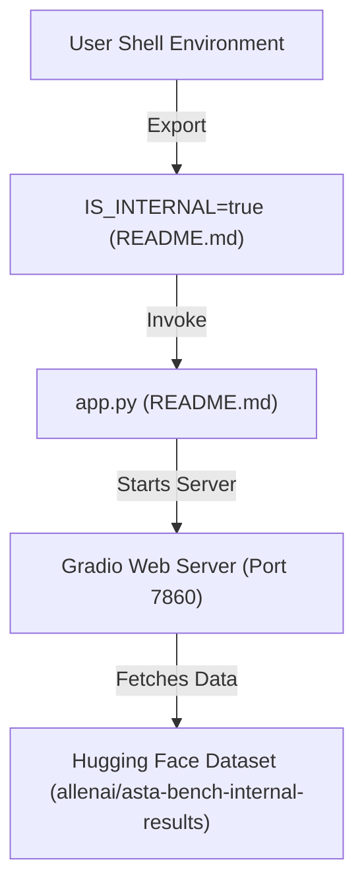
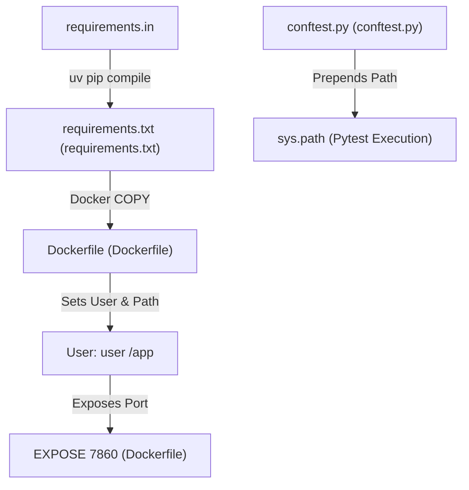

<!-- source: DeepWiki mcp.deepwiki.com · repo allenai/asta-bench-leaderboard · page 1.1 Getting Started & Local Development · fetched 2026-11-09 -->

# Getting Started & Local Development

<details>
<summary>Relevant source files</summary>

The following files were used as context for generating this wiki page:

- [.gitignore](.gitignore)
- [Dockerfile](Dockerfile)
- [README.md](README.md)
- [conftest.py](conftest.py)
- [requirements-dev.txt](requirements-dev.txt)
- [requirements.in](requirements.in)
- [requirements.txt](requirements.txt)

</details>


This page covers the core setup required to run the AstaBench leaderboard application locally, manage dependencies using `uv` and pinned requirements manifests, understand the containerized deployment via Docker, and navigate the repository structure.

---

## Environment Configuration & Local Execution

To execute the AstaBench leaderboard server on a local machine, you must configure the internal dataset toggle and run the top-level entry point `app.py`. 

The leaderboard relies on Hugging Face Datasets to load and query evaluation results [README.md:18-19](). Depending on whether the environment is configured for internal evaluation metrics or public release, the `IS_INTERNAL` environment variable must be exported before launching the server [README.md:21-24]().

```bash
export IS_INTERNAL=true
python app.py
```

Once initialized, the Gradio server binds to port `7860` [README.md:11]() and becomes accessible at `http://localhost:7860` [README.md:29]().

### Local Execution Architecture



Sources: [README.md:18-29]()

---

## Dependency Management with `uv` and Requirements Files

Dependency management is split between a human-maintainable constraint specification (`requirements.in`) and a locked, fully resolved artifact (`requirements.txt`). 

### Direct vs. Locked Dependencies
* `requirements.in`: Contains high-level direct dependencies with version constraints [requirements.in:1-32](). It explicitly decouples `agent-eval` and `inspect_ai` to align scorers and pins `gradio[oauth]` to support Hugging Face OAuth flows [requirements.in:5-18]().
* `requirements.txt`: Generated via `uv` to ensure reproducible builds across local machines, continuous integration, and production containers [requirements.txt:1-3]().

To regenerate `requirements.txt` from `requirements.in` using `uv`, execute the compilation command specified in the lockfile header:

```bash
uv pip compile requirements.in --python-version 3.10 --no-annotate --no-header -o requirements.txt
```

Development dependencies—such as formatting and testing tools (`black`, `isort`, `pytest`, `pytest-mock`)—are cataloged separately in `requirements-dev.txt` [requirements-dev.txt:1-4]().

Sources: [requirements.in:1-32](), [requirements.txt:1-3](), [requirements-dev.txt:1-4]()

---

## Repository Structure & Containerization

The repository is structured around a standard single-container Gradio web application layout. Container deployment is handled via a multi-stage-friendly `Dockerfile` built on Python 3.10 slim [Dockerfile:1-29]().

### Container Build Flow & Test Configuration
The `Dockerfile` performs the following steps:
1. Installs system requirements and sets up a non-root user `user` with UID `1000` [Dockerfile:1-5]().
2. Copies and installs pinned dependencies from `requirements.txt` [Dockerfile:9-13]().
3. Copies the local repository codebase into `/app` and provisions a data cache directory at `/home/user/data` [Dockerfile:15-17]().
4. Configures the environment variable `system=spaces` to instruct the app to write data to the designated home directory [Dockerfile:19-20]().
5. Exposes port `7860` and starts the application via `CMD ["python", "app.py"]` [Dockerfile:25-29]().

For testing, the presence of `conftest.py` at the repository root guarantees that pytest automatically prepends the root directory to `sys.path` [conftest.py:1-6](). This ensures that integration and unit tests located under `tests/` can successfully import top-level root modules (`config`, `app`, `submission`, etc.) when executed via console scripts [conftest.py:1-6]().

### Container & Test Path Architecture



Sources: [Dockerfile:1-29](), [conftest.py:1-6]()

---

## Hugging Face Spaces Integration & Remotes

The codebase acts as the single source of truth for two distinct Hugging Face Spaces [README.md:31-34]():
* Internal Leaderboard: `https://huggingface.co/spaces/allenai/asta-bench-internal-leaderboard` [README.md:33]()
* Public Leaderboard: `https://huggingface.co/spaces/allenai/asta-bench-leaderboard` [README.md:34]()

To configure local git remotes for deployment, register the Hugging Face space repositories [README.md:40-44]():

```bash
git remote add huggingface https://huggingface.co/spaces/allenai/asta-bench-internal-leaderboard
git remote add huggingface-public https://huggingface.co/spaces/allenai/asta-bench-leaderboard
```

Changes merged into the `main` branch can then be synchronized with the remote spaces [README.md:38](), [README.md:51-56]():

```bash
git push huggingface main:main
git push huggingface-public main:main
```

Sources: [README.md:31-56]()

---

