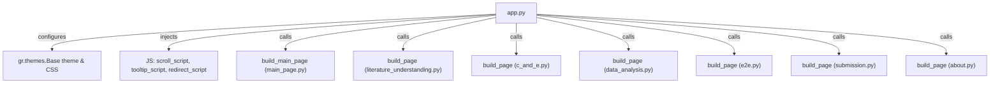

<!-- source: DeepWiki mcp.deepwiki.com · repo allenai/asta-bench-leaderboard · page 2 Application Structure & Routing · fetched 2026-11-09 -->

# Application Structure & Routing

<details>
<summary>Relevant source files</summary>

The following files were used as context for generating this wiki page:

- [app.py](app.py)
- [assets/favicon/favicon.ico](assets/favicon/favicon.ico)

</details>


This page details the structural organization of the AstaBench leaderboard application. It outlines how `app.py` initializes the Gradio instance, registers global client-side JavaScript scripts, configures the visual design system (`theme`), and assembles the application routes by delegating to specialized page builders [app.py:1-168](). 

As a parent page, this section provides a high-level architectural overview. For granular implementation details on specific views, refer to the child pages:
- Main Page: [Main Page (Overall Leaderboard)](#2.1)
- Category Pages: [Category Pages](#2.2)
- About & Static Content: [About Page & Static Content](#2.3)

---

## 2. Application Structure & Routing Overview

The entry point for the web application is `app.py`, which configures logging, imports necessary libraries such as `gradio`, `apscheduler`, and `huggingface_hub`, and pulls in page-building modules [app.py:2-20](). 

### Core Responsibilities of `app.py`:
1. **JavaScript Injections**: Defines custom client-side scripts (`scroll_script`, `redirect_script`, `tooltip_script`, and `redirect_submission_on_close_script`) to handle smooth page scrolling, URL path redirection (e.g., redirecting `/` to `/home`), dynamic smart tooltip positioning, and post-submission modal navigation [app.py:25-140]().
2. **Theme Configuration**: Implements a custom `gr.themes.Base` theme defining primary, secondary, and neutral color hues alongside custom Google Fonts (`Manrope` and `Roboto Mono`) and dark/light mode surface fills [app.py:142-168]().
3. **Route & Component Assembly**: Imports builder functions from across the codebase (`build_main_page`, `build_lit_page`, `build_c_and_e_page`, `build_data_analysis_page`, `build_e2e_page`, `build_submission_page`, and `build_about_page`) to structure the multi-tab or multi-page layout [app.py:14-20]().

Diagram: Application Assembly and Routing Architecture

Sources: [app.py:1-168]()

---

## 2.1. Main Page (Overall Leaderboard)

The primary leaderboard view is structured by `main_page.py`, which handles the main performance tables, test and validation data splits, and caching layers for performance optimization. 

For a deep dive into the layout, filtering logic, and caching strategies for viewers and tag maps, see [Main Page (Overall Leaderboard)](#2.1).

Sources: [app.py:14]()

---

## 2.2. Category Pages

Specific benchmark domains are compartmentalized into distinct category modules (`literature_understanding.py`, `c_and_e.py`, `data_analysis.py`, and `e2e.py`) using a shared builder pattern implemented in `category_page_builder.py`.

For details on how these thin category wrappers construct domain-specific views, see [Category Pages](#2.2).

Sources: [app.py:15-18]()

---

## 2.3. About Page & Static Content

Informational sections, system documentation, and visual legends are governed by `about.py` and text constants defined in `content.py`. These modules control structural anchors, typography, and styling constants.

For information regarding static copy, markdown sections, and custom CSS styling, see [About Page & Static Content](#2.3).

Sources: [app.py:13,20]()

---

## Architecture to Code Mapping

The following diagram bridges the high-level application layout to the specific code entities responsible for routing and page building across the repository.

Diagram: Natural Language to Code Entity Mapping for Application Structure
```mermaid
graph TD
    NL_App[""App Entry Point & Global Setup""] --> Code_App[""app.py""]
    NL_Theme[""Design System & Typography""] --> Code_Theme[""app.py: gr.themes.Base""]
    NL_Scripts[""Client-Side Behaviors""] --> Code_Scripts[""app.py: tooltip_script & scroll_script""]
    
    NL_Main[""Overall Leaderboard Tab""] --> Code_Main[""main_page.py: build_page()""]
    NL_Cat[""Domain Category Builders""] --> Code_Cat[""category_page_builder.py""]
    NL_About[""Documentation & Static Content""] --> Code_About[""about.py: build_page()""]
    NL_Content[""Text Constants & CSS""] --> Code_Content[""content.py: css""]
```
Sources: [app.py:1-168]()

---

