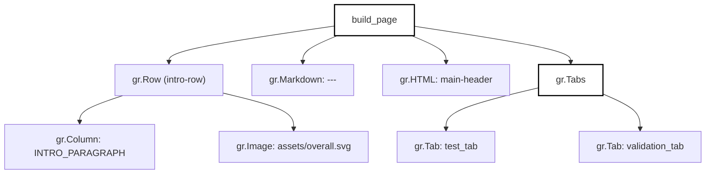
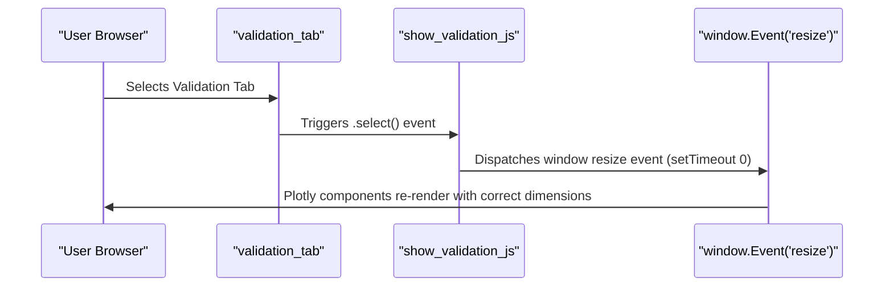

<!-- source: DeepWiki mcp.deepwiki.com · repo allenai/asta-bench-leaderboard · page 2.1 Main Page (Overall Leaderboard) · fetched 2026-11-09 -->

# Main Page (Overall Leaderboard)

<details>
<summary>Relevant source files</summary>

The following files were used as context for generating this wiki page:

- [assets/overall.svg](assets/overall.svg)
- [main_page.py](main_page.py)

</details>


The purpose of `main_page.py` is to assemble the primary landing page and aggregate leaderboard for the AstaBench application. It provides a structured layout featuring an introductory overview, a system diagram asset, and tabbed interfaces separating the `test` and `validation` evaluation splits. It interacts directly with data loading and UI generation functions imported from `ui_components.py` and content definitions from `content.py`.

---

## Page Layout & Component Assembly

The landing page is constructed via the `build_page()` function [main_page.py:18]. The structural composition divides the viewport into an introductory header row followed by the aggregate leaderboard component wrapped in Gradio tabs.

### Introductory Row
The top of the page uses a `gr.Row` with `elem_id="intro-row"` [main_page.py:19] split into two equal columns:
1. **Left Column (`gr.Column(scale=1)`)**: Renders the introductory markup text via `gr.HTML` using the `INTRO_PARAGRAPH` constant imported from `content.py` [main_page.py:20-21].
2. **Right Column (`gr.Column(scale=1)`)**: Embeds the overall architecture/system diagram image pointing to `assets/overall.svg` with interactive features and download buttons disabled [main_page.py:23-32].

### Header and Main Leaderboard Section
Beneath the intro section, a markdown divider separates the header. A bold aggregate header is injected using `gr.HTML` with `elem_id="main-header"` [main_page.py:35-37]:
```python
CATEGORY_NAME = "Overall"
gr.HTML(f'<h2>AstaBench {CATEGORY_Name} Leaderboard <span style="font-weight: normal; color: inherit;">(Aggregate)</span></h2>', elem_id="main-header")
```


*Sources: [main_page.py:18-39]*

---

## Split Tabs: Test vs. Validation Sets

The leaderboard data is isolated into two distinct evaluation splits, managed through Gradio tabs (`gr.Tabs`) [main_page.py:39].

### 1. Test Split Tab (`test_tab`)
* Calls `get_full_leaderboard_data("test")` to retrieve the dataframe and tag map for the test set [main_page.py:41].
* Checks if `test_df` is non-empty; if data exists, renders explanatory Markdown and calls `create_leaderboard_display` with `split_name="test"` [main_page.py:42-49].
* Fallbacks to a "No data available for test split." message if empty [main_page.py:50-51].

### 2. Validation Split Tab (`validation_tab`)
* Calls `get_full_leaderboard_data("validation")` to load validation data [main_page.py:54].
* Renders descriptive text explaining that validation results are used during development [main_page.py:57].
* Invokes `create_leaderboard_display` with `split_name="validation"` [main_page.py:59-64].

### Plotly Resize Handling (`show_validation_js`)
Switching between tabs or loading hidden tabs can cause Plotly scatter plots inside the leaderboard components to collapse or misrender due to undefined container dimensions. To fix this, a pure JavaScript snippet is bound to the `validation_tab.select` event [main_page.py:73-78]:
```python
show_validation_js = """
    () => {setTimeout(() => { window.dispatchEvent(new Event('resize')) }, 0);}
    """
validation_tab.select(fn=None, inputs=None, outputs=None, js=show_validation_js)
```
This forces a window resize event asynchronously via `setTimeout` the moment the validation tab is selected, ensuring Plotly figures correctly recalculate their bounding boxes.


*Sources: [main_page.py:40-78]*

---

## Global Caching of Viewers and Tag Maps

Module-level state variables are declared at the top of `main_page.py` to facilitate efficient caching of leaderboard view states and taxonomy mappings across requests [main_page.py:14-16]:

```python
CACHED_VIEWERS = {}
CACHED_TAG_MAPS = {}
```

While data retrieval and caching mechanisms are heavily driven inside `ui_components.py` (via `get_full_leaderboard_data`), these dictionaries reserve namespace in `main_page.py` for holding module-scoped viewer instances and associated metadata tag maps, avoiding redundant dataframe parsing and dataset downloads from HuggingFace on repeated tab navigation.

```mermaid
graph TD
  sub-graph ["Module Scope"]
    A["CACHED_VIEWERS"]
    B["CACHED_TAG_MAPS"]
  end
  C["get_full_leaderboard_data"] -->|Stores/Fetches| A
  C -->|Stores/Fetches| B
  D["create_leaderboard_display"] --> C

  style A fill:none,stroke:#000,stroke-width:2px
  style B fill:none,stroke:#000,stroke-width:2px
  style C fill:none,stroke:#000,stroke-width:2px
```
*Sources: [main_page.py:14-16], [ui_components.py:6-6]*

---

