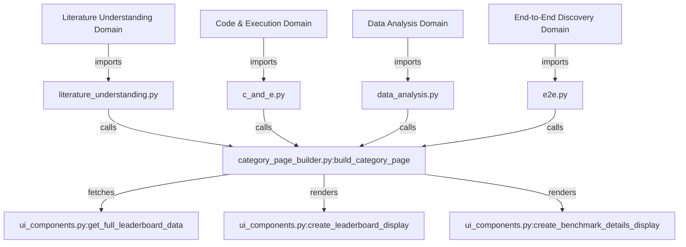
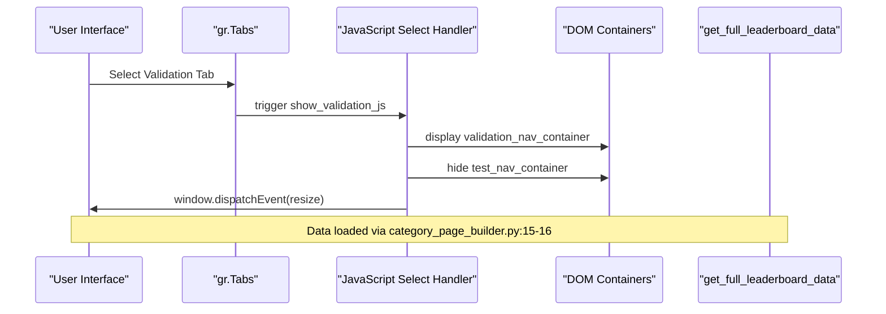

<!-- source: DeepWiki mcp.deepwiki.com · repo allenai/asta-bench-leaderboard · page 2.2 Category Pages · fetched 2026-11-09 -->

# Category Pages

<details>
<summary>Relevant source files</summary>

The following files were used as context for generating this wiki page:

- [c_and_e.py](c_and_e.py)
- [category_page_builder.py](category_page_builder.py)
- [data_analysis.py](data_analysis.py)
- [e2e.py](e2e.py)
- [literature_understanding.py](literature_understanding.py)

</details>


## Purpose and Scope
This section details the implementation of category-specific leaderboard views within the AstaBench leaderboard application. Category pages render aggregated scores, split-specific data (test vs. validation), sub-navigation bars, and benchmark detail cards for each of the four core evaluation domains. The architecture relies on a centralized builder function, `build_category_page`, located in `category_page_builder.py`, which is consumed by four thin category modules.

Sources: `category_page_builder.py:1-105](), [c_and_e.py:1-9](), [e2e.py:1-8](), [data_analysis.py:1-8](), [literature_understanding.py:1-8]()

---

## Centralized Category Builder (`category_page_builder.py`)

The core layout and rendering logic for any category page is defined by `build_category_page(CATEGORY_NAME, PAGE_DESCRIPTION)` [category_page_builder.py:13-105](). This function encapsulates data fetching, layout generation, and dynamic tab management.

### Data Loading and Layout Initialization
Upon invocation, `build_category_page` immediately fetches full leaderboard datasets and tag maps for both `validation` and `test` splits using `get_full_leaderboard_data` [category_page_builder.py:15-16](). It then constructs a two-column introductory layout using Gradio layout primitives (`gr.Row`, `gr.Column`) [category_page_builder.py:17-30]().

The left column contains:
- A main HTML header reflecting the category name [category_page_builder.py:20]().
- Split-specific sub-navigation containers (`validation_nav_container` and `test_nav_container`) initialized via `create_sub_navigation_bar` [category_page_builder.py:21-25]().
- The category description markdown (`PAGE_DESCRIPTION`) [category_page_builder.py:27]().

The right column embeds a vector diagram looked up from `CATEGORY_DIAGRAM_MAP` [category_page_builder.py:30-41]():

```python
CATEGORY_DIAGRAM_MAP = {
    "Literature Understanding": "assets/literature-understanding.svg",
    "Code & Execution": "assets/code-execution.svg",
    "Data Analysis": "assets/data-analysis.svg",
    "End-to-End Discovery": "assets/end-to-end-discovery.svg",
}
```
*(Source: [category_page_builder.py:6-11]())*

### Diagram: Natural Language Space to Code Entity Space (Architecture)

Sources: `category_page_builder.py:13-80](), [c_and_e.py:1-9](), [e2e.py:1-8](), [data_analysis.py:1-8](), [literature_understanding.py:1-8]()

---

## Split Management and Tab Interactivity

`build_category_page` sets up a Gradio `gr.Tabs()` component housing two tabs: `Results: Test Set` and `Results: Validation Set` [category_page_builder.py:43-83](). 

### Tab Select Event Handlers
To handle switching between validation and test sub-navigation bars without rebuilding the UI, raw JavaScript strings (`show_validation_js` and `show_test_js`) are bound to the `.select()` events of the respective tabs [category_page_builder.py:85-103]().

```python
show_validation_js = """
    () => {
        document.getElementById('validation_nav_container').style.display = 'block';
        document.getElementById('test_nav_container').style.display = 'none';
        setTimeout(() => { window.dispatchEvent(new Event('resize')) }, 0);
    }
    """

show_test_js = """
    () => {
        document.getElementById('validation_nav_container').style.display = 'none';
        document.getElementById('test_nav_container').style.display = 'block';
    }
    """
```
*(Source: [category_page_builder.py:85-99]())*

These JavaScript blocks toggle DOM visibility of `validation_nav_container` and `test_nav_container` and trigger a window resize event to force Plotly charts to recalculate their dimensions [category_page_builder.py:85-91]().

### Diagram: Natural Language Space to Code Entity Space (Tab Dataflow)

Sources: `category_page_builder.py:15-103]()`

---

## Thin Category Modules

The four application categories are instantiated through thin wrapper modules that import descriptive text constants from `content.py` and pass them alongside their respective category string into `build_category_page`.

### 1. Code & Execution (`c_and_e.py`)
Defines the `Code & Execution` category using `CODE_EXECUTION_DESCRIPTION` [c_and_e.py:1-9]().
- Function: `build_page()` [c_and_e.py:8-9]()
- Sources: `[c_and_e.py:1-9](), [content.py]()`

### 2. End-to-End Discovery (`e2e.py`)
Defines the `End-to-End Discovery` category using `DISCOVERY_DESCRIPTION` [e2e.py:1-8]().
- Function: `build_page()` [e2e.py:7-8]()
- Sources: `[e2e.py:1-8](), [content.py]()`

### 3. Data Analysis (`data_analysis.py`)
Defines the `Data Analysis` category using `DATA_ANALYSIS_DESCRIPTION` [data_analysis.py:1-8]().
- Function: `build_page()` [data_analysis.py:7-8]()
- Sources: `[data_analysis.py:1-8](), [content.py]()`

### 4. Literature Understanding (`literature_understanding.py`)
Defines the `Literature Understanding` category using `LIT_DESCRIPTION` [literature_understanding.py:1-8]().
- Function: `build_page()` [literature_understanding.py:7-8]()
- Sources: `[literature_understanding.py:1-8](), [content.py]()`

---

