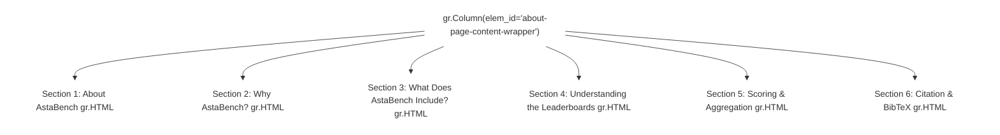
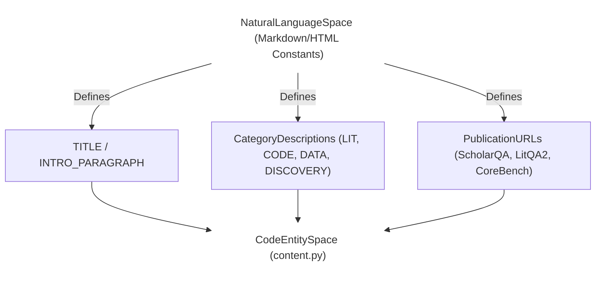
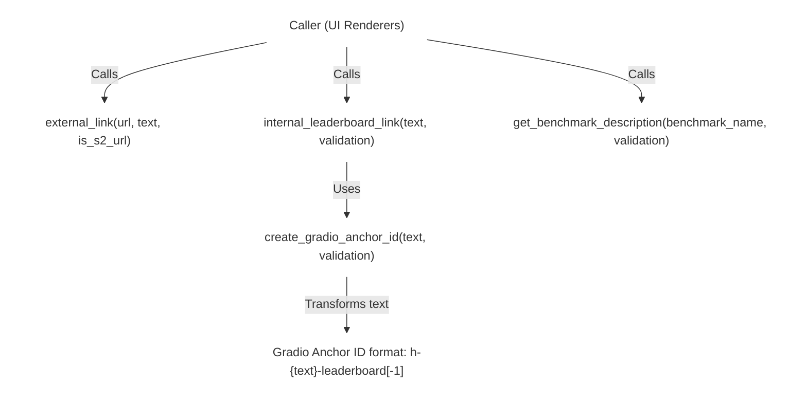

<!-- source: DeepWiki mcp.deepwiki.com · repo allenai/asta-bench-leaderboard · page 2.3 About Page & Static Content · fetched 2026-11-09 -->

# About Page & Static Content

<details>
<summary>Relevant source files</summary>

The following files were used as context for generating this wiki page:

- [about.py](about.py)
- [content.py](content.py)

</details>


## Purpose and Scope
This page details the implementation of the static content and informational views within the AstaBench leaderboard application. Specifically, it covers the layout and structure of the About page (`about.py`) and the rich text constants, URL mappings, anchor-generation utilities, and markdown helpers housed in `content.py`. These components provide users with documentation, methodological definitions, academic citations, and internal/external cross-referencing capabilities across the Gradio interface.

---

## 1. About Page Implementation (`about.py`)

The About page is constructed as a modular Gradio container component via the `build_page()` function [about.py:4-180]. It renders structured informational sections utilizing `gr.HTML` components styled with CSS classes and dividers (`gr.Markdown("---", elem_classes="divider-line")`).

The page is divided into six logical sections:
1. **About AstaBench**: Introduces the framework as an evaluation suite for scientific AI agents across research skills [about.py:6-14].
2. **Why AstaBench?**: Discusses limitations of existing benchmarks and explains the rationale behind open, reproducible scientific evaluations [about.py:17-30].
3. **What Does AstaBench Include?**: Details the scale of the benchmark suite (>2,400 problems across 11 benchmarks and four categories) with a link to the technical blog [about.py:32-53].
4. **Understanding the Leaderboards**: Explains macro-averaging, overall score/cost formulas, and category-level breakdowns [about.py:55-75].
5. **Scoring & Aggregation**: Details scoring policies, partial completions, cost calculation (USD per task), missing cost handling, and coverage metrics [about.py:77-115].
6. **Citation**: Provides the official ICLR 2026 BibTeX entry wrapped in a custom scrollable container styled via embedded `<style>` tags [about.py:117-180].



Sources: `about.py:4-180`

---

## 2. Static Content Constants & Text Generators (`content.py`)

The `content.py` module stores HTML templates, category descriptions, benchmark markdown texts, external publication URLs, and helper utilities. 

### Key Text Constants
- `TITLE`: Raw HTML header for the main space interface [content.py:16-16].
- `INTRO_PARAGRAPH`: HTML block explaining overall score (macro-average of four category averages) and overall cost calculations [content.py:18-35].
- `SCATTER_DISCLAIMER` & `PARETO_DISCLAIMER`: Explanatory text for plot confidence intervals, missing cost positioning, and Pareto-optimal green text formatting [content.py:36-41].
- `LIT_DESCRIPTION`, `CODE_EXECUTION_DESCRIPTION`, `DATA_ANALYSIS_DESCRIPTION`, `DISCOVERY_DESCRIPTION`: Category-level summaries describing problem scopes and tool usage [content.py:42-69].
- `SUBMISSION_CONFIRMATION`: Success message rendered upon agent submission [content.py:70-78].

### Semantic Scholar and Paper URLs
To provide attribution and allow users to read source papers, `content.py` defines constants for external links:
- `SCHOLAR_QA_CS_URL`, `LITQA2_URL`, `ARXIV_DIGESTABLES_URL` [content.py:81-83]
- `SUPER_URL`, `CORE_BENCH_URL`, `DS1000_URL`, `DISCOVERY_BENCH_URL` [content.py:84-87]



Sources: `content.py:1-88`

---

## 3. Anchor Generation and Link Helpers

To support internal navigation and rich formatting within generated markdown, `content.py` exposes programmatic utilities that replicate Gradio's internal ID allocation rules.

### `create_gradio_anchor_id`
Replicates the ID format created by Gradio's `gr.Markdown(header_links=True)` [content.py:3-13]. It lowercases text, replaces spaces with hyphens, strips non-word characters, and prefixes/suffixes strings based on validation split states:
```python
def create_gradio_anchor_id(text: str, validation) -> str:
    text = text.lower()
    text = re.sub(r'\s+', '-', text)
    text = re.sub(r'[^\w-]', '', text)
    if validation:
        return f"h-{text}-leaderboard-1"
    return f"h-{text}-leaderboard"
```
* `[content.py:3-13]()`

### Link and Description Helpers
- `external_link(url, text, is_s2_url)`: Automatically appends `?utm_source=asta_leaderboard` tracking parameters if `is_s2_url` is true, and returns an HTML anchor target with `rel="noopener noreferrer"` [content.py:90-92].
- `internal_leaderboard_link(text, validation)`: Generates internal anchor links using `create_gradio_anchor_id()` [content.py:94-96].
- `get_benchmark_description(benchmark_name, validation)`: Maps benchmark identifiers (e.g., `PaperFindingBench`, `LitQA2-FullText-Search`, `ScholarQA-CS2`) to descriptive text blocks containing interlinked benchmark references [content.py:98-110].



Sources: `content.py:3-110`

---

