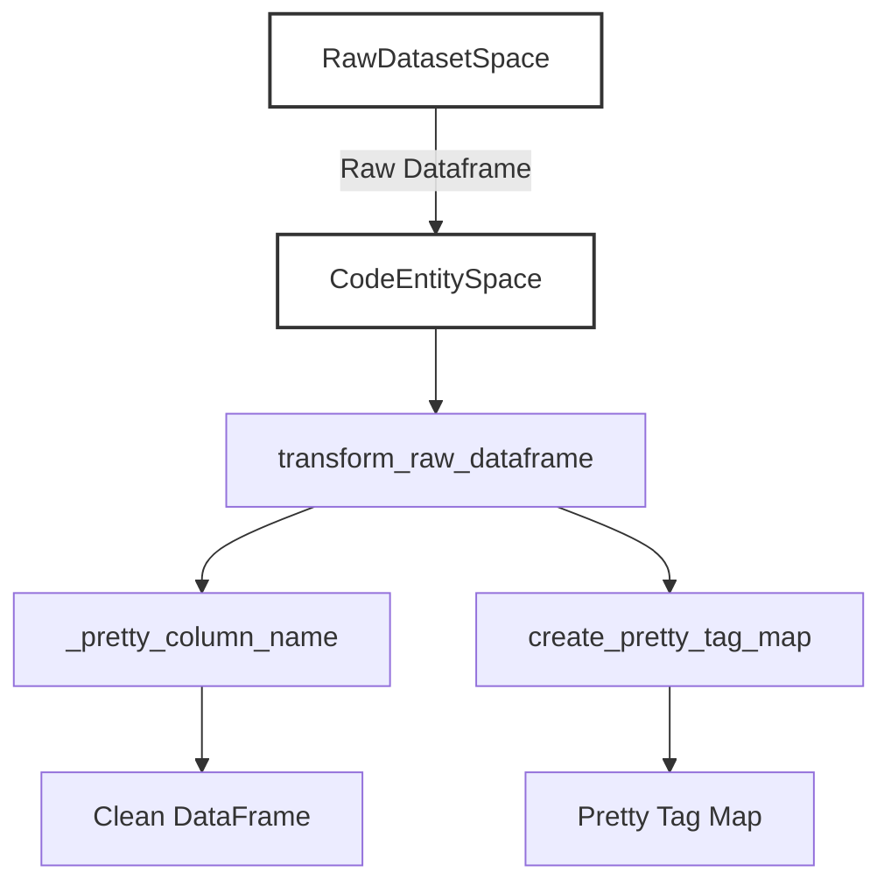
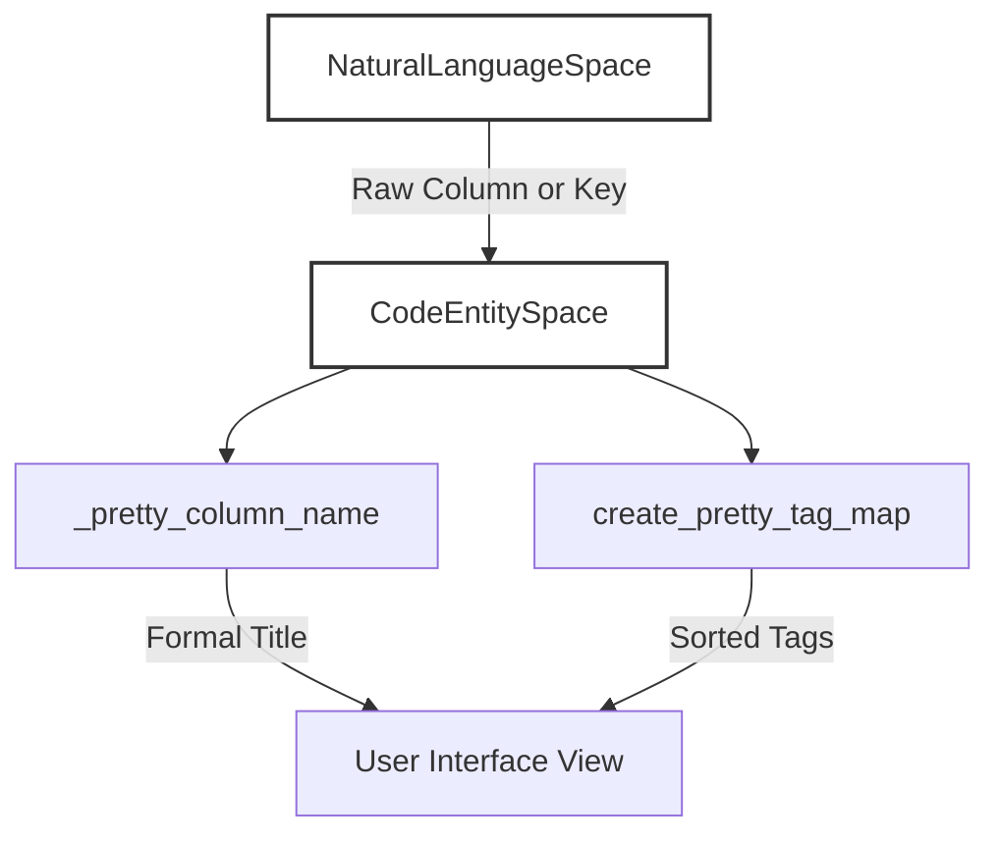

<!-- source: DeepWiki mcp.deepwiki.com · repo allenai/asta-bench-leaderboard · page 3.1 Data Transformation Pipeline · fetched 2026-11-09 -->

# Data Transformation Pipeline

Relevant source files

The following files were used as context for generating this wiki page:

- [leaderboard_transformer.py](leaderboard_transformer.py)

The data transformation pipeline is responsible for converting raw dataframes fetched from HuggingFace results datasets into clean, readable, and structured formats suitable for rendering in the Gradio UI and powering downstream analytics like Pareto frontier calculations. Implemented primarily in `leaderboard_transformer.py`, this pipeline handles column renaming, tag map creation, duplicate agent disambiguation, and precision-preserving formatting.

As a parent page, this document provides a high-level overview of the transformation architecture. For deep technical specifics regarding cost/score metrics and Pareto optimizations, see [Pareto Frontier & Cost/Score Metrics](#3.1.1).

---

## 1. Data Transformer Role & Overview

The raw data ingested from evaluation benchmarks contains raw internal identifiers, snake_case keys, and varying field names. The transformation pipeline normalizes these structures while preserving numerical precision for downstream metrics.

*Figure 1: High-level data transformation workflow from raw datasets to formatted UI structures.*

Sources: `[leaderboard_transformer.py:168-180]()`

---

## 2. Pretty Names and Tag Maps

To present human-readable categories and benchmarks in the leaderboard UI, the pipeline maps informal identifiers to formal titles using dictionaries and helper functions. 

The mapping layer relies on `INFORMAL_TO_FORMAL_NAME_MAP` and `ORDER_MAP` to translate short codes (such as `'lit'` or `'arxivdigestables_validation'`) into proper display names (`'Literature Understanding'` and `'ArxivDIGESTables-Clean'`) [leaderboard_transformer.py:13-87](). 

*Figure 2: Mapping natural language labels to code entities in `leaderboard_transformer.py`.*

The function `_pretty_column_name(raw_col: str)` handles fixed schema elements (like `'User/organization'` to `'Submitter'`) as well as dynamic metric suffixes (`' score'`, `' cost 95% CI'`) by matching against sorted base names [leaderboard_transformer.py:90-134](). Categorical filters are structured via `create_pretty_tag_map`, which enforces custom display sorting defined in `ORDER_MAP` [leaderboard_transformer.py:136-165]().

Sources: `[leaderboard_transformer.py:13-165]()`

---

## 3. Duplicate Disambiguation and Views

When multiple entries share identical names or organization tags, the pipeline applies disambiguation rules to ensure unique row indexing in Gradio tables. 

`DataTransformer` views and wrapper utilities ingest the transformed dataframe to construct specific slices for categories and validation vs. test splits. Display-only rounding for scores and costs is strictly separated from analytical transformations; raw values remain untouched until rendering time to avoid compounding floating-point discrepancies in calculations.

Sources: `[leaderboard_transformer.py:168-180]()`

---

## 4. Score, Cost, and Pareto Metrics

Scoring and cost columns require specific formatting rules (e.g., currency alignment, decimal precision, and handling missing cost metrics). Furthermore, computing the Pareto frontier depends directly on retaining full floating-point precision through `transform_raw_dataframe`.

For detailed information on Pareto frontier derivation, missing-cost handling, precision preservation, and associated integration tests, see [Pareto Frontier & Cost/Score Metrics](#3.1.1).

Sources: `[leaderboard_transformer.py:168-180]()`

---

