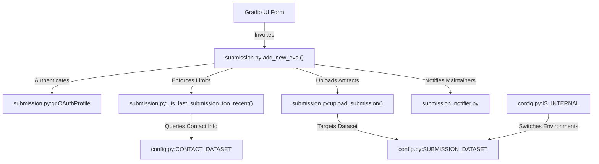
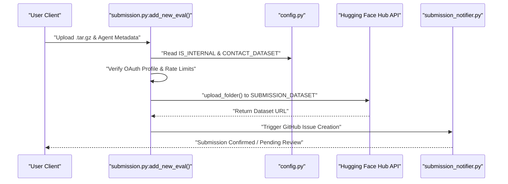

<!-- source: DeepWiki mcp.deepwiki.com · repo allenai/asta-bench-leaderboard · page 4 Submission System · fetched 2026-11-09 -->

# Submission System

Relevant source files

The following files were used as context for generating this wiki page:

- [config.py](config.py)
- [submission.py](submission.py)

The submission system manages the ingestion, validation, processing, and review of external and internal agent evaluations. Users interact with a Gradio-based submission interface to upload their evaluation artifacts (packaged as `.tar.gz` tarballs containing `agenteval.json` and associated metadata). The system authenticates users via Hugging Face OAuth, enforces rate limits, validates payloads, extracts and stores submission folders into Hugging Face datasets, and notifies reviewers via GitHub issues.

For a detailed technical breakdown of each component, refer to the child pages linked below:
- [Submission Flow & Validation](#4.1)
- [Configuration & Datasets](#4.2)
- [Reviewer Notifications](#4.3)

---

## Architecture & Code Entity Mapping

The submission workflow bridges user-facing Gradio UI elements with backend storage configuration, dataset uploading logic, and notification hooks. The diagram below maps natural language concepts to their concrete code entities in the codebase.

*Sources: `submission.py:1-451`, `config.py:1-23`*

---

## 4.1 Submission Flow & Validation

The submission lifecycle begins when a user submits agent metadata and an evaluation tarball through the Gradio form interface [submission.py:99-112](). The backend function `add_new_eval` processes the request by performing several validation and security checks:
1. **Payload Inspection**: Verifies that an agent name and a `.tar.gz` file payload are present [submission.py:113-127]().
2. **Account & Frequency Verification**: Checks user identity via Hugging Face OAuth profiles [submission.py:131-133]() and queries past submissions to enforce 24-hour rate limiting [submission.py:161-172]().
3. **Tarball Extraction & Upload**: Safely extracts submission contents to local temporary directories (`EXTRACTED_DATA_DIR`) and pushes validated folders to Hugging Face datasets via `upload_submission` [submission.py:63-94](), ensuring total size constraints (`MAX_UPLOAD_BYTES = 5e9`) are respected [submission.py:49-76]().

For detailed implementation specifics, see [Submission Flow & Validation](#4.1).

*Sources: `submission.py:49-175`, `config.py:21-22`*

---

## 4.2 Configuration & Datasets

Environment configurations and dataset routing are centralized in `config.py`. The application dynamically switches between public and internal evaluation pipelines based on the `IS_INTERNAL` environment variable [config.py:5]() and `CONFIG_NAME` [config.py:4]().

Depending on this flag, the submission system targets distinct Hugging Face repositories for raw submissions (`SUBMISSION_DATASET`), contact tracking (`CONTACT_DATASET`), and scoring results (`RESULTS_DATASET`) [config.py:10-20](). Temporary storage paths for processing tarball extractions are governed by `EXTRACTED_DATA_DIR` [config.py:22]().

For deep dives into environment switches, contact datasets, and schema definitions, see [Configuration & Datasets](#4.2).

*Sources: `config.py:1-23`, `submission.py:27-32`*

---

## 4.3 Reviewer Notifications

Once a submission is successfully ingested and uploaded to the designated Hugging Face dataset, the system automatically triggers a notification process. Implemented primarily via `submission_notifier.py`, this module interfaces with the GitHub API to create issues on the designated repository. This ensures that benchmark administrators are promptly alerted to new agent submissions requiring manual or automated review.

For details on issue templates, payload formatting, and associated unit tests, see [Reviewer Notifications](#4.3).

*Sources: `submission.py:26`, `submission_notifier.py:1-100`*

---

## End-to-End Submission Pipeline

*Sources: `submission.py:63-175`, `config.py:1-23`, `submission_notifier.py:1-100`*

---

