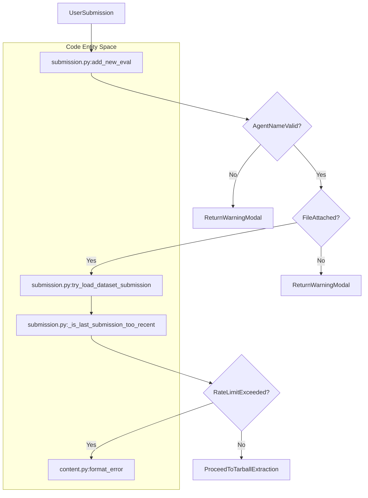
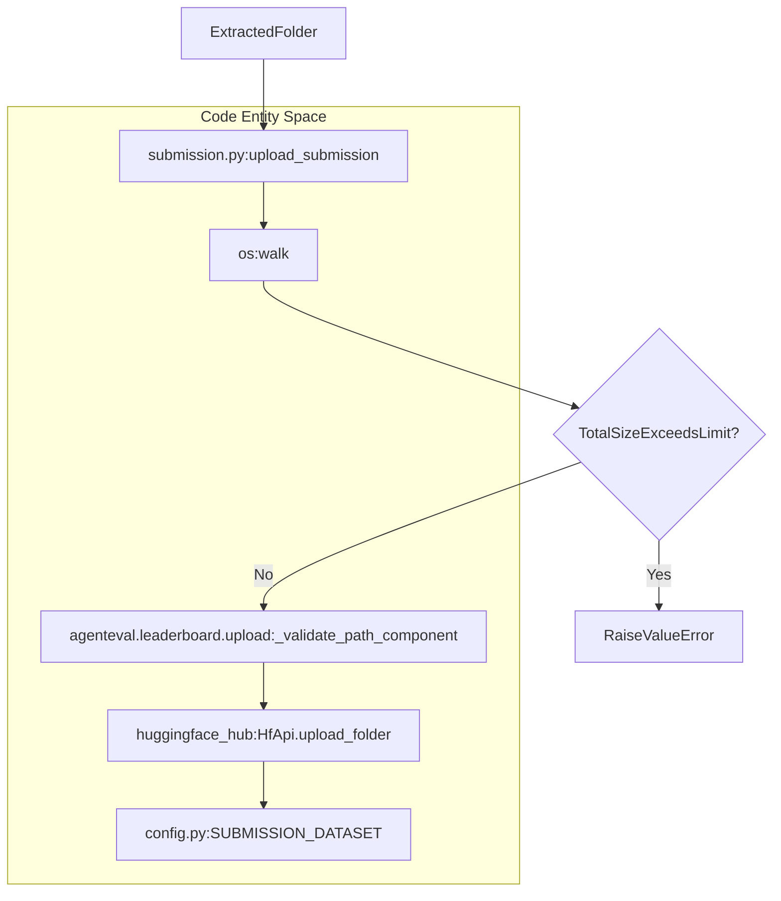

<!-- source: DeepWiki mcp.deepwiki.com · repo allenai/asta-bench-leaderboard · page 4.1 Submission Flow & Validation · fetched 2026-11-09 -->

# Submission Flow & Validation

<details>
<summary>Relevant source files</summary>

The following files were used as context for generating this wiki page:

- [config.py](config.py)
- [submission.py](submission.py)

</details>


## Purpose & Scope
This page details the submission system for the AstaBench leaderboard app. It covers the Gradio-based submission form interface, Hugging Face OAuth authentication, rate-limiting and validation mechanisms, tarball extraction protocols, metadata handling, and dataset uploads to Hugging Face Hub datasets.

Sources: `submission.py:1-451`, `config.py:1-23`

---

## 1. Submission Form Interface & OAuth Authentication
The submission interface is constructed via the `add_new_eval` function, which accepts agent metadata, evaluation configuration splits (`val_or_test`), and file uploads. Authentication is handled natively through Gradio's OAuth integration using `gr.OAuthProfile`.

When a user submits an agent evaluation, `add_new_eval` intercepts the request, validates the input parameters, and extracts the Hugging Face username from the `profile` argument if a custom username is omitted.

```python
def add_new_eval(
        val_or_test: str,
        agent_name: str | None,
        agent_description: str,
        agent_url: str,
        openness: str | None,
        degree_of_control: str | None,
        path_to_file: typing.IO | None,
        username: str,
        role: str,
        email: str,
        email_opt_in: bool,
        profile: gr.OAuthProfile,
):
    ...
```

Sources: `submission.py:99-112`, `submission.py:131-134`

---

## 2. Validation & Rate Limiting Pipeline
Before any tarball extraction or dataset upload occurs, submissions undergo rigorous validation checks inside `add_new_eval`. 

### Initial Field Validation
The system first verifies that essential fields are populated:
* `agent_name` must be provided; otherwise, a warning modal is triggered [submission.py:113-119]().
* `path_to_file` must contain an attached `.tar.gz` archive [submission.py:121-127]().

### Rate Limiting & Contact Datasets
To prevent abuse, submissions are rate-limited per user per split. The application queries the private contact dataset defined by `CONTACT_DATASET` via `try_load_dataset_submission` [submission.py:157-160]() to check submission timestamps. If a user has submitted within the last 24 hours, the request is rejected [submission.py:161-172]().


Sources: `submission.py:113-172`, `config.py:8`

---

## 3. Tarball Extraction & Metadata Processing
Once validation passes, the submitted `.tar.gz` archive is unpacked into the designated extraction directory configured by `EXTRACTED_DATA_DIR` [config.py:22](). 

The submission expects a standardized folder structure matching `agenteval` requirements, including the metadata file defined by `SUBMISSION_METADATA_FILENAME` and parsed via `SubmissionMetadata` [submission.py:5-6]().

Sources: `submission.py:5-14`, `config.py:21-23`

---

## 4. Dataset Upload & Storage
After successful extraction and local verification, the submission is prepared for upload to the Hugging Face Hub.

### Size Constraints & Folder Traversal
The function `upload_submission` calculates the aggregate size of the uncompressed submission folder by recursively walking the directory tree [submission.py:69-72](). If the total size exceeds `MAX_UPLOAD_BYTES` (configured to `5e9` bytes / 5 GB), a `ValueError` is raised [submission.py:49, 73-76]().

### Path Validation & HF Hub API
Path components (`CONFIG_NAME`, `split`, and `submission_name`) are sanitized and validated using `_validate_path_component` [submission.py:80-82]() to ensure dataset URI integrity (`hf://datasets/...`) [submission.py:83](). Finally, `HfApi.upload_folder` pushes the files to `SUBMISSION_DATASET` with a descriptive commit message containing the submitting user's HF handle [submission.py:85-94]().


Sources: `submission.py:48-94`, `config.py:1-23`

---

