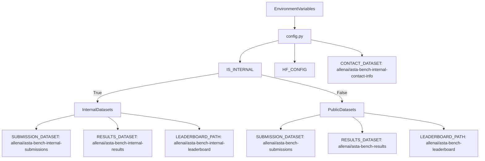
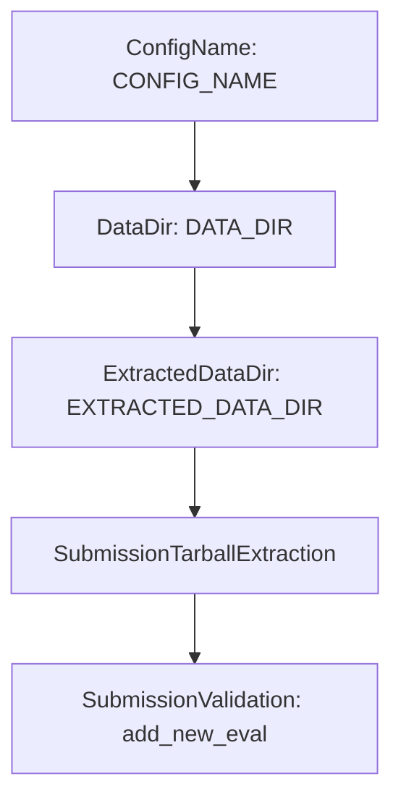
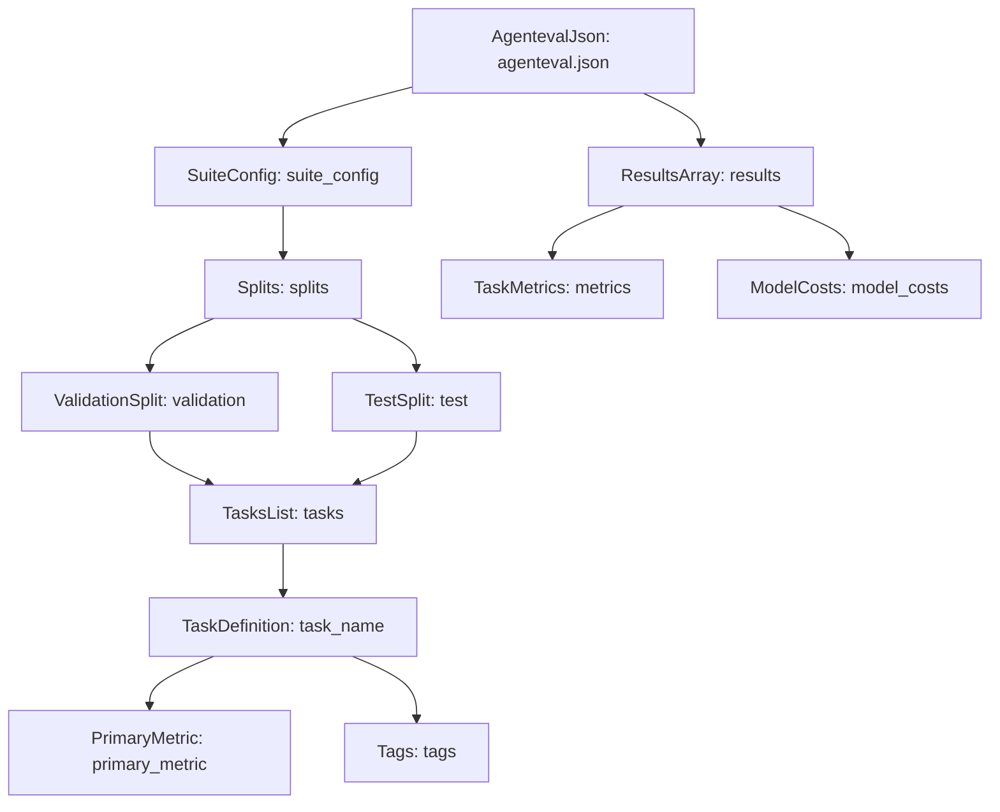

<!-- source: DeepWiki mcp.deepwiki.com · repo allenai/asta-bench-leaderboard · page 4.2 Configuration & Datasets · fetched 2026-11-09 -->

# Configuration & Datasets

Relevant source files

The following files were used as context for generating this wiki page:

- [config.py](config.py)
- [data/1.0.0-dev1/agenteval.json](data/1.0.0-dev1/agenteval.json)
- [submission.py](submission.py)

## Purpose & Scope
This page documents the configuration management and dataset architecture of the AstaBench Leaderboard. It covers `config.py`, which controls environment-based dataset routing (public versus internal datasets), temporary storage paths (`EXTRACTED_DATA_DIR`), and the schema structure of evaluation files like `agenteval.json`.

Sources: [config.py:1-22](), [submission.py:27-50](), [data/1.0.0-dev1/agenteval.json:1-161]()

---

## Configuration Architecture (`config.py`)

The application configuration is centralized in `config.py` [config.py:1-22](). It inspects environment variables to determine debug mode, active configuration versions, and whether the application is running in an internal Ai2 environment or a public HuggingFace Space.

* `LOCAL_DEBUG`: Evaluated as `not (os.environ.get("system") == "spaces")` [config.py:3]().
* `CONFIG_NAME`: Read from `os.getenv("HF_CONFIG", "1.0.0-dev1")`, which dictates the directory structure and dataset configuration identifier [config.py:4]().
* `IS_INTERNAL`: Controlled by `os.environ.get("IS_INTERNAL", "false").lower() == "true"` [config.py:5]().

Depending on `IS_INTERNAL`, `config.py` assigns distinct HuggingFace dataset repositories for submissions, results, and leaderboards:
* **Internal Mode (`IS_INTERNAL = True`)**: Points to `allenai/asta-bench-internal-submissions`, `allenai/asta-bench-internal-results`, and `allenai/asta-bench-internal-leaderboard` [config.py:12-14]().
* **Public Mode (`IS_INTERNAL = False`)**: Points to `allenai/asta-bench-submissions`, `allenai/asta-bench-results`, and `allenai/asta-bench-leaderboard` [config.py:17-19]().

Contact information for rate limiting and submission tracking is stored in a unified private dataset (`allenai/asta-bench-internal-contact-info`) referenced by `CONTACT_DATASET` [config.py:7-8]() and queried in `submission.py` [submission.py:29]().

Sources: [config.py:1-22](), [submission.py:27-32]()

---

## Directory Layout & Extracted Data

Local runtime storage is organized under a temporary base directory determined by `CONFIG_NAME` [config.py:21-22](). 

* `DATA_DIR`: Defined as `/tmp/abl/data/` concatenated with `CONFIG_NAME` [config.py:21]().
* `EXTRACTED_DATA_DIR`: Defined as `os.path.join(DATA_DIR, "extracted")` [config.py:22](). 

In `submission.py`, `EXTRACTED_DATA_DIR` is used to unpack uploaded submission tarballs for validation and evaluation processing. The directory is automatically created upon module initialization via `os.makedirs(EXTRACTED_DATA_DIR, exist_ok=True)` [submission.py:50]().

Sources: [config.py:21-22](), [submission.py:48-50]()

---

## Example Evaluation Metadata & Schema (`agenteval.json`)

Evaluation payloads and suite configurations follow the `agenteval` schema, instantiated in files such as `data/1.0.0-dev1/agenteval.json` [data/1.0.0-dev1/agenteval.json:1-161]().

The JSON structure defines suite metadata, task groupings across splits (`validation` and `test`), primary metrics, and tag taxonomies (`lit`, `data`, `code`, `discovery`) [data/1.0.0-dev1/agenteval.json:1-161]().

### Suite Configuration Schema
* `suite_config`: Contains suite `name`, `version`, and an array of `splits` [data/1.0.0-dev1/agenteval.json:2-6]().
* `splits`: Each split object contains a `name` (e.g., `validation`, `test`) and a list of `tasks` [data/1.0.0-dev1/agenteval.json:5-8]().
* `tasks`: Each task defines its `name`, HuggingFace `path`, `primary_metric`, and categorization `tags` [data/1.0.0-dev1/agenteval.json:8-16]().
* `results`: An array containing benchmark evaluation metrics (`metrics`) and execution expenses (`model_costs`) per task [data/1.0.0-dev1/agenteval.json:163-209]().

Sources: [data/1.0.0-dev1/agenteval.json:1-209]()

---

