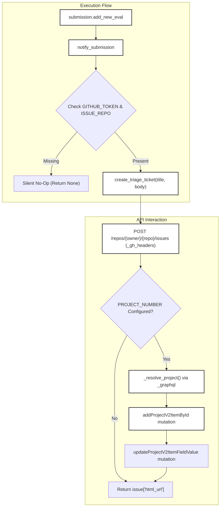
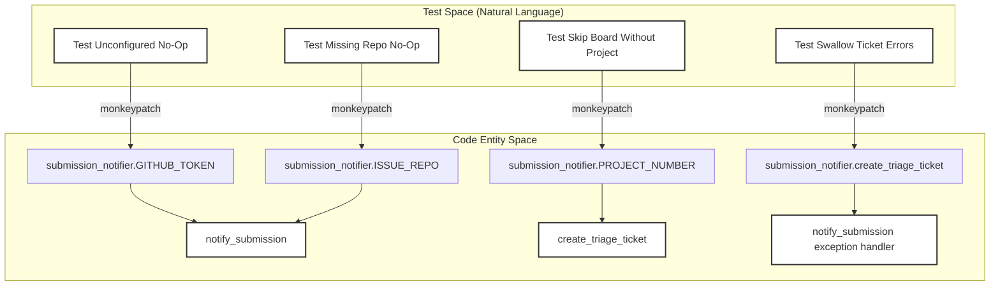

<!-- source: DeepWiki mcp.deepwiki.com · repo allenai/asta-bench-leaderboard · page 4.3 Reviewer Notifications · fetched 2026-11-09 -->

# Reviewer Notifications

<details>
<summary>Relevant source files</summary>

The following files were used as context for generating this wiki page:

- [submission_notifier.py](submission_notifier.py)
- [tests/unit/test_submission_notifier.py](tests/unit/test_submission_notifier.py)

</details>


## Purpose and Scope

The `submission_notifier.py` module handles asynchronous, best-effort alerting for new web-form submissions on the AstaBench leaderboard. When a user uploads a new evaluation tarball, the submission pipeline invokes this module to open a triage ticket on a designated GitHub repository and optionally assign it to a GitHub Projects v2 board with a specified status column (e.g., "Triage Needed"). 

Designed to fail silently without blocking user submissions, the notifier operates via GitHub REST and GraphQL APIs using credentials injected through HuggingFace Space secrets or environment variables. This page documents its configuration, message construction logic, GitHub API integration, and corresponding unit tests in `tests/unit/test_submission_notifier.py`.

Sources: [submission_notifier.py:1-33](), [tests/unit/test_submission_notifier.py:1-11]()

---

## Configuration and Environment Variables

The notifier relies strictly on environment variables or HuggingFace Space secrets. If the token or repository is missing, execution safely returns a no-op to prevent breaking the submission flow.

| Environment Variable | Default Value | Description |
| :--- | :--- | :--- |
| `NOTIFIER_GITHUB_TOKEN` / `GITHUB_TOKEN` | `None` | Authentication token used to authorize GitHub REST and GraphQL requests [submission_notifier.py:26](). |
| `NOTIFIER_GITHUB_REPO` | `""` | Target GitHub repository formatted as `"owner/repo"` where issues are opened [submission_notifier.py:27](). |
| `NOTIFIER_PROJECT_NUMBER` | `None` | Optional integer referencing a GitHub Project v2 board owned by the repository's organization [submission_notifier.py:29-30](). |
| `NOTIFIER_PROJECT_STATUS` | `"Triage Needed"` | The status column name to assign when adding the issue to a Project v2 board [submission_notifier.py:31](). |

Sources: [submission_notifier.py:17-32]()

---

## Message Construction and URL Generation

Before dispatching an issue, the module formats URLs pointing directly to the HuggingFace Hub dataset repository and constructs the issue title and body.

### Core Functions

- **`submission_folder_url(coords)`**: Generates a browser-compatible URL pointing to the submission directory within the dataset tree on the HuggingFace Hub [submission_notifier.py:34-39]().
- **`build_issue(coords)`**: Generates a tuple containing the issue title and markdown body [submission_notifier.py:45-62](). The body includes a direct reference to the HuggingFace dataset URI (`hf://datasets/...`) and links back to the internal review documentation [submission_notifier.py:47-61]().

```python
def build_issue(coords):
    dataset_url = (
        f"hf://datasets/{coords['repo']}/{coords['config']}/"
        f"{coords['split']}/{coords['name']}"
    )
    title = f"AstaBench submission from {coords['username']}"
    # ... builds markdown body ...
    return title, body
```

Sources: [submission_notifier.py:34-62]()

---

## GitHub REST and GraphQL Delivery

The notification delivery mechanism integrates GitHub's REST API for creating issues and GraphQL API for interacting with GitHub Projects v2 boards.

### Delivery Data Flow



Sources: [submission_notifier.py:72-189]()

### Key Functions for Delivery

- **`_gh_headers()`**: Assembles authentication headers, enforcing the GitHub API version `2022-11-28` [submission_notifier.py:72-81]().
- **`_graphql(query, variables)`**: Executes GraphQL queries against `_GITHUB_GRAPHQL`, handling HTTP errors and GraphQL-level error payloads [submission_notifier.py:84-95]().
- **`_resolve_project()`**: Queries the organization's project board dynamically at runtime to retrieve the `project_id`, `status_field_id`, and matching `option_id` for `PROJECT_STATUS` [submission_notifier.py:98-140]().
- **`create_triage_ticket(title, body)`**: Combines the REST issue creation step with optional Project v2 board item attachment and status updating [submission_notifier.py:143-189]().

Sources: [submission_notifier.py:72-189]()

---

## Unit Testing Suite

The unit test suite located in `tests/unit/test_submission_notifier.py` validates configuration handling, error resilience, and mocking behavior without making actual network calls to GitHub.

### Test Architecture and Entity Mapping



Sources: [tests/unit/test_submission_notifier.py:1-88]()

### Test Cases Breakdown

| Test Function | Target Behavior Verified | Citation |
| :--- | :--- | :--- |
| `test_notify_submission_noop_when_unconfigured` | Asserts that when `GITHUB_TOKEN` is `None`, notification returns `None` without raising exceptions. | [tests/unit/test_submission_notifier.py:12-25]() |
| `test_notify_submission_noop_without_repo` | Verifies that a valid token paired with an empty `ISSUE_REPO` results in a silent no-op. | [tests/unit/test_submission_notifier.py:27-40]() |
| `test_create_ticket_skips_board_without_project` | Confirms that omitting `PROJECT_NUMBER` creates a plain GitHub issue and bypasses GraphQL board mutations. | [tests/unit/test_submission_notifier.py:42-68]() |
| `test_notify_submission_swallows_ticket_errors` | Ensures that runtime exceptions during issue creation (e.g., GitHub API outages) are caught, logged, and return `None` to prevent submission blocking. | [tests/unit/test_submission_notifier.py:70-88]() |

Sources: [tests/unit/test_submission_notifier.py:1-88]()

---

