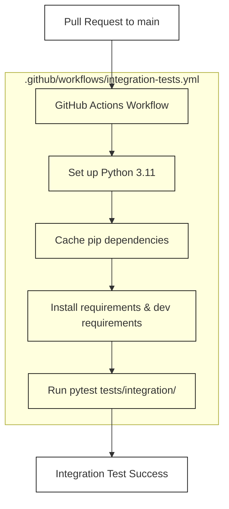
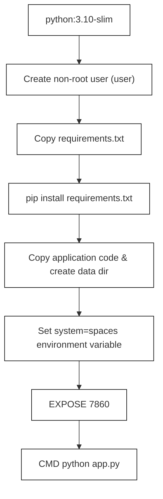

<!-- source: DeepWiki mcp.deepwiki.com · repo allenai/asta-bench-leaderboard · page 5 Testing, CI & Deployment · fetched 2026-11-09 -->

# Testing, CI & Deployment

Relevant source files

The following files were used as context for generating this wiki page:

- [.gitattributes](.gitattributes)
- [.github/workflows/integration-tests.yml](.github/workflows/integration-tests.yml)
- [.gitignore](.gitignore)
- [Dockerfile](Dockerfile)
- [README.md](README.md)

## Purpose and Scope

The **Testing, CI & Deployment** page covers the automated verification pipelines, containerization standards, and release processes used to maintain and deploy the AstaBench leaderboard. Ensuring reliability across both internal and public Hugging Face Spaces requires a robust test suite, automated GitHub Actions workflows, reproducible Docker builds, and managed Git remote pushes. 

This is a parent page providing a high-level overview of the testing infrastructure, continuous integration (CI) pipelines, and deployment protocols. For detailed implementation specifics, see the child pages:
- [Test Suite](#5.1)
- [CI & Containerized Deployment](#5.2)

---

## 5.1 Test Suite

The test suite ensures the correctness of data transformations, evaluation metric precision, Pareto frontier calculations, and the submission validation pipeline. Tests are split into unit tests targeting isolated components and integration tests verifying end-to-end functionality such as tarball processing and dataset ingestion.

The testing environment relies on fixtures and path configurations defined in `conftest.py`, ensuring that environment variables like `IS_INTERNAL` and local data directories are properly mocked or initialized. Git LFS is utilized to track large binary fixtures, such as sample submission archives [`.gitattributes:1-1]().

For detailed information on fixtures, unit tests, and integration testing logic, see [Test Suite](#5.1).

Sources:
- [ .gitattributes:1-2]()
- [README.md:1-56]()

---

## 5.2 CI & Containerized Deployment

Continuous integration and deployment bridge local development with production Hugging Face Spaces. The pipeline is orchestrated via GitHub Actions and packaged using a standardized `Dockerfile`.

### GitHub Actions Workflow

The integration test workflow triggers automatically on pull requests targeting the `main` branch [.github/workflows/integration-tests.yml:1-6](). It provisions a Python environment, caches pip dependencies, installs both production and development requirements, and executes the integration test suite under a controlled environment [ .github/workflows/integration-tests.yml:15-45]().

*Figure 5.1: The GitHub Actions CI pipeline executing integration tests on pull requests.*

Sources:
- [.github/workflows/integration-tests.yml:1-44]()

### Containerized Deployment

The application runs inside a containerized environment suitable for Hugging Face Spaces, utilizing Python 3.10 slim as a base image [Dockerfile:1-1](). To comply with security policies, the container creates a non-root user (`user`) and assigns permissions to the working directories [Dockerfile:5-17](). 

*Figure 5.2: Docker image build sequence for Hugging Face Spaces deployment.*

Sources:
- [Dockerfile:1-29]()

### Hugging Face Release Process

The repository manages two distinct Hugging Face Spaces remotes corresponding to the internal and public leaderboards [README.md:31-36](). Deployments are performed by pushing the `main` branch to the respective Hugging Face remote repositories once changes have been merged [README.md:37-56]().

For detailed configuration of GitHub Actions secrets, Docker build steps, and remote management, see [CI & Containerized Deployment](#5.2).

Sources:
- [README.md:1-56]()
- [Dockerfile:1-29]()
- [.github/workflows/integration-tests.yml:1-44]()

---

