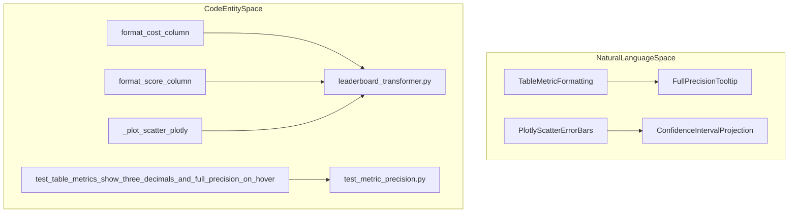
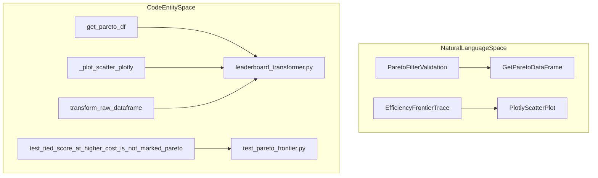
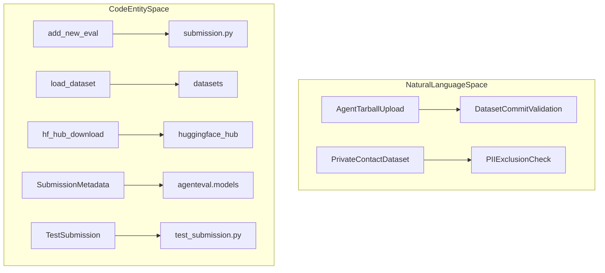

<!-- source: DeepWiki mcp.deepwiki.com · repo allenai/asta-bench-leaderboard · page 5.1 Test Suite · fetched 2026-11-09 -->

# Test Suite

Relevant source files

The following files were used as context for generating this wiki page:

- [conftest.py](conftest.py)
- [requirements.in](requirements.in)
- [requirements.txt](requirements.txt)
- [tests/integration/test-submission.tar.gz](tests/integration/test-submission.tar.gz)
- [tests/integration/test_metric_precision.py](tests/integration/test_metric_precision.py)
- [tests/integration/test_pareto_frontier.py](tests/integration/test_pareto_frontier.py)
- [tests/integration/test_submission.py](tests/integration/test_submission.py)

## Purpose and Scope
This page covers the architecture, configuration, and implementation details of the test suite for the `asta-bench-leaderboard` repository. It details path configuration via `conftest.py`, metric precision and formatting tests, Pareto frontier efficiency logic validations, and end-to-end integration testing for agent submissions against HuggingFace datasets.

---

## 1. Path Setup & Pytest Configuration (`conftest.py`)
Because the application uses a flat module layout rather than an installed package, top-level modules like `aliases`, `config`, and `submission` sit directly at the repository root. When Continuous Integration (CI) or local environments execute `pytest tests/integration/`, the console script invocation does not automatically append the current working directory to `sys.path`. 

The presence of `conftest.py` at the root directory ensures that `pytest` treats the repository root as the rootdir and prepends it to `sys.path` using the default import mode `[conftest.py:1-6]()`.

Sources: `[conftest.py:1-6]()`

---

## 2. Metric Precision & Formatting Tests (`test_metric_precision.py`)
The module `tests/integration/test_metric_precision.py` verifies that formatting functions preserve high-precision decimal values for tooltips and charts while rendering user-friendly rounded strings in UI tables.

### Key Test Cases
- **Table Metrics Display & Tooltips**: `test_table_metrics_show_three_decimals_and_full_precision_on_hover` calls `format_cost_column` and `format_score_column` from `leaderboard_transformer.py` to confirm that table cells display 3 decimal places (e.g., `>$0.037`) while embedding full-precision values and 95% confidence intervals inside HTML `data-tooltip` attributes (`[tests/integration/test_metric_precision.py:16-35]()`).
- **Zero vs Missing Scores**: `test_zero_score_keeps_tooltip_but_missing_score_does_not` validates that a score of `0.0` retains its confidence interval tooltip, whereas `None` values render an empty state without tooltips (`[tests/integration/test_metric_precision.py:37-51]()`).
- **Plotly Scatter Integration**: `test_benchmark_plot_exposes_precision_and_confidence_intervals` and related tests invoke `_plot_scatter_plotly` to verify that confidence intervals (`x_ci`, `y_ci`) populate Plotly error bars (`error_x`, `error_y`) and hover templates with exact floating-point precision (`[tests/integration/test_metric_precision.py:53-117]()`).

Sources: `[tests/integration/test_metric_precision.py:1-117]()`

---

## 3. Pareto Frontier & Efficiency Tests (`test_pareto_frontier.py`)
The suite `tests/integration/test_pareto_frontier.py` ensures that efficiency frontier computations correctly identify dominated agents while handling ties, identical coordinates, and display rounding.

### Key Test Cases
- **Tied Scores at Higher Cost**: `test_tied_score_at_higher_cost_is_not_marked_pareto` asserts that if two agents achieve identical scores, the one with the higher cost is excluded from `get_pareto_df` output and omitted from the `Efficiency Frontier` Plotly trace (`[tests/integration/test_pareto_frontier.py:49-66]()`).
- **Identical Coordinates & Dominated Lookalikes**: `test_points_equal_on_both_axes_are_both_kept` and `test_equal_cost_lower_score_is_dropped_on_frontier_line` verify that co-optimal entries (identical on both cost and score axes) both persist on the frontier, while strictly worse entries at matching costs are filtered out (`[tests/integration/test_pareto_frontier.py:95-112]()`).
- **Raw Precision vs Display Rounding**: `test_display_rounding_does_not_change_frontier_membership` ensures that raw floating-point values (e.g., `0.85331` vs `0.85330`) are compared at full precision prior to table rendering (`[tests/integration/test_pareto_frontier.py:114-140]()`).

Sources: `[tests/integration/test_pareto_frontier.py:1-140]()`

---

## 4. Submission Pipeline Integration Tests (`test_submission.py`)
The integration test `tests/integration/test_submission.py` performs an end-to-end verification of the agent submission lifecycle using a test tarball (`tests/integration/test-submission.tar.gz`) `[tests/integration/test-submission.tar.gz:1-3]()`.

### Test Execution Flow
1. **Environment Validation**: The test verifies that `IS_INTERNAL` is set to `True` and `CONFIG_NAME` is configured to `continuous-integration` `[tests/integration/test_submission.py:19-26]()`.
2. **Submission Mocking & Execution**: Rate-limiting checks (`_is_hf_acct_too_new`, `_is_last_submission_too_recent`) are bypassed via `mocker`. `add_new_eval` is invoked with sample metadata, a test tarball stream, and a simulated `gradio.OAuthProfile` `[tests/integration/test_submission.py:27-56]()`.
3. **Modal & Status Assertions**: Confirms success message returns empty error modals and active success modal indicators `[tests/integration/test_submission.py:58-62]()`.
4. **Dataset & PII Verification**:
   - Queries the private contact dataset via `load_dataset` to locate the unique agent description record `[tests/integration/test_submission.py:64-71]()`.
   - Inspects HuggingFace dataset commits on `SUBMISSION_DATASET` (`allenai/asta-bench-internal-submissions`) to confirm dataset URL matching `[tests/integration/test_submission.py:73-82]()`.
   - Validates that `eval_config.json`, task result files, and generated `submission.json` exist within the repo siblings `[tests/integration/test_submission.py:84-92]()`.
   - Downloads `submission.json` via `hf_hub_download` and asserts that sensitive PII (such as user email) is stored exclusively in the private contact dataset while remaining absent from the public submission metadata model `[tests/integration/test_submission.py:93-110]()`.

Sources: `[tests/integration/test_submission.py:1-111]`, `[tests/integration/test-submission.tar.gz:1-3]()`

---

