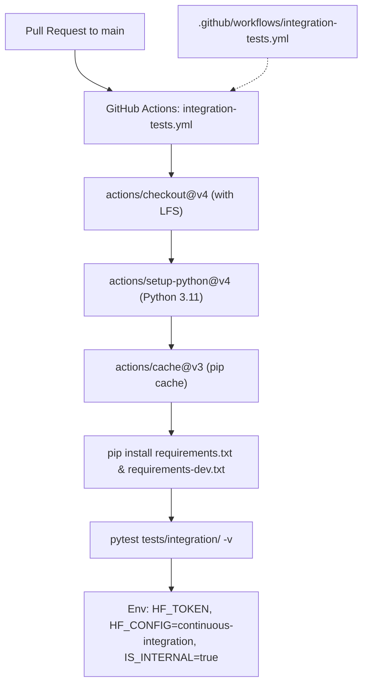
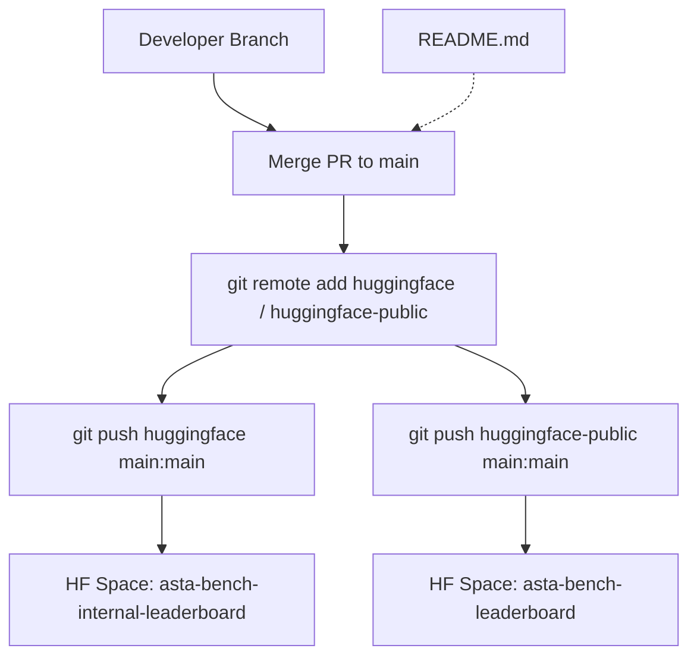

<!-- source: DeepWiki mcp.deepwiki.com · repo allenai/asta-bench-leaderboard · page 5.2 CI & Containerized Deployment · fetched 2026-11-09 -->

# CI & Containerized Deployment

<details>
<summary>Relevant source files</summary>

The following files were used as context for generating this wiki page:

- [.gitattributes](.gitattributes)
- [.github/workflows/integration-tests.yml](.github/workflows/integration-tests.yml)
- [.gitignore](.gitignore)
- [Dockerfile](Dockerfile)
- [README.md](README.md)

</details>


This page covers the continuous integration (CI) workflow, containerization details via Docker, and the release process for deploying the AstaBench leaderboard to Hugging Face Spaces.

## Purpose and Scope

The CI and containerized deployment infrastructure ensures that code changes are automatically validated against integration tests and that the application can be cleanly packaged and deployed to Hugging Face Spaces (both internal and public variants). 

---

## 1. GitHub Actions Integration Tests Workflow

The CI pipeline runs on every pull request targeting the `main` branch. It executes integration tests using pytest, utilizing GitHub Actions caching for Python dependencies and checking out Git LFS assets required for submission tests.

### Workflow Configuration

The workflow is defined in `.github/workflows/integration-tests.yml`:
- **Triggers**: Pull requests to `main` (`.github/workflows/integration-tests.yml:3-5`)
- **Runner**: `ubuntu-latest` inside the `testing` environment (`.github/workflows/integration-tests.yml:8-12`)
- **Python Version**: `3.11` (`.github/workflows/integration-tests.yml:19-22`)
- **Caching**: Caches `~pip` based on `requirements*.txt` hashes (`.github/workflows/integration-tests.yml:24-30`)
- **Execution**: Installs production and development requirements, then invokes `pytest tests/integration/` with `IS_INTERNAL=true` and `HF_CONFIG=continuous-integration` (`.github/workflows/integration-tests.yml:32-45`).

### CI Data Flow Diagram


Sources: `.github/workflows/integration-tests.yml:1-45`

---

## 2. Containerized Deployment (Dockerfile)

The leaderboard is packaged as a container image using Docker for deployment on Hugging Face Spaces (`sdk: docker`). 

### Dockerfile Implementation

The `Dockerfile` builds a lightweight Python 3.10 image, configures a non-root user (`user`), installs dependencies, copies the application source code, and exposes port `7860` for Gradio.

```mermaid
graph TD
    Base["FROM python:3.10-slim"] --> User["RUN useradd -m -u 1000 user"]
    User --> WorkDir["WORKDIR /app"]
    WorkDir --> CopyReq["COPY requirements.txt"]
    CopyReq --> Install["RUN pip install --no-cache-dir -r requirements.txt"]
    Install --> CopyApp["COPY . ."]
    CopyApp --> DataDir["RUN mkdir -p /home/user/data && chown user:user"]
    DataDir --> Env["ENV system=spaces"]
    Env --> SwitchUser["USER user"]
    SwitchUser --> Expose["EXPOSE 7860"]
    Expose --> Cmd["CMD [\"python\", \"app.py\"]"]

    sub5.2_docker["Dockerfile"] -.-> Base
```
Sources: [`Dockerfile:1-30`]()

---

## 3. Hugging Face Spaces Remotes and Release Process

The repository manages deployments to two separate Hugging Face Spaces:
- **Internal Leaderboard Space**: `https://huggingface.co/spaces/allenai/asta-bench-internal-leaderboard` [`README.md:33`]()
- **Public Leaderboard Space**: `https://huggingface.co/spaces/allenai/asta-bench-leaderboard` [`README.md:34`]()

### Release Process Workflow


Sources: [`README.md:31-57`]()

### Remote Setup Commands

Before publishing for the first time, configure the respective Git remotes:
```bash
git remote add huggingface https://huggingface.co/spaces/allenai/asta-bench-internal-leaderboard
git remote add huggingface-public https://huggingface.co/spaces/allenai/asta-bench-leaderboard
```
[`README.md:43-44`]()

Verify remotes:
```bash
git remote -v
```
[`README.md:49-49`]()

Push updates from `main`:
```bash
git push huggingface main:main   
git push huggingface-public main:main
```
[`README.md:54-55`]()

Sources: [`README.md:31-57`]()

---

