# Page: Overview

# Overview

<details>
<summary>Relevant source files</summary>

The following files were used as context for generating this wiki page:

- [.gitignore](.gitignore)
- [Dockerfile](Dockerfile)
- [README.md](README.md)
- [about.py](about.py)
- [app.py](app.py)
- [assets/favicon/favicon.ico](assets/favicon/favicon.ico)

</details>


## 1. Introduction and Purpose

The AstaBench leaderboard application is a web-based evaluation platform designed to assess and rank AI scientific agents across multiple dimensions of research capability [about.py:4-12]. Built using the [Gradio](https://gradio.app/) framework and hosted via Hugging Face Spaces [README.md:31-34], the application aggregates evaluation runs, computes macro-averaged scores and costs, and provides interactive visualizations such as Pareto frontier plots and granular benchmark detail cards.

The codebase serves two primary Hugging Face deployments (`asta-bench-internal-leaderboard` and `asta-bench-leaderboard`) [README.md:31-34], distinguishing between internal datasets and public submissions through environment configuration [README.md:21-24].

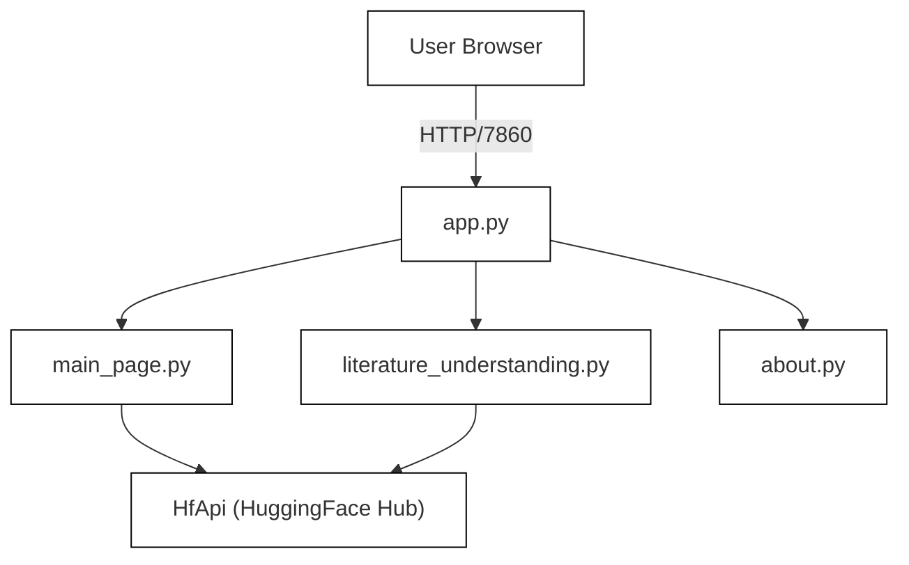
*Diagram 1: High-Level Architecture & Component Assembly mapping UI modules to entry points in `app.py`.*

Sources: `app.py:1-21`, `README.md:31-34`, `about.py:4-14`

---

## 2. Gradio and HuggingFace Architecture

The application is orchestrated by [app.py](), which initializes logging, sets up a custom design theme [app.py:141-168], and injects client-side JavaScript enhancements (such as smooth scrolling, tooltip management, and modal redirect observers) [app.py:25-140]. 

Routing and page assembly are handled by importing various page builder modules into [app.py]():
- Main leaderboard [app.py:14()]
- Category-specific evaluations (Literature Understanding [app.py:15()], Code & Execution [app.py:16()], Data Analysis [app.py:17()], End-to-End Discovery [app.py:18()])
- Submission interface [app.py:19()]
- About page [app.py:20()]

The application interacts with the Hugging Face Hub using `HfApi` [app.py:10-22] to fetch dataset results dynamically based on configuration flags like `IS_INTERNAL` [README.md:21-24].

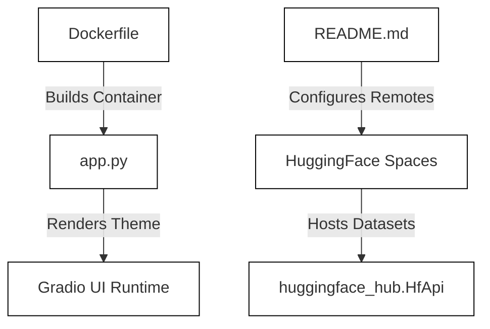
*Diagram 2: Deployment and Hosting Flow linking container definitions to HuggingFace infrastructure [Dockerfile:1-30, README.md:31-56, app.py:10-22].*

Sources: `app.py:1-22`, `Dockerfile:1-30`, `README.md:31-56`

---

## 3. Wiki Map

This technical wiki is structured into the following sections:
- **1. Overview** (Current page): Architecture, goals, and high-level structure.
- **1.1. Getting Started & Local Development**: Detailed instructions for local execution, environment variables (`IS_INTERNAL`), and dependency management. For details, see [Getting Started & Local Development](#1.1).
- **1.2. Benchmark Concepts & Scoring**: Deep dive into AstaBench categories, macro-averaging, cost calculations, Pareto frontiers, and openness/tooling taxonomies. For details, see [Benchmark Concepts & Scoring](#1.2).
- **2. Application Structure & Routing**: Routing mechanics, themes, and page builders.
- **3. Leaderboard Data & Rendering**: Data transformation pipelines and UI plotting components.
- **4. Submission System**: Agent ingestion, rate-limiting, and validation workflows.
- **5. Testing, CI & Deployment**: Test suite layout, Docker builds, and deployment workflows.
- **6. Glossary**: Definitions of core domain and codebase terms.

Sources: `app.py:1-283`, `about.py:4-114`

---

## 4. Sub-Topics Overview

### Getting Started & Local Development
Running the app locally requires configuring the `IS_INTERNAL` environment variable and executing the primary application entry point on port `7860` [README.md:21-29]. Containerized deployments are managed via a slim Python 3.10 Docker image [Dockerfile:1-30]. For further information on local setup, see [Getting Started & Local Development](#1.1).

Sources: `README.md:17-29`, `Dockerfile:1-30`

### Benchmark Concepts & Scoring
AstaBench evaluates agents across 11 benchmarks containing over 2,400 problems categorized into four key domains: Literature Understanding, Code & Execution, Data Analysis, and End-to-End Discovery [about.py:35-44]. Scores are aggregated using macro-averaging, while efficiency is tracked via cost-per-task metrics [about.py:63-71]. For details, see [Benchmark Concepts & Scoring](#1.2).

Sources: `about.py:32-74`

---

# Page: Getting Started & Local Development

# Getting Started & Local Development

<details>
<summary>Relevant source files</summary>

The following files were used as context for generating this wiki page:

- [.gitignore](.gitignore)
- [Dockerfile](Dockerfile)
- [README.md](README.md)
- [conftest.py](conftest.py)
- [requirements-dev.txt](requirements-dev.txt)
- [requirements.in](requirements.in)
- [requirements.txt](requirements.txt)

</details>


This page covers the core setup required to run the AstaBench leaderboard application locally, manage dependencies using `uv` and pinned requirements manifests, understand the containerized deployment via Docker, and navigate the repository structure.

---

## Environment Configuration & Local Execution

To execute the AstaBench leaderboard server on a local machine, you must configure the internal dataset toggle and run the top-level entry point `app.py`. 

The leaderboard relies on Hugging Face Datasets to load and query evaluation results [README.md:18-19](). Depending on whether the environment is configured for internal evaluation metrics or public release, the `IS_INTERNAL` environment variable must be exported before launching the server [README.md:21-24]().

```bash
export IS_INTERNAL=true
python app.py
```

Once initialized, the Gradio server binds to port `7860` [README.md:11]() and becomes accessible at `http://localhost:7860` [README.md:29]().

### Local Execution Architecture

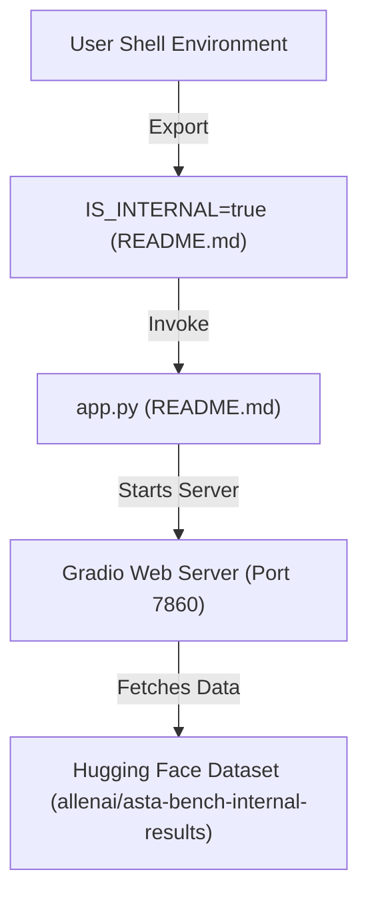

Sources: [README.md:18-29]()

---

## Dependency Management with `uv` and Requirements Files

Dependency management is split between a human-maintainable constraint specification (`requirements.in`) and a locked, fully resolved artifact (`requirements.txt`). 

### Direct vs. Locked Dependencies
* `requirements.in`: Contains high-level direct dependencies with version constraints [requirements.in:1-32](). It explicitly decouples `agent-eval` and `inspect_ai` to align scorers and pins `gradio[oauth]` to support Hugging Face OAuth flows [requirements.in:5-18]().
* `requirements.txt`: Generated via `uv` to ensure reproducible builds across local machines, continuous integration, and production containers [requirements.txt:1-3]().

To regenerate `requirements.txt` from `requirements.in` using `uv`, execute the compilation command specified in the lockfile header:

```bash
uv pip compile requirements.in --python-version 3.10 --no-annotate --no-header -o requirements.txt
```

Development dependencies—such as formatting and testing tools (`black`, `isort`, `pytest`, `pytest-mock`)—are cataloged separately in `requirements-dev.txt` [requirements-dev.txt:1-4]().

Sources: [requirements.in:1-32](), [requirements.txt:1-3](), [requirements-dev.txt:1-4]()

---

## Repository Structure & Containerization

The repository is structured around a standard single-container Gradio web application layout. Container deployment is handled via a multi-stage-friendly `Dockerfile` built on Python 3.10 slim [Dockerfile:1-29]().

### Container Build Flow & Test Configuration
The `Dockerfile` performs the following steps:
1. Installs system requirements and sets up a non-root user `user` with UID `1000` [Dockerfile:1-5]().
2. Copies and installs pinned dependencies from `requirements.txt` [Dockerfile:9-13]().
3. Copies the local repository codebase into `/app` and provisions a data cache directory at `/home/user/data` [Dockerfile:15-17]().
4. Configures the environment variable `system=spaces` to instruct the app to write data to the designated home directory [Dockerfile:19-20]().
5. Exposes port `7860` and starts the application via `CMD ["python", "app.py"]` [Dockerfile:25-29]().

For testing, the presence of `conftest.py` at the repository root guarantees that pytest automatically prepends the root directory to `sys.path` [conftest.py:1-6](). This ensures that integration and unit tests located under `tests/` can successfully import top-level root modules (`config`, `app`, `submission`, etc.) when executed via console scripts [conftest.py:1-6]().

### Container & Test Path Architecture

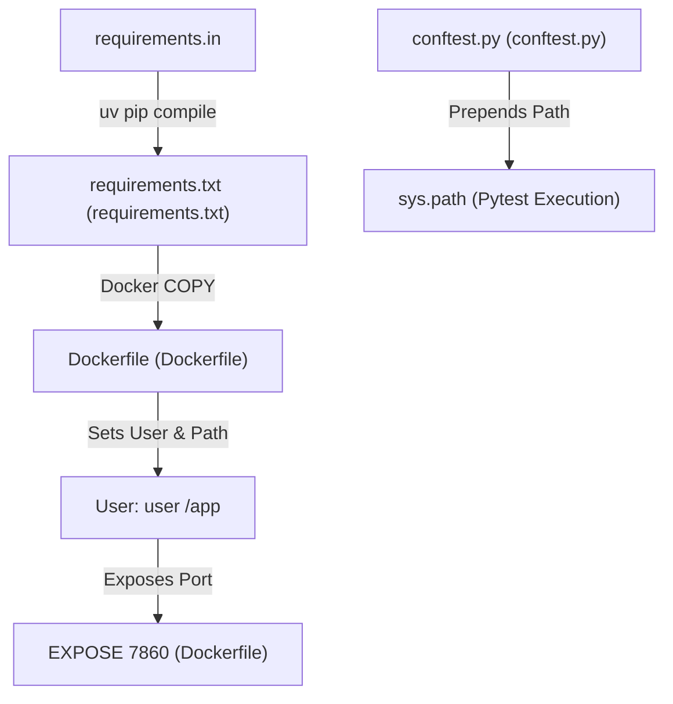

Sources: [Dockerfile:1-29](), [conftest.py:1-6]()

---

## Hugging Face Spaces Integration & Remotes

The codebase acts as the single source of truth for two distinct Hugging Face Spaces [README.md:31-34]():
* Internal Leaderboard: `https://huggingface.co/spaces/allenai/asta-bench-internal-leaderboard` [README.md:33]()
* Public Leaderboard: `https://huggingface.co/spaces/allenai/asta-bench-leaderboard` [README.md:34]()

To configure local git remotes for deployment, register the Hugging Face space repositories [README.md:40-44]():

```bash
git remote add huggingface https://huggingface.co/spaces/allenai/asta-bench-internal-leaderboard
git remote add huggingface-public https://huggingface.co/spaces/allenai/asta-bench-leaderboard
```

Changes merged into the `main` branch can then be synchronized with the remote spaces [README.md:38](), [README.md:51-56]():

```bash
git push huggingface main:main
git push huggingface-public main:main
```

Sources: [README.md:31-56]()

---

# Page: Benchmark Concepts & Scoring

# Benchmark Concepts & Scoring

<details>
<summary>Relevant source files</summary>

The following files were used as context for generating this wiki page:

- [about.py](about.py)
- [aliases.py](aliases.py)
- [content.py](content.py)

</details>


## Purpose & Scope
This page details the conceptual framework, structural organization, and scoring mechanics of AstaBench. It covers the four core categories, the 11 integrated benchmarks comprising over 2,400 problems, aggregation rules for scores and costs, coverage metrics, the Pareto frontier methodology, and the openness/tooling taxonomies used to classify evaluated agents.

Sources: `about.py:32-114`, `content.py:18-35`

---

## 1. Categories & Benchmark Suite
AstaBench organizes evaluation into four core categories, spanning a total of 11 benchmarks and over 2,400 problems (`about.py:37-44`):

1. **Literature Understanding**: Evaluates paper retrieval, citation quality assessment, and information extraction (`content.py:42-49`). Includes benchmarks such as `PaperFindingBench`, `LitQA2-FullText-Search`, and `ScholarQA-CS2` (`content.py:101-110`).
2. **Code & Execution**: Assesses coding, modification, and execution in realistic research environments requiring file manipulation and tool usage (`content.py:50-57`).
3. **Data Analysis**: Tests data-driven hypothesis generation and structured dataset analysis, anchored by `DiscoveryBench` (`content.py:58-63`).
4. **End-to-End Discovery**: Evaluates complete automated scientific discovery (ASD) workflows from task description to experiment design, execution, and report writing (`content.py:64-69`).

```mermaid
graph TD
    A["AstaBenchFramework"] --> B["LiteratureUnderstanding"]
    A --> C["CodeAndExecution"]
    A --> D["DataAnalysis"]
    A --> E["EndToEndDiscovery"]
    
    B --> B1["PaperFindingBench"]
    B --> B2["LitQA2FullTextSearch"]
    B --> B3["ScholarQACS2"]
    
    C --> C1["SUPER"]
    C --> C2["COREBench"]
    C --> C3["DS1000"]
    
    D --> D1["DiscoveryBench"]
    
    E --> E1["EndToEndBenchmarks"]

    sub: "Code Entity Space Mapping"
    class A,B,C,D,E,B1,B2,B3,C1,C2,C3,D1,E1 codeEntity;
```
*Diagram 1: Mapping high-level AstaBench categories and benchmarks to their corresponding structural groupings.*

Sources: `about.py:32-52`, `content.py:42-69`, `content.py:101-110`

---

## 2. Scoring, Cost & Coverage Aggregation
AstaBench enforces a hierarchical aggregation model to combine metrics across heterogeneous benchmarks without introducing bias toward benchmarks with larger problem counts (`content.py:20-30`, `about.py:57-74`):

- **Scores**: Computed as an average per problem, aggregated upward using macro-averaging. The overall score is a macro-average of the four category-level average scores, ensuring each category contributes equally regardless of benchmark count (`content.py:23-26`, `about.py:62-63`). Partial completions are fully factored in (`about.py:87-90`).
- **Cost**: Measured in USD per task. The overall cost is a macro-average of the agent's cost per problem across categories, equally weighted per category, excluding benchmarks lacking cost tracking (`content.py:27-29`, `about.py:64`).
- **Coverage**: Tracked at two levels—category coverage ($X/4$) on the main leaderboard, and benchmark coverage ($X/Y$) on category pages (`about.py:104-107`). Incomplete coverage is explicitly flagged (`about.py:107`).

```mermaid
graph TD
    P["ProblemLevelScores"] --> B["BenchmarkAverage"]
    B --> C["CategoryMacroAverage"]
    C --> O["OverallScoreMacroAverage"]
    
    T["TaskCostsUSD"] --> CB["CategoryCostAverage"]
    CB --> OC["OverallCostMacroAverage"]

    sub: "Data Flow Pipeline"
    class P,B,C,O,T,CB,OC transformerNode;
```
*Diagram 2: Data flow pipeline for hierarchical score and cost aggregation.*

Sources: `content.py:18-35`, `about.py:57-114`

---

## 3. Pareto Frontier & Efficiency
To evaluate the tradeoff between performance and compute expense, AstaBench computes a Pareto frontier over the score-cost space (`about.py:96`):
- **Pareto Optimality**: An agent is Pareto optimal if no other agent achieves higher performance at an equal or lower cost (`content.py:39-41`).
- **Visual Distinction**: Pareto optimal agents are highlighted with green names on the leaderboards (`content.py:40-41`).
- **Missing Cost Handling**: Agents lacking cost data are excluded from cost averages and displayed past a vertical divider line on the right side of scatter plots (`content.py:36-38`, `about.py:95-96`).

Sources: `content.py:36-41`, `about.py:92-97`

---

## 4. Openness and Tooling Taxonomies
Agents submitted to AstaBench are classified according to standardized openness and tool usage taxonomies defined in `aliases.py`:

| Taxonomy Type | Canonical Constant | UI / Alias Representation | Description |
| :--- | :--- | :--- | :--- |
| **Openness** | `CANONICAL_OPENNESS_OPEN_SOURCE_OPEN_WEIGHTS` | `"Open Source + Open Weights"` | Fully open code and model weights (`aliases.py:2-13`) |
| **Openness** | `CANONICAL_OPENNESS_OPEN_SOURCE_CLOSED_WEIGHTS` | `"Open Source"` | Open source code with closed model weights (`aliases.py:3-14`) |
| **Openness** | `CANONICAL_OPENNESS_CLOSED_API_AVAILABLE` | `"API Available"` | Closed source model accessed via API (`aliases.py:4-15`) |
| **Openness** | `CANONICAL_OPENNESS_CLOSED_UI_ONLY` | `"Closed"` | Completely proprietary UI-only service (`aliases.py:5-16`) |
| **Tool Usage** | `CANONICAL_TOOL_USAGE_STANDARD` | `""` (Standard) | Standard tool usage configuration (`aliases.py:6-20`) |
| **Tool Usage** | `CANONICAL_TOOL_USAGE_CUSTOM_INTERFACE` | `"Custom with Standard Search"` | Custom interface with standard search (`aliases.py:7-21`) |
| **Tool Usage** | `CANONICAL_TOOL_USAGE_FULLY_CUSTOM` | `"Fully Custom"` | Fully custom tool environment (`aliases.py:8-22`) |

Sources: `aliases.py:1-24`

---

# Page: Application Structure & Routing

# Application Structure & Routing

<details>
<summary>Relevant source files</summary>

The following files were used as context for generating this wiki page:

- [app.py](app.py)
- [assets/favicon/favicon.ico](assets/favicon/favicon.ico)

</details>


This page details the structural organization of the AstaBench leaderboard application. It outlines how `app.py` initializes the Gradio instance, registers global client-side JavaScript scripts, configures the visual design system (`theme`), and assembles the application routes by delegating to specialized page builders [app.py:1-168](). 

As a parent page, this section provides a high-level architectural overview. For granular implementation details on specific views, refer to the child pages:
- Main Page: [Main Page (Overall Leaderboard)](#2.1)
- Category Pages: [Category Pages](#2.2)
- About & Static Content: [About Page & Static Content](#2.3)

---

## 2. Application Structure & Routing Overview

The entry point for the web application is `app.py`, which configures logging, imports necessary libraries such as `gradio`, `apscheduler`, and `huggingface_hub`, and pulls in page-building modules [app.py:2-20](). 

### Core Responsibilities of `app.py`:
1. **JavaScript Injections**: Defines custom client-side scripts (`scroll_script`, `redirect_script`, `tooltip_script`, and `redirect_submission_on_close_script`) to handle smooth page scrolling, URL path redirection (e.g., redirecting `/` to `/home`), dynamic smart tooltip positioning, and post-submission modal navigation [app.py:25-140]().
2. **Theme Configuration**: Implements a custom `gr.themes.Base` theme defining primary, secondary, and neutral color hues alongside custom Google Fonts (`Manrope` and `Roboto Mono`) and dark/light mode surface fills [app.py:142-168]().
3. **Route & Component Assembly**: Imports builder functions from across the codebase (`build_main_page`, `build_lit_page`, `build_c_and_e_page`, `build_data_analysis_page`, `build_e2e_page`, `build_submission_page`, and `build_about_page`) to structure the multi-tab or multi-page layout [app.py:14-20]().

Diagram: Application Assembly and Routing Architecture
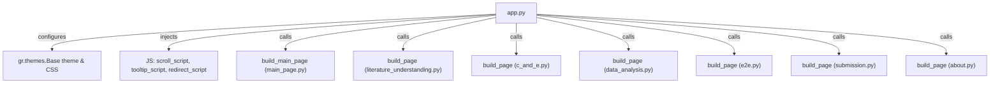
Sources: [app.py:1-168]()

---

## 2.1. Main Page (Overall Leaderboard)

The primary leaderboard view is structured by `main_page.py`, which handles the main performance tables, test and validation data splits, and caching layers for performance optimization. 

For a deep dive into the layout, filtering logic, and caching strategies for viewers and tag maps, see [Main Page (Overall Leaderboard)](#2.1).

Sources: [app.py:14]()

---

## 2.2. Category Pages

Specific benchmark domains are compartmentalized into distinct category modules (`literature_understanding.py`, `c_and_e.py`, `data_analysis.py`, and `e2e.py`) using a shared builder pattern implemented in `category_page_builder.py`.

For details on how these thin category wrappers construct domain-specific views, see [Category Pages](#2.2).

Sources: [app.py:15-18]()

---

## 2.3. About Page & Static Content

Informational sections, system documentation, and visual legends are governed by `about.py` and text constants defined in `content.py`. These modules control structural anchors, typography, and styling constants.

For information regarding static copy, markdown sections, and custom CSS styling, see [About Page & Static Content](#2.3).

Sources: [app.py:13,20]()

---

## Architecture to Code Mapping

The following diagram bridges the high-level application layout to the specific code entities responsible for routing and page building across the repository.

Diagram: Natural Language to Code Entity Mapping for Application Structure
```mermaid
graph TD
    NL_App[""App Entry Point & Global Setup""] --> Code_App[""app.py""]
    NL_Theme[""Design System & Typography""] --> Code_Theme[""app.py: gr.themes.Base""]
    NL_Scripts[""Client-Side Behaviors""] --> Code_Scripts[""app.py: tooltip_script & scroll_script""]
    
    NL_Main[""Overall Leaderboard Tab""] --> Code_Main[""main_page.py: build_page()""]
    NL_Cat[""Domain Category Builders""] --> Code_Cat[""category_page_builder.py""]
    NL_About[""Documentation & Static Content""] --> Code_About[""about.py: build_page()""]
    NL_Content[""Text Constants & CSS""] --> Code_Content[""content.py: css""]
```
Sources: [app.py:1-168]()

---

# Page: Main Page (Overall Leaderboard)

# Main Page (Overall Leaderboard)

<details>
<summary>Relevant source files</summary>

The following files were used as context for generating this wiki page:

- [assets/overall.svg](assets/overall.svg)
- [main_page.py](main_page.py)

</details>


The purpose of `main_page.py` is to assemble the primary landing page and aggregate leaderboard for the AstaBench application. It provides a structured layout featuring an introductory overview, a system diagram asset, and tabbed interfaces separating the `test` and `validation` evaluation splits. It interacts directly with data loading and UI generation functions imported from `ui_components.py` and content definitions from `content.py`.

---

## Page Layout & Component Assembly

The landing page is constructed via the `build_page()` function [main_page.py:18]. The structural composition divides the viewport into an introductory header row followed by the aggregate leaderboard component wrapped in Gradio tabs.

### Introductory Row
The top of the page uses a `gr.Row` with `elem_id="intro-row"` [main_page.py:19] split into two equal columns:
1. **Left Column (`gr.Column(scale=1)`)**: Renders the introductory markup text via `gr.HTML` using the `INTRO_PARAGRAPH` constant imported from `content.py` [main_page.py:20-21].
2. **Right Column (`gr.Column(scale=1)`)**: Embeds the overall architecture/system diagram image pointing to `assets/overall.svg` with interactive features and download buttons disabled [main_page.py:23-32].

### Header and Main Leaderboard Section
Beneath the intro section, a markdown divider separates the header. A bold aggregate header is injected using `gr.HTML` with `elem_id="main-header"` [main_page.py:35-37]:
```python
CATEGORY_NAME = "Overall"
gr.HTML(f'<h2>AstaBench {CATEGORY_Name} Leaderboard <span style="font-weight: normal; color: inherit;">(Aggregate)</span></h2>', elem_id="main-header")
```

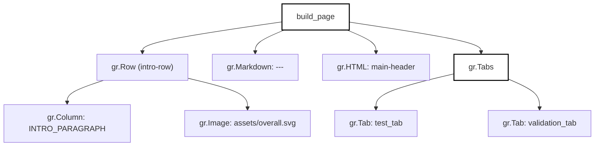
*Sources: [main_page.py:18-39]*

---

## Split Tabs: Test vs. Validation Sets

The leaderboard data is isolated into two distinct evaluation splits, managed through Gradio tabs (`gr.Tabs`) [main_page.py:39].

### 1. Test Split Tab (`test_tab`)
* Calls `get_full_leaderboard_data("test")` to retrieve the dataframe and tag map for the test set [main_page.py:41].
* Checks if `test_df` is non-empty; if data exists, renders explanatory Markdown and calls `create_leaderboard_display` with `split_name="test"` [main_page.py:42-49].
* Fallbacks to a "No data available for test split." message if empty [main_page.py:50-51].

### 2. Validation Split Tab (`validation_tab`)
* Calls `get_full_leaderboard_data("validation")` to load validation data [main_page.py:54].
* Renders descriptive text explaining that validation results are used during development [main_page.py:57].
* Invokes `create_leaderboard_display` with `split_name="validation"` [main_page.py:59-64].

### Plotly Resize Handling (`show_validation_js`)
Switching between tabs or loading hidden tabs can cause Plotly scatter plots inside the leaderboard components to collapse or misrender due to undefined container dimensions. To fix this, a pure JavaScript snippet is bound to the `validation_tab.select` event [main_page.py:73-78]:
```python
show_validation_js = """
    () => {setTimeout(() => { window.dispatchEvent(new Event('resize')) }, 0);}
    """
validation_tab.select(fn=None, inputs=None, outputs=None, js=show_validation_js)
```
This forces a window resize event asynchronously via `setTimeout` the moment the validation tab is selected, ensuring Plotly figures correctly recalculate their bounding boxes.

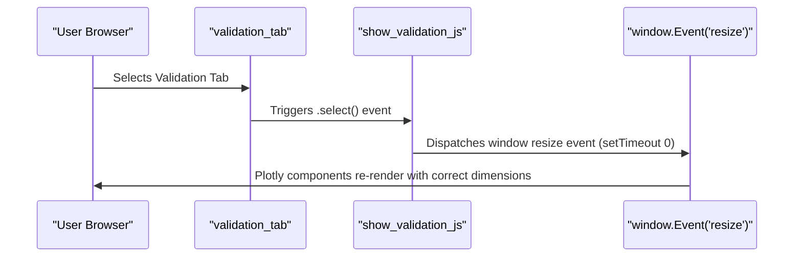
*Sources: [main_page.py:40-78]*

---

## Global Caching of Viewers and Tag Maps

Module-level state variables are declared at the top of `main_page.py` to facilitate efficient caching of leaderboard view states and taxonomy mappings across requests [main_page.py:14-16]:

```python
CACHED_VIEWERS = {}
CACHED_TAG_MAPS = {}
```

While data retrieval and caching mechanisms are heavily driven inside `ui_components.py` (via `get_full_leaderboard_data`), these dictionaries reserve namespace in `main_page.py` for holding module-scoped viewer instances and associated metadata tag maps, avoiding redundant dataframe parsing and dataset downloads from HuggingFace on repeated tab navigation.

```mermaid
graph TD
  sub-graph ["Module Scope"]
    A["CACHED_VIEWERS"]
    B["CACHED_TAG_MAPS"]
  end
  C["get_full_leaderboard_data"] -->|Stores/Fetches| A
  C -->|Stores/Fetches| B
  D["create_leaderboard_display"] --> C

  style A fill:none,stroke:#000,stroke-width:2px
  style B fill:none,stroke:#000,stroke-width:2px
  style C fill:none,stroke:#000,stroke-width:2px
```
*Sources: [main_page.py:14-16], [ui_components.py:6-6]*

---

# Page: Category Pages

# Category Pages

<details>
<summary>Relevant source files</summary>

The following files were used as context for generating this wiki page:

- [c_and_e.py](c_and_e.py)
- [category_page_builder.py](category_page_builder.py)
- [data_analysis.py](data_analysis.py)
- [e2e.py](e2e.py)
- [literature_understanding.py](literature_understanding.py)

</details>


## Purpose and Scope
This section details the implementation of category-specific leaderboard views within the AstaBench leaderboard application. Category pages render aggregated scores, split-specific data (test vs. validation), sub-navigation bars, and benchmark detail cards for each of the four core evaluation domains. The architecture relies on a centralized builder function, `build_category_page`, located in `category_page_builder.py`, which is consumed by four thin category modules.

Sources: `category_page_builder.py:1-105](), [c_and_e.py:1-9](), [e2e.py:1-8](), [data_analysis.py:1-8](), [literature_understanding.py:1-8]()

---

## Centralized Category Builder (`category_page_builder.py`)

The core layout and rendering logic for any category page is defined by `build_category_page(CATEGORY_NAME, PAGE_DESCRIPTION)` [category_page_builder.py:13-105](). This function encapsulates data fetching, layout generation, and dynamic tab management.

### Data Loading and Layout Initialization
Upon invocation, `build_category_page` immediately fetches full leaderboard datasets and tag maps for both `validation` and `test` splits using `get_full_leaderboard_data` [category_page_builder.py:15-16](). It then constructs a two-column introductory layout using Gradio layout primitives (`gr.Row`, `gr.Column`) [category_page_builder.py:17-30]().

The left column contains:
- A main HTML header reflecting the category name [category_page_builder.py:20]().
- Split-specific sub-navigation containers (`validation_nav_container` and `test_nav_container`) initialized via `create_sub_navigation_bar` [category_page_builder.py:21-25]().
- The category description markdown (`PAGE_DESCRIPTION`) [category_page_builder.py:27]().

The right column embeds a vector diagram looked up from `CATEGORY_DIAGRAM_MAP` [category_page_builder.py:30-41]():

```python
CATEGORY_DIAGRAM_MAP = {
    "Literature Understanding": "assets/literature-understanding.svg",
    "Code & Execution": "assets/code-execution.svg",
    "Data Analysis": "assets/data-analysis.svg",
    "End-to-End Discovery": "assets/end-to-end-discovery.svg",
}
```
*(Source: [category_page_builder.py:6-11]())*

### Diagram: Natural Language Space to Code Entity Space (Architecture)
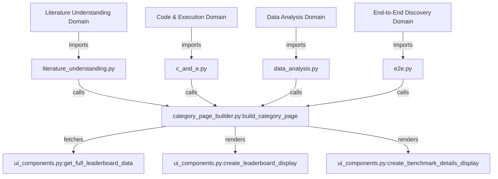
Sources: `category_page_builder.py:13-80](), [c_and_e.py:1-9](), [e2e.py:1-8](), [data_analysis.py:1-8](), [literature_understanding.py:1-8]()

---

## Split Management and Tab Interactivity

`build_category_page` sets up a Gradio `gr.Tabs()` component housing two tabs: `Results: Test Set` and `Results: Validation Set` [category_page_builder.py:43-83](). 

### Tab Select Event Handlers
To handle switching between validation and test sub-navigation bars without rebuilding the UI, raw JavaScript strings (`show_validation_js` and `show_test_js`) are bound to the `.select()` events of the respective tabs [category_page_builder.py:85-103]().

```python
show_validation_js = """
    () => {
        document.getElementById('validation_nav_container').style.display = 'block';
        document.getElementById('test_nav_container').style.display = 'none';
        setTimeout(() => { window.dispatchEvent(new Event('resize')) }, 0);
    }
    """

show_test_js = """
    () => {
        document.getElementById('validation_nav_container').style.display = 'none';
        document.getElementById('test_nav_container').style.display = 'block';
    }
    """
```
*(Source: [category_page_builder.py:85-99]())*

These JavaScript blocks toggle DOM visibility of `validation_nav_container` and `test_nav_container` and trigger a window resize event to force Plotly charts to recalculate their dimensions [category_page_builder.py:85-91]().

### Diagram: Natural Language Space to Code Entity Space (Tab Dataflow)
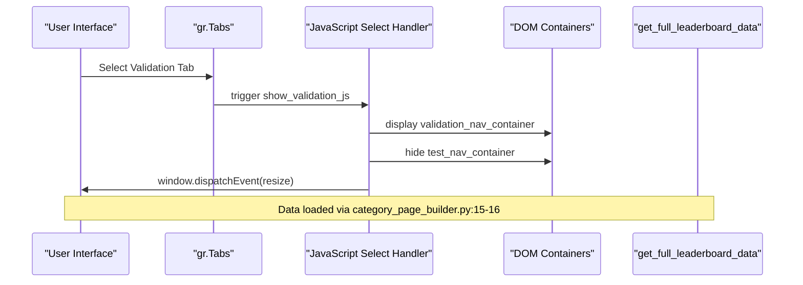
Sources: `category_page_builder.py:15-103]()`

---

## Thin Category Modules

The four application categories are instantiated through thin wrapper modules that import descriptive text constants from `content.py` and pass them alongside their respective category string into `build_category_page`.

### 1. Code & Execution (`c_and_e.py`)
Defines the `Code & Execution` category using `CODE_EXECUTION_DESCRIPTION` [c_and_e.py:1-9]().
- Function: `build_page()` [c_and_e.py:8-9]()
- Sources: `[c_and_e.py:1-9](), [content.py]()`

### 2. End-to-End Discovery (`e2e.py`)
Defines the `End-to-End Discovery` category using `DISCOVERY_DESCRIPTION` [e2e.py:1-8]().
- Function: `build_page()` [e2e.py:7-8]()
- Sources: `[e2e.py:1-8](), [content.py]()`

### 3. Data Analysis (`data_analysis.py`)
Defines the `Data Analysis` category using `DATA_ANALYSIS_DESCRIPTION` [data_analysis.py:1-8]().
- Function: `build_page()` [data_analysis.py:7-8]()
- Sources: `[data_analysis.py:1-8](), [content.py]()`

### 4. Literature Understanding (`literature_understanding.py`)
Defines the `Literature Understanding` category using `LIT_DESCRIPTION` [literature_understanding.py:1-8]().
- Function: `build_page()` [literature_understanding.py:7-8]()
- Sources: `[literature_understanding.py:1-8](), [content.py]()`

---

# Page: About Page & Static Content

# About Page & Static Content

<details>
<summary>Relevant source files</summary>

The following files were used as context for generating this wiki page:

- [about.py](about.py)
- [content.py](content.py)

</details>


## Purpose and Scope
This page details the implementation of the static content and informational views within the AstaBench leaderboard application. Specifically, it covers the layout and structure of the About page (`about.py`) and the rich text constants, URL mappings, anchor-generation utilities, and markdown helpers housed in `content.py`. These components provide users with documentation, methodological definitions, academic citations, and internal/external cross-referencing capabilities across the Gradio interface.

---

## 1. About Page Implementation (`about.py`)

The About page is constructed as a modular Gradio container component via the `build_page()` function [about.py:4-180]. It renders structured informational sections utilizing `gr.HTML` components styled with CSS classes and dividers (`gr.Markdown("---", elem_classes="divider-line")`).

The page is divided into six logical sections:
1. **About AstaBench**: Introduces the framework as an evaluation suite for scientific AI agents across research skills [about.py:6-14].
2. **Why AstaBench?**: Discusses limitations of existing benchmarks and explains the rationale behind open, reproducible scientific evaluations [about.py:17-30].
3. **What Does AstaBench Include?**: Details the scale of the benchmark suite (>2,400 problems across 11 benchmarks and four categories) with a link to the technical blog [about.py:32-53].
4. **Understanding the Leaderboards**: Explains macro-averaging, overall score/cost formulas, and category-level breakdowns [about.py:55-75].
5. **Scoring & Aggregation**: Details scoring policies, partial completions, cost calculation (USD per task), missing cost handling, and coverage metrics [about.py:77-115].
6. **Citation**: Provides the official ICLR 2026 BibTeX entry wrapped in a custom scrollable container styled via embedded `<style>` tags [about.py:117-180].

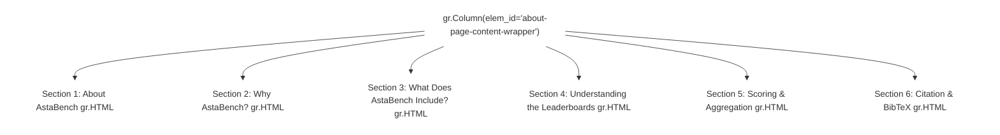

Sources: `about.py:4-180`

---

## 2. Static Content Constants & Text Generators (`content.py`)

The `content.py` module stores HTML templates, category descriptions, benchmark markdown texts, external publication URLs, and helper utilities. 

### Key Text Constants
- `TITLE`: Raw HTML header for the main space interface [content.py:16-16].
- `INTRO_PARAGRAPH`: HTML block explaining overall score (macro-average of four category averages) and overall cost calculations [content.py:18-35].
- `SCATTER_DISCLAIMER` & `PARETO_DISCLAIMER`: Explanatory text for plot confidence intervals, missing cost positioning, and Pareto-optimal green text formatting [content.py:36-41].
- `LIT_DESCRIPTION`, `CODE_EXECUTION_DESCRIPTION`, `DATA_ANALYSIS_DESCRIPTION`, `DISCOVERY_DESCRIPTION`: Category-level summaries describing problem scopes and tool usage [content.py:42-69].
- `SUBMISSION_CONFIRMATION`: Success message rendered upon agent submission [content.py:70-78].

### Semantic Scholar and Paper URLs
To provide attribution and allow users to read source papers, `content.py` defines constants for external links:
- `SCHOLAR_QA_CS_URL`, `LITQA2_URL`, `ARXIV_DIGESTABLES_URL` [content.py:81-83]
- `SUPER_URL`, `CORE_BENCH_URL`, `DS1000_URL`, `DISCOVERY_BENCH_URL` [content.py:84-87]

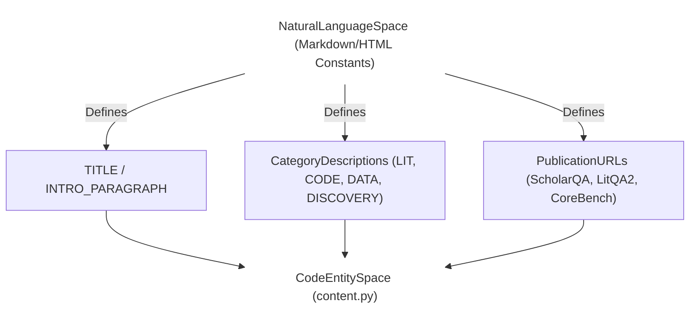

Sources: `content.py:1-88`

---

## 3. Anchor Generation and Link Helpers

To support internal navigation and rich formatting within generated markdown, `content.py` exposes programmatic utilities that replicate Gradio's internal ID allocation rules.

### `create_gradio_anchor_id`
Replicates the ID format created by Gradio's `gr.Markdown(header_links=True)` [content.py:3-13]. It lowercases text, replaces spaces with hyphens, strips non-word characters, and prefixes/suffixes strings based on validation split states:
```python
def create_gradio_anchor_id(text: str, validation) -> str:
    text = text.lower()
    text = re.sub(r'\s+', '-', text)
    text = re.sub(r'[^\w-]', '', text)
    if validation:
        return f"h-{text}-leaderboard-1"
    return f"h-{text}-leaderboard"
```
* `[content.py:3-13]()`

### Link and Description Helpers
- `external_link(url, text, is_s2_url)`: Automatically appends `?utm_source=asta_leaderboard` tracking parameters if `is_s2_url` is true, and returns an HTML anchor target with `rel="noopener noreferrer"` [content.py:90-92].
- `internal_leaderboard_link(text, validation)`: Generates internal anchor links using `create_gradio_anchor_id()` [content.py:94-96].
- `get_benchmark_description(benchmark_name, validation)`: Maps benchmark identifiers (e.g., `PaperFindingBench`, `LitQA2-FullText-Search`, `ScholarQA-CS2`) to descriptive text blocks containing interlinked benchmark references [content.py:98-110].

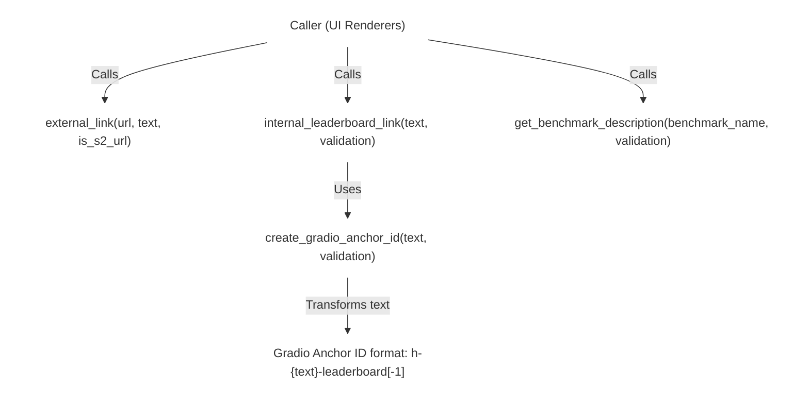

Sources: `content.py:3-110`

---

# Page: Leaderboard Data & Rendering

# Leaderboard Data & Rendering

<details>
<summary>Relevant source files</summary>

The following files were used as context for generating this wiki page:

- [leaderboard_transformer.py](leaderboard_transformer.py)
- [ui_components.py](ui_components.py)

</details>


## Purpose & Scope
This section covers the end-to-end data pipeline responsible for fetching raw evaluation results from HuggingFace datasets, transforming column names and metadata, executing Pareto frontier calculations, and rendering interactive Gradio tables, detail cards, and Plotly visualizations. 

As a parent page, this section provides a high-level overview of the data architecture. For granular implementation details, refer to the child pages:
- [Data Transformation Pipeline](#3.1)
- [UI Components & Plots](#3.2)
- [Icons, SVG Assets & Legends](#3.3)

```mermaid
Title: Data Pipeline Transformation Flow
graph TD
    RawData["HuggingFace Results Dataset"] -->|Input| TransformFunc["transform_raw_dataframe() in leaderboard_transformer.py"]
    TransformFunc -->|Pretty Names & Full Precision| TransformerClass["DataTransformer in leaderboard_transformer.py"]
    TransformerClass -->|Pareto Calculation| ParetoFunc["get_pareto_df() in leaderboard_transformer.py"]
    TransformerClass -->|UI Rendering| ViewerClass["LeaderboardViewer in agenteval/leaderboard/view.py"]
    ViewerClass -->|Table & Plots| GradioUI["Gradio UI Components in ui_components.py"]
```
Sources: `[leaderboard_transformer.py:168-180]`, `[ui_components.py:7-21]`

---

## 3.1 Data Transformation Pipeline
The data transformation pipeline ingests raw pandas DataFrames and normalizes column headers, handles missing values, and builds tag maps for filtering. The core transformation logic resides in `transform_raw_dataframe`, which maps internal database column names to user-facing formal names using `INFORMAL_TO_FORMAL_NAME_MAP` and `_pretty_column_name` `[leaderboard_transformer.py:13-134, 168-180]()`. 

Numerical precision for metrics like scores and costs is strictly preserved during renaming to ensure downstream calculations remain accurate `[leaderboard_transformer.py:169-175]()`. Tag maps are generated dynamically via `create_pretty_tag_map`, sorting filter keys and values according to custom ordering defined in `ORDER_MAP` `[leaderboard_transformer.py:67-87, 136-165]()`.

### 3.1.1 Pareto Frontier & Cost/Score Metrics
Efficiency frontiers are calculated to highlight Pareto-optimal agents across cost and performance axes. The `get_pareto_df` function isolates non-dominated entries, handling edge cases such as missing cost figures while maintaining full data type precision.

For deep technical details on dataframe transformations, sorting rules, and cost formatting helpers, see [Data Transformation Pipeline](#3.1).

Sources: `[leaderboard_transformer.py:13-180]()`

---

## 3.2 UI Components & Plots
The UI rendering layer (`ui_components.py`) bridges transformed dataframes with Gradio interactive components. It implements viewer caching mechanisms to optimize performance across user sessions, structures leaderboard table columns with embedded HTML icons, constructs benchmark detail cards, and manages sub-navigation layouts `[ui_components.py:1-161]()`.

Additionally, interactive visualization relies on Plotly wrappers such as `_plot_scatter_plotly` to render cost-vs-performance scatter plots complete with disclaimers and tooltips `[ui_components.py:16-21, 34]()`.

For deep technical details on layout composition, caching policies, and scatter plot configurations, see [UI Components & Plots](#3.2).

Sources: `[ui_components.py:1-161]()`

---

## 3.3 Icons, SVG Assets & Legends
To provide visual indicators for agent openness and tool usage categories, the application maps raw taxonomy values to vector assets. The `COMBINED_ICON_MAP` structure merges openness categories (`aliases.py`) with tool usage types, resolving aliases and associating them with specific SVG files under `assets/` `[ui_components.py:40-74]()`.

Performance is optimized at startup by pre-loading and base64-encoding these SVG assets via `get_svg_as_data_uri` into `PRELOADED_URI_MAP` `[ui_components.py:109-126]`. The resulting data URIs are embedded directly into Gradio dataframes using `get_combined_icon_html` and `create_svg_html` `[ui_components.py:128-161]()`.

```mermaid
Title: Asset Rendering and Icon Mapping Architecture
graph TD
    Aliases["alias definitions in aliases.py"] -->|Lookup| CombinedMap["COMBINED_ICON_MAP in ui_components.py"]
    CombinedMap -->|Base64 Conversion| DataURI["get_svg_as_data_uri() in ui_components.py"]
    DataURI -->|Caching| PreloadedMap["PRELOADED_URI_MAP in ui_components.py"]
    PreloadedMap -->|HTML Generation| IconHTML["get_combined_icon_html() in ui_components.py"]
    IconHTML -->|Render| GradioTable["gr.DataFrame in ui_components.py"]
```
Sources: `[ui_components.py:40-141]`

For deep technical details on SVG mappings, legend tooltip structures, and category icon definitions, see [Icons, SVG Assets & Legends](#3.3).

Sources: `[ui_components.py:40-161]()`

---

# Page: Data Transformation Pipeline

# Data Transformation Pipeline

<details>
<summary>Relevant source files</summary>

The following files were used as context for generating this wiki page:

- [leaderboard_transformer.py](leaderboard_transformer.py)

</details>


The data transformation pipeline is responsible for converting raw dataframes fetched from HuggingFace results datasets into clean, readable, and structured formats suitable for rendering in the Gradio UI and powering downstream analytics like Pareto frontier calculations. Implemented primarily in `leaderboard_transformer.py`, this pipeline handles column renaming, tag map creation, duplicate agent disambiguation, and precision-preserving formatting.

As a parent page, this document provides a high-level overview of the transformation architecture. For deep technical specifics regarding cost/score metrics and Pareto optimizations, see [Pareto Frontier & Cost/Score Metrics](#3.1.1).

---

## 1. Data Transformer Role & Overview

The raw data ingested from evaluation benchmarks contains raw internal identifiers, snake_case keys, and varying field names. The transformation pipeline normalizes these structures while preserving numerical precision for downstream metrics.

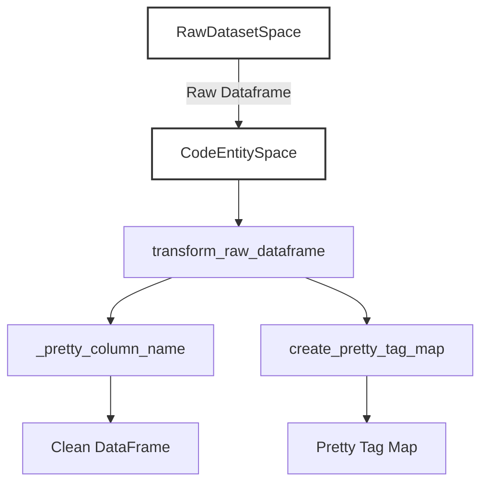
*Figure 1: High-level data transformation workflow from raw datasets to formatted UI structures.*

Sources: `[leaderboard_transformer.py:168-180]()`

---

## 2. Pretty Names and Tag Maps

To present human-readable categories and benchmarks in the leaderboard UI, the pipeline maps informal identifiers to formal titles using dictionaries and helper functions. 

The mapping layer relies on `INFORMAL_TO_FORMAL_NAME_MAP` and `ORDER_MAP` to translate short codes (such as `'lit'` or `'arxivdigestables_validation'`) into proper display names (`'Literature Understanding'` and `'ArxivDIGESTables-Clean'`) [leaderboard_transformer.py:13-87](). 

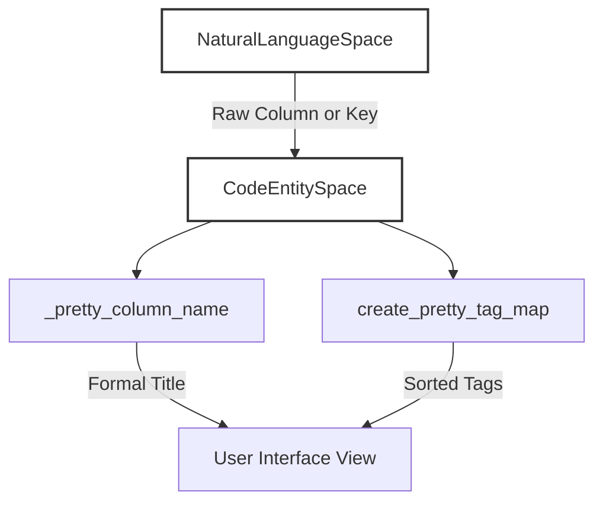
*Figure 2: Mapping natural language labels to code entities in `leaderboard_transformer.py`.*

The function `_pretty_column_name(raw_col: str)` handles fixed schema elements (like `'User/organization'` to `'Submitter'`) as well as dynamic metric suffixes (`' score'`, `' cost 95% CI'`) by matching against sorted base names [leaderboard_transformer.py:90-134](). Categorical filters are structured via `create_pretty_tag_map`, which enforces custom display sorting defined in `ORDER_MAP` [leaderboard_transformer.py:136-165]().

Sources: `[leaderboard_transformer.py:13-165]()`

---

## 3. Duplicate Disambiguation and Views

When multiple entries share identical names or organization tags, the pipeline applies disambiguation rules to ensure unique row indexing in Gradio tables. 

`DataTransformer` views and wrapper utilities ingest the transformed dataframe to construct specific slices for categories and validation vs. test splits. Display-only rounding for scores and costs is strictly separated from analytical transformations; raw values remain untouched until rendering time to avoid compounding floating-point discrepancies in calculations.

Sources: `[leaderboard_transformer.py:168-180]()`

---

## 4. Score, Cost, and Pareto Metrics

Scoring and cost columns require specific formatting rules (e.g., currency alignment, decimal precision, and handling missing cost metrics). Furthermore, computing the Pareto frontier depends directly on retaining full floating-point precision through `transform_raw_dataframe`.

For detailed information on Pareto frontier derivation, missing-cost handling, precision preservation, and associated integration tests, see [Pareto Frontier & Cost/Score Metrics](#3.1.1).

Sources: `[leaderboard_transformer.py:168-180]()`

---

# Page: Pareto Frontier & Cost/Score Metrics

# Pareto Frontier & Cost/Score Metrics

<details>
<summary>Relevant source files</summary>

The following files were used as context for generating this wiki page:

- [leaderboard_transformer.py](leaderboard_transformer.py)
- [tests/integration/test_metric_precision.py](tests/integration/test_metric_precision.py)
- [tests/integration/test_pareto_frontier.py](tests/integration/test_pareto_frontier.py)

</details>


This page documents the data transformation and evaluation mechanics for the AstaBench leaderboard, specifically focusing on the Pareto frontier computation (`get_pareto_df`), missing-cost and tie handling, metric precision preservation, and their associated test suites.

---

## 1. Purpose and Scope

The AstaBench leaderboard evaluates agents across multiple axes of capability (scores) and resource consumption (costs). To help users navigate trade-offs, the system computes an **Efficiency Frontier** (Pareto frontier) [tests/integration/test_pareto_frontier.py:63-63]() balancing agent cost against performance score. 

To maintain mathematical correctness during frontier calculations, raw metrics are preserved at full floating-point precision during transformations (`transform_raw_dataframe`) [leaderboard_transformer.py:168-180](). Display-layer rounding and tooltips are applied separately.

Sources:
- `leaderboard_transformer.py:168-180`
- `tests/integration/test_pareto_frontier.py:1-67`

---

## 2. Pareto Frontier Calculation (`get_pareto_df`)

The Pareto frontier calculation identifies the set of non-dominated agent submissions. An agent is considered Pareto-optimal if no other agent achieves a **strictly higher score at equal or lower cost**, or a **higher or equal score at strictly lower cost**. 

```mermaid
graph TD
    RawDF["transform_raw_dataframe()"] --> FullPrecision["Full-Precision DataFrame"]
    FullPrecision --> ParetoFunc["get_pareto_df()"]
    FullPrecision --> ScatterPlot["_plot_scatter_plotly()"]
    ParetoFunc --> FrontierTrace["Efficiency Frontier Trace"]
    ScatterPlot --> FrontierTrace
    
    sub5["Sources: leaderboard_transformer.py, test_pareto_frontier.py"]
    style RawDF fill:none,stroke:#000,stroke-width:2px
    style FullPrecision fill:none,stroke:#000,stroke-width:2px
    style ParetoFunc fill:none,stroke:#000,stroke-width:2px
    style ScatterPlot fill:none,stroke:#000,stroke-width:2px
    style FrontierTrace fill:none,stroke:#000,stroke-width:2px
```
*Figure 1: Data flow from raw transformations to Pareto frontier extraction.*

Sources:
- `leaderboard_transformer.py:168-180`
- `tests/integration/test_pareto_frontier.py:50-50`

---

## 3. Tie Handling and Edge Cases

The Pareto engine accounts for several edge cases regarding tied metrics, identical data points, and rounding artifacts:

1. **Score Ties at Higher Cost:** If two agents achieve the exact same score, the one with the higher cost is dominated and excluded from the frontier [tests/integration/test_pareto_frontier.py:49-53]().
2. **Identical Cost and Score:** When two distinct submissions share identical cost and score values, neither dominates the other; both are retained on the frontier [tests/integration/test_pareto_frontier.py:95-98]().
3. **Display Rounding vs. Full Precision:** Values that appear identical when rounded to 3 decimal places (e.g., `0.85331` vs `0.85330`) are compared at full floating-point precision. Display rounding never alters Pareto membership [tests/integration/test_pareto_frontier.py:114-140]().

```mermaid
graph TD
    InputRows["_tied_score_rows() / _equal_cost_and_score_rows()"] --> ComputePareto["get_pareto_df()"]
    ComputePareto --> FilterTies["Filter Dominated Higher-Cost Ties"]
    ComputePareto --> KeepIdentical["Retain Identical Cost/Score Points"]
    ComputePareto --> FullPrecisionCheck["Evaluate Full Precision over Display Rounding"]
    
    sub5["Sources: tests/integration/test_pareto_frontier.py"]
    style InputRows fill:none,stroke:#000,stroke-width:2px
    style ComputePareto fill:none,stroke:#000,stroke-width:2px
    style FilterTies fill:none,stroke:#000,stroke-width:2px
    style KeepIdentical fill:none,stroke:#000,stroke-width:2px
    style FullPrecisionCheck fill:none,stroke:#000,stroke-width:2px
```
*Figure 2: Validation paths for tie-breaking and precision during Pareto analysis.*

Sources:
- `tests/integration/test_pareto_frontier.py:18-141`

---

## 4. Precision Preservation and Metric Formatting

Raw dataframes processed by `transform_raw_dataframe` retain full precision so that sorting, confidence interval displays, and Pareto calculations remain uncorrupted [leaderboard_transformer.py:168-180](). 

When rendering tables or scatter plots:
- **Table Cells:** Display values are truncated or rounded (e.g., to 3 decimal places), while full-precision values are injected into HTML tooltips (`data-tooltip`) [tests/integration/test_metric_precision.py:16-35]().
- **Missing vs. Zero Scores:** A score of `0.0` retains its zero-value representation and tooltip, whereas `None` (missing score) omits the tooltip and renders with a fallback style [tests/integration/test_metric_precision.py:37-51]().
- **Plotly Integration:** Scatter plots (`_plot_scatter_plotly`) extract error arrays for confidence intervals directly from unrounded dataframe columns [tests/integration/test_metric_precision.py:53-80]().

Sources:
- `leaderboard_transformer.py:168-180`
- `tests/integration/test_metric_precision.py:1-118`

---

## 5. Test Suites & Verification

The correctness of cost/score transformations and Pareto frontier calculations is verified via dedicated integration tests:

* `tests/integration/test_pareto_frontier.py`: Validates `get_pareto_df` behavior on tied scores, identical coordinate points, and raw-vs-rendered precision filtering [tests/integration/test_pareto_frontier.py:1-140]().
* `tests/integration/test_metric_precision.py`: Validates `format_cost_column`, `format_score_column`, and `_plot_scatter_plotly` confidence intervals and tooltip preservation [tests/integration/test_metric_precision.py:1-117]().

Sources:
- `tests/integration/test_pareto_frontier.py:1-141`
- `tests/integration/test_metric_precision.py:1-118`

---

# Page: UI Components & Plots

# UI Components & Plots

<details>
<summary>Relevant source files</summary>

The following files were used as context for generating this wiki page:

- [ui_components.py](ui_components.py)

</details>


This section covers the technical implementation of `ui_components.py`, which serves as the visual rendering engine for the AstaBench leaderboard app. It manages icon maps and base64 SVG data URIs for openness and tooling taxonomies, handles leaderboard viewer caching, constructs benchmark detail cards, manages sub-navigation, and embeds interactive Plotly scatter plots.

---

## 1. Icon Assets and Data URI Preloading

The leaderboard categorizes agent submissions along two main axes: **Agent Openness** (code and model availability) and **Agent Tooling** (standard vs custom environments). `ui_components.py` dynamically loads SVG assets, transforms them into base64-encoded data URIs, and injects them into Gradio dataframes and UI tooltips.

### Icon Mapping Architecture
The module maps openness and tooling aliases to specific vector graphic files stored locally [ui_components.py:40-107](). To optimize performance during runtime, all SVG files are read from disk once upon application startup and compiled into a preloaded URI map [ui_components.py:109-126]().

```mermaid
graph TD
    A["DiskSVGFiles"] -->|"get_svg_as_data_uri()"| B["PRELOADED_URI_MAP"]
    C["AgentSubmissionRow"] -->|"get_combined_icon_html()"| D["HTMLImgTagWithURI"]
    B --> D
    E["OpennessValue"] -->|"OPENNESS_SVG_MAP"| F["SingleIconHTML"]
    G["ToolingValue"] -->|"TOOLING_SVG_MAP"| F

    sub:CodeEntitySpace
    style CodeEntitySpace fill:none
    click A "ui_components.py" "Disk SVG assets"
    click B "ui_components.py" "PRELOADED_URI_MAP"
    click D "ui_components.py" "get_combined_icon_html"
    click F "ui_components.py" "create_svg_html"
end
```
*Figure 1: Natural Language Space to Code Entity Space mapping for icon generation and data URI embedding.*

Sources: `ui_components.py`

---

## 2. Viewer Caching and Leaderboard Displays

To prevent redundant dataframe transformations and API round-trips when users navigate between tabs or adjust filters, `ui_components.py` leverages caching mechanisms alongside `LeaderboardViewer` instances [ui_components.py:7](). 

### Caching Strategy
- **Stateful Viewers**: `LeaderboardViewer` instances encapsulate state for specific splits (e.g., test vs validation) and categories.
- **Preloaded Maps**: Global structures such as `PRELOADED_URI_MAP` eliminate I/O bottlenecks by avoiding synchronous file reads on every dataframe cell render.
- **Dataframe Injection**: Functions like `get_combined_icon_html()` process individual row values for `Openness` and `Agent Tooling` to inject custom HTML `` tags into Gradio table cells [ui_components.py:128-141]().

```mermaid
graph TD
    A["UserAction"] -->|"SelectTabOrFilter"| B["LeaderboardViewer"]
    B -->|"FetchDataframe"| C["DataTransformer"]
    C -->|"FormatScoresAndCosts"| D["GradioDataFrame"]
    E["PRELOADED_URI_MAP"] -->|"InjectDataURIs"| D

    sub:CodeEntitySpace
    style CodeEntitySpace fill:none
    click B "agenteval/leaderboard/view.py" "LeaderboardViewer"
    click C "leaderboard_transformer.py" "DataTransformer"
    click D "ui_components.py" "Gradio Table Render"
end
```
*Figure 2: Natural Language Space to Code Entity Space mapping for leaderboard display rendering and caching.*

Sources: `ui_components.py`, `agenteval/leaderboard/view.py`

---

## 3. Benchmark Detail Cards and Sub-Navigation

The user interface uses modular card components to present benchmark metadata, descriptions, and dataset statistics alongside interactive tables.

### Key Features
- **Benchmark Descriptions**: Dynamic lookup using `get_benchmark_description()` from `content.py` [ui_components.py:31]() to supply rich context cards for individual sub-tasks.
- **Anchor Generation**: Utilization of `create_gradio_anchor_id()` to build deep-linkable section anchors across views [ui_components.py:29]().
- **Sub-Navigation**: Layout primitives that segment the page into logical sub-views, enabling seamless transitions between overall leaderboards, category-specific views, and submission logs.

Sources: `ui_components.py`, `content.py`

---

## 4. Plotly Scatter Plot Integration

Interactive scatter plots visualize the Pareto frontier, plotting agent cost against performance scores.

### Integration Pipeline
- **Plot Generation**: Relies on `_plot_scatter_plotly()` imported from `leaderboard_transformer.py` [ui_components.py:16]() to generate native Plotly `go.Figure` objects [ui_components.py:3]().
- **Disclaimers & Metadata**: Appends standardized disclaimers (`SCATTER_DISCLAIMER`) to explain cost-versus-score trade-offs and missing-cost handling [ui_components.py:34]().
- **Gradio Plot Integration**: Renders figures inside Gradio `gr.Plot` components, allowing dynamic hover tooltips, zoom capabilities, and legend filtering based on openness taxonomies.

Sources: `ui_components.py`, `leaderboard_transformer.py`

---

# Page: Icons, SVG Assets & Legends

# Icons, SVG Assets & Legends

<details>
<summary>Relevant source files</summary>

The following files were used as context for generating this wiki page:

- [assets/api-legend.svg](assets/api-legend.svg)
- [assets/c-custom.svg](assets/c-custom.svg)
- [assets/c-equivalent.svg](assets/c-equivalent.svg)
- [assets/c-legend.svg](assets/c-legend.svg)
- [assets/c-standard.svg](assets/c-standard.svg)
- [assets/code-execution.svg](assets/code-execution.svg)
- [assets/custom-legend.svg](assets/custom-legend.svg)
- [assets/data-analysis.svg](assets/data-analysis.svg)
- [assets/end-to-end-discovery.svg](assets/end-to-end-discovery.svg)
- [assets/just-icon.svg](assets/just-icon.svg)
- [assets/literature-understanding.svg](assets/literature-understanding.svg)
- [assets/logo.svg](assets/logo.svg)
- [assets/os-ow-standard.svg](assets/os-ow-standard.svg)
- [assets/trophy.svg](assets/trophy.svg)

</details>


## Purpose and Scope
This page documents the repository's visual assets, scalable vector graphics (SVGs), legend indicators, and category diagrams located in the `assets/` directory. It details how these graphical assets are managed, styled, and embedded as data URIs within the Gradio application components, Markdown blocks, and UI headers across various leaderboard pages and category builders.

Sources: `assets/logo.svg` [assets/logo.svg:1-12](), `assets/trophy.svg` [assets/trophy.svg:1-3]()

---

## SVG Asset Inventory
The AstaBench leaderboard bundles vector assets to support branding, category differentiation, metric legends, and status indicators. These assets are stored as raw XML/SVG files under the `assets/` directory:

| Asset Path | Primary Role / Context | Technical Attributes |
| :--- | :--- | :--- |
| `assets/logo.svg` [assets/logo.svg:1-12]() | Application branding and header title graphics. | Width: 293, Height: 36, Theme: `#0FCB8C` |
| `assets/trophy.svg` [assets/trophy.svg:1-3]() | Pareto frontier and rank recognition indicators. | Width: 20, Height: 21, Fill: `#0FCB8C` |
| `assets/code-execution.svg` [assets/code-execution.svg:1-44]() | Category header/diagram for Code & Execution. | Width: 800.08, Height: 410, Dark theme palette |
| `assets/data-analysis.svg` [assets/data-analysis.svg:1-44]() | Category header/diagram for Data Analysis. | Width: 800.08, Height: 410, Dark theme palette |
| `assets/end-to-end-discovery.svg` [assets/end-to-end-discovery.svg:1-44]() | Category header/diagram for End-to-End Discovery. | Width: 800.08, Height: 410, Dark theme palette |
| `assets/literature-understanding.svg` [assets/literature-understanding.svg:1-44]() | Category header/diagram for Literature Understanding. | Width: 800.08, Height: 410, Dark theme palette |
| `assets/c-legend.svg` [assets/c-legend.svg:1-3]() | Openness / Tooling legend indicator (Circle). | Width/Height: 18x18, Stroke: `#F0529C` |
| `assets/api-legend.svg` [assets/api-legend.svg:1-3]() | API-based model or environment badge. | Width/Height: 18x18, Fill: `#F9F871`, Stroke: `#F0529C` |
| `assets/c-standard.svg` [assets/c-standard.svg:1-3]() | Standard tool configuration indicator. | Width/Height: 20x19, Stroke: `#F0529C` |
| `assets/c-custom.svg` [assets/c-custom.svg:1-3]() | Custom tool configuration indicator. | Width/Height: 18x15, Stroke: `#F0529C` |
| `assets/c-equivalent.svg` [assets/c-equivalent.svg:1-3String]() | Equivalent tool configuration indicator. | Width/Height: 20x20, Stroke: `#F0529C` |

Sources: `assets/logo.svg` [assets/logo.svg:1-12](), `assets/trophy.svg` [assets/trophy.svg:1-3](), `assets/code-execution.svg` [assets/code-execution.svg:1-26]()

---

## Data URI Embedding & Transformation Pipeline
To render vector graphics reliably inside Gradio's web components (such as Markdown blocks, HTML components, or custom table headers), SVGs are frequently converted into Base64-encoded or URI-encoded data strings. 

```mermaid
graph TD
    A["RawSVGFiles" + "assets/trophy.svg" + "assets/logo.svg"] --> B["PythonFileIO" + "open(path, 'r')"]
    B --> C["Base64OrURLParser" + "base64.b64encode"]
    C --> D["DataURIString" + "data:image/svg+xml;base64,..."]
    D --> E["GradioUIComponents" + "gr.HTML / gr.Markdown"]

    sub: "Sources: assets/trophy.svg, assets/logo.svg"
```

Sources: `assets/trophy.svg` [assets/trophy.svg:1-3](), `assets/logo.svg` [assets/logo.svg:1-12]()

---

## Openness and Tooling Legends
The leaderboard classifies agent submissions across openness taxonomies (e.g., open vs. closed models) and tooling categories (standard, custom, equivalent). The corresponding legend files (`c-legend.svg`, `api-legend.svg`, `c-standard.svg`, `c-custom.svg`, `c-equivalent.svg`) provide visual keys rendered alongside score breakdowns and methodology explanations on the About page and category views.

```mermaid
graph TD
    subgraph "NaturalLanguageSpace"
        NL1["Openness Taxonomy"]
        NL2["Tooling Taxonomy"]
        NL3["Trophy / Pareto Rank"]
    end

    subgraph "CodeEntitySpace"
        CE1["assets/c-legend.svg" + "assets/api-legend.svg"]
        CE2["assets/c-standard.svg" + "assets/c-custom.svg" + "assets/c-equivalent.svg"]
        CE3["assets/trophy.svg"]
    end

    NL1 --> CE1
    NL2 --> CE2
    NL3 --> CE3

    sub: "Sources: assets/c-legend.svg, assets/c-standard.svg, assets/trophy.svg"
```

Sources: `assets/c-legend.svg` [assets/c-legend.svg:1-3](), `assets/c-standard.svg` [assets/c-standard.svg:1-3](), `assets/trophy.svg` [assets/trophy.svg:1-3]()

---

## Category Diagrams & Layout Integration
Each benchmark category relies on specialized banner graphics (`code-execution.svg`, `data-analysis.svg`, `end-to-end-discovery.svg`, `literature-understanding.svg`) that establish visual identity across sub-pages generated by category builders.

```mermaid
graph TD
    subgraph "NaturalLanguageSpace"
        NC1["Literature Understanding Category"]
        NC2["Code and Execution Category"]
        NC3["Data Analysis Category"]
        NC4["End-to-End Discovery Category"]
    end

    subgraph "CodeEntitySpace"
        CC1["assets/literature-understanding.svg" + "category_page_builder.py"]
        CC2["assets/code-execution.svg" + "category_page_builder.py"]
        CC3["assets/data-analysis.svg" + "category_page_builder.py"]
        CC4["assets/end-to-end-discovery.svg" + "category_page_builder.py"]
    end

    NC1 --> CC1
    NC2 --> CC2
    NC3 --> CC3
    NC4 --> CC4

    sub: "Sources: assets/literature-understanding.svg, assets/code-execution.svg, assets/data-analysis.svg, assets/end-to-end-discovery.svg"
```

Sources: `assets/literature-understanding.svg` [assets/literature-understanding.svg:1-26](), `assets/code-execution.svg` [assets/code-execution.svg:1-26](), `assets/data-analysis.svg` [assets/data-analysis.svg:1-26](), `assets/end-to-end-discovery.svg` [assets/end-to-end-discovery.svg:1-26]()

---

# Page: Submission System

# Submission System

<details>
<summary>Relevant source files</summary>

The following files were used as context for generating this wiki page:

- [config.py](config.py)
- [submission.py](submission.py)

</details>


The submission system manages the ingestion, validation, processing, and review of external and internal agent evaluations. Users interact with a Gradio-based submission interface to upload their evaluation artifacts (packaged as `.tar.gz` tarballs containing `agenteval.json` and associated metadata). The system authenticates users via Hugging Face OAuth, enforces rate limits, validates payloads, extracts and stores submission folders into Hugging Face datasets, and notifies reviewers via GitHub issues.

For a detailed technical breakdown of each component, refer to the child pages linked below:
- [Submission Flow & Validation](#4.1)
- [Configuration & Datasets](#4.2)
- [Reviewer Notifications](#4.3)

---

## Architecture & Code Entity Mapping

The submission workflow bridges user-facing Gradio UI elements with backend storage configuration, dataset uploading logic, and notification hooks. The diagram below maps natural language concepts to their concrete code entities in the codebase.

```mermaid
graph TD
    UI[""Gradio UI Form""] -->|Invokes| AddEval["submission.py:add_new_eval()"]
    AddEval -->|Authenticates| OAuth["submission.py:gr.OAuthProfile"]
    AddEval -->|Enforces Limits| RateLimit["submission.py:_is_last_submission_too_recent()"]
    RateLimit -->|Queries Contact Info| ContactDs["config.py:CONTACT_DATASET"]
    AddEval -->|Uploads Artifacts| UploadSub["submission.py:upload_submission()"]
    UploadSub -->|Targets Dataset| SubDs["config.py:SUBMISSION_DATASET"]
    AddEval -->|Notifies Maintainers| Notifier["submission_notifier.py"]
    Config["config.py:IS_INTERNAL"] -->|Switches Environments| SubDs
```
*Sources: `submission.py:1-451`, `config.py:1-23`*

---

## 4.1 Submission Flow & Validation

The submission lifecycle begins when a user submits agent metadata and an evaluation tarball through the Gradio form interface [submission.py:99-112](). The backend function `add_new_eval` processes the request by performing several validation and security checks:
1. **Payload Inspection**: Verifies that an agent name and a `.tar.gz` file payload are present [submission.py:113-127]().
2. **Account & Frequency Verification**: Checks user identity via Hugging Face OAuth profiles [submission.py:131-133]() and queries past submissions to enforce 24-hour rate limiting [submission.py:161-172]().
3. **Tarball Extraction & Upload**: Safely extracts submission contents to local temporary directories (`EXTRACTED_DATA_DIR`) and pushes validated folders to Hugging Face datasets via `upload_submission` [submission.py:63-94](), ensuring total size constraints (`MAX_UPLOAD_BYTES = 5e9`) are respected [submission.py:49-76]().

For detailed implementation specifics, see [Submission Flow & Validation](#4.1).

*Sources: `submission.py:49-175`, `config.py:21-22`*

---

## 4.2 Configuration & Datasets

Environment configurations and dataset routing are centralized in `config.py`. The application dynamically switches between public and internal evaluation pipelines based on the `IS_INTERNAL` environment variable [config.py:5]() and `CONFIG_NAME` [config.py:4]().

Depending on this flag, the submission system targets distinct Hugging Face repositories for raw submissions (`SUBMISSION_DATASET`), contact tracking (`CONTACT_DATASET`), and scoring results (`RESULTS_DATASET`) [config.py:10-20](). Temporary storage paths for processing tarball extractions are governed by `EXTRACTED_DATA_DIR` [config.py:22]().

For deep dives into environment switches, contact datasets, and schema definitions, see [Configuration & Datasets](#4.2).

*Sources: `config.py:1-23`, `submission.py:27-32`*

---

## 4.3 Reviewer Notifications

Once a submission is successfully ingested and uploaded to the designated Hugging Face dataset, the system automatically triggers a notification process. Implemented primarily via `submission_notifier.py`, this module interfaces with the GitHub API to create issues on the designated repository. This ensures that benchmark administrators are promptly alerted to new agent submissions requiring manual or automated review.

For details on issue templates, payload formatting, and associated unit tests, see [Reviewer Notifications](#4.3).

*Sources: `submission.py:26`, `submission_notifier.py:1-100`*

---

## End-to-End Submission Pipeline

```mermaid
sequenceDiagram
    participant User as "User Client"
    participant UI as "submission.py:add_new_eval()"
    participant Config as "config.py"
    participant HF as "Hugging Face Hub API"
    participant Notifier as "submission_notifier.py"

    User->>UI: "Upload .tar.gz & Agent Metadata"
    UI->>Config: "Read IS_INTERNAL & CONTACT_DATASET"
    UI->>UI: "Verify OAuth Profile & Rate Limits"
    UI->>HF: "upload_folder() to SUBMISSION_DATASET"
    HF-->>UI: "Return Dataset URL"
    UI->>Notifier: "Trigger GitHub Issue Creation"
    Notifier-->>User: "Submission Confirmed / Pending Review"
```
*Sources: `submission.py:63-175`, `config.py:1-23`, `submission_notifier.py:1-100`*

---

# Page: Submission Flow & Validation

# Submission Flow & Validation

<details>
<summary>Relevant source files</summary>

The following files were used as context for generating this wiki page:

- [config.py](config.py)
- [submission.py](submission.py)

</details>


## Purpose & Scope
This page details the submission system for the AstaBench leaderboard app. It covers the Gradio-based submission form interface, Hugging Face OAuth authentication, rate-limiting and validation mechanisms, tarball extraction protocols, metadata handling, and dataset uploads to Hugging Face Hub datasets.

Sources: `submission.py:1-451`, `config.py:1-23`

---

## 1. Submission Form Interface & OAuth Authentication
The submission interface is constructed via the `add_new_eval` function, which accepts agent metadata, evaluation configuration splits (`val_or_test`), and file uploads. Authentication is handled natively through Gradio's OAuth integration using `gr.OAuthProfile`.

When a user submits an agent evaluation, `add_new_eval` intercepts the request, validates the input parameters, and extracts the Hugging Face username from the `profile` argument if a custom username is omitted.

```python
def add_new_eval(
        val_or_test: str,
        agent_name: str | None,
        agent_description: str,
        agent_url: str,
        openness: str | None,
        degree_of_control: str | None,
        path_to_file: typing.IO | None,
        username: str,
        role: str,
        email: str,
        email_opt_in: bool,
        profile: gr.OAuthProfile,
):
    ...
```

Sources: `submission.py:99-112`, `submission.py:131-134`

---

## 2. Validation & Rate Limiting Pipeline
Before any tarball extraction or dataset upload occurs, submissions undergo rigorous validation checks inside `add_new_eval`. 

### Initial Field Validation
The system first verifies that essential fields are populated:
* `agent_name` must be provided; otherwise, a warning modal is triggered [submission.py:113-119]().
* `path_to_file` must contain an attached `.tar.gz` archive [submission.py:121-127]().

### Rate Limiting & Contact Datasets
To prevent abuse, submissions are rate-limited per user per split. The application queries the private contact dataset defined by `CONTACT_DATASET` via `try_load_dataset_submission` [submission.py:157-160]() to check submission timestamps. If a user has submitted within the last 24 hours, the request is rejected [submission.py:161-172]().

```mermaid
graph TD
    A["UserSubmission"] --> B["add_new_eval"]
    B --> C{AgentNameValid?}
    C -- No --> D["ReturnWarningModal"]
    C -- Yes --> E{FileAttached?}
    E -- No --> F["ReturnWarningModal"]
    E -- Yes --> G["try_load_dataset_submission"]
    G --> H["_is_last_submission_too_recent"]
    H --> I{RateLimitExceeded?}
    I -- Yes --> J["ReturnErrorModal"]
    I -- No --> K["ProceedToTarballExtraction"]

    subgraph "Code Entity Space"
      B["submission.py:add_new_eval"]
      G["submission.py:try_load_dataset_submission"]
      H["submission.py:_is_last_submission_too_recent"]
      J["content.py:format_error"]
    end
```
Sources: `submission.py:113-172`, `config.py:8`

---

## 3. Tarball Extraction & Metadata Processing
Once validation passes, the submitted `.tar.gz` archive is unpacked into the designated extraction directory configured by `EXTRACTED_DATA_DIR` [config.py:22](). 

The submission expects a standardized folder structure matching `agenteval` requirements, including the metadata file defined by `SUBMISSION_METADATA_FILENAME` and parsed via `SubmissionMetadata` [submission.py:5-6]().

Sources: `submission.py:5-14`, `config.py:21-23`

---

## 4. Dataset Upload & Storage
After successful extraction and local verification, the submission is prepared for upload to the Hugging Face Hub.

### Size Constraints & Folder Traversal
The function `upload_submission` calculates the aggregate size of the uncompressed submission folder by recursively walking the directory tree [submission.py:69-72](). If the total size exceeds `MAX_UPLOAD_BYTES` (configured to `5e9` bytes / 5 GB), a `ValueError` is raised [submission.py:49, 73-76]().

### Path Validation & HF Hub API
Path components (`CONFIG_NAME`, `split`, and `submission_name`) are sanitized and validated using `_validate_path_component` [submission.py:80-82]() to ensure dataset URI integrity (`hf://datasets/...`) [submission.py:83](). Finally, `HfApi.upload_folder` pushes the files to `SUBMISSION_DATASET` with a descriptive commit message containing the submitting user's HF handle [submission.py:85-94]().

```mermaid
graph TD
    A["ExtractedFolder"] --> B["upload_submission"]
    B --> C["os.walk"]
    C --> D{TotalSizeExceedsLimit?}
    D -- Yes --> E["RaiseValueError"]
    D -- No --> F["_validate_path_component"]
    F --> G["HfApi.upload_folder"]
    G --> H["SUBMISSION_DATASET"]

    subgraph "Code Entity Space"
      B["submission.py:upload_submission"]
      C["os:walk"]
      F["agenteval.leaderboard.upload:_validate_path_component"]
      G["huggingface_hub:HfApi.upload_folder"]
      H["config.py:SUBMISSION_DATASET"]
    end
```
Sources: `submission.py:48-94`, `config.py:1-23`

---

# Page: Configuration & Datasets

# Configuration & Datasets

<details>
<summary>Relevant source files</summary>

The following files were used as context for generating this wiki page:

- [config.py](config.py)
- [data/1.0.0-dev1/agenteval.json](data/1.0.0-dev1/agenteval.json)
- [submission.py](submission.py)

</details>


## Purpose & Scope
This page documents the configuration management and dataset architecture of the AstaBench Leaderboard. It covers `config.py`, which controls environment-based dataset routing (public versus internal datasets), temporary storage paths (`EXTRACTED_DATA_DIR`), and the schema structure of evaluation files like `agenteval.json`.

Sources: [config.py:1-22](), [submission.py:27-50](), [data/1.0.0-dev1/agenteval.json:1-161]()

---

## Configuration Architecture (`config.py`)

The application configuration is centralized in `config.py` [config.py:1-22](). It inspects environment variables to determine debug mode, active configuration versions, and whether the application is running in an internal Ai2 environment or a public HuggingFace Space.

* `LOCAL_DEBUG`: Evaluated as `not (os.environ.get("system") == "spaces")` [config.py:3]().
* `CONFIG_NAME`: Read from `os.getenv("HF_CONFIG", "1.0.0-dev1")`, which dictates the directory structure and dataset configuration identifier [config.py:4]().
* `IS_INTERNAL`: Controlled by `os.environ.get("IS_INTERNAL", "false").lower() == "true"` [config.py:5]().

Depending on `IS_INTERNAL`, `config.py` assigns distinct HuggingFace dataset repositories for submissions, results, and leaderboards:
* **Internal Mode (`IS_INTERNAL = True`)**: Points to `allenai/asta-bench-internal-submissions`, `allenai/asta-bench-internal-results`, and `allenai/asta-bench-internal-leaderboard` [config.py:12-14]().
* **Public Mode (`IS_INTERNAL = False`)**: Points to `allenai/asta-bench-submissions`, `allenai/asta-bench-results`, and `allenai/asta-bench-leaderboard` [config.py:17-19]().

Contact information for rate limiting and submission tracking is stored in a unified private dataset (`allenai/asta-bench-internal-contact-info`) referenced by `CONTACT_DATASET` [config.py:7-8]() and queried in `submission.py` [submission.py:29]().

```mermaid
graph TD
    A["EnvironmentVariables"] --> B["config.py"]
    B --> C["IS_INTERNAL"]
    B --> D["HF_CONFIG"]
    C -->|True| E["InternalDatasets"]
    C -->|False| F["PublicDatasets"]
    E --> G["SUBMISSION_DATASET: allenai/asta-bench-internal-submissions"]
    E --> H["RESULTS_DATASET: allenai/asta-bench-internal-results"]
    E --> I["LEADERBOARD_PATH: allenai/asta-bench-internal-leaderboard"]
    F --> J["SUBMISSION_DATASET: allenai/asta-bench-submissions"]
    F --> K["RESULTS_DATASET: allenai/asta-bench-results"]
    F --> L["LEADERBOARD_PATH: allenai/asta-bench-leaderboard"]
    B --> M["CONTACT_DATASET: allenai/asta-bench-internal-contact-info"]
```
Sources: [config.py:1-22](), [submission.py:27-32]()

---

## Directory Layout & Extracted Data

Local runtime storage is organized under a temporary base directory determined by `CONFIG_NAME` [config.py:21-22](). 

* `DATA_DIR`: Defined as `/tmp/abl/data/` concatenated with `CONFIG_NAME` [config.py:21]().
* `EXTRACTED_DATA_DIR`: Defined as `os.path.join(DATA_DIR, "extracted")` [config.py:22](). 

In `submission.py`, `EXTRACTED_DATA_DIR` is used to unpack uploaded submission tarballs for validation and evaluation processing. The directory is automatically created upon module initialization via `os.makedirs(EXTRACTED_DATA_DIR, exist_ok=True)` [submission.py:50]().

```mermaid
graph TD
    A["ConfigName: CONFIG_NAME"] --> B["DataDir: DATA_DIR"]
    B --> C["ExtractedDataDir: EXTRACTED_DATA_DIR"]
    C --> D["SubmissionTarballExtraction"]
    D --> E["SubmissionValidation: add_new_eval"]
```
Sources: [config.py:21-22](), [submission.py:48-50]()

---

## Example Evaluation Metadata & Schema (`agenteval.json`)

Evaluation payloads and suite configurations follow the `agenteval` schema, instantiated in files such as `data/1.0.0-dev1/agenteval.json` [data/1.0.0-dev1/agenteval.json:1-161]().

The JSON structure defines suite metadata, task groupings across splits (`validation` and `test`), primary metrics, and tag taxonomies (`lit`, `data`, `code`, `discovery`) [data/1.0.0-dev1/agenteval.json:1-161]().

### Suite Configuration Schema
* `suite_config`: Contains suite `name`, `version`, and an array of `splits` [data/1.0.0-dev1/agenteval.json:2-6]().
* `splits`: Each split object contains a `name` (e.g., `validation`, `test`) and a list of `tasks` [data/1.0.0-dev1/agenteval.json:5-8]().
* `tasks`: Each task defines its `name`, HuggingFace `path`, `primary_metric`, and categorization `tags` [data/1.0.0-dev1/agenteval.json:8-16]().
* `results`: An array containing benchmark evaluation metrics (`metrics`) and execution expenses (`model_costs`) per task [data/1.0.0-dev1/agenteval.json:163-209]().

```mermaid
graph TD
    A["AgentevalJson: agenteval.json"] --> B["SuiteConfig: suite_config"]
    B --> C["Splits: splits"]
    C --> D["ValidationSplit: validation"]
    C --> E["TestSplit: test"]
    D --> F["TasksList: tasks"]
    E --> F
    F --> G["TaskDefinition: task_name"]
    G --> H["PrimaryMetric: primary_metric"]
    G --> I["Tags: tags"]
    A --> J["ResultsArray: results"]
    J --> K["TaskMetrics: metrics"]
    J --> L["ModelCosts: model_costs"]
```
Sources: [data/1.0.0-dev1/agenteval.json:1-209]()

---

# Page: Reviewer Notifications

# Reviewer Notifications

<details>
<summary>Relevant source files</summary>

The following files were used as context for generating this wiki page:

- [submission_notifier.py](submission_notifier.py)
- [tests/unit/test_submission_notifier.py](tests/unit/test_submission_notifier.py)

</details>


## Purpose and Scope

The `submission_notifier.py` module handles asynchronous, best-effort alerting for new web-form submissions on the AstaBench leaderboard. When a user uploads a new evaluation tarball, the submission pipeline invokes this module to open a triage ticket on a designated GitHub repository and optionally assign it to a GitHub Projects v2 board with a specified status column (e.g., "Triage Needed"). 

Designed to fail silently without blocking user submissions, the notifier operates via GitHub REST and GraphQL APIs using credentials injected through HuggingFace Space secrets or environment variables. This page documents its configuration, message construction logic, GitHub API integration, and corresponding unit tests in `tests/unit/test_submission_notifier.py`.

Sources: [submission_notifier.py:1-33](), [tests/unit/test_submission_notifier.py:1-11]()

---

## Configuration and Environment Variables

The notifier relies strictly on environment variables or HuggingFace Space secrets. If the token or repository is missing, execution safely returns a no-op to prevent breaking the submission flow.

| Environment Variable | Default Value | Description |
| :--- | :--- | :--- |
| `NOTIFIER_GITHUB_TOKEN` / `GITHUB_TOKEN` | `None` | Authentication token used to authorize GitHub REST and GraphQL requests [submission_notifier.py:26](). |
| `NOTIFIER_GITHUB_REPO` | `""` | Target GitHub repository formatted as `"owner/repo"` where issues are opened [submission_notifier.py:27](). |
| `NOTIFIER_PROJECT_NUMBER` | `None` | Optional integer referencing a GitHub Project v2 board owned by the repository's organization [submission_notifier.py:29-30](). |
| `NOTIFIER_PROJECT_STATUS` | `"Triage Needed"` | The status column name to assign when adding the issue to a Project v2 board [submission_notifier.py:31](). |

Sources: [submission_notifier.py:17-32]()

---

## Message Construction and URL Generation

Before dispatching an issue, the module formats URLs pointing directly to the HuggingFace Hub dataset repository and constructs the issue title and body.

### Core Functions

- **`submission_folder_url(coords)`**: Generates a browser-compatible URL pointing to the submission directory within the dataset tree on the HuggingFace Hub [submission_notifier.py:34-39]().
- **`build_issue(coords)`**: Generates a tuple containing the issue title and markdown body [submission_notifier.py:45-62](). The body includes a direct reference to the HuggingFace dataset URI (`hf://datasets/...`) and links back to the internal review documentation [submission_notifier.py:47-61]().

```python
def build_issue(coords):
    dataset_url = (
        f"hf://datasets/{coords['repo']}/{coords['config']}/"
        f"{coords['split']}/{coords['name']}"
    )
    title = f"AstaBench submission from {coords['username']}"
    # ... builds markdown body ...
    return title, body
```

Sources: [submission_notifier.py:34-62]()

---

## GitHub REST and GraphQL Delivery

The notification delivery mechanism integrates GitHub's REST API for creating issues and GraphQL API for interacting with GitHub Projects v2 boards.

### Delivery Data Flow

```mermaid
graph TD
    subgraph "Execution Flow"
        A["submission.add_new_eval"] --> B["notify_submission"]
        B --> C{"Check GITHUB_TOKEN & ISSUE_REPO"}
        C -- "Missing" --> D["Silent No-Op (Return None)"]
        C -- "Present" --> E["create_triage_ticket(title, body)"]
    end

    subgraph "API Interaction"
        E --> F["POST /repos/{owner}/{repo}/issues (_gh_headers)"]
        F --> G{"PROJECT_NUMBER Configured?"}
        G -- "No" --> H["Return issue['html_url']"]
        G -- "Yes" --> I["_resolve_project() via _graphql"]
        I --> J["addProjectV2ItemById mutation"]
        J --> K["updateProjectV2ItemFieldValue mutation"]
        K --> H
    end

    style A fill:#fff,stroke:#333,stroke-width:2px
    style B fill:#fff,stroke:#333,stroke-width:2px
    style E fill:#fff,stroke:#333,stroke-width:2px
    style F fill:#fff,stroke:#333,stroke-width:2px
    style I fill:#fff,stroke:#333,stroke-width:2px
    style J fill:#fff,stroke:#333,stroke-width:2px
```

Sources: [submission_notifier.py:72-189]()

### Key Functions for Delivery

- **`_gh_headers()`**: Assembles authentication headers, enforcing the GitHub API version `2022-11-28` [submission_notifier.py:72-81]().
- **`_graphql(query, variables)`**: Executes GraphQL queries against `_GITHUB_GRAPHQL`, handling HTTP errors and GraphQL-level error payloads [submission_notifier.py:84-95]().
- **`_resolve_project()`**: Queries the organization's project board dynamically at runtime to retrieve the `project_id`, `status_field_id`, and matching `option_id` for `PROJECT_STATUS` [submission_notifier.py:98-140]().
- **`create_triage_ticket(title, body)`**: Combines the REST issue creation step with optional Project v2 board item attachment and status updating [submission_notifier.py:143-189]().

Sources: [submission_notifier.py:72-189]()

---

## Unit Testing Suite

The unit test suite located in `tests/unit/test_submission_notifier.py` validates configuration handling, error resilience, and mocking behavior without making actual network calls to GitHub.

### Test Architecture and Entity Mapping

```mermaid
graph TD
    subgraph "Test Space (Natural Language)"
        T1["Test Unconfigured No-Op"]
        T2["Test Missing Repo No-Op"]
        T3["Test Skip Board Without Project"]
        T4["Test Swallow Ticket Errors"]
    end

    subgraph "Code Entity Space"
        T1 -->|monkeypatch| S1["submission_notifier.GITHUB_TOKEN"]
        T2 -->|monkeypatch| S2["submission_notifier.ISSUE_REPO"]
        T3 -->|monkeypatch| S3["submission_notifier.PROJECT_NUMBER"]
        T4 -->|monkeypatch| S4["submission_notifier.create_triage_ticket"]
        
        S1 --> M1["notify_submission"]
        S2 --> M1
        S3 --> M2["create_triage_ticket"]
        S4 --> M3["notify_submission exception handler"]
    end

    style T1 fill:#fff,stroke:#333,stroke-width:2px
    style T2 fill:#fff,stroke:#333,stroke-width:2px
    style T3 fill:#fff,stroke:#333,stroke-width:2px
    style T4 fill:#fff,stroke:#333,stroke-width:2px
    style M1 fill:#fff,stroke:#333,stroke-width:2px
    style M2 fill:#fff,stroke:#333,stroke-width:2px
    style M3 fill:#fff,stroke:#333,stroke-width:2px
```

Sources: [tests/unit/test_submission_notifier.py:1-88]()

### Test Cases Breakdown

| Test Function | Target Behavior Verified | Citation |
| :--- | :--- | :--- |
| `test_notify_submission_noop_when_unconfigured` | Asserts that when `GITHUB_TOKEN` is `None`, notification returns `None` without raising exceptions. | [tests/unit/test_submission_notifier.py:12-25]() |
| `test_notify_submission_noop_without_repo` | Verifies that a valid token paired with an empty `ISSUE_REPO` results in a silent no-op. | [tests/unit/test_submission_notifier.py:27-40]() |
| `test_create_ticket_skips_board_without_project` | Confirms that omitting `PROJECT_NUMBER` creates a plain GitHub issue and bypasses GraphQL board mutations. | [tests/unit/test_submission_notifier.py:42-68]() |
| `test_notify_submission_swallows_ticket_errors` | Ensures that runtime exceptions during issue creation (e.g., GitHub API outages) are caught, logged, and return `None` to prevent submission blocking. | [tests/unit/test_submission_notifier.py:70-88]() |

Sources: [tests/unit/test_submission_notifier.py:1-88]()

---

# Page: Testing, CI & Deployment

# Testing, CI & Deployment

<details>
<summary>Relevant source files</summary>

The following files were used as context for generating this wiki page:

- [.gitattributes](.gitattributes)
- [.github/workflows/integration-tests.yml](.github/workflows/integration-tests.yml)
- [.gitignore](.gitignore)
- [Dockerfile](Dockerfile)
- [README.md](README.md)

</details>


## Purpose and Scope

The **Testing, CI & Deployment** page covers the automated verification pipelines, containerization standards, and release processes used to maintain and deploy the AstaBench leaderboard. Ensuring reliability across both internal and public Hugging Face Spaces requires a robust test suite, automated GitHub Actions workflows, reproducible Docker builds, and managed Git remote pushes. 

This is a parent page providing a high-level overview of the testing infrastructure, continuous integration (CI) pipelines, and deployment protocols. For detailed implementation specifics, see the child pages:
- [Test Suite](#5.1)
- [CI & Containerized Deployment](#5.2)

---

## 5.1 Test Suite

The test suite ensures the correctness of data transformations, evaluation metric precision, Pareto frontier calculations, and the submission validation pipeline. Tests are split into unit tests targeting isolated components and integration tests verifying end-to-end functionality such as tarball processing and dataset ingestion.

The testing environment relies on fixtures and path configurations defined in `conftest.py`, ensuring that environment variables like `IS_INTERNAL` and local data directories are properly mocked or initialized. Git LFS is utilized to track large binary fixtures, such as sample submission archives [`.gitattributes:1-1]().

For detailed information on fixtures, unit tests, and integration testing logic, see [Test Suite](#5.1).

Sources:
- [ .gitattributes:1-2]()
- [README.md:1-56]()

---

## 5.2 CI & Containerized Deployment

Continuous integration and deployment bridge local development with production Hugging Face Spaces. The pipeline is orchestrated via GitHub Actions and packaged using a standardized `Dockerfile`.

### GitHub Actions Workflow

The integration test workflow triggers automatically on pull requests targeting the `main` branch [.github/workflows/integration-tests.yml:1-6](). It provisions a Python environment, caches pip dependencies, installs both production and development requirements, and executes the integration test suite under a controlled environment [ .github/workflows/integration-tests.yml:15-45]().

```mermaid
graph TD
    PR["Pull Request to main"] --> GH["GitHub Actions Workflow"]
    subgraph CI_Pipeline [.github/workflows/integration-tests.yml]
        GH --> Setup["Set up Python 3.11"]
        Setup --> Cache["Cache pip dependencies"]
        Cache --> Install["Install requirements & dev requirements"]
        Install --> Pytest["Run pytest tests/integration/"]
    end
    Pytest --> Success["Integration Test Success"]

    classDef default fill:none,stroke:#000,stroke-width:1px;
```
*Figure 5.1: The GitHub Actions CI pipeline executing integration tests on pull requests.*

Sources:
- [.github/workflows/integration-tests.yml:1-44]()

### Containerized Deployment

The application runs inside a containerized environment suitable for Hugging Face Spaces, utilizing Python 3.10 slim as a base image [Dockerfile:1-1](). To comply with security policies, the container creates a non-root user (`user`) and assigns permissions to the working directories [Dockerfile:5-17](). 

```mermaid
graph TD
    Base["python:3.10-slim"] --> User["Create non-root user (user)"]
    User --> CopyReq["Copy requirements.txt"]
    CopyReq --> PipInstall["pip install requirements.txt"]
    PipInstall --> CopyApp["Copy application code & create data dir"]
    CopyApp --> Env["Set system=spaces environment variable"]
    Env --> Expose["EXPOSE 7860"]
    Expose --> CMD["CMD python app.py"]

    classDef default fill:none,stroke:#000,stroke-width:1px;
```
*Figure 5.2: Docker image build sequence for Hugging Face Spaces deployment.*

Sources:
- [Dockerfile:1-29]()

### Hugging Face Release Process

The repository manages two distinct Hugging Face Spaces remotes corresponding to the internal and public leaderboards [README.md:31-36](). Deployments are performed by pushing the `main` branch to the respective Hugging Face remote repositories once changes have been merged [README.md:37-56]().

For detailed configuration of GitHub Actions secrets, Docker build steps, and remote management, see [CI & Containerized Deployment](#5.2).

Sources:
- [README.md:1-56]()
- [Dockerfile:1-29]()
- [.github/workflows/integration-tests.yml:1-44]()

---

# Page: Test Suite

# Test Suite

<details>
<summary>Relevant source files</summary>

The following files were used as context for generating this wiki page:

- [conftest.py](conftest.py)
- [requirements.in](requirements.in)
- [requirements.txt](requirements.txt)
- [tests/integration/test-submission.tar.gz](tests/integration/test-submission.tar.gz)
- [tests/integration/test_metric_precision.py](tests/integration/test_metric_precision.py)
- [tests/integration/test_pareto_frontier.py](tests/integration/test_pareto_frontier.py)
- [tests/integration/test_submission.py](tests/integration/test_submission.py)

</details>


## Purpose and Scope
This page covers the architecture, configuration, and implementation details of the test suite for the `asta-bench-leaderboard` repository. It details path configuration via `conftest.py`, metric precision and formatting tests, Pareto frontier efficiency logic validations, and end-to-end integration testing for agent submissions against HuggingFace datasets.

---

## 1. Path Setup & Pytest Configuration (`conftest.py`)
Because the application uses a flat module layout rather than an installed package, top-level modules like `aliases`, `config`, and `submission` sit directly at the repository root. When Continuous Integration (CI) or local environments execute `pytest tests/integration/`, the console script invocation does not automatically append the current working directory to `sys.path`. 

The presence of `conftest.py` at the root directory ensures that `pytest` treats the repository root as the rootdir and prepends it to `sys.path` using the default import mode `[conftest.py:1-6]()`.

Sources: `[conftest.py:1-6]()`

---

## 2. Metric Precision & Formatting Tests (`test_metric_precision.py`)
The module `tests/integration/test_metric_precision.py` verifies that formatting functions preserve high-precision decimal values for tooltips and charts while rendering user-friendly rounded strings in UI tables.

### Key Test Cases
- **Table Metrics Display & Tooltips**: `test_table_metrics_show_three_decimals_and_full_precision_on_hover` calls `format_cost_column` and `format_score_column` from `leaderboard_transformer.py` to confirm that table cells display 3 decimal places (e.g., `>$0.037</span>`) while embedding full-precision values and 95% confidence intervals inside HTML `data-tooltip` attributes (`[tests/integration/test_metric_precision.py:16-35]()`).
- **Zero vs Missing Scores**: `test_zero_score_keeps_tooltip_but_missing_score_does_not` validates that a score of `0.0` retains its confidence interval tooltip, whereas `None` values render an empty state without tooltips (`[tests/integration/test_metric_precision.py:37-51]()`).
- **Plotly Scatter Integration**: `test_benchmark_plot_exposes_precision_and_confidence_intervals` and related tests invoke `_plot_scatter_plotly` to verify that confidence intervals (`x_ci`, `y_ci`) populate Plotly error bars (`error_x`, `error_y`) and hover templates with exact floating-point precision (`[tests/integration/test_metric_precision.py:53-117]()`).

```mermaid
graph TD
    subgraph "NaturalLanguageSpace"
        A["TableMetricFormatting"] --> B["FullPrecisionTooltip"]
        C["PlotlyScatterErrorBars"] --> D["ConfidenceIntervalProjection"]
    end
    subgraph "CodeEntitySpace"
        E["format_cost_column"] --> F["leaderboard_transformer.py"]
        G["format_score_column"] --> F
        H["_plot_scatter_plotly"] --> F
        I["test_table_metrics_show_three_decimals_and_full_precision_on_hover"] --> J["test_metric_precision.py"]
    end
```
Sources: `[tests/integration/test_metric_precision.py:1-117]()`

---

## 3. Pareto Frontier & Efficiency Tests (`test_pareto_frontier.py`)
The suite `tests/integration/test_pareto_frontier.py` ensures that efficiency frontier computations correctly identify dominated agents while handling ties, identical coordinates, and display rounding.

### Key Test Cases
- **Tied Scores at Higher Cost**: `test_tied_score_at_higher_cost_is_not_marked_pareto` asserts that if two agents achieve identical scores, the one with the higher cost is excluded from `get_pareto_df` output and omitted from the `Efficiency Frontier` Plotly trace (`[tests/integration/test_pareto_frontier.py:49-66]()`).
- **Identical Coordinates & Dominated Lookalikes**: `test_points_equal_on_both_axes_are_both_kept` and `test_equal_cost_lower_score_is_dropped_on_frontier_line` verify that co-optimal entries (identical on both cost and score axes) both persist on the frontier, while strictly worse entries at matching costs are filtered out (`[tests/integration/test_pareto_frontier.py:95-112]()`).
- **Raw Precision vs Display Rounding**: `test_display_rounding_does_not_change_frontier_membership` ensures that raw floating-point values (e.g., `0.85331` vs `0.85330`) are compared at full precision prior to table rendering (`[tests/integration/test_pareto_frontier.py:114-140]()`).

```mermaid
graph TD
    subgraph "NaturalLanguageSpace"
        A["ParetoFilterValidation"] --> B["GetParetoDataFrame"]
        C["EfficiencyFrontierTrace"] --> D["PlotlyScatterPlot"]
    end
    subgraph "CodeEntitySpace"
        E["get_pareto_df"] --> F["leaderboard_transformer.py"]
        G["_plot_scatter_plotly"] --> F
        H["transform_raw_dataframe"] --> F
        I["test_tied_score_at_higher_cost_is_not_marked_pareto"] --> J["test_pareto_frontier.py"]
    end
```
Sources: `[tests/integration/test_pareto_frontier.py:1-140]()`

---

## 4. Submission Pipeline Integration Tests (`test_submission.py`)
The integration test `tests/integration/test_submission.py` performs an end-to-end verification of the agent submission lifecycle using a test tarball (`tests/integration/test-submission.tar.gz`) `[tests/integration/test-submission.tar.gz:1-3]()`.

### Test Execution Flow
1. **Environment Validation**: The test verifies that `IS_INTERNAL` is set to `True` and `CONFIG_NAME` is configured to `continuous-integration` `[tests/integration/test_submission.py:19-26]()`.
2. **Submission Mocking & Execution**: Rate-limiting checks (`_is_hf_acct_too_new`, `_is_last_submission_too_recent`) are bypassed via `mocker`. `add_new_eval` is invoked with sample metadata, a test tarball stream, and a simulated `gradio.OAuthProfile` `[tests/integration/test_submission.py:27-56]()`.
3. **Modal & Status Assertions**: Confirms success message returns empty error modals and active success modal indicators `[tests/integration/test_submission.py:58-62]()`.
4. **Dataset & PII Verification**:
   - Queries the private contact dataset via `load_dataset` to locate the unique agent description record `[tests/integration/test_submission.py:64-71]()`.
   - Inspects HuggingFace dataset commits on `SUBMISSION_DATASET` (`allenai/asta-bench-internal-submissions`) to confirm dataset URL matching `[tests/integration/test_submission.py:73-82]()`.
   - Validates that `eval_config.json`, task result files, and generated `submission.json` exist within the repo siblings `[tests/integration/test_submission.py:84-92]()`.
   - Downloads `submission.json` via `hf_hub_download` and asserts that sensitive PII (such as user email) is stored exclusively in the private contact dataset while remaining absent from the public submission metadata model `[tests/integration/test_submission.py:93-110]()`.

```mermaid
graph TD
    subgraph "NaturalLanguageSpace"
        A["AgentTarballUpload"] --> B["DatasetCommitValidation"]
        C["PrivateContactDataset"] --> D["PIIExclusionCheck"]
    end
    subgraph "CodeEntitySpace"
        E["add_new_eval"] --> F["submission.py"]
        G["load_dataset"] --> H["datasets"]
        I["hf_hub_download"] --> J["huggingface_hub"]
        K["SubmissionMetadata"] --> L["agenteval.models"]
        M["TestSubmission"] --> N["test_submission.py"]
    end
```
Sources: `[tests/integration/test_submission.py:1-111]`, `[tests/integration/test-submission.tar.gz:1-3]()`

---

# Page: CI & Containerized Deployment

# CI & Containerized Deployment

<details>
<summary>Relevant source files</summary>

The following files were used as context for generating this wiki page:

- [.gitattributes](.gitattributes)
- [.github/workflows/integration-tests.yml](.github/workflows/integration-tests.yml)
- [.gitignore](.gitignore)
- [Dockerfile](Dockerfile)
- [README.md](README.md)

</details>


This page covers the continuous integration (CI) workflow, containerization details via Docker, and the release process for deploying the AstaBench leaderboard to Hugging Face Spaces.

## Purpose and Scope

The CI and containerized deployment infrastructure ensures that code changes are automatically validated against integration tests and that the application can be cleanly packaged and deployed to Hugging Face Spaces (both internal and public variants). 

---

## 1. GitHub Actions Integration Tests Workflow

The CI pipeline runs on every pull request targeting the `main` branch. It executes integration tests using pytest, utilizing GitHub Actions caching for Python dependencies and checking out Git LFS assets required for submission tests.

### Workflow Configuration

The workflow is defined in `.github/workflows/integration-tests.yml`:
- **Triggers**: Pull requests to `main` (`.github/workflows/integration-tests.yml:3-5`)
- **Runner**: `ubuntu-latest` inside the `testing` environment (`.github/workflows/integration-tests.yml:8-12`)
- **Python Version**: `3.11` (`.github/workflows/integration-tests.yml:19-22`)
- **Caching**: Caches `~pip` based on `requirements*.txt` hashes (`.github/workflows/integration-tests.yml:24-30`)
- **Execution**: Installs production and development requirements, then invokes `pytest tests/integration/` with `IS_INTERNAL=true` and `HF_CONFIG=continuous-integration` (`.github/workflows/integration-tests.yml:32-45`).

### CI Data Flow Diagram

```mermaid
graph TD
    PR["Pull Request to main"] --> GH["GitHub Actions: integration-tests.yml"]
    GH --> Checkout["actions/checkout@v4 (with LFS)"]
    Checkout --> SetupPy["actions/setup-python@v4 (Python 3.11)"]
    SetupPy --> Cache["actions/cache@v3 (pip cache)"]
    Cache --> Install["pip install requirements.txt & requirements-dev.txt"]
    Install --> RunTest["pytest tests/integration/ -v"]
    RunTest --> Env["Env: HF_TOKEN, HF_CONFIG=continuous-integration, IS_INTERNAL=true"]

    sub5.2_ci[".github/workflows/integration-tests.yml"] -.-> GH
```
Sources: `.github/workflows/integration-tests.yml:1-45`

---

## 2. Containerized Deployment (Dockerfile)

The leaderboard is packaged as a container image using Docker for deployment on Hugging Face Spaces (`sdk: docker`). 

### Dockerfile Implementation

The `Dockerfile` builds a lightweight Python 3.10 image, configures a non-root user (`user`), installs dependencies, copies the application source code, and exposes port `7860` for Gradio.

```mermaid
graph TD
    Base["FROM python:3.10-slim"] --> User["RUN useradd -m -u 1000 user"]
    User --> WorkDir["WORKDIR /app"]
    WorkDir --> CopyReq["COPY requirements.txt"]
    CopyReq --> Install["RUN pip install --no-cache-dir -r requirements.txt"]
    Install --> CopyApp["COPY . ."]
    CopyApp --> DataDir["RUN mkdir -p /home/user/data && chown user:user"]
    DataDir --> Env["ENV system=spaces"]
    Env --> SwitchUser["USER user"]
    SwitchUser --> Expose["EXPOSE 7860"]
    Expose --> Cmd["CMD [\"python\", \"app.py\"]"]

    sub5.2_docker["Dockerfile"] -.-> Base
```
Sources: [`Dockerfile:1-30`]()

---

## 3. Hugging Face Spaces Remotes and Release Process

The repository manages deployments to two separate Hugging Face Spaces:
- **Internal Leaderboard Space**: `https://huggingface.co/spaces/allenai/asta-bench-internal-leaderboard` [`README.md:33`]()
- **Public Leaderboard Space**: `https://huggingface.co/spaces/allenai/asta-bench-leaderboard` [`README.md:34`]()

### Release Process Workflow

```mermaid
graph TD
    Dev["Developer Branch"] --> Merge["Merge PR to main"]
    Merge --> AddRemotes["git remote add huggingface / huggingface-public"]
    AddRemotes --> PushInternal["git push huggingface main:main"]
    AddRemotes --> PushPublic["git push huggingface-public main:main"]
    PushInternal --> HFSpaceInt["HF Space: asta-bench-internal-leaderboard"]
    PushPublic --> HFSpacePub["HF Space: asta-bench-leaderboard"]

    sub5.2_readme["README.md"] -.-> Merge
```
Sources: [`README.md:31-57`]()

### Remote Setup Commands

Before publishing for the first time, configure the respective Git remotes:
```bash
git remote add huggingface https://huggingface.co/spaces/allenai/asta-bench-internal-leaderboard
git remote add huggingface-public https://huggingface.co/spaces/allenai/asta-bench-leaderboard
```
[`README.md:43-44`]()

Verify remotes:
```bash
git remote -v
```
[`README.md:49-49`]()

Push updates from `main`:
```bash
git push huggingface main:main   
git push huggingface-public main:main
```
[`README.md:54-55`]()

Sources: [`README.md:31-57`]()

---

# Page: Glossary

# Glossary

<details>
<summary>Relevant source files</summary>

The following files were used as context for generating this wiki page:

- [aliases.py](aliases.py)
- [content.py](content.py)
- [leaderboard_transformer.py](leaderboard_transformer.py)
- [ui_components.py](ui_components.py)

</details>


## Purpose and Scope

This glossary defines key domain-specific concepts, architectural classes, and transformation primitives used across the AstaBench leaderboard codebase. It bridges natural language descriptions of scientific AI agent metrics and taxonomies with their precise Python code entities, classes, and helper functions.

Sources: `aliases.py:1-24`, `leaderboard_transformer.py:1-180`, `ui_components.py:1-162`

---

## 1. Taxonomy & Metadata Terms

### Openness
A classification system defining the accessibility of an agent's underlying source code and machine learning model weights. AstaBench categorizes agents into four canonical openness tiers:
1. **Open Source + Open Weights**: Both code and models are fully accessible.
2. **Open Source**: Code is open, but uses closed-weight models.
3. **API Available**: No code access; interaction is restricted to public APIs.
4. **Closed (UI Only)**: No code or API access; interaction restricted to user interfaces.

These tiers are imported from `agenteval.config` and mapped to human-readable labels via `aliases.OPENNESS_ALIASES` in `aliases.py:12-17`, and translated into visual asset paths via `OPENNESS_SVG_MAP` in `ui_components.py:76-93`.

### Tooling (Agent Tooling)
Categorizes the environment interaction limits and tools available to an agent during benchmark execution:
1. **Standard**: Uses only explicit tools provided in `state.tools`.
2. **Custom with Standard Search**: Custom tools built to access an equivalent underlying environment.
3. **Fully Custom**: Uses tools beyond the standard or custom interface constraints.

Defined via canonical constants in `agenteval.config` and mapped in `aliases.TOOL_USAGE_ALIASES` (`aliases.py:19-23`), these are paired with openness in `COMBINED_ICON_MAP` (`ui_components.py:40-61`).

### Split
Refers to the evaluation subset partition (`validation` or `test`) against which agent runs are benchmarked. Splits are encoded directly in raw dataset column names and mapped to formal benchmark names through `INFORMAL_TO_FORMAL_NAME_MAP` (`leaderboard_transformer.py:13-66`).

```mermaid
graph TD
    sub: "NaturalLanguageSpace"
    sub -->|"Open Source + Open Weights"| canon1["CANONICAL_OPENNESS_OPEN_SOURCE_OPEN_WEIGHTS"]
    sub -->|"Custom with Standard Search"| canon2["CANONICAL_TOOL_USAGE_CUSTOM_INTERFACE"]
    sub -->|"Validation Split String"| canon3["sqa_dev / sqa_test"]

    sub: "CodeEntitySpace"
    canon1 ==>|"aliases.py:12-17"| map1["OPENNESS_ALIASES"]
    canon2 ==>|"aliases.py:19-23"| map2["TOOL_USAGE_ALIASES"]
    canon3 ==>|"leaderboard_transformer.py:23-42"| map3["INFORMAL_TO_FORMAL_NAME_MAP"]
```
*Diagram 1: Natural Language Taxonomy to Code Entity Space for Metadata and Splits.*

Sources: `aliases.py:1-24`, `ui_components.py:40-107`, `leaderboard_transformer.py:13-66`

---

## 2. Analytical & Mathematical Terms

### Pareto Frontier (Pareto Optimality)
A set of agents that achieve the best performance (score) for a given cost budget. An agent is Pareto optimal if no other agent achieves a strictly higher score at an equal or lower cost, or an equal score at a strictly lower cost. 

This calculation is implemented in `get_pareto_df` within `leaderboard_transformer.py`, handling missing cost values and preserving full metric precision prior to UI formatting.

### Tag Map
A dictionary structure mapping category and benchmark keys to lists of available metadata tags or filter values. The raw tag map is cleaned and sorted according to custom priority arrays using `create_pretty_tag_map` (`leaderboard_transformer.py:136-165`).

Sources: `leaderboard_transformer.py:1-180`

---

## 3. Core Architectural & Data Classes

### DataTransformer
The data transformation suite and namespace in `leaderboard_transformer.py` responsible for converting raw HuggingFace dataset frames into clean, structured tables. It handles column renaming via `_pretty_column_name` (`leaderboard_transformer.py:90-134`), tag mapping via `create_pretty_tag_map` (`leaderboard_transformer.py:136-165`), and core frame sanitization via `transform_raw_dataframe` (`leaderboard_transformer.py:168-180`).

### LeaderboardViewer
An upstream view rendering and management class imported from `agenteval.leaderboard.view` (`ui_components.py:7`) that coordinates interaction state, filtering, and data view persistence across Gradio components.

```mermaid
graph TD
    sub: "NaturalLanguageSpace"
    sub -->|"Raw Dataset DataFrame"| rawdf["Raw DataFrame"]
    sub -->|"View Management State"| vstate["Viewer State"]

    sub: "CodeEntitySpace"
    rawdf ==>|"leaderboard_transformer.py:168-180"| tdf["transform_raw_dataframe()"]
    tdf ==>|"leaderboard_transformer.py:90-134"| pcol["_pretty_column_name()"]
    vstate ==>|"ui_components.py:7"| lview["LeaderboardViewer"]
```
*Diagram 2: Natural Language Space to Code Entity Space for Data Transformation and Viewing.*

Sources: `ui_components.py:1-35`, `leaderboard_transformer.py:1-180`