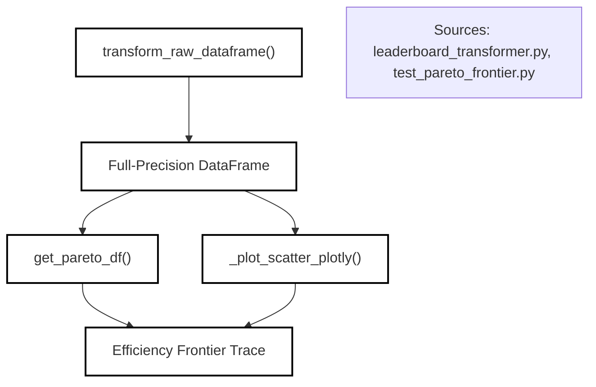
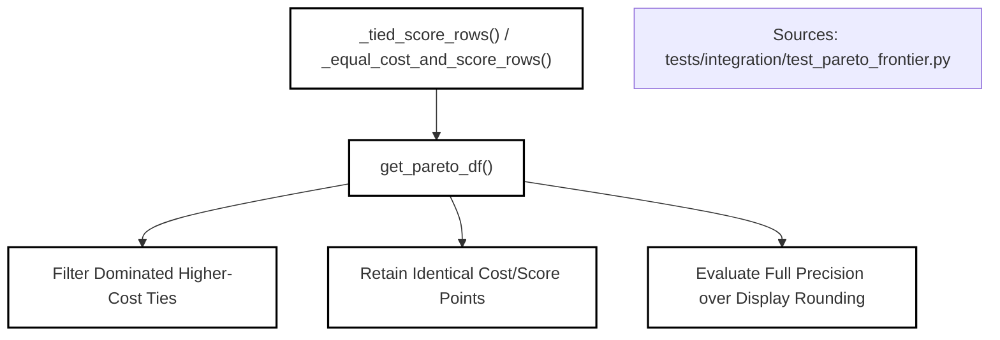

<!-- source: DeepWiki mcp.deepwiki.com · repo allenai/asta-bench-leaderboard · extra page Pareto Frontier & Cost/Score Metrics · fetched 2026-11-09 -->

# Pareto Frontier & Cost/Score Metrics

Relevant source files

The following files were used as context for generating this wiki page:

- [leaderboard_transformer.py](leaderboard_transformer.py)
- [tests/integration/test_metric_precision.py](tests/integration/test_metric_precision.py)
- [tests/integration/test_pareto_frontier.py](tests/integration/test_pareto_frontier.py)

This page documents the data transformation and evaluation mechanics for the AstaBench leaderboard, specifically focusing on the Pareto frontier computation (`get_pareto_df`), missing-cost and tie handling, metric precision preservation, and their associated test suites.

---

## 1. Purpose and Scope

The AstaBench leaderboard evaluates agents across multiple axes of capability (scores) and resource consumption (costs). To help users navigate trade-offs, the system computes an **Efficiency Frontier** (Pareto frontier) [tests/integration/test_pareto_frontier.py:63-63]() balancing agent cost against performance score. 

To maintain mathematical correctness during frontier calculations, raw metrics are preserved at full floating-point precision during transformations (`transform_raw_dataframe`) [leaderboard_transformer.py:168-180](). Display-layer rounding and tooltips are applied separately.

Sources:
- `leaderboard_transformer.py:168-180`
- `tests/integration/test_pareto_frontier.py:1-67`

---

## 2. Pareto Frontier Calculation (`get_pareto_df`)

The Pareto frontier calculation identifies the set of non-dominated agent submissions. An agent is considered Pareto-optimal if no other agent achieves a **strictly higher score at equal or lower cost**, or a **higher or equal score at strictly lower cost**. 

*Figure 1: Data flow from raw transformations to Pareto frontier extraction.*

Sources:
- `leaderboard_transformer.py:168-180`
- `tests/integration/test_pareto_frontier.py:50-50`

---

## 3. Tie Handling and Edge Cases

The Pareto engine accounts for several edge cases regarding tied metrics, identical data points, and rounding artifacts:

1. **Score Ties at Higher Cost:** If two agents achieve the exact same score, the one with the higher cost is dominated and excluded from the frontier [tests/integration/test_pareto_frontier.py:49-53]().
2. **Identical Cost and Score:** When two distinct submissions share identical cost and score values, neither dominates the other; both are retained on the frontier [tests/integration/test_pareto_frontier.py:95-98]().
3. **Display Rounding vs. Full Precision:** Values that appear identical when rounded to 3 decimal places (e.g., `0.85331` vs `0.85330`) are compared at full floating-point precision. Display rounding never alters Pareto membership [tests/integration/test_pareto_frontier.py:114-140]().

*Figure 2: Validation paths for tie-breaking and precision during Pareto analysis.*

Sources:
- `tests/integration/test_pareto_frontier.py:18-141`

---

## 4. Precision Preservation and Metric Formatting

Raw dataframes processed by `transform_raw_dataframe` retain full precision so that sorting, confidence interval displays, and Pareto calculations remain uncorrupted [leaderboard_transformer.py:168-180](). 

When rendering tables or scatter plots:
- **Table Cells:** Display values are truncated or rounded (e.g., to 3 decimal places), while full-precision values are injected into HTML tooltips (`data-tooltip`) [tests/integration/test_metric_precision.py:16-35]().
- **Missing vs. Zero Scores:** A score of `0.0` retains its zero-value representation and tooltip, whereas `None` (missing score) omits the tooltip and renders with a fallback style [tests/integration/test_metric_precision.py:37-51]().
- **Plotly Integration:** Scatter plots (`_plot_scatter_plotly`) extract error arrays for confidence intervals directly from unrounded dataframe columns [tests/integration/test_metric_precision.py:53-80]().

Sources:
- `leaderboard_transformer.py:168-180`
- `tests/integration/test_metric_precision.py:1-118`

---

## 5. Test Suites & Verification

The correctness of cost/score transformations and Pareto frontier calculations is verified via dedicated integration tests:

* `tests/integration/test_pareto_frontier.py`: Validates `get_pareto_df` behavior on tied scores, identical coordinate points, and raw-vs-rendered precision filtering [tests/integration/test_pareto_frontier.py:1-140]().
* `tests/integration/test_metric_precision.py`: Validates `format_cost_column`, `format_score_column`, and `_plot_scatter_plotly` confidence intervals and tooltip preservation [tests/integration/test_metric_precision.py:1-117]().

Sources:
- `tests/integration/test_pareto_frontier.py:1-141`
- `tests/integration/test_metric_precision.py:1-118`

---

