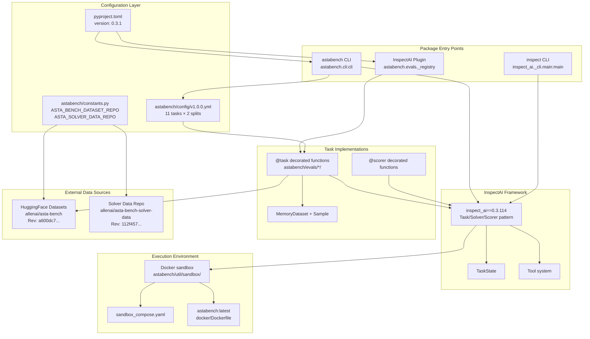
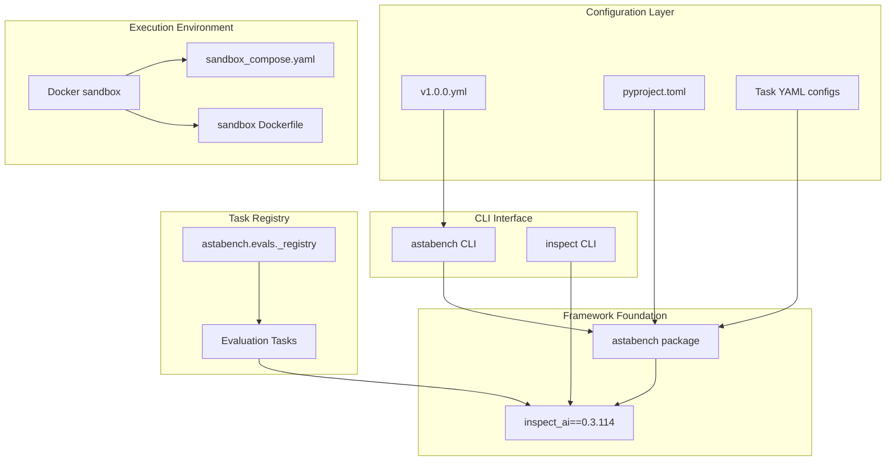
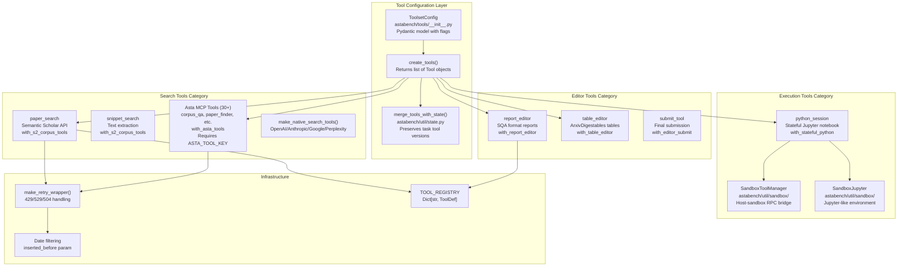
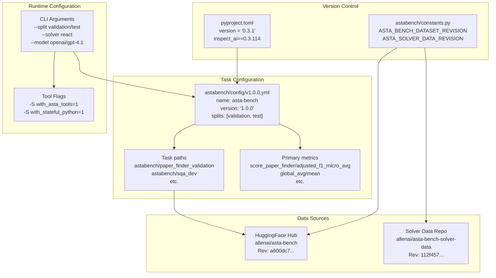

<!-- source: DeepWiki mcp.deepwiki.com · repo allenai/asta-bench · page 1 Overview · fetched 2026-10-26 -->

# Overview

Relevant source files

The following files were used as context for generating this wiki page:

- [Makefile](Makefile)
- [README.md](README.md)
- [astabench/cli.py](astabench/cli.py)
- [astabench/config/v1.0.0-dev1.yml](astabench/config/v1.0.0-dev1.yml)
- [astabench/config/v1.0.0.yml](astabench/config/v1.0.0.yml)
- [astabench/constants.py](astabench/constants.py)
- [docker/Dockerfile](docker/Dockerfile)
- [pyproject.toml](pyproject.toml)

ASTA-Bench is an evaluation framework for measuring the scientific research capabilities of AI agents. Built on InspectAI, it provides 2,400+ evaluation samples across 11 standardized benchmarks that test agents on literature search, code execution, data analysis, and end-to-end scientific discovery workflows.

The framework provides:
- **11 benchmarks** organized into 4 categories (literature, code, data, discovery)
- **Standardized tool ecosystem** including search tools, code execution environments, and structured editors
- **Reproducible evaluation infrastructure** with Docker-based sandboxing and dataset versioning
- **Cost tracking and scoring** with unified metrics across heterogeneous task types

For installation and setup instructions, see [Getting Started](#2). For details on specific evaluation tasks, see [Evaluation Tasks](#5). For information about extending the framework, see [Development](#6).
</old_str>

<old_str>
## The 11 Benchmarks

ASTA-Bench contains 11 evaluation tasks organized into 4 thematic categories. Each task is available in both `validation` and `test` splits, defined in `astabench/config/v1.0.0.yml`.

**Task Registry and Implementation Mapping**

```mermaid
graph TB
    subgraph "Configuration"
        V1YML["v1.0.0.yml<br/>validation + test splits"]
    end
    
    subgraph "Literature Tasks (lit tag)"
        PF["PaperFindingBench<br/>astabench/paper_finder_{validation,test}<br/>Primary: adjusted_f1_micro_avg<br/>333 queries"]
        PFSEARCH["LitQA2 Search<br/>astabench/paper_finder_litqa2_{validation,test}<br/>Primary: recall_at_30"]
        SQA["ScholarQA CS2<br/>astabench/sqa_{dev,test}<br/>Primary: global_avg/mean"]
        LITQA["LitQA2 FullText<br/>astabench/litqa2_{validation,test}<br/>Primary: is_correct/accuracy"]
        ARXIV["ArxivDIGESTables Clean<br/>astabench/arxivdigestables_{validation,test}<br/>Primary: score_tables/mean"]
    end
    
    subgraph "Code Tasks (code tag)"
        CORE["CORE-Bench Hard<br/>astabench/core_bench_{validation,test}<br/>Primary: score_with_stderr/accuracy"]
        DS1000["DS-1000<br/>astabench/ds1000_{validation,test}<br/>Primary: ds1000_scorer/accuracy"]
        SUPER["SUPER Expert<br/>astabench/super_{validation,test}<br/>Primary: entrypoint/mean (val)<br/>output_match/mean (test)"]
    end
    
    subgraph "Data Tasks (data tag)"
        DISCO["DiscoveryBench<br/>astabench/discoverybench_{validation,test}<br/>Primary: score_discoverybench/mean"]
    end
    
    subgraph "Discovery Tasks (discovery tag)"
        E2E["E2E-Bench<br/>astabench/e2e_discovery_{validation,test}<br/>Primary: score_rubric/accuracy"]
        E2EHARD["E2E-Bench Hard<br/>astabench/e2e_discovery_hard_{validation,test}<br/>Primary: score_rubric/accuracy"]
    end
    
    V1YML --> PF
    V1YML --> PFSEARCH
    V1YML --> SQA
    V1YML --> LITQA
    V1YML --> ARXIV
    V1YML --> CORE
    V1YML --> DS1000
    V1YML --> SUPER
    V1YML --> DISCO
    V1YML --> E2E
    V1YML --> E2EHARD
```

Sources: [astabench/config/v1.0.0.yml:5-134](), [README.md:327-358]()

### Task Categories

| Category | Tag | # Tasks | Description |
|----------|-----|---------|-------------|
| Literature | `lit` | 5 | Paper search, literature QA, table extraction from papers |
| Code | `code` | 3 | Programming challenges, data science tasks, trajectory tracking |
| Data | `data` | 1 | Data-driven scientific discovery |
| Discovery | `discovery` | 2 | End-to-end discovery workflows |

Sources: [astabench/config/v1.0.0.yml:10-56,62-133]()

### Task Naming Convention

Tasks follow a consistent naming pattern:
- **InspectAI task name**: `astabench/{task_name}_{split}` (e.g., `astabench/paper_finder_validation`)
- **Display name**: Full task name as shown in configuration (e.g., `PaperFindingBench_validation`)
- **Primary metric**: The metric used for aggregation (e.g., `score_paper_finder/adjusted_f1_micro_avg`)

The validation split is used for development and hyperparameter tuning, while the test split is used for final leaderboard submission.

Sources: [astabench/config/v1.0.0.yml:5-134](), [README.md:358]()

### Macro-Averaging with Weight Adjustments

ASTA-Bench computes a unified score across all tasks using macro-averaging with tag-based grouping. Some tasks receive weight adjustments in the configuration:

- LitQA2 FullText: weight 0.5 (to balance with its paired search task)
- LitQA2 FullText Search: weight 0.5

This ensures that paired tasks (LitQA2 question answering + paper finding) don't dominate the literature category score.

Sources: [astabench/config/v1.0.0.yml:62-68,127-133]()
</old_str>
<new_str>
## System Architecture

ASTA-Bench is built as a Python package that extends InspectAI through its plugin system. The architecture follows a layered design with configuration-driven task execution.

**System Architecture and Code Structure**

Sources: [pyproject.toml:5-7,50-55](), [astabench/constants.py:1-6](), [astabench/config/v1.0.0.yml:1-134](), [astabench/cli.py:1-28]()

### Package Structure

The system is structured as a Python package (`astabench`) with the following key components:

| Component | File Path | Purpose |
|-----------|-----------|---------|
| CLI Entry Point | `astabench.cli:cli` | Main command-line interface wrapping `inspect eval-set` |
| InspectAI Plugin | `astabench.evals._registry` | Registers all 11 evaluation tasks with InspectAI |
| Task Configuration | `astabench/config/v1.0.0.yml` | Defines validation and test splits with 11 tasks each |
| Dataset Versioning | `astabench/constants.py` | Pins HuggingFace dataset revisions for reproducibility |
| Sandbox Environment | `astabench/util/sandbox/` | Docker-based code execution isolation |

Sources: [pyproject.toml:50-55](), [astabench/constants.py:1-6]()

### InspectAI Integration

ASTA-Bench extends InspectAI by implementing the Task/Solver/Scorer pattern:

- **Tasks**: Defined using the `@task` decorator, each task loads a dataset and specifies scoring methods
- **Solvers**: Provided by the user (e.g., ReAct, custom agents), process `TaskState` and use tools from `state.tools`
- **Scorers**: Defined using the `@scorer` decorator, evaluate solver outputs against targets and return metrics

All task implementations are registered through the `[project.entry-points.inspect_ai]` section in `pyproject.toml`, making them discoverable via the `astabench/` namespace.

Sources: [pyproject.toml:54-55](), [README.md:7,234-241]()

## System Purpose and Architecture

AstaBench serves as a comprehensive evaluation suite built on top of the `inspect_ai` framework. The system provides over 2,400 evaluation examples across 11 benchmarks, testing AI agents' ability to perform scientific research tasks including literature search, code execution, data analysis, and discovery workflows.

**Core Architecture Diagram**

Sources: [pyproject.toml:1-126](), [README.md:1-369](), [docker/Dockerfile:1-66]()

The system is structured as a Python package with entry points defined in `pyproject.toml`. The main CLI entry point `astabench = "astabench.cli:cli"` provides the primary interface, while the evaluation tasks are registered through the InspectAI plugin system via `astabench = "astabench.evals._registry"`.

## Tool Ecosystem

ASTA-Bench provides a comprehensive tool ecosystem that agents can use during evaluation. Tools are configured via `ToolsetConfig` and merged with task-provided tools using `merge_tools_with_state()`.

**Tool Configuration and Implementation**

Sources: [README.md:271-301](), [astabench/config/v1.0.0.yml:104]()

### Tool Categories

| Category | CLI Flag | Description | Key Classes |
|----------|----------|-------------|-------------|
| Search | `-S with_s2_corpus_tools=1` | Semantic Scholar paper/snippet search | `paper_search`, `snippet_search` |
| Search | `-S with_asta_tools=1` | 30+ Asta MCP research tools | Requires `ASTA_TOOL_KEY` |
| Execution | `-S with_stateful_python=1` | Jupyter-like code execution | `SandboxToolManager`, `SandboxJupyter` |
| Editor | `-S with_report_editor=1` | Scientific report composition | `report_editor` for SQA tasks |
| Editor | `-S with_table_editor=1` | Data table creation | `table_editor` for ArxivDigestables |
| Thinking | `-S with_thinking_tool=1` | Extended reasoning | For chain-of-thought |

Sources: [README.md:288-295]()

### Task-Provided Tools vs. Optional Tools

Tasks may provide their own tools in `state.tools` with specific constraints (e.g., date restrictions on search tools for reproducibility). When using `merge_tools_with_state()`, task-provided tools take precedence over optional tools with the same name, ensuring that task-specific constraints are preserved.

**Example workflow:**
1. Solver creates optional tools via `ToolsetConfig(**kwargs).create_tools()`
2. Solver merges with task tools via `merge_tools_with_state(optional_tools)`
3. Task-provided search tools (with date restrictions) override optional search tools
4. Agent uses final merged toolset from `state.tools`

Sources: [README.md:273-287,295]()

### Sandbox Communication

Sandbox tools use a file-based RPC mechanism defined in `sandbox_compose.yaml` to enable communication between host and sandbox processes. This allows:
- Code execution in isolated Docker containers
- Tool calling from sandboxed Python code back to host tools
- Persistent state across multiple code executions

Sources: [README.md:296-297](), [pyproject.toml:104]()

## Configuration System

ASTA-Bench uses a layered configuration system with version pinning for reproducibility.

**Configuration File Hierarchy**

Sources: [pyproject.toml:5-7](), [astabench/constants.py:1-6](), [astabench/config/v1.0.0.yml:1-134]()

### Configuration Files

| File | Purpose | Key Fields |
|------|---------|------------|
| `pyproject.toml` | Package metadata and dependencies | `version`, `dependencies`, `project.scripts`, `project.entry-points.inspect_ai` |
| `astabench/constants.py` | Dataset version pinning | `ASTA_BENCH_DATASET_REPO`, `ASTA_BENCH_DATASET_REVISION`, `ASTA_SOLVER_DATA_REPO`, `ASTA_SOLVER_DATA_REVISION` |
| `astabench/config/v1.0.0.yml` | Task suite definition | `splits`, `tasks`, `primary_metric`, `tags`, `macro_average_weight_adjustments` |
| `.env` | Environment variables | `ASTA_TOOL_KEY`, `HF_TOKEN`, `OPENAI_API_KEY`, etc. |

Sources: [pyproject.toml:5-7,50-55](), [astabench/constants.py:1-6](), [astabench/config/v1.0.0.yml:1-134](), [README.md:86-103]()

### CLI Interface

The `astabench` CLI (defined in `astabench/cli.py`) wraps InspectAI's `eval-set` command with additional features:

**CLI Command Structure:**
- `astabench eval`: Execute evaluation suite with metadata tracking
  - `--split {validation,test}`: Choose evaluation split
  - `--log-dir`: Directory for evaluation logs
  - `--ignore-git`: Skip git status check for reproducibility
  - Standard InspectAI options: `--solver`, `--model`, `--max-samples`, etc.
  
- `astabench score <log_dir>`: Aggregate scores and calculate costs
  - Processes `.eval` files in the directory
  - Computes macro-averaged scores by tag
  - Calculates total model usage costs

- `inspect eval`: Direct evaluation of individual tasks
  - Format: `inspect eval --solver <solver> --model <model> astabench/<task_name>`
  - Example: `inspect eval --solver react --model openai/gpt-4.1 astabench/sqa_dev`

Sources: [astabench/cli.py:1-28](), [README.md:114-157]()

### Reproducibility Mechanisms

ASTA-Bench enforces reproducibility through:

1. **Dataset version pinning**: Commit hashes in `constants.py` ensure identical datasets
2. **Git status tracking**: `astabench eval` records git SHA and fails on uncommitted changes (unless `--ignore-git`)
3. **Configuration versioning**: YAML config includes version field (`1.0.0`)
4. **Dependency pinning**: `pyproject.toml` pins `inspect_ai==0.3.114`
5. **Evaluation metadata**: All runs record model, solver, and configuration details

Sources: [astabench/constants.py:1-6](), [README.md:119]()

## Configuration and CLI Interface

AstaBench uses a YAML-based configuration system with the primary configuration defined in `astabench/config/v1.0.0.yml`. The CLI provides wrapper functionality around InspectAI's `eval-set` command with additional metadata and task management.

### Key CLI Commands
- `astabench eval`: Execute evaluation suites with enhanced logging and reproducibility metadata
- `astabench score`: Aggregate results and calculate model usage costs  
- `inspect eval`: Direct task execution for individual benchmarks
- `inspect view`: Result visualization and analysis

### Configuration Files
- **Task definitions**: Individual YAML configurations for each benchmark
- **Suite configuration**: `v1.0.0.yml` defining validation and test splits
- **Package data**: Embedded configurations via `setuptools.package-data` in `pyproject.toml`

Sources: [README.md:114-148](), [pyproject.toml:103-111]()

## Development Environment and Containerization

The system uses Docker for consistent evaluation environments across development, testing, and production. Multiple solver-specific images are built from a common base, with each solver having its own setup requirements.

### Docker Structure
- **Base image**: `astabench-base` with Python 3.11.3 and core dependencies
- **Solver images**: `react`, `smolagents`, `storm`, `sqa`, `super`, `datavoyager`, `futurehouse`
- **Sandbox environment**: Separate sandbox container with `sandbox_compose.yaml` and `Dockerfile`

### Build System
- **Makefile**: Development workflows including `make shell`, `make format`, `make test`
- **UV package manager**: Dependency management and virtual environment handling
- **PyPI publishing**: Automated release pipeline through GitHub Actions

Sources: [docker/Dockerfile:1-66](), [pyproject.toml:1-126]()

The framework provides comprehensive evaluation capabilities for AI agents performing scientific research tasks, with standardized tools, reproducible environments, and detailed cost tracking to enable fair comparison of different agent approaches.

---

