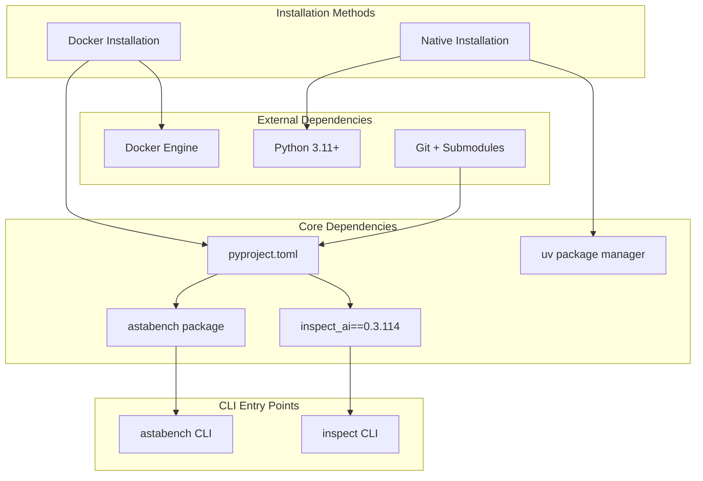
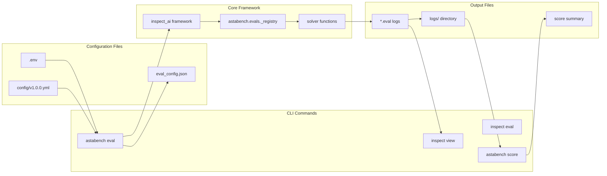

<!-- source: DeepWiki mcp.deepwiki.com · repo allenai/asta-bench · page 2 Getting Started · fetched 2026-10-26 -->

# Getting Started

<details>
<summary>Relevant source files</summary>

The following files were used as context for generating this wiki page:

- [Makefile](Makefile)
- [README.md](README.md)
- [docker/Dockerfile](docker/Dockerfile)
- [pyproject.toml](pyproject.toml)

</details>


This guide covers the essential steps to install AstaBench, configure your environment, and run your first evaluation. AstaBench is an evaluation framework for measuring the scientific research abilities of AI agents, built on top of the InspectAI framework.

For detailed installation instructions, see [Installation and Setup](#2.1). For step-by-step examples of running evaluations, see [Quick Start Guide](#2.2). For comprehensive framework architecture details, see [Core Framework](#3).

## Installation Overview

AstaBench provides two installation paths: Docker-based (recommended) for consistent environments, or native installation using `uv`. The framework requires Python 3.11+ and integrates with external APIs for literature search and model access.

**Installation Architecture**



Sources: [pyproject.toml:1-126](), [README.md:66-83](), [Makefile:62-63](), [docker/Dockerfile:1-66]()

## Environment Configuration

AstaBench requires several API keys for full functionality. These are configured via environment variables or a `.env` file at the project root.

| Variable | Purpose | Required For |
|----------|---------|--------------|
| `S2_API_KEY` | Semantic Scholar API access | Literature search tools |
| `OPENAI_API_KEY` | OpenAI model access | Model inference and scoring |
| `ANTHROPIC_API_KEY` | Anthropic model access | Alternative model providers |
| `GOOGLE_API_KEY` | Google AI model access | Alternative model providers |
| `HF_TOKEN` | Hugging Face dataset access | Dataset downloading |

Sources: [README.md:85-103](), [Makefile:21-37]()

## Basic Installation Commands

**Docker Installation (Recommended):**
```bash
git clone https://github.com/allenai/asta-bench.git
cd asta-bench
make shell SOLVER=react
```

**Native Installation:**
```bash
git clone https://github.com/allenai/asta-bench.git
cd asta-bench
curl -LsSf https://astral.sh/uv/install.sh | sh
uv sync
```

Sources: [README.md:36-42](), [README.md:68-82]()

## First Evaluation Workflow

The basic evaluation workflow involves configuring API keys, running a test evaluation, and examining results through the CLI tools.

**Evaluation Command Flow**



Sources: [README.md:51-64](), [README.md:114-127](), [README.md:154-158](), [pyproject.toml:49-54]()

## Demo Task Execution

Test your installation with the built-in arithmetic demo task:

```bash
# Test basic inspect functionality
uv run inspect eval --solver generate --model openai/gpt-4o-mini astabench/arithmetic_demo

# Run limited AstaBench suite for testing
uv run astabench eval --solver react --model openai/gpt-4o-mini --split validation --limit 1 --log-dir=logs/test-run/

# Score the results
uv run astabench score logs/test-run/
```

The `--limit 1` flag runs only one problem per task to minimize API costs during testing. Remove this flag for full evaluation runs.

Sources: [README.md:51-60]()

## System Requirements and Considerations

AstaBench evaluations can be resource-intensive, particularly for coding tasks that use sandboxed execution environments.

**Resource Requirements:**
- **Memory**: 10+ GB for framework, 20-30 GB for complex coding tasks
- **CPU**: 8+ physical cores recommended for parallel execution  
- **Storage**: Several GB for datasets and Docker images
- **Network**: Stable connection for API calls and dataset downloads

**Parallelism Configuration:**
- `--max-samples`: Number of problems to run in parallel (≤ CPU cores)
- `--max-connections`: Concurrent model API connections
- `INSPECT_DOCKER_CLI_CONCURRENCY`: Docker operation concurrency (≥ 2× max-samples)

Sources: [README.md:105-109](), [README.md:193-210]()

## Next Steps

After completing basic installation and testing:

1. **Configure your solver**: See [Tool System](#4) for configuring agent capabilities
2. **Run full evaluations**: Remove `--limit` flags and configure parallelism for your system
3. **Explore specific tasks**: See [Evaluation Tasks](#5) for detailed task documentation
4. **View detailed results**: Use `inspect view` web interface for result analysis
5. **Submit to leaderboard**: See submission guidelines in [README.md:159-191]()

For development workflows and advanced usage, see [Development](#6) and [Evaluation Pipelines](#7).

Sources: [README.md:110-227]()

---

