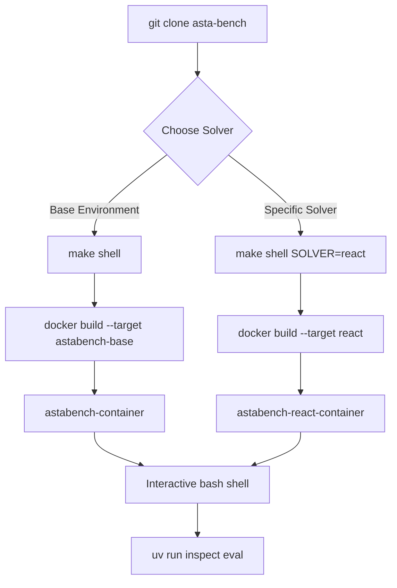
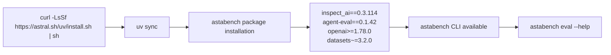
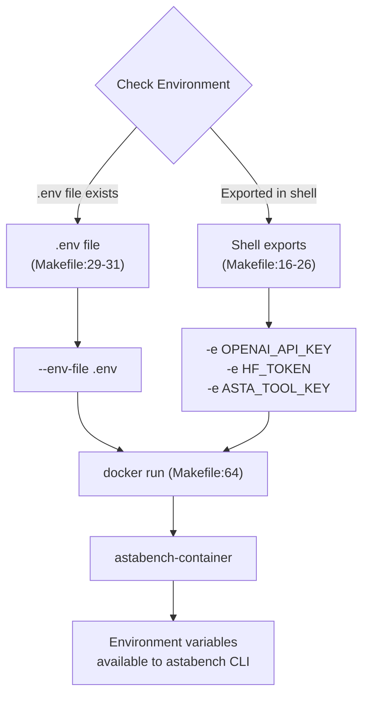
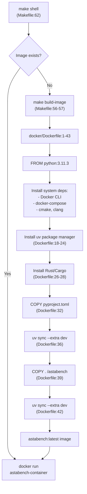
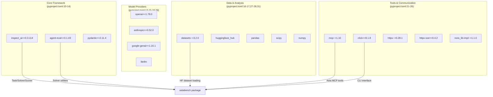

<!-- source: DeepWiki mcp.deepwiki.com · repo allenai/asta-bench · page 2.1 Installation and Setup · fetched 2026-10-26 -->

# Installation and Setup

<details>
<summary>Relevant source files</summary>

The following files were used as context for generating this wiki page:

- [Makefile](Makefile)
- [README.md](README.md)
- [astabench/tools/asta_tools.py](astabench/tools/asta_tools.py)
- [astabench/tools/search.py](astabench/tools/search.py)
- [docker/Dockerfile](docker/Dockerfile)
- [pyproject.toml](pyproject.toml)
- [solvers/paper_finder/setup.sh](solvers/paper_finder/setup.sh)

</details>


This page provides comprehensive instructions for installing AstaBench and configuring your environment for AI agent evaluation. It covers dependency installation, environment variable configuration, Docker setup, and system requirements verification.

For running evaluations after installation, see [Quick Start Guide](#2.2). For development environment setup, see [Development Environment](#6.1).

## Prerequisites and System Requirements

AstaBench requires Python 3.11+ and has significant memory requirements for full evaluation suites. The framework can consume up to 10 GB of memory internally, with individual coding tasks potentially requiring 20-30 GB for sandbox execution.

### Recommended System Specifications

| Component | Minimum | Recommended |
|-----------|---------|-------------|
| Memory | 16 GB | 128 GB |
| CPU Cores | 4 physical cores | 8 physical cores (16 vCPU) |
| Python Version | 3.11 | 3.11+ |
| Docker | Optional for core framework | Required for sandboxed tasks |

**Docker Requirements**: Most tasks require Docker for sandboxed code execution. Even non-Docker installations need Docker available for tasks like SUPER, CORE-Bench, and DiscoveryBench.

Sources: [README.md:105-108](), [pyproject.toml:9]()

## Installation Methods

### Docker Installation (Recommended)

The Docker approach provides a consistent environment with all dependencies pre-configured. This method uses the `Makefile` to manage Docker operations and supports multiple solver configurations.

#### Installation Flow Diagram



#### Step-by-Step Docker Setup

1. **Clone the repository with submodules**:
   ```bash
   git clone --recursive https://github.com/allenai/asta-bench.git
   cd asta-bench
   ```

2. **Configure environment variables** (create `.env` file as shown above or export variables)

3. **Launch Docker environment**:
   ```bash
   make shell
   ```
   
   This command (`Makefile:62-69`):
   - Updates git submodules
   - Builds the `astabench:latest` Docker image (`docker/Dockerfile:1-43`)
   - Starts an interactive container with mounted volumes
   - Exposes port 7575 for the Inspect UI

4. **Verify installation inside the container**:
   ```bash
   uv run inspect eval --solver generate --model openai/gpt-4.1 astabench/arithmetic_demo
   ```

**What `make shell` sets up**:
- Docker socket mount for sandbox execution (`Makefile:43,65`)
- Code volume mounts for live development (`Makefile:44-47`)
- Cache volumes for dependencies (`Makefile:48,66`)
- Environment variable forwarding (`Makefile:15-31`)

Sources: [README.md:36-41](), [README.md:69-74](), [Makefile:62-69](), [docker/Dockerfile:1-43]()

### Non-Docker Installation

For users who prefer local installation or have Docker limitations, AstaBench can be installed directly using `uv`.

#### Installation Process Diagram



#### Installation Commands

1. **Install uv package manager**:
   ```bash
   curl -LsSf https://astral.sh/uv/install.sh | sh
   ```

2. **Clone the repository**:
   ```bash
   git clone --recursive https://github.com/allenai/asta-bench.git
   cd asta-bench
   ```

3. **Install AstaBench and dependencies**:
   ```bash
   uv sync
   ```
   
   This installs all dependencies from `pyproject.toml` and registers the `astabench` package.

4. **Verify CLI availability**:
   ```bash
   uv run astabench --help
   uv run inspect --help
   ```

**Important**: Docker is still required for sandboxed task execution (SUPER, CORE-Bench, DS-1000, DiscoveryBench, E2E-Bench) even with local installation. The sandbox uses `astabench/util/sandbox/sandbox_compose.yaml` to start execution containers.

Sources: [README.md:81-82](), [pyproject.toml:10-31](), [README.md:69-74]()

## Environment Variable Configuration

AstaBench requires multiple API keys for external services. These can be configured via `.env` file or environment variables.

### Required Environment Variables

| Variable | Purpose | Required For |
|----------|---------|--------------|
| `ASTA_TOOL_KEY` | Asta MCP API access | Literature search tasks (paper_search, snippet_search, Asta MCP tools) |
| `HF_TOKEN` | Hugging Face dataset access | All tasks (dataset loading from allenai/asta-bench) |

### Model Provider API Keys

At least one of these is required depending on your solver and scoring configuration:

| Variable | Purpose | Required For |
|----------|---------|-------------|
| `OPENAI_API_KEY` | OpenAI model access | Most evaluations, GPT models |
| `ANTHROPIC_API_KEY` | Anthropic model access | Claude models, some scoring tasks |
| `GOOGLE_API_KEY` | Google model access | Gemini models, some scoring tasks |

### Optional Environment Variables

| Variable | Purpose | When Needed |
|----------|---------|-------------|
| `AZUREAI_OPENAI_API_KEY` | Azure OpenAI access | Azure-hosted models |

### Configuration Methods

#### Using .env File (Recommended)

Create a `.env` file in the repository root:

```bash
# Required: Asta MCP API key for literature search tools
# Get from: https://allenai-web-dev.allen.ai/asta/resources/mcp
ASTA_TOOL_KEY=your-asta-tool-key

# Required: Hugging Face token for dataset access
# Accept license at https://huggingface.co/datasets/allenai/asta-bench
# Then get token from https://huggingface.co/settings/tokens
HF_TOKEN=your-huggingface-token

# Model provider API keys (at least one required)
OPENAI_API_KEY=your-openai-key
ANTHROPIC_API_KEY=your-anthropic-key
GOOGLE_API_KEY=your-google-key

# Optional: Azure OpenAI access
AZUREAI_OPENAI_API_KEY=your-azure-key
```

#### Environment Variable Loading

**Environment Variable Loading Flow**



The `Makefile` automatically detects `.env` files and individual environment variables, passing them to Docker containers via `--env-file` or `-e` flags.

Sources: [README.md:87-103](), [Makefile:15-31](), [Makefile:64]()

## Docker Image Build Process

Understanding how the Docker image is built helps with troubleshooting and customization.

### Docker Build Flow

**Docker Image Build Process**



### Build Stages

The Dockerfile performs two `uv sync` operations:

1. **First sync** (line 36): Installs dependencies based on `pyproject.toml` alone, enabling Docker layer caching
2. **Second sync** (line 42): Registers the `astabench` and `inspect_evals` packages after code is copied

This two-stage approach optimizes build caching—dependency installation is cached separately from code changes.

Sources: [docker/Dockerfile:1-43](), [Makefile:56-57]()

## Package Dependencies and Entry Points

AstaBench extends the `inspect_ai` framework with specialized evaluation tasks and tools.

### Core Dependencies Structure

**Package Dependency Graph**



### CLI Entry Points

The package registers two CLI commands via `pyproject.toml:50-52`:

| Command | Target | Purpose |
|---------|--------|---------|
| `astabench` | `astabench.cli:cli` | Main AstaBench CLI with `eval` and `score` commands |
| `inspect` | `inspect_ai._cli.main:main` | Direct InspectAI CLI access for low-level operations |

### Task Registration

Tasks are automatically discovered via the InspectAI plugin system (`pyproject.toml:54-55`):

```
[project.entry-points.inspect_ai]
astabench = "astabench.evals._registry"
```

This enables InspectAI to find all `@task` decorated functions in the `astabench.evals._registry` module.

Sources: [pyproject.toml:10-32](), [pyproject.toml:50-55](), [pyproject.toml:57-59]()

## Installation Verification

### Basic Functionality Test

Verify core installation with the arithmetic demo task:

```bash
uv run inspect eval --solver generate --model openai/gpt-4.1 astabench/arithmetic_demo
```

### Full Suite Test

Test the complete evaluation pipeline with minimal samples:

```bash
uv run astabench eval --solver react --model openai/gpt-4.1 --split validation --limit 1 --log-dir=logs/verification/
```

### Docker Environment Test

Verify Docker integration and sandbox functionality:

```bash
# Test Docker compose functionality
docker compose --version

# Test sandbox creation (requires Docker socket access)
uv run inspect eval --solver python_session --model openai/gpt-4.1 astabench/arithmetic_demo
```

## Common Setup Issues

### Docker Socket Access

**Issue**: `permission denied while trying to connect to the Docker daemon socket`

**Solution**: Ensure Docker socket is properly mounted and accessible:
```bash
# Check Docker socket path (Makefile:8 sets default)
echo $DOCKER_SOCKET_PATH

# Verify socket accessibility (should show srw-rw----)
ls -la /var/run/docker.sock

# Ensure your user is in the docker group
groups | grep docker
```

The `Makefile` uses `DOCKER_SOCKET_PATH` to support both standard Docker (`/var/run/docker.sock`) and rootless Docker (`$XDG_RUNTIME_DIR/docker.sock`) setups (see `Makefile:8`).

Sources: [Makefile:8](), [Makefile:43](), [Makefile:65]()

### Memory Limitations

**Issue**: Out-of-memory errors during evaluation

**Solution**: Reduce parallelism or increase system memory:
```bash
# Reduce parallel execution
uv run astabench eval --max-samples 1 --max-sandboxes 1 [other args]
```

### API Key Validation

**Issue**: Authentication failures for external services

**Solution**: Verify API key configuration:
```bash
# Test ASTA_TOOL_KEY (used by astabench/tools/search.py:18)
curl -H "x-api-key: $ASTA_TOOL_KEY" https://api.semanticscholar.org/graph/v1/paper/search?query=test&limit=1

# Test HF_TOKEN
curl -H "Authorization: Bearer $HF_TOKEN" https://huggingface.co/api/whoami-v2

# Test OpenAI key
curl -H "Authorization: Bearer $OPENAI_API_KEY" https://api.openai.com/v1/models
```

### UV Installation Issues

**Issue**: `uv` command not found or installation fails

**Solution**: Manual UV installation:
```bash
# Alternative installation method
curl -fsSL https://astral.sh/uv/install.sh | sh
export PATH="$HOME/.local/bin:$PATH"
```

Sources: [README.md:212-227]()

---

