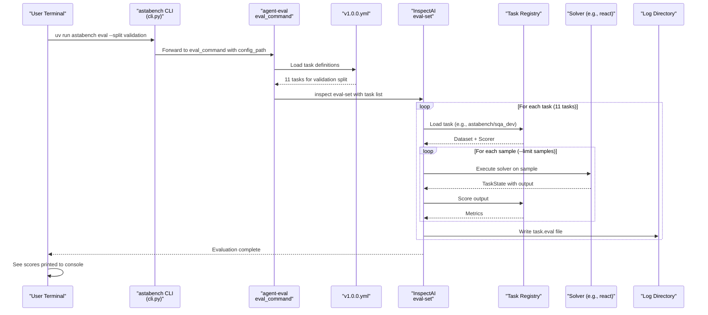
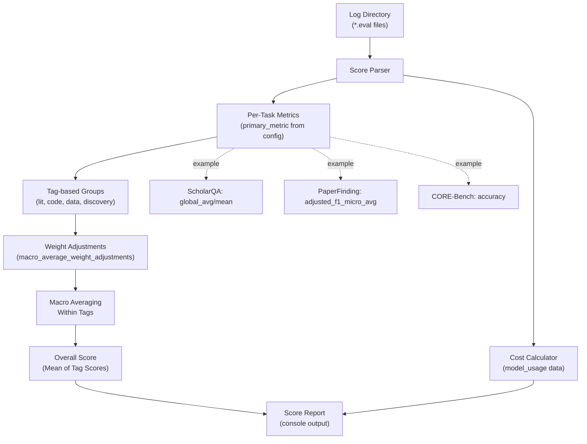
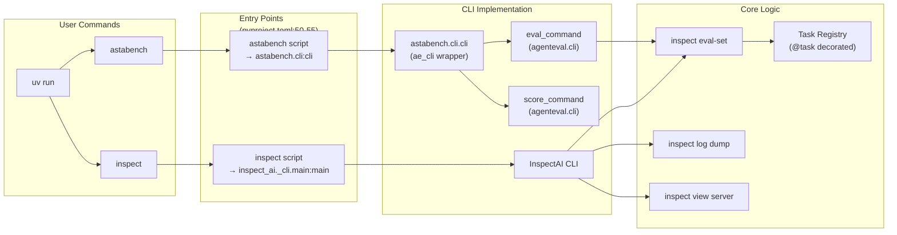

<!-- source: DeepWiki mcp.deepwiki.com · repo allenai/asta-bench · page 2.2 Quick Start Guide · fetched 2026-10-26 -->

# Quick Start Guide

<details>
<summary>Relevant source files</summary>

The following files were used as context for generating this wiki page:

- [Makefile](Makefile)
- [README.md](README.md)
- [astabench/cli.py](astabench/cli.py)
- [astabench/config/v1.0.0-dev1.yml](astabench/config/v1.0.0-dev1.yml)
- [astabench/config/v1.0.0.yml](astabench/config/v1.0.0.yml)
- [docker/Dockerfile](docker/Dockerfile)
- [pyproject.toml](pyproject.toml)

</details>


This guide provides step-by-step instructions for running your first ASTA-Bench evaluation, understanding the output logs, and scoring results. It assumes you have completed the installation and setup steps outlined in [Installation and Setup](#2.1).

For detailed information about the evaluation framework architecture, see [Architecture Overview](#3.1). For comprehensive documentation on individual benchmarks, see [Evaluation Tasks](#5). For solver development, see [Solver Development](#7.2).

## Prerequisites

Before proceeding, ensure you have:
- Completed installation per [Installation and Setup](#2.1)
- Set required environment variables (`OPENAI_API_KEY`, `ASTA_TOOL_KEY`, `HF_TOKEN`, etc.)
- Docker running (if using the containerized environment)

Sources: [README.md:32-66]()

## Testing Your Installation

First, verify your setup by running a minimal demo task. The `arithmetic_demo` task uses InspectAI's built-in `generate` solver, which directly queries the LLM without tool usage:

```bash
uv run inspect eval --solver generate --model openai/gpt-4.1 astabench/arithmetic_demo
```

This command should complete quickly and output basic evaluation metrics. If you encounter errors, verify your API keys and Docker setup.

Sources: [README.md:52-55]()

## Running Your First Evaluation

### Command Structure

The `astabench eval` command is a wrapper around InspectAI's `inspect eval-set` that provides task configuration and enhanced logging:

```bash
uv run astabench eval --solver <solver> --model <model> --split <split> --log-dir <directory>
```

**Key Parameters:**

| Parameter | Description | Required | Example |
|-----------|-------------|----------|---------|
| `--solver` | Solver/agent to use | Yes | `react`, `generate` |
| `--model` | LLM model identifier | Yes | `openai/gpt-4.1` |
| `--split` | Evaluation split | Yes | `validation` or `test` |
| `--log-dir` | Output directory for logs | Recommended | `logs/my-experiment/` |
| `--limit` | Max samples per task | No | `1` (useful for testing) |
| `--max-samples` | Parallel sample limit | No | `8` (default varies) |

Sources: [README.md:114-124](), [astabench/cli.py:1-28]()

### Running a Test Evaluation

Execute a lightweight evaluation with one sample per task to verify the full pipeline:

```bash
uv run astabench eval \
  --solver react \
  --model openai/gpt-4.1 \
  --split validation \
  --limit 1 \
  --log-dir logs/my-first-astabench-experiment/
```

This command:
1. Loads all 11 validation tasks from [astabench/config/v1.0.0.yml:5-68]()
2. Runs the ReAct solver on one sample per task
3. Scores the outputs
4. Saves results to the specified log directory

**Expected Runtime:** 5-15 minutes depending on model latency and task complexity.

Sources: [README.md:57-61](), [astabench/config/v1.0.0.yml:1-68]()

### Evaluation Execution Flow



Sources: [astabench/cli.py:1-28](), [astabench/config/v1.0.0.yml:5-68]()

## Understanding Output Files

### Log Directory Structure

After running `astabench eval`, your log directory contains:

```
logs/my-first-astabench-experiment/
├── eval_config.json                          # Run metadata and configuration
├── astabench_sqa_dev_<timestamp>.eval        # ScholarQA results
├── astabench_paper_finder_validation_<timestamp>.eval
├── astabench_litqa2_validation_<timestamp>.eval
├── astabench_arxivdigestables_validation_<timestamp>.eval
├── astabench_core_bench_validation_<timestamp>.eval
├── astabench_ds1000_validation_<timestamp>.eval
├── astabench_super_validation_<timestamp>.eval
├── astabench_discoverybench_validation_<timestamp>.eval
├── astabench_e2e_discovery_validation_<timestamp>.eval
├── astabench_e2e_discovery_hard_validation_<timestamp>.eval
└── astabench_paper_finder_litqa2_validation_<timestamp>.eval
```

### Log File Contents

Each `.eval` file is a JSON Lines file containing:

| Section | Content |
|---------|---------|
| **Header** | Task metadata, model info, timestamps |
| **Samples** | Per-sample input, output, scoring results, model usage |
| **Stats** | Aggregate metrics, token usage, costs |

**Key Fields in Sample Records:**

- `input`: Original task prompt
- `messages`: Full conversation history with the LLM
- `output.completion`: Agent's final answer
- `output.model_usage`: Token counts and API calls
- `scores`: Metric values for this sample
- `metadata`: Task-specific data (e.g., paper IDs, code outputs)

### Configuration File

The `eval_config.json` file stores reproducibility metadata:

```json
{
  "config_name": "asta-bench",
  "config_version": "1.0.0",
  "split_name": "validation",
  "git_sha": "abc123...",
  "git_dirty": false,
  "timestamp": "2024-01-15T10:30:00Z",
  "tasks": [...],
  "solver_args": {...}
}
```

This file is required for scoring and leaderboard submission.

Sources: [README.md:136-147](), [README.md:149-161]()

## Scoring Results

### Running the Score Command

Generate aggregate scores and cost summaries:

```bash
uv run astabench score logs/my-first-astabench-experiment/
```

**Output includes:**

1. **Per-task scores** - Primary metric for each benchmark
2. **Tag-based aggregates** - Macro-averages by category (lit, code, data, discovery)
3. **Overall ASTA-Bench score** - Weighted average across all tasks
4. **Cost breakdown** - API costs by model provider and task

### Understanding Score Output

```
Task Scores:
  ScholarQA_CS2_validation: global_avg/mean = 0.45
  PaperFindingBench_validation: adjusted_f1_micro_avg = 0.62
  CORE_Bench_Hard_validation: accuracy = 0.33
  ...

Tag Aggregates:
  lit (5 tasks): 0.54
  code (3 tasks): 0.38
  data (1 task): 0.41
  discovery (2 tasks): 0.29

Overall ASTA-Bench Score: 0.46

Total Cost: $12.34
  OpenAI: $8.50
  Anthropic: $2.84
  Google: $1.00
```

The overall score uses macro-averaging with weight adjustments defined in [astabench/config/v1.0.0.yml:62-68]() for tasks that share data sources.

Sources: [README.md:154-158](), [astabench/config/v1.0.0.yml:62-68]()

### Score Calculation Flow



Sources: [astabench/config/v1.0.0.yml:9-68]()

## Viewing Detailed Results

### InspectAI Log Viewer

Launch the interactive web UI to explore results:

```bash
inspect view --host 0.0.0.0
```

Navigate to `http://localhost:7575` to view:
- Per-sample conversations
- Tool call traces
- Scoring details
- Model usage statistics

### Command-Line Dump

For quick inspection without the web UI:

```bash
inspect log dump logs/my-first-astabench-experiment/astabench_sqa_dev_*.eval
```

This outputs JSON-formatted log contents to the terminal.

Sources: [README.md:149-151]()

## CLI Command Mapping



Sources: [pyproject.toml:50-55](), [astabench/cli.py:1-28]()

## Single Task Execution

To run a single benchmark task without the full suite wrapper:

```bash
uv run inspect eval --solver generate --model openai/gpt-4.1 astabench/sqa_dev
```

**Note:** When running single tasks, you must manually create `eval_config.json` for scoring:

```bash
# 1. Create log directory and move .eval file
mkdir logs/your-solver-name/
mv your_submission_log.eval logs/your-solver-name/

# 2. Generate configuration file
astabench eval --config-only --log-dir logs/your-solver-name/ \
  --config-path astabench/config/v1.0.0.yml \
  --split validation --ignore-git
```

This creates the required `eval_config.json` file for subsequent scoring.

Sources: [README.md:129-147]()

## Parallelism Considerations

For testing with `--limit 1`, default parallelism settings are usually fine. For full evaluations, carefully configure:

| Parameter | Recommended | Purpose |
|-----------|-------------|---------|
| `--max-samples` | ≤ CPU cores, ≤ 8 for lit tasks | Parallel samples |
| `--max-connections` | ≥ max-samples | LLM API connections |
| `INSPECT_DOCKER_CLI_CONCURRENCY` | 2× max-samples | Docker communication |

**Example for 8-core system:**
```bash
export INSPECT_DOCKER_CLI_CONCURRENCY=16
uv run astabench eval --solver react --model openai/gpt-4.1 \
  --split validation --max-samples 8 --max-connections 8 \
  --log-dir logs/full-eval/
```

For detailed parallelism guidance, see the [Parallelism section in the README](README.md:193-210)().

Sources: [README.md:193-210]()

## Next Steps

Once you've successfully run your first evaluation:

- **Explore individual benchmarks:** See [Evaluation Tasks](#5) for detailed task documentation
- **Develop custom solvers:** See [Solver Development](#7.2) for building agents
- **Use advanced tools:** See [Tool System](#4) for search, code execution, and editing tools
- **Configure execution environment:** See [Sandbox and Execution Environment](#3.4) for sandboxing details
- **Submit to leaderboard:** See [Submitting to the Leaderboard](README.md:159-172)() in the README

Sources: [README.md:1-368]()

---

